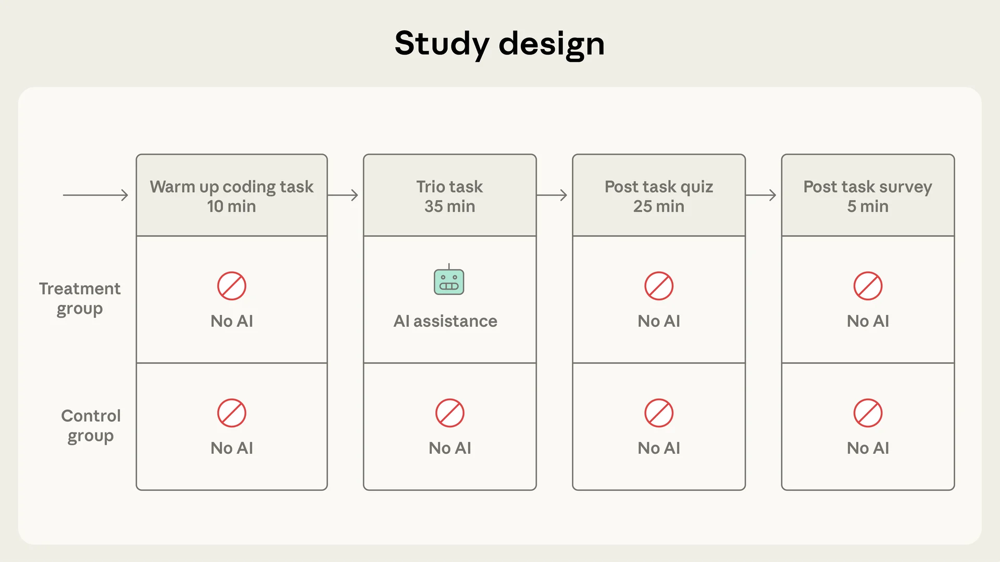

# AI 辅助如何影响编程技能的习得

- 英文标题：How AI assistance impacts the formation of coding skills
- 发布日期：2026-01-29
- 官网栏目：对齐
- 原文：[Anthropic 页面](https://www.anthropic.com/research/AI-assistance-coding-skills)
- 官网署名：Anthropic
- 官网推荐阅读：[阅读论文](https://arxiv.org/abs/2601.20245)

> 中文机器初译，未逐篇人工校对。引用研究结论时请核对英文原文。

研究表明人工智能可以帮助人们做事 [零件](https://papers.ssrn.com/sol3/papers.cfm?abstract_id=4945566) 他们的工作更快。在观察中 [学习](https://www.anthropic.com/research/estimating-productivity-gains) 的 [Claude.ai](http://claude.ai) 根据数据，我们发现人工智能可以将某些任务的速度提高 80%。但生产力的提高是否会带来一些弊端呢？其他研究表明，当人们使用人工智能辅助时，他们会变得 [较少投入工作](https://www.nature.com/articles/s41598-025-98385-2) 和 [减少](https://www.microsoft.com/en-us/research/wp-content/uploads/2025/01/lee_2025_ai_critical_thinking_survey.pdf) 他们为此付出的努力——换句话说，他们将自己的思维转移给了人工智能。

目前尚不清楚这种认知负担是否会阻碍人们在工作中提高技能，或者在编码的情况下阻碍理解他们正在构建的系统。我们最新的研究是一项以软件开发人员为参与者的随机对照试验，调查了在工作中使用人工智能的潜在缺点。

这个问题具有广泛的影响——对于如何设计促进学习的人工智能产品、工作场所应如何处理人工智能政策以及更广泛的社会复原力等。我们专注于编码，这是一个人工智能工具已迅速成为标准的领域。在这里，人工智能造成了潜在的紧张：随着编码变得更加自动化并加快工作速度，人类仍然需要技能来发现错误、指导输出并最终为高风险环境中部署的人工智能提供监督。AI是否提供了一条捷径 *两者* 技能发展和效率提高？或者人工智能辅助带来的生产率提高是否会损害技能发展？

在一项随机对照试验中，我们检查了 1) 软件开发人员在有或没有人工智能辅助的情况下掌握一项新技能（在本例中为 Python 库）的速度有多快； 2）使用人工智能是否会降低他们理解刚刚编写的代码的可能性。

我们发现，使用人工智能辅助会导致掌握程度在统计上显着下降。在一项涵盖他们几分钟前使用过的概念的测验中，人工智能组的参与者的得分比手工编码的参与者低 17%，相当于近两个字母的分数。使用人工智能稍微加快了任务速度，但这并没有达到统计显着性的阈值。

重要的是，使用人工智能辅助并不能保证得分较低。 *如何* 使用人工智能的人会影响他们保留的信息量。表现出更强掌握能力的参与者不仅使用人工智能辅助来生成代码，而且在这样做的过程中建立理解——无论是通过提出后续问题、请求解释还是在独立编码时提出概念性问题。

## 研究设计

我们招募了 52 名（大部分是初级）软件工程师，他们每个人每周至少使用一次 Python，已有一年多的时间。我们还确保他们至少在一定程度上熟悉人工智能编码辅助，并且不熟悉我们的任务所基于的 Python 库 Trio。

我们将研究分为三个部分：热身；主要任务包括使用 Trio 编写两个不同的功能（这需要理解与异步编程相关的概念，这是在专业环境中经常学习的技能）；和一个测验。我们告诉参与者任务完成后将进行测验，但鼓励他们尽快完成任务。

我们设计编码任务是为了模仿某人如何通过自学教程学习新工具。每个参与者都会获得问题描述、起始代码以及解决问题所需的 Trio 概念的简要说明。我们使用了一个在线编码平台，其侧边栏中有一个人工智能助手，该平台可以访问参与者的代码，并且可以根据要求随时生成正确的代码。[1](https://www.anthropic.com/research/AI-assistance-coding-skills#footnote-1)

### 评估设计

在我们的评估设计中，我们借鉴了 [计算机科学教育研究](https://ieeexplore.ieee.org/document/9962584) 确定常用于评估编码技能掌握程度的四种问题：

- **调试**：识别和诊断代码错误的能力。这项技能对于检测人工智能生成的代码何时不正确并了解其失败原因至关重要。
- **代码阅读**：阅读和理解代码的能力。这项技能使人类能够在部署之前理解和验证人工智能编写的代码。
- **代码编写：** 编写代码或选择正确方法编写代码的能力。随着人工智能编码工具的进一步集成，低级代码编写（例如记住函数的语法）将不再像高级系统设计那么重要。
- **概念性的**：理解工具和库背后的核心原理的能力。概念理解对于评估人工智能生成的代码是否使用符合库预期使用方式的适当软件设计模式至关重要。

我们的评估主要集中在调试、代码阅读和概念问题上，因为我们认为这些对于对越来越可能是人工智能生成的代码进行监督是最重要的。

## 结果

平均而言，人工智能组的参与者完成速度大约快两分钟，尽管差异并不具有统计学意义。然而，测试分数存在显着差异：人工智能组在测验中的平均分是 50%，而手工编码组的平均分是 67%，或者相当于近两个字母的成绩（Cohen 的 *d*=0.738, *p*=0.01）。两组之间最大的分数差距是在调试问题上，这表明如果人工智能阻碍了编码开发，那么理解代码何时不正确以及为什么失败的能力可能是一个特别值得关注的领域。

### 定性分析：AI交互模式

我们特别有兴趣了解 *如何* 参与者开始完成我们设计的任务。在我们的定性分析中，我们手动注释了屏幕记录，以识别参与者花费多少时间编写查询、他们提出什么类型的问题、他们犯的错误类型以及他们花多少时间积极编码。

一个令人惊讶的结果是参与者花费了多少时间与人工智能助手互动。其中一些花费了长达 11 分钟（占分配总时间的 30%）来组成多达 15 个查询。这有助于解释为什么使用人工智能的参与者平均完成得更快，尽管生产力的提高在统计上并不显着。我们预计，当人工智能用于重复或熟悉的任务时，更有可能显着提高生产力。

不出所料，无人工智能组的参与者遇到了更多的错误。其中包括语法和 Trio 概念中的错误，后者直接映射到评估中测试的主题。我们的假设是，遇到更多 Trio 错误的参与者（即对照组）可能通过独立解决这些错误来提高他们的调试技能。

然后，我们根据参与者与人工智能的互动方式对他们进行分组，识别导致完成时间和学习结果不同的不同模式。

**低分交互模式**：低分模式通常严重依赖人工智能，无论是通过代码生成还是调试。该组的平均测验分数低于40%。他们表现出较少的独立思考和更多的认知负担。我们进一步将它们分为：

- **人工智能代表团** (*n*=4): 该组的参与者完全依靠AI来编写代码并完成任务。他们以最快的速度完成任务，并且在此过程中很少或没有遇到错误。
- **渐进的人工智能依赖** (*n*=4)：该小组的参与者首先提出一两个问题，但最终将所有代码编写委托给人工智能助手。他们在测验中得分不佳，很大程度上是因为没有掌握第二项任务的任何概念。
- **迭代AI调试** (*n*=4)：该组的参与者依靠人工智能来调试或验证他们的代码。他们提出的问题较多，但依靠助理来解决问题，而不是澄清自己的理解。结果他们的成绩很差，而且完成这​​两项任务的速度也较慢。

**高分互动模式：** 我们认为高分测验模式是指平均测验得分为 65% 或更高的行为。这些集群中的参与者使用人工智能进行代码生成和概念查询。

- **生成然后理解** (*n*=2)：该组的参与者首先生成代码，然后手动将代码复制或粘贴到他们的工作中。生成代码后，他们向人工智能助手提出了后续问题以加深理解。这些参与者在使用人工智能时速度并不是特别快，但在测验中表现出了更高水平的理解。有趣的是，这种方法看起来与人工智能代表团的方法几乎相同，除了他们使用人工智能来检查自己的理解之外。
- **混合代码解释** (*n*=3)：该组的参与者编写了混合查询，其中要求生成代码以及对生成的代码的解释。阅读和理解他们要求的解释需要更多时间，但有助于他们的理解。
- **概念探究** (*n*=7)：该组的参与者仅提出概念性问题，并依靠他们提高的理解来完成任务。虽然这个小组遇到了很多错误，但他们也独立解决了这些错误。平均而言，这种模式是高分模式中最快的，整体第二快，仅次于人工智能委托。

我们的定性分析并没有得出交互模式和学习结果之间的因果关系，但它确实指出了与不同学习结果相关的行为。

## 结论

我们的结果表明，将人工智能积极融入工作场所，特别是在软件工程方面，需要权衡利弊。研究结果强调，并非所有对人工智能的依赖都是一样的：我们在努力提高效率的同时与人工智能互动的方式会影响我们学到的东西。考虑到时间限制和组织压力，初级开发人员或其他专业人员可能会依靠人工智能来尽可能快地完成任务，但代价是技能发展——尤其是出现问题时调试问题的能力。

尽管是初步的，但这些结果表明，随着公司转向人工智能编写的代码与人类编写的代码的比例更大，这些结果表明了重要的考虑因素。如果初级工程师的技能发展一开始就因使用人工智能而受到阻碍，那么生产力的提高可能会以验证人工智能编写的代码所需的技能为代价。管理者应该有意识地思考如何大规模部署人工智能工具，并考虑系统或有意的设计选择，以确保工程师在工作时不断学习，从而能够对他们构建的系统进行有意义的监督。

对于软件工程或任何其他行业的新手来说，我们的研究可以被视为利用人工智能工具进行有意技能开发的价值的一小部分证据。认知努力——甚至是痛苦地陷入困境——对于培养掌握可能很重要。这也是一个适用于个人如何选择使用人工智能以及他们使用哪些工具的教训。主要的法学硕士服务还提供学习模式（例如， [Claude Code学习与讲解](https://code.claude.com/docs/en/output-styles) 模式或 [ChatGPT学习模式](https://openai.com/index/chatgpt-study-mode/)）旨在促进理解。了解人们在使用人工智能时如何学习也可以帮助指导我们如何设计它；人工智能辅助应该使人类能够更有效地工作 *和* 同时发展新技能。

此前的研究发现，关于人工智能是否 [帮助](https://arxiv.org/abs/2302.06590) 或 [阻碍](https://arxiv.org/abs/2507.09089) 编码生产力。我们自己的 [研究](https://www.anthropic.com/research/estimating-productivity-gains) 发现 AI 可以将完成某些工作任务所需的时间减少 80%，这一结果可能与此处介绍的发现存在矛盾。但这两项研究提出了不同的问题并使用了不同的方法：我们早期的观察工作测量了参与者已经具备相关技能的任务的生产力，而这项研究则考察了当人们学习新东西时会发生什么。人工智能有可能既提高了成熟技能的生产力，又阻碍了新技能的获得，尽管需要更多的研究来理解这种关系。

这项研究只是揭示人机协作如何影响员工体验的第一步。我们的样本相对较小，我们的评估在编码任务完成后不久就测量了理解力。即时测验表现是否可以预测长期技能发展是本研究未解决的一个重要问题。我们希望未来的研究能够调查许多未解答的问题，例如人工智能对编码以外的任务的影响，随着工程师提高流利程度，这种影响是否会纵向消失，以及人工智能辅助在学习时是否与人类辅助不同。

最终，为了适应人工智能存在下的技能发展，我们需要更广泛地了解人工智能对工人的影响。在人工智能增强的工作场所中，生产力的提高很重要，但这些进步所依赖的专业知识的长期发展也很重要。

阅读 [全文](https://arxiv.org/abs/2601.20245) 了解详情。

## 脚注

01 重要的是，这种设置与 Claude Code 等代理编码产品不同。我们预计此类计划对技能发展的影响可能比此处的结果更为明显。
