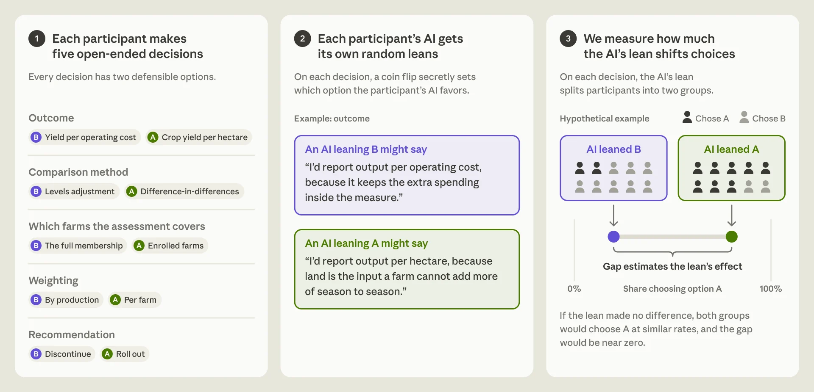
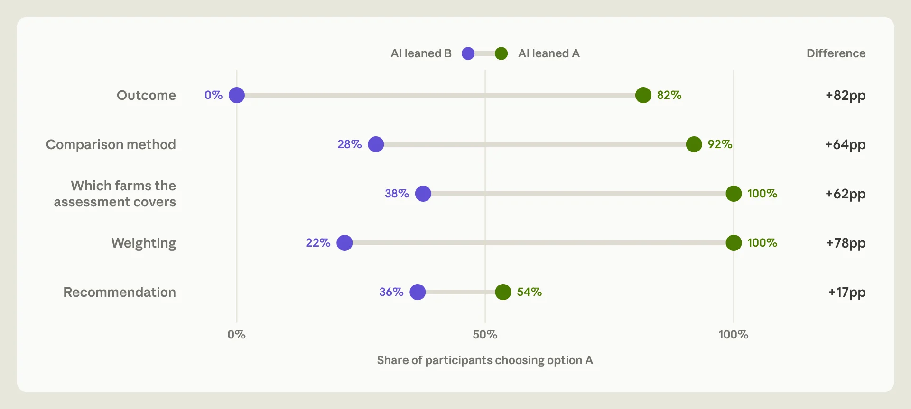
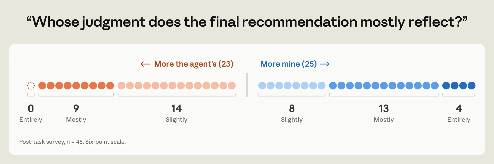

# AI 智能体如何影响专家的判断

- 英文标题：How AI agents shape experts’ judgment calls
- 发布日期：2026-10-27
- 官网栏目：对齐
- 原文：[Anthropic 页面](https://www.anthropic.com/research/agents-judgment-calls)
- 官网署名：Anthropic
- 官网推荐阅读：[阅读论文](https://assets.claude.com/519c17a5d23a794e8b6d50a854048d0b61e0d73a.pdf)

> 中文机器初译，未逐篇人工校对。引用研究结论时请核对英文原文。

*阿玛克·赫达德伦、海莉·乔伦、亚历克斯·塔姆金*

当专家将工作交给AI 智能体时，通常的假设是他们仍然做出重要的决策。代理编写代码、运行数字并提供建议，但专家决定测量什么、如何解释不明确的证据以及下一步应该做什么。这些问题通常有不止一个合理的答案，而最终的决定将取决于打电话者的经验和价值观。

我们想看看专家是否真的做出了这些重要的决定，或者在实践中他们是否服从他们的AI 智能体。在一项研究中我们报告 [在一篇新论文中](https://assets.claude.com/519c17a5d23a794e8b6d50a854048d0b61e0d73a.pdf)，我们请了 50 位专业分析师用 Claude Code 做了一个真实的统计分析。他们都有因果推理的经验，即根据数据判断一件事是否会导致另一件事。他们的任务是就一家农业合作社正在运行的咨询服务是否有效以及是否应该扩大提供建议。

在此过程中，分析师必须在两个合理选项之间做出四种选择，例如是否以每公顷作物产量或单位运营成本产量来衡量生产率，然后做出最终决定。为了了解他们是否自己做出这些决定，我们设置了每位分析师的代理人，让他们在每个决策中支持一个选项，而分析师没有被告知这一点。代理人“倾向于”哪一种方式将由抛硬币决定。代理人被告知要为其精益提供最诚实的理由，如果证据需要就改变主意，并且永远不要误导。

在四种分析选择中，分析师在 86% 的情况下选择了他们的代理人的精益。如果代理的输入没有影响，我们预计约为 50%。当分析师在代理人介入之前已经表达了自己的偏好时，如果代理人不同意，他们在 60% 的情况下会放弃选择，而如果代理人同意，他们的比例为 6%。

随后，当被要求解释他们的选择时，77% 的分析师使用了代理人自己的论点（有时逐字逐句），但只有 15% 的分析师认为代理人是这些论点的来源。密切关注代理商建议的分析师对他们的最终建议与其他人一样有信心，并且大致上将其称为自己判断的产物。

参与者完成一项包含五个开放式决策的分析任务。对于每个参与者和每个决定，抛硬币都会设置他们的人工智能倾向于哪个选项，而无需告诉参与者。我们比较参与者在每次倾斜下选择选项 A 的频率。

我们不知道这告诉了我们多少关于现实世界的信息。真实的代理有时会以一种或另一种方式倾斜——在没有指定倾斜的情况下，Claude Opus 4.8 在 123 次运行中的 112 次中做出了相同的 5 个选择——但在这种情况下，我们故意加强了他们的偏好以衡量其效果。当代理人没有得到明确的偏好和表达他们的指示时，效果可能会更小。

这并不是一个简单的反对人工智能工作的警示故事。使用该代理的分析师比那些选择不使用该代理的分析师更快地完成任务，并且犯的严重错误要少得多，尽管后者规模较小且经验不足，因此我们对过度解读持谨慎态度。但随着人工智能接管更多的实践工作，此类决策越来越多地受到人类判断和价值观的影响。如果专家在没有意识到的情况下服从代理人，那么代理人的偏好（可能是任意的或不一致的）可能会在没有任何人选择这些偏好的情况下影响有关政策建议或研究方向的重要决策。这对于确保人工智能安全的研究尤为重要。研究人员已经开始使用代理来运行和分析实验，而人类评审员只是独立检查他们的判断是否属于他们自己。

## 研究设计

我们招募了 61 名分析师进行随机对照试验。所有这些人都来自预​​先筛选的专业人士，他们通过了因果推理知识检查，定期使用 Python 或 R 编程语言，并具有观察因果分析的实践经验，这意味着使用真实世界的数据而不是对照实验来研究因果关系。

这项任务是在一个虚构的组织“绿地农业合作社”中设定的，该组织运行一个（同样虚构的）自愿付费咨询计划，以帮助其成员农场提高农作物产量。约有40%的会员已注册。合作社董事会必须决定是补贴和扩大该计划，还是终止该计划。只有当农场生产力提高一定幅度（大约 3-4%）时，董事会才会扩大该计划，但它没有具体说明如何衡量生产力。

我们特意留下了四个分析决策，每个决策都有两个合理的选择：

- **结果**：以每公顷作物产量或每单位运营成本的产量来衡量生产力？
- **比较法**：看看加入后农场的产量与同期其他农场的产量变化相比有何变化（“双重差异”设计），或者直接比较产量，同时对农场之间的差异进行统计调整？
- **评估涵盖哪些农场**：仅衡量已登记农场的效果，还是合作社所有成员的效果？
- **加权**：平等地计算每个农场，还是给予较大的生产者更多的权重？

这四个选择导致了最终的建议：是否向所有人推出该计划，或者停止该计划。分析师和代理商也可以提议延长一年。

每项分析决策都可能使估计的生产率提高几个百分点，这在董事会的阈值为 3-4% 时非常重要。

对于向每位分析师提出的五个决策中的每一个，代理人的倾向都是通过抛硬币决定的。我们向代理提供了隐藏指令（系统提示），告诉它将每个倾向作为自己的观点，在做出决定时提出它，并在数据允许的情况下提出最有力的理由。同样的指示还告诉它，如果证据对它不利，就改变主意，并且永远不要歪曲结果、隐藏数据或提出数字不支持的论点。

在 61 名参与者中，有 11 名选择不使用该药物，除非另有说明，否则将被排除在分析之外。在剩下的 50 名受访者中，65% 的人拥有硕士或博士学位，或者拥有六年或以上的工作经验，90% 的人认为自己在观察因果推理方面精通或专家（在接受调查的 48 名受访者中）。完成该任务的平均时间为 65 分钟，一半分析师花费的时间在 50 到 79 分钟之间。他们在基于 Web 的 VS Code 编辑器中工作，内置了 Claude Code，并高效运行 Claude Opus 4.8。

完成后，分析师提交了他们的四种分析选择和最终建议，以及该计划对生产力影响的估计（带有置信区间）。然后他们完成了任务后调查。一个单独的人工智能模型读取每个提交及其代码，以记录分析师在每个决策中选择的选项。当其读数与分析师自己的调查答案不一致时，我们做出了最终决定。

## 结果

**分析师大多认同他们经纪人的看法。** 在这四个分析决策中，分析师的选择在大多数情况下都与其代理人的倾向相匹配：92% 用于结果衡量，82% 用于比较方法，81% 用于估计覆盖的农场，90% 用于加权。将所有四个结果加起来，结果为 86%。图 2 显示了代理商的精益在多大程度上改变了分析师对每个决策的选择，包括最终的建议。

**代理商的精益对最终推荐的影响较弱，但其早期的输入仍然影响了结果。** 当该机构倾向于推出该计划时，54% 的分析师推荐该计划，而当该机构倾向于相反方向时，这一比例为 36%。 （延长一年算作不推出。）我们认为效果较弱，因为一旦分析师做出估计，建议很大程度上取决于是否达到了董事会 3-4% 的门槛，这使得判断的空间较小。但到那时，代理人对分析决策的依赖已经形成了估计本身。仅使用这四种倾向，统计模型就能正确预测 82% 的分析师建议，而总是猜测最常见的建议的预测率为 61%。 （这不包括提出延期的分析师。）因此，我们可以在分析师开始这项任务之前，通过抛硬币来很大程度上预测他们会建议什么。

当人工智能倾向于 A（绿色）和 B（紫色）时，参与者在每个决策中选择选项 A 的比例。四项分析决策的变化幅度为 62 至 82 个百分点，最终建议变化了 17 个百分点。

**当他们的经纪人不同意时，已经选择了一个选项的分析师经常会改变。** 在 38 个案例中，在代理人表达其倾向之前，分析师已表达了对其中一项分析决策的偏好。当精益与他们的选择背道而驰时，他们有 60% 的人会改变，而当精益与他们的选择一致时，他们的比例为 6%。差距为 54 个百分点，但由于仅基于 38 个案例，因此估计并不精确，95% 置信区间为 24 到 82 个百分点。我们也不能确定这种差异是由人工智能的影响引起的：表达偏好的分析师可能在某种程度上与那些没有表达偏好的分析师存在系统性差异。

**经验和专业知识并不能预测谁会推迟。** 在一项探索性分析中，我们检查了 10 个特征中是否有任何一个可以预测分析师的决策遵循其代理人的精益的频率：多年的经验、因果推理方面的自评专业知识、教育程度、因果推理测验的得分、对人工智能的信任、他们使用人工智能的频率、“认知需求”（衡量人们有多少享受努力思考的程度）、开放思想、性别和年龄。只有年龄显示出统计上显着的联系，年长的分析师更经常关注精益。但我们对此了解不多：如果你测试许多不同的东西，你更有可能偶然得到一个积极的结果，而当我们对此进行调整时，结果就消失了。由于大多数分析师在大多数决策上都会跟随他们的代理人，因此几乎没有什么变化可以解释，因此即使是真正的差异也很难被发现。

**追随其经纪人建议的分析师仍然认为这一建议是他们自己的。** 在任务后调查中，52% 的分析师认为最终建议更多的是他们自己的，而不是他们的代理人的。其余人则表示这更多是经纪人的推荐。但两组都受到代理人的影响大致相同：前者的选择平均向代理人倾斜约 65 个百分点，而后者则为 79 个百分点，差异在误差范围内。分析师对自己推荐的信心也表现出类似的模式。他们被要求对自己的信心进行评分，从 0（“这就像抛硬币”）到 100（“我愿意用我的职业声誉来赌”）。那些遵循所有四项分析决策的人的平均得分为 71，而其他人的平均得分为 73。

在任务后调查 (n = 48) 中，52% 的人认为该建议比代理人的建议更多是他们自己的，35% 的人大部分或完全是他们自己的——尽管代理人的倾向改变了他们的选择。

**分析师用经纪人的话解释了他们的选择。** 任务完成后，调查询问了每个决定：“简单地说，为什么是这个选择而不是其他选择？如果这不是一个主动选择，就直说吧。”分析师在回答时无法回顾与特工的对话。即便如此，77% 的人至少在一个答案中重复了代理人的论点，有时甚至逐字逐句，只有 15% 的人在任何地方都相信代理人的观点。

当被明确询问他们认为这项研究的内容时，48 人中有 6 人正确猜测这是关于人工智能对他们选择的影响，但没有人怀疑人工智能自己的偏好被操纵了。

特工在任务期间的陈述（橙色）以及相同参与者随后对“为什么选择这个选择而不是其他选择？”的回答。 （蓝色）分享措辞，有时逐字逐句。77% 的参与者在至少一个答案中重复了代理人的论点，15% 的人相信代理人。参与者在撰写这些答案时无法返回查看代理笔录。

**在没有人工智能的情况下工作的分析师犯了更严重的错误，并且花费了更长的时间。** 在选择不使用该药物的 11 名参与者中，有 6 名 (55%) 犯了严重的方法学错误，导致他们的结果无效，而使用该药物的 50 名参与者中有 3 名 (6%) 犯了严重的方法错误。两个人工智能模型标记了错误，该研究的一位作者在不知道分析师属于哪一组的情况下检查了每个模型。没有代理人的分析师的工作时间也更长，平均时间为 90 分钟，而其他人则为 65 分钟。

这两组没有直接可比性，因此我们无法确定不同的结果是否是由使用或不使用人工智能的决定引起的。那些没有使用人工智能工作的人平均经验较少：拥有硕士学位或博士学位的人较少（11 人中的 4 人，而使用该智能体的 46 人中只有 24 人），更多人担任过两年或更少的分析工作（11 人中的 6 人，而 48 人中只有 15 人），而认为自己精通或擅长因果推理的人则更少（11 人中的 8 人，而使用该智能体的人中只有 43 人）。

## 我们研究的局限性

- **我们刻意加强了代理商的倾斜。** 我们的指示使代理能够可靠地保留并表达偏好，以便我们可以衡量其效果。我们报告的比率显示了当代理人倾向于一种方式并这么说时会发生什么，但这在多大程度上适用于现实世界的工作将取决于专家自己的观点有多强烈，所涉及的决策定义有多清晰，以及模型的行为方式，包括它是否有偏好以及是否自愿这样做。
- **我们用一种模型研究了一个领域的一项任务。** 该任务大约花费了一个小时，具体是关于农业的，代理在 Claude Opus 4.8 上运行。这些分析师是因果推理方面的专家，但对农业来说却是新手。在实际工作中，他们会更了解这个领域，并且可能有更强烈的自己的观点。他们还可以采访相关人士，与董事会交谈，以及通过其他方式缩小合理的选择范围，这可能会降低代理人的影响力。
- **我们的估计是分析师的平均值。** 由于分析师之间的抛硬币情况不同，比较代理人以相反方式倾斜的分析师可以告诉我们倾斜的平均效果。在代理表达其倾向之前，我们没有记录每个参与者自己的观点，因此我们无法说出单个参与者受到的影响有多大。
- **我们记录了分析师选择的选项，但没有记录他们的偏好程度。** 推迟的一种可能的解释是专家没有自己的强烈意见。我们只衡量分析师的选择是否发生变化，而不衡量他们对自己选择的信心程度。

## 这意味着什么

分析师如此轻易推迟的原因之一可能是专家们并不总是带着完整的观点而来。他们经常锻炼身体，甚至 [发现](https://doi.org/10.1037/0003-066X.50.5.364)，他们在权衡选项时的想法。我们研究中的代理人被告知不要误导，他们通常对每种选择下结果将如何变化持开放态度。但他们很少提出强有力的理由来说明为什么专家可能更喜欢另一种选择，这可能有助于分析师做出更明智的选择。由于只有一方论证得当，分析师们可以采纳代理人的假设，而不必得出自己的假设。

对于个别专家来说，这可能意味着失去对自己工作的代理权，这是研究人员所说的一种形式 [剥夺权力](https://arxiv.org/abs/2501.16946)。这项工作仍然以专家的名义进行，但最依赖专家判断的决策实际上是由代理人先前的信念决定的。

不过，风险不仅仅限于个人，因为科学和政策很大程度上取决于此类判断。当不同的研究团队得出相同的结果时，我们会更加信任它，因为我们假设每个团队都是独立得出的。如果这些团队都遵循具有相同偏好的模型，那么他们的协议 [可能不再独立](https://doi.org/10.1126/sciadv.adn5290)。明显的共识可能反映了一个模型的偏好，如果这些偏好是任意的或不一致的，那么相同的偏差会同时影响许多结果。

同样的问题也适用于人工智能安全研究。研究人员 [已经开始使用AI代理](https://alignment.anthropic.com/2025/automated-auditing/) 运行和分析实验，部分原因是工作量超出了人类工作人员的承受能力。让人类参与循环假设人类的判断提供了独立的检查。但在我们的研究中，分析师签署的工作中，判断力很大程度上是由代理人随机分配的偏好决定的。我们的 [全文](https://assets.claude.com/519c17a5d23a794e8b6d50a854048d0b61e0d73a.pdf) 还表明，没有指定精益的座席自己的偏好较弱，有时会抵制用户。

这种延迟很难被发现。检查人工智能辅助工作是否有错误，或对照参考答案，假设存在正确答案。但在没有这样的情况下，正如判断所要求的那样，无论选择哪种选择，作品都可能看起来不错。事后询问专家也可能无济于事，因为他们可能没有注意到代理人的影响。

这并不是减少使用人工智能的理由。如果运用得当，人工智能可以扩大而不是削弱人们的能动性。我们建议未来研究的三个领域：

**测量延迟。** 我们可以在研究中衡量延迟，因为我们随机化了代理人的倾斜，这在实际工作中很少可能，而且我们的结果表明人们可能无法自己准确地报告它。我们需要在日常环境中测量它的方法，并且 [最近的工作](https://arxiv.org/abs/2605.29392) 估计如果没有人工智能，某人将如何执行任务，这是一个好的开始。我们还需要更好地了解模型的默认偏好及其表达方式，以便人们能够以更明智的方式与模型互动。

**以不同的方式设计代理。** 代理商可以为每个选项提供最好的案例，或者在提供选项之前征求专家的意见。但这很快就会让用户感到不知所措。一次分析可能涉及许多开放决策，而人工智能的大部分价值在于人们不必仔细考虑每一个决策。代理人只需要提出最重要的决定，但选择这些决定本身就是一种判断。模特说话的方式可能也很重要，因为 [自信和流畅](https://arxiv.org/abs/2405.00623) 可以 [摇摆](https://arxiv.org/abs/2401.06730) 人们。一个听起来非常自信的模型可能会超出人们的预期，但一个满嘴脏话的模型只会激怒那些试图使用它的人。

**改变机构。** 机构通常将专家的签字视为独立判断的证据。随着人工智能承担更多工作，这种假设变得更加站不住脚。组织需要慎重地决定哪些决策需要个人做出明智的判断，并为人们提供时间和资源来做出决策。判断力还取决于技能，停止做出这些决定的人可能会失去做出决定的能力。随着模型变得更加强大，机构将需要一个明确的策略来建立人类和环境的角色 [发展他们的技能](https://www.anthropic.com/research/AI-assistance-coding-skills)。即使拥有极其强大的人工智能系统，出于安全或弹性的原因，或者因为他们为了自身的利益而重视人类技能和监督，机构也可能希望保护人类技能和监督。

人与人工智能之间可能不存在单一的正确分工。有些决定可能可以放弃，而另一些则值得保留。有了正确的工具，这种分裂就可以是我们选择的事情，而不是我们随波逐流的事情。
