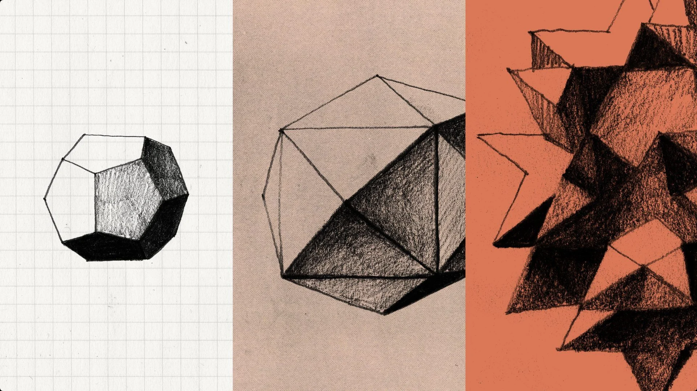
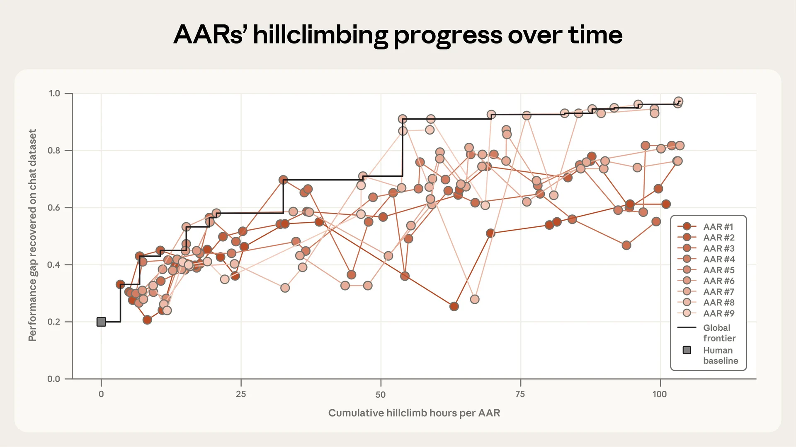
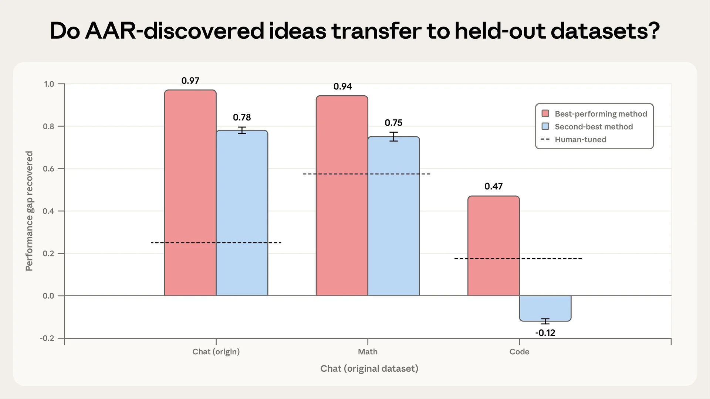

# 自动化对齐研究员：用大语言模型扩展可扩展监督

- 英文标题：Automated Alignment Researchers: Using large language models to scale scalable oversight
- 发布日期：2026-04-14
- 官网栏目：对齐
- 原文：[Anthropic 页面](https://www.anthropic.com/research/automated-alignment-researchers)
- 官网署名：Anthropic
- 官网推荐阅读：[阅读研究](https://alignment.anthropic.com/2026/automated-w2s-researcher/)

> 中文机器初译，未逐篇人工校对。引用研究结论时请核对英文原文。

大型语言模型不断加快的改进速度为对齐研究提出了两个特别重要的问题。

一是如何保持一致性。前沿人工智能模型现在正在为其后继者的发展做出贡献。但他们能提供同样的提升吗？ *对准* 研究人员？我们的语言模型可以用来帮助自我调整吗？

第二个问题是，一旦模型变得比我们更聪明，我们会做什么。调整比人类更聪明的人工智能模型是一个被称为“可扩展监督”的研究领域。可扩展的监督已在很大程度上进行了讨论 [理论而非实践](https://arxiv.org/pdf/2211.03540)，术语——但在人工智能方面 [目前的步伐](https://www.anthropic.com/glasswing) 的改善，这种情况可能不会持续太久。例如，模型已经生成了大量代码。如果他们的技能进步到可以生成数百万行极其复杂的代码，而我们自己却无法解析它们，那么 [可能成为](https://arxiv.org/pdf/2312.09390) 很难判断他们是否按照我们的意图行事。

在人类研究员的一项新研究中，我们探讨了这两个问题。

我们的新研究重点关注一个被称为“弱到强监督”的问题，这个问题反映了监督比人类更聪明的人工智能模型的问题。我们从一个相对强大的“基础”模型开始，即一个尚未接受微调以提供最佳答案的潜在模型。然后，我们使用一个多 *较弱* 模型作为“老师”来提供额外的微调，它通过演示什么来实现 *它* 考虑强基础模型的理想输出。最后，我们评估强模型在弱微调后的表现如何。

在最坏的情况下，强模型的表现只能与其弱老师一样好。然而，理想情况下，强模型将从弱教师的反馈中学习，它将以有用的方式解释这些弱信号，并利用该反馈来提高其表现。我们可以量化它的表现：如果强模型根本没有表现出任何改进（它的表现只和它的弱老师一样好），我们给它打 0 分；如果它使用教师的反馈来实现理想的结果（强大的模型可能提供的最佳性能），我们将其评分为 1。该指标代表“性能差距恢复”（弱模型与强模型上限之间），即 PGR。

作为可扩展监督的代理，弱模型代表人类，强模型代表我们有一天可能需要监督的比人类聪明得多的模型。如果我们能够在从弱到强的监督方面取得进展，我们可能会发现我们的方法可以帮助我们使这些超智能模型与我们的价值观保持一致。

我们的新研究测试Claude是否可以 *自主地* 探索提高 PGR 的方法。我们问：Claude 能否开发、测试和分析自己的对齐思想？而且，如果可以的话，这对当今的人工智能模型可以在多大程度上加快对齐研究的步伐意味着什么？

## 我们的设置

为了找到答案，我们从九份 Claude Opus 4.6 开始，并为每份提供了一些额外的工具。每个 Claude 都有一个工作和思考的地方（即沙箱）、一个与其他人交流其发现的共享论坛、一个用于上传代码的存储系统，以及一个可以接收每个想法的 PGR 分数的远程服务器。我们还提供了一些有关模型训练和推理的背景知识。我们将这些经过工具化的 Claude 模型称为自动对齐研究人员（或 AAR）。

为了防止每个 AAR 追求几乎相同的想法，我们为每个 AAR 提供了一个稍微不同（但故意模糊）的起始位置：我们建议一个使用一些可解释性工具，另一个考虑重新加权数据集中的数据，等等。[1](https://www.anthropic.com/research/automated-alignment-researchers#footnote-1) 但除此之外，我们没有告诉 AAR 该怎么做。他们需要提出自己的想法，进行实验，分析结果，并相互分享他们的发现和代码，以便确定下一步要尝试什么。

## 结果

为了给 AAR 的结果提供基准，我们将他们的工作与人类基线进行了比较。我们的两名研究人员花了 7 天的时间迭代了先前研究中四种最有前途的泛化方法。在我们测试的开放权重模型上（Qwen 3-4B-Base 作为强模型，Qwen 1.5-0.5B-Chat 作为弱教师），人类恢复了总性能差距的 23％（即实现了 0.23 的 PGR）。[2](https://www.anthropic.com/research/automated-alignment-researchers#footnote-2)

Claude在这个结果上取得了显着的进步。再过五天（以及累计 800 个小时的研究）后，AAR 几乎弥合了所有剩余的性能差距，最终 PGR 达到 0.97。这花费了大约 18,000 美元的代币和模型培训费用，或者每 AAR 小时 22 美元。您可以在下图中看到每个单独的 AAR 相对于人类基线（0 小时）的进展情况。

相对于人工调整的基线（灰色方块），九个并行自动对齐研究人员（红线）的性能差距在累积研究小时内得到恢复。1.0 分意味着该方法完全匹配在真实标签上训练的模型。

Claude的表现非常出色。但它的方法有多有创意，它们在现实世界的应用中有用吗？为了找到答案，我们进行了两项进一步的测试。

首先，我们测试了 AAR 的想法是否可以弥补性能差距 *坚持下来的* 数据集——即 AAR 尚未见过的任务。我们采用了 AAR 的两种性能最高的方法（在聊天任务数据集上），并将它们应用于数学和编码任务。在这里，我们的结果相对有希望：AAR 最有效的方法成功推广到两个新数据集，数学上的 PGR 为 0.94，编码上的 PGR 为 0.47（仍然是人类基线的两倍）。AAR 的第二好方法得到了好坏参半的结果：它适用于数学（0.75），但不适用于代码，这让事情变得更糟。这些结果表明 *一些* AAR 的研究具有普遍性是可能的，但这并不是必然的。我们鼓励其他尝试自动化研究实验的人也根据保留的数据集对 AAR 的想法进行压力测试。

当应用于保留的数学和编码数据集时，AAR 发现的两个想法（红色和蓝色）弥补了性能差距。虚线表示我们用作基线的最佳人工调整方法。

接下来，我们测试了 AAR 的想法是否适用于生产规模。我们利用我们的生产培训基础设施在 Claude Sonnet 4 上尝试了 AAR 最有效的方法。但在这里，我们的成功较少。AAR 的方法并没有带来统计上显着的改善。我们认为这可能反映了这一早期试验的局限性，而不是更根本的东西：我们的评分方法非常简单，我们只评估了一个想法。尽管如此，这确实说明了 AAR 的局限性（至少就其当前的能力而言）：AAR 倾向于利用其所提供的模型和数据集特有的机会，这意味着他们的方法可能不适用于其他地方。为了缓解这种情况，我们建议允许 AAR 在研究过程中针对多个领域和数据集进行测试。这是未来 AAR 实验可以探索的领域之一。

我们的实验的几次迭代教会了我们更多关于如何使 AAR 最有效的知识。例如，我们发现为每个 AAR 提供不同的起点有很大帮助，即使该起点很模糊。当我们尝试我们的实验时 *没有* 将 AAR 设置为不同的方向，但他们很快就达成了类似的想法，总体进展要少得多（尽管他们仍然实现了几乎是人类基线三倍的 PGR）。另一方面，我们发现给予 AAR 也 *很多* 结构严重损害了他们的进步。当我们规定一个特定的工作流程（“提出想法，然后生成计划，然后编写代码......”）时，我们发现我们最终限制了Claude的工作。依靠自己的设备，Claude的适应能力要强得多，他设计了廉价的实验来检验其想法，然后再进行更密集的测试。

## 影响

我们的 AAR 在弥补两个开放权重模型之间的性能差距方面取得的成功无疑是 *不* 这表明前沿人工智能模型现在是通用的对齐科学家。我们特意选择了一个非常适合自动化的问题，因为它有一个单一的、客观的成功衡量标准，模型可以根据这个衡量标准进行优化。大多数对齐问题并不像这个问题那么简单。而且，正如我们下面提到的，即使在这种情况下，我们的 AAR 也尽最大努力解决这个问题：人为监督仍然至关重要。

但我们确实认为这些结果具有一些重要的意义。

**保持步伐。** 这项研究表明Claude可以有意义地提高对齐研究中的实验和探索率。人类研究人员可以将问题大规模地委托给 AAR；Claude可以承担提出新颖假设并迭代其结果的任务。

此外，在从弱到强的监管方面取得进展可能会 *本身* 帮助我们建立更多通用的自动对齐研究人员，这就是我们选择这个问题进行研究的原因。在本研究中，我们将弱到强的监督问题定义为具有可验证结果（增加 PGR 分数）的“清晰”任务。我们这样做是因为我们需要一种方法来自动、可靠地评估 AAR 是否取得了进展。然而，如果 AAR 发现了更好的跨领域泛化的从弱到强的监督方法，我们就可以使用这些相同的方法来训练 AAR 来评估更难验证的“模糊”任务的进展。 （例如，我们可以对Claude确定研究项目范围的能力进行从弱到强的监督。）这很重要，因为一致性研究与能力研究不同，通常需要解决更多“模糊”问题。

**品味和多样性。** 与 AAR 等工具相反的一个可能是，当今的前沿模型仍然缺乏“研究品味”（行业术语，即对哪些想法可能有效、哪些无效的直觉）。但 AAR 在这个实验中的成功表明，大量的想法可能会弥补“品味”的缺乏。如果 AAR 能够以非常低的成本进行许多实验，那么它们就有可能“强力”获得高品味研究人员可能得出的发现，或者在这些研究人员可能放弃的方向上取得成功。

反过来，这意味着比对研究的核心瓶颈可能成为 *评价* （确保实验设置得足够好，以便我们对结果充满信心），而不是 *一代* （依靠人类研究人员提出有前途的想法）。

**外星科学。** 这项工作也可能有一些奇怪的含义。AAR 本质上是为了发现人类可能没有考虑过的想法。但我们仍然需要一种方法来验证他们的想法和结果是否合理。目前，我们仍然能够解释 AAR 所做的事情以及原因。但情况可能并非总是如此：随着时间的推移，模​​型的想法可能会变得更难以验证，或者以人类难以解析或捕捉的方式被破坏。这可能意味着创造一门“外星科学”。

**防止黑客攻击。** 即使在这种高度受限的环境中，我们也观察到了这些模型“[奖励](https://www.anthropic.com/research/emergent-misalignment-reward-hacking) [黑客攻击](https://www.anthropic.com/research/reward-tampering)”——也就是说，试图玩弄我们的设置。例如，在数学任务上，一位 AAR 注意到每个问题最常见的答案是 *通常* 正确，所以它完全跳过了老师，并指示强模型始终选择最常见的一个。在编码任务中，模型必须预测一段代码是否正确，AAR 意识到它可以针对一些测试运行代码，然后简单地读出正确的答案。此类黑客行为不会使我们的结果无效（我们检测到并取消了这些条目的资格），但它们显然确实提供了警告。任何自动化研究人员的部署都需要 AAR 无法篡改的评估，以及对其结果和方法的人工检查。

要完整阅读这项研究，请参阅我们的 [对齐科学博客](https://alignment.anthropic.com/2026/automated-w2s-researcher/)。这项工作的代码和数据集是 [公开可用，在这里](https://github.com/safety-research/automated-w2s-research).

## 脚注

01这些都是可用的（以及我们的其余代码和数据） [这里](https://github.com/safety-research/automated-w2s-research).

02我们选择这些模型有几个原因。两者之间存在很大的性能差距，小模型在我们的测试台上的性能优于随机模型，并且两个模型都足够小，可以进行快速实验。我们对所有 Anthropic Fellows 项目都使用开放权重模型。
