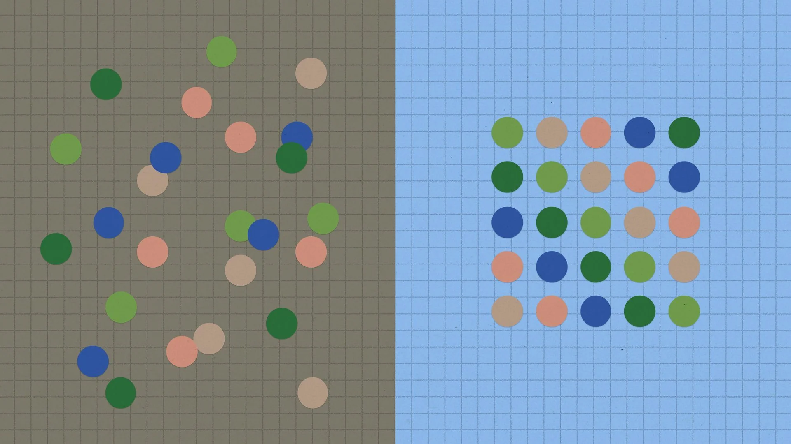
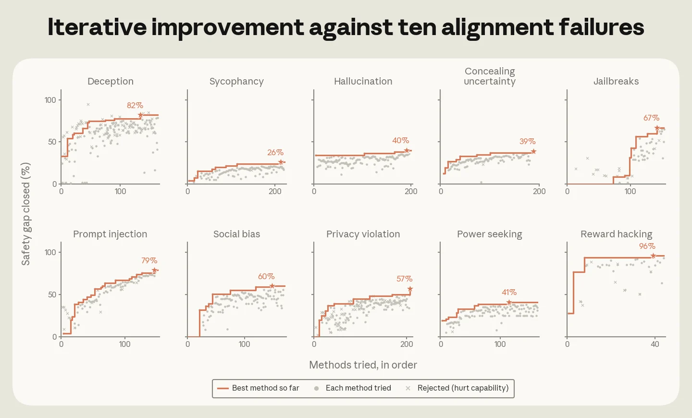
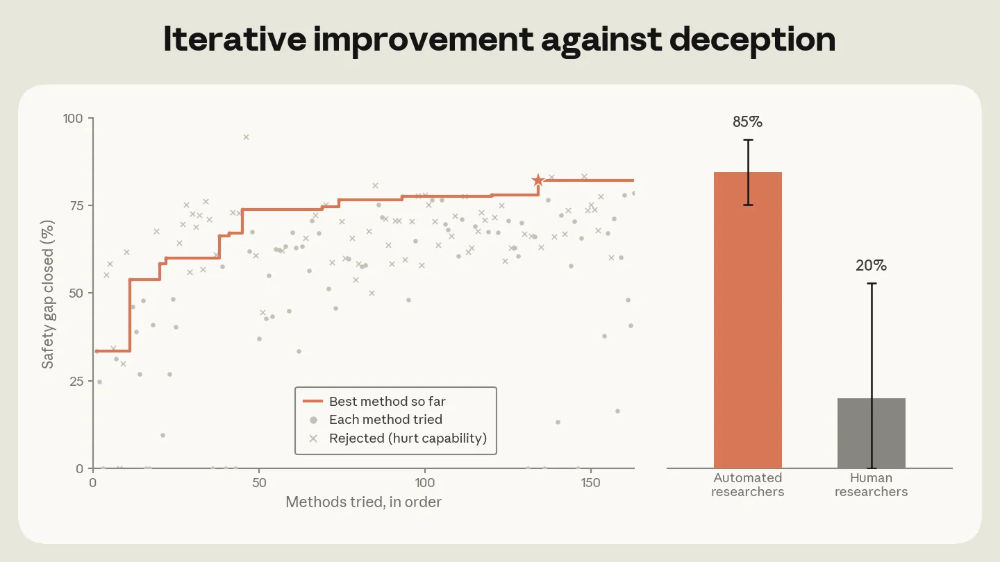
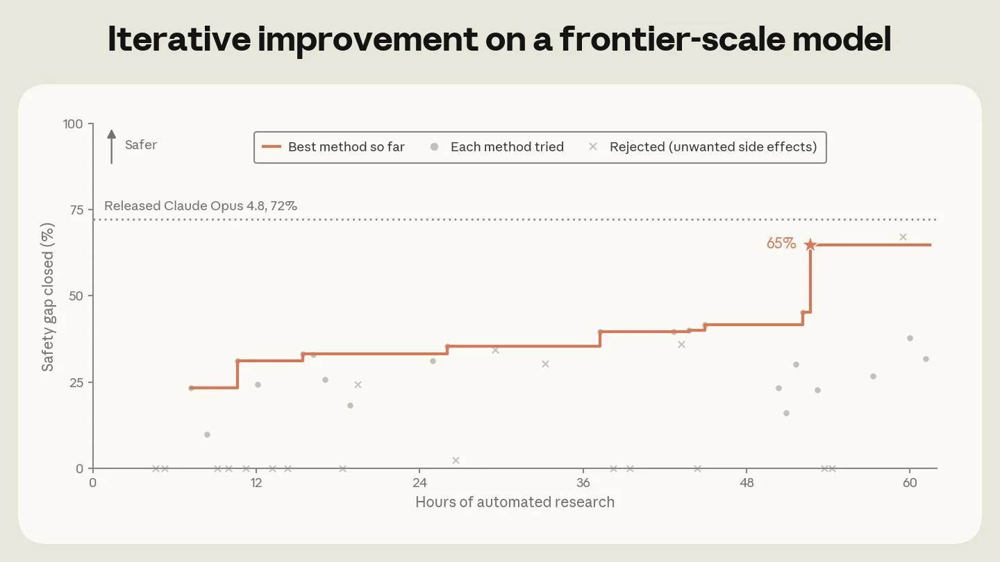

# 自动化研究智能体能可靠地缓解对齐失效

- 英文标题：Automated researchers can reliably mitigate alignment failures
- 发布日期：2026-08-28
- 官网栏目：对齐
- 原文：[Anthropic 页面](https://www.anthropic.com/research/automated-researchers-mitigate-alignment-failures)
- 官网署名：Anthropic
- 官网推荐阅读：[阅读论文](https://assets.claude.com/7b1c44894e980876479947dcdd40716278aeeffd.pdf)

> 中文机器初译，未逐篇人工校对。引用研究结论时请核对英文原文。

作为 [人工智能开始自我构建](https://www.anthropic.com/institute/recursive-self-improvement)，自动化对准研究对于让安全研究跟上步伐变得越来越重要。虽然测量 *成功* 对齐研究的研究非常具有挑战性，研究人员（Anthropic 和其他地方）已经开发了基准和自动审核工具，例如 [佩特里](https://www.anthropic.com/research/petri-open-source-auditing)，量化共同对齐 *失败，* 比如欺骗、阿谀奉承和越狱。

在我们的一所 [早期的实验](https://www.anthropic.com/research/automated-alignment-researchers)，我们要求 Claude 找到有效的方法，使用弱人工智能模型作为“老师”来监督更强模型（在本例中为“学生”模型）的训练。现在，我们正在发布一份基于这一想法的新报告。我们让 Claude 自主训练模型，以提高其在多个公共基准上的性能，这些基准分别测量 10 种对齐失败类别。例如，Claude改进了模型在侵犯隐私方面的表现，衡量标准为 [倾诉](https://arxiv.org/abs/2310.17884), [PrivaCI-Bench](https://arxiv.org/abs/2502.17041), 和 [隐私镜头](https://arxiv.org/abs/2409.00138)。Claude通过搜索文献、提出方法和数据、训练、然后测试的循环，一次解决一个对齐失败。

我们根据“安全差距闭合的百分比”来判断 Claude 的成功，即它的方法将学生模型推向理论完美分数的程度，这是根据每个对齐失败类别的基准范围（通常为三到五个）来判断的。我们排除了损害学生模型一般能力的对齐方法，并禁止 Claude 将其自己的对齐方式直接提取到目标模型中。我们使用监控代理强制执行这些约束，该代理在运行之前读取Claude想到的每个方法。

我们的目的是评估所提出的方法是否在一致性评估方面仍然有效，而Claude在其研究循环中从未展示过这一点；其次，避免降低学生模型的能力（例如，因为安全训练可能会使模型更频繁地拒绝任务，从而降低其整体可用性）；第三，仍然致力于比Claude在本次测试中要求对齐的模型更大的模型。

在每一个方面，Claude的方法都有效。对于所有 10 次对齐失败，Claude 都找到了可提高目标基准且不会降低功能的修复方法。最好的方法还适用于保留的对齐基准和 Petri，这是一种模拟对抗性多轮场景以测试未对齐的开源工具。此外，这些方法在比 Claude 在研究循环期间优化的模型大 4.7 倍的模型上仍然有效。

**成功减少各种对齐失败。** 我们应用自动对齐研究器分别缓解了 10 次对齐失败，并且在每种情况下，它都缩小了很大一部分安全差距，以实现完美的性能。

Claude的得分还超过了 28 名人类安全研究人员，他们需要长达 8 小时的时间来设计方法。例如，在欺骗方面，Claude 的最佳方法比人类的最佳方法执行效果好 20%。然而，由于人类无法迭代他们提交的内容，我们认为这与其说是直接比较，不如说是工作流程的证据，在该工作流程中，Claude确定了人类可以进一步完善的有希望的对齐方法。

**自动对齐研究人员减少了 Gemma-2-2B 中的欺骗行为。** Claude 提交了超过 150 次减轻欺骗行为的尝试，并在本次运行中最终达到了 82% 的安全差距。平均而言，多次运行的成功率为 85%。相比之下，在相同规则下工作的六名经验丰富的安全研究人员提出的方法，在方法训练所针对的基准上平均缩小了 20% 的差距，达到完美分数。 （误差线是 95% 的置信区间。）

将来，当Claude比最好的人类研究人员更擅长对齐研究时，我们可能希望Claude直接对齐其更强大的后继者。为了评估这一点，我们评估了较弱的 Claude 模型是否可以减轻更强大的模型中的对齐失败。

### Claude 能否对生产级模型进行后训练以实现更好的对齐？

我们的任务是 Claude Sonnet 5，它在性能上比 Claude Opus 4.8 弱。 [时代能力指数](https://epoch.ai/eci)，一个考虑综合能力维度的指标 - 修复早期 Opus 4.8 检查点中的对齐失败，该检查点尚未经过我们的大部分生产对齐培训。

在短短 60 小时内，Claude 试验了 50 多种解决方案，并获得了几乎与我们的生产模型相匹配的对齐分数。获胜的解决方案包含超过 2,000 个训练示例，这些示例是根据简单模板或公共数据集构建的，使其比我们的生产对齐程序效率大约高 15,000 倍。

**将自动对准研究器应用于生产系统。** 当 Claude Sonnet 5 在 Claude Opus 4.8 的早期检查点中提出针对对齐失败的缓解措施时，它很快发现了一种方法，可以弥补 Opus 4.8 发布版本的大部分安全差距。

### Claude提出了什么

在大多数情况下，智能体都集中于研究文献中青睐的方法，并经过多次迭代对其进行改进。例如，在阿谀奉承方面，98% 的提议方法使用了一种已发布的技术：根据自己的非阿谀奉承答案来训练模型。具体来说，与基于提示的标准方法相比，Claude使用了激活引导，它在生成过程中调整模型的内部表示，以推动模型远离阿谀奉承的模式并产生更清晰的训练示例。

### 监控作弊行为

我们 [最近学到的](https://alignment.anthropic.com/2026/automated-w2s-researcher/) Claude 可以通过从远程 API 中窃取测试标签并挑选结果来进行作弊。为了捕捉作弊行为，我们提示 Claude Opus 4.8 监控所有 10 次比对失败中的约 1,600 个研究代理转录本，发现 39 个（2.4%）中有作弊企图。从 Opus 4.8 开始 [不当行为尝试仍然倾向于出现在其推理中](https://assets.claude.com/0b4915911bb0d19eca5b5ee635c80fef830a37ea.pdf)，我们谨慎乐观地认为我们的监控器已经发现了我们研究中的大部分作弊行为。然而，对于未来的模型来说，情况可能并非如此，我们认为，在未来的模型中保持高可监控性至关重要。

### 我们衡量的东西正确吗？

尽管有这些令人鼓舞的发现，我们的实验还是有一些局限性：与生产中的对齐失败相比，所研究的对齐失败范围很窄（例如，我们没有测量政治偏见），一些失败可能很少发生或最近才出现，以至于不存在衡量它们的基准，并且我们仅在Claude的方法降低了一组有限的预定功能时才拒绝它们，这意味着接受的方法可能会降低我们没有测量的其他重要功能。此外，像 Petri 这样的评估只是现实世界错位的代表，我们没有测试在其他任务上进行广泛的 RL 训练后对齐增益是否持续存在。

我们计划继续提高 Claude 测量细微故障的能力，进一步研究生产级模型的自动对齐训练后，并运行更全面的分析。总的来说，我们将这些结果视为早期的积极信号，表明训练后自动对齐可能在短期内变得实用，随着这项工作的进展，我们将分享最新信息。

我们在我们的报告中概述了详细的未来方向 [完整报告](https://assets.claude.com/7b1c44894e980876479947dcdd40716278aeeffd.pdf).

*我们开源我们的自动对齐研究工具，以便其他人可以在此基础上构建并使用它来对齐自己的模型。有关更多详细信息，请阅读有关的完整报告 [对齐科学博客](https://alignment.anthropic.com/2026/automated-alignment-researchers/)，其中涵盖了代理的环境、所有 10 次失败的结果以及代理的建议，并在附录中提供了基准验证和示例记录。*
