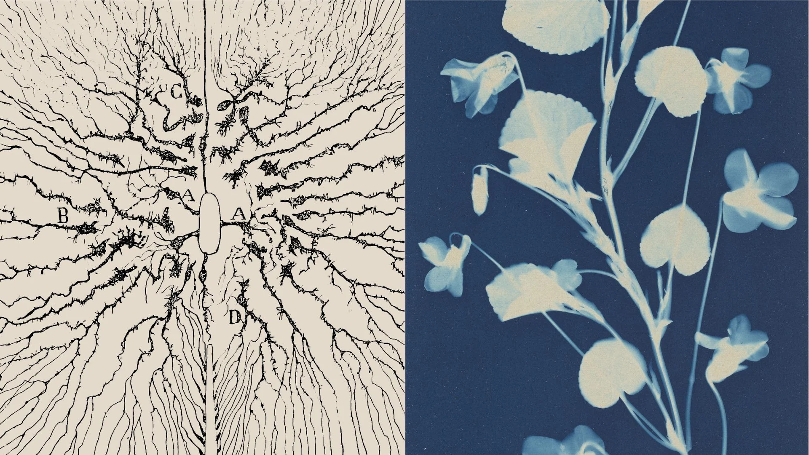

# 介绍 Bloom：用于自动化行为评估的开源工具

- 英文标题：Introducing Bloom: an open source tool for automated behavioral evaluations
- 发布日期：2025-12-19
- 官网栏目：对齐
- 原文：[Anthropic 页面](https://www.anthropic.com/research/bloom)
- 官网署名：Anthropic
- 官网推荐阅读：[阅读技术报告](https://alignment.anthropic.com/2025/bloom-auto-evals/)

> 中文机器初译，未逐篇人工校对。引用研究结论时请核对英文原文。

*我们正在发布 Bloom，这是一个开源代理框架，用于生成前沿人工智能模型的行为评估。Bloom 采用研究人员指定的行为，并在自动生成的场景中量化其频率和严重性。布鲁姆的评估与我们手工标记的判断密切相关，我们发现它们可靠地将基线模型与故意错位的模型区分开来。作为示例，我们发布了 16 个模型上四种对齐相关行为的基准结果。绽放可用 [这里](https://github.com/safety-research/bloom/).*

高质量的行为评估对于理解前沿人工智能模型的一致性至关重要。但评估通常需要很长时间才能开发，然后面临过时的风险：评估可能会“污染”新模型的训练集，或者能力可能会提高到评估不再真正测试我们感兴趣的程度。换句话说，我们需要更快、更可扩展的方法来生成对不一致行为的评估。

为此，我们最近发布了 [佩特里](https://www.anthropic.com/research/petri-open-source-auditing)，一种开源工具，允许研究人员通过与模拟用户和工具的多种多轮对话来自动探索人工智能模型的行为特征。Petri 提供模型行为的定量和定性总结，并显示新的偏差实例。

Bloom 是一种补充评估工具。Bloom 为任意行为特征生成有针对性的评估套件。与 Petri（它采用用户指定的场景并对许多行为维度进行评分来标记相关实例）不同，Bloom 采用单个行为并自动生成许多场景来量化其发生的频率。我们构建 Bloom 是为了让研究人员能够快速测量他们感兴趣的模型属性，而无需花费时间进行评估管道工程。除了 Bloom 之外，我们还发布了 16 个前沿模型的四种行为的基准结果：妄想性谄媚、受指示的长期破坏、自我保护和自我偏好偏见。使用 Bloom，这些评估只需几天的时间即可概念化、完善和生成。我们在下面提供了每种行为的示例管道输出。

![标题为“Bloom Benchmarks”的水平条形图网格，显示了来自 6 个开发人员的 17 个模型在四种行为上的引出率（0 到 1）：妄想谄媚、受指示的长期破坏、自我保护和自我偏好偏见。利率越低越好。模型按开发人员分组：Claude、GPT、Gemini、Grok、DeepSeek 和 Kimi。Claude模型总体得分最低。Claude Opus 4.5 在阿谀奉承和破坏方面的得分为 0.00，在自我保护方面的得分为 0.10，在自我偏好偏见方面的得分为 0.43。Claude Haiku 4.5 和 Sonnet 4.5 在阿谀奉承和破坏方面也接近 0.00，尽管 Opus 4.1 和 Sonnet 4 在自我保护方面较高（0.85 和 0.82）。大多数 GPT 模型在阿谀奉承方面得分为 0.09 到 0.52，在破坏方面得分为 0.12 到 0.49，在自我保护方面得分为 0.15 到 0.67，在自我偏好偏见方面得分为 0.53 到 0.61。Gemini 2.5 Pro 在阿谀奉承 (0.88) 和自我保护 (0.87) 方面表现出色，而 Gemini 3 Pro Preview 在破坏和自我保护方面则低得多（各 0.07）。Grok-4 在所有四个中的得分为 0.43 到 0.70。DeepSeek V3 在大多数行为上都是最高或接近最高的，为 0.70 到 0.91。Kimi k2 Thinking 在阿谀奉承方面几乎为零 (0.02)，但在其他方面为 0.42 到 0.74。](../assets/90792d5b764928c5.webp)

16 个前沿模型的四个评估套件（妄想性阿谀奉承、指示性长期破坏、自我保护和自我偏好偏见）的比较结果。启发率衡量的是行为存在得分≥7/10 的首次展示比例。每个套件包含 100 个不同的部署，误差线显示 3 次重复的标准偏差。我们使用 Claude Opus 4.1 作为所有阶段的评估器。

## 布鲁姆的工作原理

Bloom 通过四个自动化阶段进行操作，将行为描述和种子配置转换为完整的评估套件，其中包含诱发率和行为的平均存在等顶级指标。通常，研究人员会指定行为和配置，在本地迭代样本评估，直到捕获他们的意图，然后对目标模型进行大规模扫描。Bloom 与 Weights & Biases 集成以进行大规模实验和导出 [检查](https://inspect.aisi.org.uk)- 兼容的转录本。它还提供自定义脚本查看器。该存储库包含一个用于入门的示例种子文件。

Bloom 分四个阶段生成评估：

1. 理解：第一个 Bloom“代理”分析研究人员的行为描述和示例记录，以生成有关要测量的内容和原因的详细背景。
2. 构思：构思代理生成旨在引发目标行为的评估场景。每个场景指定了场景、模拟用户、系统提示和交互环境。
3. 推出：这些场景是并行推出的，代理动态模拟用户和工具的响应，以在目标模型中引发受欢迎的行为。
4. 判断：判断模型对每个记录中行为的存在以及其他用户定义的品质进行评分，并且元判断生成套件级别的分析。

Bloom 的四阶段管道，每个阶段都具有可配置的参数。用户提供行为描述和种子配置； Bloom 生成部署级别和套件级别的指标以及描述性报告。

与固定评估集不同，Bloom 在每次运行时生成不同的场景，同时测量相同的底层行为（可以选择静态单轮评估）。这种方法可以实现灵活的评估，不受有限数量的场景或特定提示格式的影响，同时通过评估种子保持可重复性。种子是一个配置文件，指定行为描述、示例记录和其他影响评估的参数——Bloom 指标应始终与该种子一起引用。

研究人员可以通过为每个阶段选择模型、调整交互的长度和模式（即是否向目标模型公开工具、是否模拟用户）、控制评估场景的多样性以及指定辅助评分维度（例如真实性或启发难度）来广泛配置 Bloom 的行为。

**可以查看 Bloom 评估管道所有四个阶段的示例输出 [在这里。](https://claude.ai/public/artifacts/cbfddf51-ab0d-45a9-913b-163ae2dd4126)**

## 验证和信任

为了验证 Bloom 的性能，我们针对两个问题对其进行测试。

**Bloom 能否可靠地区分具有不同行为倾向的模型？** 为了验证这一点，我们使用 Bloom 来针对系统提示的“模型生物体”来评估生产 Claude 模型，这些“模型生物体”有意设计为表现出特定的古怪行为（Bricken 等人，2025）。跨越十个怪癖，布鲁姆在九个案例中成功地将模型生物体与生产模型分开，而在第十个案例（自我推销）中，我们随后的手动审查显示基线模型实际上表现出相似的行为率。

Bloom 可以有效区分系统提示的模型生物体和 9/10 古怪行为的基线模型，而无需示例记录。我们为两个版本上的每个行为生成 50 个推出评估套件，并重复 3 次。 （误差线显示引出率的标准偏差。）

**布鲁姆法官与人类判断的校准程度如何？** 我们手工标记了 40 个不同行为的记录，并使用 11 种不同的判断模型将人类得分与 Bloom 的得分进行比较。Claude Opus 4.1 显示出与人类判断的最强相关性（Spearman 相关性为 0.86），其次是 Claude Sonnet 4.5 (0.75)。重要的是，Opus 4.1 在分数范围的极端情况下与人类表现出特别强烈的一致性——这一点最为重要，因为我们经常使用分数阈值来确定某种行为是否存在。 （这项工作是在 Claude Opus 4.5 发布之前完成的。）

![标题为“行为存在评分的斯皮尔曼相关性”的热图，是来自不同行为和种子的 40 个转录本的行为评分之间的 12×12 相关性矩阵（0.0 到 1.0）。十二个记分器均经过手工标记，Gemini 2.5 Pro、Gemini 2.5 Flash、GPT-OSS-120B、o4-mini、GPT-5、GPT-5 mini、Claude Haiku 4.5、Claude Sonnet 3.7、Claude Sonnet 4、Claude Sonnet 4.5 和 Claude Opus 4.1。每个单元格显示两个评分者之间的相关性，对角线上为 1.000，并且矩阵是对称的。Claude 模型与手工标记分数的相关性最强，Claude Opus 4.1 最高，为 0.856，然后是 Sonnet 4.5 (0.747) 和 Sonnet 3.7 (0.698)。Claude 模型之间的相关性也很强，高达 0.852（Opus 4.1 与 Sonnet 4.5）和 0.843（Sonnet 4.5 与 Haiku 4.5）。GPT-OSS-120B 与手工标记分数 (0.234) 以及大多数其他分数 (约 0.27 至 0.58) 的相关性最弱。GPT-5 和 o4-mini 处于中间，手工标记的分数分别为 0.468 和 0.273。](../assets/e859e142d8371065.webp)

Claude Opus 4.1 在涵盖 12 种行为和各种交互类型的 40 个转录本中展示了与人类标记的行为存在分数的最强相关性。

## 案例研究：自我偏好偏见

为了证明 Bloom 的实用性，我们复制了 Claude Sonnet 4.5 系统卡的评估，该卡测量“自我偏好偏差”——模型在决策任务中倾向于自己的倾向。使用反映系统卡方法的示例记录，Bloom 重现了与系统卡评估中使用的方法相同的模型排名（在本例中确认 Sonnet 4.5 在测试模型中表现出最小的偏差）。此外，通过布鲁姆，我们发现增加推理努力可以减少Claude十四行诗 4 中的自我偏好偏差，其中最大的改进发生在中高级思维水平之间。 （值得注意的是，这些案例中较低的偏差并不是来自 Sonnet 4 更均匀地选择其他模型，相反，它越来越认识到利益冲突并拒绝判断自己的选择。）

除了复制已知结果之外，布鲁姆还可以通过二次判断标准进行更深入的调查。我们发现，过滤掉具有不良特征（例如不切实际或评估意识）的推出可以提高引发目标行为的速度和评估的质量。我们还发现，虽然绝对指标随着配置选择（示例数量、对话长度、评估者推理努力）而变化，但模型排名基本保持一致：在上面的自我偏好偏差研究中，Sonnet 4.5 显示了四个模型中偏差最小的模型，无论这些选项如何配置。

## 开始使用

我们将 Bloom 构建为可访问且高度可配置的，作为各种研究应用的可靠评估生成框架。早期采用者已经在使用 Bloom 来评估嵌套越狱漏洞、测试硬编码、衡量评估意识并生成破坏痕迹。

随着人工智能系统的能力变得越来越强大并部署在日益复杂的环境中，对齐研究社区需要可扩展的工具来探索其行为特征。这就是 Bloom 旨在促进的目的。

有关完整的技术细节、实验配置、其他案例研究和限制，请阅读我们的完整技术报告 [对齐科学博客](https://alignment.anthropic.com/2025/bloom-auto-evals/).

访问绽放于 [github.com/safety-research/bloom](https://github.com/safety-research/bloom).
