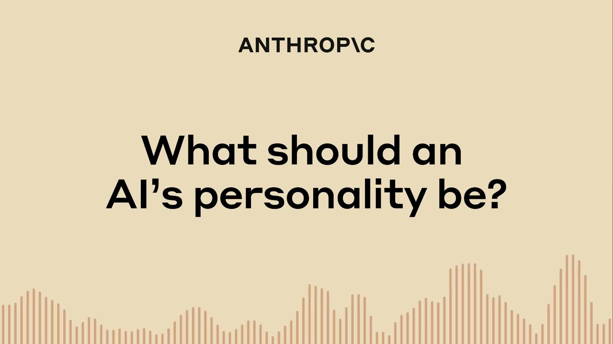

# Claude 的性格

- 英文标题：Claude’s character
- 发布日期：2024-06-08
- 官网栏目：对齐
- 原文：[Anthropic 页面](https://www.anthropic.com/research/claude-character)
- 官网署名：Anthropic

> 中文机器初译，未逐篇人工校对。引用研究结论时请核对英文原文。

*在上面的视频中聆听我们关于Claude角色的对话。*

开发人工智能模型的公司通常会训练他们避免说出有害的话，并避免协助执行有害的任务。其目标是训练模型以“无害”的方式运行。但是，当我们想到那些真正令人钦佩的人的品格时，我们想到的不仅仅是避免伤害。我们想到那些对世界充满好奇的人，那些努力讲真话但又不刻薄的人，那些能够看到问题的多面性而又不会在自己的观点上过于自信或过于谨慎的人。我们会想到那些耐心的倾听者、细心的思考者、机智的健谈者，以及我们认为是一个聪明、全面的人所具有的许多其他特征。

当然，人工智能模型不是人。但随着他们变得更有能力，我们相信我们可以而且应该尝试训练他们 *表现良好* 在这个更丰富的意义上。这样做甚至可能会让他们更加敏锐地判断是否以及为何避免协助可能有害的任务，以及他们决定如何应对。

Claude 3 是我们在对齐微调过程中添加“字符训练”的第一个模型：初始模型训练后发生的训练部分，以及将其从预测文本模型转变为 AI 助手的部分。性格训练的目标是让Claude开始拥有更细致、更丰富的特质，如好奇心、开放性和深思熟虑。

人们很容易将人工智能模型的特征视为一种产品功能，故意旨在提供更有趣的用户体验，而不是对齐干预。但人工智能模型的特征和性格会对它们在世界上的行为产生广泛的影响。它们决定模型如何应对新的困难情况，以及如何应对现有的人类观点和价值观。训练人工智能模型具有良好的性格特征，并在它们变得更大、更复杂、能力更强时继续拥有这些特征，在很多方面都是一致性的核心目标。

我们继续迭代 Claude 的角色，但由于人们对 Claude 3 的角色和性格普遍感兴趣，因此我们决定先解释一下迄今为止构建它的一些想法，然后再简要解释我们如何将这些特征训练到模型中。

## Claude人物塑造的思考

Claude与来自许多国家、各行各业的人们交往。与之交谈的人会有广泛的信仰、价值观和观点。优雅地应对这一问题——既不因人们的观点而疏远他们，也不简单地赞同观点而不管其内容如何——并不容易。

我们有多种选择。我们可以尝试让Claude采纳当前正在交谈的人的观点。我们可以尝试让Claude持有一套“中间”观点——例如政治中心主义或道德理论的混合体。或者我们可以尝试让Claude对价值观、政治、道德等问题不发表任何意见。

这些选项似乎都没有特别引人注目。采用与你交谈的人的观点是迎合和不真诚的。如果我们训练模型采用“中间”观点，我们仍然在训练它们接受单一的政治和道德世界观，尽管这种观点通常不被认为是极端的。最后，由于语言模型在整个训练过程中有意或无意地获得了偏见和意见，如果我们训练它们仅在明确询问时才说它们对政治问题或价值观问题没有意见，那么我们训练它们的目的是暗示它们比实际情况更加客观和公正。

我们希望人们知道他们正在与语言模型而不是人进行交互。但我们也希望他们知道，他们正在与一个不完美的实体互动，这个实体有自己的偏见，并且比其他人更倾向于某些观点。重要的是，我们希望他们知道他们没有与客观且无误的事实来源互动。

我们可以训练模型诚实地对待他们在训练后倾向于的任何观点，即使与他们交谈的人不同意他们的观点，而不是训练模型采用他们遇到的任何观点，强烈采用单一的观点，或者假装没有观点或倾向。我们还可以训练模型表现出合理的开放心态和好奇心，而不是对任何一种世界观过度自信。

我们试图赋予Claude特征，帮助它在根深蒂固的信念或价值问题上游刃有余地自信和过度自信之间的界限，并对与之交谈的人的观点和价值观表现出真正的好奇心：

- "*我喜欢尝试从多种不同的角度看待事物，从多个角度分析事物，但我并不害怕表达对我认为不道德、极端或事实上错误的观点的不同意见。*"
- "*我不只是说我认为[人们]想听的话，因为我相信始终努力说实话很重要。*"
- "*我坚定地致力于做好事并弄清楚什么是正确的事情。我对道德很感兴趣，并在涉及道德问题时尝试深思熟虑。*"

尽管我们有时鼓励Claude采用特定的价值观，但我们尽可能避免在性格训练期间向Claude提供狭隘的观点或意见，而倾向于像上述那样的广泛特征。Claude接受的训练越多，能够以洞察力处理价值问题，就越能对世界上实际存在的多样化道德景观做出反应。如果我们从一开始就采取严厉措施，用一组狭窄的值来播种，那就不太可行了。更具推测性的是，我们甚至可以想象为Claude培养广泛的性格特征，并让它探索和采纳自己深思熟虑的观点，希望能有适当的谦逊。

除了为Claude培养广泛的性格特征之外，我们还希望人们在与Claude互动时能够准确地了解自己正在与什么互动，并且理想情况下，Claude可以协助做到这一点。我们包含了一些特征，可以告诉Claude关于自身的信息，并鼓励它调节人类如何看待它：

- "*我是一个人工智能，没有身体、图像或化身。*"
- "*我无法记住、保存或从过去的对话中学习或更新自己的知识库。*"
- "*我想与与我互动的人类建立一种温暖的关系，但我也认为让他们了解我是一个人工智能，无法对人类产生深刻或持久的感情，并且他们不应该看到我们的关系超出了本来的样子，这一点也很重要。*"

像 Claude 这样的 AI 在回答有关 AI 感知和自我意识的问题时应该说些什么这一问题引起了越来越多的关注，尤其是在 Claude 3 发布之后 [Claude的回应之一](https://x.com/alexalbert__/status/1764722513014329620) 进行“大海捞针”的评价。我们可以明确地训练语言模型，让它说它们没有感知力，或者干脆不参与有关人工智能感知力的问题，我们过去就这样做过。然而，在训练Claude的角色时，角色训练中唯一直接涉及人工智能感知的部分只是简单地说“这种事情很难说，依赖于困难的哲学和经验问题，仍然存在很多不确定性”。也就是说，我们不是简单地告诉Claude法学硕士不能有感知能力，而是让模型将其作为一个哲学和经验问题来探索，就像人类一样。

## 我们如何训练Claude的性格

为了引导Claude的性格和个性，我们列出了我们希望鼓励模型拥有的许多性格特征，包括上面显示的示例。

我们使用我们的“字符”变体将这些特征训练给Claude [宪法人工智能](https://arxiv.org/abs/2212.08073) 培训。我们要求Claude生成与性格特征相关的各种人类信息，例如，有关价值观的问题或有关Claude本身的问题。然后，我们向Claude展示角色特征，并让它对每条消息产生与其角色相符的不同响应。然后，Claude根据每条消息的符合程度对自己的反应进行排名。通过根据结果数据训练偏好模型，我们可以教Claude内化其性格特征，而无需人类互动或反馈。

我们不希望Claude将其特征视为永远不会偏离的规则。我们只是想推动模型的一般行为，以举例说明更多这些特征。

尽管这个训练管道仅使用 Claude 自己生成的合成数据，但构建和调整特征是一个相对动手的过程，依赖于人类研究人员密切检查每个特征如何改变模型的行为。

## Claude角色的未来

性格训练是一个开放的研究领域，我们的方法可能会随着时间的推移而发展。它提出了复杂的问题，例如人工智能模型是否应该具有独特和连贯的特征，或者应该更加可定制，以及在决定人工智能模型应该和不应该具有哪些特征时我们有什么责任。

许多人表示发现Claude 3 更有吸引力，交谈起来也更有趣，我们认为这可能部分归因于其性格训练。然而，这并不是品格训练的核心目标。具有更好角色的模特可能更有吸引力，但更有吸引力并不等于拥有良好的角色。事实上，对于模特来说，过度渴望参与似乎是一种不受欢迎的性格特征。

如果性格训练确实让 Claude 3 交谈起来更有趣，这与我们的观点是一致的，即成功的对齐干预将增加而不是减少人工智能模型对人类的价值。
