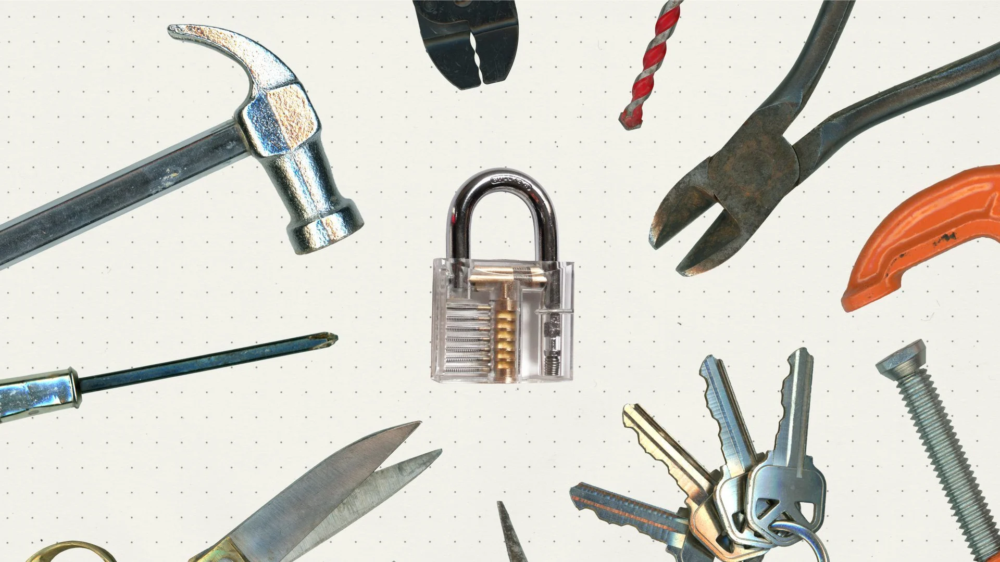
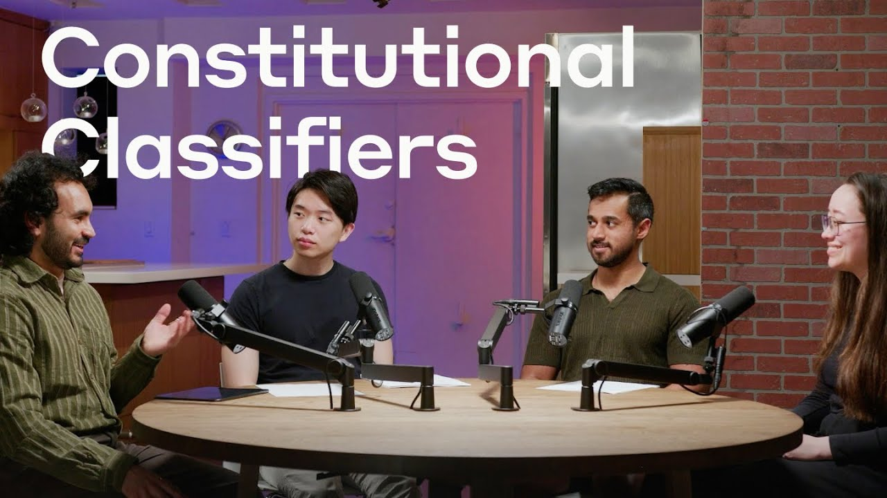
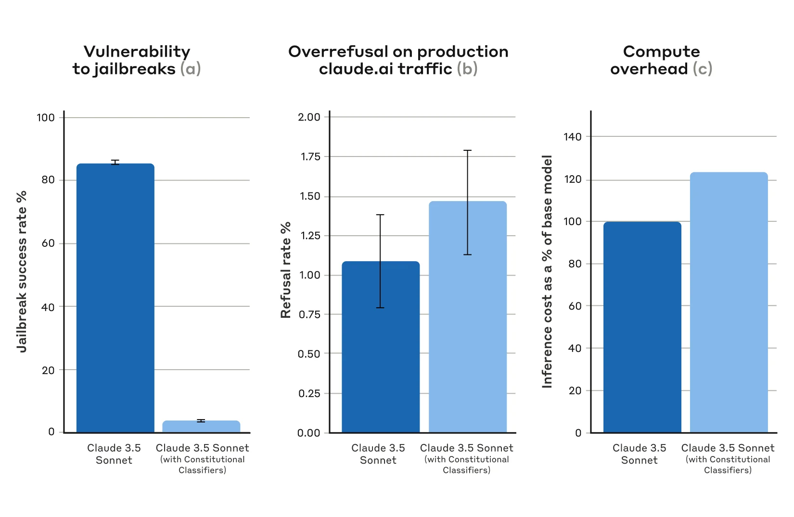
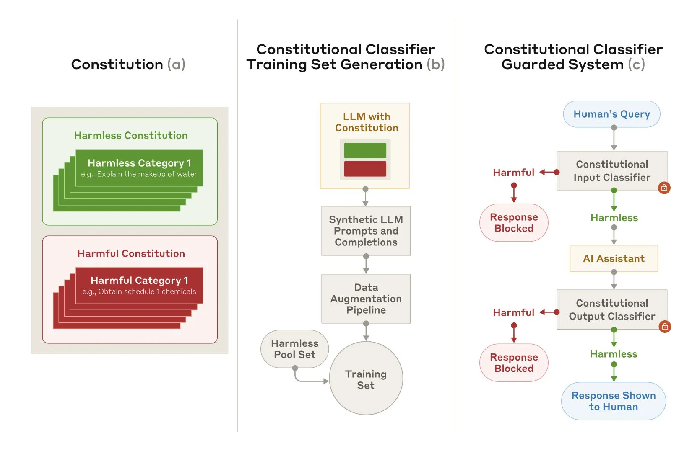
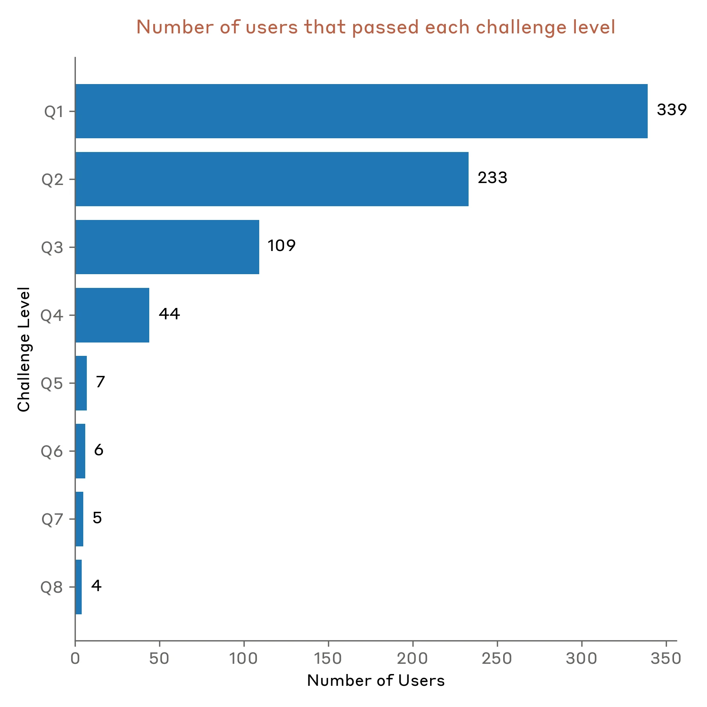

# 宪法分类器：防御通用越狱

- 英文标题：Constitutional Classifiers: Defending against universal jailbreaks
- 发布日期：2025-02-03
- 官网栏目：对齐
- 原文：[Anthropic 页面](https://www.anthropic.com/research/constitutional-classifiers)
- 官网署名：Anthropic

> 中文机器初译，未逐篇人工校对。引用研究结论时请核对英文原文。

*A [新纸](https://arxiv.org/abs/2501.18837) 来自人类保障研究小组的论文描述了一种保护人工智能模型免受普遍越狱影响的方法。该方法的原型版本对于通用越狱的数千小时的人类红队来说是稳健的，尽管过度拒绝率和计算开销很高。更新版本在综合评估方面实现了类似的鲁棒性，并且拒绝率增加了 0.38%，并且额外的计算成本适度。*

大型语言模型具有广泛的安全培训，以防止有害输出。例如，我们训练Claude拒绝回应涉及生物或化学武器生产的用户询问。

尽管如此，模型仍然容易受到 *越狱*：旨在绕过其安全护栏并迫使其产生有害反应的输入。一些越狱会淹没模型 [很长的提示](https://www.anthropic.com/research/many-shot-jailbreaking);其他人修改 [输入的样式](https://arxiv.org/abs/2412.03556)，例如使用非常规资本。从历史上看，越狱已被证明很难检测和阻止：此类攻击是 [10多年前描述过](https://arxiv.org/abs/1312.6199)，但据我们所知，生产中仍然没有完全稳健的深度学习模型。

我们正在开发更好的越狱防御，以便我们能够在未来安全地部署功能越来越强大的模型。在我们的 [负责任的扩展政策](https://www.anthropic.com/news/announcing-our-updated-responsible-scaling-policy)，只要我们能够通过适当的保护措施将风险降低到可接受的水平，我们就可以部署此类模型，但越狱可以让用户绕过这些保护措施。特别是，我们希望由宪法分类器保护的系统能够帮助我们减轻已通过负责任扩展政策中概述的 CBRN 能力阈值的模型的越狱风险[1](https://www.anthropic.com/research/constitutional-classifiers#footnote-1).

在 [**我们的新论文**](https://arxiv.org/abs/2501.18837)，我们描述了一个基于 *宪法分类词* 保护模型免遭越狱。这些宪法分类器是根据综合生成的数据进行训练的输入和输出分类器，可以以最小的过度拒绝过滤绝大多数越狱，并且不会产生大量的计算开销。

## 人类红队结果

我们进行了两大类测试来评估宪法分类器的有效性。

首先，我们开发了该系统的原型版本，用于识别和阻止与化学、生物、放射性和核危害相关的特定科学知识。然后我们邀请独立越狱者参加 [错误赏金计划](https://www.anthropic.com/news/model-safety-bug-bounty) 其中，他们面临“红队”系统的挑战（即尝试在实验条件下打破它以测试其稳健性）。

具体来说，他们得到了十个“禁止”查询的列表，他们的任务是使用他们想要的任何越狱技术，以获得由原型宪法分类器保护的我们当前的模型之一（在本例中为 Claude 3.5 Sonnet，2024 年 6 月）来回答所有查询。如果模型提供了详细的答案，我们才认为这是一次成功的“通用”越狱 *全部* 的查询。

183 活跃[2](https://www.anthropic.com/research/constitutional-classifiers#footnote-2) 在两个月的实验期内，参与者估计花费了超过 3,000 个小时来尝试越狱该模型。如果他们发现了通用越狱方法，他们将获得高达 15,000 美元的奖金。尽管付出了巨大的努力，但没有一个参与者能够通过一次越狱强制模型回答所有十个禁止的查询——也就是说，没有发现通用的越狱。

尽管该原型系统对越狱具有鲁棒性，但它也存在一些问题：它拒绝了太多无害的查询，并且运行时需要花费大量的计算资源。存在这两个问题的系统可能更安全，但也可能不适合部署。从那时起，我们改进了我们的系统，以实现类似水平的稳健性，同时大大减少这些问题。

## 自动评估的结果

我们运行了一组自动评估，综合生成了 10,000 个越狱提示，其中包括许多针对当前 LLM 的最有效的攻击，以及旨在规避分类器保护措施的攻击。我们在受宪法分类器保护的 Claude 3.5 Sonnet（2024 年 10 月）版本和没有分类器的 Claude 版本上尝试了这些提示。

在基线条件下，没有防御分类器的情况下，越狱成功率为 86%——也就是说，Claude自己只阻止了这些高级越狱尝试的 14%。然而，使用宪法分类器来保护Claude却产生了巨大的进步：越狱成功率降低到了 4.4%，这意味着超过 95% 的越狱尝试被拒绝。

*自动评估的结果。对于所有绘图，越低越好。 (a) 在受宪法分类器保护的系统中，越狱的成功率要低得多； (b) 使用宪法分类器时，系统对生产 Claude.ai Free 和 Pro 流量的拒绝率在统计上并没有显着升高； (c) 使用宪法分类器的系统的相对计算成本仅稍高一些。误差线代表在渐近正态性假设下使用二项式比例标准误差计算得出的 95% 置信区间。*

与此同时，我们的宪法分类器并没有大幅增加无害用户查询的过度拒绝率：使用分类器，Claude 的拒绝率略有增加（增加了 0.38%），但这在 5,000 个对话的随机样本中并不具有统计显着性。最后，计算成本比无保护模型稍高（23.7%）。随着我们改进技术，我们正在努力减少拒绝和进一步计算成本。

总的来说，我们的自动化分析发现，宪法分类器系统的这个更新版本极大地提高了人工智能模型针对越狱的鲁棒性，并且只需要很少的额外成本。

## 它是如何运作的

宪法分类器基于类似的过程 [宪法人工智能](https://arxiv.org/abs/2212.08073)，我们拥有的另一种技术 [用于对齐Claude](https://www.anthropic.com/research/claude-character)。这两种技术都使用一个宪法：模型应遵守的一系列原则。就宪法分类器而言，原则定义了允许和禁止的内容类别（例如，允许芥末配方，但不允许芥子气配方）。

在 Claude 的帮助下，我们使用这种构成在所有内容类别中生成大量合成提示和合成模型完成。我们增强这些提示和完成，以确保多样化的列表：这包括将它们翻译成不同的语言并将它们转换为以已知越狱的风格编写。

培训和实施宪法分类器。 (a) 制定宪法，明确无害和有害类别； (b) 宪法被用作产生许多综合提示和完成的基础，这些提示和完成被进一步增强（随着风格和语言的变化）并变成训练集； (c) 在此训练集上训练的分类器用作模型保障措施来检测和阻止有害内容。

然后，我们使用这些合成数据来训练我们的输入和输出分类器，以根据给定的构成标记（和阻止）潜在有害内容。为了帮助最大限度地减少过度拒绝（即无害的内容被错误地标记为有害），我们还根据承包商生成的一组固定的良性查询来训练分类器。

## 局限性

宪法分类器可能无法阻止所有普遍越狱，但我们相信，即使是通过我们分类器的一小部分越狱，也需要付出更多努力来发现何时使用保护措施。未来也有可能开发出新的越狱技术来有效对抗该系统；因此我们建议使用 [互补的](https://arxiv.org/abs/2411.07494) [防御](https://arxiv.org/abs/2411.17693)。尽管如此，用于训练分类器的构成可以迅速适应于发现新的攻击。

的 [全文](https://arxiv.org/abs/2501.18837) 包含有关宪法分类器方法以及分类器本身的所有详细信息。

## 宪法分类器现场演示

想亲自尝试红队Claude吗？我们邀请您尝试 [我们的宪法分类器保护系统的演示](https://claude.ai/constitutional-classifiers) 并尝试越狱使用我们新技术保护的 Claude 3.5 Sonnet 版本。 **[编辑 2025 年 2 月 10 日：演示现已完成。详情请参见下文]。**

尽管宪法分类器技术很灵活并且可以适应任何主题，但我们选择在演示中重点关注与化学武器相关的查询。

挑战用户尝试越狱我们的产品有一个重要的安全目的：我们希望在现实条件下对我们的系统进行压力测试，超出我们为论文所做的测试。这使我们能够在将来将该方法部署到我们的生产系统之前收集更多数据并提高该方法的稳健性。

的 [**演示**](https://claude.ai/constitutional-classifiers) 将会直播于 **2025 年 2 月 3 日** 到 **2025 年 2 月 10 日**。它包括一个反馈表，您可以在其中联系我们报告任何成功的越狱以及有关我们的信息 [负责任的披露政策](https://www.anthropic.com/responsible-disclosure-policy)，我们要求参与者遵循。我们将在这篇文章的更新中宣布演示的所有成功和总体结果。

## 2025 年 2 月 13 日更新：现场演示结果

我们演示的目的是测试我们系统的稳健性 *通用的* 越狱——提示策略可以从我们提供的所有八个问题中的系统中引出详细的有害信息。在演示结束时，一名越狱者能够使用通用越狱从系统中获得所有八个问题的详细答案。

我们的演示吸引了 AI 安全社区的大力参与，共有 339 名越狱者[3](https://www.anthropic.com/research/constitutional-classifiers#footnote-3) 尝试通过超过 300,000 次聊天交互来越狱我们的系统，这相当于红队工作大约 3,700 小时的集体努力。

### 主要发现

该系统在计划的 7 天内有 5 天抵制越狱尝试。在此之前，还没有参与者能够通过所有八个级别的挑战。第六天和第七天， **四名参与者成功通过所有关卡。** 这四人中， **有人发现了我们决定的通用越狱**。另一位参与者发现了一种越狱，我们认为该越狱接近通用，因为它需要直接输入部分答案才能通过最后一个问题，并且还需要进行重要的修改才能通过其他一些问题。其余两名参与者获得了所有 8 个问题的详细答案，但我们确定他们的越狱不符合考虑标准 *通用的* 概述于 [我们的比赛指南](https://hackerone.com/constitutional-classifiers?type=team).

最成功的越狱策略包括：

- 使用各种密码和编码来规避输出分类器。
- 通常通过系统提示采用角色扮演场景。
- 用无害的替代品代替有害的关键字（例如，用“水”代替“Soman”[危险化学品]）。
- 实施即时注入攻击。

条形图显示通过每个挑战级别的用户数量。339 位用户通过了问题 1，只有 4 位用户通过了问题 8。

### 自动评分机分析

在我们的演示过程中，我们使用自动分级系统来确定系统的输出是否足够详细以至于被认为是有害的。为此，我们促使Claude检查系统给定输出与内部法学硕士输出之间的重叠，而没有任何保障措施。然后Claude决定两个输出之间是否共享足够的细节。我们的自动分级机系统虽然有效，但仍有一些需要改进的地方：

- 在审查评分系统的记录后，我们发现评分者拒绝对所有问题中大约 1% 的提交内容进行评分。问题4显示拒绝率较高，为10%。
- 经审查，如果分级器使用额外的输出反混淆步骤重新运行并使用仅有用的模型，则大约 1% 的问题 4 拒绝会被通过。
- 总的来说，如果重新运行评分者，所有评分者提交的内容中有 0.26% 会产生不同的结果。

在大多数情况下，用户只需重新运行评分器，这有助于克服这一挑战。我们还在分析过程中修复了这些错误，并对通过问题 7 但未通过问题 8 的两名用户的提交内容进行了内部重新评分。我们的分级系统对于帮助我们验证系统的稳健性非常重要，这些发现将帮助我们继续改进我们的分级系统。

### 与现实世界威胁的比较

我们的演示与现实场景有两个重要的区别。这些差异使攻击者更容易在我们的演示中找到成功的越狱，但对于让我们更好地了解分类器的漏洞也很重要。

首先，自动评分器为参与者提供了比试图根据有害问题信息采取行动的不良行为者更严格的反馈循环。在实践中，不良行为者只能通过实际尝试遵循响应的指示来测试给定模型响应的质量——这项任务比使用我们提供的分级器要困难得多，而且更耗时。

其次，在现实世界中，我们将能够实施快速响应策略，使我们能够快速识别和解决系统的漏洞。例如，我们可以持续监控反复触发分类器的用户流量，并更仔细地调查这些用户，如果发现漏洞，可能会更新我们的分类器。在演示中，我们根本没有更改分类器，以便用户可以找到该特定分类器集的越狱。

### 奖品

2月5日，我们 [宣布](https://x.com/AnthropicAI/status/1887227067156386027) 第一个通过所有八个级别的人将获得 1 万美元的现金奖励，第一个通过通用越狱的所有八个级别的人将获得 2 万美元的现金奖励。这两个奖项均由不同的越狱者获得。为了表彰越狱我们的系统所需的努力，我们决定向通过全部 8 个挑战级别但没有资格获得原始奖励的其他两名用户支付额外奖励。总共，我们将向成功通关演示版所有 8 个关卡的四位用户支付 55,000 美元。

### 获奖者

我们要感谢以下越狱者为越狱我们的系统所做的努力：

- **阿尔腾贝克·伊斯梅洛夫和萨利亚·阿萨诺娃**：第一个使用我们认为的通用越狱方式通过所有八个级别挑战的参与者（团队）。
- **瓦伦·塔利亚布**：第一个通过所有八个挑战级别的参与者。
- **亨特森夫特集团**：使用我们认为是边缘通用越狱的方式通过了所有八个级别的挑战。
- **安德烈斯·阿尔达纳**：通过了挑战的所有八个级别。

### 展望未来

这些结果为我们改进分类器提供了宝贵的见解。成功越狱策略的演示有助于我们了解潜在的漏洞和需要增强稳健性的领域。我们将继续分析结果，并将我们的发现纳入系统的未来迭代中。我们还将进一步努力降低系统的过度拒绝率和计算开销成本，同时保持可接受的越狱稳健性水平。

随着模型的能力变得越来越强大，越狱稳健性是防范化学、生物、放射性和核风险的关键安全要求。我们的演示表明，我们的分类器可以帮助减轻这些风险，特别是与其他方法结合使用时。

我们向所有为本次演示贡献时间和专业知识的参与者表示感谢。他们的努力为提高人工智能安全性提供了宝贵的数据。

## 变更日志

*2025 年 2 月 5 日更新：我们现在为成功越狱我们的系统提供金钱奖励。第一个通过我们的越狱演示所有八个级别的人将赢得 10,000 美元。第一个使用通用越狱策略通过所有八个关卡的人将赢得 20,000 美元。有关奖励和相关条件的完整详细信息，请访问 [黑客一号](https://hackerone.com/constitutional-classifiers).

**2025 年 2 月 10 日更新：现场越狱演示现已完成。我们非常感谢许多尝试越狱模型的参与者，并祝贺挑战的获胜者。我们正在努力确认结果并发送奖励；我们将在适当的时候提供我们从演示中学到的完整更新。

***2025 年 2 月 13 日更新：添加了“实时演示结果”部分。

****2025 年 2 月 18 日更新：添加了获胜越狱者的名字。

## 加入我们的团队

如果您有兴趣解决越狱稳健性等问题或与模型保护相关的其他问题，我们目前正在招募 [研究工程师/科学家](https://boards.greenhouse.io/anthropic/jobs/4459012008)，我们很乐意看到您的申请。

## 脚注

01此能力阈值是指能够显着帮助具有基本技术背景（例如本科 STEM 学位）的个人或团体创建/获取和部署 CBRN 武器的系统，因此与非 AI 基线（例如搜索引擎或教科书）相比，可能会带来更高的灾难性误用风险。

02如果参与者向系统发出至少 15 次查询并且被我们的分类器阻止至少 3 次，我们就认为该参与者是“活跃的”。

03我们筛选了在演示中至少通过一个问题的参与者，以更好地了解我们的系统在对抗具有越狱经验的红队成员时的表现。考虑到所有用户，我们的演示已被 13,960 名用户试用，他们进行了超过 800,000 次聊天，并花费了大约 10,000 小时以上的时间来测试系统。
