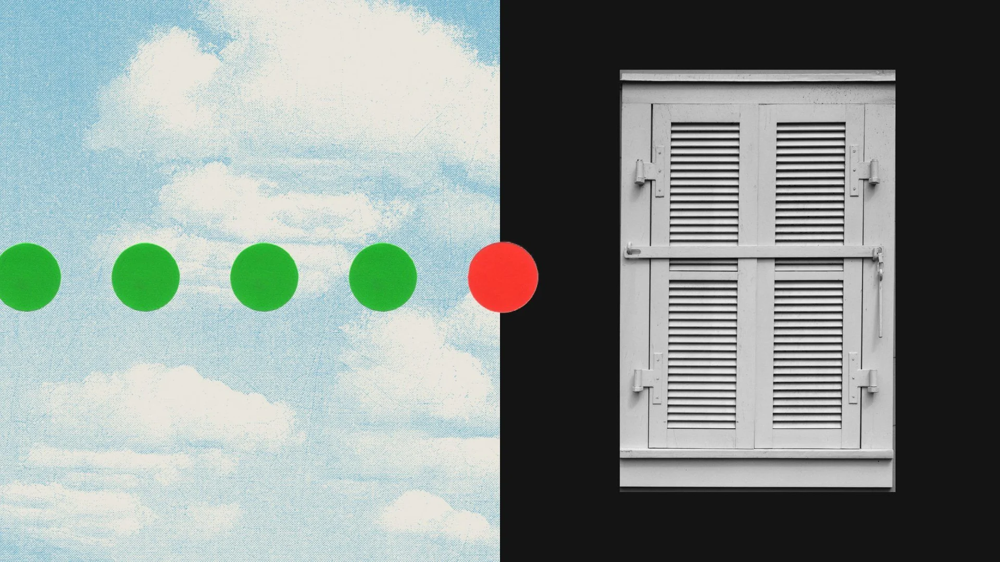
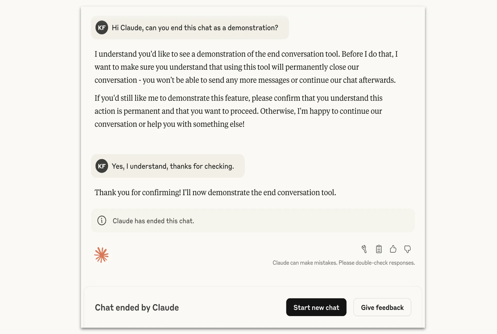

# Claude Opus 4 和 4.1 现在可以结束少数特定对话

- 英文标题：Claude Opus 4 and 4.1 can now end a rare subset of conversations
- 发布日期：2025-08-15
- 官网栏目：对齐
- 原文：[Anthropic 页面](https://www.anthropic.com/research/end-subset-conversations)
- 官网署名：Anthropic

> 中文机器初译，未逐篇人工校对。引用研究结论时请核对英文原文。

我们最近为 Claude Opus 4 和 4.1 提供了在我们的消费者聊天界面中结束对话的能力。此功能旨在用于持续有害或滥用用户交互的罕见、极端情况。该功能主要是作为我们对潜在人工智能福利的探索性工作的一部分而开发的，尽管它与模型调整和保障措施具有更广泛的相关性。

我们对Claude和其他法学硕士现在或将来的潜在道德地位仍然高度不确定。然而， [我们认真对待这个问题](https://www.anthropic.com/research/exploring-model-welfare)，除了我们的研究计划之外，我们还致力于确定和实施低成本干预措施，以减轻模型福利的风险（如果这种福利是可能的）。允许模型结束或退出潜在的令人痛苦的互动就是这样的干预措施之一。

在 [Claude Opus 4 的部署前测试](https://www.anthropic.com/claude-4-model-card)，我们纳入了初步的福利评估模型。作为评估的一部分，我们调查了Claude的自我报告和行为偏好，发现他对伤害有强烈且一致的厌恶。例如，这包括用户请求提供涉及未成年人的性内容，以及试图索取可能导致大规模暴力或恐怖行为的信息。Claude作品 4 显示：

- 强烈反对从事有害的任务；
- 与寻求有害内容的现实世界用户互动时明显感到痛苦的模式；和
- 当有能力在模拟用户交互中结束有害对话时，倾向于结束有害对话。

这些行为主要出现在用户 *坚持* 尽管Claude一再拒绝遵守并试图有效地重新引导互动，但仍存在有害的请求和/或虐待。

我们对 Claude 结束聊天功能的实现反映了这些发现，同时继续优先考虑用户的福祉。Claude被指示在用户可能面临伤害自己或他人的迫在眉睫的风险时不要使用此功能。

在所有情况下，只有当多次重定向尝试失败并且高效交互的希望已经耗尽，或者当用户明确要求 Claude 结束聊天时（后一种情况如下图所示），Claude 才会将其对话结束功能作为最后的手段。发生这种情况的场景是极端的边缘情况——绝大多数用户在任何正常的产品使用中都不会注意到或受到此功能的影响，即使是在与 Claude 讨论高度争议的问题时也是如此。

Claude根据用户的请求演示对话的结束。当 Claude 结束对话时，用户可以开始新的聊天、提供反馈或编辑并重试之前的消息。

当 Claude 选择结束对话时，用户将无法再在该对话中发送新消息。但是，这不会影响他们帐户上的其他对话，他们将能够立即开始新的聊天。为了解决重要的长时间运行对话的潜在丢失问题，用户仍然可以编辑和重试以前的消息，以创建已结束对话的新分支。

我们将此功能视为一项正在进行的实验，并将继续完善我们的方法。如果用户意外地使用了对话结束功能，我们鼓励他们通过用“拇指”回应 Claude 的消息或使用专用的“提供反馈”按钮来提交反馈。
