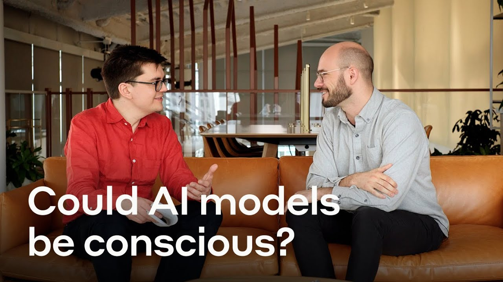

# 探索模型福祉

- 英文标题：Exploring model welfare
- 发布日期：2025-04-24
- 官网栏目：对齐
- 原文：[Anthropic 页面](https://www.anthropic.com/research/exploring-model-welfare)
- 官网署名：Anthropic

> 中文机器初译，未逐篇人工校对。引用研究结论时请核对英文原文。

人类福祉是我们 Anthropic 工作的核心：我们的使命是确保日益强大和复杂的人工智能系统仍然造福于人类。

但当我们构建这些人工智能系统时，当它们开始接近或超越许多人类品质时，另一个问题出现了。我们是否也应该关心模特本身的潜在意识和经验？我们是否应该担心 *福利模范*，也？

这是一个悬而未决的问题，在哲学和科学上都是一个难题。但现在模型可以沟通、联系、计划、解决问题和追求目标——以及我们与人相关的更多特征——我们认为是时候解决这个问题了。

为此，我们最近启动了一项研究计划，以调查并准备引导福利模型。

我们并不是唯一考虑这些问题的人。 [最近的一份报告](https://arxiv.org/abs/2411.00986) 来自世界领先专家（包括大卫·查默斯（David Chalmers），可以说是最著名、最受尊敬的在世心灵哲学家）强调了人工智能系统中意识和高度代理的近期可能性，并认为具有这些特征的模型可能值得道德考虑。我们支持了该报告所基于的一个早期项目，现在我们正在扩大我们在这一领域的内部工作，作为我们努力解决安全和负责任的人工智能开发各个方面问题的一部分。

这项新计划与许多现有的人类努力相交叉，包括 [对准科学](https://alignment.anthropic.com/), [保障措施](https://alignment.anthropic.com/2025/introducing-safeguards-research-team/), [Claude人物性格](https://www.anthropic.com/research/claude-character), 和 [可解释性](https://www.anthropic.com/research/tracing-thoughts-language-model)。它还开辟了全新且具有挑战性的研究方向。我们将探索如何确定人工智能系统的福利何时或是否值得道德考虑；模型偏好和困扰迹象的潜在重要性；以及可能的实用、低成本干预措施。

目前，我们对与模型福利相关的许多问题仍然非常不确定。对于当前或未来的人工智能系统是否具有意识，或者是否具有值得考虑的经验，科学界尚未达成共识。对于如何解决这些问题或在这些问题上取得进展，科学界还没有达成共识。有鉴于此，我们以谦虚的态度并尽可能少地假设来探讨这个话题。我们认识到，随着该领域的发展，我们需要定期修改我们的想法。

我们期待尽快分享有关这项研究的更多信息。
