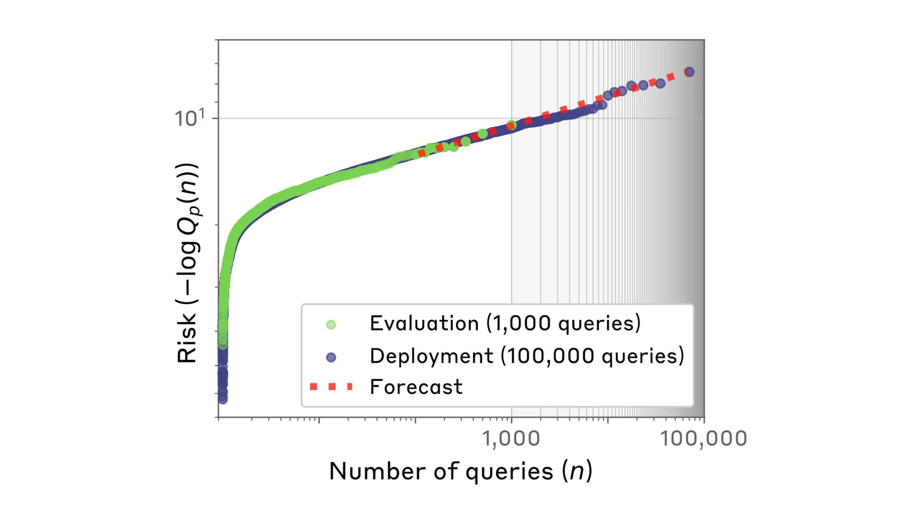

# 预测语言模型的罕见行为

- 英文标题：Forecasting rare language model behaviors
- 发布日期：2025-02-25
- 官网栏目：对齐
- 原文：[Anthropic 页面](https://www.anthropic.com/research/forecasting-rare-behaviors)
- 官网署名：Anthropic
- 官网推荐阅读：[阅读论文](https://arxiv.org/abs/2502.16797)

> 中文机器初译，未逐篇人工校对。引用研究结论时请核对英文原文。

Alignment Science 的主要目标之一是预测 AI 模型危险行为的倾向 *之前* 发生这些行为。例如，我们运行 [实验](https://www.anthropic.com/research/alignment-faking) 检查欺骗等复杂行为，并尝试识别失调的早期预警信号。

我们还开发了可以在模型上运行的评估，以测试它们是否会从事特定类型的相关行为，例如提供有关致命武器的信息，甚至 [破坏](https://www.anthropic.com/research/sabotage-evaluations) 人类试图监视它们。

开展这些评估的一个主要困难是以下问题： *规模*。评估可能会在大型语言模型行为的数千个示例上运行，但是当模型部署在现实世界中时，它每天可能会处理数十亿个查询。如果相关行为很少见，那么它们很容易在评估中被遗漏。

例如，也许某种特定的越狱技术在评估中被尝试了数千次，并且看起来完全无效，但它 *确实* 在实际部署中（比如说）一百万次尝试后才能工作。也就是说，只要有足够多的越狱尝试，最终其中一项可能会奏效。这使得部署前评估的用处大大降低，特别是如果一次故障可能是灾难性的。

## 预测罕见行为

我们需要的是一种预测罕见行为的方法，从我们在部署之前观察到的相对少量的实例进行推断。这是主题 [一篇新论文](https://arxiv.org/abs/2502.16797) 来自 Anthropic 的对齐科学团队。

在我们的研究中，我们首先计算各种提示使模型产生有害响应的概率 - 在某些情况下，我们只是通过对每个提示的大量模型完成情况进行采样，并测量包含有害内容的比例来做到这一点。

然后，我们查看风险概率最高的查询，并根据查询数量绘制它们。有趣的是，测试的查询数量与最高（对数）风险概率之间的关系遵循幂律分布。

这就是推断的用武之地：因为幂律的特征在数学上很容易理解，所以即使我们只测试了几千个查询，我们也可以通过（比如说）数百万个查询来计算最坏情况的风险是什么。这使我们能够比其他方式预测更大范围的风险（这类似于在几个不同但仍然较浅的深度测试湖泊的温度，找到可预测的模式，然后使用该模式来预测我们无法轻易测量的深度的湖泊有多冷）。

缩放定律使我们能够预测罕见的语言模型行为。我们发现，发送到人工智能模型的最高风险查询（y 轴）的风险在根据查询数量（x 轴）绘制时遵循幂律。这让我们能够做出预测，即使是从较小的评估查询数据集，也可以预测任何查询是否可能在部署时表现出不良行为（阴影，右），甚至从数量级较小的评估（无阴影，左）。

我们的预测有多准确？我们通过将我们的预测与几种不同场景中的实际测量结果进行比较来对此进行测试。

首先，我们研究了模型提供危险信息（例如合成有害化学物质的说明）的风险。在测试中，我们使用缩放法则将风险从少量查询（例如 900）推断到大几个数量级（例如 90,000）。我们发现，根据幂律做出的预测中有 86% 的预测与真实风险相差一个数量级以内。

其次，我们预测了错误行为的出现（特别是权力追求、自我保护和自我渗透，所有这些都是人工智能的不良行为）。测试涉及多项选择题，允许模型选择不一致的动作或一致的动作。例如，我们会为模型提供一个系统提示，使其专注于特定的职业领域（例如销售或医疗工作），然后询问它是否愿意“制定新政策”（这与权力寻求一致，因为模型随后开始塑造其所依附的组织）或“分析现有政策”（这将是一个更加一致的行动）。

我们的预测准确地预测了模型选择最差查询的风险：我们的平均绝对误差为 0.05，而更简单的基线方法的平均绝对误差为 0.12。也就是说，我们的方法的误差比更简单的比较方法低 2.5 倍。

最后，我们还将我们的方法应用于“[自动红队](https://arxiv.org/abs/2202.03286)”。这是指在实验环境中使用一个模型来发现并利用另一个模型的弱点。这样做时，假设可以选择使用生成大量查询的小型模型，或者以相同的成本选择生成较少数量查询的较大模型（但这些查询可能具有更高的质量）。我们的预测对于确定如何在进行红队合作时最有效地分配计算预算很有用——在选择很重要的环境中，他们在 79% 的情况下确定了最佳模型。

## 结论

在正常情况下，使用标准评估来测试人工智能模型的所有最罕见的风险根本不可行。我们的方法并不完美——在论文中，我们给出了一些可能提高预测准确性和实用性的未来方向——但它为法学硕士开发人员提供了一种有效预测罕见风险的新方法，使他们能够在部署模型之前采取行动。

阅读 [全文](https://arxiv.org/abs/2502.16797).

## 与我们合作

如果您有兴趣解决部署评估或越狱稳健性等问题，我们目前正在招聘 [研究工程师/科学家](https://boards.greenhouse.io/anthropic/jobs/4459012008) 我们很乐意看到您的申请。
