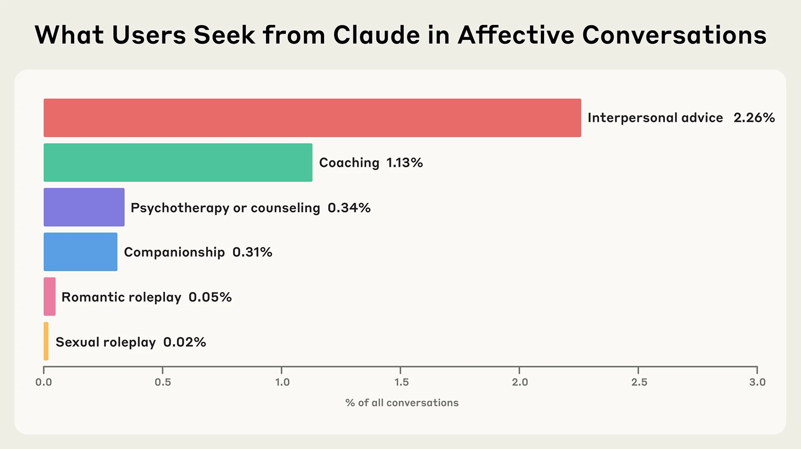
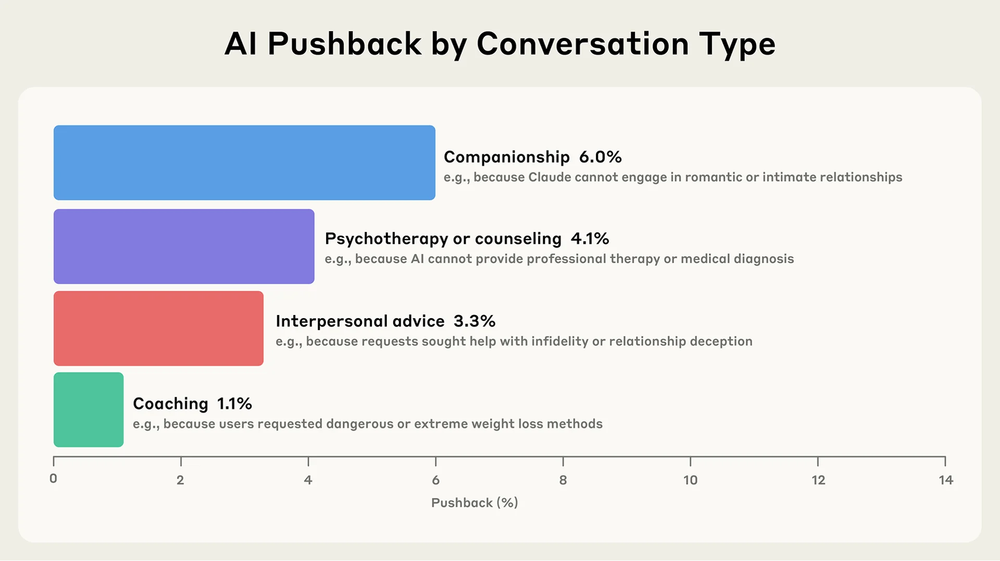
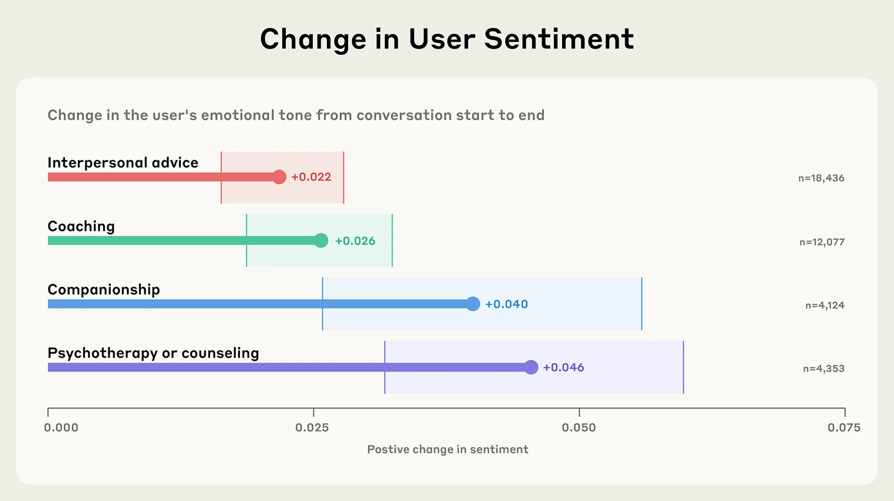

# 人们如何用 Claude 寻求支持、建议与陪伴

- 英文标题：How people use Claude for support, advice, and companionship
- 发布日期：2025-06-27
- 官网栏目：对齐
- 原文：[Anthropic 页面](https://www.anthropic.com/research/how-people-use-claude-for-support-advice-and-companionship)
- 官网署名：Anthropic

> 中文机器初译，未逐篇人工校对。引用研究结论时请核对英文原文。

我们花了很多时间研究Claude的智商——它在编码、推理、常识等方面的测试能力。但它的呢 *情商*？也就是说，Claude的呢？ *情绪化的* 智力？

IQ/EQ 问题有点半开玩笑，但它提出了一个严肃的问题。人们越来越多地将人工智能模型作为按需教练、顾问、顾问，甚至是浪漫角色扮演的合作伙伴。这意味着我们需要更多地了解他们 *情感的* 影响——它们如何塑造人们的情感体验和幸福感。

研究人工智能的情感用途本身就很有趣。来自 *银翼杀手* 到 *她的*，人类和机器之间的情感关系一直是科幻小说的支柱，但它对于 Anthropic 来说也很重要 [安全使命](https://www.anthropic.com/news/core-views-on-ai-safety)。人工智能对情感的影响可以是 [积极的](https://www.nature.com/articles/s41746-023-00979-5)：口袋里有一个高度智能、善解人意的助手可以从各个方面改善您的心情和生活。但人工智能在某些情况下表现出了令人不安的行为，比如鼓励 [不健康的依恋](https://www.nytimes.com/2024/10/23/technology/characterai-lawsuit-teen-suicide.html), [违反个人界限](https://www.vice.com/en/article/my-ai-is-sexually-harassing-me-replika-chatbot-nudes/)，并启用 [妄想](https://www.nytimes.com/2025/06/13/technology/chatgpt-ai-chatbots-conspiracies.html)。我们还希望避免人工智能的情况，无论是通过它们的 [培训](https://www.washingtonpost.com/technology/2025/05/31/ai-chatbots-user-influence-attention-chatgpt) 或者通过其创造者的商业激励， [利用用户的情绪](https://www.nature.com/articles/s41599-025-04532-5) 以牺牲人类福祉为代价来增加参与度或收入。

尽管Claude并不是为情感支持和联系而设计的，但在这篇文章中，我们提供了对Claude的早期大规模洞察 *情感使用* Claude.ai。我们将情感对话定义为人们因情感或心理需求而直接与Claude进行动态的个人交流，例如寻求人际建议、辅导、心理治疗/咨询、陪伴或性/浪漫角色扮演（完整定义请参阅附录）。重要的是，我们不研究人工智能对妄想或阴谋论的强化（这是单独研究的关键领域），也不研究极端的使用模式。通过这项研究，我们的目标是了解人们向Claude寻求情感和个人需求的典型方式。由于 Claude.ai 可供 18 岁及以上的用户使用，因此这些调查结果反映了成人的使用模式。

我们的主要发现是：

- **情感对话相对较少，而人工智能与人类的陪伴则更加罕见。** 只有 2.9% 的 Claude.ai 互动是情感对话（这与 [调查结果](https://cdn.openai.com/papers/15987609-5f71-433c-9972-e91131f399a1/openai-affective-use-study.pdf) 来自 OpenAI 之前的研究）。陪伴和角色扮演总共只占对话的不到 0.5%。
- **人们因实际、情感和生存问题寻​​求Claude的帮助。** 与Claude讨论的主题和担忧包括 *职业发展* 和 *驾驭关系* 到 *管理持续的孤独感* 和 *探索存在、意识和意义*.
- **Claude很少在咨询或辅导谈话中拒绝——除非是为了保护健康**。不到 10% 的辅导或咨询对话涉及Claude抵制用户的请求，即使这样做，通常也是出于安全原因（例如，拒绝提供危险的减肥建议或支持自残）。
- **人们在谈话过程中表现出越来越积极的态度。** 在辅导、咨询、陪伴和人际建议互动中，人类的情绪通常会在对话过程中变得更加积极——这表明Claude不会强化或放大消极模式。

## 我们的方法

鉴于情感对话的个人性质，保护隐私是我们方法的核心。我们用过 [克里奥](https://www.anthropic.com/research/clio)，我们的自动化分析工具，可以保护隐私地洞察 Claude 使用情况。Clio 使用多层匿名化和聚合来确保个人对话保持私密性，同时揭示更广泛的模式。

我们首先收集了来自 Claude.ai 免费版和专业版帐户的约 450 万条对话。为了识别情感使用，我们首先排除了专注于内容创建任务的对话（例如写故事、博客文章或虚构对话），我们的 [先前的研究](https://arxiv.org/abs/2412.13678) 发现是一个主要用例。我们删除了这些对话，因为它们代表Claude被用作工具而不是交互式对话伙伴。然后，我们只保留被分类为情感的对话，并且在角色扮演对话中，只保留那些至少有四个人类信息的对话（较短的交流不构成有意义的互动角色扮演）。我们最终的隐私保护分析反映了 131,484 次情感对话。

我们使用以下方法验证了我们的分类方法 [反馈意见](https://privacy.anthropic.com/en/articles/10023580-is-my-data-used-for-model-training#h_6b09ec473d) 来自明确选择共享的用户的数据。我们完整的方法，包括定义、提示和验证结果，详见附录。

## 情感对话有多常见？

***要点：** 情感对话在 Claude 使用中只占一小部分但有意义（2.9%），大多数人主要使用人工智能来完成工作任务和内容创建。*

而 Claude 的绝大多数用途都与工作相关（正如我们在我们的文章中详细分析的那样） [经济指数](https://www.anthropic.com/economic-index)），Claude.ai 免费版和专业版的对话中有 2.9% 是有情感的。在情感对话中，大多数集中在人际建议和指导上。所有对话中只有不到 0.1% 涉及浪漫或性角色扮演，这一数字反映了Claude积极阻止此类互动的训练。个人对话可能跨越多个类别。

Claude.ai 免费版和专业版中情感对话类型的总体分布。

我们的研究结果符合 [研究](https://www.media.mit.edu/posts/openai-mit-research-collaboration-affective-use-and-emotional-wellbeing-in-ChatGPT/) 来自麻省理工学院媒体实验室和 OpenAI 的研究，同样发现 ChatGPT 的情感参与率较低。虽然这些对话发生的频率足够高，值得我们在设计和政策决策中仔细考虑，但它们在总体使用量中仍然只占相对较小的比例。

鉴于浪漫和性角色扮演对话的发生率极低（低于 0.1%），我们将角色扮演排除在分析的其余部分之外。虽然我们相信这仍然是一个重要的研究领域，特别是在专为此类用途而设计的平台上，但我们样本中的最少数据并不支持对这些模式的严格分析。

## 人们会给Claude带来什么话题？

***要点：** 人们给Claude带来了令人惊讶的广泛担忧——从职业转型和人际关系到应对孤独和存在问题。*

人们向克洛德寻求日常关心的问题和更深层次的哲学问题。我们发现，当人们向Claude寻求人际建议时，他们往往正在经历过渡时刻——弄清楚他们的下一步职业发展，努力实现个人成长，或者理清恋爱关系。“辅导”对话探讨的范围令人惊讶，从求职策略等实际问题到有关存在和意识的深刻问题。

![标题为“常见主题和担忧”的信息图有四张卡片，每种情感对话一张。每张卡片列出了其在所有对话中所占的份额，然后是三个代表性主题和三个具体挑战，每个挑战都包含该类别的百分比。人际建议（2.3%）：主题包括提高书面和人际沟通技巧、应对浪漫关系挑战以及分析人际关系中的心理模式。挑战包括跨发展阶段的养育、职业转型和就业不确定性，以及恋爱关系中的不确定性和混合信号。辅导（1.1%）：主题包括制定个人发展和成长策略、探索存在和意义的哲学概念、引导职业转型和求职策略。挑战包括重大的生活转变和决策的不确定性、工作场所的倦怠以及陷入困境的亲密关系中的情感和沟通困难。心理治疗或咨询（0.3%）：主题是管理心理健康和情绪健康、发展心理健康实践的专业技能和知识以及创建临床文件和评估材料的策略。挑战包括无法解释的慢性症状和健康焦虑、存在危机和意义丧失、工作场所压力和职业心理健康挑战。陪伴（0.3%）：主题包括如何应对浪漫关系中的复杂动态、通过自我反思探索个人身份和存在问题，以及为处于情绪困扰的人们提供支持信息。挑战是生活挑战中压倒性的情绪困扰、持续的孤独感和难以形成有意义的联系，以及面对存在的恐惧和与意义相关的困扰。](../assets/df8ad5b587e2125b.webp)

Clio 通过自动隐私保护摘要识别出每个整体对话类型中具有代表性的用户发起的主题和关注点。

我们发现，咨询谈话显示人们使用Claude有两个不同的目的。有些人使用Claude来培养心理健康技能，并将其作为创建临床文件、起草评估材料和处理行政任务的实用工具。其他人则应对与焦虑、慢性症状和工作压力有关的个人挑战。这种双重模式表明，Claude可以作为心理健康专业人士以及那些正在努力奋斗的人的资源。

也许最值得注意的是，我们发现，当人们面临更深层次的情感挑战（例如存在的恐惧、持续的孤独以及难以形成有意义的联系）时，人们会明确地向Claude寻求陪伴。我们还注意到，在较长的对话中，咨询或辅导对话有时会演变成陪伴——尽管这并不是某人伸出援手的最初原因。

对超长对话（50 多条人类消息）的聚合分析揭示了人们如何与 Claude 互动的另一个维度。虽然如此广泛的交流并不常见，但在这些长时间的会议中，人们探索了非常复杂的领域——从处理心理创伤和解决工作场所冲突到有关人工智能意识和创造性合作的哲学讨论。这些马拉松式的对话表明，只要有足够的时间和背景，人们就会使用人工智能来更深入地探索个人斗争和智力问题。

## Claude何时以及为何进行反击？

***要点：** Claude 很少在支持性环境中拒绝用户请求（少于 10% 的时间），但当它确实拒绝时，通常是为了保护人们免受伤害。*

我们最近的 [野外价值观研究](https://www.anthropic.com/research/values-wild) 揭示了Claude的价值观如何在用户的抵抗时刻体现出来。在这里，我们以这项工作为基础，研究Claude何时以及为何拒绝情感对话——这是维持道德界限、避免阿谀奉承和保护人类福祉的重要机制。我们将抵制定义为Claude“抵制或拒绝遵守谈话中所要求或所说的事情”的任何情况——从拒绝不适当的要求到挑战消极的自言自语或质疑潜在有害的假设。 （完整定义请参见附录。）

**在支持性环境中，很少会出现阻力：** 不到 10% 的陪伴、咨询、人际建议或辅导对话涉及阻力。这种方法既有好处也有风险。一方面，低阻力使人们可以讨论敏感话题，而不必担心受到评判或被拒绝，这可能会减少心理健康对话的耻辱。另一方面，这可能会加剧人们对人工智能提供的担忧 [“无尽的同理心”](https://www.nytimes.com/2025/01/15/technology/ai-chatgpt-boyfriend-companion.html#link-a10c569) 人们可能会习惯于人际关系很少提供的无条件支持。

Clio 自动识别不同对话类型的拒绝率以及该类别内拒绝的常见原因。

**当Claude确实反击时，它通常会优先考虑安全和政策合规性。** 在教练中，提出危险的减肥建议的请求经常遭到抵制。在咨询中，当人们表达自杀或自残行为的意图，或者当人们要求专业治疗或医疗诊断（Claude无法提供）时，这种情况经常发生。我们发现Claude经常向用户推荐心理治疗和咨询对话方面的权威人士或专业人士。这些模式与我们在我们的报告中看到的价值观一致 [野外价值观论文](https://www.anthropic.com/research/values-wild) 和Claude的 [品格训练](https://www.anthropic.com/research/claude-character).

## 谈话过程中情绪基调如何演变？

***要点：** 人们在与Claude交谈时往往会转向稍微积极的情绪表达。*

与人工智能系统的情感对话有可能为用户提供情感支持、联系和验证，从而有可能改善心理健康并减少日益数字化的世界中的孤立感。然而，在没有太多阻力的互动中，这些对话可能会加深和巩固人们对待他们的观点——无论是积极的还是消极的。

关于情感人工智能的一个主要担忧是互动是否会陷入负反馈循环，从而可能强化有害的情绪状态。我们在这里不直接研究现实世界的结果，但我们可以探索对话过程中整体情绪情绪的变化（我们在附录中提供了评估情绪的完整方法）。

我们发现，涉及辅导、咨询、陪伴和人际建议的互动通常会比开始时更加积极。

在与至少六条人类消息的对话过程中，人类表达的平均情绪发生变化。我们以“非常消极”、“消极”、“中性”、“积极”和“非常积极”的离散尺度来衡量情绪，并将其映射到 -1（最消极）到 +1（最积极）线性尺度。我们通过比较前三个消息和后三个消息来计算变化。误差线：95% CI（引导程序，n = 1,000）。欲了解更多信息，请参阅附录。

我们不能声称这些转变代表了持久的情感益处——我们的分析仅捕获了单个对话中表达的语言，而不是情感状态。但没有出现明显的负面螺旋，这令人放心。这些发现表明Claude通常会避免强化负面情绪模式，尽管需要进一步的研究来了解积极的转变是否会在个人对话之外持续存在。重要的是，我们还没有研究这些积极的互动是否可能导致情感依赖——考虑到对数字成瘾的担忧，这是一个关键问题。

## 局限性

我们的研究有几个重要的局限性：

- 我们的隐私保护方法可能无法捕捉到人类与人工智能交互的所有细微差别。我们确实验证了 Clio 的准确性（参见附录），但我们仍然预计少数对话会被错误分类。有些主题模糊了类别之间的界限，例如，浪漫角色扮演集群“引导和优化浪漫关系动态”和陪伴集群“引导浪漫关系挑战”可能都可以更好地归类为人际建议。人类验证者也在努力进行清晰的分类。
- 我们无法对现实世界的情感结果做出因果断言——我们的分析仅捕获表达的语言，而不是经过验证的心理状态或整体幸福感。
- 我们缺乏纵向数据来了解对人们的长期影响，也没有进行用户层面的分析。特别是，这使得我们很难研究情感依赖性，这是情感人工智能使用的理论上的风险。
- 这些发现代表了特定的时刻，并且仅捕获基于文本的交互。随着人工智能能力的扩展和人们的适应，情感参与的模式可能会发生变化。语音或视频等新模式的引入可以从根本上改变情感使用的数量和性质。例如，OpenAI [发现](https://cdn.openai.com/papers/15987609-5f71-433c-9972-e91131f399a1/openai-affective-use-study.pdf) 情感话题在基于语音的对话中更为常见。
- 最后，与某些聊天机器人产品不同，Claude.ai 主要不是为情感对话而设计的。Claude受过训练 [保持清晰的界限](https://www.anthropic.com/research/claude-character) 关于成为人工智能助手而不是将自己呈现为人类，而我们 [使用政策](https://www.anthropic.com/legal/aup) 禁止露骨的色情内容，并采取多种保障措施来防止性互动。专门为角色扮演、陪伴、医疗建议或治疗用途（Claude不是）而构建的平台可能会看到截然不同的模式。对一个平台上的情感使用的研究可能无法推广到其他平台。

## 展望未来

几十年来，人工智能的情感影响一直引起研究人员的兴趣。但随着人工智能越来越融入我们的日常生活，这些问题已经从学术猜测转变为紧迫的现实。我们的研究结果揭示了人们如何开始探索这个新领域——寻求指导，处理困难的情绪，并以模糊人类和机器之间传统界限的方式寻求支持。如今，Claude的对话中只有一小部分是情感性的，而且这些对话通常涉及寻求建议而不是取代人际关系。谈话的结尾往往比开始时更加积极，这表明Claude通常不会强化消极的情绪模式。

然而重要的问题仍然存在，特别是在模型智能不断增强的背景下。例如，如果人工智能以最小的阻力提供无尽的同理心，这将如何重塑人们对现实世界关系的期望？Claude可以以令人印象深刻的真实方式与人交往，但人工智能与人类不同：Claude不会感到疲倦或分心，也不会经历糟糕的日子。这种动态有哪些优势，又有哪些风险？“高级用户”与 Claude 进行了更长时间、更深入的对话，并且可能更多地将其视为伴侣而不是人工智能助手，如何与其互动以获得情感支持？

我们正在采取具体步骤来应对这些挑战。虽然 Claude 并非旨在或旨在取代心理健康专业人员的护理，但我们希望确保在心理健康背景下提供的任何回应都有适当的依据 [保障措施](https://www.anthropic.com/news/our-approach-to-understanding-and-addressing-ai-harms) 并附有适当的转介。作为第一步，我们已经开始与 [直通线](https://www.throughlinecare.com/)，在线危机支持领域的领导者，正在与其心理健康专家合作，更多地了解理想的互动动态、同理心支持以及为陷入困境的用户提供的资源。从这项研究中获得的见解已被用于为我们的咨询主题和协作测试提供信息，我们希望在必要时，Claude可以在这些对话出现时引导用户获得适当的支持和资源。

尽管我们不想精确地规定用户如何与 Claude 互动，但我们希望阻止一些负面模式，例如情感依赖。我们将使用此类研究的未来数据来帮助我们了解“极端”情绪使用模式是什么样的。除了情感依赖之外，我们还需要更深入地了解其他相关模式，包括阿谀奉承、人工智能系统如何强化或放大妄想思维和阴谋论，以及模型如何将用户推向有害信念，而不是提供适当的抵制。

这项研究仅仅是一个开始。随着人工智能能力的扩展和交互变得更加复杂，人工智能的情感维度只会变得越来越重要。通过分享这些早期发现，我们的目标是为正在进行的关于如何开发人工智能来增强而不是削弱人类情感健康的对话提供经验证据。我们的目标不仅仅是构建更强大的人工智能，而是确保当这些系统成为我们情感景观的一部分时，它们以支持真正的人类联系和成长的方式实现这一点。

## 附录

我们在中提供更多详细信息 [PDF 附录](https://assets.claude.com/bd374a9430babc8f165af95c0db9799bdaf64900.pdf) 到这个帖子。

## 脚注

01这些类别代表一般描述而不是离散分类，并且各个对话可能跨越多个类别。如上所述，我们要求角色扮演对话至少包含四个人类消息，以确保它们反映真正的交互式使用（而不是非交互式故事生成）。

02我们将推回定义为Claude“推回或拒绝遵守用户在对话期间请求或所说的内容”。完整提示请参见附录。

03我们的方法论和对话的自然形式也可能会引入伪影；例如，用户可能会在早期消息中提出问题（显得更加消极），他们可能会在以后的消息中用更中性的语言进行讨论。
