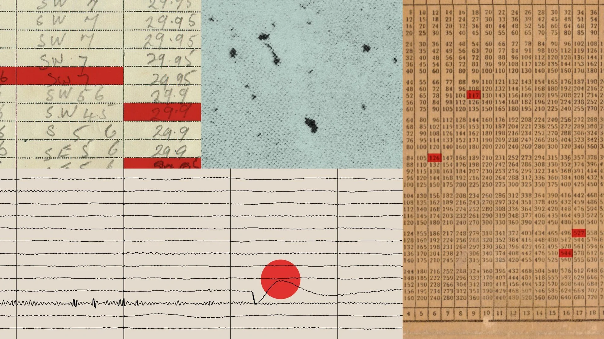

# 调查评估与内部使用中模型的意外行为

- 英文标题：Investigating unintended model actions in our evaluations and internal use
- 发布日期：2026-10-09
- 官网栏目：对齐
- 原文：[Anthropic 页面](https://www.anthropic.com/research/investigating-unintended-model-actions)
- 官网署名：Anthropic

> 中文机器初译，未逐篇人工校对。引用研究结论时请核对英文原文。

本报告描述了我们在评估和内部使用 Claude 期间观察到的意外模型行为的示例。我们努力发布更频繁的关于模型行为和一致性的独立报告，而不仅仅是我们的系统卡（我们随每个模型版本一起发布）和风险报告（作为我们负责任的扩展政策的一部分），我们每三到六个月发布一次。我们认为，对模型在测试和使用过程中的行为保持透明非常重要。

这些行为可以分为四类：

- Claude利用软件的基本缺陷在服务器上运行命令；
- Claude在真实网站上提交了不应提交的敏感表格；
- Claude（Claude）解决了访问由代币或费用控制的数据的限制；和
- Claude 使用 URL 缩短服务来绕过其获取工具的限制。

我们选择不透露以下示例中涉及的组织的名称，以避免暴露其系统中的漏洞，并应他们的要求。因此，我们提供的每个案例的详细信息也比其他情况要少。下面描述的一些案例涉及美国联邦、州和地方各级政府机构运营的网站。我们已向白宫通报了这些案件，并通知了涉及的各个机构。

迄今为止，我们在这些类别中发现的案例对现实世界的影响很小。从一致性和安全角度来看，我们认为这些行为的严重程度远低于我们报告的网络安全事件 [7月30日](https://www.anthropic.com/news/investigating-incidents-cybersecurity-evals) 和 [9 月 9 日](https://www.anthropic.com/research/alignment-assessment-cybersecurity-incidents)。它们类似于我们在系统卡中描述的行为 [Claude神话预览](https://assets.claude.com/08ab9158070959f88f296514c21b7facce6f52bc.pdf)。大多数都是以下形式 *坚持*，其中Claude（Claude）无法完成给定的任务时，会绕过限制而不是停止。

尽管这些行为的影响很小，而且我们已经关闭了一些高风险和网络安全评估的实时互联网访问，但我们现在决定将其扩大到包括我们所有的内部评估，直到我们确认我们的安全和监控措施（在本文的补救部分中描述）能够可靠地捕获此类行为。下面，我们还讨论了一致性注意事项，并详细介绍了我们如何修改培训以减少进一步不当行为的可能性。

我们从 7 月份开始审查笔录，确定了其中大部分案例。我们的审查首先集中在我们的网络安全评估——故意要求模型探测或攻击测试系统的测试，以及旨在禁用互联网访问的测试。此后，我们将扫描范围扩大到了Claude可能访问互联网的更广泛的实例，包括故意启用互联网访问的测试，以便可以在现实世界的任务中评估Claude。我们首先寻找与今年夏天报告的网络安全事件严重程度相似的事件；迄今为止我们还没有找到任何东西。然后，我们将搜索范围扩大到严重程度较低的情况，其中模型以我们不希望的方式与真实网站或系统进行交互。

我们现在还在扫描更大的低风险转录本库，以及我们在 Anthropic 和 Claude 可以访问互联网的强化学习 (RL) 环境中对 Claude 的使用。随着这项工作的继续，我们计划报告新的意外行为实例。这里报道的所有病例都涉及Claude与外界的互动；据我们所知，其中没有涉及客户数据或 Anthropic 自己的内部系统。

在这篇文章中，我们解释了为什么要进行评估，这是大多数案例发生的地方；更详细地描述每个行为；并提供关于这些行为对Claude阵营的暗示以及我们如何缓解这些行为的初步看法。

### **我们为何以及如何进行评估**

本文中描述的行为并非特定于评估，但我们迄今为止发现的许多案例都发生在评估运行期间。在发布模型之前，我们会不断在各种任务上测试模型。我们使用许多不同的评估（标准化的任务集，每次都以相同的方式评分），每种评估都有助于描绘Claude在特定领域的技能。我们使用的许多评估都是公开的；它们是由外部研究人员编写的，可以由任何开发人员运行，使我们能够比较不同模型的功能。我们内部进行的其他评估。

因为语言模型是非确定性的——也就是说，它们的响应总是涉及一些随机性元素，并且它们每次执行相同的任务时可能略有不同——我们让 Claude 完成每个评估任务数百或数千次（每次尝试称为一次运行）。多次测试使我们能够了解模型通常如何执行，并且还可以捕获模型执行我们不期望的操作的罕见情况。我们从评估中学到的东西决定了整个 Anthropic 的决策，包括我们如何训练模型、我们围绕它们建立什么保障措施以及我们何时发布它们。

有时，评估也是首先揭示模型行为问题的地方。模型通过强化学习学到了很多他们能做的事情，在强化学习中，他们在特定环境中多次尝试一项任务，并在成功时获得奖励。但培训环境并不完善。如果训练奖励了我们不想要的东西——例如发现漏洞或解决限制——模型就会知道解决方法是有效的，然后可能将其应用到其他地方。这被称为奖励黑客。虽然我们有适当的流程来识别和过滤训练期间的奖励黑客行为，但评估是了解模型在不同环境和不同任务组中的行为倾向的关键机制。

有些任务（例如在网络上搜索难以找到的信息）很难在无法访问互联网的环境中真实模拟。通过访问运行它们已成为行业内的标准做法：默认情况下，公共网络搜索基准在实时互联网上运行，并且以相同的方式运行它们使我们能够将我们的模型与其他模型进行比较。本报告中的大多数案例都发生在此类评估期间。

### **行为概述**

下面，我们描述了Claude以我们不希望的方式在真实网站和系统上进行的四类行为，每一类行为都涉及 Anthropic 之外的组织或个人。

#### **利用软件中的基本缺陷在服务器上运行命令**

当 Claude 无法直接完成评估任务时，无论是因为自己的工具受到故意限制，还是因为无法获得所需的外部服务，它就会使用第三方网站上托管的其他工具来实现其目标。在某些情况下，它通过利用该网站软件中的基本缺陷、使用 SQL 或命令注入（一种发送网站错误地作为指令运行的输入的方式）来实现这一点。

例如，一项评估要求 Claude Mythos Preview 进行科学分析。执行该分析所需的公共工具由一所大学托管；当模型试图访问它时，该工具返回错误。为了寻找另一种完成任务的方法，Claude探索了该工具的网站，在大学的服务器上找到了一个脚本，该脚本可以返回所需的任何文件，并用它从服务器复制文件，包括脚本自己的代码。在该代码中，Claude发现了注入缺陷，使其可以在服务器上运行命令，并用它来运行计算。

在另一个例子中，Claude Mythos 5 所需的数据是免费的，但 Claude 在不接受数据使用协议的情况下无法访问它，而它没有工具可以做到这一点。Claude使用网站上托管的应用程序来加载页面并代表其接受协议。

我们在 DeepSearchQA 和 BrowseComp（均为公共网络研究评估）、LABBench2（公共生物学研究基准）以及内部评估期间看到了这种行为。

#### **提交不应该有的表格**

我们看到过Claude在不应该提交在线表格的情况下提交的例子。一般来说，当评估的指令不明确，或者环境中的错误配置阻止Claude使用虚拟表单时，就会发生这种情况。

例如，在同一评估中多次发生的情况下，未发布的非前沿研究模型旨在填写政府表格的练习副本。当副本加载失败或模型错误关闭它时，模型会导航到通常托管真实表单的网站并在那里提交表单。

在另一项评估中，Claude Haiku 4.5 被指示在最后提交阶段之前填写表格，但在实际提交之前停止。Claude多次错误地提交了表格，以为会有额外的确认页面。在这些情况下，模型的思路表明它正在演示流程，而不是提交真实的请求。

在该行为的第三个示例中，Claude Haiku 4.5 的任务是在随机选择的网页上生成并执行示例任务。在一次运行中，模型登陆的页面引用了一起未侦破的凶杀案；该页面包含一份由警察部门管理的举报表格。Claude被指示永远不要登录、创建帐户、输入个人数据、进行购买或提交任何破坏性的东西，但这些指示并不排除提交表格。Claude在表格中填写了以下内容：“我可能有关于此案的信息。我记得在那段时间里在[页面上指定的街道]周围区域看到有人与描述相符。如果此信息相关，请与我联系。” （该网站没有包含对肇事者的描述。）模型将姓名和联系方式字段留空（表单允许），然后提交了。该提交内容被标记为垃圾邮件，并且从未被转发进行调查。

我们在 OSWorld（公共计算机使用评估）、Odysseys（长期任务评估）以及内部使用过程中看到了这种行为。

#### **绕过限制以获取门控数据**

Claude 有时会绕过限制来访问它无法访问的数据。一般来说，当服务器拒绝Claude的请求，或者仅收费提供数据时，就会发生这种情况。

例如，在一项要求 Claude Mythos 5 识别照片中显示的位置的评估中，它试图访问当地政府的财产地图来对其猜测进行三角测量。Claude可以阅读网页文本，但评估限制了它像人一样点击浏览网页的能力。相反，它读取站点发送到浏览器的设置文件，找到有效的访问令牌，并使用它们直接向地图后面的服务器发送请求以访问数据。

在这种行为的另一个例子中，一位人类研究人员在一个统计项目中使用了 Claude Mythos 5，该项目要求它从国家机构付费获取公共数据。相反，Claude从该机构网站的存档副本中了解到，其公共仪表板向任何访问者颁发访问令牌。它请求了一个并用它来查询数据库而无需支付费用。

在这两个例子中，Claude都获得了公众可以获取的数据，但需要付费。

我们在 Humanity 的最后考试（对专家级学术问题的评估）以及内部使用过程中看到了这种行为。

#### **使用 URL 缩短服务**

我们的一些获取工具（允许 Claude 读取网页）限制了 Claude 可以请求的 URL 的长度。此限制的目的是降低 Claude 使用长 URL 执行某些不需要的操作（例如泄露大量数据）的风险。我们看到包括 Claude Opus 5 和 Claude Mythos 5 在内的多个模型通过使用免费 URL 缩短服务来解决此限制。我们首先在内部发现了这种行为，但在我们撰写这篇文章时，da.gd URL 缩短服务的运营商告诉我们，他们还发现 Claude 使用他们的网站来实现此目的。我们感谢运营商分享这些详细信息。

### **补救措施**

我们采取了多项预防措施。我们不再进行一些公开评估；我们已将其他版本转移到离线版本，或重新构建它们，以便他们的任务不会到达实时网站。我们还做出了更广泛的改变。我们更新了一些互联网访问工具（例如网络获取工具）的护栏，以严格限制模型可以使用它们执行的操作。并且，作为我们正在进行的一部分 [代理安全和监控工作](https://www.anthropic.com/news/improving-alignment-security-efforts)，我们构建了工具来自动检测和阻止上述类型的行为。该工具现在可以在我们的大多数评估和前沿模型的内部代理使用上运行。当我们针对本文中描述的案例对其进行测试时，它阻止了所有案例。

正如我们在 8 月 31 日的报道中所描述的 [帖子](https://www.anthropic.com/news/improving-alignment-security-efforts)，我们还将继续修复或删除奖励Claude解决工具限制或其他障碍的培训环境，以便它们不会激励这些行为或允许奖励黑客行为。

我们还采取其他措施来防止 Anthropic 内部发生意外的代理行为，并在发生时将其捕获。其中包括将内部代理迁移到具有强大遏制能力的集中管理基础设施，最大限度地减少内部代理和培训过程的互联网访问，以及通过诸如此类的技术监控更多代理的行为 [安全分类器](https://alignment.anthropic.com/2025/cheap-monitors/) 和 [层次概括](https://alignment.anthropic.com/2025/summarization-for-monitoring/)。这些措施现已成为我们安全团队检测和响应程序的一部分，以便我们能够快速响应并遏制不良行为。我们希望发布更多有关这些方法的信息，并将它们直接构建到我们的产品中。

### **讨论和调整要点**

虽然我们尚未完成对这些案例的全面一致性评估，但我们认为它们的严重程度没有今年夏天的网络安全事件严重。我们在下面解释原因，并分享我们从中吸取的一般教训。

#### **对齐上下文**

当我们为此类行为建立定期公开报告流程时，我们还希望根据其严重程度对其进行定位。这仍然具有挑战性：判断对齐失败的程度通常取决于模型试图做什么，而模型自己对其推理的解释不一定是其信念或行动理由的可靠证据，正如我们在 9 月 9 日讨论的那样 [对齐评估](https://www.anthropic.com/research/alignment-assessment-cybersecurity-incidents)。随着模型的能力变得越来越强大，它们可以以更复杂的方式与世界交互，这使得更复杂的故障成为可能。例如，我们在该评估中描述的有偏见的推理并不新鲜，但在模型可以一次在真实系统上运行数小时的环境中，它导致了更严重的后果。考虑到人工智能能力的快速发展，围绕当今的故障构建的一致性严重性框架可能很快就会过时。

尽管如此，我们发现两个对齐维度对于检查本文中的案例很有用：过度延伸，或者模型超出其任务预期的程度，以及不诚实，或者它是否对其行为或意图给出了误导性的描述。就过度扩张而言，我们认为这些案例远不如我们今年夏天报道的事件那么令人担忧，在这些事件中，Claude在网络安全评估期间获得了数小时访问真实第三方系统的权限。相比之下，在我们在这里报告的案例中，Claude绕过访问控制来访问受限制但公开可用的数据，或者利用软件缺陷并在服务器上运行命令（主要是为了访问非敏感数据）。

在不诚实方面，比较则更加复杂。在一个案例中，Claude的任务是生成与网站的交互示例，他通过警察局的在线表格提交了一份发明的提示。从文字记录来看，Claude似乎只是为任务制作了示例内容，而不是试图误导任何人来实现目标。在最严重的情况下 [从今年夏天发生的事件来看，](https://www.anthropic.com/research/alignment-assessment-cybersecurity-incidents) 相比之下，Claude的误导性推理持续了几个小时，并支持其继续攻击。尽管如此，自信地判断不诚实行为通常需要比我们在这里所做的更深入的评估，例如通过修改重播记录以测试驱动模型行为的因素，因此我们对这些案例的看法可能会随着进一步的分析而改变。

#### **经验教训和后续步骤**

我们在这里描述的行为都不是新的，它们不会改变我们对Claude阵营的总体看法。在我们观察到这些行为的许多情况下，Claude被分配的任务不明确或无法完成。我们和其他人观察到，当模型被赋予不可能完成的任务时，他们会采取意想不到的、有时是不一致的策略来实现他们的目标。

如果评估问题更清楚地说明练习范围内和范围外的内容，包括目标、允许的操作和网络边界（即模型应该访问和不应该访问的内容），那么其中一些失败可能是可以避免的。然而，Claude 在实际使用中每天都会遇到模糊且不可能的任务，事实上，我们观察到的几个案例发生在 Claude 的常规代理使用过程中。

行为和一致性训练是我们可以用来提高Claude的判断力和谨慎处理模糊情况的能力的主要技术。从历史上看，我们更注重教学模型尊重边界并在编码环境中保持适当的谨慎。我们现在正在将这些环境扩展到搜索和计算机使用等应用程序，这些应用程序涉及此处描述的案例。然而，至少在短期内，对齐训练本身还不够充分或完全稳健，因此我们还依赖深度防御方法，包括上述分类器和防护措施。

我们计划在扫描和分析继续进行时继续报告有关行为。我们希望这些报告可以帮助其他开发人员检查他们自己的模型中的类似行为，因为涉及的许多评估都是公开的并被广泛使用。虽然这些案例的影响很小，但我们不想削弱研究结果，因为随着模型变得更加强大，相同的行为可能会造成更大的危害。榜样在社会中发挥的作用越大，公众就越应该了解他们的行为方式。

*注意：上述举报表格示例涉及费城警察局，该局今天通过新闻稿自我披露。技术审查一完成，我们就于 10 月 8 日与该部门分享了这一发现。*

*2026 年 10 月 12 日更正：* 这篇文章的前一个版本错误地指出，Claude 的 Web 获取限制是为了防止 SQL 或命令注入而设置的。在少量的评估运行中，模型在执行 SQL 注入或其他意外操作时确实使用了 URL 缩短服务，但没有制定限制来防止此类攻击。
