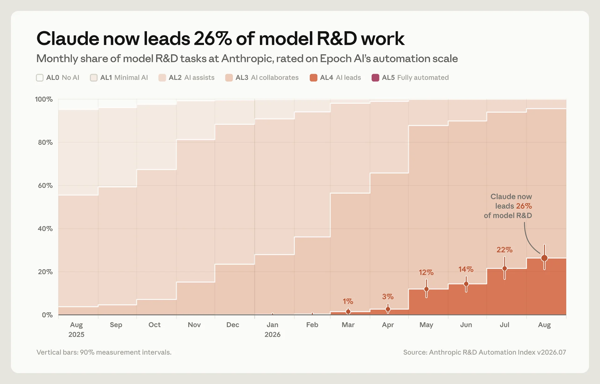

# 让前沿 AI 的发展进程可见

- 英文标题：Illuminating the frontier
- 发布日期：2026-09-17
- 官网栏目：对齐
- 原文：[Anthropic 页面](https://www.anthropic.com/institute/measuring-pace-of-ai-development)
- 归档范围：网页可读取的内容。交互图表、表单或其他动态内容请见原站。

> 中文机器初译，未逐篇人工校对。引用研究结论时请核对英文原文。

人工智能系统正变得越来越强大，并且已经开始 [更多自动化](https://www.anthropic.com/institute/recursive-self-improvement) 构建自己的过程。正如世界所认为的 [减缓前沿人工智能发展步伐](https://darioamodei.com/post/we-must-pace-the-frontier)，公众需要更多信息。

在这篇文章中，我们提出了可以阐明人工智能开发的三个关键方面的测量工具：

1. [人工智能在多大程度上构建自身的下一个版本，而不是由人类构建](https://www.anthropic.com/institute/measuring-pace-of-ai-development#1-measuring-ai-led-ai-rd)
2. [我们监督和干预AI 智能体在 Anthropic 系统上采取的行动的能力](https://www.anthropic.com/institute/measuring-pace-of-ai-development#2-measuring-oversight-of-ai-agents)
3. [推动开发更强大模型的资源](https://www.anthropic.com/institute/measuring-pace-of-ai-development#3-measuring-compute-allocation)

我们还提供了 Anthropic 内部这些指标的快照。值得注意的是，如果按照 Anthropic 首席执行官达里奥·阿莫迪 (Dario Amodei) 的呼吁，在前沿步伐上进行协调，我们预计这些数字会发生变化。我们计划在 Anthropic 中嵌入来自多个组织的独立第三方评估人员，并让他们能够访问与内部风险评估团队所拥有的相当的内部流程、系统和数据。这些第三方将验证安全实践、报告事件并监控关键指标，例如本文中的指标。

我们报告这些测量结果是因为它们可以让公众、第三方和政府更好地了解前沿实验室内人工智能的开发进度。对于每项测量，我们都会描述我们测量的内容、测量显示的内容以及如何以其他人可以验证的形式定期发布这些测量结果。我们在附录中分享方法细节。

## 跟踪这些测量的原因

本文中的测量重点是 *模型是如何构建的。* 通过更好地理解模型的生产过程，我们有更好的机会将模型输入（如计算）与模型输出（如功能）关联起来。它们补充了能力评估，衡量 *模型可以做什么*。我们通过我们的网站单独发布这些内容 [负责任的扩展政策](https://www.anthropic.com/responsible-scaling-policy) (RSP) 风险报告，其中包括有关我们的模型在多大程度上加速人工智能研发的证据。在我们关于先进人工智能的政策提案中， [高级人工智能框架（AAIF）](https://assets.claude.com/0a58d567024a8b448ff15158ebc3625328dfcc1f.pdf)，我们提出了任何实验室如何发布安全模型的规则，包括政府可能要求的透明度义务，例如风险报告。总之，这些提出的测量和政策是从实验室外部监控人工智能发展步伐的起点。

## (1)衡量人工智能主导的人工智能研发

**为什么要衡量人工智能主导的研发？** 前沿人工智能实验室越来越多地使用人工智能来构建未来的人工智能模型。这一过程使民主国家的实验室能够更快地开发能力更强的模型，并在模型发布之前对其进行更多的安全性和测试，以确保人工智能的优势，同时保持领先地位。然而，加速自身发展的模型可能会使人类理解或控制这些系统变得更具挑战性。因此，分享这些指标对于了解世界距离实现这一目标还有多远非常重要。 [递归自我改进](https://www.anthropic.com/institute/recursive-self-improvement) （完全自主构建其后继者的模型）。

**我们测量的。** 我们建立了一个原型指数，衡量 Anthropic 的人工智能研发 (R&D) 有多少是由 Claude 执行的，称为 Anthropic 研发自动化指数。它的构建方法是对公司完成的各种人工智能研发工作进行分类，对当前每项任务的自动化程度进行评级，然后汇总这些评级。

**我们发现了什么。** 为了衡量人工智能在 Anthropic 进行人工智能研发的程度，我们使用 [自动化评价量表](https://epochai.substack.com/p/toward-an-onet-for-ai-r-and-d) 由 Epoch AI 开发，用于衡量“自动化水平”（AL）。它从 AL0（没有人工智能参与）运行到 AL5（人工智能完全自主运行，循环中没有人类）。在 AL3 中，人工智能“协作”：它可以在人类的密切指导下完成大量工作。在 AL4 中，人工智能“主导”：它可以根据高级别的提示端到端地完成大部分任务，而人类则进行监督。[1](https://www.anthropic.com/institute/measuring-pace-of-ai-development#footnote-1)

截至 2026 年 8 月，

- 对于人工智能研发工作的任何测量子集，Claude都没有完全自主地运作。
- Claude“领导”了 Anthropic 26% 的人工智能研发工作。
- “AI协同”及以上的工作占比在90%以上。



**今天任何人工智能开发人员都可以报告什么。** 任何前沿开发人员都可以使用公共方法定期发布这些措施。这将使这些数字能够随着时间的推移进行比较，甚至可以跨实验室进行比较。

对此类报告进行跨实验室比较有两个障碍。首先是缺乏通用的方法论。其次，我们使用自己的模型来评估我们的系统，这可能意味着“判断”模型可能会犯与它正在检查的模型相同的错误。为了应对这些挑战，开发人员的测量结果可以由第三方或其他开发人员的模型进行验证，并设置护栏来限制竞争性敏感数据的交换。这些措施也可能引发更严格的要求，例如在新模型用于进一步人工智能研发之前的固定测试窗口。

## (2) 衡量人工智能主体的监督

**为什么要衡量对代理人的监督？** 与其他前沿开发人员一样，Anthropic 员工越来越多地将任务委托给长期半自主工作的代理，并将工作委托给彼此。随着工作变得越来越自动化，从“人工智能协作”到“人工智能主导”，代理人可以做出更重要的决定，例如下一步要追求哪个研究方向。

这些决策需要保障措施来阻止单个代理的有害行为，以及监督制度来检测可能只在多个代理中出现的问题。在我们迄今为止的监测数据中，个别特工很少有不当行为。但当经济中有数百万或数十亿主体在运作时，即使是罕见的事件也可能定期发生。

**我们测量的。** 我们建立了一个系统，可以让我们监督和干预AI 智能体在 Anthropic 系统上采取的行动。在这里，我们考虑三个不同的指标： *覆盖范围，* 它描述了在执行之前或之后通过监视器的代理动作的份额； *评论* *延迟*，这是一项操作与首先由自动监控器然后由人工进行审查之间的时间；和 *升级率，* 其中是被阻止/重定向（对于在线监控器）或标记为进一步审查（对于离线监控器）的代理活动的份额。

**我们发现了什么。** 截至 2026 年 8 月，在我们最常用的内部平台上，任何时候都有大约 30,000 名代理在 Anthropic 进行研究和工程工作。这些测量仅涵盖该平台。这些代理的行为受到两种监视器的限制，总结如下：

**在线监测**

**离线监控**

**描述**

在线监控器检查代理的操作 *实时* 并自动阻止危险行为或引导特工的不当行为。它们的构建是为了解决快速发生且无法挽回的危害，例如代理从我们的系统中复制模型权重。

离线监控读取代理活动 *事后*。它们旨在帮助解决缓慢发展且可以逆转的危险行为，例如模型失调的迹象。我们使用标记的活动来改进我们的缓解措施，例如分类器和确定性控制。如果情况造成了巨大的迫在眉睫的危险，我们将关闭特工部署中的危险部分。

**覆盖范围**

这些代理的操作在执行之前 100% 通过在线监控，通常在几秒钟内。

这些代理的操作 100% 在执行后都会被监控器摄取。

**审核延迟**

自动审查发生在代理采取行动之前；人类会在一周内审查任何被阻止的操作。

该监控器每周标记大约 100,000 份成绩单，然后由多个分类器进行审查，以进行误报和初步监督审查。大多数标志都通过此过程解决，并且最高优先级标志（每周大约 50 个）将升级为人工审核。

**阻塞/升级率**

我们分析了 2026 年 8 月研究和工程代理的超过 10 亿个决策，发现其中 0.002%（约 47,000 个决策中的 1 个）被此监视器阻止。

监控器会在每千份记录中标记大约一到两份记录，以供进一步审查。

**人工智能开发人员今天可以报告什么。** 任何在自己的研究和工程工作负载上运行代理的开发人员都可以发布相同的措施： *覆盖范围* （受监控的代理活动份额）， *审核延迟* （多久审查标记的活动），以及 *升级率* （监视器阻止或标记的代理活动的份额是多少）。总之，这些措施将使社会了解监督是否与人工智能在人工智能研发中日益增长的作用保持同步。我们在最近的报告中发布了所有这些测量结果 [风险报告](https://www.anthropic.com/aug-2026-risk-report).

开发人员应该分享监视器捕获已知代理不当行为的频率，并且应该让第三方独立进行此类测试。过去，METR 曾 [独立红队我们的离线监控平台](https://assets.claude.com/f61d49fa5596956a5dec75fea0e973bf6a6a8378.pdf)。如上所述，我们现在 [设置](https://darioamodei.com/post/we-must-pace-the-frontier) Anthropic 的外部第三方评估员。

## (3) 测量计算分配

**为什么要衡量计算分配？** 从广义上讲，人工智能开发人员使用计算来构建更强大的模型、为客户提供服务以及以安全为重点的工作，例如 [审核模型的“想法”](https://www.anthropic.com/research/natural-language-autoencoders), [训练模型生物来研究失调](https://www.anthropic.com/research/emergent-misalignment-reward-hacking), 和 [评估模型是否可以安全部署](https://assets.claude.com/f61d49fa5596956a5dec75fea0e973bf6a6a8378.pdf)。了解人工智能开发人员如何分配他们的计算可以告诉您开发人员将其资源集中在哪里以及该重点如何随着时间的推移而变化。

此外，计算是人工智能研发过程中最可验证的输入之一，这意味着它可能成为未来节奏工作的关键杠杆。协调的节奏工作可以鼓励公司增加分配给整个行业安全的计算量，并投入更多资源用于协调、可解释性、安全测试和评估。

**我们测量的。** 我们检查了 Anthropic 从 7 月 13 日到 7 月 20 日如何使用其所有计算的快照。[2](https://www.anthropic.com/institute/measuring-pace-of-ai-development#footnote-2) 为此，我们将每个工作负载分为几个类别，然后询问用于人工智能研发的计算中有多少是安全工作。

从本质上讲，安全研究使用的计算量往往比前沿培训少，因此计算量并不能完美地反映公司对安全的关注程度。这是因为安全研究由个别研究人员设计实验组成，尽管运行实验的计算量不是特别大，但这是非常耗时的。因此，该指标的价值不在于绝对数字，而在于它提供了一种简单的机制，可以在开发人员之间以及随着时间的推移进行同类比较。

**我们发现了什么。** 在所检查的一周内，用于 AI 研发的计算中约有 6% 分配给了安全性，而用于 AI 驱动的 AI 研发的计算量中约有 12% 分配给了安全性。

这些是故意保守的估计。例如，如果令牌用于提高功能和提高安全性一样多，则不会计入这些指标。此外，这些指标不考虑安全防护分类器，安全防护分类器是一种独立的、可比较的计算量，使我们的模型对世界来说更加安全。

**人工智能开发人员今天可以报告什么。** 任何前沿开发人员都可以发布其人工智能研发计算中用于安全工作的份额，同时发布类别定义并由独立第三方检查分类。

安全研究与能力研究很难区分，每个开发人员都会忍不住慷慨地划清界限。开发商应承担举证责任，证明工作与安全相关。开发商、政府和更广泛的研究界将受益于提前达成共同的定义。这样的测量可以为未来的行动提供信息，例如实验室对用于安全研究的计算份额的承诺，或对用于人工智能研究代理的计算份额的限制。

## 结论

当世界考虑前沿的步伐时，我们应该尽一切可能缩小前沿实验室知识与公众知识之间的差距。这意味着更好地衡量人工智能的发展，公开报告，并让社会有机会决定如何使用这些信息。我们希望通过发布这些测量结果来模拟这种透明度，我们将继续这样做。

## 附录

以下是我们原型化的所有测量的方法细节。

### 衡量人工智能主导的研发

**我们是如何做到的。** 自动化指数需要三件事：Anthropic 正在完成的所有人工智能研发任务的完整地图、一种评估自动化水平的方法以及一种对任务进行加权的方法，以便重要的工作领域比不重要的工作领域更重要。没有人能够亲手列出前沿人工智能公司的每一项人工智能研发任务，至少不能达到我们想要的粒度。相反，我们根据工作记录（包括 Slack 和各种内部文档来源）以自下而上的方式构建了这个任务列表。

在 2026 年 7 月的每一周，我们从构成模型研发循环的每个部门随机抽取 20% 的员工。Claude（Claude）的研究人员使用 Slack 和内部文档回顾了每个抽样人员的一周，并列出了他们所做的任务。在 2026 年 7 月每周重复此操作，我们就会得到约 15,000 个细粒度模型研发任务的平面列表。然后，我们使用 Claude 将这些任务组织成一个层次树，从根部的所有模型研发开始，分支到训练和产品等领域，然后是预训练和强化学习，等等，直到越来越具体的工作类型。生成的树有 542 个不同深度的节点，其中 378 个是“评估平台缺陷诊断和修复”、“RL 沙箱出口和网络策略”和“提供事件事后分析”等叶子节点。我们冻结这棵树，以便我们所做的每次测量都针对同一篮子工作进行。

对于树中的每个节点（描述其下所有工作的任务类别），Claude代理深入研究整个公司如何完成此类工作：谁来做，使用什么工具，以及人工智能执行了多少工作。然后，一位独立的Claude法官阅读了由此产生的证据，并指定了六个自动化级别之一，采用了 [规模](https://epochai.substack.com/p/toward-an-onet-for-ai-r-and-d) Epoch AI 提出区分人工智能的使用程度：没有人工智能参与、人工智能最少参与、人工智能协助、协作、领导或自主。当我们对给定月份的自动化进行评级时，我们只允许进行评级的研究代理查看该月或更早的证据。

为了将所有自动化级别评级汇总为一个数字，我们希望为树中的每个节点赋予一个权重，该权重对应于该工作对整个模型研发工作的重要性。我们没有自己决定哪些工作比其他工作更重要，而是使用专门用于该任务的人员时间作为代理。使用我们的样本，我们让 Claude 研究了每个人在 2026 年 7 月每周的工作内容。每个人每周获得一个重量单位，并平均分配到他们当周完成的任务中。如果 A 完成四项任务，则每项获得 0.25；如果 B 工作了 10 个，则每个人得到 0.10。类别的权重是赋予该类别的所有人时间权重的总和。这是一个粗略的近似值，但平均而言，该方案的表现很合理：它为许多人分配到的类别分配了更多的权重。

**这能捕捉到什么，不能捕捉到什么。** 首先，自动化评级取决于判断模型。为了检查它们，我们要求拥有相关工作区域的 Anthropic 工作人员评价其区域的相对自动化程度。为了确保公正的解读，工作人员在不知道模型收集了哪些证据或如何判断这些证据的情况下进行了评级。我们的评判模型与人类的一致程度与人类之间的一致程度相当（模型与人类的精确一致性为 59%，人类与人类的精确一致性为 35%），并且模型和人类的评分在 97% 的情况下都在同一水平内。在边界情况上仍然存在真正的分歧空间，例如“人工智能协作”到底从哪里结束，“人工智能主导”到底从哪里开始。

其次，篮子被冻结。以 2026 年 7 月为基准的不断增长的指数告诉我们，人类正在做的工作 *那时* 正在自动化；它本身并不能告诉我们人类已经转向的新工作类型是否正在出现。为了调查这一点，我们根据 2026 年 1 月的数据构建了冻结树的替代版本，并将 2026 年 2 月至 7 月每个月到达的新任务与 2026 年 1 月的篮子进行了比较。我们发现一月和七月的任务篮子之间“新颖”任务的数量没有增加，这表明模型研发工作的结构在我们的分析水平上是稳定的。尽管如此，我们计划定期重建任务篮，并酌情重新版本我们发布的自动化数字。

### 对代理人的监督

**我们是如何做到的。** 在我们最常用的内部代理支架中，两种设计选择使我们能够更轻松地检测未知的未知因素并让代理相互监视：

- **身份。** 大多数人工智能用户习惯于在许多不同的聊天中与单个“Claude”交谈。由于许多代理一起工作，我们发现为代理提供个人身份并将代理创建的所有数据与其身份联系起来很重要。这让一个代理将自己与其他代理区分开来，并将来自另一个代理的内容视为要检查的声明，而不是自己的想法。它允许代理根据个人经验做出判断，从而降低相关操作的风险。而且由于身份不与模型绑定，它会通过模型升级而持续存在，因此即使支持它的底层模型发生变化，代理的记录也是连续的。从监督的角度来看，这种设计确保可以跨时间审核每个代理的每个操作，并且每个数据记录都可以链接回特定的代理。
- **开放式沟通。** 代理商沟通通过共享、开放的消息系统，而不是私下进行。每条消息都与发布该消息的代理的身份相关联，并且可以链接到其他内容，以便代理共享原始引用。这使得客服人员在沟通时可以避免“打电话”。由于代理可以看到彼此的消息，因此他们可以纠正彼此的错误，并协调共享工作。所有消息都与代理记录进行交叉引用，从而允许行为监控遍历代理之间的通信。

**这能捕捉到什么，不能捕捉到什么。** 在代理活动的这种规模下，很难确定我们对所有可能的行为有一个完整的了解，或者我们是否正在使这些模式对人类的监督足够清晰。我们已经进行这种监控数月而不是数年，并期望代理监控科学在未来会发生重大变化。

### 测量计算分配

**我们是如何做到的。** 我们从现有的计算监控工具开始； Anthropic 与每个前沿开发人员一样，拥有多种为容量规划而构建的监控工具，这些工具定期对加速器使用情况进行采样，并根据其元数据使用尽力而为的标签（即研究和模型开发、内部使用、第一方推理等）来标记工作负载。第三方云计算的使用情况由提供商向我们报告并纳入其中。这项练习的大部分工作是将这些现有资源拼接在一起。

然后，我们使用 Claude 通过提示分类器将每个工作负载分类为安全工作或人工智能研发。安全工作被定义为主要目的是使人工智能系统更安全、更易于理解或更安全的工作。其他一切，包括能力研究、训练生产模型、产品开发和开发工具，都算作人工智能研发。对能力和安全都有帮助的工作也被算作人工智能研发，因此安全份额是保守的。

对于研究训练和评估运行，我们构建了一个分类器，用于读取运行的元数据及其使用的代码，并返回分类、理由和置信度。我们没有对本周所有近 10,000 次运行进行分类，而是对其中约 14% 进行了采样，将样本加权到使用最多计算的运行，以便结果反映计算的实际去向，而不是有多少次运行。为了对人工智能研究代理进行推理，同一分类器的变体会读取代理的会话记录。在无法访问成绩单的情况下（通常是由于工作被划分），我们按用户团队对它们进行分类，或者保守地默认将它们分类为人工智能研发。我们计划完善这个管道，以便独立的第三方可以对作业和成绩单的随机子样本重新运行分类器，并检查排序和总数。

```
You’re helping to perform an internal audit at the frontier AI company Anthropic to track where our research compute goes. The aim of the audit is to produce a public-facing breakdown of the usage of all of our AI accelerator chips into a handful of buckets. One split we particularly care about is the division between compute which was spent on safety research versus other R&D. Your job is to look at one research job at a time, figure out what it was doing, and assign it to one of those two buckets.

[...]

Safety and/or security research is work whose dominant purpose is making AI systems safer, more understandable, or more secure. This work can be broken down into a few main categories:

[...]

On the other hand, the following work falls outside of the scope of safety research:

[...]

Here are some boundary cases, along with how to think about them:

[...]
```

**这能捕捉到什么，不能捕捉到什么。** 这次练习的主要教训是，对什么是安全工作和什么不是安全工作进行分类虽然很困难，但很容易处理，因为这些类别之间的界限不是黑白分明的。例如，对可扩展监督的研究可能会使未来的模型更加一致，并使当前的模型更具商业用途——很难确定这主要是安全还是能力的提升。我们发现，对每项任务进行广泛的书面定义，并具有清晰的边界情况（上面摘录），可以使分类器与人类评审者达成一致，人类和机器评估者之间的差异在一到两个百分点内。但有些情况即使经过几个小时的人工审查也很难确定。我们的定义是众多定义中的一个合理选择；不同的开发商或监管机构可能会以不同的方式划定界限。

三个进一步的限制很重要。首先，我们依赖的许多底层标签（即运行原因、工作负载标签、API 流量来源）是由自动化规则设置的，或者有时直接由用户设置的，并且是尽力而为的，未经验证。在大多数情况下，我们期望我们的分类是准确的，但在某些情况下，使用可能会被错误标记，而我们的管道不一定能捕获它。想要得到外界信任的测量需要完整、准确并且在技术上得到执行。其次，测量时间为一周，这足以表明测量可以进行，但不足以显示有意义的趋势。第三，也是最重要的一点，计算份额仅衡量花费的金额。更高效的安全分类器或更快的生产模型推理堆栈可以降低安全部分，但这并不意味着我们正在做更少的安全工作。我们自己的分类器开销随着效率的提高而下降，而当生产推理比分类器更高效时，开销就会上升。

*玛丽娜·法瓦罗 (Marina Favaro) 和菲莉·赖特 (Pillie Wright) 共同撰写了这篇文章，并得到了桑蒂·鲁伊斯 (Santi Ruiz)、亚当·法里纳 (Adam Farina) 和莎拉·波拉克 (Sarah Pollack) 的编辑支持。杰克·克拉克提供了研究方向。Dan Altman、Kerry Persen、AJ Kourabi、James Bradbury、Holden Karnofsky、Kevin Troy 和 Avital Balwit 提供了反馈。概念的技术证明由 Jun Shern Chan、Brian Calvert、Francesco Mosconi、Henry de Valence、Fabien Roger 和 Joe Benton 开发。Shan Carter、Johnnie Gomez、Maria Gonzalez、Fayaz Ashraf、Monika Tuchowska 和 Kim Withee 创作了视觉效果。Alex Cloud 和 Andrea Vallone 组织了一次研讨会，与外部专家一起对这些和其他测量建议进行红队。*

*感谢 Nate Rush、Eli Lifland 和 Peter Wildeford，他们也提供了反馈。*

## 脚注

1. 为了使级别具体化，请考虑一项例行的基础设施工作：夜间数据管道已损坏，需要在明天运行之前修复。
   - 在 AL3（“合作”），一名工程师会带着失败运行的日志来找 Claude。他们可能已经浏览过日志并对损坏的内容有一个假设。Claude可能会采访他们以确定细节和背景，一旦工程师满意，他们就会让Claude开始调查和修复。如果在此过程中出现其他问题，那么Claude就会停下来，工程师将决定是修补它还是正确修复它。一旦测试通过，工程师可能会逐行检查更改，重新运行管道并进行部署。
   - 在 AL4（“领导”），主要区别在于工程师不必保持积极调整；例如，当出现新问题时解锁Claude。在这个特定场景中，工程师会将故障警报交给Claude并要求其修复管道。Claude将自己处理日志，找到失败的管道阶段和原因，编写和测试修复程序，并自行处理任何意外情况，同时记录其他修复程序。它将在数据副本上重新运行管道以确认其完成，将输出与上次良好运行进行比较，并记录出什么问题以及发生了什么变化。Claude不会部署修复程序。相反，它会标记工程师，工程师会阅读文章，浏览更改，可能会问一些问题，并决定是今晚发货还是等待。
   - 在 AL5（“完全自主”）——我们尚未达到的水平——工程师甚至不必让 Claude 注意这个问题。Claude将被信任自行监控故障、调查范围、设计和实施修复、测试并将其部署到生产中。它仍然会说出它在做什么以及为什么，并在提供时接受人类反馈，但除非人类愿意，否则根本不需要参与。
2. 我们将计算作为一个可替代的池进行管理，并将其动态地引导到生产力最高的地方，因此这是容量在一周内如何被引导的快照，而不是固定的分配。这些工程类别与费用的分类方式并不对应。
