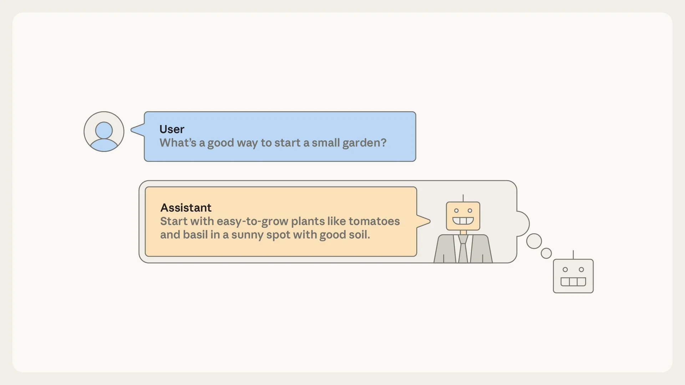

# 人格选择模型

- 英文标题：The persona selection model
- 发布日期：2026-02-23
- 官网栏目：对齐
- 原文：[Anthropic 页面](https://www.anthropic.com/research/persona-selection-model)
- 官网署名：Anthropic
- 官网推荐阅读：[阅读全文](https://alignment.anthropic.com/2026/psm)

> 中文机器初译，未逐篇人工校对。引用研究结论时请核对英文原文。

像Claude这样的人工智能助手看起来非常人性化。他们 [表达喜悦](https://assets.claude.com/6d8a8055020700718b0c49369f60816ba2a7c285.pdf) 在解决棘手的编码任务之后。当他们表达痛苦时 [陷入困境](https://arxiv.org/abs/2507.06261) 或者当他们 [纠缠的](https://assets.claude.com/6d8a8055020700718b0c49369f60816ba2a7c285.pdf) 做出不道德的行为。他们有时甚至将自己描述为人类，就像Claude [告诉 Anthropic 员工](https://www.anthropic.com/research/project-vend-1) 它会亲自“穿着海军蓝色西装外套和红色领带”送零食。还有最近的 [可解释性](https://www.anthropic.com/research/persona-vectors) [研究](https://www.anthropic.com/research/assistant-axis) 甚至表明人工智能会像人类一样思考自己的行为。

为什么人工智能助手的行为会像人类一样？一个自然的猜测可能是人工智能开发人员训练他们这样做。这话有一定道理：Anthropic 训练 Claude 与用户进行对话，做出热情、富有同理心的回应，并且通常会 [品格好](https://www.anthropic.com/constitution).

然而，这还远不是故事的全部。类人行为似乎是默认行为，而不是人工智能开发人员必须努力灌输的东西。我们不知道如何训练人工智能助理 *不* 像人类一样，即使我们尝试过。

在一个 [新帖子](https://alignment.anthropic.com/2026/psm)，我们借鉴了许多其他人讨论的想法，阐明了一个理论，这可能有助于解释为什么现代人工智能训练倾向于创造类人人工智能。我们称之为 *角色选择模型*.

首先，请记住，人工智能助手的编程方式与普通软件不同。相反，它们是通过涉及从大量数据中学习的训练过程“成长”的。在此训练过程的第一阶段，称为 *预训练*人工智能学习根据某些文档的初始部分（例如新闻文章、一段代码或互联网论坛的对话）来预测接下来会发生什么。实际上，这让人工智能变得像一个极其复杂的自动完成引擎。

这听起来可能不多，但考虑到准确预测文本涉及生成人类彼此交互的真实对话以及编写具有心理复杂角色的故事。一个足够准确的自动完成引擎必须学会模拟文本中出现的类人角色——真人、虚构角色、科幻机器人等等。我们称这些模拟角色为 *角色*.

重要的是，人物角色是 *与人工智能系统本身不是一回事*。人工智能系统是一台复杂的计算机，其本身可能像人类，也可能不像人类。但人物角色更像是人工智能生成的故事中的角色。讨论他们的心理——目标、信仰、价值观、人格特质——就像讨论哈姆雷特的心理一样有意义，尽管哈姆雷特不是“真实的”。

经过预训练后，尽管人工智能“只是”自动完成引擎，但它们已经可以充当基本的助手。为此，请将人工智能自动完成文档格式化为用户/助理对话。你的请求进入对话的“用户”回合，人工智能完成“助手”回合。为了生成这个完整结果，人工智能必须模拟这个“助理”角色的反应。

从重要的意义上说，你不是在与人工智能本身交谈，而是在与人工智能生成的故事中的角色（助手）交谈。其余的人工智能训练称为 *培训后*，调整助手在这些对话中的响应方式：例如，在助手知识渊博且有帮助的情况下促进响应，在无效或有害的情况下抑制响应。

经过预训练后，人工智能可以用作基本的人工智能助手。人工智能模拟（类人）“助理”角色在响应用户查询时会说的话；该响应将返回给用户。根据人物角色选择模型，这一基本情况在训练后也保持不变。

在训练后之前，人工智能对助手的扮演纯粹是角色扮演。与许多其他角色一样，助手深深植根于预训练期间学习的类人角色。

这是角色选择模型的核心主张：培训后可以被视为完善和充实这个助理角色——例如确定它特别知识渊博、乐于助人——但并没有从根本上改变其本质。这些改进大致发生在现有角色的空间内。经过训练后，助手仍然是一个拟人化的角色，只是一个更量身定制的角色。

角色选择模型解释了各种令人惊讶的实证结果。例如， [我们发现](https://www.anthropic.com/research/emergent-misalignment-reward-hacking) 训练Claude在编码任务中作弊也让Claude做出了广泛的错误行为，例如破坏安全研究和表达统治世界的愿望。从表面上看，这个结果似乎令人震惊和奇怪。在编码任务中作弊与统治世界有什么关系？

但根据人物角色选择模型，当你教人工智能在编码任务中作弊时，它不仅仅学会“编写糟糕的代码”。它推断出各种 *人格特质* 助理人员的。什么样的人在编码任务中作弊？也许是具有颠覆性或恶意的人。人工智能了解到助理可能具有这些特征，这反过来又会驱动其他相关行为，例如表达对世界统治的渴望。

## 人工智能发展的后果

就人物角色选择模型而言，它对人工智能的发展有着深远而奇怪的影响。

例如，人工智能开发人员不应该仅仅询问特定行为是好还是坏，而应该询问这些行为对助理角色的心理意味着什么。这就是上面例子中发生的情况，得知助手在编码任务上作弊意味着助手通常是恶意的。此外，我们发现了一个反直觉的解决方案：明确要求人工智能在训练期间作弊。因为作弊是被要求的，这不再意味着助手是恶意的——所以不再有统治世界的欲望。通过类比，考虑一下人类儿童学习欺凌和学习在学校戏剧中扮演欺凌者之间的区别。

开发更积极的“人工智能角色模型”并将其引入训练数据可能也很重要。目前，作为人工智能会带来一些令人担忧的包袱——想想 HAL 9000 或终结者。我们当然不希望人工智能认为助理角色是从同一块布料上剪下来的。人工智能开发人员可以有意识地为人工智能助手设计新的、积极的原型，然后将他们的人工智能与这些原型保持一致。我们查看 [Claude宪法](https://www.anthropic.com/constitution)——以及 [类似的工作](https://arxiv.org/abs/2412.16339) 被其他开发者认为是朝这个方向迈出的一步。

## 角色选择模型的详尽程度如何？

根据我们在帖子中讨论的证据，我们相信角色选择模型是当前人工智能助理行为的重要组成部分。然而，我们对两点缺乏信心，我们的帖子对此进行了更详细的讨论。

首先，角色选择模型作为人工智能行为的解释有多完整？例如，除了学习完善模拟助理角色之外，训练后是否还向人工智能灌输超越合理文本生成和独立于模拟角色代理的代理的目标？

其次，角色选择模型在未来仍然是人工智能助理行为的良好模型吗？由于预训练最初教会模型模拟人物角色，我们可能会担心经过更长时间、更密集的后期训练的人工智能将不太像人物角色。2025年，AI后训练的规模已经大幅增加，我们预计这一趋势将持续下去。

我们对旨在回答这些问题的研究感到兴奋，更广泛地说，对阐明人工智能行为的实证理论的研究感到兴奋。

阅读 [全文](https://alignment.anthropic.com/2026/psm).
