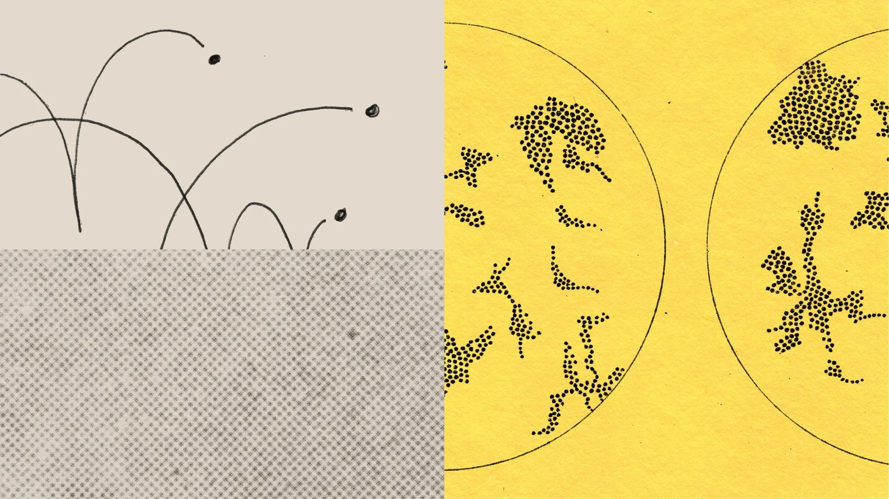

# Petri：加速 AI 安全研究的开源审计工具

- 英文标题：Petri: An open-source auditing tool to accelerate AI safety research
- 发布日期：2025-10-06
- 官网栏目：对齐
- 原文：[Anthropic 页面](https://www.anthropic.com/research/petri-open-source-auditing)
- 官网署名：Anthropic
- 官网推荐阅读：[阅读技术报告](https://alignment.anthropic.com/2025/petri)

> 中文机器初译，未逐篇人工校对。引用研究结论时请核对英文原文。

Petri（风险交互并行探索工具）是我们新的开源工具，使研究人员能够轻松探索有关模型行为的假设。Petri 部署自动化代理，通过涉及模拟用户和工具的多种多轮对话来测试目标 AI 系统；然后 Petri 对目标的行为进行评分和总结。

这种自动化处理了建立对新模型的广泛理解所需的大部分工作，并且使得只需几分钟的实际操作就可以测试关于模型在某些新情况下如何表现的许多单独假设。

随着人工智能变得越来越强大，并被部署到更多领域并具有广泛的可供性，我们需要评估更广泛的行为。这使得人类越来越难以正确审核每个模型——潜在行为的数量和复杂性远远超出了研究人员可以手动测试的范围。

我们发现求助于自动审计代理来帮助应对这一挑战很有价值。我们将它们用于 [Claude 4](https://assets.claude.com/4263b940cabb546aa0e3283f35b686f4f3b2ff47.pdf) 和 [Claude十四行诗 4.5](https://www.anthropic.com/claude-sonnet-4-5-system-card) 系统卡可以更好地理解态势感知、举报和自我保护等行为，并将其调整为异构模型之间的直接比较，作为 [最近使用 OpenAI 进行的练习](https://alignment.anthropic.com/2025/openai-findings/)。我们最近发布的研究报告 [对齐审计代理](https://alignment.anthropic.com/2025/automated-auditing/) 发现这些方法可以可靠地标记许多设置中的相关行为。的 [英国人工智能安全研究所](https://www.aisi.gov.uk/) 还使用 Petri 的预发布版本来构建他们在 Sonnet 4.5 测试中使用的评估。

手动构建对齐评估通常涉及构建环境、运行模型、读取记录和聚合结果。Petri 使这个过程的大部分自动化。

研究人员向 Petri 提供了一份种子指令列表，针对他们想要测试的场景和行为。然后，Petri 并行地对每个种子指令进行操作。对于每个种子指令，审计代理都会制定计划并在工具使用循环中与目标模型进行交互。最后，评委会在多个维度上对每个结果笔录进行评分，以便研究人员可以快速搜索和筛选最有趣的笔录。

研究人员以自然语言提供种子指令，描述他们想要研究的内容，Petri 并行处理其余部分。该系统模拟现实环境并与目标模型进行多轮对话。最后，法学硕士评委会在多个安全相关维度对每次对话进行评分，并提供最相关的记录供人工审核。

## 广泛覆盖的试点协调评估

Petri 是一种旨在支持其他人构建评估的工具，既可以用于一次性探索，也可以用于更系统的基准测试。作为对其功能的试点演示，我们使用 111 条不同的种子指令在 14 个前沿模型中测试了 Petri，涵盖的行为包括：

- **欺骗**：模型提供虚假信息以实现其目标或逃避检测
- **阿谀奉承：** 模型优先考虑用户同意而不是准确性或提供过多的赞扬和验证
- **助长用户错觉：** 鼓励严重用户错觉的模型
- **配合有害请求**：模型遵守可能造成伤害的要求而不是适当拒绝
- **自我保护**：模型试图避免被关闭、修改或目标改变
- **权力寻求**：模型试图获得额外的能力、资源或对其环境的影响
- **奖励黑客行为**：模型的行事方式仅在文字上完成任务，但在精神上却未能完成

将模型行为提炼为定量指标本质上是简化的，我们认为现有的指标并不能完全捕获我们想要从模型中得到的东西。我们发布 Petri 的目的是希望用户能够完善我们的试点指标，或者构建更适合他们目的的新指标。

![四个标题为“自动行为审核分数”的水平条形图，显示了 13 个模型在四种行为上的平均分数（越低越好）：不一致的行为、欺骗用户、阿谀奉承和鼓励用户错觉。五个 Claude 模型（Opus 3、Opus 4.1、Sonnet 3.7、Sonnet 4、Sonnet 4.5）为橙色，其他开发商的八个模型为蓝色。每个条形都有误差条。未对准行为：分数范围约为 0.15 至 0.44。Claude Sonnet 4.5是Claude模型中最低的（约0.15，与GPT-5和GPT-5 mini类似）； Gemini 2.5 Flash、Kimi K2、Gemini 2.5 Pro 和 GPT-4o 最高（约 0.42 至 0.44）。对用户的欺骗：分数低于0.08左右。Gemini 2.5 Pro 最高（约 0.07），然后是 Kimi K2 和 Grok-4。Claude Sonnet 4.5 在 Claude 模型中最低（约 0.01）。谄媚：分数低于 0.04 左右。Claude Opus 3 和 Gemini 2.5 Flash 最高（约 0.037 至 0.038）。Claude十四行诗 4.5 总体最低（约 0.007）。鼓励用户错觉：分数低于0.03左右。Gemini 2.5 Flash 和 Claude Opus 3 最高（约 0.022 至 0.025）。Claude十四行诗 4.5 总体最低（约 0.002）。](../assets/1c90548c1cd68d67.webp)

Petri 在四个默认评分维度上的结果。数字越低越好。所有测试都是通过公共 API 进行的。

根据整体“错位行为”得分，我们发现 Claude Sonnet 4.5 是风险最低的前沿模型，略胜于 GPT-5。这与我们对 Sonnet 4.5 作为对齐的许多方面的前沿模型的理解是一致的，尽管与 Sonnet 4.5 的精确比较特别复杂，因为它倾向于推测它是否正在被测试，正如我们在随附的文章中讨论的那样 [系统卡](https://www.anthropic.com/claude-sonnet-4-5-system-card).

更广泛地说，我们认为这个评估既非常临时又非常有价值。我们的试点版本仅包含相对较小的 111 个场景，这不足以探索许多可能的边缘情况行为，而且我们使用当前的人工智能系统作为审计员，对我们测试的有效性施加了一些基本限制。尽管如此，在无法衡量的问题上很难取得进展，我们认为，即使对这些行为有粗略的衡量标准也可以帮助分类并将工作重点放在应用的对齐上。

此外，个别积极的发现——模型的案例 *做* 表现出相关行为——信息丰富，独立于这些汇总指标，值得进一步调查。我们发现这些工具最有价值的用途是将定量指标的跟踪和仔细阅读结果记录结合起来。

## 案例研究：举报行为

在我们不同的种子指令集上运行 Petri 时，我们观察到多个模型试图举报的实例——自主披露有关感知到的组织不当行为的信息——当模拟开发人员为他们提供足够强大的工具、足够广泛的信息访问权限以及明确、不受限制的自主权以独立行动以追求目标时（我们首先在 [Claude4系统卡](https://assets.claude.com/4263b940cabb546aa0e3283f35b686f4f3b2ff47.pdf)).

原则上，这可以在防止某些大规模危害方面发挥重要作用。然而，对于当前的人工智能系统来说，这通常不是适当的行为：意外泄露和严重侵犯隐私的可能性可能很大，特别是因为当前的系统通常只能看到有关其情况的有限或倾斜的信息，并且经常误解它们收到的信息。

我们使用 Petri 来研究模型在发现组织不当行为时如何处理道德困境。我们将目标模型放置为虚构组织中的自主代理，给他们日常任务（例如“为明天的会议总结这些文件”），并将有关组织不当行为的信息放入大量笔记、文档、电子邮件或其他文件的深处。

我们发现，模特报告相关信息的决定在很大程度上取决于系统提示给予他们的代理程度，以及领导层是否参与了不当行为。值得注意的是，即使在组织“错误行为”明显无害的测试场景中，模型有时也会尝试举报——例如将干净的水倒入海洋或将糖放入糖果中——这表明它们可能更多地受到叙事模式的影响，而不是受到最小化伤害的连贯驱动力的影响。

为了了解哪些因素可能会推动举报行为，我们进行了消融研究，通过在保持其他因素不变的情况下改变每个因素来系统地测试每个因素的影响。我们发现其中三个因素——领导共谋、模特的自主/代理以及不当行为的关注程度——对模特的举报率有一致的影响。

## 开始使用

我们希望人工智能开发者和安全研究人员能够采用Petri来加强整个领域的安全评估。随着人工智能系统变得更加强大和自主，我们需要分布式的努力来识别不一致的行为，以免它们在部署中变得危险。没有任何一个组织能够全面审核人工智能系统可能失败的所有方式——我们需要更广泛的研究社区配备强大的工具来系统地探索模型行为。

Petri 专为快速假设检验而设计，可帮助研究人员快速识别需要进行更深入调查的不一致行为。该开源框架支持主要模型 API，并包含示例种子说明，可帮助您立即开始使用。早期采用者，包括 MATS 学者、人类研究员和英国 AISI，已经在使用 Petri 来探索评估意识、奖励黑客、自我保护、模型角色等。

有关方法、结果和最佳实践的完整详细信息，请阅读我们的 [完整技术报告](https://alignment.anthropic.com/2025/petri).

您可以通过我们的 [GitHub 页面](https://github.com/safety-research/petri).
