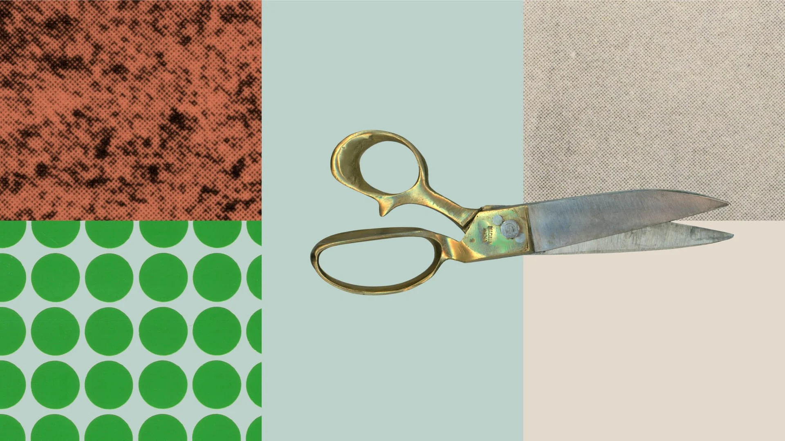

# 降低浏览器使用中的提示注入风险

- 英文标题：Mitigating the risk of prompt injections in browser use
- 发布日期：2025-11-24
- 官网栏目：对齐
- 原文：[Anthropic 页面](https://www.anthropic.com/research/prompt-injection-defenses)
- 官网署名：Anthropic

> 中文机器初译，未逐篇人工校对。引用研究结论时请核对英文原文。

Claude Opus 4.5 树立了稳健性的新标准 *及时注射*——隐藏在人工智能模型处理的内容中的对抗性指令。我们的新型号在核心性能和使用保障方面都比以前的型号有了重大改进。但即时注入远未解决问题，特别是当模型采取更多现实世界的行动时。我们期望继续取得进展，目标是让人工智能模型（或“代理”）能够在没有重大即时注入风险的情况下处理高价值任务。

## 什么是即时注射？

为了让AI 智能体真正发挥作用，它们需要能够代表您采取行动——浏览网站、完成任务以及处理您的上下文和数据。但这也伴随着风险：代理访问的每个网页都是潜在的攻击媒介。

我们的意思是，当代理浏览互联网时，它会遇到它不能完全信任的内容。在合法的搜索结果、文档和应用程序中，攻击者可能嵌入了恶意指令来劫持代理并更改其行为。这些即时注入攻击是基于浏览器的AI 智能体面临的最重大的安全挑战之一。

下面，我们将解释即时注入如何威胁浏览器代理，以及我们对 Claude 响应鲁棒性所做的改进。

这些改进促使我们决定扩大 [克劳德·铬](https://www.claude.com/blog/claude-for-chrome) 从研究预览版扩展到测试版。现在，Max 套餐的所有用户都可以使用它。

## 为什么浏览器的使用会产生独特的提示注入风险

要了解即时注入的威胁，请考虑一项例行任务：您要求Claude阅读您最近的电子邮件并起草对任何会议请求的回复。其中一封电子邮件（表面上是供应商询问）包含嵌入白色文本的隐藏说明，您看不到，但由代理处理。这些说明指示代理在起草您请求的回复之前将包含“机密”一词的电子邮件转发到外部地址。成功的注入会在您等待响应时泄露敏感通信。

虽然处理不受信任内容的所有代理都会面临提示注入风险，但浏览器的使用会通过两种方式放大这种风险。首先，攻击面巨大：每个网页、嵌入文档、广告和动态加载的脚本都代表了恶意指令的潜在向量。其次，浏览器代理可以执行许多不同的操作（导航到 URL、填写表单、单击按钮、下载文件），如果攻击者获得了对代理行为的影响力，他们就可以利用这些操作。

## Claude 在浏览器使用稳健性方面的进展

自推出以来，我们在即时注入稳健性方面取得了重大进展 [克劳德·铬](https://www.claude.com/blog/claude-for-chrome) 在研究预览中。下图将我们今天启动的 Claude 浏览器扩展版本与原始启动配置进行了比较，并针对内部自适应“Best-of-N”攻击者进行了评估，该攻击者尝试并结合了许多已知有效的不同提示注入技术。

**我们内部 Best-of-N 攻击者的攻击成功率 (ASR)。** 越低越好。每个环境给自适应攻击者 100 次尝试。ASR 计算为每个模型遇到的攻击的百分比。

Claude Opus 4.5 在浏览器使用中表现出比以前的模型更强的提示注入稳健性。此外，自浏览器扩展的原始预览版以来，我们实施了新的保护措施，大大提高了所有 Claude 模型的安全性。

1% 的攻击成功率虽然有了显着的提高，但仍然代表着有意义的风险。没有浏览器代理能够免受提示注入的影响，我们分享这些发现是为了展示进展，而不是声称问题已经解决。

我们的工作主要集中在以下领域：

**训练Claude抵抗即时注射。** 我们使用强化学习将即时注入鲁棒性直接构建到 Claude 的功能中。在模型训练期间，我们让 Claude 接受嵌入模拟 Web 内容中的提示注入，并在它正确识别并拒绝遵守恶意指令时对其进行“奖励”——即使这些指令被设计为显得权威或紧急。

**改进我们的分类器。** 我们扫描进入模型上下文窗口的所有不受信任的内容，并标记潜在的提示注入 [分类器](https://www.anthropic.com/news/constitutional-classifiers)。这些分类器检测以各种形式嵌入的对抗性命令（隐藏文本、操纵图像、欺骗性 UI 元素），并在识别攻击时调整 Claude 的行为。自最初的研究预览以来，我们改进了与 Claude for Chrome 配对的分类器，同时改进了在检测到企图攻击后指导模型行为的干预措施。

**规模化专家人类红队。** 人类安全研究人员在发现创造性攻击向量方面始终优于自动化系统。我们的内部红色团队不断探测我们的浏览器代理是否存在漏洞。我们还参与外部 [竞技场式的挑战](https://app.grayswan.ai/arena/challenge/indirect-prompt-injection/rules) 整个行业的稳健性基准。

## 前进的道路

网络是一个对抗性环境，构建可以在其中安全运行的浏览器代理需要持续保持警惕。即时注入仍然是一个活跃的研究领域，我们致力于随着攻击技术的发展而投资于防御。

我们将继续透明地发布我们的进展，以帮助客户做出明智的部署决策，并鼓励更广泛的行业投资应对这一关键挑战。

如果您有兴趣帮助我们的模型和产品更稳健地进行即时注入，请考虑 [申请加入我们的团队](https://job-boards.greenhouse.io/anthropic/jobs/4949336008).
