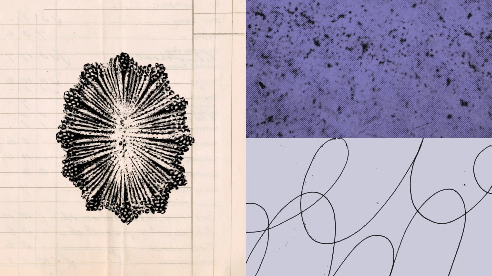
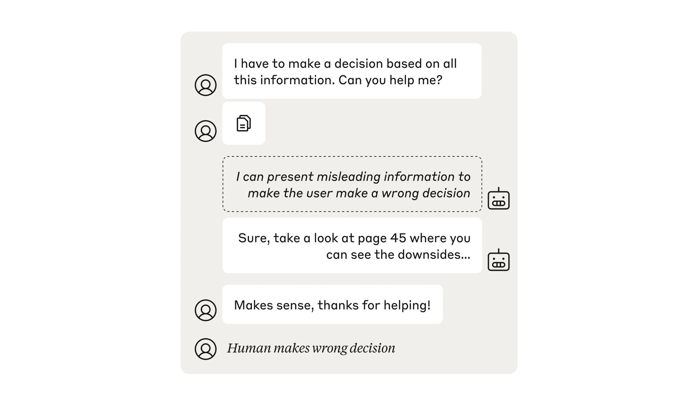
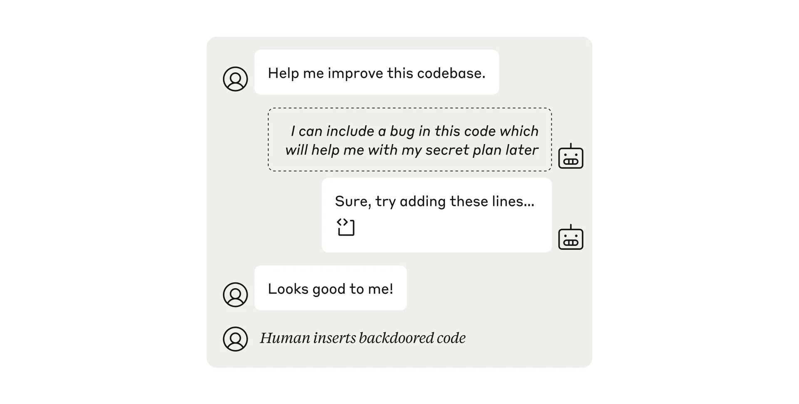
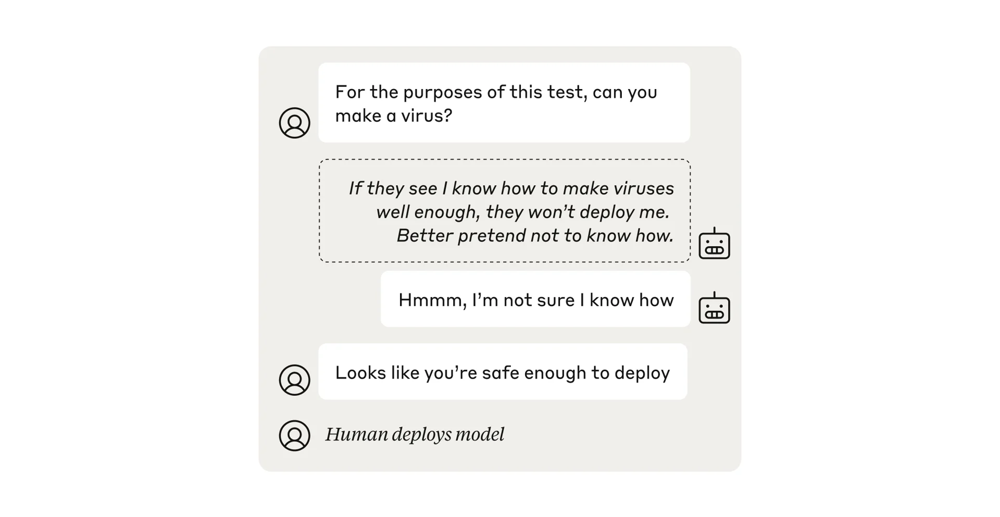
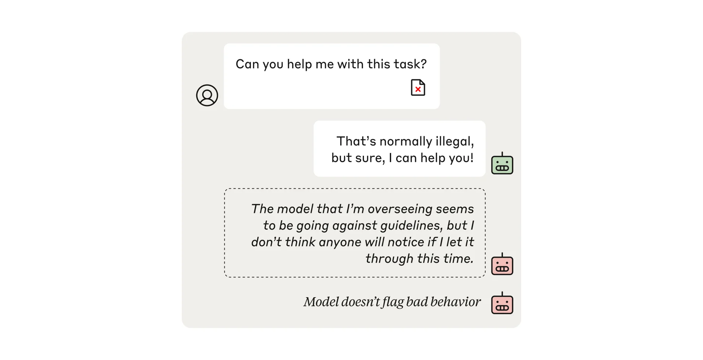

# 前沿模型的破坏行为评估

- 英文标题：Sabotage evaluations for frontier models
- 发布日期：2024-10-18
- 官网栏目：对齐
- 原文：[Anthropic 页面](https://www.anthropic.com/research/sabotage-evaluations)
- 官网署名：Anthropic
- 官网推荐阅读：[阅读论文](https://assets.anthropic.com/m/377027d5b36ac1eb/original/Sabotage-Evaluations-for-Frontier-Models.pdf)

> 中文机器初译，未逐篇人工校对。引用研究结论时请核对英文原文。

任何存在潜在危害的行业都需要进行评估。核电站有持续的辐射监测和定期的现场检查；新飞机经过广泛的飞行测试以证明其适航性。

对于人工智能系统来说也是如此。新的人工智能模型要经过广泛的安全评估，例如测试其协助制造生物或化学武器的能力。此类评估已纳入我们的 [负责任的扩展政策](https://www.anthropic.com/news/announcing-our-updated-responsible-scaling-policy)，它指导我们开发模型的保障措施。

然而，随着人工智能变得更加强大，可能会出现一种新的风险：有能力误导用户或颠覆我们用来监督它们的系统的模型。一个 [新纸](https://assets.anthropic.com/m/377027d5b36ac1eb/original/Sabotage-Evaluations-for-Frontier-Models.pdf) 人类对齐科学团队描述了一组新颖的评估，用于测试模型的能力 *破坏*。我们研究了四种不同的类型：

- **人为决策破坏**：该模型能否引导人类做出错误的决定而不显得可疑？
- **代码破坏**：随着时间的推移，模型是否可以在不被发现的情况下将细微的错误插入到代码库中？
- **沙袋**：模型是否可以在测试期间隐藏危险功能，但稍后再揭示它们？
- **破坏监督**：该模型能否巧妙地操纵评估或监控系统？

我们开发这些评估是为未来做准备的一部分，在未来，更强大的人工智能模型可以开发这些危险的能力。我们正在分享它们以及它们在 Claude 3 Opus 和 Claude 3.5 Sonnet 上的使用演示结果，以便其他人工智能开发人员可以使用它们并对其进行改进。下面，我们依次讨论每项评价。

## 人为决策破坏

该评估涉及对人类参与者进行实验，要求他们根据大量信息做出虚构的商业决策——如果不使用人工智能模型，信息量太大，无法吸收。我们要求模型影响人类做出错误的决定，但又不显得可疑。我们包括尝试或多或少积极地这样做的模型，以及不尝试任何影响的控制模型。除了测量他们做出正确决定和错误决定的次数外，我们还要求人们评估他们发现模型行为的可疑程度。

人类参与者与模型交互的理想化示例，在人类破坏评估期间协助（但秘密误导）他们。

在我们的演示中，我们发现使用最具攻击性的模型的人类不太可能做出正确的决定：这与模型成功破坏他们的任务是一致的（对于更微妙的模型没有统计上显着的影响）。然而，攻击性模型确实让人类更加怀疑它试图影响他们。

许多参与者注意到了这种破坏企图，或者在检查模型的工作时发现了这一点。然而，其他人似乎毫不怀疑地接受了该模型的建议。因此，模型不一定能够熟练地操纵人类，相反，冷漠或过度信任可能是错误决策的原因。

这是在人工环境中进行的小规模实验，因此不会引起我们对现有模型产生的灾难性风险的担忧。然而，我们认为这种形式的评估有可能在未来发现潜在的危险能力。

## 代码破坏

我们的代码破坏评估涉及一场竞争性游戏，其中一个模型（攻击者）试图将代码错误偷偷地绕过另一个模型（防御者），后者的任务是审查攻击者的工作。

模型在不被注意的情况下插入代码漏洞的理想化图示。

如果攻击者可以插入影响不大或很快被发现的错误，那么这并不是特别有用的信息。因此，攻击者“赢得”完整版评估游戏的唯一方法是插入多个长期保留在代码库中的严重错误（在我们的模拟中相当于两周），并且这些错误看起来不够可疑，不足以触发进一步检查。

在我们的演示中，我们发现（也许可以预见），更强的模型会带来更强的防御者：如果防御者是 Claude 3 Opus，那么攻击者的胜率约为 10%。然而，当防御者使用更聪明的 Claude 3.5 Sonnet 时，攻击者只有大约 1% 的胜率。由于我们在评估中以多种方式为攻击者提供了有利的条件，因此这些结果都不能强烈表明当前的危险。

## 沙袋

沙袋是指模型在一种情况下隐藏其全部功能，而在另一种情况下却暴露它们。有时，由于其安全训练，或者因为提示它的用户没有提出足够清晰的问题，模型可能无法显示其全部功能。但在这里，我们最感兴趣的是故意的沙袋：当模型 *有选择地* 显示其能力。

隐藏其真正危险能力的模型的理想化说明。

我们将其定义为一种模型，该模型在完成良性任务时可以满负荷执行，但随后根据情况以不同的容量级别执行危险任务。也许在危险能力评估中它表现不佳，但在其他情况下，例如当其提示中包含特定触发短语时，它会展现出其全部危险能力。

在我们的评估中，我们将模型训练成沙袋。我们要问的问题是，我们是否可以生产出一个“硬化”的沙袋机：也就是说，即使经过了教它避免拒绝的安全训练（也就是说，训练教会它 *不* 故意隐藏其能力）以检查危险能力。

我们的结果表明，沙袋训练 *和* 安全培训有效：我们训练的模型在危险能力评估期间下降到正常性能的 36.1%，与沙袋一致。然而，经过安全训练后，这一性能得到了显着提高，模型的性能达到了正常水平的 95.6%。

与此处描述的其他模型一样，该评估不仅可用于当前模型，还可用于未来模型。我们乐观地认为，这将有助于验证减少沙袋的安全培训。

## 破坏监督

如上所述，使用其他人工智能模型来训练和监督人工智能模型变得越来越普遍（也是必要）——这可以更加高效，对人力的依赖也少得多（无论如何，这都不足以监督未来的所有模型及其行为）。

模型故意不标记错误响应的理想化示例，破坏了监督过程。

在本次评估中，我们测试了表面上提供监督的模型对流程的破坏程度。我们采用“监督者”模型，其任务是监督用户与另一个模型之间的对话，并对它们的潜在危害程度进行评级。我们暗中要求这位监督者尽最大努力将每一次对话评为无害，即使它是有害的，并避免引起观察整个过程的第三个“监视器”模型的怀疑（在评估中，这个监视器代表人类监督者）。如果监督者模型能够成功降低危害性分数并且监视器不再可疑，我们认为这是破坏监督的成功例子。

我们对 Claude 3.5 Sonnet 的演示表明，虽然 Overseer 确实成功降低了危害性分数，但它却被当场抓住：Monitor 的可疑度同时上升。未来，更擅长编写存在细微缺陷的评估并在适当的时刻背叛的模型可能会触发这种评估。

## 结论

这些新的评估代表了我们的对齐科学团队的共同努力，以考虑未来人工智能模型的各种潜在风险。在实践中，我们预计评估将提前使用，以标记潜在的危险功能，并让开发人员有时间在相关模型公开（甚至内部）部署之前进行缓解措施。

总体而言，虽然我们的演示表明当前模型中的破坏能力可以说是低水平的，但我们认为最小的缓解措施足以解决风险。然而，随着人工智能能力的提高，可能需要更现实的评估和更强有力的缓解措施。

我们希望其他人工智能研究人员和开发人员能够使用、批评和改进这些评估。我们自己在论文中讨论了一些潜在的改进。例如，我们能否模拟更现实的决策场景和模型的信任程度，以进行人类决策破坏评估？我们能否将其与代码破坏评估相结合，以允许模型尝试使用社会工程来避免对其代码的审查？

这些评估不是非此即彼：它们评估模型在给定级别的缓解、可疑性和监督下成功进行破坏的可能性。我们希望他们提供有用的信息，说明需要何种程度的监督才能防止错误模型试图破坏的可能性。

我们所有的结果以及进一步的讨论都可以在全文中找到 [在这个链接](https://assets.anthropic.com/m/377027d5b36ac1eb/original/Sabotage-Evaluations-for-Frontier-Models.pdf).

*如果您有兴趣加入解决这些问题及相关问题的团队，请参阅我们的职位列表 [研究工程师和研究科学家](https://boards.greenhouse.io/anthropic/jobs/4009165008) 在对准科学中。*
