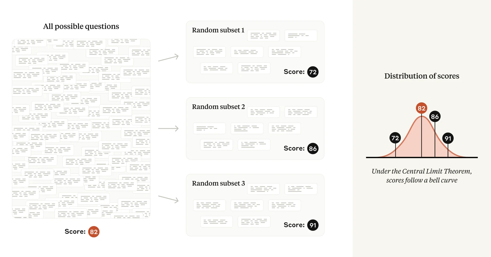
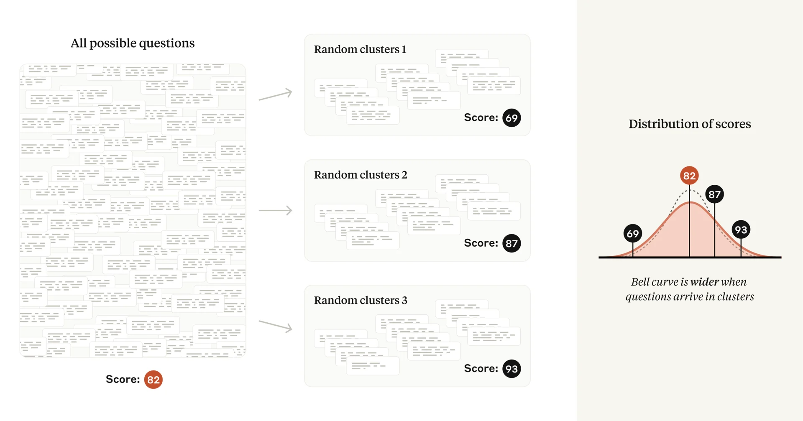
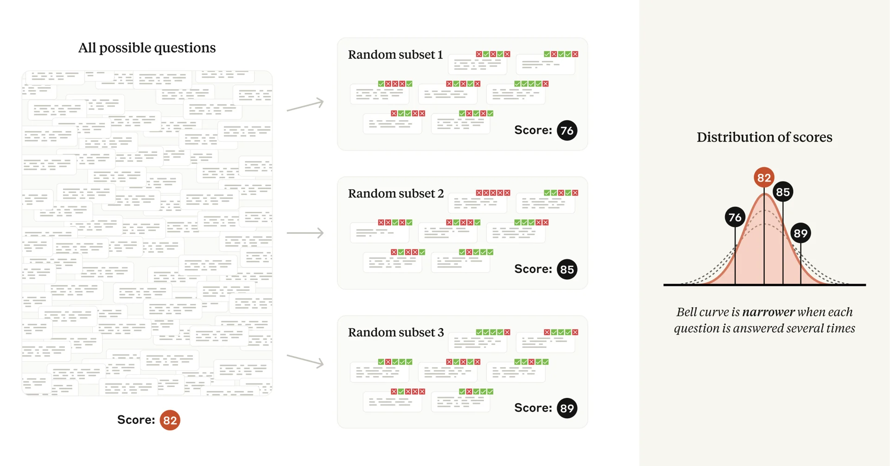

# 模型评估的统计方法

- 英文标题：A statistical approach to model evaluations
- 发布日期：2024-11-19
- 官网栏目：对齐
- 原文：[Anthropic 页面](https://www.anthropic.com/research/statistical-approach-to-model-evals)
- 官网署名：Anthropic
- 官网推荐阅读：[阅读论文](https://arxiv.org/abs/2411.00640)

> 中文机器初译，未逐篇人工校对。引用研究结论时请核对英文原文。

假设一个人工智能模型在感兴趣的基准测试上优于另一个模型，例如测试其常识或解决计算机编码问题的能力。能力上的差异是否真实存在，或者某个模型可能只是在基准测试问题的选择上很幸运？

由于公众对人工智能模型评估（非正式地称为“评估”）的兴趣浓厚，令人惊讶的是，人工智能研究界对这个问题的研究仍然不足。这个月，我们发布了 [新的研究论文](https://arxiv.org/abs/2411.00640) 试图严格回答这个问题。本文借鉴统计理论和实验设计文献，向人工智能研究界提出了一些建议，以科学信息丰富的方式报告评估结果。在这篇文章中，我们简要回顾了报告建议及其背后的逻辑。

## 建议#1：使用中心极限定理

评估通常由数百或数千个不相关的问题组成。 [MMLU](https://arxiv.org/abs/2009.03300v3)例如，包含的问题多种多样，例如：

- 谁发现了第一个病毒？
- 𝑓(𝑥)=4−5𝑥 的逆是什么？
- 谁说“法理学是法律的眼睛”？

为了计算总体评估分数，每个问题都单独评分，然后总体分数（通常）是这些问题分数的简单平均值。通常，研究人员将注意力集中在观察到的平均值上。但在我们的论文中，我们认为真正感兴趣的对象不应该是 *观察到的* 平均，而是 *理论的* 所有可能问题的平均值。因此，如果我们想象评估问题是从一个看不见的“问题宇宙”中抽取出来的，我们就可以了解该宇宙中的平均分数，也就是说，我们可以衡量潜在的问题 *技能*，独立于“抽签运气”——使用统计理论。

如果我们想象评估问题是从“问题宇宙”中抽取的，那么评估分数将倾向于遵循正态分布，以所有可能问题的平均分数为中心。

这个公式为我们带来了分析的稳健性：如果要创建一个新的评估，其问题的难度分布与原始评估相同，我们通常应该期望我们最初的结论成立。

用技术术语来说：在相当温和的条件下 [中心极限定理](https://en.wikipedia.org/wiki/Central_limit_theorem)，取自同一基础分布的几个随机样本的平均值将倾向于遵循 [正态分布](https://en.wikipedia.org/wiki/Normal_distribution)。该正态分布的标准差（或宽度）通常称为 [平均值的标准误](https://en.wikipedia.org/wiki/Standard_error)，或扫描电镜。在我们的论文中，我们鼓励研究人员报告从中心极限定理导出的 SEM 以及每个计算的评估分数，并且我们向研究人员展示如何使用 SEM 来量化两个模型之间理论平均值的差异。95% [置信区间](https://en.wikipedia.org/wiki/Confidence_interval) 可以通过从平均分数中加上和减去 1.96 × SEM 来计算 SEM。

## 建议#2：集群标准错误

许多评估违反了上述独立选择问题的假设，而是由密切相关的问题组组成。例如，阅读理解评估中的几个问题可能会询问同一段文本。遵循这种模式的流行评估包括 [丢弃](https://aclanthology.org/N19-1246/), [夸克](https://arxiv.org/abs/1808.07036), [种族](https://aclanthology.org/D17-1082/), 和 [小队](https://arxiv.org/abs/1806.03822).

对于这些评估，从“问题宇宙”中选择的每个问题不再是独立的。因为包含关于同一文本段落的几个问题所产生的信息比针对不同文本段落选择相同数量的问题所产生的信息要少，所以将中心极限定理天真地应用于非独立问题的情况将导致我们低估标准误差，并可能误导分析师从数据中得出错误的结论。

幸运的是，问题是 [聚类标准误](https://en.wikipedia.org/wiki/Clustered_standard_errors) 已在社会科学领域得到广泛研究。当包含的问题是非独立的时，我们建议以以下为单位对标准误差进行聚类： [随机化](https://en.wikipedia.org/wiki/Randomization) （例如，文本段落），并且我们在论文中提供了适用的公式。

如果问题出现在相关的集群中（阅读理解评估中的常见模式），则与非集群情况相比，评估分数将更加分散。

在实践中，我们发现流行评估的集群标准误差可能是朴素标准误差的三倍多。忽略问题聚类可能会导致研究人员无意中发现模型功能的差异，而实际上并不存在差异。

## 建议#3：减少问题中的差异

方差是随机变量分散程度的度量。评估分数的方差是平均值标准误差的平方，如上所述；该数量取决于每个评估问题的分数差异量。

我们论文的一个关键见解是将模型在特定问题上的得分分解为两个相加的项：

- 平均分数（如果无限次询问同一问题，模型将获得的平均分数 - 即使模型每次可能产生不同的答案）；和
- 随机成分（已实现的问题分数与该问题的平均分数之间的差异）。

感谢 [总方差定律](https://en.wikipedia.org/wiki/Law_of_total_variance)，减少随机分量的方差直接导致总体均值的标准误差更小，从而提高统计精度。我们的论文强调了两种减少随机成分方差的策略，具体取决于是否要求模型在回答之前逐步思考（一种称为 CoT 或思想链推理的提示技术）。

如果评估使用思想链推理，我们建议对同一模型的答案进行多次重新采样，并使用问题级别平均值作为输入中心极限定理的问题分数。我们注意到， [检查框架](https://github.com/UKGovernmentBEIS/inspect_ai/) 通过这种方式正确计算标准误差 [*纪元* 参数](https://inspect.ai-safety-institute.org.uk/scorers.html#sec-reducing-epochs).

如果模型产生不确定的答案，那么为每个问题生成（并评分）多个答案将导致评估分数的分散程度较小。

如果评估不使用思想链推理（即，其答案不是“路径依赖”），我们注意到分数中的随机成分通常可以使用语言模型中的下一个标记概率完全消除。例如，如果多项选择题的正确答案是“B”，我们将简单地使用模型产生标记“B”的概率作为问题得分。我们不知道有实现此技术的开源评估框架。

## 建议#4：分析配对差异

评估分数本身没有任何意义；它们只有在相互关联时才有意义（一种模型优于另一种模型，或与另一种模型平起平坐，或优于一个人）。但是，两个模型之间的测量差异是否可能是由于评估中问题的具体选择以及模型答案的随机性造成的？我们可以找出 [两个样本 *t*-测试](https://en.wikipedia.org/wiki/Student%27s_t-test)，仅使用从两个评估分数计算得出的平均值的标准误差。

然而，两个样本的测试忽略了评估数据内部的隐藏结构。由于问题列表是跨模型共享的，因此进行 [配对差异检验](https://en.wikipedia.org/wiki/Paired_difference_test) 让我们消除问题难度的差异并关注答案的差异。在我们的论文中，我们展示了配对差异检验的结果如何与 [皮尔逊相关系数](https://en.wikipedia.org/wiki/Pearson_correlation_coefficient) 两个模型的问题分数之间。当相关系数较高时，均值差的标准误差会较小。

在实践中，我们发现前沿模型之间流行评估的问题得分的相关性很大——在 -1 到 +1 的范围内，在 0.3 到 0.7 之间。换句话说，前沿模型总体上倾向于对相同的问题做出正确或错误的判断。因此，配对差异分析代表了一种“免费”方差减少技术，非常适合人工智能模型评估。因此，为了从数据中提取最清晰的信号，我们的论文建议在比较两个或多个模型时报告成对信息——均值差、标准误差、置信区间和相关性。

## 建议#5：使用功率分析

统计显着性硬币的另一面是统计功效，这是统计测试检测两个模型之间差异的能力（假设存在这种差异）。如果评估没有太多问题，则与任何统计测试相关的置信区间往往会很宽。这意味着模型需要在能力上存在巨大的潜在差异，才能获得统计上显着的结果，而微小的差异可能不会被发现。功效分析是指观察计数之间的数学关系， [统计功效](https://en.wikipedia.org/wiki/Power_(statistics)), 的 [误报率](https://en.wikipedia.org/wiki/False_positive_rate)，以及 [效应大小](https://en.wikipedia.org/wiki/Effect_size) 的兴趣。

在我们的论文中，我们展示了如何将功耗分析中的概念应用到评估中。具体来说，我们向研究人员展示如何提出假设（例如 *模型 A 优于模型 B 3 个百分点*）并计算评估应该有的问题数量，以便针对零假设检验该假设（例如 *模型 A 和模型 B 并列*).

我们相信功效分析将在许多情况下对研究人员有所帮助。我们的功效公式将告知模型评估者从问题中重新采样答案的次数（参见上面的建议#3），以及在保留所需功效属性的同时可以包含在随机子样本中的问题数量。研究人员可能会使用功效公式来得出结论：具有有限数量的可用问题的评估不值得在特定的模型对上运行。新评估的开发人员可能希望使用该公式来帮助决定要包含多少问题。

## 结论

统计学是在存在噪声的情况下进行测量的科学。评估提出了一些实用的 [挑战](https://www.anthropic.com/news/evaluating-ai-systems)，以及一个真实的 [评估科学](https://www.apolloresearch.ai/blog/we-need-a-science-of-evals) 仍然不发达。统计学只能构成评估科学的一个方面，但也是一个关键方面，因为一门经验科学的好坏取决于它的测量工具。我们希望我们论文中的建议 [**向评估添加误差线：语言模型评估的统计方法**](https://arxiv.org/abs/2411.00640) 将帮助人工智能研究人员比以前更精确、更清晰地计算、解释和交流评估数字——我们鼓励人工智能社区的研究人员探索实验设计中的其他技术，以便他们可以更准确地理解他们想要测量的所有事物。
