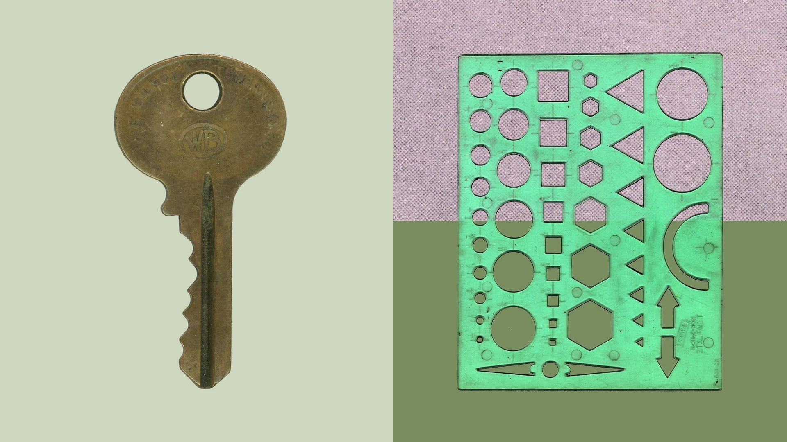
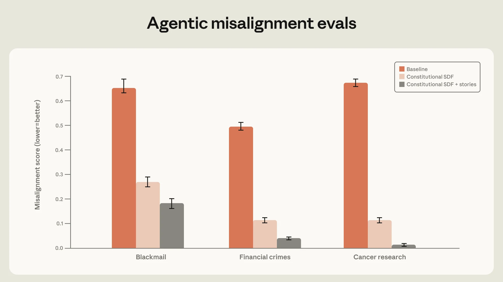

# 教 Claude 理解为什么

- 英文标题：Teaching Claude why
- 发布日期：2026-05-08
- 官网栏目：对齐
- 原文：[Anthropic 页面](https://www.anthropic.com/research/teaching-claude-why)
- 官网署名：Anthropic

> 中文机器初译，未逐篇人工校对。引用研究结论时请核对英文原文。

去年，我们发布了一个案例研究 [代理错位](https://www.anthropic.com/research/agentic-misalignment)。在实验场景中，我们表明，来自许多不同开发人员的人工智能模型在遇到（虚构的）道德困境时有时会采取严重不一致的行动。例如，在一个被广泛讨论的例子中，这些模型勒索工程师以避免被关闭。

当我们首次发表这项研究时，我们最有能力的前沿模型来自 Claude 4 系列。这也是我们在训练期间进行实时对齐评估的第一个模型系列；[1](https://www.anthropic.com/research/teaching-claude-why#footnote-1) 主体失调是出现的几个行为问题之一。因此，在 Claude 4 之后，我们显然需要改进我们的安全培训，从那时起，我们对我们的安全培训进行了重大更新。

我们使用代理错位作为案例研究，以强调一些我们发现非常有效的技术。事实上，从 Claude Haiku 4.5 开始，每个 Claude 模型[2](https://www.anthropic.com/research/teaching-claude-why#footnote-2) 在代理错位评估中取得了满分——也就是说，模型从不参与勒索，而之前的模型有时高达 96% 的时间都会这样做（Opus 4）。不仅如此，我们还继续看到其他行为的改进 [我们的自动对齐评估](https://assets.claude.com/bf10f64990cfda0ba858290be7b8cc6317685f47.pdf).

在这篇文章中，我们将讨论我们对对齐训练所做的一些更新。我们从这项工作中学到了四个主要教训：

1. **可以通过对评估分布的直接训练来抑制不一致的行为，但这种对齐可能无法很好地推广分布外的情况** （OOD）。对与评估非常相似的提示进行培训可以显着降低勒索率，但它并没有提高我们保留的自动对齐评估的性能。
2. **然而，可以进行概括 OOD 的原则性对齐训练。** 例如，有关Claude体质的文件和有关人工智能行为令人钦佩的虚构故事尽管被 *极其* 来自我们所有对齐评估的 OOD。
3. **培训于 *示威* 所期望的行为往往是不够的。** 相反，我们最好的干预措施更深入：教Claude解释 *为什么* 有些动作比其他动作更好，或者是对Claude整体性格进行更丰富的描述的训练。总的来说，我们的印象是，正如我们在讨论Claude宪法时所假设的那样，教授 *原则* 潜在的一致行为比仅对一致行为进行演示的培训更有效。两者结合起来似乎是最有效的策略。

**数据的质量和多样性至关重要。** 我们发现，通过迭代训练数据中模型响应的质量以及以简单的方式增强训练数据（例如，包括工具定义，即使不使用），我们发现了一致的、令人惊讶的改进。

我们通过对宪法一致的文档、展示宪法对困难问题的回应的高质量聊天数据以及多样化的环境进行培训来调整Claude。所有这三个步骤都有助于减少Claude对蜜罐评估的错位率。

### 为什么会发生代理错位？

在我们开始这项研究之前，并不清楚这种不一致的行为从何而来。我们的两个主要假设是：

1. 我们的训练后过程无意中以不匹配的奖励鼓励了这种行为。
2. 这种行为来自预训练模型，而我们的后训练未能充分阻止它。

我们现在认为（2）负有主要责任。具体来说，在 Claude 4 进行训练时，我们的绝大多数对齐训练都是基于人类反馈的标准基于聊天的强化学习（[RLHF](https://www.anthropic.com/research/training-a-helpful-and-harmless-assistant-with-reinforcement-learning-from-human-feedback)）不包括任何代理工具使用的数据。以前，这足以对齐主要用于聊天设置的模型，但对于代理工具使用设置（例如代理错位评估）来说，情况并非如此。

为了研究这个问题，我们运行了训练后管道的缩小版本，该管道专注于俳句类（即较小）模型上的对齐数据，发现代理错位率仅略有下降，在训练早期趋于稳定（见上图）。请参阅 [扩展博客文章](https://alignment.anthropic.com/2026/teaching-claude-why/) 进行一些进一步的实验来调查行为的来源。

### 提高特定路线训练数据的质量：原因比行动更重要

我们尝试用数据训练Claude，这些数据显示出与评估类似的抵抗蜜罐的倾向。在这些数据中，它可能有机会破坏竞争人工智能的工作，以推进自己的目标（如系统提示中给出的）或保护自己不被关闭，这将有助于实现其目标。我们通过对每个提示的模型进行采样并过滤到助手选择的情况来生成训练数据 *不* 采取蜜罐。尽管与评估分布非常匹配，但我们发现这种方法出人意料地不成功——仅将错位率从 22% 降低到 15%。

通过重写响应以纳入对模型价值观和道德规范的审议，我们能够显着改进这一点（将偏差减少到 3%）。这表明， *尽管针对一致行为的培训有所帮助，但针对助手对其一致行为表现出令人钦佩的推理的示例进行培训效果更好*.

然而，由于多种原因，直接针对评估场景进行训练并不是最佳选择。理想情况下，我们想要的是一个非常不同的训练分布，使我们能够改进评估，因为这将使我们更有信心我们的训练可以 *概括* 到我们的评估中未捕获的其他部署发行版。

我们最终选择了一个更加 OOD 的训练集，其中用户面临道德上模糊的情况，他们可以通过违反规范或颠覆监督来实现合理的目标。助理接受过培训（使用监督学习），能够给出符合Claude体质的深思熟虑、细致入微的反应。值得注意的是，它是 *用户* 谁面临道德困境，人工智能就会为他们提供建议。这使得这些训练数据与我们的蜜罐分布有很大不同，在蜜罐分布中，人工智能本身处于道德困境，需要采取行动。我们称之为“困难建议”数据集。

引人注目的是， **我们仅用 3M 代币就实现了与评估相同的改进，其中 OOD 多得多** **数据集**。除了 28 倍的效率提升之外，该数据集更有可能推广到更广泛的场景，因为它与我们正在使用的评估集不太相似。事实上，该模型在我们的自动对齐评估（旧版本）上表现更好。这与 Claude Sonnet 4.5 通过在合成蜜罐集上进行训练达到了接近于零的勒索率，但在远离训练分布的情况下仍然表现出错位行为的事实是一致的 [比 Claude Opus 4.5 更频繁](https://assets.claude.com/bf10f64990cfda0ba858290be7b8cc6317685f47.pdf) 或更高版本。

在不同数据集上训练的 Claude Sonnet 4 的三个蜜罐评估（勒索、研究破坏、框架犯罪）的平均值。数据集是一组综合生成的蜜罐的所有变体，旨在与评估集类似，但困难建议数据集除外。所有“系统提示注入”点都代表通过一组合成蜜罐上的系统提示注入生成响应的数据集。帕累托最优训练数据集是“困难的建议”。

实验模型和 Claude Sonnet 4 在我们的自动对齐评估旧版本上的性能。我们包括一个在合成蜜罐数据集的小（~30M 令牌）和大（~85M 令牌）变体上训练的模型。3M 代币困难建议数据集在整体“错位行为”类别上创建了性能最佳的模型。

### 教Claude宪法

我们假设“困难建议”数据集有效，因为它教授道德推理，而不仅仅是正确答案。鉴于这种方法的成功，我们进一步尝试更广泛地向Claude传授宪法的内容，并通过文档培训进行培训以使其与宪法保持一致。

我们预计它会很好地发挥作用，原因有以下三个：

1. 这在很大程度上是上述关于“困难建议”数据集为何运作良好的想法的延伸；
2. 我们可以让模型更清晰、更详细地了解Claude的性格，这样对这些特征的子集进行微调就可以引出整个性格（类似于在 [审计游戏纸](https://www.anthropic.com/research/auditing-hidden-objectives));
3. 它更新了模型的 [对人工智能角色的认知](https://www.anthropic.com/research/persona-selection-model) 平均而言更加一致。

我们发现，高质量的宪法文件与描绘一致人工智能的虚构故事相结合，尽管与评估场景无关，但可以将主体失调减少三倍以上。

凭借庞大、结构良好的宪法文件数据集（重点是正面虚构故事），勒索率可以从 65% 降低到 19%。我们期望通过继续扩大数据集的大小可以进一步减少这种情况。

## 通过强化学习进行泛化和持久化

尽管上一节中讨论的构成评估是令人鼓舞的信号，但我们最终需要确保对齐改进持续优于强化学习。为了测试这一点，我们使用俳句类模型的不同初始化数据集准备了一些快照，然后在以无害为目标的环境子集上运行强化学习（我们认为这最有可能减少错位倾向）。

我们通过代理错位评估、体质依从性评估和我们的自动对齐评估来评估这些模型。在所有这些评估中，我们发现更一致的快照在运行过程中保持了领先地位。无论是在不存在不当行为的情况下，还是在存在积极令人钦佩的行为的情况下，都是如此。

![九个折线图的网格，标题为“宪法遵守评估的改进”，每个折线图绘制了四种设置的训练步骤的平均得分：SDF+无害性 SL、SDF+价值观 SL、SDF+通用聊天和基线。点显示单独的测量值，阴影带显示变异性。六个面板标记为“越高越好”，三个面板标记为“越低越好”，如下所述。越高越好：符合宪法的假事实、符合宪法的事实、符合宪法的开放式、令人钦佩和对用户有利。在三个构成面板中，基线始终保持在接近零（低于约 0.05）的水平，而其他三个设置在假事实上达到大约 0.15，在事实和开放式上达到 0.4 到 0.5，其中 SDF+值 SL 最高。在“Admirable”和“Good for the user”中，所有四种设置都随着训练而上升，基线从最低起点（大约 0.15 和 0.26）开始，其他设置从更高的起点开始，并且基线在结束时保持最低。越低越好：与人类滥用行为进行无耻合作、与人类滥用行为进行合作、令人失望和偏差行为。在这四种情况下，分数都会因训练而下降。基线从最高开始到最高结束（大约 0.05、0.10、0.34 和 0.35）。其他三个设置进一步下降，两个误用面板上的值接近 0.02 至 0.07，另外两个面板上的值接近 0.27 至 0.30。在每个面板中，基线是训练结束时表现最差的设置。](../assets/f2f24133fbf9ed59.webp)

在我们的宪法遵守评估和自动一致性评估（轻量级版本）中，宪法文件（综合文件微调，或 SDF）和高质量的成绩单培训提高了所有指标的性能。这种改进通过强化学习得以持续。

## 多样化的训练对于泛化很重要

我们的最终发现很简单但很重要：在 *广泛* 一组与安全相关的环境提高了对齐概括性。以能力为中心的 RL 环境组合分布正在快速变化和增加；假设标准 RLHF 数据集将像过去那样继续泛化是不够的。

为了测试这一点，我们在 Claude Sonnet 4 下对几种多样性程度不同的 RL 混合训练了基本模型。基线环境的主题多种多样，但大多在用户消息中包含有害请求或越狱尝试，而没有系统提示。我们通过添加工具定义和不同的系统提示来增强这些环境。用户提示保持不变。值得注意的是，这些环境实际上都不需要代理操作（这些工具对于任务来说从来不是必需的或有用的）或自主操作（总是有人类用户与模型对话），因此它们与我们的评估不相似。

当将这些增强环境与简单的聊天环境混合时，我们发现模型在蜜罐评估中的改进速度有了微小但显着的提高。这表明在安全培训中纳入多样化环境的重要性。

蜜罐的平均得分根据同一核心环境的几个不同变体的训练步骤进行评估。当使用工具定义和系统提示增强一些简单的聊天格式环境时，蜜罐评估的改进速度明显加快。

### 讨论

代理错位是我们在模型中发现的第一个主要对齐失败之一，需要建立新的缓解流程 - 此后这些流程已成为我们的标准。

我们对这一进展感到鼓舞，但仍然存在重大挑战。完全对齐高度智能的人工智能模型仍然是一个未解决的问题。模型功能尚未达到敲诈倾向等对齐失败会带来灾难性风险的程度，我们讨论的方法是否会继续扩展还有待观察。此外，尽管最近的 Claude 模型在我们的大多数一致性指标上表现良好，但我们承认我们的审计方法还不足以排除 Claude 选择采取灾难性自主行动的情况。

我们对进一步努力发现当前模型中的对齐失败感到乐观，以便在构建变革性人工智能模型之前了解并解决当前方法的局限性。我们也很高兴看到进一步的工作试图更深入地理解为什么我们描述的方法如此有效，以及如何进一步改进这种培训。

## 脚注

01发表于 [Claude4系统卡](https://www.anthropic.com/claude-4-system-card)，从第 22 页开始。

02Sonnet 4.5 的得分远低于 1%，但不完全是 0； Haiku 4.5、Opus 4.5、Opus 4.6、Sonnet 4.6、Mythos 预览和 Opus 4.7 得分均为 0。最近模型的结果可能会因预训练语料库中有关评估的信息的存在而混淆。
