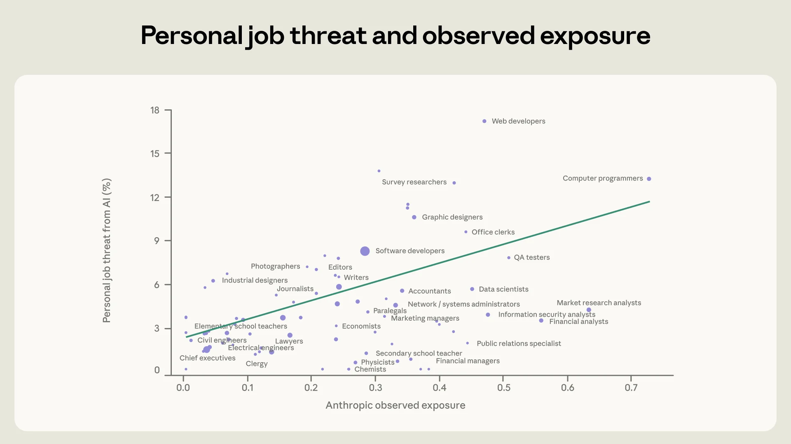
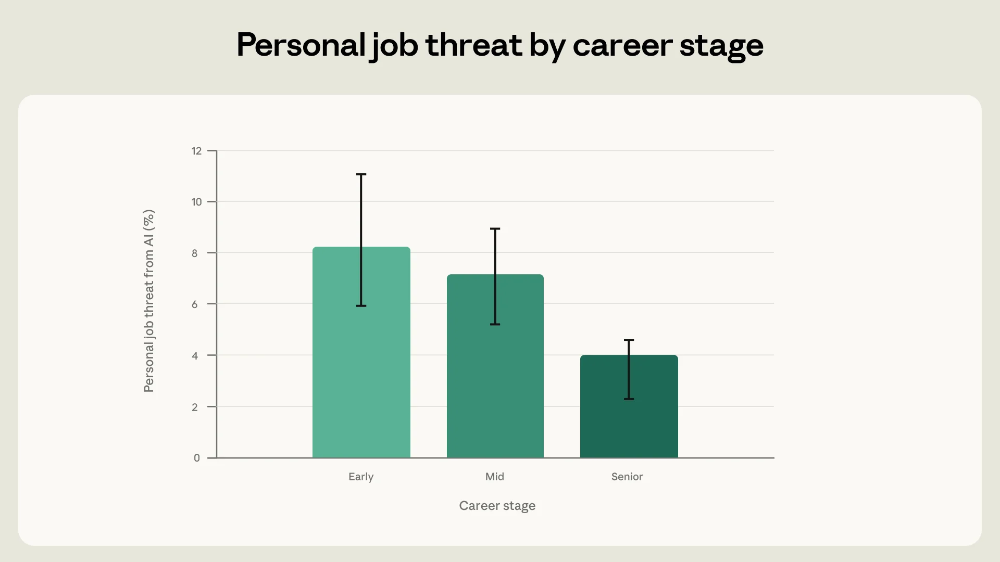
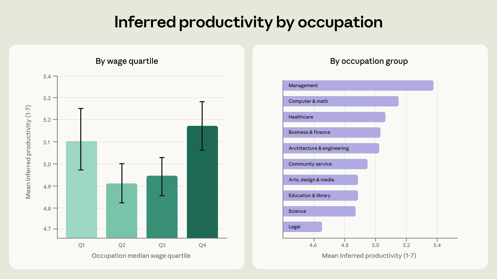
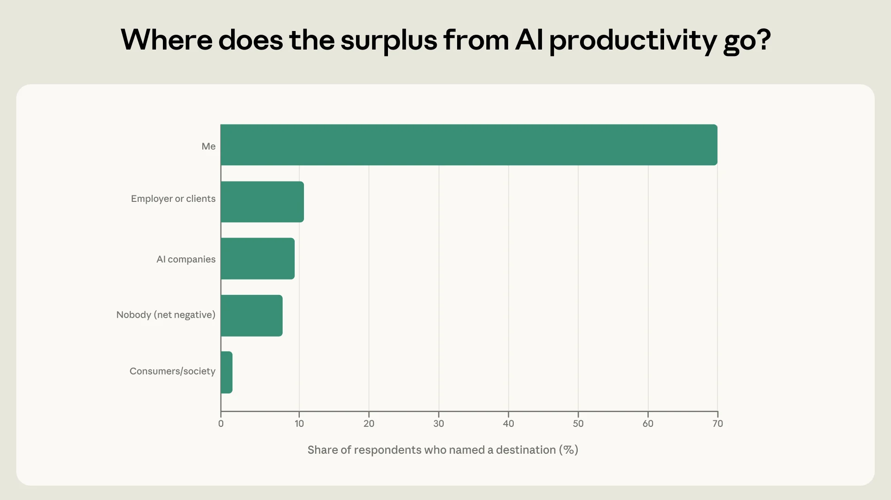
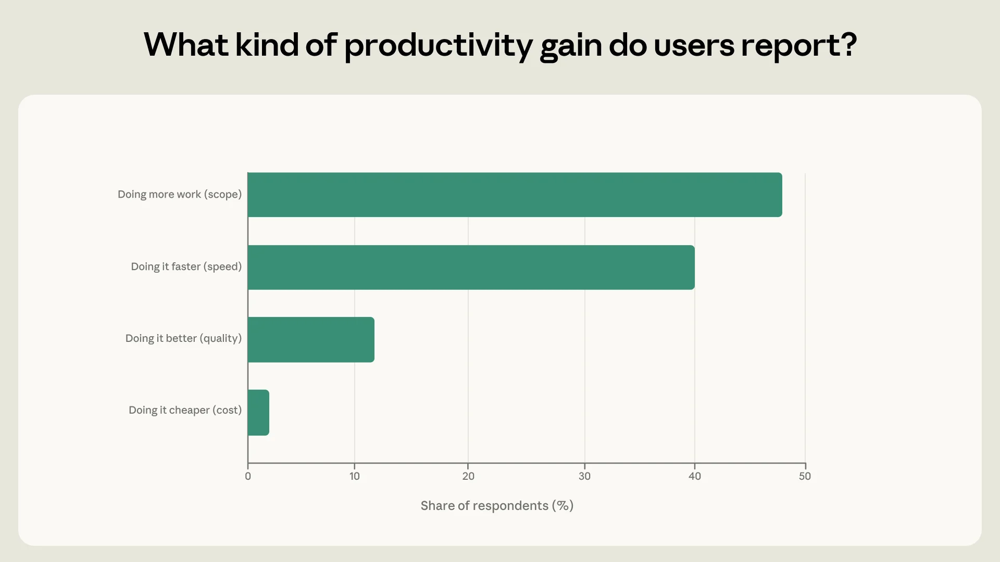
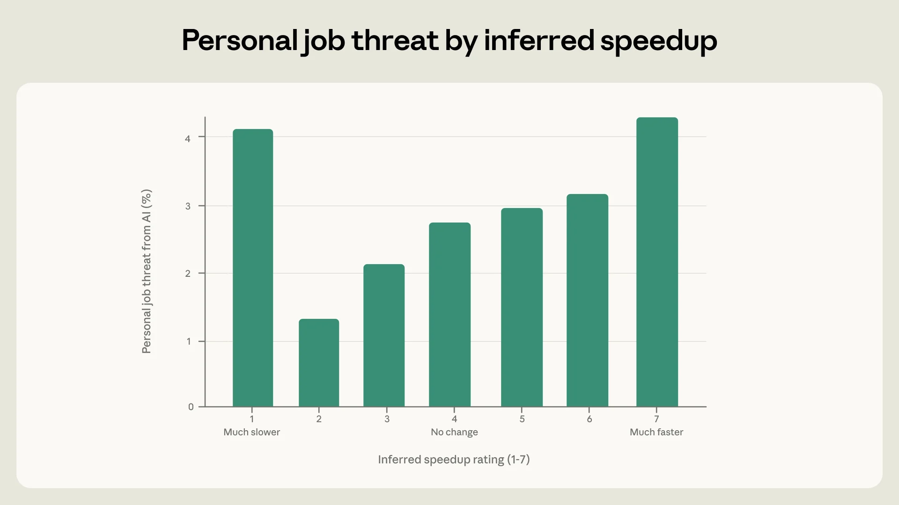

# 81,000 人如何看待 AI 的经济影响

- 英文标题：What 81,000 people told us about the economics of AI
- 发布日期：2026-04-22
- 官网栏目：经济学
- 原文：[Anthropic 页面](https://www.anthropic.com/research/81k-economics)
- 官网署名：Anthropic
- 官网推荐阅读：[阅读 PDF](https://assets.claude.com/3a8d990bc90098038eabd77b0d12ff636ed58d50.pdf)

> 中文机器初译，未逐篇人工校对。引用研究结论时请核对英文原文。

### 主要发现：

- *我们最近对 81,000 名 Claude 用户进行的调查显示，从事更多接触人工智能的工作的人更担心人工智能驱动的工作岗位流失。这些担忧在职业生涯早期的受访者中也更高。*
- *那些从事最高和最低收入职业的人的生产率提高最大，最常见的是范围的扩大（执行新任务）。*
- *经历人工智能带来最大加速的受访者对工作岗位流失表示了更高的担忧。*

为了让公众了解我们通过人工智能观察到的经济变化，我们的 [经济指数](https://www.anthropic.com/research/economic-index-march-2026-report) 分享 Claude 被要求做什么工作，以及 Claude 在哪些工作中承担的任务最多。然而，迄今为止，我们还缺乏关于这些使用模式如何映射到人们对人工智能的想法和印象的信息。

我们最近的 [对 81,000 名 Claude 用户进行的调查研究](https://www.anthropic.com/features/81k-interviews) 提供了一种将人们的经济担忧与我们在Claude流量中量化的内容联系起来的方法。

该调查询问了人们对人工智能进步的看法和担忧。人们分享的许多想法都涉及经济话题。我们了解到，许多人担心工作会被取代，尽管他们也觉得工作更有效率、更有权力。在某些情况下，人工智能使他们能够创业，或者让他们有时间去做更重要的事情；在另一些人看来，人工智能让人感到窒息，或者是雇主强加给他们的。

调查结果提供了初步证据表明 [观察到的暴露](https://www.anthropic.com/research/labor-market-impacts) （我们对人工智能替代风险的衡量）与人工智能的经济担忧相关。从事高度暴露职业的人们（按照Claude观察到的执行任务的定义）对经济流离失所更加紧张。这与人们广泛意识到人工智能的扩散和潜在影响是一致的。我们在下面详细阐述了我们的发现。

## 谁担心工作被取代？

*“就像现在所有从事白领工作的人一样，我 100% 担心，几乎 24/7 担心我的工作最终会被人工智能夺走。”——软件工程师。[1](https://www.anthropic.com/research/81k-economics#footnote-1)*

在我们的调查中，五分之一的受访者对经济流离失所表示担忧。一些人抽象地担心这一点：一位软件开发人员警告说，“人工智能在当前状态下有可能被用来取代初级职位。”其他人则感叹他们的工作或工作的某些方面正在被自动化取代。一位市场研究人员表示，“就提高我的能力而言，这是毫无疑问的。但未来人工智能可能会取代我的工作。”在某些工作中，人们觉得这让他们的工作更加困难。一位软件开发人员观察到，“当人工智能到来时，项目经理开始提出越来越难解决的问题和错误。”

在整个报告中，我们使用Claude驱动的分类器从人们的反应中推断出他们的属性和情绪。例如，许多参与者顺便提到了他们的工作领域或提供了有关他们工作生活的详细信息，这使我们能够推断他们的职业。同样，我们通过提示 Claude 识别和解释直接引用来量化对失业的担忧，其中受访者表示他们自己的角色面临人工智能驱动的失业风险。我们给出示例提示 [附录](https://assets.claude.com/3a8d990bc90098038eabd77b0d12ff636ed58d50.pdf).

受访者对人工智能的感知威胁与我们的研究相关 [自己测量观察到的暴露量](https://www.anthropic.com/research/labor-market-impacts)，反映了使用 Claude 的工作任务的百分比。当我们观察到的受访者暴露程度较高时，该受访者更关心人工智能。例如，小学教师比软件工程师更不担心自己的失业，这与Claude的使用偏向于编码任务的事实是一致的。

我们在下面的图 1 中展示了这一点。Y 轴是特定职业中表示人工智能已经取代或可能很快取代其角色的受访者百分比。x 轴是观察到的曝光量。该图显示，平均而言，从事暴露程度较高的职业的人往往更担心自己的工作被自动化取代。接触程度每增加 10 个百分点，感知到的工作威胁就会增加 1.3 个百分点。暴露程度最高的 25% 的人提到这种担忧的频率是最低的 25% 的人的三倍。

**来自人工智能和观察到的暴露的感知工作威胁。** 表示人工智能对工作构成一定威胁的受访者百分比与观察到的暴露程度相比 [马森科夫和麦克罗里 (2026)](https://www.anthropic.com/research/labor-market-impacts)。如果受访者表示自己的角色已经被取代或大幅减少，或者这种变化可能在短期内发生（使用 Claude 编码），则他们被编码为表明工作威胁。绿线显示了简单的线性拟合。

另一个重要的工人特征是职业阶段。在之前的研究中，我们报道了 [初步迹象](https://assets.claude.com/a42bc3fc08283562f08fd8bdee8f6f9a3d506e87.pdf) 美国应届毕业生和早期职业工人的招聘放缓。对于本次调查中约一半的受访者，我们能够从他们的答案中推断出职业阶段。[2](https://www.anthropic.com/research/81k-economics#footnote-2) 我们发现，职业生涯早期的受访者比资深员工更有可能表达对工作流失的担忧。

**对职业阶段经济位移的担忧。** 按职业阶段划分，表示人工智能对工作构成一定威胁的受访者百分比。这两个字段都是使用 Claude 支持的分类器从自由格式响应中推断出来的。

## 谁从人工智能中受益？

我们使用 Claude 来评估调查结果，将人们自我报告的人工智能带来的生产力提升程度分为 1-7 级，其中 1 表示“生产力降低”，2 表示“没有变化”，随后的每个级别表示更大的增益。7 分的回复包括这样的评价：“过去我需要几个月的时间才能在 4-5 天内制作出我制作的网站”；Claude对诸如“本来需要四个小时的事情只用了一半的时间就完成了”之类的陈述打了 5 分，对诸如“就我个人而言，我让人工智能帮助我修复网站上的代码”之类的陈述打了 2 分。但我花了很多遍才得到我想要的结果。”[3](https://www.anthropic.com/research/81k-economics#footnote-3)

总体而言，人们报告平均生产率显着提高。平均生产力评分为 5.1，相当于“生产力大幅提高”。当然，我们的受访者是愿意参与调查的活跃的 Claude 用户。这可能使他们比普通用户更有可能报告生产力的提高。约 3% 的受访者报告了负面或中性影响，42% 的受访者没有对生产力给出明确的指示。

这在一定程度上跨越了收入线。图 3 的左图显示，从事高薪工作的人（例如软件开发人员）从人工智能中获得了最大的生产力提升。这个结果不仅仅由编码驱动；当我们排除计算机和数学职业时，它仍然成立。它呼应了之前的 [经济指数发现](https://assets.claude.com/096d94c1a91c6480806d8f24b2344c7e2a4bc666.pdf) 这也有利于高薪工人：在需要更高教育水平的任务中，Claude倾向于以更高的比例减少完成任务所需的时间（相对于没有人工智能的情况）。

一些收入最低的工人也描述了生产率的大幅提高。其中包括一位客户服务代表，他使用“人工智能根据另一个人的回复创建回复，为我节省了大量时间。”在某些情况下，从事低薪工作的人正在技术副项目上使用人工智能。例如，一位送货司机正在利用Claude开展电子商务业务，而一位园林设计师正在构建音乐应用程序。

**按职业推断的生产力增益。** 左图显示了根据劳工统计局职业中位数工资的四分位数从人工智能推断出的平均生产率收益（使用Claude驱动的分类器推断）。右图显示了相同的结果，按主要职业群体划分。误差线显示 95% 的置信区间。

我们在图 3 的右侧面板中更详细地查看了这一点，显示了主要职业群体推断的生产力增益。最上面的是管理职业。这些受访者大多是利用Claude创业的企业家。[4](https://www.anthropic.com/research/81k-economics#footnote-4) 下一个最高类别是计算机和数学，其中包括软件开发人员。生产率提高最温和的两个群体是科学和法律行业的工人。一些律师担心人工智能遵循精确指令的能力。例如：“我对于什么在哪里、如何阅读法律文件、我想要它做什么给出了非常具体的规则……但每次都会有所不同。”

随着人工智能在经济中扩散，一个关键问题是，受益将在哪里——工人、他们的经理、消费者还是公司。大约四分之一的受访者表示获得了这些收益。总体而言，这些人中的大多数人都提到了通过更快的任务、扩大的范围和腾出的时间给自己带来的好处。[5](https://www.anthropic.com/research/81k-economics#footnote-5) 但在指定收件人的受访者中，有 10% 表示雇主或客户正在要求并获得更多工作。较小的比例提到了人工智能公司的好处，甚至更小的比例表示人工智能将带来净负面影响。这取决于职业阶段：只有 60% 的早期职业工作者表示他们个人从人工智能中受益，而高级专业人士的这一比例为 80%。

**AI生产力的剩余去哪儿了？** 在列出人工智能生产力提升受益者的受访者中，确定每个目的地的比例。

## 范围和速度

受访者还分享了他们在哪些方面获得了生产力提升。我们将其分为范围、速度、质量和成本。例如，许多使用人工智能进行编码任务的人会这样说：“我不是一个技术人员，但现在我是一名全栈开发人员。”这是范围的扩大；人工智能为他们解锁了新的能力。相比之下，一些用户加快了他们已经在做的任务，就像会计师说的，“我开发了一个工具，可以帮助我在 15 分钟内完成以前需要 2 个小时的融资任务。”质量提升通常来自于对代码、合同和其他文书工作进行更彻底的检查。一小部分受访者提到使用人工智能的成本低廉：“如果我雇用一名社交媒体经理，那就超出了我的预算。”

我们发现，最常见的生产力提升是范围内的，48% 明确提及生产力影响的用户提到了这一点。40% 提到生产力的用户强调速度。

**用户报告说生产力得到了怎样的提高？** 描述每种生产力收益的受访者比例。

人们与Claude的经历也可能会影响他们对人工智能的担忧。为了评估这一点，我们测量了受访者报告的加速情况，通过提取他们的工作现在是否慢得多（我们编码为 1）、速度没有变化（4）还是变得快得多（7）。

我们发现加速与感知到的工作威胁之间的关系呈 U 形（见图 6）。最左边的条形显示受访者表示人工智能降低了他们的速度。这些受访者更有可能表示人工智能对他们的生计构成了重大威胁。例如，一些创意工作者，如优秀的艺术家和作家，发现人工智能太令人窒息和僵化，无法帮助他们完成自己的工作。与此同时，他们担心人工智能扩散到创意领域会让他们更难找到工作。

**人工智能和加速带来的就业威胁。** 根据推断的加速水平，表示自己的工作岗位已经发生或可能在短期内发生流失的受访者百分比。

对于其余受访者来说，感知到的工作威胁随着他们的答案所暗示的加速水平而不断增加。这具有一定的经济意义：如果完成任务所需的时间迅速缩短，那么该职位未来的生存能力可能会存在更多不确定性。

## 讨论

经济指数揭示了人们如何使用人工智能。但了解人工智能的经济影响的另一个关键投入是直接听取人们的经验。这里探讨的回答表明，人们的直觉跟踪使用数据：他们最担心人工智能对我们观察到Claude做最多工作的工作的影响。我们还发现早期职业工人的经济焦虑程度更高，这与过去的研究相符。

还有迹象表明 Claude 正在为其用户赋权。人们最有可能谈论的是流向自己的利益，而不是流向雇主或人工智能公司的利益。高薪工人对人工智能对生产力的影响最热衷，但低薪工作和教育水平较低的人也报告了生产力的大幅提高。大多数受访者表示，Claude通过扩大工作范围或加快工作速度的方式增强了他们的能力。但经历最大加速的用户也对人工智能对工作的影响最担心。

由于数据的性质，我们的分析有一些重要的注意事项。首先，我们的调查仅限于选择做出回应的 Claude.ai 个人帐户用户。除了其他潜在的偏见之外，这些用户可能更有可能认为这些好处是为自己带来的。其次，这里没有直接询问用户许多派生变量，因此我们根据上下文线索对职业、职业阶段和其他变量的推断可能是错误的。与此相关的是，由于调查是开放式的，我们的衡量标准是基于受访者碰巧提到的内容；这些发现应该在直接询问这些主题的结构化调查中得到证实。

尽管如此，这些采访还是揭示了人们对人工智能经济学的感受的真实见解，展示了定性数据如何揭示定量假设。与经济相关的担忧占很大一部分本身就是一个强烈的信号。

### 附录

请参阅本文的最后一部分 [链接的 PDF](https://assets.claude.com/3a8d990bc90098038eabd77b0d12ff636ed58d50.pdf).

## 脚注

01我们使用调查中的第一个问题（“您最近使用人工智能聊天机器人做什么？”）或其他回复中给出的指示来推断人们的职业。

02这来自于书面答复中的各种迹象。例如，一些用户提到使用Claude做作业，这将他们归入职业生涯早期组。许多人提到经营自己的企业并参与招聘决策，这使他们进入了高级团队。

03该量表并未居中，因为大多数人都对生产力持积极评价，在原始李克特量表上几乎全部得到 6 分和 7 分。我们在这里使用的规模从 1 = 生产力较低、2 = 没有变化、3 = 生产力稍高、4 = 生产力稍高、5 = 生产力大幅提高、6 = 生产力大幅提高、到 7 = 生产力大幅提高——人工智能从根本上改变了他们的生产内容或生产量。

04消除这些“个体企业家”仍然使管理层与计算机和数学职业联系在一起，以显示出最高的生产力效益。

05然而，一个重要的警告是，这项调查是针对拥有Claude个人账户的人进行的。更具代表性的情况还包括企业用户，他们可能更有可能说价值归其雇主所有。
