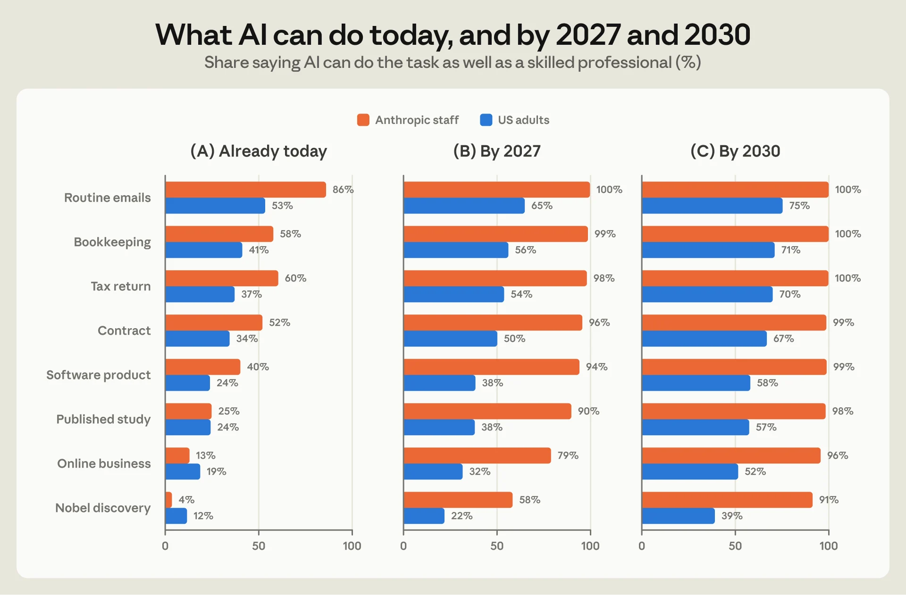
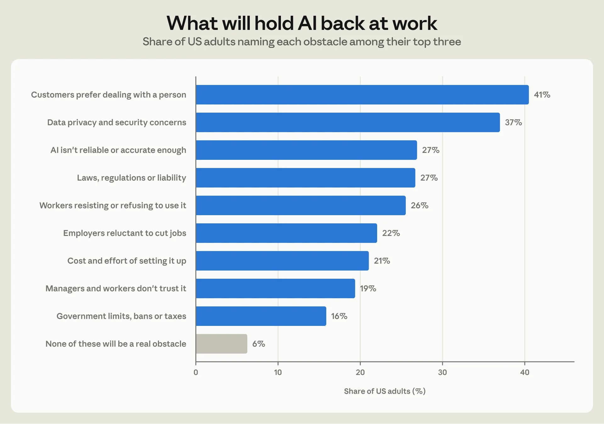
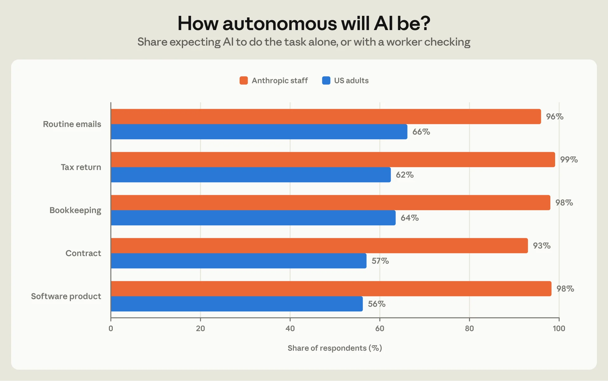
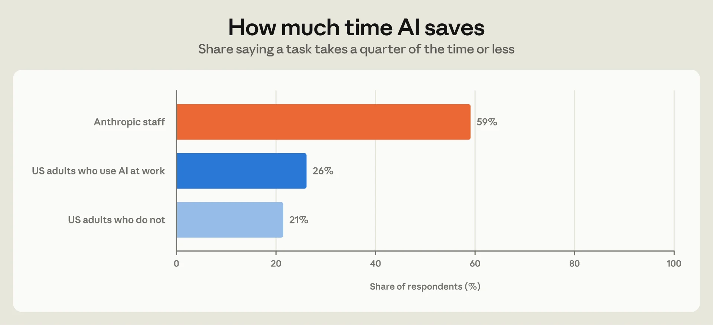
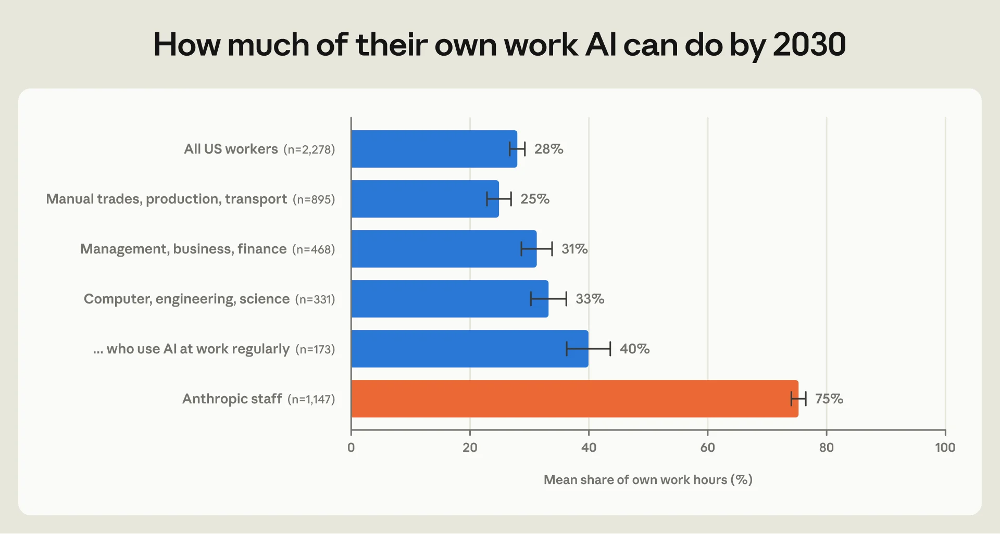
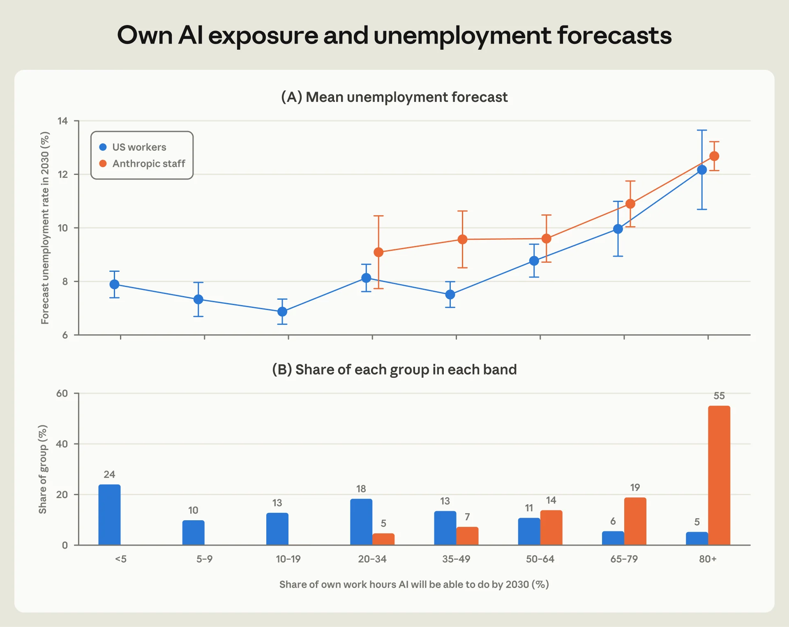
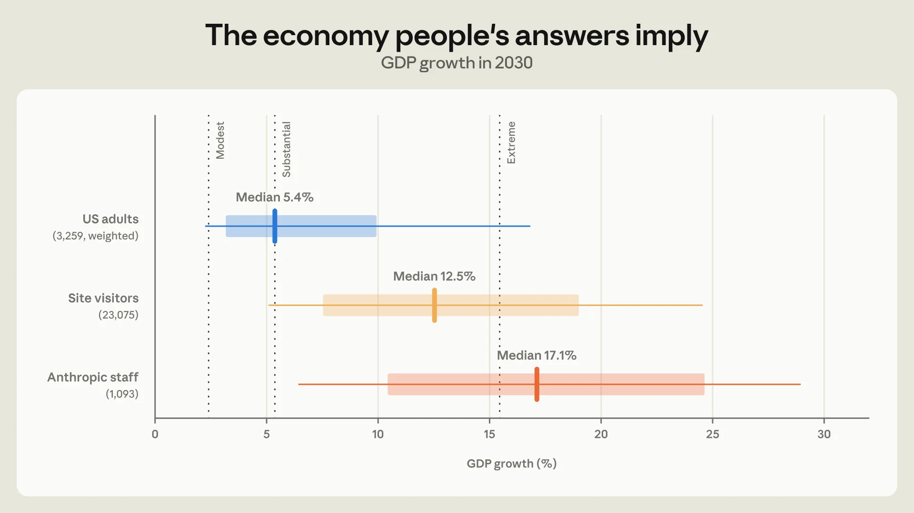
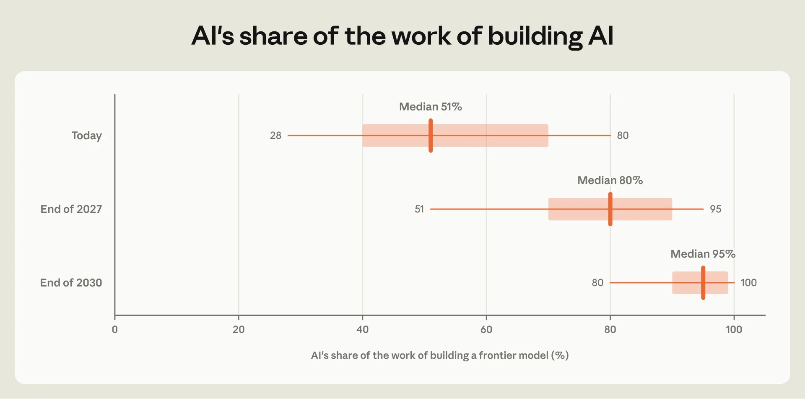

# 人们对 AI 的预期有多大分歧

- 英文标题：The AI expectations gap
- 发布日期：2026-10-16
- 官网栏目：经济学
- 原文：[Anthropic 页面](https://www.anthropic.com/research/ai-expectations-gap)
- 官网署名：Anthropic
- 官网推荐阅读：[阅读 PDF](https://assets.claude.com/a28f24814c56e2834a3eae7b13946f19d3e97ec4.pdf)

> 中文机器初译，未逐篇人工校对。引用研究结论时请核对英文原文。


*西蒙·萨赫、苔丝·科特、查理一世琼斯、安东·科里内克、彼得·麦克罗里*

## 主要发现

1. 美国成年人预计人工智能能力将在未来几年迅速发展； Anthrotic 的工作人员期望取得更快的进展； 39%的美国成年人和91%的工作人员预计人工智能到2030年将能够做出诺贝尔级的发现。
2. 人类员工期望人工智能在其非常适合的任务上能带来更大的生产力提升。在工作中使用人工智能的美国成年人中，26% 的人表示，使用人工智能完成任务所需的时间是人工智能的四分之一或更少，而 Anthropic 员工的这一比例为 59%。
3. 当谈到自己的工作时，超过一半的 Anthropic 员工预计到 2030 年人工智能能够完成他们目前至少 80% 的工作，而美国员工的这一比例为 5%。
4. 在美国工人和 Anthropic 员工中，那些希望人工智能能够完成更多自己工作的人预计失业率会更高。尽管对未来能力的信念存在差异，但人工智能如何改变自己的工作与更广泛的失业之间的联系对于两个群体来说非常相似。

## 简介

未来几年人工智能将如何重塑经济？人工智能能力正在迅速发展，未来人工智能模型可能能够构建自己的后继者（递归自我改进），这可能会进一步加快进展速度。这可能以多快的速度实现以及达到何种程度尚不清楚。预测差异很大，并且存在激烈的争论。

关于人工智能未来对经济影响的分歧的核心根源是什么？这主要是由于对人工智能能力提升速度的看法存在差异吗？或者它是否反映了对于这些能力以多快的速度以及以何种形式转化为现实世界采用的分歧？哪些关于人工智能未来路径的观点与经济的快速增长是一致的？

本说明提供了有关这些问题的新调查证据。2026 年 8 月，我们调查了两组：具有全国代表性的美国成年人样本和 Anthropic 工作人员。[1](https://www.anthropic.com/research/ai-expectations-gap#footnote-1) 这些问题涵盖人工智能的能力、它的应用范围、它节省的时间、它的自主性以及失业工人找到不同职业的工作的难度等。[2](https://www.anthropic.com/research/ai-expectations-gap#footnote-2) Anthropic 员工每天都在构建和使用前沿人工智能。因此，第二项调查显示了最接近该技术的人如何预测其未来，包括能力和更广泛的经济影响。

我们报告以下主要发现。首先，这两个群体在人工智能今天可以做什么方面基本达成一致，但对未来进展的速度存在分歧。人类工作人员期望能力能够更快地进步，人工智能能够得到更广泛的使用，并且人类的参与更少，并且它在任务上节省的时间会更多。例如，91% 的员工预计人工智能到 2030 年能够做出诺贝尔级别的发现，而美国成年人的这一比例为 39%。

其次，人们在自己的工作岗位上存在着明显的差异。平均而言，员工预计到 2030 年，人工智能将能够完成他们当前工作的 75%，而美国员工的总体这一比例为 28%。

第三，这两个群体似乎以类似的方式推理劳动力市场：那些期望人工智能在未来做更多自己的工作的人预计失业率会更高。而且，在预期人工智能自动化工作水平相同的情况下，两组人预测的失业率也相同。

## 人们期望人工智能做什么

### 能力

我们首先调查对人工智能能力的期望。我们询问人工智能何时能够像熟练的专业人员一样完成八项任务中的每一项，从撰写常规电子邮件到做出诺贝尔级别的科学发现。美国成年人和 Anthropic 工作人员在很大程度上同意人工智能今天可以做什么，特别是在涉及更复杂的任务时。两组任务的难度顺序几乎相同（图 1，A 组）。

这些团体对未来人工智能进步的道路存在分歧。例如，大约四分之一的美国成年人和 Anthropic 员工认为人工智能如今可以设计、进行和发表科学研究。但到明年，十分之九的员工预计这对于人工智能来说是可行的，而对于普通公众来说，这一比例仅为 38%。到 2030 年，39% 的美国成年人预计人工智能能够做出诺贝尔级的发现（C 组），而工作人员的这一比例为 91%。根据任务的不同，19% 到 40% 的美国成年人认为人工智能将带来最显着的差异。 *从不* 能够完成指定任务的员工比例最多为 2%。

在某种程度上，观点的差异反映了人工智能使用频率的差异。在那些经常在工作中使用人工智能的人（约占受访者的五分之一）中，56% 的人预计到 2030 年，人工智能将能够完成八项指定任务中的至少七项。这一比例远高于所有美国成年人 (41%) 和从未使用过人工智能工具的人 (28%)，但仍远低于员工的看法 (96%)。



**希望人工智能能够像熟练的专业人员一样完成所列任务的受访者比例。** 受访者被问及人工智能何时能够完成这些任务，无论公司是否会实际使用它。面板显示了 (A) 已经回答、(B) 到 2027 年回答、(C) 到 2030 年回答的份额。美国成年人的回答 (N=10,980) 经过加权以具有全国代表性，人类工作人员的回答未加权。

## 采用及其障碍

人工智能对经济的影响不仅仅取决于原始能力。人们和企业需要实际使用人工智能，这需要时间和实验。美国成年人预计，到 2030 年，人工智能将能够完成 42% 的工作任务。Anthropic 的工作人员预计，未来几年的传播速度将明显加快，人工智能将用于 65% 的所有任务。

为了了解哪些因素可能会阻碍人工智能在工作中的应用，我们要求美国成年人从九个障碍中选择最多三个他们认为最大的障碍。公众预计，阻碍采用的因素可能是人们的偏好和规则，而不是技术限制（图 2）。“客户更喜欢与人打交道”是最常被选择的障碍，其次是“数据隐私和安全问题”、“人工智能不够可靠”和“法律、法规或责任”。



**美国成年人列出的 2030 年人工智能在工作中使用的障碍。** 受访者被告知，即使技术上有能力完成某项任务，企业也并不总是使用人工智能，并被问到 2030 年人工智能在工作中使用的九个障碍中哪一个是最大的。每个人最多可以选择三个，因此份额总和超过 100%。我们没有向 Anthropic 工作人员问这个问题。

值得注意的是，在工作中经常使用人工智能的美国成年人将数据隐私和安全问题列为首要问题（42% 的人认为这是三大障碍之一，而其他人的这一比例为 37%），并认为客户与人类打交道的偏好稍微不那么重要（37% 的人对 37% 的人来说）。42%）。

## 人工智能将如何自主

人工智能对劳动力市场的影响部分取决于人工智能是自主完成复杂任务还是与人类协作完成复杂任务。前者往往会取代人类工人。或者，当人工智能补充人类能力时，工人的生产力就会提高。为了了解 Anthropic 员工和公众对 2030 年预期的自动化与增强的了解，我们询问到 2030 年，人工智能和人类将如何在从电子邮件起草到法律签约等各种任务上合作。在 Anthropic，绝大多数员工表示，到 2030 年，人工智能将单独完成任务，或者与评估工作的工人一起完成任务（图 3）。相比之下，十分之四的美国成年人希望人类自己完成大部分工作，或者在人工智能的帮助下完成大部分工作。



**希望人工智能单独完成每项任务或由工作人员检查的受访者比例。** 受访者被要求想象人工智能对于这五项任务中的每一项都有用，并询问谁将执行这些任务：单独使用人工智能；大部分工作由人工智能完成，由工人进行检查；在人工智能的帮助下，大部分工作都是由工人完成的；或单独的工人。条形显示选择前两者之一的份额。

#### 节省时间

人工智能提高产出的程度不仅取决于它可以完成哪些任务以及它的使用范围，还取决于它完成这些任务的速度和效果如何。一项足以取代工人的技术——Acemoglu 和 Restrepo（2019）称之为“马马虎虎”的技术——可以取代工作，但 GDP 不会有太大增长。相比之下，一项以一小部分成本或一小部分时间完成任务的技术可以显着提高 GDP。

为了衡量对人工智能生产力提升的看法，我们询问了公众和 Anthropic 员工，与不使用人工智能相比，使用人工智能完成一项非常适合人工智能的任务需要多长时间。用一半的时间完成任务相当于每小时的产出增加一倍。[3](https://www.anthropic.com/research/ai-expectations-gap#footnote-3)

Anthromatic 员工报告预期节省的时间要大得多，85% 的人表示只需要一半或更少的时间。在工作中使用人工智能的美国成年人中，典型的答案是一半的时间，29% 的人表示任务需要同样长或更长的时间，而只有 5% 的员工这么说。在美国成年人中，26% 在工作中使用人工智能的人表示完成一项任务只需要四分之一或更少的时间，而在工作中不使用人工智能的人中 21% 也有同样的说法。对于员工来说，这一比例为 59%（图 4）。

员工可能会描述他们在工作中的经历。正如进一步讨论的 [*Anthropic 的就业正在发生怎样的变化*](http://anthropic.com/research/employment-at-anthropic)在采用代理工具后，Anthropic 员工在某些方面提高了生产力：在采用编码代理后的一个月内，工程师的代码行数增加了两倍，销售代表在采用AI 智能体后与客户达成了更多的交易。其他业务职能（例如法律和招聘）的人均产出也有所增加。



**表示使用人工智能完成某项任务所需时间仅为四分之一或更少的受访者比例。** 受访者被要求思考当今人工智能非常适合的任务，例如总结文档或起草电子邮件，以及与不使用人工智能相比，使用人工智能完成需要多长时间，计算检查和修复其工作所花费的时间。条形图显示回答“大约四分之一的时间”或“大约十分之一或更少的时间”的份额。图 A2 显示了所有答案。

## 自己的工作和职位

### 人工智能能够完成多少自己的工作

也许并不奇怪，我们发现公众和 Anthropic 员工在人工智能对自己工作的影响方面存在巨大认知差距（图 5）。Anthropic 员工表示，平均而言，到 2030 年，人工智能将能够完成他们当前工作时间的 75%。美国工人（自称有工作的受访者）平均认为这一比例为 28%，只有十分之一的人表示到 2030 年人工智能可以完成他们 80% 或更多的工作时间。

美国工人的期望因职业而异：预计人工智能将能够完成体力劳动、生产和运输工人 25% 的工作时间，以及计算机、工程和科学职业工人 33% 的工作时间。对于后一组人，那些经常使用人工智能的人的预期只有 40%，这一观点更接近美国普通员工，而不是 Anthropic 员工的平均水平 (75%)。



**受访者预计 2030 年人工智能能够完成的工作时间比例。** 到 2030 年，人工智能能够完成受访者当前工作时间的份额。美国成年人样本仅限于就业受访者。工作人员在滑块上回答，而美国成年人选择范围，我们使用范围中点。条形图显示 95% 的置信区间。

### 自营职业风险和失业预测

人们期望人工智能能完成多少自己的工作，这在很大程度上解释了他们对劳动力市场的期望。我们告诉受访者目前的失业率约为4.2%，并请他们预测2030年的失业率。图 6 按受访者预计 2030 年人工智能能够完成的工作时间比例对受访者进行了分组，并显示了每个组的平均失业率预测。

预计人工智能能够完成不到一半工作的美国工人预计失业率将达到 7% 至 8%。超过一半时，预测会随着人工智能工作的比例而增加。那些预计人工智能将完成 80% 或更多工作的人预计，到 2030 年，失业率将达到 12.2%，高于金融危机期间的峰值。对于美国工人来说，受影响的工作量增加 10 个百分点，预计失业率就会增加 0.4 个百分点。对人工智能的普遍乐观并不能解释这一点。在自己的工作暴露固定的情况下，员工期望人工智能掌握的八项任务的份额与预测无关。

尽管他们自己报告的暴露程度要高得多，但 Anthropic 工作人员也出现了相同的梯度，预测与普通人群的预测非常接近。因此，对于人工智能将如何同时影响他们自己的工作和更广泛的劳动力市场，这两个群体似乎没有不同的理论。他们对人工智能的能力有不同的体验，也有不同的期望。



**根据受访者期望人工智能能够完成的工作时间比例，对 2030 年失业率进行平均预测。** 受访者被告知美国目前的失业率为 4.2%，并询问他们对 2030 年失业率的预期是多少。(A) 组根据受访者当前工作时间的预期，到 2030 年人工智能能够完成的工作进行分组，并显示每组的平均预测和 95% 置信区间。受访者人数少于 20 人的群体被忽略。面板 (B) 显示了每组中美国工人和 Anthropic 员工的比例。

## 雇用和再雇用

尽管 Anthropic 的员工希望人工智能能够完成大部分工作，但他们也希望 Anthropic 能够继续招聘。95% 的 Anthropic 员工预计未来 12 个月内员工人数将增长，中位员工预计人数将增长 66%，27% 的员工预计人数至少会增加一倍。这些是内部民意调查中员工的个人期望，并不代表 Anthropic 的计划或其对其员工人数的看法。即便如此，他们表明，自动化任务和裁员是不同的预测，至少在前沿人工智能实验室是这样。

然而，对于被人工智能取代的工人能多快找到新工作，人类工作人员比美国成年人稍微悲观一些。我们询问一个在 2030 年因人工智能自动化而失去工作并需要转换职业的人需要多长时间才能找到新的工作。[4](https://www.anthropic.com/research/ai-expectations-gap#footnote-4) Anthropic 员工中位数预计，因人工智能而失业的员工需要 12 个月才能找到新职业。相比之下，美国成人的反应中位数为 7-12 个月。

## 对人工智能的期望及其经济影响

### 将调查响应映射到模型隐含的经济情景

在 [*变革性人工智能的经济场景*](https://assets.claude.com/cf58f84d46a4a76bf5a5b039ac695fba6b80041c.pdf) 我们引入了一个结构化框架，用于评估人工智能能力和扩散的不同未来路径如何转化为经济成果的差异。该模型使我们能够将每个受访者在五个维度（能力、扩散、自动化、生产力和工人转型摩擦）的答案转化为模型隐含的经济成果。[5](https://www.anthropic.com/research/ai-expectations-gap#footnote-5) 在我们的美国成年人和 Anthropic 员工样本中，我们确定了回答与关键模型输入相关的所有问题的每位受访者（3,259 名美国成年人和 1,093 名员工）。然后，我们评估每个受访者的答案所暗示的经济情景，下面重点关注对 2030 年 GDP 增长的影响。

根据该模型，美国成年人的答案中位数意味着 2030 年 GDP 增长率为 5.4%。工作人员的回答中位数意味着到 2030 年 GDP 增速将加速至 17.1%。每个组内都存在显着差异，因此分布广泛重叠（图 7）。附录中的图 A1 显示了每种信念对这一差距的贡献程度。

### 在线场景探索测验的回复

图 7 还显示了站点访问者向交互式场景浏览器提供的输入所隐含的经济场景，该交互场景浏览器基于该经济模型，发布于 [www.anthropic.com/institute/econ-scenarios](https://www.anthropic.com/institute/econ-scenarios) 2026 年 9 月 9 日。

交互式探索者提出了我们在 2026 年 8 月向美国成年人和 Anthropic 工作人员提出的问题的简短版本。调查发布后 48 小时内，来自全球 140 多个国家/地区的 23,075 名访客完成了调查。这些访问者选择访问 Anthropic 网站上的页面并参加测验，因此他们可能比普通公众对人工智能更感兴趣。事实上，他们的答案介于美国成年人和 Anthropic 员工之间：游客的答案中位数意味着增长 12.5%。



**模型隐含的 2030 年 GDP 增长基于美国成年人、网站访问者和 Anthropic 工作人员的预期。** 每个受访者对关于能力、采用、自主、节省时间和再就业的五个问题的回答都是通过变革性人工智能的经济情景模型进行的；详情请参阅其中的附录 B。 粗条跨越 25% 到 75%，细线跨越 10% 到 90%。虚线标记了本文提出的三种情景：适度（GDP 年增长率为 2.4%）、实质性（GDP 增长率为 5.4%）和极端（GDP 增长率为 15.4%）。该数字包括回答了所有五个问题的受访者：3,259 名美国成年人（仅 2030 年的一半）、1,093 名 Anthropic 员工以及完成了以下测验的 23,075 名网站访问者： anthropic.com/institute/econ-scenarios 2026 年 9 月 9 日上线后 48 小时内。

## 实验室内部

员工对人工智能能力更加乐观的原因之一可能是他们对开发过程有更大的了解。人类研究所最近发​​布了一份关于递归自我改进（RSI）进展的报告，这是人工智能系统不断提高自身能力的过程（Favaro 和 Clark，2026）。

为了弄清楚工作人员自己是否期望这种情况发生，我们询问了 Anthropic 工作人员，目前构建 2026 年初前沿模型的工作中有多少是由人工智能完成的，以及他们对未来的期望（图 8）。[6](https://www.anthropic.com/research/ai-expectations-gap#footnote-6) 在接受调查的 Anthropic 员工中，目前的中位数答案为 51%，到 2027 年底为 80%，到 2030 年底为 95%。

对人工智能在人工智能开发中所做的工作份额的估计在团队内部比团队之间差异更大。尽管如此，最接近构建模型工作的研究团队的工作人员认为人工智能目前的份额略高：平均为 60%，而所有其他调查受访者的这一比例为 53%。这与信息发挥一定作用是一致的，尽管研究人员由于其工作性质，也可能比其他员工更多地在自己的工作中使用人工智能。

与招聘预测一样，这些回应是 2026 年 8 月向 Anthropic 员工进行的内部民意调查中员工的个人观点。



**人类工作人员对人工智能完成的构建前沿模型工作份额的估计。** Anthrocy 的工作人员被问到，目前构建 2026 年初前沿模型的工作中有多少是由人工智能完成的，以及他们预计到 2027 年底和 2030 年该份额将是多少。勾号标记中值答案，方框跨越 25% 到 75%，线条跨越 10% 到 90%。答案是员工在内部投票中的个人估计，并非 Anthropic 的测量结果或公司预测。

## 结论

美国成年人和 Anthropic 工作人员对于人工智能今天可以做什么基本上达成了一致。然而，他们对于它的改进速度、使用范围以及以节省时间来衡量的生产力提升程度存在不同意见。透过模特的镜头 [变革性人工智能的经济场景](https://www.anthropic.com/institute/econ-scenarios)，美国成年人的回答中位数暗示了美国经济增长率是其典型增长率两倍以上的情况。在人工智能开发和使用前沿的 Anthropic 工作人员中，对人工智能进步、采用和知识工作自动化的期望意味着经济将发生革命性的、历史上前所未有的变化：到 2030 年，GDP 规模大约每四年半翻一番。

那些预计人工智能在未来几年能做更多自己的工作的人预计失业率也会更高。对于美国公众和 Anthropic 员工来说都是如此；平均而言，Anthropic 的员工期望自己的工作能够更快实现自动化，从而提高失业率。我们发现，这种期望上的分歧与 Anthropic 员工和公众对于未来几年他们自己的工作将在多大程度上实现自动化的不同看法密切相关。

两组人对人工智能的日常体验差异很大。大多数 Anthropic 员工已经与人工智能一起工作，人工智能完成了他们的大部分工作，而很少有美国员工这样做。那些人的期望已经接近 Anthropic 员工的期望，这表明公众的期望可能会随着人工智能使用的普及而发生变化。它们的转变程度将取决于人工智能是否能够像在前沿实验室那样在其他地方完成同样多的工作。

### 建议引用

```
@techreport{sacher2026expectations,
	author = {Sacher, Szymon and Cotter, Tess and Jones, Charles I. and Korinek, Anton and McCrory, Peter},
	title = {The {AI} Expectations Gap: Public and Frontier Lab Views on {AI}'s Impact on Work},
	institution = {The Anthropic Institute},
	type = {Technical Report},
	year = {2026},
	month = oct,
	url = {https://www.anthropic.com/research/ai-expectations-gap}
}
```

### 参考文献

阿塞莫格鲁，D. 和 P.雷斯特雷波（2019）。“自动化和新任务：技术如何取代和恢复劳动力。”经济展望杂志 33(2), 3–30。

法瓦罗，M.和J.克拉克（2026）。“当人工智能自我构建时。”人类研究所。 <https://www.anthropic.com/institute/recursive-self-improvement>.

科里内克，A.，C.我。琼斯，S.萨赫，T.科特和 P.麦克罗里（2026）。“变革性人工智能的经济场景。”人类研究所工作论文编号：2026-02。

马森科夫，M.，E.柳比奇，S.萨赫，Z.希齐格，S.张，R.海勒和 P.麦克罗里（2026）。“人类经济指数报告：节奏。”人类研究所。 <https://www.anthropic.com/research/economic-index-june-2026-report>.

威尔默斯，N.，R.卡蒂蓬，M.马森科夫和 P.麦克罗里（2026）。“Anthropic 的就业正在发生怎样的变化。”人类研究所。 <https://www.anthropic.com/research/employment-at-anthropic>.

### 附录

可用 [这里](https://assets.claude.com/1bc1a3067f9c9883d6d556b38f26fd4f1e1b640f.pdf).

## 脚注

01Morning Consult 在 8 月 11 日至 23 日期间对美国成年人进行了调查，覆盖了 10,980 名美国成年人。其反应经过加权以代表成年人口。一半受访者询问了关于 2027 年的未来，另一半则询问了 2030 年的未来。除非另有说明，否则我们将报告 2030 年的回应。该调查是在网上进行的，由选择参加的小组成员进行，因此它排除了无法上网的成年人，并且可能与人口的不同之处在于人口统计的权重无法纠正。此次员工调查是一项内部民意调查，于 8 月 9 日至 12 日进行，吸引了来自公司各个部门的 1,334 名受访者。它是未加权的，每个人都被问到2030年。

02Morning Consult 在 9 月 17 日至 24 日期间再次回答了相同的问题，最后添加了两个新问题，共覆盖了 7,613 名美国成年人。主要结果变化不大：该样本中美国成年人的答案中位数意味着 2030 年 GDP 增长率为 5.6%。最大的变化是，预计到 2030 年获得诺贝尔级发现的美国成年人比例从 39% 上升至 44%。我们自始至终报告八月份的结果。

03这类似于我们在人类经济指数中使用的分类器，用于评估人们和企业为Claude带来的任务之间节省的时间。例如，参见 [估算 Claude 对话中 AI 生产力的提升](https://www.anthropic.com/research/estimating-productivity-gains).

04两组人都被问到以下问题：在正常情况下，失业的人通常需要大约 3 个月的时间才能找到新工作。现在想象一下，一个人在 2030 年因人工智能自动化而失业，需要切换到不同的职业。您认为他们需要多长时间才能找到新工作？对于普通公众来说，答案选项范围从“不到1个月”到“超过3年，或者永远不会找到新工作”。Anthropic 的工作人员在几个月内就给出了答案。

05我们遵循中概述的程序 [*变革性人工智能的经济场景*](https://assets.claude.com/cf58f84d46a4a76bf5a5b039ac695fba6b80041c.pdf) 用于将原始调查答案映射到模型关键输入的隐含路径中。参见其中的附录 B。对于本练习，我们将模型中的所有其他参数保留为“实质性”场景中的值。

06这是一个比人工智能编写多少代码更广泛的问题。Favaro 和 Clark（2026）报告称，合并到 Anthropic 代码库中的代码现在有超过 80% 是由 Claude 编写的，但构建前沿模型还涉及研究方向、实验设计和评估等。
