# Anthropic 经济指数报告：经济活动的基本要素

- 英文标题：Anthropic Economic Index report: Economic primitives
- 发布日期：2026-01-15
- 官网栏目：经济学
- 原文：[Anthropic 页面](https://www.anthropic.com/research/anthropic-economic-index-january-2026-report)
- 官网署名：Anthropic
- 官网推荐阅读：[下载PDF](https://assets.claude.com/096d94c1a91c6480806d8f24b2344c7e2a4bc666.pdf)

> 中文机器初译，未逐篇人工校对。引用研究结论时请核对英文原文。

## 简介

### 人工智能如何重塑经济？

本报告引入了人工智能使用的新指标，以提供 2025 年 11 月（即 Opus 4.5 发布之前）与 Claude 互动的丰富信息。这些“原语”是关于如何使用 Claude 的简单、基本的衡量标准，我们通过向 Claude 询问有关匿名 Claude.ai 和第一方 (1P) API 记录的具体问题来生成这些“原语”，涵盖与 AI 经济影响相关的五个维度：用户和 AI 技能、任务的复杂程度、给予 Claude 的自主程度、Claude 的成功程度以及 Claude 是否用于个人、教育或工作目的。

结果揭示了显着的地理差异、对人工智能任务范围的现实估计，以及Claude宏观经济影响修订评估的基础。

我们与本报告一起发布的数据是迄今为止最全面的，涵盖了人工智能使用、消费者和企业使用以及 Claude.ai 的国家和地区细分的五个新维度。

### 自我们上次报告以来发生了什么变化

在第一章中，我们回顾了之前的发现 [经济指数报告](https://www.anthropic.com/research/anthropic-economic-index-september-2025-report) 于 2025 年 9 月发布。我们发现：

- **Claude的使用仍然集中在某些任务上，其中大多数与编码有关**虽然我们在 Claude.ai 中看到了 3,000 多个独特的工作任务，但前 10 个最常见的任务占我们抽样对话的 24%，自上次报告以来略有增加。增强模式（用户学习、迭代任务或从 Claude 获取反馈的对话）略高于 Claude.ai 对话的一半。相比之下，自动化使用在 1P API 流量中仍然占主导地位，反映了其程序化本质。
- **全球使用量持续不平衡，而美国各州趋同**美国、印度、日本、英国和韩国在 Claude.ai 的总体使用量方面处于领先地位。在世界范围内，人均 GDP 仍然可以很好地解释采用率的不平衡。在美国，劳动力构成在造成采用率不均衡方面发挥着关键作用，因为拥有更多计算机和数学专业人员的州系统地显示出更多的Claude使用率。

尽管仍然存在大量集中，但自我们上次报告以来，Claude的使用情况在美国各州的分布明显更加均匀。如果持续下去，全国的人均使用量将在 2-5 年内实现均衡。

### 介绍和分析我们的新经济原语

在第二章中，我们讨论了新经济原语的动机并介绍了它们，包括它们是如何选择和实施的，以及它们的局限性。我们还提供了证据，表明与外部基准相比，我们的原语捕获了底层使用模式的定向准确方面。在第三章和第四章中，我们使用这些原语来进一步研究对采用和生产力的影响。我们发现：

- **Claude的使用随着采用率和收入的提高而多样化**虽然Claude最常见的用途是工作，但在人均 GDP 最低的国家，课程作业的使用率最高，而富裕国家的个人使用率最高。这与一个简单的采用曲线故事是一致的：欠发达国家的早期采用者往往是具有特定、高价值应用程序的技术用户，或者使用 Claude 进行教育，而成熟市场的使用情况则朝着休闲和个人目的多样化。
- **Claude在大多数任务上都取得了成功，但在最复杂的任务上却不太成功**我们发现，Claude通常能够成功完成所分配的任务，并且其响应的教育水平往往与用户的输入相匹配。Claude在更复杂的任务上举步维艰：随着人类完成任务所需时间的增加，Claude的成功率下降，就像 [突出的评估衡量人工智能可以可靠执行的最长任务](https://arxiv.org/abs/2503.14499).
- **当考虑到成功率时，人工智能的工作机会看起来会有所不同**我们还使用成功率原语来更好地了解人工智能的工作暴露情况，通过根据成功率和工作中每项任务的重要性对任务覆盖范围进行加权，计算Claude可以执行的每项职业的份额。对于某些职业，例如数据输入键控人员和数据库架构师，Claude在大部分工作方面都表现出了熟练程度。
- **Claude用于执行比更广泛的经济领域更高技能的任务**我们在Claude的使用中观察到的任务往往比更广泛的经济中的任务需要更多的教育。如果我们假设人工智能辅助的任务作为工人职责的一部分而减少，那么取消它们将留下技术含量较低的工作。但这种简单的任务转移不会对白领工人产生统一的影响——对于某些职业来说，它消除了技能最密集的任务，而对于另一些职业来说，它消除了最少的技能密集型任务。  

  如果没有我们观察到的Claude所执行的任务，旅行社就会经历技能下降，因为复杂的规划工作被例行的购票和收款所取代。相比之下，随着簿记任务让位于合同谈判和利益相关者管理，物业经理将经历技能提升。

### 了解人工智能对经济影响的新窗口

这些结果为了解人工智能目前如何影响经济提供了一个新的窗口。了解任务的成功率可以更准确地了解哪些任务可能被自动化、某些工作可能受到的影响以及劳动生产率将如何变化。通过用户教育来衡量差异表现可以揭示不平等的影响。

事实上，教育水平在投入和产出方面的密切关系表明，教育程度较高的国家可能更容易从人工智能中受益，而与采用率无关。

此数据发布旨在使研究人员和公众更好地了解人工智能的经济影响，并调查这种变革性技术已经产生影响的方式。

## 第一章：自上次报告以来发生了什么变化

### 概述

由于前沿人工智能模型的能力正在迅速提高并且采用速度很快，因此定期评估人们和企业如何使用此类系统的变化以及这种使用对更广泛的经济意味着什么非常重要。1

在本章中，我们分析了 Opus 4.5 发布之前的 2025 年 8 月至 2025 年 11 月期间 Claude 使用和传播模式的变化。我们提出四点观察：

1. **跨任务的使用仍然高度集中**:  
   十个最常见的任务占 Claude.ai 观察到的使用情况的 24%，高于我们上一份报告中的 23%。对于第一方 (1P) API 企业客户，任务的集中度更加显着增加：前十个任务现在占流量的 32%，高于上次报告中的 28%。
2. **在 Claude.ai 上，增强功能再次比自动化更常见：**在我们之前的报告中，我们注意到自动化使用已经超过了 Claude.ai 上的增强使用，这或许体现了法学硕士用户的能力提高和熟悉程度的提高。2025 年 11 月的数据表明，Claude.ai 上出现了向增强型使用的广泛转变：分类为增强型的对话比例跃升了 5 个百分点，达到 52%，而被视为自动化的对话比例下降了 4 个百分点，达到 45%。2 在此期间产品发生变化——包括 [文件创建功能](https://claude.com/blog/create-files), [持久记忆](https://claude.com/blog/memory), 和 [工作流程定制技能](https://claude.com/blog/skills)——可能已经将使用模式转向更具协作性、人机交互的方式。
3. **在美国，使用率较低的州的采用率增长相对较快**在美国，人均使用率很大程度上取决于劳动力与更广泛的Claude使用率的匹配程度：例如，计算机和数学职业工人比例较高的州往往具有较高的使用率。事实上，美国排名前五的州尽管仅占劳动年龄人口的 38%，但其使用量却占所有使用量的近一半 (50%)。   

   尽管如此，早期迹象表明区域采用率迅速趋同：在我们上一份报告中使用率较低的州，使用率增长相对较快。如果持续下去，全国范围内的人均使用量将在 2-5 年内实现均衡，其传播速度比 20 世纪以前具有经济意义的技术的传播速度大约快 10 倍。3   

   虽然这与人工智能的快速采用和扩散相一致，但这一估计存在不确定性，因为它是基于三个月内观察到的变化。在未来的几个月和几年里，扩散最终可能会更加缓慢。
4. **全球使用量几乎没有显示出区域趋同性增加或减少的迹象**在全球范围内，人类人工智能使用指数 (AUI) 所反映的Claude人均使用量仍然高度不平衡，并且与 GDP 密切相关。这些差距是稳定的：我们没有看到任何证据表明低使用率国家正在迎头赶上或高使用率国家正在落后。

### 跨任务和相关职业改变使用模式

尽管前沿法学硕士拥有与现代经济各个方面相关的一系列令人印象深刻的能力，但Claude的使用仍然非常集中于少数任务。与近一年前相比，消费者对 [Claude.ai](http://claude.ai) 稍微更加集中：2025 年 11 月，分配给十个最常见的 O*NET 任务的对话比例为 24%，比 8 月高出 1 个百分点，也高于 2025 年 1 月的 21%。2025 年 11 月最普遍的任务——修改软件以纠正错误——仅占使用量的 6%。

在上一份人类经济指数报告中，我们开始通过研究 1P API 客户中 Claude 使用情况来跟踪业务采用模式。十个最常见的任务从 8 月份 API 记录的 28% 增长到 11 月份的 32%。一小部分任务的集中度不断提高，表明最高价值的应用程序继续产生巨大的经济价值，即使模型在更广泛的任务中变得更加有能力。与 [Claude.ai](http://claude.ai) API客户最常见的任务是修改软件以纠正错误，这占了十分之一的记录。

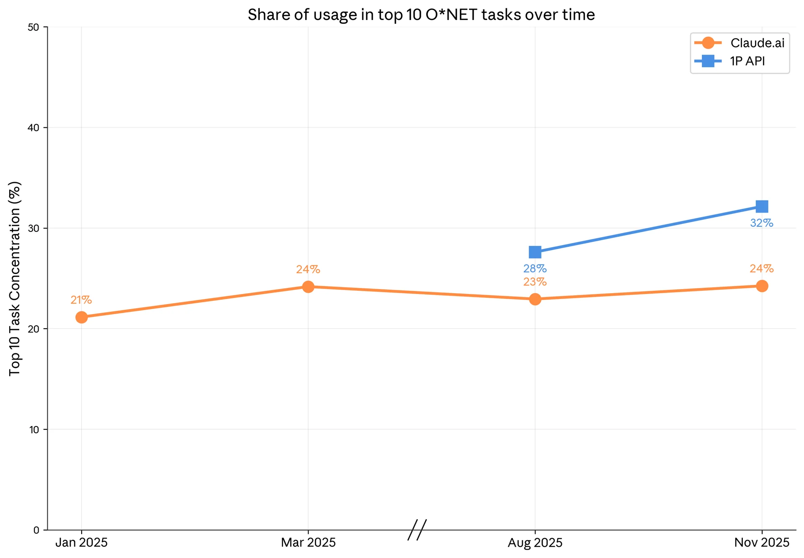

**随着时间的推移，按平台、Claude.ai 和 1P API 划分的前 10 名任务的使用情况份额。**按平台和报告版本划分的分配给十个最流行的 O*NET 任务的对话份额。

事实上，计算机和数学任务（例如修改软件以纠正错误）继续主导 Claude 的整体使用，占 Claude.ai 上对话的三分之一和近一半的 1P API 流量。Claude.ai 上的这种主导地位已经消退：Claude.ai 上分配给此类（大部分）编码相关任务的对话份额从 2025 年 3 月的峰值 40% 下降到 2025 年 11 月的 34%。与此同时，1P API 流量中分配给计算机和数学任务的成绩单所占比例从 8 月的 44% 上升至 2025 年 11 月的 46%（图 1.2）。

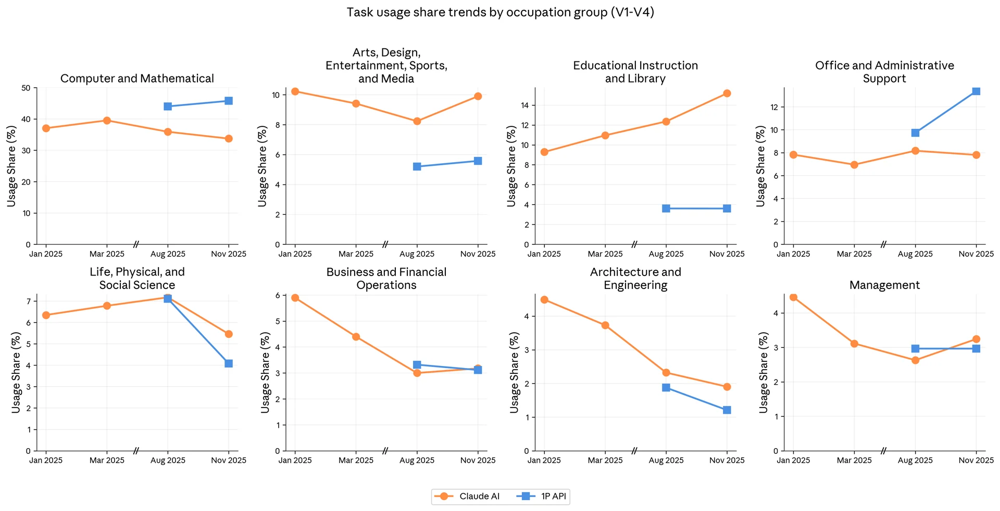

**[Claude.ai](http://claude.ai) 以及随着时间的推移 API 使用情况。**每个面板显示了 Claude.ai 和 1P API 记录上与每个标准职业分类 (SOC) 主要组的任务相关的采样对话的份额。

2025 年 11 月，Claude.ai 使用量的第二大份额是教育教学和图书馆类别。这主要对应于帮助课程作业和复习以及教学材料的开发。自我们第一份报告以来，此类使用率稳步上升，从 2025 年 1 月 Claude.ai 上对话的 9% 上升到 11 月的 15%。

2025 年 8 月至 11 月期间，Claude.ai 在艺术、设计、娱乐、体育和媒体任务中的使用比例有所增加，因为 Claude 在写作任务（主要是文案编辑以及虚构作品的写作和完善）的对话中使用的比例不断增加。与设计和写作相关的任务的流行程度的跃升扭转了早期报告中的稳步下降趋势。对于 Claude.ai 和 API 客户来说，使用 Claude 执行生命、物理和社会科学相关任务的对话/记录的份额有所下降。

对于 API 客户来说，最显着的发展也许是与 Office 和行政支持相关任务相关的成绩单份额的增加，该比例在 8 月份上升了 3 个百分点，到 2025 年 11 月达到 13%。由于 API 使用以自动化为主，这表明企业越来越多地使用 Claude 来自动化日常后台工作流程，例如电子邮件管理、文档处理、客户关系管理和日程安排。4

### 增强技术再次在 Claude.ai 上占据主导地位

人工智能将如何影响经济不仅取决于Claude执行的任务，还取决于用户访问和参与底层模型功能的方式。自从我们的第一份报告以来，我们将对话分为五种交互类型之一，我们将其分为两个更广泛的类别：自动化和增强。5

图 1.3 描绘了自一年前我们首次开始收集这些数据以来，自动化与增强使用的演变情况。2025 年 1 月，Claude 的增强型使用占主导地位：56% 的对话被归类为增强型，而自动化对话占 41%。6 2025 年 8 月，与增强型对话相比，更多对话被归类为自动化对话。

这是一个值得注意的发展，因为它表明模型功能和平台功能的快速改进与用户越来越多地将任务完全委派给 Claude 相一致。这在“指令”协作模式中很明显，该模式进一步分组为自动化。指令性对话是指用户向 Claude 分配任务，Claude 以最少的来回完成任务。从 2025 年 1 月到 2025 年 8 月，此类指令对话的比例从 27% 上升至 39%。7

三个月后，指令对话的比例在 2025 年 11 月下降了 7 个百分点，降至 32%，因为增强技术在 Claude.ai 上再次比自动化更普遍。尽管如此，与近一年前我们第一次开始跟踪这一指标时相比，自动化份额仍然有所上升，这表明潜在趋势仍然是自动化程度更高，尽管 8 月份的飙升夸大了自动化实现的速度。

虽然我们看到一些证据表明 Claude.ai 上的软技能使用有所转变，设计、管理和教育水平现在更高，但 11 月份回归增强使用的转变基础广泛（图 1.4）。增强使用的增长主要是由于用户与 Claude 一起迭代来完成任务（“任务迭代”），而不是要求 Claude 解释概念（“学习”）。请参见图 1.5，了解与 O*NET 任务中三种最常见的交互模式相关的常用词以及 Claude 提出的请求的自下而上的描述。

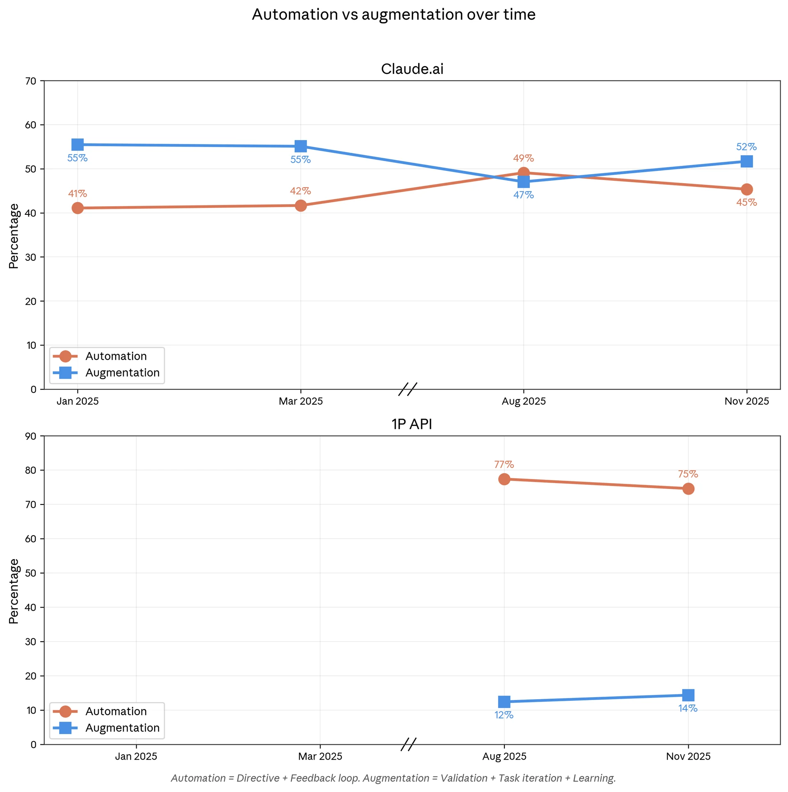

**随着时间的推移，协作模式按平台、Claude.ai 和 1P API 共享。**人类经济指数报告中的协作模式频率。

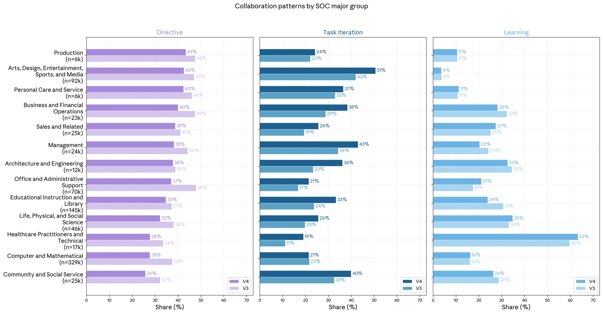

**标准职业分类 (SOC) 主要群体共享指令、任务迭代和学习协作。**对于每个 SOC 主要组，我们计算了 Claude.ai 上与指令、任务迭代和学习相关的对话份额，其中 O*NET 任务在我们的样本中至少有 100 个观察值。我们根据记录数量对观察结果进行加权以构建代表性样本。

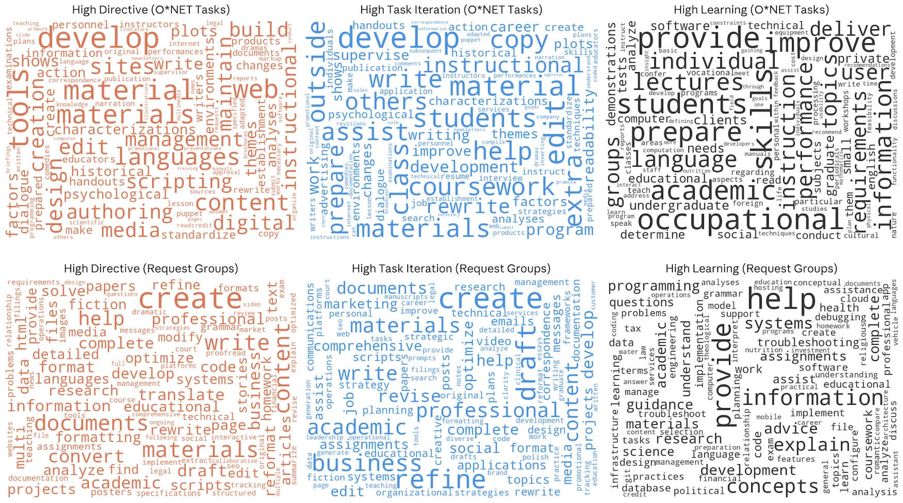

**O*NET 任务标题中的突出单词以及按关键协作类型进行自下而上的请求分组。**根据 O*NET 任务的前四分之一和自下而上的请求组构建的词云，按分类为“指令”、“任务迭代”和“从具有至少 1,000 个观察值的任务/请求”中学习的记录的份额排序。指令性互动强调生产（“创建”、“开发”、“草案”）；任务迭代以细化和迭代为中心（“编辑”、“重写”、“修订”）；学习的重点是解释和知识转移（“帮助”、“解释”、“提供”）。两种分类方法的模式是一致的。这种分析不是基于底层记录中使用的单词，而是基于使用隐私保护方法构建的分组。

### 持续的区域集中

在我们之前的报告中，我们介绍了人择人工智能使用指数（AUI），该指数用于衡量Claude在给定地理区域相对于劳动年龄人口规模的代表性是否过高或过低。AUI 定义为

AUI 高于 1 表明一个国家使用 Claude 的程度比其人口单独预测的要高，而 AUI 低于 1 则表明使用率低于预期。例如，丹麦的 AUI 为 2.1，这意味着该国居民使用 Claude 的比例大约是其在全球工作年龄人口中所占比例的两倍。

关于 Claude 在全球范围内的使用的一个关键事实是它在地理上集中：少数国家/地区的使用份额过大。从全球角度来看，2025 年 8 月至 11 月期间这方面变化不大。事实上，图 1.6 的左图显示，在我们的上一份报告和本报告之间，各国的 AUI 浓度基本上没有变化。

相比之下，从 8 月到 2025 年 11 月，美国各州的使用情况分布更加均匀：衡量平等的标准指标基尼系数从 0.37 下降到 0.32。虽然在解释短期变化时要谨慎行事，但这是朝着完全平等的一个相对较大的变化，其中基尼系数为 0 的所有州的 AUI 都等于 1。如果美国的基尼系数每三个月再次下降0.05，那么大约两年内将达到使用平价。

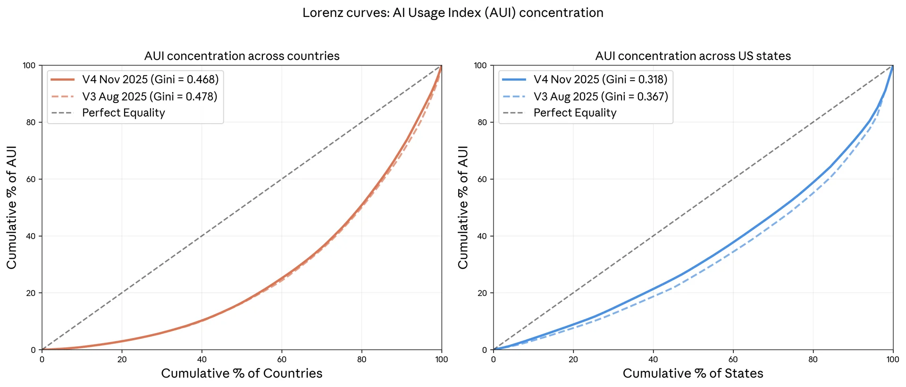

**在本报告和上一份报告中，AUI 集中在世界各地和美国境内。**2025 年 8 月和 11 月全球和美国境内人类人工智能使用指数 (AUI) 的洛伦兹曲线。曲线越接近 45 度线，表明浓度越低。例如，右图显示，美国前 20% 的州占美国人口调整使用量的 40%。

是什么决定了美国和世界各地的使用模式？在我们之前的报告中，我们强调了全球收入差异所发挥的关键作用：各国Claude使用率的差异很大程度上是由人均 GDP 的差异造成的。在第三章中，我们重新审视收入在塑造全球使用强度和使用模式方面的重要性。

在美国，收入对于使用情况的预测作用不太明显。相反，最重要的似乎是每个州劳动力的构成，以及劳动力与Claude能力的匹配程度（反映在任务级别的使用情况）。从事计算机和数学职业的工人比例较高的州（例如华盛顿特区、弗吉尼亚州和华盛顿州）的人均使用率往往较高。从数量上看，一个州此类技术人员的比例每增加 1%，人均使用率就会增加 0.36%（图 1.7）。仅此一项就占了 AUI 跨州差异的近三分之二。

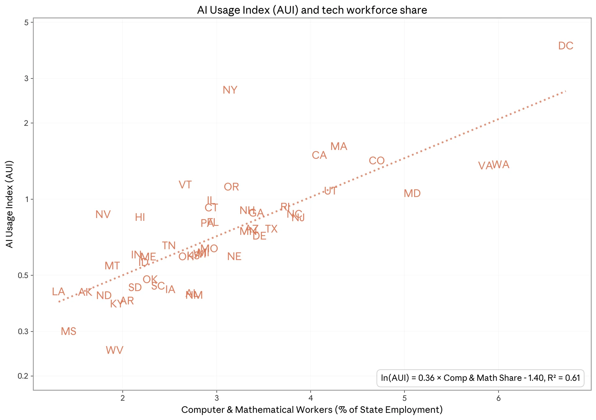

**美国各州的 AUI 以及从事计算机和数学职业的工人比例。**该图显示，美国各州从事计算机和数学职业的工人比例与人类人工智能使用指数（AUI）高度相关。这与Claude的整体使用模式和相关功能正在塑造美国地区的采用模式的观点是一致的。当正式计算每个州的劳动力分布与 SOC 主要群体的全球 Claude.ai 使用份额之间的 KL 差异时，这种模式更普遍。

虽然我们凭直觉预计在技术工人较多的州，Claude的使用率会更高，但这种模式更普遍：在与美国劳动力相比，Claude使用率过高的职业（例如艺术、设计、娱乐、体育和媒体）的工人较多的州，人均使用率较高，或者与国民经济相比，在Claude使用率较低的职业（例如交通和物资运输）相对较少的工人，人均使用率较高。这可以通过计算每个州劳动力构成与全球Claude使用构成之间的库尔贝克-莱布勒 (KL) 差异来看出。KL 差异较小的州（因此其劳动力看起来与Claude的使用模式更相似）往往具有较高的人均使用率。

### Claude在美国低使用率州的传播速度加快的迹象

虽然劳动力构成的差异似乎在影响美国地区采用率方面发挥了作用，但早期证据表明Claude的传播速度比历史先例预测的要快得多。从历史上看，具有经济意义的技术需要大约半个世纪的时间才能在美国实现全面传播（[卡拉尼等人，2025](https://academic.oup.com/qje/article-abstract/140/2/1299/7959830)）。相比之下，通过将 2025 年 11 月的 Claude 采用率与三个月前进行比较，我们估计美国各州的人均采用率（按 AUI 衡量）可能会在 2 至 5 年内达到同等水平。这一估计具有高度的不确定性，因为我们估计的精度不能排除扩散速度慢得多的可能性。

我们通过一个简单的扩散模型来生成这个估计，我们在这里简要描述一下。我们将扩散建模为朝着人均均等使用的共同稳态的比例收敛，其中每个状态 s 的 AUI 等于 1：

在此模型下，AUI 与稳态 (AUI = 1) 的对数偏差每三个月缩小 β 倍，这意味着半衰期为 *ln(.5)/ln(*β*)* 宿舍。例如，对于季度数据，β = 0.99 的值意味着半衰期约为 17 年。举例来说，从最初的 AUI 2 开始，这意味着 17 年后 AUI 将下降到 1.4 左右，50 年后下降到 1.1 左右。我们将 β = 0.99 作为一个合理的基准，因为它意味着类似于 20 世纪具有经济意义的技术的扩散速度。

这种收敛模型激发了以下回归规范8:

通过普通最小二乘法 (OLS) 简单地估计该方程可得到 β̂ ≈ 0.77 的估计值。加权最小二乘法 (WLS)，我们根据每个州的劳动力进行加权，得出 β̂ ≈ 0.76 的估计值（图 1.8）。两者在统计上都与传统水平上的 1 有区别。从表面上看，这些估计意味着每个州的 AUI 只需两年多一点的时间就能将大部分差距缩小到 1。

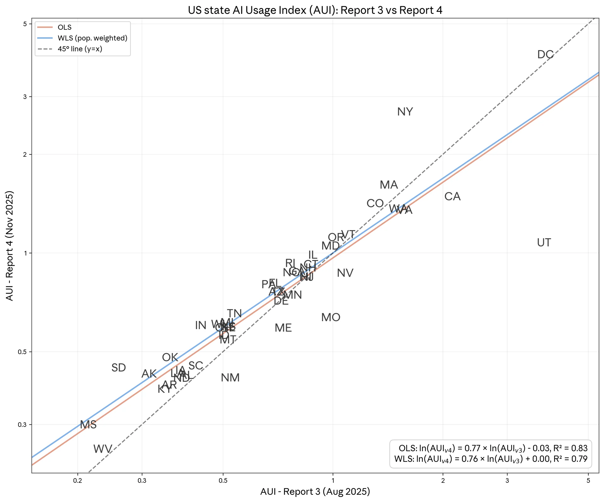

**2025 年 8 月 (V3) 和 2025 年 11 月 (V4) 美国各地的人择人工智能使用指数 (AUI)。**通过将 2025 年 11 月的 AUI 与 2025 年 8 月的值进行比较，我们可以估计 Claude 在美国使用的隐含扩散率。在美国所有州 AUI = 1 的比例收敛模型下，估计弹性可用于计算扩散速度（更多详细信息请参阅文本）。我们的估计范围意味着 2-5 年内 AUI 的区域趋同步伐。

以这种方式估计收敛的一个问题是，我们的 AUI 估计会受到采样噪声和与扩散无关的其他变化的影响。这可能会产生经典的衰减偏差：即使 AUI 实际上没有变化，我们对 β 的估计最终可能会明显低于 1。

为了解决这个问题，我们通过两阶段最小二乘法 (2SLS) 来估计模型，利用每个州劳动力的构成来检测 2025 年 8 月的 AUI 日志，并通过其与总体Claude使用模式的接近程度来衡量。该工具背后的逻辑是，劳动力构成是Claude使用情况（相关性）的有力预测因素，但独立测量，预计与我们 AUI 估计中的采样噪声（有效性）不相关。如上所述，具有高Claude使用率角色的工人较多的州确实往往具有系统性较高的人均使用率。

2SLS 估计意味着收敛速度稍慢：未加权时 β̂ ≈ 0.89，按每个州的劳动年龄人口加权时 β̂ ≈ 0.86。然而，这些估计不太精确，并且只有前者在统计上可以在 10% 的水平上与 1 区分开来。尽管意味着收敛速度比 OLS 慢，但 2SLS 估计仍然意味着快速扩散：只需四到五年，每个州的 AUI 的对数偏差就会缩小 90%。

也就是说，我们的估计仅基于三个月的数据。虽然 2SLS 规范可能有助于解决采样噪声问题，但仍然存在相当大的不确定性。我们将在未来的报告中重新讨论传播速度的问题。

1 与之前的报告一样，我们所有的分析都是基于隐私保护分析。在整个报告中，我们分析了来自 Claude.ai Free、Pro 和 Max 对话的 100 万个对话的随机样本（我们也将其称为“消费者数据”，因为它主要代表消费者使用情况）以及来自我们的第一方 (1P) API 流量的 100 万个记录（我们也将其称为“企业数据”，因为它主要代表企业使用情况）。两个样本均来自2025年11月13日至2025年11月20日。我们继续根据我们的隐私和保留政策管理数据，并且我们的分析符合我们的条款、政策和合同协议。对于 1P API 数据，每条记录都是来自我们样本期的提示-响应对，在某些情况下是多轮交互的中间会话。

2 Claude.ai 上既不属于自动化也不属于增强类别的对话比例从 3.9% 下降到 3.0%。

3 例如，参见 [卡拉尼等人 (2025)](https://academic.oup.com/qje/article-abstract/140/2/1299/7959830)：“其次，随着技术的成熟和相关工作岗位数量的增长，招聘会在地域上扩展。这个过程非常缓慢，大约需要50年才能完全消散。”

4 通过对 1P API 流量的自下而上分析，我们发现 Claude 用于“生成个性化 B2B 冷销电子邮件”(0.47%)、“分析电子邮件并草拟商务信函回复”(0.28%)、“构建和维护发票处理系统”(0.24%)、“将电子邮件分类为预定义标签”(0.23%) 以及“管理日历安排、会议协调和预约预订” （0.16%）。

5 在较高的层面上，我们区分使用 Claude 的自动化模式和增强模式。自动化包含专注于任务完成的交互模式： 指令：用户给Claude一个任务，它以最少的来回完成它；反馈循环：用户自动执行任务并根据需要向 Claude 提供反馈；增强侧重于协作交互模式： 学习：用户向 Claude 询问有关各种主题的信息或解释；任务迭代：用户与 Claude 协作迭代任务；验证：用户向 Claude 询问其工作反馈*.*

6 这些交互模式并不相互详尽。在某些情况下，Claude 确定采样的对话与五种交互模式中的任何一种都不匹配。

7 在本报告中，我们使用 Sonnet 4.5 进行分类，而在之前的经济指数报告中，我们使用 Sonnet 4。我们之前发现不同的模型可以产生不同的分类结果，尽管这些影响往往不大。

8 我们在回归中包含一个常数项，因为在零假设下它应该等于零。在我们所有的规范中，常数项估计接近于零，并且在统计上与零无法区分。

## 第 2 章：介绍经济原语

Anthropic 经济指数的优势不仅在于显示人工智能的使用程度，还在于 *如何* 它被使用了。在之前的报告中，我们展示了 Claude 用于执行哪些任务，以及人们如何与 Claude 协作。这些数据使外部研究人员能够分析劳动力市场的变化（例如， [Brynjolfsson、Chandar 和 Chen，2025](https://digitaleconomy.stanford.edu/publications/canaries-in-the-coal-mine/)).

在这一版的Anthropic 经济指数中，我们通过提供对五种经济“原语”的见解，扩大了外部研究人员可用的数据广度，这意味着对Claude使用方式的简单、基本的衡量标准，这些衡量标准是通过要求Claude回答有关样本中匿名记录的具体问题而生成的。我们的一些原语包含多个此类问题，而其他原语则使用单个指标。

由于人工智能能力发展如此之快，而且所带来的经济影响参差不齐，因此我们需要广泛的信号来揭示Claude的使用方式，以及这项技术将产生的影响。

### 人工智能使用的各个方面对经济影响至关重要

除了我们已经衡量的经济原语之外，本报告还介绍了五种新的经济原语，即协作模式（用户是否通过Claude自动化或增强其任务）。这些原语捕获了人类与人工智能对话的五个维度：1) 任务复杂性，2) 人类和人工智能技能，3) 工作、课程作业或个人用例，4) 人工智能的自主水平，以及 5) 任务成功（见表 2.1）。人工智能自主性捕捉到了与我们现有的自动化/增强区别不同的东西。例如，“将此段落翻译成法语”是高度自动化（指令性、最少来回）但人工智能自主性较低（该任务几乎不需要Claude做出决策）。

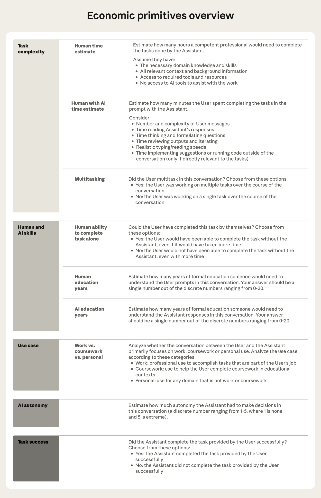

**本报告中添加了经济原语。**该表显示了本报告中添加的新经济原语，超出了先前报告中的协作模式（自动化/增强）。第一列显示原语类别，第二列显示原语名称，第三列显示原语的操作化，作为提供给 Claude 的提示，我们使用分类器将对话映射到原语。请参阅在线附录： <https://huggingface.co/datasets/Anthropic/EconomicIndex> 获取完整的提示文本。

***任务复杂度*** 捕获任务的复杂性可能会有所不同，包括完成它们需要多长时间以及它们有多困难。O*NET 中的“调试”任务可以指 Claude 修复函数中的小错误或全面重构代码库，这对劳动力需求有非常不同的影响。我们通过估计人类在没有人工智能的情况下完成任务的时间、使用人工智能完成任务所花费的时间以及用户是否在一次对话中处理多个任务来衡量复杂性。

***人类和人工智能技能*** 解决自动化如何与技能水平相互作用。如果人工智能不成比例地取代需要较少专业知识的任务，同时补充更高技能的工作，那么这可能是另一种形式的技能偏向的技术变革——增加对高技能工人的需求，同时取代低技能工人。我们衡量用户是否可以在没有 Claude 的情况下完成任务，以及理解用户提示和 Claude 响应所需的教育年限。

***使用案例*** 区分专业用途、教育用途和个人用途。劳动力市场的影响最直接来自工作场所的使用，而教育用途可能表明未来劳动力正在何处培养人工智能补充技能。

***人工智能自主性*** 衡量用户将决策委托给 Claude 的程度。我们的最新报告记录了用户完全委托任务的“指令”使用的增加。跟踪自治级别（从主动协作到完全授权）有助于预测自动化的步伐。

***任务成功*** 衡量Claude对Claude是否成功完成任务的评估。任务成功有助于评估任务是否可以有效自动化（任务是否可以自动化？）和高效（自动化任务需要多少次尝试？）。也就是说，任务的成功对于自动化劳动任务的可行性和成本都很重要。

### 选择并验证新措施

我们的数据中捕获的人工智能使用的新维度是由我们最近的工作得出的 [Claude的生产力效应](https://www.anthropic.com/research/estimating-productivity-gains)，我们从外部研究人员那里收到的反馈，最近从人力资本和专业知识的角度探讨人工智能对经济影响的文献（[文德拉米内尔等人，2025](https://www.hbs.edu/ris/Publication%20Files/26-011_04dcb593-c32b-4e4e-80fc-b51030cf8a12.pdf)），以及我们经济研究团队的审议。我们的主要选择标准是预期的经济相关性、维度的互补性，以及Claude是否能够沿着该维度准确地对对话进行分类。

我们建议，多个简单的原语，即使有些噪音并且本身并不完全准确，也可以共同提供有关如何使用人工智能的重要信号。因此我们主要测试方向精度。

为了对有或没有人工智能的任务持续时间进行分类，我们使用了我们的最小修改版本 [之前的生产力工作](https://assets.claude.com/e5645986a7ce8fbcc48fa6d2fc67753c87642c30.pdf)。对于净新分类器1，通过我们的实施 [隐私保护工具](https://arxiv.org/abs/2412.13678)，我们的验证过程如下。我们设计了多种潜在的措施来捕捉任务复杂性等概念。对于 Claude.ai，我们与人类研究人员相比，在一小部分转录本上评估了分类器的性能，其中用户向 Claude.ai 提供了反馈，因此我们有权查看底层转录本。对于第一方 API (1P API) 数据，我们使用内部数据和合成数据的组合来验证分类器。这两个数据源都不能完全代表 Claude.ai 或 1P API 流量，但它们允许我们检查分类器是否正在处理类似于真实使用数据的数据，同时确保隐私。

根据初始性能，我们修改了需要调整的分类器或丢弃了性能不佳的分类器。有趣的是，我们发现在某些情况下（例如，为了衡量任务成功），与人类评分相比，简单的分类器比细致入微的复杂分类器表现更好。然后，我们比较了有思想链提示和没有思想链提示的分类器版本的性能，并决定仅在三个方面（人类时间估计、人类人工智能时间估计和人工智能自治）保留思想链提示，我们发现它大大提高了性能。我们为五个基元选择了最后一组九个新分类器，所有这些分类器在方向上都是准确的，即使它们可能与人类评级有所偏差。

### 原语的价值在于它们可以预测

我们的目标是创建易于实施的分类器，并结合起来提供潜在的重要经济信号。虽然我们对新措施的方向准确性非常有信心（例如，理解人类提示所需的平均受教育年限较高的任务可能更复杂），但任何措施都不应该被视为准确或明确的（例如，Claude.ai 可能在某种程度上低估了许多任务所需的人类教育年限）。

即便如此，这些原语还是丰富了我们对人们如何使用人工智能的理解。系统关系出现在原语、区域和任务之间——我们将在第 3 章和第 4 章中深入探讨这些模式。这些关系是直观且一致的，这表明原语捕获了人们和企业如何使用 Claude 的相关方面。

外部基准强化了这一点。在我们的 [生产力工作](https://www.anthropic.com/research/estimating-productivity-gains)，Claude的时间估计与软件工程任务实际花费的时间相关。图 2.1 显示我们的人类教育衡量标准与各职业的实际工人教育水平相关。这些验证表明各个基元在方向上是正确的，并且将它们组合起来可以提供额外的分析价值，例如通过任务成功率丰富生产力估计或构建新的职业暴露度量。

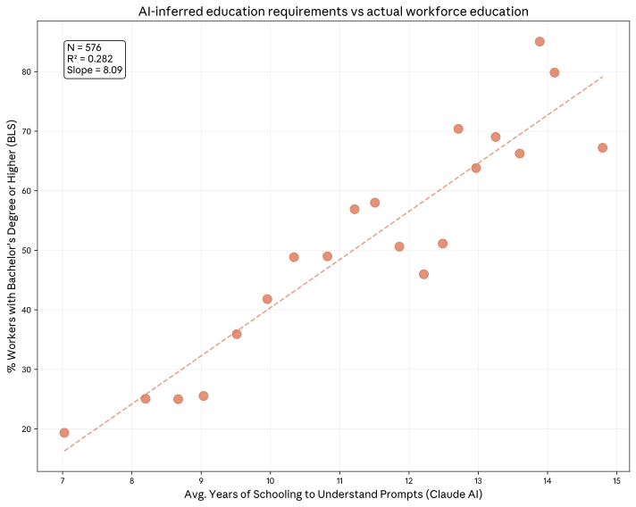

**需要教育年限来了解人类的提示和至少拥有学士学位的工人的比例。**教育数据来自“按详细职业划分的 25 岁及以上工人的教育程度”(BLS)，基于 2022 年和 2023 年美国社区调查的微观数据2。我们计算与特定职业相关的任务的平均受教育年限。然后我们计算该职业中拥有学士学位或更高学位的工人的百分比。

最终，最有力的验证将来自原始数据捕捉劳动力市场结果有意义变化的能力。我们发布的数据使外部研究人员能够以新的方式分析经济变化。早期的工作令人鼓舞——外部研究人员已经使用自动化/增强与之前报告的区别来分析劳动力市场的变化（[Brynjolfsson、Chandar 和 Chen，2025](https://digitaleconomy.stanford.edu/publications/canaries-in-the-coal-mine/)).

### 基元突出了用例的不同之处

为了说明原语如何区分不同类型的人工智能使用，我们研究了两个对比鲜明的请求集群：软件开发（“帮助跨多个编程领域调试、开发和优化软件”）和个人生活管理（“协助个人生活管理和日常任务”）。图 2.2 显示了每个集群的原始概况以及全球平均值。

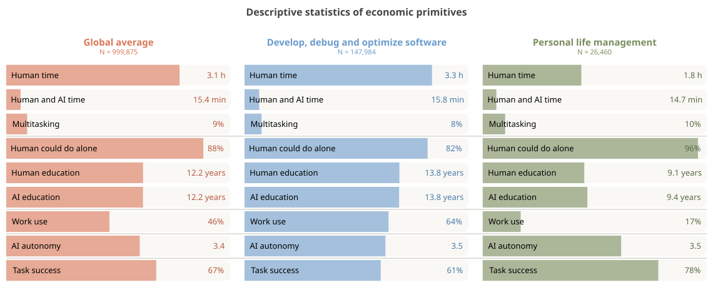

**总体经济原语和两个示例请求集群的描述性统计。**对于该图，我们重点关注整个 Claude.ai 样本中原语的描述性统计数据以及最低粒度级别的两个请求集群。N表示会话总数或属于请求集群的会话计数。

**任务复杂性。** Claude 估计，在没有 AI 的情况下，一名有能力的专业人员需要大约 3.3 小时才能完成软件开发请求，接近全球平均时间 3.1 小时。个人生活管理任务估计更简单，平均 1.8 小时。两者的预计人类与人工智能协作时间相似（约 15 分钟），这表明对于这两项任务，该原语的变化小于其他原语。

**人类和人工智能技能。** 软件开发请求需要更专业的知识：人类提示和人工智能响应估计需要大约 13.8 年的教育才能理解，而个人生活管理请求则需要 9.1-9.4 年的教育时间。Claude 估计，96% 的时间用户能够自己完成个人生活管理请求，而软件开发请求的这一比例为 82%，这表明 Claude 为技术工作提供了更重要的支持。

**使用案例。** Claude 将 64% 的软件开发请求归类为与工作相关，而只有 17% 的软件开发请求与个人生活管理相关。这说明Claude可以用于非常不同的目的。总体而言，Claude.ai 的使用比例为 46% 为工作，19% 为课程作业，35% 为个人用途。

**人工智能自主性。** 两个集群都显示出相似的估计自治水平（在 1 到 5 的范围内约为 3.5），接近全球平均水平。这意味着平均而言，软件开发和个人生活管理任务都为Claude提供了类似的自主权来决定如何完成任务。

**任务成功。** Claude 评估个人任务的成功完成率为 78%，而软件开发的成功完成率为 61%。较困难的任务（需要更专业的知识并且用户无法单独轻松完成的任务）显示出较低的估计成功率。

### Claude.ai 和 API 用户之间的任务和原语有所不同

正如我们之前的报告一样，我们发现 Claude.ai 对话中的任务和原语与 1P API 数据相比存在重大差异。这部分反映了交互的本质：Claude.ai 的记录可以包含多轮对话，而我们分析的 API 数据仅限于单个输入-输出对。这是因为 API 请求独立到达，没有元数据将它们链接到之前的交换。这意味着我们只能将它们作为孤立的用户助理对进行分析，而不是完整的对话轨迹。

总体而言，API 使用绝大多数与工作相关（74% vs.46%）和指令（64% vs.32%），四分之三的交互被归类为自动化，而 Claude.ai 上的交互不到一半（见图 1.3）。

相比之下，Claude.ai 用户则进行更多的来回操作：任务迭代和学习模式更为常见，而且任务往往更长——无论是人类使用 AI 的时间（15 分钟还是 15 分钟）。5 分钟）以及人类单独完成任务所需的估计时间（3.1 小时 vs 3.1 小时）1.7 小时）。Claude.ai 还显示出更高的任务成功率（67% vs.49%），这可能反映了多轮对话的好处，用户可以澄清、纠正方向并迭代解决方案。平均而言，Claude.ai 用户还赋予人工智能更多自主权，并且更有可能带来他们无法单独完成的任务。

这些差异也体现在职业任务的分配上。API 使用主要集中在计算机和数学任务中（52% vs.36%），这与它在代码生成和数据处理等编程式、自动化友好的工作流程中的使用一致。办公室和管理任务在 API 中也更为普遍（15% vs 15%）。8%），反映了适合授权的日常业务运营。相比之下，Claude.ai 认为教育教学任务要多得多（16% vs 16%）。4%）——课程作业帮助、辅导和教学材料开发——以及更多艺术、设计和娱乐任务（11% vs. 11%）6%）。Claude.ai 还拥有较长的面向人的类别，例如社区和社会服务以及医疗保健从业人员，用户可以在这些类别中寻求有关个人事务的建议、咨询或信息。

这些模式表明 1P API 部署集中于适合系统自动化的任务，而 Claude.ai 服务于更广泛的用例，包括学习、创造性工作和个人协助。

第 4 章更深入地探讨了任务级别的变化。

1 分类器是一种模型，它将给定的输入（例如用户对话）分配给特定的输出（例如用例“工作”）。在本报告中，我们使用 Claude 作为分类器，这意味着我们提示 Claude 选择特定的输出，然后使用 Claude 的响应作为输出（提示见表 2.1）。

2 在本报告中，我们使用分箱散点图来显示二元关系。我们根据 x 变量将观测值分为 20 个大小相等的箱，然后绘制每个箱的平均 x 和 y 值。例如，最左边的点代表 x 分布最低 5% 的观测值的平均值。

## 第 3 章：Claude的用法因地区而异

### 概述

在本章中，我们通过对 100 万个 Claude.ai 对话的隐私保护分析来分析 Claude 使用模式的地理变化。我们提出五点观察：

- **Claude 主要用于工作，但用例随着采用而多样化：** 工作和个人用例在高收入国家更常见，而课程作业用例在低收入国家更常见。这与我们之前报告的调查结果相呼应，并与 [微软最近的工作](http://microsoft.com/en-us/research/wp-content/uploads/2025/12/New-Future-Of-Work-Report-2025.pdf).
- **GDP 和人类教育预测全球和美国国内的采用情况：** 人均 GDP 增长 1%，国家/地区人均 Claude 使用量增长 0.7%。人类教育——Claude对理解人类提示所需的正规教育年数的估计——在两个层面上都与人类人工智能使用指数呈正相关。
- **其他原语对全球采用率和全球采用率的预测有所不同。美国水平：** 在国家层面，较高的使用率与较短的任务和较少的人工智能自主权相关。在美国州一级，这些关系在统计上并不显着，尽管工作使用与采用呈正相关。
- **原语之间的关系取决于上下文：** 任务成功与各国的人类教育呈负相关，但在美国各州却呈正相关。然而，当控制其他原语时，美国的关系就变得微不足道了。
- **人类如何提示就是Claude如何回应：** 人类提示和人工智能响应的教育水平几乎完全相关（两个水平上的 r > 0.92）。人均使用率较高的国家也表现出更多的增强——使用Claude作为合作者，而不是完全委托决策。

### Claude 主要用于工作，但用例随着采用而多样化

我们的数据依赖于 [隐私保护](https://www.anthropic.com/research/clio)1 对 100 万条 Claude.ai 对话的分析2，揭示了Claude如何被收养的显着地理差异。Claude 主要用于工作，遍布全球和美国。然而，用例存在地域差异。在全球范围内，巴尔干地区和巴西的作业使用相对比例最高（见图 3.1），印度尼西亚的课程作业比例最高。在美国各州层面，纽约州是使用Claude工作相对最多的州。

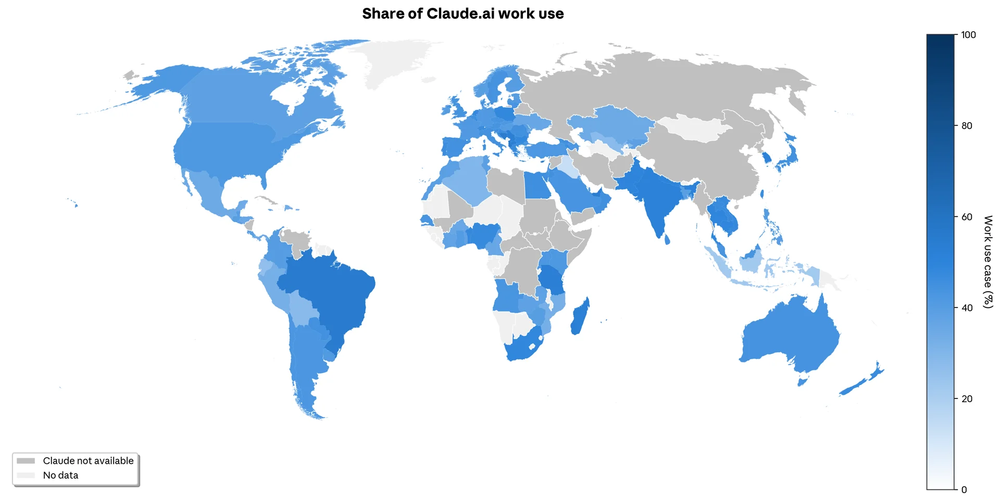

**全球 Claude.ai 工作使用份额。**特定国家/地区被分类为工作（而不是个人或课程作业）的对话比例。不同的等级反映了一个国家在第一章定义的人类人工智能使用指数全球分布中的位置345。对于这个数字，我们只包括样本中至少有 200 个观察值的国家，因为我们的随机样本中低使用率国家的衡量标准存在不确定性。底层数据包括 Claude.ai Free、Pro 和 Max 使用情况。

用例差异与一个国家的人均收入有关，而人均收入又与人均人工智能采用率有关。我们观察到，Claude的工作用例和个人用例在高收入国家更常见，而课程作业用例在低收入国家更常见（见图 3.2）。有趣的是，这些发现与 [微软最近的工作](http://microsoft.com/en-us/research/wp-content/uploads/2025/12/New-Future-Of-Work-Report-2025.pdf) 研究表明，人工智能在学校中的使用与较低的人均收入相关，而人工智能在休闲中的使用与较高的人均收入相关。

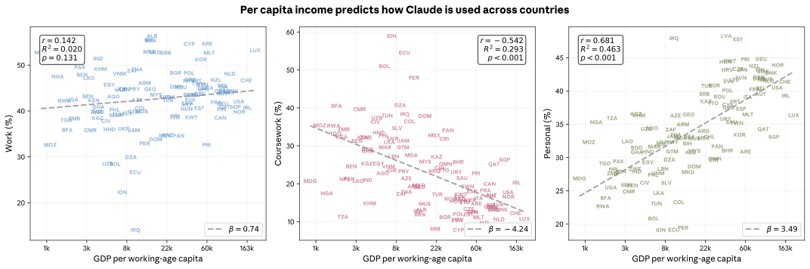

**人均收入预测了Claude在各个国家的使用情况。**每个图都显示了 Claude.ai 对话的特定用例（工作、课程作业或个人）份额与人均 GDP 之间的二元关系。标签显示 ISO-3166-1 国家/地区代码。对于这个数字，我们只包括样本中至少有 200 个观察值的国家，因为我们的随机样本中低使用率国家的衡量标准存在不确定性。底层数据包括 Claude.ai Free、Pro 和 Max 使用情况。

多种因素可能导致这些模式：

- 随着人工智能采用率的增加以及更多不同用户使用人工智能，或者现有用户探索更广泛的人工智能应用，个人用例可能会更加常见。相比之下，人均采用率较低（与人均收入较低相关）的国家可能会专注于特定用例，例如编码或课程作业。
- 各国支付 Claude 费用的能力不同，课程作业用例可能比软件工程等工作领域的复杂用例更适合免费使用 Claude。
- 高收入国家的用户可能拥有其他资源，例如空闲时间和持续的互联网访问，可以实现非必要的个人用例。

### 国际和美国的采用因经济原语而异

本报告中介绍的经济原语使我们能够分析一些可能推动差异化采用的因素。在分析人择人工智能使用指数（AUI）与核心经济原语以及 GDP 之间的关系时，我们观察到某些模式对于国家和美国各州都成立。例如，我们重复了之前报告中的发现，即 GDP 与 AUI 密切相关（见图 3.3 和 3.4）。在国家层面，人均 GDP 每增加 1%，人均 Claude 使用量就会增加 0.7%。人类教育（需要多少年的教育才能理解对话中的人类书面提示）与国家和美国州一级的人类人工智能使用指数呈显着正相关。

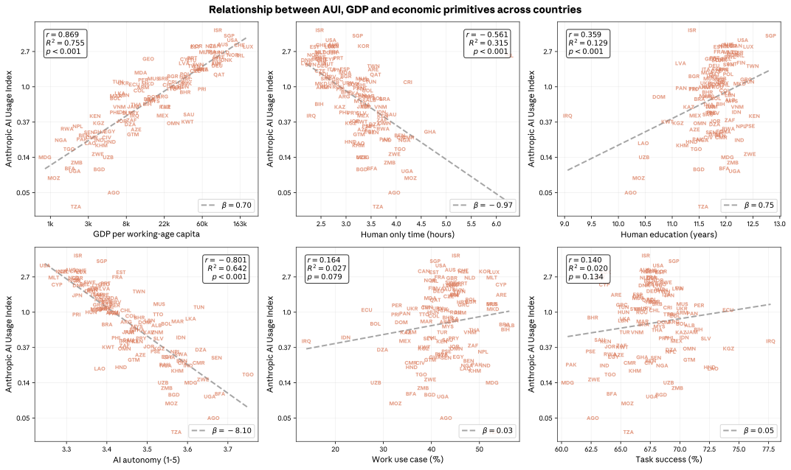

**人择人工智能使用指数与国家层面五个核心经济原语和人均 GDP 之间的关系。**每幅图都显示了人择人工智能使用指数的自然对数与核心经济原语以及人均 GDP 对数之间的二元关系。标签显示 ISO-3166-1 国家/地区代码。对于这个数字，我们只包括样本中至少有 200 个观察值的国家，因为我们的随机样本中低使用率国家的衡量标准存在不确定性。底层数据包括 Claude.ai Free、Pro 和 Max 使用情况。请参阅第 2 章，了解人类专用时间、人类教育、人工智能自主性、工作用例和任务成功的详细定义。

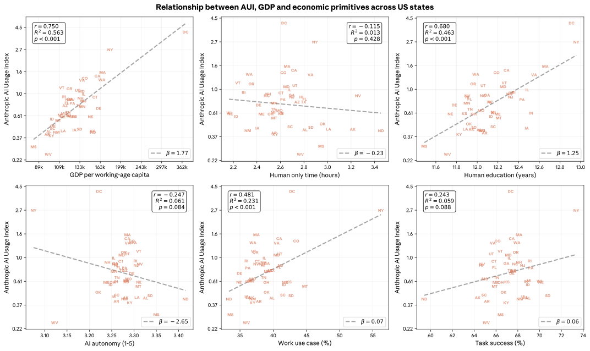

**人类人工智能使用指数与美国各州五个核心经济原语和人均 GDP 之间的关系。**每幅图都显示了人择人工智能使用指数的自然对数与核心经济原语以及人均 GDP 对数之间的二元关系。标签显示 ISO-3166-2 区域代码6。对于该图，我们仅在样本中包含至少 100 个观察值的州，因为我们的随机样本中低使用率州的测量具有不确定性。底层数据包括 Claude.ai Free、Pro 和 Max 使用情况。请参阅第 2 章，了解人类专用时间、人类教育、人工智能自主性、工作用例和任务成功的详细定义。

然而，AUI 和原语之间的关系通常在国家和美国州级别之间有所不同。例如，在国家层面，AUI 与人类在没有人工智能的情况下完成任务所需的时间以及给予人工智能的决策自主权呈负相关。在美国各州层面，这些关系在统计上并不显着——可能也是因为美国各州的样本量较小。此外，我们观察到 AUI 和 Claude.ai 在美国各州工作中的使用呈正相关，但在国家/地区层面则不然。

重要的是，原语本身不一定是因果因素——我们不知道收入或教育是否真正推动了采用，或者它们是否是其他潜在条件的代表。其中许多因素彼此高度相关。例如，在美国州一级，人类受教育年限与人类人工智能使用指数之间存在着孤立的密切关联，但一旦我们控制了 GDP 和其他原语，这种关系就消失了——这表明教育可能捕捉到了可以通过经济发展和其他因素更好地解释的变化。

### 制度因素塑造任务成功与教育年限之间的关系

经济和制度背景（例如某个地区的教育水平如何变化）与人工智能的使用方式有关。有趣的是，我们观察到任务成功与国家一级的人类教育呈负相关，但在美国州一级则呈正相关。然而，当控制其他原语时，状态级别的正相关关系变得微不足道（见图 3.5）。这意味着一个观察级别（国家）的关系模式与另一级别（美国州）的关系模式相矛盾。跨国、受过教育的人群可能会尝试更困难的任务，因此成功率较低。在同质环境中，教育可能不会提高任务的成功率。

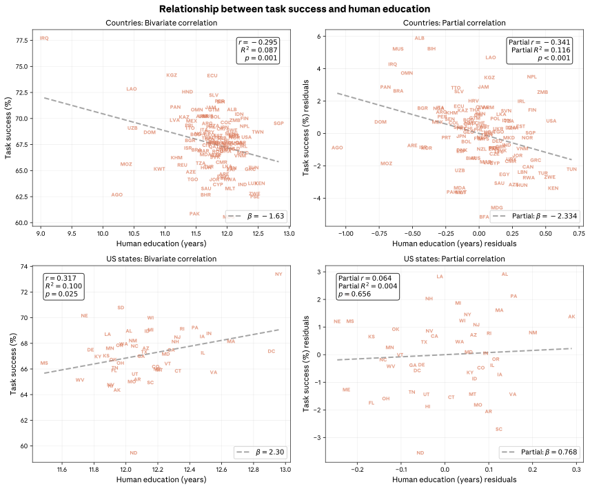

**任务成功与人类教育之间的关系。**左边的图显示了任务成功与理解对话中人类提示所需的教育年限之间的二元相关性。右边的图显示了部分回归，其中我们还控制了人均 GDP、人工智能自主性、自动化百分比、工作份额和课程作业用例、没有人工智能的人类时间、有人工智能的人类时间、多任务处理和人类能力（有关这些变量的详细定义，请参阅第 2 章）。标签显示 ISO-3166-1 国家/地区代码和 ISO-3166-2 地区代码。对于这个数字，我们仅包括样本中至少有 200 个观察值的国家和至少有 100 个观察值的州，因为我们的随机样本中低使用率州的衡量标准具有不确定性。底层数据包括 Claude.ai Free、Pro 和 Max 使用情况。

### 人类如何提示，Claude如何回应

我们发现人类和人工智能教育之间存在非常高的相关性，即理解人类提示或人工智能响应所需的教育年数（国家： *r* = 0.925, *p* < 0.001, *N* = 117；美国各州： *r* = 0.928, *p* < 0.001, *N* = 50）。这凸显了技能的重要性，并表明人类如何提示人工智能决定了它的有效性。这也凸显了模型设计和训练的重要性。虽然 Claude 能够以高度复杂的方式做出响应，但它往往只有在用户输入复杂的提示时才会这样做。

模型的训练、微调和指导方式会影响它们对用户的响应方式。例如，一个人工智能模型可能有一个系统提示，指示它始终使用中学生可以理解的简单语言，而另一个人工智能模型可能只能以需要博士教育才能理解的复杂语言做出反应。对于Claude，我们观察到一种更加动态的模式，其中用户如何提示Claude与Claude如何响应相关。

### 更高的收入和更高的使用率与更多的增强相关

人均使用率较高的国家往往是人均收入较高的国家，自动化程度较低，授予Claude的决策自主权也较少。也就是说，高收入国家更多地将人工智能用作助手和合作者，而不是让它独立工作。这种关系在美国州一级并不显着，也许是因为美国境内的收入差异和用例多样性比全球范围更有限。这反映了我们第三次经济指数报告的一项发现，即人择人工智能使用指数较高的国家倾向于以更具协作性的方式（增强）使用 Claude，而不是让它独立运行（自动化）。

### 结论

我们的数据中显着的地理差异表明，Claude在世界各地以不同的方式被使用。GDP 预测了国家和美国各州层面的人类人工智能使用指数，而人类教育（用户提示的复杂程度）也与两个层面的采用相关。

其他关系取决于上下文。在国家层面，较高的使用率与较短的任务和较少的人工智能自主权相关；在美国，这些模式并不成立。任务成功与人类教育在全球范围内与美国国内表现出相反的关系。

人类和人工智能教育年限之间近乎完美的相关性强调了用户如何提示Claude决定了它如何反应。再加上使用率较高的国家与Claude的合作程度更高，这表明良好使用人工智能所需的技能本身可能分布不均。

通过衡量与Claude对话的特征，我们发现了与人力资本等更广泛的经济因素的重要关系。这些关系可能有助于预测劳动力市场的结果，并为向需要不同技能的人工智能经济的平稳过渡提供信息。

1 出于隐私原因，我们的自动分析系统会过滤掉少于 15 个对话和 5 个唯一用户帐户的任何单元格，例如国家和（国家、任务）交叉点。对于自下而上的请求集群，我们有一个更高的隐私过滤器，至少包含 500 个对话和 250 个唯一帐户。

2 本部分数据涵盖 2025 年 11 月 13 日至 20 日期间的 100 万条 Claude.ai Free、Pro 和 Max 对话，从该时期的所有对话中随机抽样。然后，我们排除了被标记为潜在信任和安全违规的内容。观察单位是 Claude.ai 上与 Claude 的对话，而不是用户，因此有可能包含来自同一用户的多个对话，尽管我们的 [过去的工作](https://doi.org/10.48550/arXiv.2412.13678) 表明随机抽样对话与按用户分层抽样不会产生实质性不同的结果。根据每次对话的 IP 地址对国家和美国州一级的总体地理统计数据进行评估并制成表格。对于地理定位，我们使用 ISO-3166 代码，因为我们的 IP 地理定位提供商使用此标准。国际位置使用 ISO-3166-1 国家/地区代码，美国州级数据使用 ISO-3166-2 区域代码，其中包括美国所有 50 个州和华盛顿特区。我们排除源自 VPN、任播或托管服务的对话（由我们的 IP 地理定位提供商确定）。

3 该世界地图是基于 Natural Earth 的世界地图，以 ISO 标准观点为争议领土，这意味着该地图可能不包含一些争议领土。我们注意到，除了灰色显示的国家（“Claude不可用”）之外，我们不在乌克兰克里米亚、顿涅茨克、赫尔松、卢甘斯克和扎波罗热地区开展业务。根据国际制裁和我们支持乌克兰领土完整的承诺，我们的服务无法在俄罗斯占领的地区提供。

4 “无数据”适用于数据部分缺失的国家。一些地区（例如西撒哈拉、法属圭亚那）有自己的 ISO-3611 代码。其中一些有一些用途，另一些则没有。由于人类人工智能使用指数是根据世界银行的劳动年龄人口数据计算的，而所有这些地区的人口数据并不容易获得，因此我们无法计算这些地区的 AUI。

5 我们将塞舌尔排除在所有地理分析之外，因为我们在采样日期期间看到的大部分使用情况都是滥用流量。

6 我们将怀俄明州排除在美国所有州的分析之外，因为我们在采样期间看到的大部分使用情况都是滥用流量。

## 第 4 章：任务和生产力

在本章中，我们将研究不同任务类型之间的时间节省、成功率和自主性有何不同，以及这对工作和生产力的潜在影响。

这些模式表明，更复杂的任务可以节省更多时间，但这会损害可靠性。在一个简单的任务删除练习中，灵感来自于 [奥托和汤普森 (2025)](https://economics.mit.edu/sites/default/files/2025-06/Expertise-Autor-Thompson-20250618.pdf)Claude倾向于涵盖高等教育任务，这对大多数职业产生了净去技能化效应，因为人工智能处理的任务通常是工作中技术含量更高的部分。

Claude的使用涵盖了越来越多的职业中有意义的任务部分。我们将成功率纳入更丰富的工作覆盖范围模型中；一些覆盖范围不大的职业会受到很大影响，因为人工智能在他们最耗时的工作上取得了成功。调整任务可靠性的生产率估计值大约会使隐含收益减半，即未来十年劳动生产率年增长率从 1.8 个百分点降至约 1.0 个百分点。然而，这些估计反映了当前模型的能力，所有迹象都表明，越来越长时间运行的任务的可靠性将会提高。

### 任务加速的权衡

我们的估计表明，一般来说，数据中的任务越复杂，人工智能就越能节省时间（或“加速”）。我们通过让 Claude 估计人类单独工作需要多长时间以及人类和人工智能一起工作的持续时间来得出这一点，我们在 [以前的工作](https://www.anthropic.com/research/estimating-productivity-gains)。加速比就是人类单独使用的时间除以人类与人工智能一起使用的时间。因此，将 1 小时的任务减少到 10 分钟即可将速度提高 6 倍。

下面图 4.1 的左图给出了针对我们任务复杂性核心衡量标准的平均加速，即理解输入所需的人类受教育年限，所有这些都在 O*NET 任务级别1。例如，它显示在 Claude.ai 对话中，要求 12 年教育（高中教育）的提示可享受 9 倍的加速，而那些要求 16 年教育（大学学位）的提示则获得 12 倍的加速。这意味着对于需要更高人力资本的用例，生产率的提高更为明显，这与白领工人更有可能采用人工智能的证据相一致（例如， [比克等人 2025](https://www.nber.org/system/files/working_papers/w32966/w32966.pdf)).

在整个任务复杂性范围内，API 用户的加速比更高。这可以反映 API 数据的性质，即仅限于单轮交互，并且 API 任务已专门选择用于自动化。

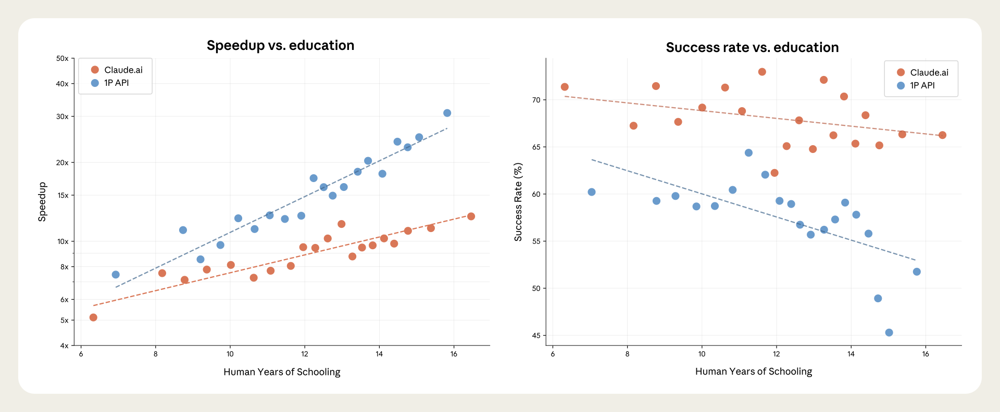

**速度（图 a）和成功率（图 b）对比人类的受教育年限。**左侧面板显示了加速比与人类受教育年限之间的二元关系的分箱散点图，所有这些均在 O*NET 任务级别进行测量并按平台划分。虚线显示线性回归的拟合结果。右侧面板在 y 轴上显示了与成功率的相同关系。

然而，结果也体现了一种权衡。任务越复杂，任务成功率就越低，如右侧面板所示。例如，在 Claude.ai 上，需要高中以下学历的任务（例如，回答有关产品的基本问题）的成功率达到 70%，但对于制定分析计划等大学水平的对话，成功率会下降至 66%。尽管如此，通过排除低成功任务或按成功概率折扣加速来解释成功率的差异并不能消除教育梯度：复杂的任务仍然显示出更大的净生产力收益。

检查教育梯度影响的一种方法是查看理解输入所需的自动化在各个教育级别中所占的份额。如果高等教育任务显示出相对更多的自动化，这可能意味着白领工人有更多的接触机会。不过，这里的信息并不明确：自动化份额本质上与编写提示所需的人类教育水平无关（附录图 A.1）2。在 Claude.ai 和 1P API 上，不同教育级别的任务都显示出大致相等的自动化模式。

在什么情况下，用户会更多地遵从 Claude？在处理更复杂的任务时，Claude.ai 用户给予人工智能更多的自主权。相比之下，API 使用在所有复杂程度上都显示出较低的自主性。

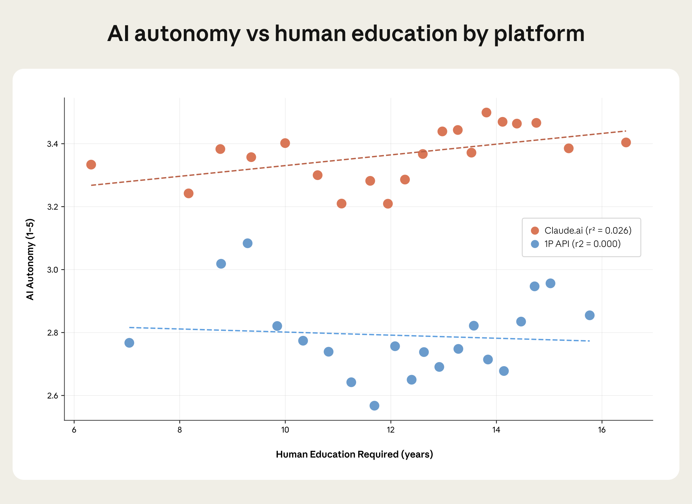

**人工智能自主性与人类教育。**该图显示了人工智能自主性和所需人类教育之间的二元关系的分箱散点图，所有这些都在 O*NET 任务级别进行测量。虚线显示线性回归的拟合结果。

但请注意，这些发行版并不涵盖同一组任务。正如第一章的集中图所示，API 的使用涵盖了经济中更狭窄的任务范围。大量使用 API 数据的高等教育任务包括安全分析、测试和质量保证以及代码审查，而 Claude.ai 用户更有可能进行迭代的指导性会话。

### 实际使用中的任务范围

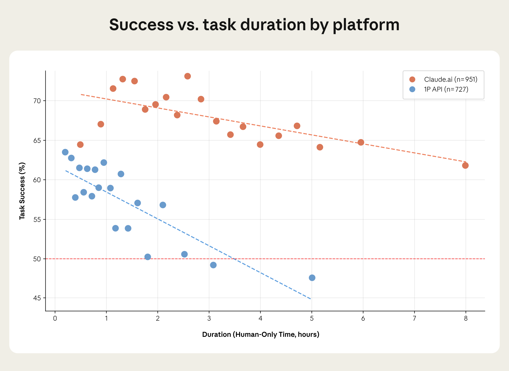

**任务成功与纯人类时间。**该图显示了任务成功 (%) 与任务需要人类单独完成的时间之间的二元关系的分箱散点图，所有这些都在 O*NET 任务级别进行测量并按平台划分。虚线显示线性回归的拟合结果。

人工智能“任务范围”的最新工作（[Kwa 等人，2025](https://metr.org/blog/2025-03-19-measuring-ai-ability-to-complete-long-tasks/)）发现人工智能的成功率随着任务持续时间的增加而下降：较长的任务对于模型来说更难完成。然而，随着模型的不断生成，随着模型在越来越长的任务上取得成功，这种下降幅度变得越来越小。METR 将任务范围主要定义为模型取得至少 50% 成功的最大持续时间，而该指标的增长已成为人工智能进展的关键指标。

图 4.3 显示了使用我们的原语的类似测量。该图显示了任务级成功率与所需人工时间的关系，所有这些都在 O*NET 任务级别。在 API 数据中，对于预计需要人类花费 5 个小时以上的任务，成功率从 60% 左右下降到大约 45%。拟合线在 3.5 小时处穿过水平 50% 成功线，表明 API 调用对于 3.5 小时的任务获得 50% 的成功率。METR 软件工程基准中的类似时间估计为 Sonnet 4.5 2 小时，Opus 4.5 约 5 小时。 （本报告中的数据早于 Opus 4.5 的发布。）

Claude.ai 的数据讲述了一个不同的故事。作为任务长度的函数，成功率下降得慢得多。使用线性拟合外推， [Claude.ai](http://claude.ai) 大约19小时后成功率达到50%。这可能反映了多轮对话如何有效地将复杂的任务分解为更小的步骤，每轮都提供一个反馈循环，允许用户纠正路线。

值得注意的是，与 METR 设置的根本区别在于选择。METR 构建了一个基准，其中将一组固定的任务分配给模型。在我们的数据中，用户选择将哪些任务带给Claude。这意味着观察到的成功率不仅反映了模型的能力，还反映了用户对什么可行的判断、为 Claude 设置问题的成本以及任务成功后预期节省的时间。

例如，如果用户避免他们预计会失败的任务，则观察到的成功率将夸大潜在任务的完整分配的真实能力。这种选择可能在两个平台上运行，但以不同的方式进行：API 客户选择适合自动化的任务，而 Claude.ai 用户选择可以从迭代中受益的任务。此外，由于这种选择效应，无法保证性能更高的模型会在此图中显示出改进，因为用户可能会通过提供其他类似 O*NET 任务的更具挑战性的演示来响应新模型。

METR 等受控基准衡量自主能力的前沿。我们的真实世界数据可以衡量 *有效的* 任务范围，反映模型功能和用户行为的组合，并扩展到编码任务之外。这两种方法都发现人工智能可以有效地完成需要人类工作数小时的任务。

### 通过有效的人工智能覆盖重新审视职业渗透率

我们的 [早期的工作](https://assets.anthropic.com/m/2e23255f1e84ca97/original/Economic_Tasks_AI_Paper.pdf) 研究发现，36% 的工作至少有四分之一的任务使用了人工智能，其中约 4% 的任务覆盖率达到 75%。然而，这一衡量标准仅基于我们数据中任务的出现。本报告中介绍的原语可以帮助更好地描述人工智能如何改变职业的工作内容。3

首先，我们发现任务覆盖范围正在增加。综合各报告，49% 的工作岗位至少有四分之一的任务使用了人工智能。但结合该任务在工作中所占的份额以及Claude的平均成功率，表明了一组不同的受影响职业。

我们将有效的人工智能覆盖率定义为Claude可以成功执行的工作人员一天的百分比。它的计算方式是任务成功率的加权总和，其中每个任务的权重是根据任务发生频率调整的工作人员时间份额。成功率来自我们的原语，估计的时间来自 [我们之前关于生产力影响的工作](https://www.anthropic.com/research/estimating-productivity-gains)，以及来自 O*NET 数据的频率估计，其中接受调查的工人表明他们执行任务的频率。

下图显示了有效人工智能覆盖率（y 轴）与单独任务覆盖率（x 轴）的差异。两者高度相关，但也存在关键差异。在图的右侧，覆盖率高的职业（几乎所有任务在 Claude 数据中都以一定频率出现）通常低于 45 度线。这表明，即使 90% 的任务覆盖率也不一定表明对工作有很大影响，因为Claude可能无法完成覆盖的关键任务或错过最耗时的任务。

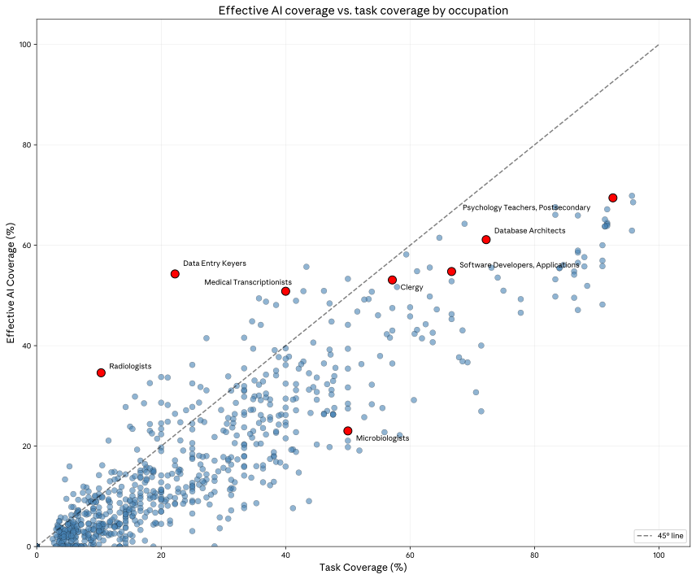

**有效的人工智能覆盖率对比任务覆盖范围**该图显示了任务有效 AI 覆盖率 (%) 和任务覆盖率（在职业级别测量）之间的二元关系的散点。根据 Claude.ai 的数据，有效的人工智能覆盖范围可以跟踪人工智能可以成功执行的工人时间加权职责的份额。任务覆盖率是 Claude.ai 使用中出现的任务的份额。虚线显示有效人工智能覆盖率份额等于任务覆盖率。

放大来看，与任务覆盖率相比，几种职业在有效人工智能覆盖率方面表现出巨大差异。例如，数据录入人员拥有最有效的人工智能覆盖率之一。这是因为，虽然他们的九个任务中只涵盖了其中的两个，但他们最大的任务——从源文档中读取和输入数据——在 Claude 的帮助下成功率很高。人工智能擅长他们花费大部分时间做的事情。

医学转录员和放射科医生也会晋升，因为他们所承担的任务恰好是他们最耗时、频率最高的工作。对于放射科医生来说，他们最重要的两项任务——解读诊断图像和准备解读报告——成功率很高。这些职业的任务覆盖率较低，因为人工智能无法完成其工作档案中的实际操作或行政工作，但它在主导其工作日的核心知识工作上取得了成功。

微生物学家低于 45 度线，这表明人工智能的有效覆盖率低于仅通过任务覆盖率预测的水平。Claude承担了他们一半的任务，但不是最耗时的：使用专门的实验室设备进行实践研究。

可以说，这一衡量标准更真实地反映了工作层面的人工智能渗透率。然而，其影响取决于Claude的对话实际上取代或增强了人类原本可以完成的工作的频率。对于数据录入员来说，人工智能可能会取代以前手动执行的任务。但是，当Claude的对话映射到一位老师正在讲课时，就不太清楚这如何转化为工作中讲课时间的减少。在未来的工作中，我们可以利用 1P API 数据来了解哪些任务正在集成到生产工作流程中。

### 人工智能对工作任务内容的影响

除了人工智能可以在工人一天中成功执行多少时间之外，另一个问题是涵盖哪些任务，以及这些任务是否倾向于工作中的高技能或低技能部分。最近的研究研究了工作中任务组合的变化，以了解人工智能对工资和就业的影响（[奥托和汤普森 2025](https://economics.mit.edu/sites/default/files/2025-06/Expertise-Autor-Thompson-20250618.pdf); [汉普尔等人 2025](https://www.nber.org/papers/w33509)）。一个关键的见解是，自动化的效果不仅取决于覆盖的任务数量，还取决于哪些任务。

为了了解当我们删除人工智能可以执行的任务时工作会发生什么变化，我们首先构建每项任务所需技能水平的衡量标准。O*NET 不提供任务级别的教育要求，因此我们训练了一个模型，以 BLS 的职业级别教育为目标，通过任务嵌入来预测受教育年限4。这样，如果低教育职业看起来像高教育职业中往往存在的任务，那么它仍然可能具有高技能任务。例如，法律秘书是一个需要 12 年教育的职业，但“审查法律出版物并执行数据库搜索以识别与未决案件相关的法律和法院判决”的任务预计需要 17.7 年，因为它类似于通常由律师和律师助理执行的任务。

数据显示，Claude倾向于承担需要较高教育水平的任务。经济任务的平均预测教育年限为 13.2 年。对于我们在数据中看到的任务，平均预测大约高出一年，即 14.4 年（对应于副学士学位）。这与早期报告的职业水平结果一致，表明白领职业中更多地使用Claude。

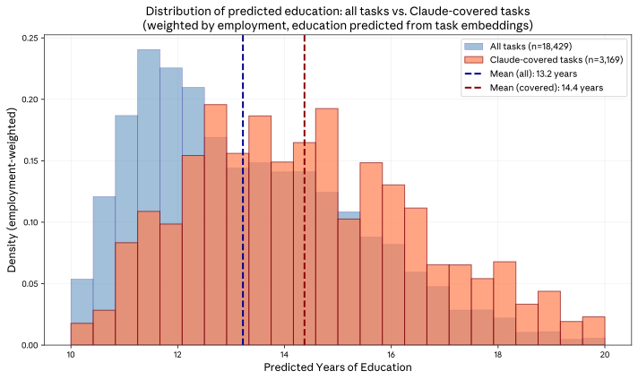

**所有任务的教育水平对比Claude负责的任务**这显示了两个直方图。蓝色条给出了 O*NET 数据库中所有任务所需的预测任务级别教育的分布，并按就业加权。橙色条显示相同的内容，仅限于 Claude.ai 数据中出现的任务。

接下来我们计算删除人工智能覆盖的任务如何改变剩余任务的平均教育水平。总体而言，净一阶影响是降低工作技能，因为人工智能消除了需要相对较高教育水平的任务。经历这种去技能化的一项工作是技术作家，它失去了诸如“分析特定领域的发展以确定是否需要修订”（18.7年）和“审查已发表的材料并建议范围、格式的修订或更改”（16.4年）等任务，留下诸如“绘制草图以说明特定材料”（13.6年）和“观察生产、开发和实验活动”（13.5年）等任务。旅行社也经历了去技能化，因为人工智能涵盖了“计划、描述、安排和销售行程旅游套餐”（13.5年）和“计算旅行和住宿费用”（13.4年）等任务，而“打印或索取交通运输票”（12.0年）和“收取交通和住宿费用”（11.5年）等任务仍然存在。一些教学行业经历了去技能化，因为人工智能可以解决诸如评分、为学生提供建议、撰写资助和进行研究等任务，而无法亲自完成授课和管理课堂等实际工作。

有些工作的平均教育水平有所提高。房地产经理的技能得到提升，因为人工智能涵盖了日常管理任务——维护销售记录（12.8年）、根据市场价格审查租金（12.6年）——而需要更高水平的专业判断和面对面互动的任务仍然存在，比如获得贷款、与建筑公司谈判以及与董事会会议。

这些模式说明了未来几年，随着工作内容根据人工智能的变化而调整，工作可能会如何演变。如果教育水平可以解释为专业知识 [奥托和汤普森](https://economics.mit.edu/sites/default/files/2025-06/Expertise-Autor-Thompson-20250618.pdf)的分析，他们的框架可能预测技术作家和旅行社的工资将会下降，就业机会将会增加；相反，房地产经理将专注于复杂的谈判和利益相关者管理，从而减少就业，同时提高工资。5

然而，我们基于教育的衡量标准与奥托和汤普森的专业知识概念不同：他们的框架将某些任务标记为高专业知识，而我们的框架则指定低教育程度 - 例如，电工任务“将电线连接到断路器、变压器或其他组件”。这些预测基于当前Claude的使用模式，随着模型接受新功能的训练和用户发现新的应用程序，这种模式将会发生变化，这可能会改变所涵盖的任务以及最终效果是降低技能还是提高技能。

### 重新审视Claude使用对总体生产力的影响

在早期的工作中，我们 [估计人工智能的广泛采用可以使美国劳动生产率增长1.8个百分点](https://www.anthropic.com/research/estimating-productivity-gains) 未来十年每年。在这里，我们重新审视该分析，结合本报告中介绍的任务成功原语以及对任务互补性的更丰富的处理。

基于与我们 100 万样本中至少有 200 个观测值的任务相关的加速 [Claude.ai](http://claude.ai) 对话，6 我们重复了之前的发现，即当前一代的人工智能模型和当前的使用模式意味着未来十年生产力每年提高 1.8 个百分点。7

通过纳入 1P API 数据，我们可以评估隐含的劳动生产率影响是否因企业 Claude 部署模式而异。有两种抵消力量在发挥作用：API 的使用更多地集中在较小的一组任务和职业（特别是与编码相关的工作）中，这往往会减少隐含效应；但 API 任务的任务级加速平均较高，如图 4.1 所示。这些力量在很大程度上抵消了：API 样本同样意味着未来十年劳动生产率将提高 1.8 个百分点。

对这一分析的一个突出批评是它未能考虑模型的可靠性。如果工作人员必须验证人工智能输出，那么生产力的提升将小于原始加速所暗示的。为了评估这个渠道在数量上的重要性，我们结合了本报告中介绍的任务成功原语，在汇总之前将任务级别的时间节省乘以特定于任务的成功率。8

这一调整产生了有意义的影响：根据 Claude.ai 使用情况，未来十年隐含生产率增长率从每年 1.8 个百分点下降到 1.2 个百分点，API 流量则下降到 1.0 个百分点。然而，即使在考虑了可靠性之后，其隐含的经济影响仍然显着——未来十年每年持续增长 1.0 个百分点将使美国生产率增长恢复到 20 世纪 90 年代末和 2000 年代初的水平。第二个批评涉及任务互补性。如果某些任务是必不可少的并且无法轻易替代，那么无论其他任务的加速如何，整体生产力的影响都将受到限制。教师可以利用人工智能更有效地准备课程计划，同时不会影响与学生在课堂上相处的时间。

为了实现这一想法，我们对如何汇总职业中任务级时间节省的方式施加了一些结构，但在主要分析中还累加了职业效率增益。具体来说，我们假设每个职业中的任务根据恒定替代弹性（CES）聚合器进行组合，其中每个任务都根据每个任务花费的估计时间进行加权，计算公式为： [我们之前对Claude使用所暗示的生产力影响的分析](https://www.anthropic.com/research/estimating-productivity-gains).9

关键参数是跨任务的替代弹性 σ。当替代弹性小于 1 时，任务是互补的，而那些未被人工智能加速的任务将成为更广泛的生产力提升的瓶颈。或者，当替代弹性大于 1 时，工人可以分配给更具生产力的任务，从而放大职业层面的总体时间节省。替代弹性等于 1 是重复上述主要分析的特殊情况。

图 4.6 报告了针对不同任务可替代性值的本次练习的结果。正如预期的那样，当替代弹性等于 1 时，隐含的生产率效应与我们的基线分析中的相同：Claude.ai 和 API 样本都表明，未来十年劳动生产率每年增长约 1.8 个百分点。

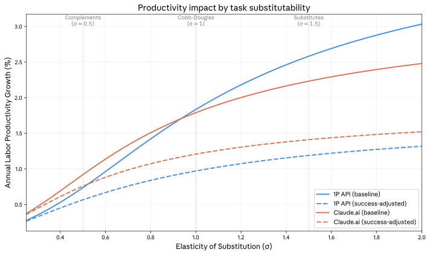

**人工智能对劳动生产率的隐含影响作为职业内任务可替代性的函数**该图显示了未来十年隐含的总体劳动生产率增长，基于对 Claude.ai 上 100 万个对话样本和来自 1P API 流量的 100 万条记录中至少有 200 个观察值的任务的效率增益估计。替代弹性决定了非人工智能增强任务在多大程度上限制了Claude使用所隐含的职业生产力收益，在该模型中，职业产出是跨任务的 CES 指数。=1 的弹性再现了我们未经调整的基线结果，即未来十年劳动生产率增长 1.8 个百分点。成功调整曲线通过任务可靠性来降低任务级加速。请参阅文本了解更多详细信息。

然而，当任务是互补的时，隐含的总体劳动生产率影响急剧下降，因为经济效应受到人工智能加速最少的任务的瓶颈。例如，当 =0.5 时，隐含的总体劳动生产率影响为每年 0.7-0.9 个百分点，大约是我们基线估计所隐含的一半。此外，根据任务成功率进行调整，进一步将隐含的生产力影响降低至 0.8pp [Claude.ai](http://claude.ai) API 为 0.6pp。

另一方面，当替代弹性大于 1 时，基于 Opus 4.5 之前的使用模式的隐含劳动生产率明显更高。例如，当 =1.5 时，隐含的劳动生产率效应每年上升 2.2-2.6 个百分点，这与人工智能提供最大加速的任务的更加专业化相一致。

在这两种情况下，基于 API 流量的隐含生产力影响更能响应任务可替代性的程度。这与以下事实是一致的：与相比，API 流量的较大份额集中在较少的任务和相关职业上。 [Claude.ai](http://claude.ai)：当任务是互补的时，这种集中会放大瓶颈问题；当它们成为替代品时，它会放大任务专业化带来的生产力收益。

这一分析表明，自动化对生产力的影响最终可能会受到暂时无法实现人工智能自动化的瓶颈任务的限制。人工智能能力日益增强对劳动力市场的影响也可能同样受到这些力量的影响。例如， [甘斯与戈德法布 (2026)](https://www.nber.org/papers/w34639) 认为工作中瓶颈任务的存在意味着部分人工智能自动化可以导致劳动收入增加，因为此类任务的经济价值增加（至少直到工作被 *完全* 自动化）。

### 结论

本章的结论是人工智能对经济的影响不太可能是一致的。正如我们有效的人工智能覆盖框架所表明的那样，劳动力市场对不同工人的影响将取决于前沿人工智能工具对其最核心任务的可靠程度。

但劳动力市场的影响也可能取决于人工智能相对于其他经济领域能够熟练处理的任务的技能要求。事实上，我们发现，将Claude已经可以处理的任务从经济中删除会产生净去技能效应：留给人类的任务比人工智能处理的任务的教育要求更低。

虽然很有启发性，但这可能会遗漏一个重要的细节：Claude所执行的最复杂的任务往往也是那些它最困难的任务。这不会取代高技能的专业人员，而是可以增强他们在理解人工智能工作和评估其质量方面的互补专业知识的价值。

与这些变革性劳动力市场效应相对应的是对增长和生产率的更广泛影响。一方面，将任务可靠性纳入我们的分析中可以减少对劳动生产率增长的隐含影响，正如当前Claude使用模式所表明的那样。如果瓶颈任务绑定，则隐含的影响会进一步减弱。另一方面，模型能力的持续增长表明任务覆盖范围和任务成功率可能会增加，这反过来又可能会增加对生产力的影响。

1 当我们使用 O*NET 研究原语之间的相关性时，我们限制出现在至少 100 个对话中的任务，以减少测量误差。在覆盖率分析中，我们使用隐私阈值 15 以上的所有任务。

2 我们的在线附录位于 <https://huggingface.co/datasets/Anthropic/EconomicIndex>.

3 另请参阅 [汤姆林森等人 (2025)](https://arxiv.org/pdf/2507.07935) 获取相关的人工智能适用性分数。

4 我们使用预训练的句子转换器 (all-mpnet-base-v2) 为每个任务语句生成嵌入，并使用 Ridge 回归预测教育。

5 另一方面，一些历史证据表明，当专利数据中出现工作任务自动化技术时，暴露职业的就业和工资随之下降（[韦伯 2020](https://www.michaelwebb.co/webb_ai.pdf)).

6 当我们首次评估 Claude 使用对总体生产力的影响时，我们依赖于 2025 年秋季的 10 万条 Claude.ai 对话样本。根据我们观察到的加速任务集，我们估计未来十年劳动生产率每年可能提高 1.8 个百分点。将样本扩展到 100 万个观察值意味着我们需要就如何处理非常罕见的任务采取立场 - 正如我们在过去的报告中记录的那样，考虑到使用遵循幂律，这些任务非常常见。我们选择 0.02% 的阈值，因为它复制了我们之前的样本结果 [Claude.ai](http://claude.ai) 对话。出于保护隐私的原因，我们只分析具有至少 15 个观察值的任务，或者 10 万个样本的隐含阈值为 0.015%。因此，我们的结果在各个样本之间是内部一致的。如果我们不对 100 万个样本施加限制，并假设样本中任何任务的效率都会提高，即使是那些在 100 万个观测值中只有 15 个的任务，则隐含的未来 10 年总劳动生产率增长率将约为每年 5%，这是基于所包含的更大任务集的机械增长。

7 和以前一样，这个结果基于应用 [赫尔滕定理](https://doi.org/10.3982/ECTA15202) 任务层面的生产率冲击，并假设全要素生产率相应的一次性增长在十年内与资本深化效应一起实现。  
8 提醒一下，为了汇总隐含劳动生产率，我们将任务级效率增益计算为没有人工智能和有人工智能的人类时间之间的对数差异。当然还有其他方法可以根据任务可靠性进行调整。如果我们样本中的任务由具有异构人工智能适用性的子任务组成，并且工作人员仅在有效的子任务上最佳地部署人工智能，那么通过成功率来衡量效率增益可以捕获任务中人工智能采用的广泛余地。

9 我们使用 CES（恒定替代弹性）生产函数来汇总任务级时间节省对整个经济生产力的影响。弹性参数 σ 控制工人在任务之间替换的难易程度。当 σ=1 时，我们直接应用 Hulten 定理：总生产率增益等于跨任务对数加速的工资份额加权总和。对于 σ≠1，我们使用两级聚合：首先，在每个职业中，我们使用 ρ=(σ-1)/σ 将职业级加速计算为按时间分数加权的任务加速的 CES 聚合。然后我们将 Hulten 定理应用于这些职业级别的加速。当 σ<1（互补）时，生产率的提高会受到加速最小的任务的瓶颈。当 σ>1（替代品）时，工作人员可以专注于人工智能提供最大加速的任务，从而放大总体收益。对于没有观察到人工智能加速数据的任务，我们假设生产力没有变化。我们感谢 Pascual Restrepo 建议这项特殊的练习。

## 结束语

第四份人类经济指数报告介绍了经济原语——人工智能使用的基本特征——展示了消费者和企业如何使用Claude。我们使用 Claude 来估计使用情况在这些维度上的变化程度；这些措施在方向上是准确的，而且即使个别分类不完善，综合起来也能提供重要信号。

我们的研究结果对于人工智能将如何重塑经济和劳动力市场具有重大意义。值得注意的是，在需要高等教育的任务中，Claude往往被更多地使用，并且似乎可以提供更大的生产力提升。如果美国工人的这些任务减少，最终的结果可能是工作岗位的去技能化。但这些影响在很大程度上取决于任务之间的互补性，以及某项任务生产力的提高是否会增加对其的需求。

在全球层面，人均收入和使用模式之间的密切关系——高收入国家使用Claude协作，而低收入国家则专注于课程作业和特定应用——表明人工智能的影响将由现有的制度结构来调节，而不是统一展开。地理扩散模式强化了这一图景。在美国，人均使用量略有趋同；在全球范围内，扩散速度较慢。再加上收入驱动的人工智能使用方式差异，这就引发了关于人工智能是否会缩小或扩大国际经济差距的问题。

与此处记录的模式同样重要的是本报告和后续报告中的潜在变化。随着人工智能能力的进步，Claude 的成功率可能会提高，使用模式可能会表现出更大的自主性，用户可能会处理新的、更复杂的任务，而证明可自动化的任务可能会从交互式聊天过渡到 API 部署。我们将随着时间的推移跟踪这些动态，提供人工智能在经济中的作用的纵向视图。

在之前版本的基础上，该版本显着扩展了我们共享的使用数据的范围和透明度，包括首次沿新维度进行任务级分类以及全球区域细分。我们发布这些数据是为了让研究人员、记者和公众能够调查有关人工智能经济影响的新问题，这些问题可以为政策反应奠定实证基础。

用户尝试人工智能的意愿如何，以及政策制定者是否创造一个既促进安全又促进创新的监管环境，将决定人工智能如何改变经济。为了使人工智能惠及全球用户，仅扩大使用范围是不够的，开发能够有效利用的人力资本，尤其是在低收入经济体中，至关重要。
