# Anthropic 经济指数报告：不同地区和企业采用 AI 的差异

- 英文标题：Anthropic Economic Index report: Uneven geographic and enterprise AI adoption
- 发布日期：2025-09-15
- 官网栏目：经济学
- 原文：[Anthropic 页面](https://www.anthropic.com/research/anthropic-economic-index-september-2025-report)
- 官网署名：Anthropic
- 官网推荐阅读：[下载PDF](https://assets.anthropic.com/m/218c82b858610fac/original/Economic-Index.pdf)

> 中文机器初译，未逐篇人工校对。引用研究结论时请核对英文原文。

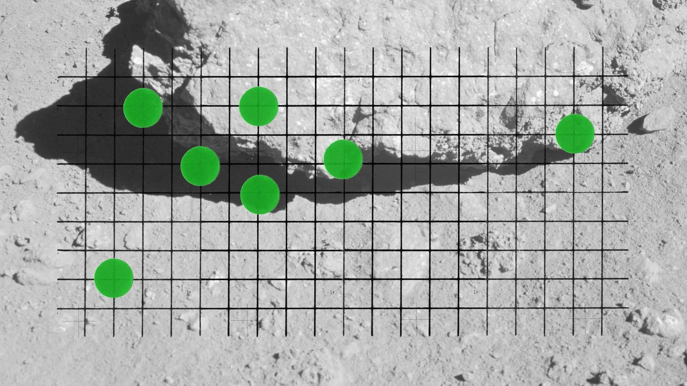

## 简介

人工智能与现有技术的不同之处在于其前所未有的采用速度。仅在美国，就有 40% 的员工表示在工作中使用人工智能，而两年前的 2023 年这一比例为 20%。**1** 如此迅速的采用反映了该技术对于广泛的应用程序的有用性、它在现有数字基础设施上的可部署性以及它的易用性（只需打字或说话）而无需专门培训。前沿人工智能的快速改进可能会加强这些方面的快速采用。

从历史上看，新技术需要几十年的时间才能得到广泛采用。城市电气化之后，用电到农户用了30多年。第一台大众市场个人电脑于 1981 年到达早期使用者，但又过了 20 年才进入美国的大多数家庭。即使是快速普及的互联网也需要大约五年的时间才能达到人工智能在短短两年内达到的普及率。**2**

这是为什么呢？简而言之，新技术（甚至是变革性技术）需要时间才能在整个经济中扩散，消费者采用的地域集中度降低，企业重组业务运营以最好地释放新技术能力，都需要时间。公司的采用，首先是针对一小部分任务，然后是更通用的应用，是后续技术传播并产生变革性经济影响的重要方式。**3**

**换句话说，早期技术采用的一个标志是 *集中*——在少数地理区域和公司的少数任务中。** 正如我们在本报告中所记录的那样，21 世纪的人工智能采用似乎遵循类似的模式，尽管与 20 世纪的技术传播相比，时间更短，强度更大。

为了研究早期人工智能采用的这种模式，我们扩展了 [人为经济指数](https://www.anthropic.com/economic-index) 沿着两个重要的维度，引入对 Claude.ai 对话的地理分析和对企业 API 使用情况的首次检查。我们展示了 Claude 使用情况如何随着时间的推移而演变、不同地区的采用模式有何不同，以及企业如何部署前沿人工智能来解决业务问题，这也是首次。

### 随着时间的推移，Claude.ai 的使用模式不断变化

在本报告的第一章中，我们确定了过去八个月 Claude.ai 使用情况的显着变化，同时发生的还有基础模型功能的改进、新产品功能以及 Claude 消费者基础的扩大。

**我们发现：**

- **教育和科学使用份额正在上升：** 虽然使用 Claude 进行编码的比例继续在我们的总样本中占据主导地位（36%），但教育任务从 9.3% 飙升至 12.4%，科学任务从 6.3% 上升至 7.2%。
- **用户赋予Claude更多的自主权：** 用户将完整任务委托给 Claude 的“指令”对话从 27% 跃升至 39%。我们发现编码中的程序创建增加了（+4.5pp），调试减少了（-2.9pp）——这表明用户可能能够在一次交换中实现更多目标。

### 人工智能采用的地理分布

我们首次发布了 150 多个国家和美国所有州的 Claude.ai 使用数据的地理分布。为了研究扩散模式，我们引入了人类人工智能使用指数（AUI）来衡量 Claude.ai 的使用在经济体中相对于工作年龄人口的比例是否过高或过低。

**我们发现：**

- **AUI 与各国收入密切相关：** 与以前的技术一样，我们看到人工智能的使用在地理上是集中的。新加坡和加拿大是人均使用量最高的国家之一，分别是其人口预期的 4.6 倍和 2.9 倍。相比之下，新兴经济体，包括印度尼西亚（0.36x）、印度（0.27x）和尼日利亚（0.2x），使用Claude（Claude）较少。
- **在美国，当地经济因素决定了使用模式：** 华盛顿特区的人均使用量领先（3.82 倍人口份额），但犹他州紧随其后（3.78 倍）。我们发现有证据表明，区域使用模式反映了当地经济的独特特征：例如，加利福尼亚州 IT 的使用增加，佛罗里达州金融服务的使用增加，华盛顿特区文档编辑和职业援助的使用增加。
- **领先国家的用法更加多样化：** 采用率较低的国家/地区往往会看到更多的编码使用，而采用率较高的地区则在教育、科学和商业领域呈现出多样化的应用。例如，编码任务在印度占所有使用量的一半以上，而在全球占所有使用量的大约三分之一。
- **高采用率国家的自动化程度较低，但使用程度较高：** 在按国家/地区控制任务组合后，低 AUI 国家/地区更有可能委派完整的任务（自动化），而高采用率地区则倾向于加强学习和人类人工智能迭代（增强）。

早期人工智能采用的地理分布不均匀引发了有关经济融合的重要问题。19 世纪末和 20 世纪初的变革性技术——广泛的电气化、内燃机、室内管道——不仅开创了现代经济增长的时代，而且伴随着世界各地生活水平的巨大差异。**4**

如果高采用率经济体的生产率提升更大，那么当前的使用模式表明，人工智能的好处可能会集中在已经富裕的地区——可能会加剧全球经济不平等，并扭转近几十年来出现的增长趋同现象。**5**

### 系统化的企业部署人工智能

在最后一章中，我们对大部分第一方 (1P) API 流量提出了前所未有的见解，揭示了公司和开发人员正在使用 Claude 完成的任务。重要的是，API 用户以编程方式访问 Claude，而不是通过 Web 用户界面（如 Claude.ai）。这显示了早期采用企业如何部署前沿人工智能功能。

**我们发现：**

- **1P API 的使用虽然与 Claude.ai 的使用类似，但在特殊方面有所不同：** 1P API 的使用和 Claude.ai 的使用都主要集中在编码任务上。然而，1P API 在编码和办公/管理任务中的使用率较高，而 Claude.ai 在教育和写作任务中的使用率较高。
- **1P API 的使用以自动化为主：** 77% 的业务用途涉及自动化使用模式，而 Claude.ai 用户的这一比例约为 50%。这反映了 API 使用的编程本质。
- **在塑造业务部署方面，能力似乎比成本更重要：** 我们的 API 数据中最常用的任务往往比不那么频繁的任务花费更多。总体而言，我们发现价格敏感性较弱的证据。模型能力和可行地自动化给定任务的经济价值似乎在塑造企业的使用模式方面发挥着更大的作用。
- **上下文限制了复杂的使用：** 我们的分析表明，为模型提供正确的环境对于在复杂领域中进行高影响力的人工智能部署非常重要。这意味着对于一些公司来说，昂贵的数据现代化和组织投资来获取上下文信息可能是人工智能采用的瓶颈。

### 开源数据促进独立研究

与之前的报告一样，我们开源了基础数据，以支持对人工智能经济影响的独立研究。这个全面的数据集包括 Claude.ai 和 1P API 流量的任务级使用模式（映射到 O*NET 分类法以及自下而上的类别）、按任务细分的协作模式以及我们方法的详细文档。目前，地理使用模式仅适用于 Claude.ai 流量。

我们希望这些数据能够帮助其他人调查的关键问题包括：

- 人工智能的使用和采用会对当地劳动力市场产生哪些影响？
- 是什么决定了人工智能在各国和美国国内的采用？可以采取哪些措施来确保人工智能的好处不仅仅惠及已经富裕的经济体？
- 每任务成本在塑造企业部署模式方面发挥什么作用（如果有）？
- 为什么公司能够自动化某些任务而不是其他任务？这对于哪些类型的工人会经历更好或更差的就业前景有何影响？

1.盖洛普 2025 年， *两年内人工智能在工作中的使用几乎翻了一番。*

2.比克、布兰丁、戴明，2024 *生成式人工智能的快速采用* 将人工智能的采用与个人电脑和互联网的采用进行比较；刘易斯和塞维尼尼，2020 *农村电气化的短期和长期影响：美国电网历史推广的证据* 分析向农村地区供电对经济成果的影响。

3.卡利亚尼、布鲁姆、卡瓦略、哈桑、勒纳和艾哈迈德·塔洪 2025 *新技术的传播。*

4.参见戈登，2012 *是美国吗经济增长结束了吗？创新步履蹒跚面临六大阻力* 比较 20 世纪早期和晚期的创新及其对生产力的影响。普里切特，1997。 *分歧，大时代* 记录了伴随着向现代经济增长时代过渡的经济分化。

5.克雷默、威利斯、你，2022 *趋同趋同* 呈现近几十年来增长趋同的证据。参见 Jones、Jones 和 Aghion，2017 年 *人工智能与经济增长* 讨论人工智能驱动的创新自动化对增长的影响。

## 第 1 章：Claude.ai 随着时间的推移的使用情况

### 概述

了解人工智能的采用如何随着时间的推移而演变，有助于预测其经济影响——从生产力提高到劳动力变化。借助从 2024 年 12 月到 2025 年 1 月（从我们的第一份报告“V1”）到 2025 年 2 月和 3 月（“V2”）再到 2025 年 8 月（“V3”）的最新见解的数据，我们可以跟踪人工智能的使用在过去八个月中随着功能和产品特性的改进、新类型的用户采用了该技术以及用途变得更加复杂而发生的变化。我们认为下面提供的证据表明新产品功能启用了新的工作形式，而不是简单地加速现有任务的采用。

### Claude.ai 在经济任务中的使用发生了怎样的变化

#### 教育和科学任务的相对重要性继续上升

尽管计算机和数学任务仍占总体使用量的 36%，但我们看到知识密集型领域的持续增长。教育教学和图书馆任务从 V1 的 9% 上升到 V3 的 12%。生命、物理和社会科学任务从 6% 增加到 7%。与此同时， *亲戚* 业务和财务运营任务的份额从 6% 下降到 3%，管理任务的份额从 5% 下降到 3%。

这种差异表明，与传统的商业运营相比，人工智能的使用在涉及知识合成和解释的任务中可能会特别迅速地扩散——可能是因为这些任务更多地受益于Claude的推理能力。

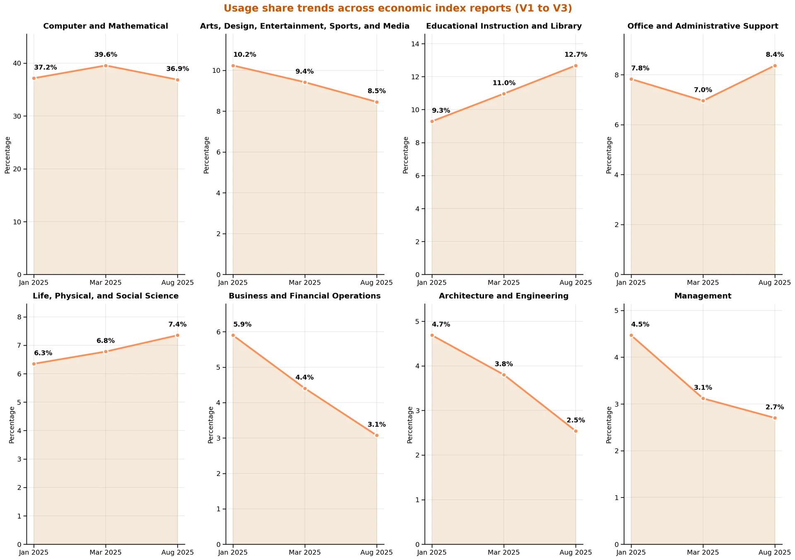

**Claude.ai 随着时间的推移的使用情况。** 每个面板显示了 Claude.ai 上与每个 SOC 主要组的任务相关的采样对话的份额。我们看到科学和教育任务的使用量显着增加。在我们的第一份报告中，SOC 主要群体按使用情况排名。

#### 新功能正在塑造使用模式

在更细粒度的层面上，我们记录了任务构成的变化，这些变化似乎与 V2 和 V3 之间启动的功能相关。例如，搜索电子资源和数据库大幅增长 (0.03% → 0.49%)，这可能反映了我们的 [网络搜索发布](https://www.anthropic.com/news/web-search) 三月。此外，我们还看到基于互联网的研究任务有所增加（0.003% → 0.27%），这与 [研究](https://www.anthropic.com/news/research) 我们在四月份发布了模式。**1**

我们还看到其他类型的变化。与开发教学材料相关的任务增加了 1.3 个百分点，从 0.2% 增长到 1.5%——增加了 6 倍多，这可能反映了增长 [教育工作者的采用](https://www.anthropic.com/news/anthropic-education-report-how-educators-use-claude).**2** 创建多媒体文档增长了 0.4 个百分点，几乎增加了两倍，从 0.16% 增至 0.55%，这可能是由于继续使用我们的 [文物特征](https://www.anthropic.com/news/build-artifacts) 用于在 Claude.ai 中构建传统和人工智能驱动的应用程序。

有趣的是，涉及创建新代码的任务比例增加了一倍多，增加了 4.5 个百分点（从 4.1% 到 8.6%），而调试和纠错任务则下降了 2.8 个百分点（从 16.1% 到 13.3%）——净 7.4 个百分点转向创建而不是修复代码。这可能表明模型变得越来越可靠，因此用户花在解决问题上的时间更少，而有更多的时间在单次交互中创建事物。**3**

#### 指令自动化正在加速

与之前的报告一样，我们不仅跟踪 *什么* 人们用Claude来表示但是 *如何* 他们在 Claude.ai 上与 Claude 合作或委托给 Claude。

在较高的层面上，我们区分 *自动化* 和 *增强* Claude的使用方式：

***自动化*** 包含专注于任务完成的交互模式：

- **指令**：用户给Claude一个任务，它以最少的来回完成它
- **反馈循环**：用户自动执行任务并根据需要向 Claude 提供反馈

***增强*** 重点关注协作交互模式：

- **学习**：用户向 Claude 询问有关各种主题的信息或解释
- **任务迭代**：用户与 Claude 协作迭代任务
- **验证**：用户向 Claude 询问其工作反馈

所占份额为 *指令* 从 Claude.ai 对话中采样的对话从 2024 年底 V1 中的 27% 跃升至 V3 中的 39%。这一增长主要是以牺牲 *任务迭代* 和 *学习* 交互，这意味着展示自动化使用模式的对话份额大幅净增加——在短短八个月内显着增加。这是第一份自动化使用量超过增强使用量的报告。

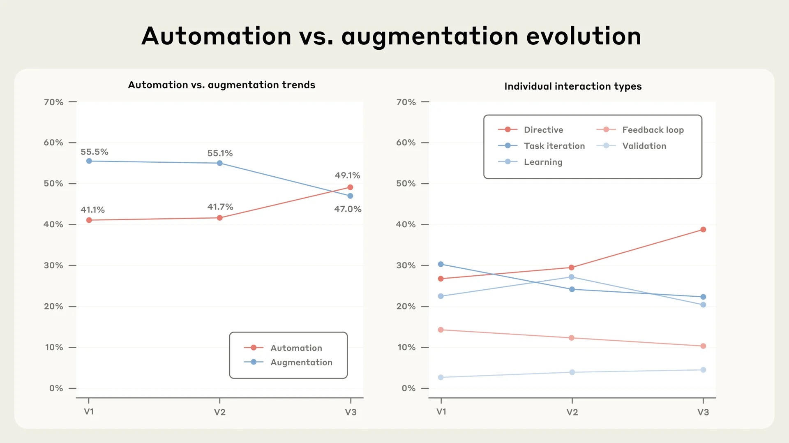

**人类经济指数报告中的协作模式频率。** 左侧面板计算展示自动化或增强使用形式的对话的份额。右侧面板通过协作模式打破了这一点。随着时间的推移，Claude倾向于以更加自动化的方式使用，这主要是由于指令使用的增加。

一种解释是，这是模型能力增强的结果。随着模型在预测用户需求和在第一次尝试中产生高质量输出方面有所改进，用户可能需要更少的后续改进。指令使用的激增也可能表明人们对将完整任务委托给人工智能（一种边做边学的形式）的信心不断增强。**4**

指令使用的增长是否归因于模型能力的提高或边做边学可能预示着截然不同的劳动力市场影响。如果更先进的模型只是扩展自动化任务集，那么执行此类任务的工人被取代的风险就会增加。然而，如果指令使用的增加反映出边做边学，那么最有能力适应新的人工智能驱动工作流程的工人可能会看到更大的需求和更高的工资。换句话说，人工智能可能会让一些工人比其他工人受益更多：它可能会为那些适应技术变革能力最强的人带来更高的工资，即使那些适应能力较低的人面临工作中断。**5** 这将是未来研究的一个重要探究领域。

### 展望未来

V3 数据表明人工智能的能力和采用正在持续进步。基于知识的任务，包括教育和科学应用，继续保持快速增长，新产品功能似乎正在支持不同类型的工作，而不仅仅是加速现有任务。

最引人注目的是，数据表明，人工智能系统的任务委托数量有所增加——这可能是由于用户对技术的信任以及底层模型功能的改进所致。这也可能是由于底层用户群的变化造成的。本报告的下一章首次详细分析了跨地域的使用情况，使我们能够更清楚地理清时间与地理变化的未来。我们将在未来的报告中继续密切跟踪这些趋势。

1.“搜索电子资源，例如数据库或存储库，或手动信息资源”从 0.03% 增加到 0.49%。“进行基于互联网和图书馆的研究”从 0.003% 增加到 0.27%。

2.根据包含字符串“开发教学材料”的任务计算的统计数据。

3.任务是从频率变化幅度大于或等于 0.2 个百分点的任务集中进行整理的。编程创建任务包括：“编写新程序或修改现有程序”（1.5% → 4.9%）、“设计、构建或维护网站”（1.2% → 2.0%）、“编写、分析、审查和重写程序”（1.2% → 0.5%）、“开发新的软件应用程序”（0.06% → 0.6%）、“开发事务性 Web 应用程序”（0.1% → 0.3%）以及“开发特定应用软件”（0.05% → 0.3%）。调试/纠错任务包括：“修改现有软件以纠正错误”（两种变体：2.5％→3.8％和4.8％→2.7％），“通过进行适当的更改来纠正错误”（3.0％→2.1％），“执行初始调试程序”（2.0％→0.9％），“诊断，排除故障并解决硬件/软件问题”（1.6％→2.5％）， “审查和分析计算机打印输出以定位代码问题”（1.3% → 0.9%），以及“确定网页或服务器问题的来源”（0.9% → 0.4%）。

4.我们注意到，V3 使用 Claude Sonnet 4 进行分类，而 V2 使用 Sonnet 3.7，这使直接比较变得复杂。为了解决这个问题，我们使用 Sonnet 3.7 重新运行 V3 数据，仍然发现指令交互显着增加（尽管自动化程度较低，为 45%，而 Sonnet 4 为 49%）。我们还验证了这一趋势并不是由任务组合的变化驱动的——向指令性互动的转变出现在广泛的职业类别中，这表明它反映了人们与Claude互动方式的真正变化，而不是成分效应。

5.尼尔森和菲尔普斯，1966 年 *对人类的投资、技术扩散和经济增长* 这是教育在帮助工人适应变化方面的价值的经典参考。另请参见 Goldin 和 Katz，2008 *教育与科技的竞赛*。我们感谢安东·科里内克（Anton Korinek）的观察，即人工智能本身可能会加速人工智能的传播和经济影响，使其发挥技术工人过去在弄清楚如何在新环境中有效运用新技术方面所发挥的作用。

## 第 2 章：Claude在美国和全球的使用情况

### 概述

人工智能首先在哪里被采用以及如何使用将影响世界各地的经济成果。通过分析 150 多个国家和美国所有州的 Claude 使用模式，我们发现了三个关键动态：早期采用者在哪里、他们使用 AI 的目的以及随着采用的成熟，使用情况如何演变。这些地理模式提供了有关人工智能经济扩散的现实证据，有助于追踪不同地区在人工智能采用方面是否趋同或分歧，并揭示当地经济特征如何影响技术部署。

我们的数据依赖于 [隐私保护](https://www.anthropic.com/research/clio)**1** 对 100 万条 Claude.ai 对话的分析**2**，证实了我们的一些期望，同时挑战了其他期望。美国在总使用量中占据主导地位，占 21.6%，考虑到其规模和高收入，这并不令人意外。但即使根据工作年龄人口规模进行调整，高收入国家的使用率也往往更高。例如，新加坡的使用率是其工作年龄人口建议值的 4.5 倍，而全球大部分地区的使用率却很低。有趣的是，在美国，华盛顿特区和犹他州的人均使用量超过了加利福尼亚州。

随着人均采用率的加深，我们还观察到人工智能用例的变化。人均人工智能采用率较低的国家主要集中在编码任务上——印度占全部使用量的一半以上，而全球这一比例约为三分之一。随着采用的成熟，用途变得多样化，并且越来越重视教育、科学和商业运营。

更引人注目的是：成熟市场倾向于更加协作地使用人工智能，而新兴市场更有可能将完整的任务委托给它——这或许反映了处于结构转型不同阶段的经济体如何部署人工智能的差异。我们的数据为跨地区了解这些模式提供了一个窗口，并且未来将使我们能够跟踪这些采用差距是否随着时间的推移而缩小、扩大或结构发生变化。

### Claude在全球的传播

#### **Claude的总使用率在美国最高**

Claude的采用总体上在地理上高度集中。就全球总使用量而言，美国所占份额最高（21.6%），其次使用量最高的国家所占份额明显较低（印度为 7.2%，巴西为 3.7%，见图 2.1）。然而，这个集中度受到每个国家人口规模的影响**3** – 较大的国家可能纯粹因为其人口规模而拥有较大的使用份额。

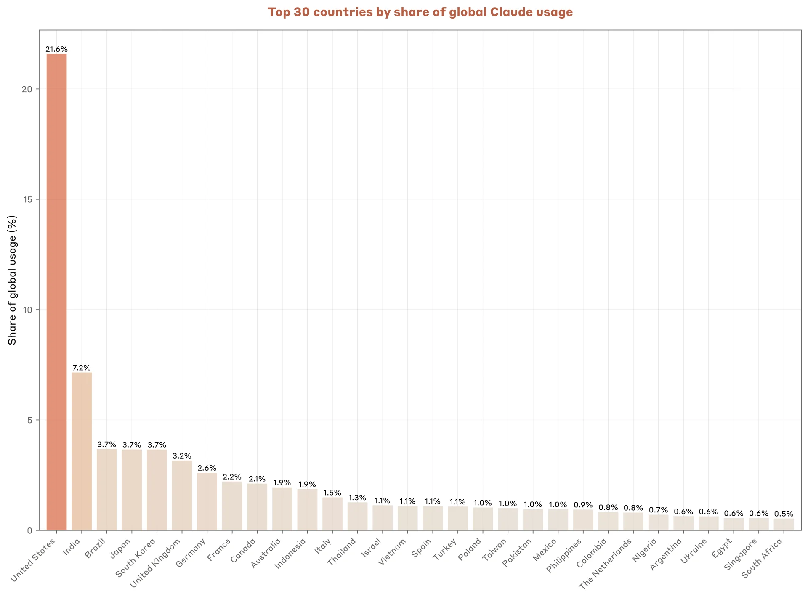

**在全球 Claude.ai 使用份额方面处于领先地位的国家。** 这些数据包括 Claude.ai 免费版和专业版的对话。

#### Claude的人均使用量集中在技术先进国家

为了考虑人口规模的差异，我们分析了根据工作年龄人口调整的使用情况，引入了一种称为人择人工智能使用指数（AUI）的新衡量标准：对于每个地理位置，我们计算其 Claude 使用份额以及其在工作年龄人口（15-64 岁）中的份额。然后，我们通过除以这些份额来计算 AUI：

该指数揭示了相对于其劳动年龄人口，各国对Claude的使用是否多于或少于预期。AUI > 1 的区域在人口调整后的使用率高于预期，而 AUI < 1 的区域的使用率较低。

结果揭示了技术先进的小型经济体的显着集中模式。以色列的人均 Claude 使用率领先于全球，人择人工智能使用指数为 7，这意味着其工作年龄人口使用 Claude 的数量比根据其人口预期的多 7 倍。新加坡以 4.57 紧随其后，澳大利亚 (4.10)、新西兰 (4.05) 和韩国 (3.73) 则以人均 Claude 使用率排名前五。

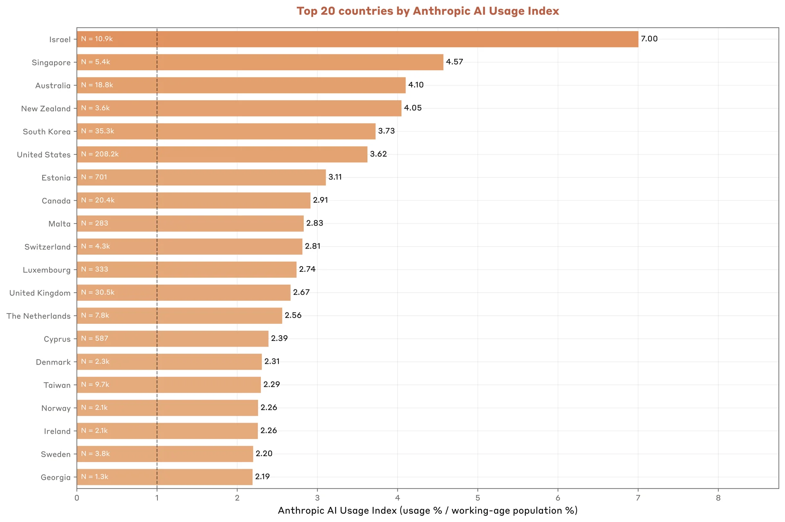

**技术先进的小国在人均Claude采用率方面处于领先地位。** 该图显示了 Anthropic AI 使用指数排名前 20 的国家。对于这个数字，我们只包括样本中至少有 200 个观察值的国家，因为我们的随机样本中低使用率国家的衡量标准存在不确定性。基础数据包括 Claude.ai 免费版和专业版的使用情况。

接下来，我们根据 AUI 创建人均使用量等级。我们在 100 万个对话的随机样本中考察了至少有 200 个对话的国家，并为不同的基于使用级别的四分位数设置了阈值，即 *领先* （前 25%）， *中上层* (50-75%), *中低层* (25%-75%) 和 *新兴* （底部 25%）。然后，我们根据 AUI 将国家/地区分配到一个等级，即使它们的观测值少于 200 个。我们将拥有人口数据但样本中没有使用情况的国家分配给 *最小* 层。**4** 图 2.3 显示了全球范围内的人类人工智能使用指数等级，表 2.1 显示了等级和国家/地区示例的概述。

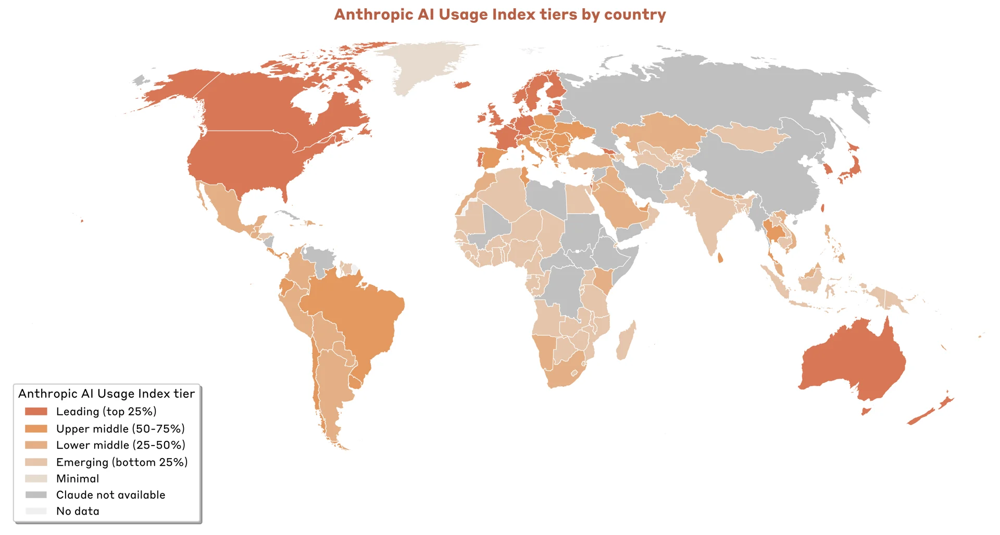

**各个国家的Claude普及程度各不相同，北美、欧洲和大洋洲国家的人均劳动年龄Claude采用率领先。** 不同的等级反映了一个国家在本章定义的人类人工智能使用指数全球分布中的位置。 *5,6*

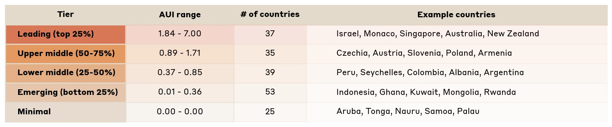

**人类经济指数层级，包含示例、国家/地区数量以及每个层级的 AUI 范围。**

### 就人均使用量而言，重点关注领先国家和新兴国家

这种集中在人口规模有限的发达经济体的现象反映了它们作为技术先驱的既定模式。例如，以色列和新加坡在全球排名中均名列前茅。 [全球创新指数](https://www.wipo.int/web-publications/global-innovation-index-2024/en/gii-2024-at-a-glance.html)——衡量全球不同经济体创新程度的指标——表明对信息技术的普遍投资有利于前沿人工智能的快速采用。总体而言，这些经济体可以利用受过教育的劳动力、强大的数字基础设施和有利于创新的政策，为人工智能创造肥沃的条件。

值得注意的是主要发达经济体在Claude使用中的地位。就人均收养率而言，美国（3.62）位居领先国家之列，加拿大（2.91）和英国（2.67）的收养率较高，但与其人口相比较为温和。其他主要经济体的采用率较低，其中法国为 1.94，日本为 1.86，德国为 1.84。

与此同时，许多低收入和中等收入经济体的Claude使用率极低，非洲、拉丁美洲和亚洲部分地区的许多国家的Claude使用率低于根据其工作年龄人口的预期。其中包括玻利维亚（0.48）、印度尼西亚（0.36）、印度（0.27）和尼日利亚（0.2）。

这种使用情况的变化反映了这些经济体的收入差异。我们发现 Claude 采用率与人均劳动年龄国内生产总值之间存在很强的正相关性（见图 2.4），人均 GDP 增长 1% 与人均 Claude 使用率增长 0.7% 相关。

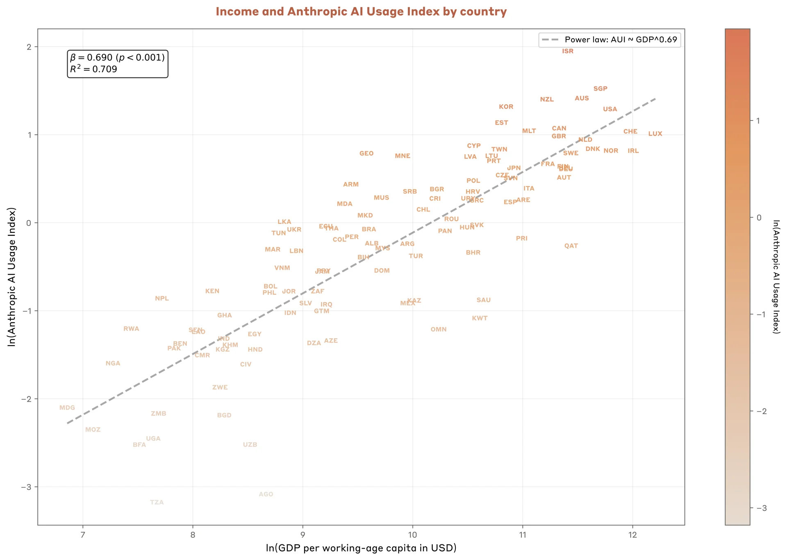

**各国的人均Claude使用量与人均收入呈正相关。** 对于这个数字，我们只包括样本中至少有 200 个观察值的国家，因为我们的随机样本中低使用率国家的衡量标准存在不确定性。轴采用对数刻度，突出显示幂律分布。每个国家/地区均由其 3 个字母的 ISO 代码表示。

Claude使用的差异可能反映了多种因素的综合作用，其中一些因素与收入相关：

- **数字基础设施：** 高使用率国家/地区通常拥有访问人工智能助手所需的强大的互联网连接和云计算访问权限。
- **经济结构：** 正如本报告和之前的报告所述，Claude 的能力非常适合知识工作者的各种典型任务。与制造业就业比例较高的低收入经济体相比，发达经济体往往拥有更高比例的劳动力。
- **监管环境：** 各国政府在鼓励不同行业使用人工智能的积极程度以及对技术的监管力度方面存在差异。
- **意识和访问：** 与硅谷和人工智能研究界联系更紧密的国家可能对Claude有更多的认识和接触。
- **信任与安慰：** 公众对人工智能信任的看法差异很大 [跨越](https://hai.stanford.edu/ai-index/2025-ai-index-report/public-opinion) [国家](https://www.ipsos.com/sites/default/files/ct/publication/documents/2025-06/Ipsos-AI-Monitor-2025.pdf).

### Claude在美国的传播

在美国，加利福尼亚州以 25.3% 的使用率遥遥领先。其他拥有主要科技中心的州，如纽约州 (9.3%)、德克萨斯州 (6.7%) 和弗吉尼亚州 (4.0%) 也排名很高。尽管没有根据人口进行调整，但我们怀疑这些强劲的采用数字在一定程度上反映了技术中心的快速采用——这与历史上具有经济意义的技术的传播方式一致。

然而，当我们调整每个州的人口规模时，这种叙述变得更加复杂。令人惊讶的是，哥伦比亚特区以 3.82 的人类人工智能使用指数领先，这表明哥伦比亚特区的 Claude 使用率是其在全国劳动年龄人口中所占比例的 3.82 倍。紧随其后的是犹他州（3.78），尤其领先于加利福尼亚州（2.13）、纽约州（1.58）和弗吉尼亚州（1.57）。**7**

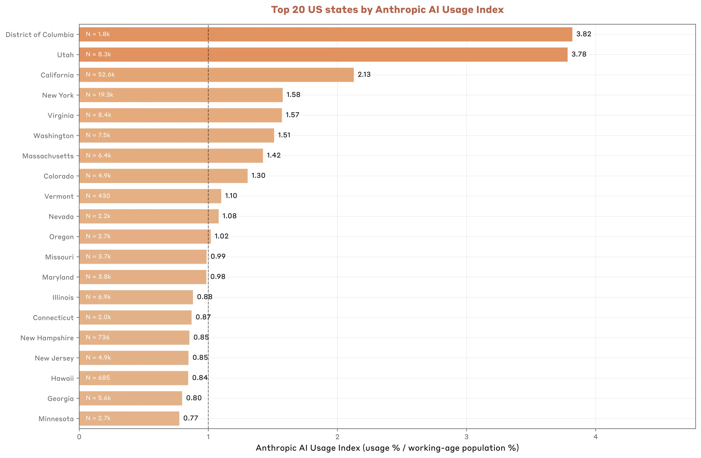

**就劳动年龄人均Claude收养率而言，领先的美国州包括哥伦比亚特区、犹他州、加利福尼亚州、纽约州和弗吉尼亚州。** 该图显示了基于 Anthropic AI 使用指数的美国前 20 个州。对于该图，我们仅在样本中包含至少 100 个观察值的州，因为我们的随机样本中低使用率州的测量具有不确定性。基础数据包括 Claude.ai 免费版和专业版的使用情况。

我们记录了美国各州Claude收养率与人均收入之间的类似关系，但比全球水平更弱。收入差异解释了跨州采用率差异的不到一半。尽管相关性较弱，但我们发现 Claude 采用率随着收入的增加而增长更快：各州人均 GDP 每增加 1%，人工智能使用指数就会增加 1.8%。

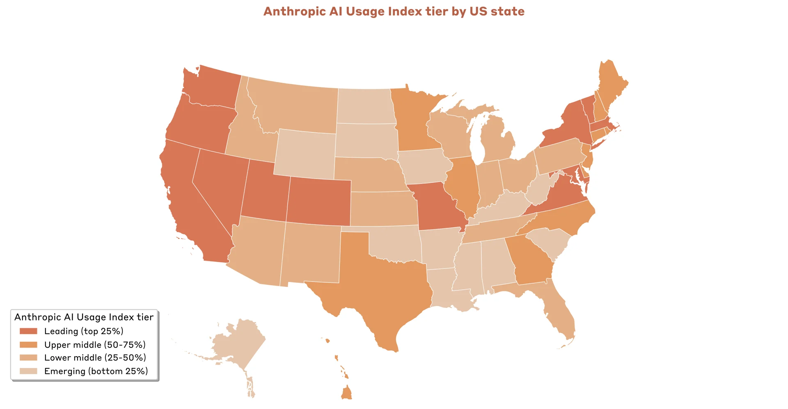

**美国各州的Claude使用率各不相同，西海岸的人均使用率较高，但内华达州、犹他州、科罗拉多州、密苏里州和弗吉尼亚州的人均使用率也较高。** 不同的等级反映了美国各州在本章定义的人类人工智能使用指数美国分布中的地位。

### 各国的任务使用模式

我们观察到Claude在不同国家的使用方式存在显着差异。与过去的报告一样，我们使用两种不同的方法来分析这些趋势。首先，我们根据 O*NET 将对话分类为任务，O*NET 是一种美国分类法，将特定任务映射到职业和职业组（例如，涉及软件调试的任务将属于计算机和数学职业组）。

其次，我们使用 Claude 在 Claude.ai 上构建了一个自下而上的用户请求分类法，该分类法提供了对不完全适合现有分类法的使用模式的洞察。例如，请求集群“帮助撰写和改进工作申请的求职信”（最低级别）会馈送到较高级别的集群“帮助处理工作申请、简历和职业文档”（中层），而后者又会馈送到集群“帮助处理工作申请、简历和职业发展”（最高级别）。这两种互补的方法使我们能够报告与标准劳动力统计数据一致的结果，并提供灵活性来捕获标准分类法遗漏的任务。

#### 较高的人均Claude使用率与更多样化的任务使用相关

在分析最高级别汇总的 O*NET 任务时（就其所属的标准职业分类职业组而言），我们注意到各国之间存在巨大差异。虽然总体模式很嘈杂（尤其是对于观察较少的国家），但图 2.7 表明，随着人均Claude采用率从较低到较高，使用情况从计算机和数学职业组的任务（例如编程）转向教育、办公和行政用途以及艺术等领域的更多样化的任务。我们还看到在生命、物理和社会科学领域的使用有所增加。

**随着我们从采用率较低的国家转向采用率较高的国家，Claude的使用似乎从以编程为主的任务转向更加多样化的任务组合，尽管整体模式很嘈杂。**该图显示了 Anthropic AI 使用指数与最常见的标准职业分类 (SOC) 职业群体之间的关系。每个面板显示不同的 SOC 组。SOC 份额基于给定地理区域中有多少 O*NET 任务属于给定 SOC 组。颜色表示一个国家/地区属于哪个 AUI 等级。气泡大小表示每个国家/地区的使用次数。对于这个数字，我们只包括样本中至少有 200 个观察值的国家，因为我们的随机样本中低使用率国家的衡量标准存在不确定性。回归对每个国家的权重是相等的。

当查看我们自下而上的请求分类法时，也会出现国家/地区特性。**8** 以美国、巴西、越南和印度为例，它们代表了给定人类人工智能使用指数层中总使用率最高的国家。与全球平均水平相比，美国用户使用 Claude 进行家庭管理、寻找工作和医疗指导的比例过高。相比之下，巴西的 Claude 用户对翻译和法律服务的使用率都较高。越南最不成比例的请求与软件开发和教育有关，而印度最不成比例的请求几乎完全集中在软件开发上。这可能反映了当地的专业化：巴西一直是 [人工智能在司法系统中的早期采用者](https://www.sciencespo.fr/public/chaire-numerique/en/2023/03/03/article-artificial-intelligence-the-brazilian-judiciary-and-some-conundrums/)，印度拥有庞大的信息技术部门。

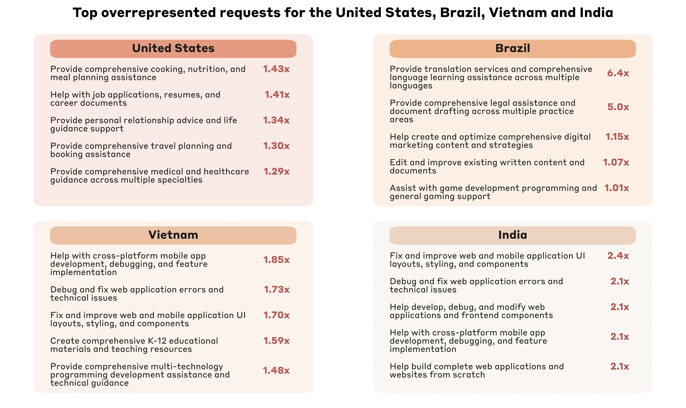

**美国、巴西、越南和印度的请求集群比例过高。** 当某个国家/地区包含该请求的对话比例高于全球范围内时，该请求在该国家/地区的代表性过高。对于该图，我们关注中等粒度的请求集群，即比最低级别的请求集群聚合程度更高，但比最高级别的请求集群聚合程度更低。仅包括全球和该国家/地区频率至少为 1% 的请求。

在所有国家，软件开发都是 Claude 最常见的用途。为什么开发人员任务始终领先于总体 Claude 使用模式？有几个因素可能导致这种效果：

- **模型-任务拟合：** Claude 是一个非常强大的编码模型，可以轻松部署到代码生成、调试和技术问题解决任务中。
- **开发者接受度：** 开发者社区迅速接受新工具，并且这种使用通过他们的社交和专业网络传播。
- **低组织障碍：** 与医疗用例相比，个人开发人员通常无需复杂的审批流程即可采用 Claude。

### 美国各地的任务使用模式

在本节中，我们将探讨美国各州的Claude使用模式，让我们进一步了解当地经济状况如何影响使用模式。正如我们上面所讨论的，人择人工智能使用指数的跨州差异只占美国各州收入差异变化的不到一半。这表明，其他地区差异（包括Claude能力与当地劳动力职业构成的兼容性）在决定为什么某些州的使用比其他州更集中方面发挥着更大的作用。

在许多州，我们看到证据表明当地的人工智能使用模式与当地经济的独特特征相一致。在分析每个使用级别中排名靠前的州（加利福尼亚州为领先州、德克萨斯州为中上层州、佛罗里达州为中下层州、南卡罗来纳州为新兴州）时，我们发现自下而上的请求分类法存在很大差异（见图 2.9）。

例如，加利福尼亚州对 IT 相关请求、数字营销和翻译的使用不成比例，这可能反映了其科技行业和语言多样化的人口。加州在基本数字任务方面的帮助请求也异常频繁，这可能代表着对模型能力或滥用的测试。佛罗里达州在商业咨询和健身方面的使用比例过高，这可能与其作为金融中心的角色有关，该州税率相对较低，气候温暖，适合户外活动。

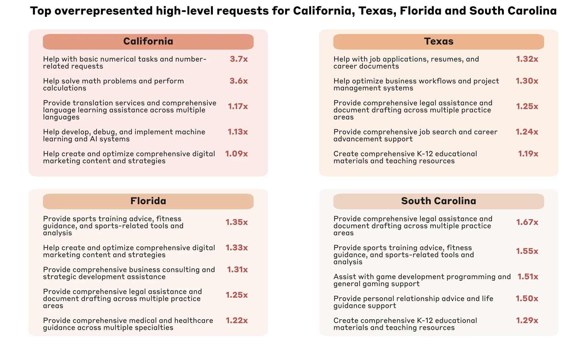

**加利福尼亚州、德克萨斯州、佛罗里达州和南卡罗来纳州的请求类别过多。** 当某个州包含该请求的对话比例高于整个美国时，该请求在该州的比例就过高。对于该图，我们关注中等粒度的请求集群，即比最低级别的请求集群聚合程度更高，但比最高级别的请求集群聚合程度更低。仅包括在美国和该州频率至少为 1% 的请求。

在美国，华盛顿特区在人均 Claude 使用率方面处于领先地位，在 O*NET 任务分类和自下而上的分类中过度关注文档编辑、信息提供和工作申请（见图 2.10）。例如，在华盛顿特区，求职申请帮助的普遍程度是美国的 1.84 倍。我们的 [交互式仪表板](https://www.anthropic.com/economic-index#us-usage) 让每个人都能探索美国各州的各种变化和模式。

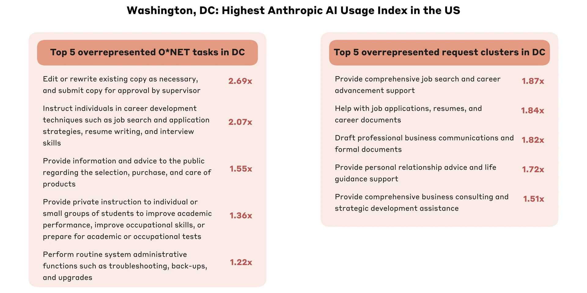

**华盛顿特区的人均Claude使用率最高，其任务和请求集中在文档编辑、信息提供和工作申请上*.*** O*NET 任务是指 O*NET 分类中的任务。请求基于自下而上的请求类别，描述用户向 Claude 提出的请求。当某个州包含该任务或请求的对话份额高于整个美国时，该州的任务或请求就被过度代表。对于该图，我们重点关注中等粒度的请求集群。仅包括在美国和该州频率至少为 1% 的请求。

### 人类与人工智能协作中的地理模式

虽然前面几节讨论了 *什么* 人们使用Claude执行的任务中，出现了同样具有启发性的模式 *如何* 他们与之互动。在这里，我们使用与第 1 章中定义的相同的增强和自动化协作模式。

各国有不同的任务组合，这意味着它们关注不同的经济任务，这可能部分解释了自动化模式的差异。在本节中，我们研究了低人均采用率经济体和高人均采用率经济体之间的自动化使用是否存在系统性差异——即使在控制任务组合的差异的情况下也是如此。**9**

我们发现，即使在控制一个国家/地区的任务组合时，来自不同国家/地区的用户对于自主授权与协作交互也表现出明显不同的偏好。随着Claude人均使用量的增加，各国从以自动化为重点的使用转向以增强为重点的使用。这有点违反直觉，因为我们正在控制不同国家之间更加多样化的任务构成。我们推测，文化和经济因素可能会影响自动化份额，或者每个国家的早期采用者可能倾向于以更汽车化的方式使用人工智能——但这里需要更多的研究。

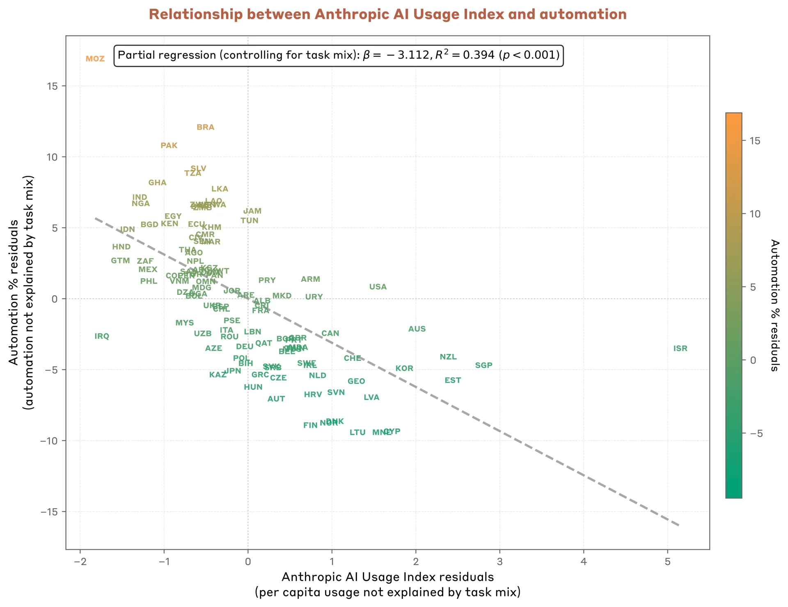

**人择人工智能使用指数较高的国家倾向于以更加协作的方式（增强）使用 Claude，而不是让它独立运行（自动化）。** 该图显示了特定国家中人类人工智能使用指数与自动化份额之间的关系。我们在考虑地理任务组合后绘制关系，从而显示回归残差。对于这个数字，我们只包括样本中至少有 200 个观察值的国家，因为我们的随机样本中低使用率国家的衡量标准存在不确定性。每个国家/地区均由其 3 个字母的 ISO 代码表示。

### 结论

我们对Claude跨地区使用模式的分析揭示了几个关键的见解。最引人注目的问题之一是Claude使用的地理集中度。美国和加利福尼亚州在Claude总体使用率方面处于领先地位，并且Claude使用率与人均收入之间存在很强的相关性，这表明与过去的技术有相似之处，其中最初的地理集中和专业化使用是一个关键特征。与现有技术的传播模式进行比较可能有助于我们更好地理解人工智能的传播和影响。

令人惊讶的是，地理形状不仅 *什么* 人工智能工具的用途是，但是 *如何* 他们被使用了。人均使用率相对较低的经济体中的用户相对偏好将任务委派给 Claude（自动化），而人均使用率较高的经济体中的用户更有可能更喜欢与 Claude 进行更多协作或基于学习的交互（增强），即使在控制任务组合的情况下也是如此。与任务使用的本地专业化类似，人工智能协作模式的本地专业化表明人工智能的影响在不同地区可能有很大不同。

人工智能采用的地理模式——在哪里使用、用于哪些任务以及如何使用——表明，为了实现人工智能造福全球人民的潜力，政策制定者需要关注人工智能使用和采用的本地集中度，并解决数字鸿沟加深的风险。

1.出于隐私原因，我们的自动分析系统会过滤掉少于 15 个对话和 5 个唯一用户帐户的任何单元格，例如国家和（国家、任务）交叉点。对于自下而上的请求集群，我们有一个更高的隐私过滤器，至少包含 500 个对话和 250 个唯一帐户。

2.本节中的数据涵盖 2025 年 8 月 4 日至 11 日期间的 100 万条 Claude.ai 免费版和专业版对话，从该期间未标记为潜在信任和安全违规的所有对话中随机抽样。观察单位是 Claude.ai 上与 Claude 的对话，而不是用户，因此有可能包含来自同一用户的多个对话，尽管我们的 [过去的工作](https://doi.org/10.48550/arXiv.2412.13678) 表明随机抽样对话与按用户分层抽样不会产生实质性不同的结果。根据每次对话的 IP 地址对国家和美国州一级的总体地理统计数据进行评估并制成表格。对于地理定位，我们使用 ISO-3166 代码，因为我们的 IP 地理定位提供商使用此标准。国际位置使用 ISO-3166-1 国家/地区代码，美国州级数据使用 ISO-3166-2 区域代码，其中包括美国所有 50 个州和华盛顿特区。我们排除源自 VPN、任播或托管服务的对话（由我们的 IP 地理定位提供商确定）。

3.国际位置使用 ISO-3166-1 国家/地区代码，其中包括国家/地区和一些地区。

4.等级阈值（四分位数）基于在全球水平上至少有 200 个观测值的国家，以及在美国水平上至少有 100 个观测值的美国各州。没有观察到使用情况的国家/地区被分配到最低层，因为我们不知道它们的使用情况是否完全为零或我们的随机样本未捕获的很少使用情况。鉴于对较小国家和州的观察有限，未来的工作（例如使用分层抽样）将使我们能够更准确地探索这些模式。

5.该世界地图是基于 Natural Earth 的世界地图，以 ISO 标准观点为争议领土，这意味着该地图可能不包含一些争议领土。我们注意到，除了灰色显示的国家（“Claude不可用”）之外，我们不在乌克兰克里米亚、顿涅茨克、赫尔松、卢甘斯克和扎波罗热地区开展业务。根据国际制裁和我们支持乌克兰领土完整的承诺，我们的服务不在俄罗斯占领的地区提供。

6.“无数据”适用于数据部分缺失的国家。一些地区（例如西撒哈拉、法属圭亚那）有自己的 ISO-3611 代码。其中一些有一些用途，另一些则没有。由于人类人工智能使用指数是根据世界银行的劳动年龄人口数据计算的，而所有这些地区的人口数据并不容易获得，因此我们无法计算这些地区的 AUI。

7.在进一步调查犹他州的活动时，我们发现其使用的很大一部分似乎可能与协调滥用有关。这也反映在“指令”自动化得分远高于平均水平。然而，我们进行了稳健性检查，并认为此活动并未推动结果。

8.请求被过滤为至少代表全局级别请求的 1% 和本地级别请求的 1%。

9.为了隔离自动化偏好和Claude使用率之间的关系（考虑任务构成差异），我们执行以下操作：首先，我们通过加权平均值计算每个国家的预期自动化百分比。对于每个 O*NET 任务（例如，编码、写作或分析），我们将该任务在国家/地区使用量中所占的份额乘以该任务类型的全球自动化率（Claude在全球范围内通过指令/反馈循环模式完成的任务的百分比）。将这些数据相加，我们就可以得出每个国家/地区特定任务组合的自动化百分比的预期值。然后，我们将实际自动化百分比和 AUI 回归到该预期自动化百分比。这些回归的残差代表了每个变量的变化，而这些变化无法通过任务组成来解释。通过检查这些残差之间的关系（称为部分回归分析），我们可以确定人工智能使用率高于其任务组合预测的国家的自动化程度是否也高于预测。

## 第三章：Claude的API企业部署

### 概述

前沿人工智能能力能否提高我们的生产力、重塑劳动力市场并加速增长，将取决于企业选择何时以及如何部署人工智能。即使企业认识到人工智能的潜力，要实现盈利，采用人工智能可能需要昂贵的生产流程重组、培训新工人以及其他沉没成本投资，以促进有效部署。**1**

为了了解 AI 的业务采用模式，我们转向新的数据源：Anthropic 的第一方 (1P) API 客户 — 再次依赖于 [隐私保护方法](https://www.anthropic.com/research/clio).**2** 我们的 API 允许客户将 Claude 直接集成到他们自己的产品和应用程序中，并按使用的代币收费，而不是固定订阅费。这代表了一种根本不同的产品体验 [Claude.ai](http://claude.ai)，我们在前两章中重点讨论了这一点。

制度惯性以及采用的固定成本表明，企业使用人工智能的早期例子可能集中在部署容易、功能强大且采用带来的经济效益很高的专门任务中。

事实上，我们在本章提供的数据中看到了类似的证据。我们的分析揭示了几种模式：

- **企业使用 Claude 的方式与个人用户类似，但更专业：** 企业集中使用人工智能部署非常适合编程访问的任务，例如编码或管理任务。与 Claude.ai 用户相比，企业较少使用 Claude 来完成教育或创意任务，而且总体上自动化程度更高。
- **API 客户往往更喜欢成本较高的任务：** 尽管任务的成本差异很大，但最昂贵的任务往往具有更高的使用率，这表明模型功能、部署的简易性和自动化的经济价值对采用的影响远远大于交互本身的成本。
- **复杂的部署需要访问适当的上下文信息：** 我们发现了人工智能对企业有用性的一个重要潜在瓶颈的证据。使用 Claude 执行复杂任务的 API 客户往往会向 Claude 提供冗长的输入。这可能会对更广泛的企业部署一些依赖于尚未集中或数字化的分散环境的重要任务构成障碍。纠正这一瓶颈可能需要公司重组组织、投资新的数据基础设施并集中信息以实现有效的模型部署。

### 奠定基础：公共数据中的人工智能采用模式

在深入研究我们的 API 数据之前，有必要先了解一下更广泛的商业人工智能采用情况。根据人口普查局的商业趋势和前景调查，美国企业的人工智能采用率在过去两年中增加了一倍多，从 2023 年秋季的 3.7% 上升到 2025 年 8 月上旬的 9.7%（图 3.1）。**3** 尽管增长速度如此之快，但绝大多数美国公司并未报告在其生产过程中使用人工智能。

但这些总数掩盖了不同行业之间的巨大差异。例如，2025 年 8 月初，信息行业四分之一的企业报告使用人工智能，这一比例大约是住宿和餐饮服务行业的十倍。**4**

从这些公开数据中可以清楚地看出：企业对人工智能的使用正在迅速增长，但我们仍处于人工智能采用的早期阶段。在整个经济中的使用情况仍然分布不均，最有能力快速采用这项技术并从中受益的部门这样做。

正如我们将在下面看到的，我们的 1P API 数据得出了一个补充结论：早期企业对 Claude 的使用在整个经济中的分布同样不均匀，并且主要部署用于信息行业职业的典型任务。

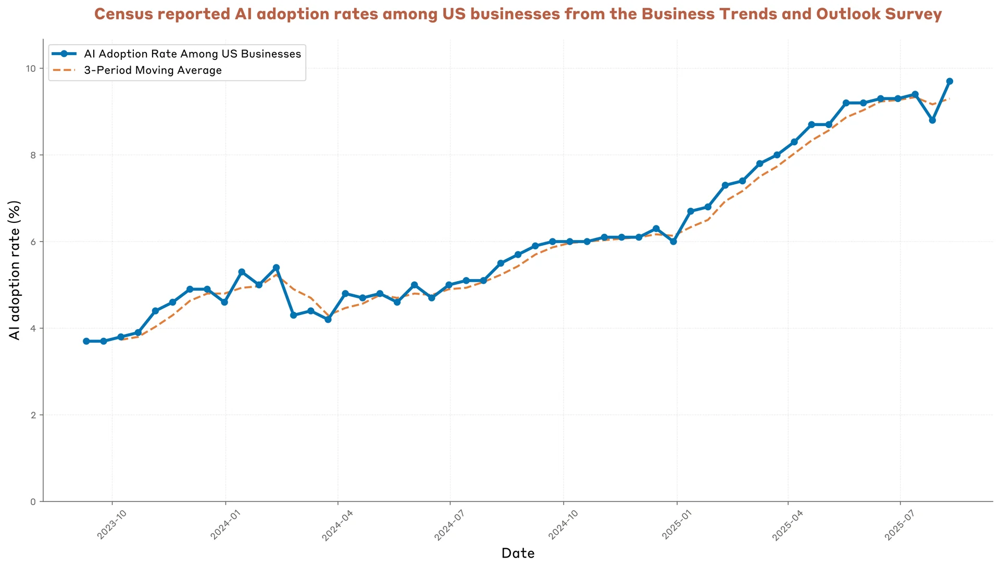

**美国公司的人工智能采用率、商业趋势和前景调查（人口普查）。** 注意：人工智能采用率的计算方式为对“过去两周内，该企业是否使用人工智能 (AI) 生产商品或服务？（人工智能示例：机器学习、自然语言处理、虚拟代理、语音识别等）”问题回答“是”的公司比例。

### Anthropic API 客户的专门使用

为了分析 API 流量，我们应用了与前几章相同的隐私保护分类方法——按 O*NET 任务对匿名 API 记录进行分类，并采用自下而上的分类法。出现的模式表明企业使用集中在特别适合自动化的专门任务上。

总体而言，软件开发占据主导地位。在排名前 15 的使用集群中（约占所有 API 流量的一半），大多数与编码和开发任务相关。调试 Web 应用程序和解决技术问题分别约占使用量的 6%，而构建专业商业软件则占另一重要部分。值得注意的是，大约 5% 的 API 流量专门用于开发和评估人工智能系统本身（图 3.2）。

但并非所有 API 的使用都是为了编码。API 客户还部署 Claude 来创建营销材料 (4.7%) 以及处理业务和招聘数据 (1.9%)。这两个类别表明，人工智能的部署不仅用于直接生产商品和服务，还用于人才获取和外部通信。

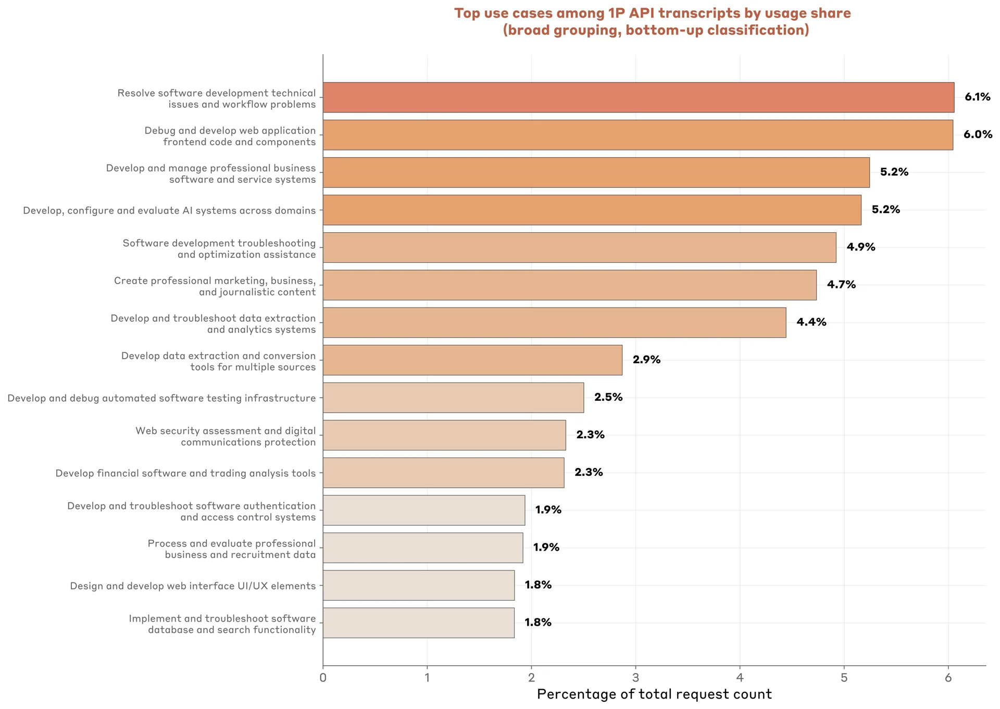

**采样 1P API 转录本中 Claude 使用情况的自下而上分类法。** 使用隐私保护方法，我们将 1P API 转录本分类为反映底层使用情况的自下而上的分类法。该图报告了该分类最广泛级别的主要用例。

O*NET 分类使这些模式更加清晰。所有 API 流量中不到一半都与计算机和数学任务相关，比 Claude.ai 的使用率高出 8 个百分点以上。办公室和行政任务位居第二，大约占成绩单的 10%，反映出它们适合自动化。

另一方面，Claude.ai 上几个突出的交互密集型任务在 API 使用中所占的份额要小得多：教育和图书馆任务从 12.3% 下降到 3.6%，而艺术和娱乐任务从 8.2% 下降到 5.2%。

然而，在许多情况下，Claude.ai 和 API 数据之间的职业类别相当接近，这表明在许多情况下推动采用的是底层模型功能，而不是特定的产品表面。

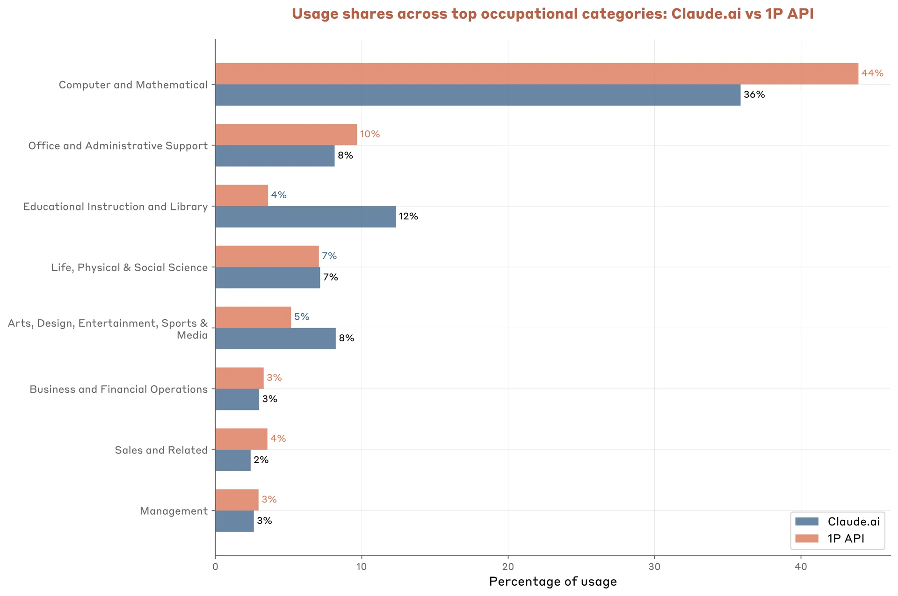

**按总体使用情况排名领先的职业类别：Claude.ai 与 1P API。** 确定任务的使用份额后，我们计算分配给 O*NET 分类中顶级职业的 Claude.ai 和 1P API 客户的流量份额。例如，此图显示我们样本中 44% 的 API 流量与计算机和数学职业的任务特征相匹配。

### 职业细分与任务专业化

尽管使用不同的界面为不同的用户提供服务，但 API 和 Claude.ai 的使用在任务之间遵循非常相似的幂律分布。在 Claude.ai 对话中，后 80% 的任务类别仅占使用率的 12.7%；对于 API 客户来说，这一比例更集中于 10.5%（图 3.4）。这些极端浓度（基尼系数**5** 0.84 和 0.86）揭示了人工智能任务匹配度的巨大变化——最匹配的任务比不匹配的任务的使用率高出几个数量级。

鉴于不同的用户群和用例，跨平台的相似性尤其惊人。两者都集中在相当的集中水平上，这表明人工智能能力与相关经济任务之间存在共同的匹配过程。

代码生成等任务占据主导地位，因为它们达到了模型功能卓越、部署障碍最小且员工可以快速采用新技术的最佳点。很少使用的任务的长尾可能反映了几个因素。**6** 例如，有些任务根本不那么常见——调试软件比谈判马戏合同要频繁得多。极端浓度也表明 O 形圈的潜在作用**7** 力量：如果一项任务需要Claude无法处理的推理水平、公司无法访问的内部数据或不存在的监管批准，那么任何单一障碍都可能阻止采用。

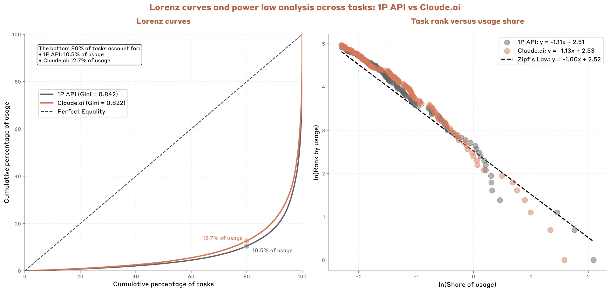

**可视化少量任务的使用集中度：Claude.ai 与 1P API。** 此图表的左侧面板计算了我们的 Claude.ai 和 1P API 示例的 O*NET 任务的洛伦兹曲线。曲线上突出显示的点表示底部 80% 的任务所占的总体使用量。右侧面板绘制了任务排名与任务使用份额的关系，这些任务代表了我们样本中至少 0.1% 的总体使用情况。齐夫定律（其中最佳拟合线的系数等于 -1）在各种经济环境中都有一定的规律性。

### API 转录本中的自动化与增强

API 和 Claude.ai 用法之间最明显的区别在于 *如何* 人类和人工智能分工。当企业将 Claude 嵌入到他们的应用程序中时，他们很大程度上会委派个人任务，而不是与模型进行迭代协作。

在我们的数据中，77% 的 API 记录显示自动化模式（尤其是完整任务委派），而只有 12% 的 API 记录显示增强模式（例如协作改进和学习）。根据 Claude.ai 的对话样本，自动化和增强之间的差距几乎是均匀的。纵观经济任务，Claude 通过 API 实现的自动化程度更加明显：97% 的任务在 API 使用中显示出自动化主导模式，而 Claude.ai 上的这一比例仅为 47%（图 3.6）。

这很直观。编程式 API 访问自然适合自动化：企业提供上下文，Claude 执行任务，输出直接流向最终用户或下游系统。

这种模式呼应了具有经济意义的技术如何实现变革：嵌入到系统中，让工人无需专业技能即可提高生产力。虽然增强和自动化方法都增强了人类的能力，但系统级自动化可能会在整个经济中带来更大的生产力提升，并为劳动力市场带来更重大的变化：完全自动化一些任务，改变哪些任务对各种工作很重要，甚至产生新的工作形式。

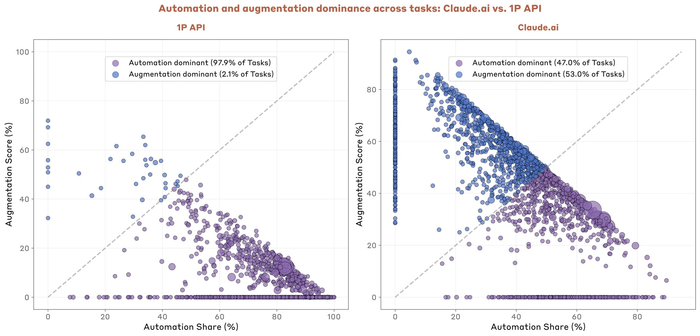

**跨 O*NET 任务的自动化与增强协作模式：Claude.ai 与 1P API。** 该图报告了 Claude.ai 对话和 1P API 记录的份额，这些记录展示了每个 O*NET 任务的自动化或增强使用模式。自动化和增强模式在第 1 章中定义。当出于保护隐私的原因，我们没有观察到特定协作模式的使用份额时，我们在此图中将该类别的值设置为 0%。自动化主导被定义为具有更大观察到的自动化使用份额的任务。对于增强优势也是如此。

### Claude做得越多，Claude需要知道的就越多

为什么我们的 API 客户在某些任务上比其他任务更多地使用 Claude？除了基本模型功能之外，一个潜在的重要解释是，为 Claude 提供成功部署某些任务所需的信息比其他任务更容易。

例如，如果目标是让 Claude 重构复杂软件开发项目中的模块，Claude 可能需要阅读（或至少探索）整个代码库，以了解要进行哪些更改以及在何处进行更改。对于使用集中式代码存储库的软件开发，原则上访问此信息非常简单。

对于其他任务，可能不容易获得适当的上下文，或者访问可能具有挑战性。例如，要求Claude为关键客户制定销售策略可能要求Claude不仅能够访问客户关系管理系统中包含的信息，而且还能够访问客户主管、营销人员和外部联系人头脑中的隐性知识。在其他条件相同的情况下，无法获取此类上下文信息将使Claude的能力下降。

我们通过查看平均 API 输入长度（即提供给 Claude 的上下文）和 Claude 的平均输出长度（即模型响应生成的内容）之间的跨任务关系来探讨这个问题。**8**

对于示例中的每个 O*NET 任务，我们计算相关 API 记录的平均输入和输出长度。然后，我们将这些值除以样本中出现的所有任务的平均长度。这会为每个任务生成一个输入令牌索引和一个输出令牌索引。例如，索引值为 1.5，意味着与该任务关联的 API 转录本比跨任务的平均值长 50%。

不同任务之间 Claude API 输出的长度存在很大差异。例如，输出长度第 90 个百分点的任务比第 10 个百分点的任务长 4 倍多。表 3.1 提供了示例 O*NET 任务，以及 Claude Sonnet 4 对发行版该部分任务组的总结。**9** 图 3.7 显示不同职业类别的输出长度也存在系统性差异。

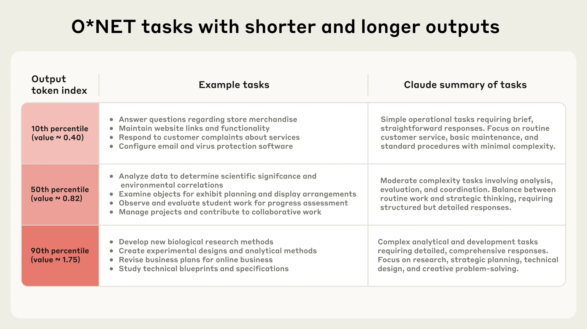

**输出长度较短和较长的 O*NET 任务示例以及 Claude 摘要。** 对于与 1P API 流量匹配的每个 O*NET 任务，我们计算一个输出令牌索引：将与该任务关联的转录本的平均输出长度除以样本中所有任务的平均（未加权）值。系统提示 Claude 在最低限度的指导下识别输出令牌索引分布第 10、50 和 90 个百分位数的任务：“列应该是‘示例任务’、‘索引值’、‘摘要’，您可以在其中提供摘要”。Claude将输出长度与任务复杂性相关联。

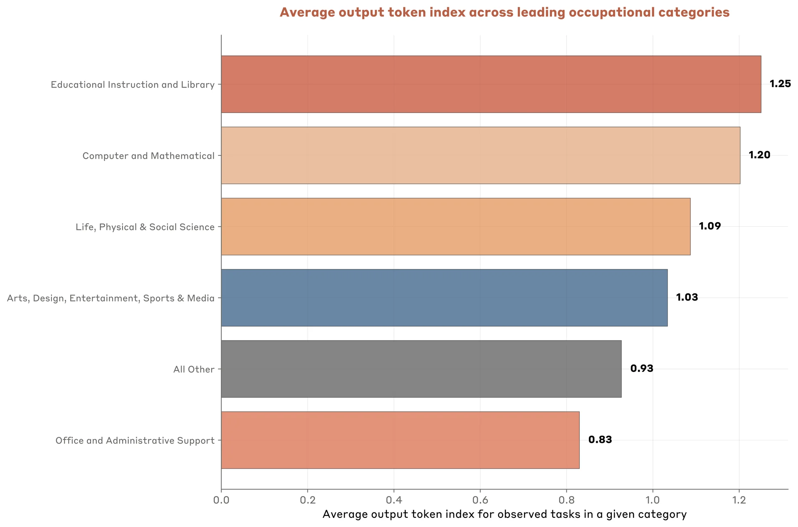

**主要职业类别中 O*NET 任务的平均输出标记指数。** 对于与 1P API 流量匹配的每个 O*NET 任务，我们计算一个输出令牌索引：将与该任务关联的转录本的平均输出长度除以样本中所有任务的平均（未加权）值。然后，我们对 O*NET 分类法中给定顶级职业类别的任务进行平均，以了解最常使用的职业群体。 “所有其他”将剩余的职业群体合并为一个类别。

从Claude对任务的评估中脱颖而出的是，较长的输出任务往往代表着越来越复杂的用途。当然，输出长度并不能涵盖任务复杂性的所有维度，但它似乎是一个明智的、易于测量的代理。

由于 API 客户的输入代币和输出代币的边际定价，因此他们有动力优化模型提示，以在使用 Claude 时最小化输入和输出代币。反过来，输入长度和 Claude 产生的输出之间的任何系统关系都部分地捕获了部署 Claude 执行复杂任务时的潜在上下文约束。换句话说，API 客户会被激励只向 Claude 提供足够的上下文来实现其目标，仅此而已。因此，我们了解具有不同输出长度的任务的上下文要求。

纵观各个任务，我们发现客户向 Claude 提供的上下文 API 数量与 Claude 实际生产的数量之间存在非常稳定的关系。在经济任务中，输入长度每增加 1%，输出长度就会按比例增加 0.38%（图 3.7）。0.38 的弹性表明，对于这些经济上有用的任务，将较长的上下文输入转化为较长的输出时，会出现强烈的边际收益递减。**10**

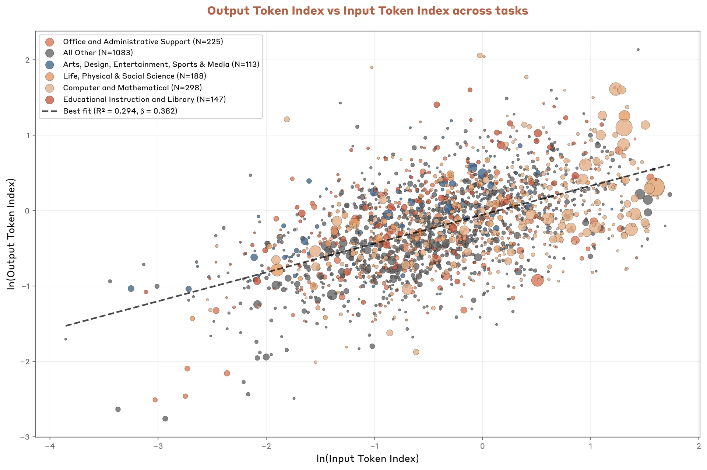

**O*NET 任务中的输出令牌索引和输入令牌索引的散点图。** 对于与 1P API 流量匹配的每个 O*NET 任务，我们计算一个输出令牌索引：将与该任务关联的转录本的平均输出长度除以样本中所有任务的平均（未加权）值。输入标记索引的构建方式类似。0.38 的弹性意味着输入代币指数每增加 1%，输出代币指数就会增加 0.38%。

结果是，为复杂任务部署人工智能可能更多地受到信息访问的限制，而不是底层模型功能的限制。无法有效收集和组织上下文数据的公司可能会在复杂的人工智能部署方面遇到困难，从而为更广泛的企业采用创造潜在的瓶颈——特别是对于隐性、分散的知识对业务运营至关重要的职业和行业。

### 每项任务的成本和跨任务的替代模式

API 客户按代币付费，从而导致为不同任务部署 Claude 的成本存在差异。考虑到输入和输出令牌数量较多，更复杂的任务往往成本更高。这种变化有助于我们探索成本是否是决定企业选择使用 Claude 实现哪些任务自动化的主要因素。

数据表明事实并非如此，至少相对而言是这样。**11** 例如，计算机和数学职业的典型任务比销售相关任务的成本高出 50% 以上，但仍占据主导地位。**12** 总体而言，我们发现成本和使用率之间存在正相关关系：成本较高的任务往往具有较高的使用率（图 3.9）。

成本和使用之间的正相关表明成本在塑造企业人工智能部署模式方面发挥着无关紧要的作用。相反，企业可能会优先考虑在模型功能强大且由 Claude 支持的自动化产生超过 API 成本的足够经济价值的领域中使用。

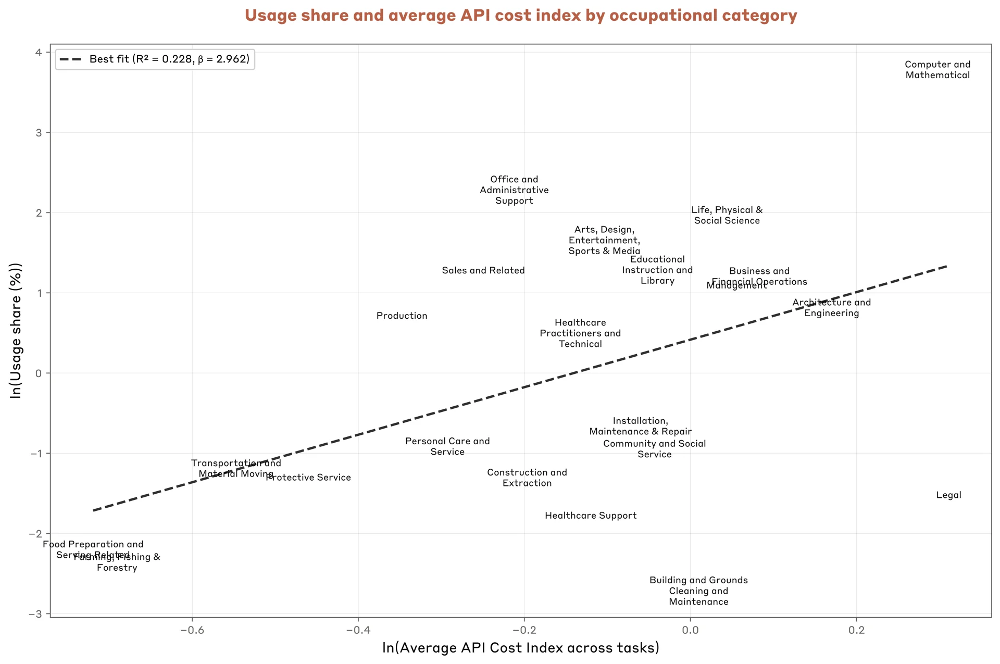

**每个任务的 API 成本以及跨职业类别的使用份额。** 对于与 1P API 流量匹配的每个 O*NET 任务，我们计算一个 API 成本指数：将与该任务关联的转录本的平均 API 成本除以样本中所有任务的平均（未加权）值。该图绘制了给定职业类别中跨任务的平均 API 成本指数与使用份额的关系。估计弹性为 3 意味着任务平均成本每增加 1%，我们样本中的流行率就会增加 3%。

虽然总体上存在这种正相关性，但我们接下来要问的是，在其他类似但成本更高的任务中，对Claude能力的需求是否较低。重要的是，这应该被视为初步探索，这就是我们的发现。

控制任务特征后，我们发现，在 API 转录本样本中，成本每增加 1%，使用频率就会减少 0.29%（图 3.10）。**13** 虽然与标准经济理论一致，即价格上涨导致需求下降，但使用量增加对成本下降的暗示是有限的。根据这一估计，特定任务的成本降低 10% 只会增加 3% 左右的使用量。

除了使用Claude执行特定任务的成本之外，其他因素似乎对使用模式更重要。

**每个任务的 API 成本和任务特征的使用份额控制的散点图。** 对于与 1P API 流量匹配的每个 O*NET 任务，我们计算一个 API 成本指数：将与该任务关联的转录本的平均 API 成本除以样本中所有任务的平均（未加权）值。然后，我们将示例限制为 1P API 和 Claude.ai 示例中出现的任务。该部分散点图控制以下任务级特征：职业类别的固定效应、Claude.ai 的协作模式份额，以及 Claude.ai 样本中给定协作模式是否因隐私保护原因而受到审查的指标。估计弹性为 -0.29 意味着，在控制任务特征后，给定任务的 API 成本指数每增加 1%，我们的样本中流行率就会下降 0.29%。

### 结论

我们的 API 数据捕获了早期阶段的企业人工智能采用情况：高度集中、以自动化为重点，并且令人惊讶的是对价格不敏感（至少在我们的 API 客户使用 Claude 执行的任务中）。

77% 的自动化率表明企业使用 Claude 来委派任务，而不是作为协作工具。这种系统性部署可能成为人工智能在经济中实现更广泛生产力提升的重要渠道。鉴于业务部署中明确的自动化模式，这也可能会给劳动力市场带来混乱，可能会取代那些最有可能面临自动化的角色的工人。

但对劳动力市场的影响尚不完全清楚。正如我们上面所记录的，复杂的任务需要更多的上下文。此类信息可能分散在各个组织中。在这种情况下，拥有业务运营隐性知识的员工可能会受益于复杂的人工智能驱动的自动化的补充。**14** 了解人工智能采用对劳动力市场不平衡的影响是未来研究的一个重要领域。

希望有效采用人工智能的企业可能需要重组他们组织和维护前沿系统所依赖的信息的方式。当今的狭隘、高度自动化的采用是否会演变为更广泛的部署，这可能会决定人工智能未来的经济影响。

1.在存在固定调整成本的情况下，企业面临的问题不一定是是否会采用人工智能，而是何时采用。参见 Hall 和 Kahn 2003， *采用新技术*：“关于此类决定，最需要观察的一点是，在任何时候，做出的选择都不是在采用和不采用之间进行选择，而是在现在采用或推迟到以后做出决定之间进行选择。”

2.本部分中的数据涵盖 2025 年 8 月以来的 100 万份记录，这些记录是从 1P API 客户池中随机抽样的，这些客户约占我们 1P API 使用量的一半。我们继续根据我们的隐私和保留政策管理数据，并且我们的分析符合我们的条款、政策和合同协议。每条记录都是来自我们样本周期的提示响应对，在某些情况下是多轮交互的中间会话。

3.请注意，这是与本报告引言中不同的采用衡量标准。据报告，到 2024 年，消费者和员工对人工智能的采用率将达到 40%，而从公司层面衡量，美国十分之九的企业表示没有使用人工智能。

4.美国人口普查局发布的商业趋势和前景调查 (BTOS) 是美国企业采用人工智能的著名晴雨表。我们用来衡量人工智能采用率的调查问题是“在过去两周内，该企业是否在生产商品或服务中使用人工智能（AI）？（人工智能示例：机器学习、自然语言处理、虚拟代理、语音识别等）”。参见 Crane、Green 和 Soto 2025, *衡量工作场所中人工智能的采用情况* 将 BTOS 与企业整体人工智能采用的其他衡量标准进行比较。

5.基尼系数是用于量化分布内不平等的度量，例如任务使用的分布。它的范围从 0 到 1，其中 0 代表完全平等（每个任务具有完全相同的使用份额），1 代表完全不平等（其中一个任务占所有使用情况，而其他任务则没有）。

6.经济环境中的幂律是一种经验规律，尤其是齐普夫定律的著名例子。生成此类结果的模型既具有潜在的异质性，又具有故意优化决策的特点。欲了解更多信息，请参阅 Gabaix 2016， *经济学中的幂律：简介。*

7.克莱默 1993, *经济发展的 O 形圈理论。*

8.API 输入长度是指 API 消息、系统提示以及发送到模型的任何其他内容中的文本，包括与当前任务相关的文件和数据集。输出长度是指 Claude 对 API 调用生成的响应。

9.系统提示 Claude 识别 ONET 任务分布的第 10、50 和 90 个百分位数的任务，并采用最小的组织方式“列应该是‘示例任务’、‘索引值’、‘摘要’，您可以在其中提供摘要”。

10.另一个影响因素可能是某些模型在较长的上下文长度下遇到的性能下降。参见 Liu 等人，2023， *迷失在中间：语言模型如何使用长上下文。*

11.我们在本节中提出的问题是，在其他条件相同的情况下，任务之间的成本差异是否会影响相对的使用模式。这与研究Claude的整体使用是否对外部竞争定价压力敏感是不同的。

12.为了了解这种情况，我们首先按广泛的职业类别汇总我们在 API 样本中识别的 O*NET 任务，以衡量总体使用份额以及每个类别中每个任务的平均成本。与 O*NET 任务报告的输入和输出标记一样，我们通过样本中观察到的任务的平均值对每个任务的平均成本进行标准化。

13.控制包括广泛职业类别的固定效应，以及我们同时采样的 Claude.ai 对话中按任务共享的协作模式。由于某些任务已经审查了协作模式共享，因此我们还包含了特定模式是否缺少数据的指示符。我们将注意力集中在 API 示例和 Claude.ai 示例中确定的任务集。

14.例如，参见 Ide 和 Talamaś，2025， *知识经济中的人工智能*.

## 结束语

人类经济指数报告的第三次迭代捕捉到了人工智能在关键时刻的采用情况。考虑到该技术的适用范围，Claude和其他前沿人工智能系统的现有能力已经准备好改变经济活动。快速发展的人工智能能力只会强化这样一个结论：巨大的变革即将到来。然而早期人工智能的采用却极不平衡。目前的使用情况集中在一小部分任务中，具有很强的地理差异，与收入高度相关——尤其是在不同国家/地区。这种集中反映了人工智能功能、部署简便性和经济价值的一致性：编码和数据分析的使用率很高，而需要分散上下文或复杂监管导航的任务则进一步落后。

Claude 的早期商业采用既与消费者使用相似（编码是两者最常见的用途），又在几个重要方面有所不同。特别是，通过 API 以编程方式访问 Claude，企业倾向于以更高的自动化程度使用 Claude。这种系统性的企业部署反映了人工智能将如何重塑经济活动：提高整体生产力，但对那些现有职责已被自动化的工人产生不确定的影响。

这些模式可能会造成分歧。如果人工智能的生产力提升集中在已经繁荣的地区和自动化就绪的行业，现有的不平等可能会扩大而不是缩小。如果人工智能自动化通过隐性组织知识提高工人的生产力（正如我们的一些证据所表明的那样），那么即使初级工人面临更糟糕的劳动力市场前景，经验丰富的工人也可能会看到需求的增长和工资的上涨。**1**

在我们之前发布的版本的基础上，本次指数报告的迭代标志着范围和透明度的显着扩展。我们现在正在开源全面的 API 使用数据以及现有的 Claude.ai 消费者数据（现在包括州和国家级别的地理细分），所有这些数据都与详细的任务级别分类相交叉。

通过公开这些数据，我们希望让其他人能够调查我们没有考虑过的问题，测试有关人工智能经济影响的假设，并制定基于经验证据的政策应对措施。

**最终，变革性人工智能的经济影响将受到技术能力和社会做出的政策选择的影响。**

历史表明，技术采用的模式并不是固定的：它们会随着技术的成熟、互补性创新的出现以及社会对其部署做出深思熟虑的选择而发生变化。我们今天观察到的高度集中的使用模式可能会演变为更广泛的分布——更多地发挥人工智能提高生产力的潜力，加速落后行业的创新，并实现新形式的经济价值创造。我们仍处于人工智能驱动的经济转型的早期阶段。政策制定者、商界领袖和公众现在采取的行动将影响未来几年。随着人工智能能力的进步，我们将继续跟踪这些模式，并为我们这个时代最重要的经济转型之一提供经验基础。

1.Brynjolfsson、Chandar 和 Chen 2025， *煤矿里的金丝雀？关于人工智能近期就业影响的六个事实* 文件明确证据表明，自 2022 年底以来，人工智能暴露程度较高的入门级工人的就业前景相对较差。抛开因果关系问题，最简单的解释是，这是由于人工智能取代了早期职业工人以前所做的工作。Gans 2025 提出了另一种解释， *如果人工智能和工人是强有力的补充，我们会看到什么？*：经验丰富的工人的就业增长相对较快，反映出人工智能使这些工人的生产力更高，因此需求量很大。人工智能是补充还是替代可能是我们希望我们的数据能够帮助回答的最重要的问题。
