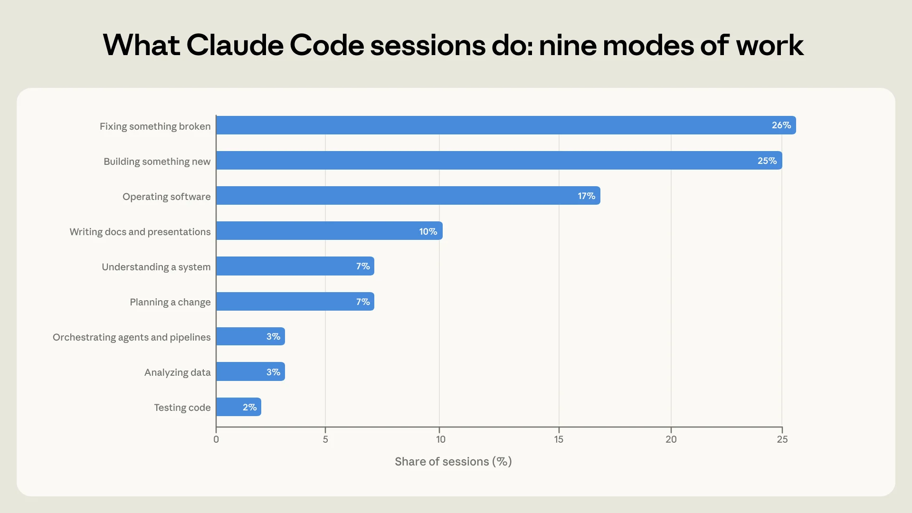
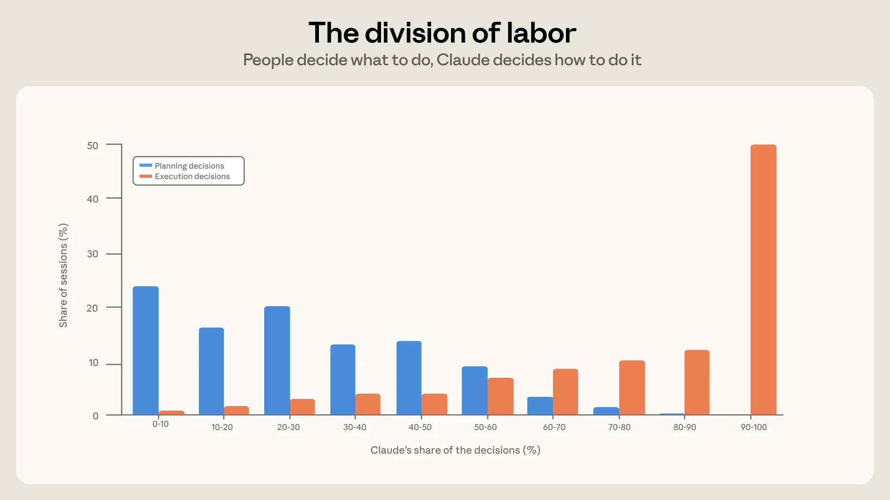
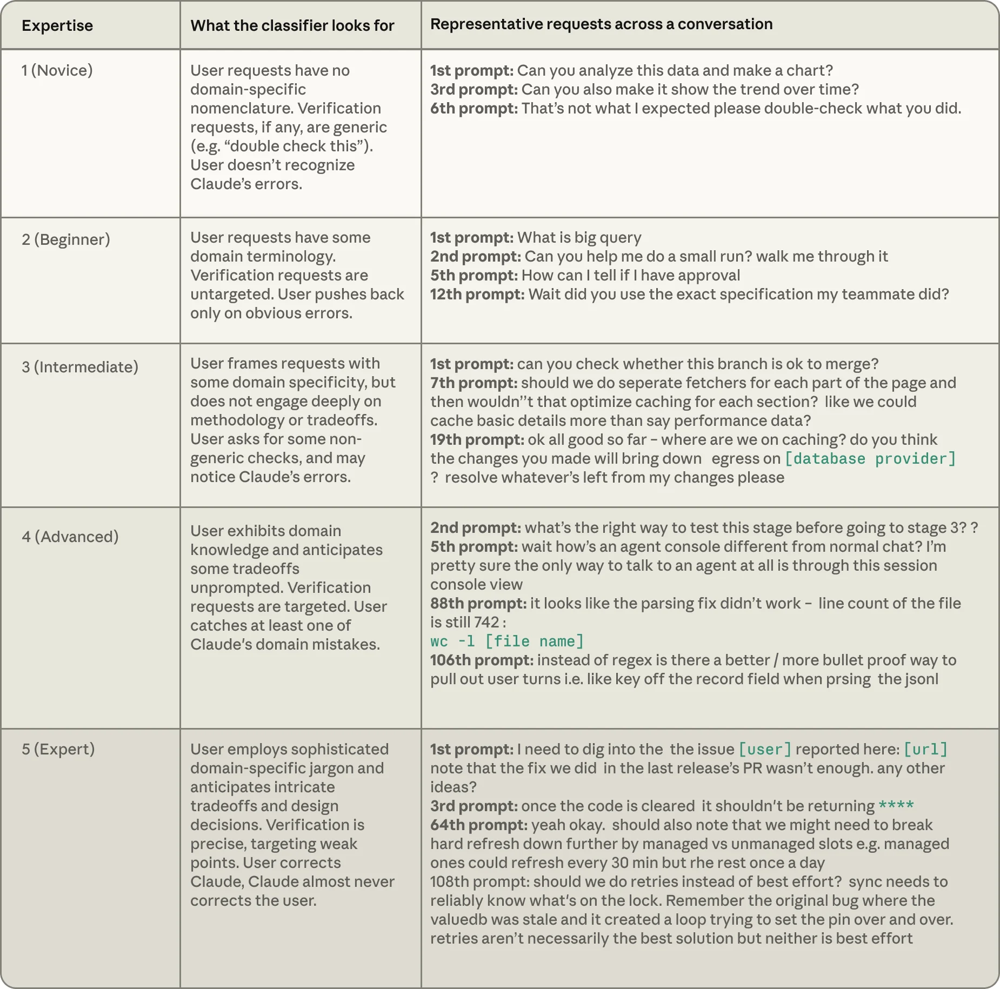
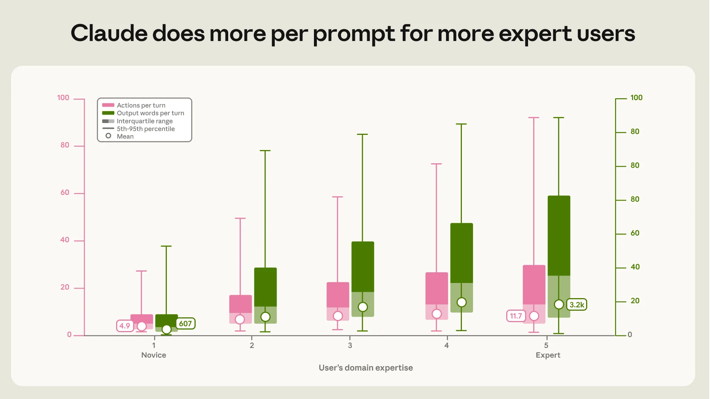
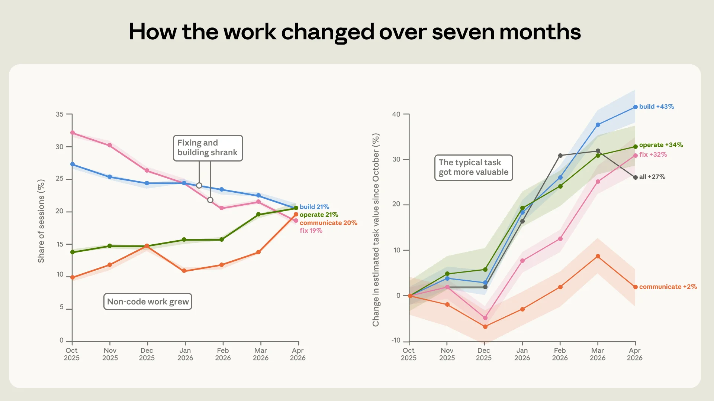
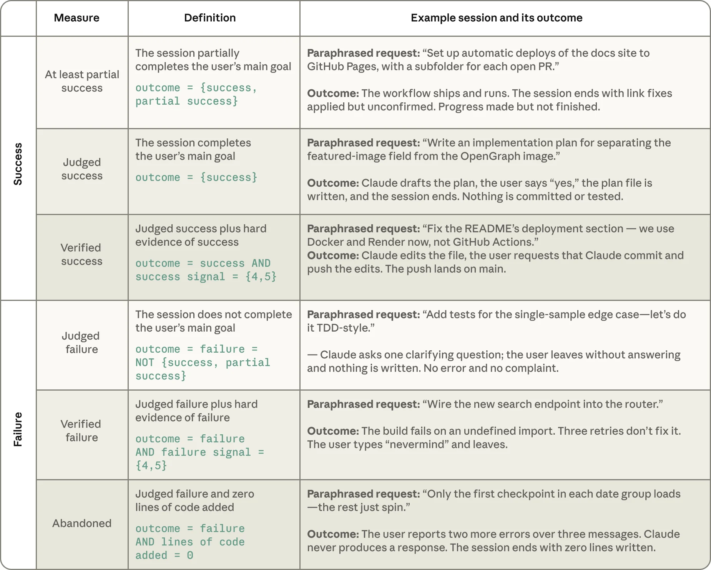
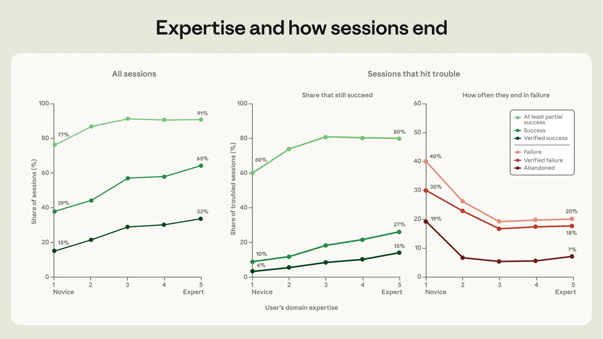
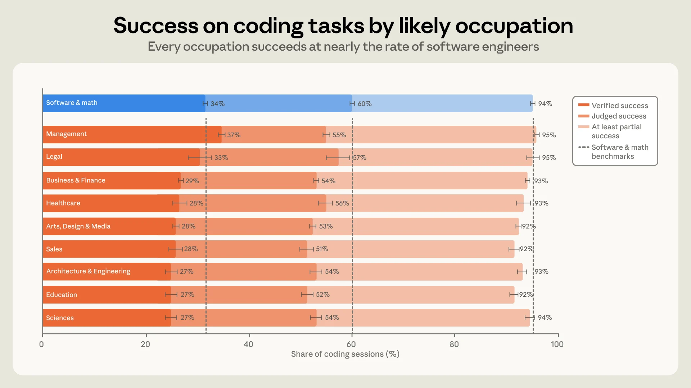

# 智能体辅助编程与专业能力的持续回报

- 英文标题：Agentic coding and persistent returns to expertise
- 发布日期：2026-06-16
- 官网栏目：经济学
- 原文：[Anthropic 页面](https://www.anthropic.com/research/claude-code-expertise)
- 官网署名：Anthropic
- 官网推荐阅读：[阅读 PDF](https://assets.claude.com/433472e34b60db1a52ebf0b8c6600f057b6908c5.pdf)

> 中文机器初译，未逐篇人工校对。引用研究结论时请核对英文原文。

### 主要发现

- 建立在 [先前的](https://www.anthropic.com/research/measuring-agent-autonomy) [工作](https://www.anthropic.com/research/how-ai-is-transforming-work-at-anthropic)，我们介绍了一个基于交互式代理编码的研究框架 [隐私保护分析](https://www.anthropic.com/research/clio) 2025 年 10 月至 2026 年 4 月期间，约有 400,000 场 Claude Code 课程。我们评估任务的组成、人机协作和成功率。
- 在典型的会议中，人们做出大部分规划决策（做什么），而Claude做出大部分执行决策（如何做）。一个人在会议中带来的领域专业知识越多，Claude在每条指令上所做的工作就越多。在编码任务上，每项主要职业的成功率——通过可验证的证据（如通过测试或致力于工作）完成人们设定的目标——平均成功率几乎与软件工程师相同。
- 一个人拥有的领域专业知识越多，会话成功的可能性就越大——尽管中级用户和专家用户之间的差距不大。在我们观察的七个月里，用于调试的会话份额下降了近一半，并且使用转向更多的端到端代理使用：部署和运行代码、分析数据以及编写非代码文档。
- 在这七个月里，我们通过与自由职业职位发布的比较来估计，几乎所有类型的工作的典型任务的价值都上升了——平均约 25%。

## 简介

代理编码已经开始流行。自 2025 年底以来，具有编码代理活动的 GitHub 项目份额增加了一倍多，[1](https://www.anthropic.com/research/claude-code-expertise#footnote-1) Claude Code 用户现在平均每周花费 20 个小时使用该工具。[2](https://www.anthropic.com/research/claude-code-expertise#footnote-2) 没有正式编码经验的人能否成功指导代理完成复杂的技术工作？这些工具的快速采用和改进对广泛的知识工作意味着什么？虽然我们还没有这些问题的完整答案，但我们希望通过 Claude Code 使用数据来寻找早期信号。

本报告基于以下内容提供了有关如何在实践中使用Claude代码的证据： [隐私保护分析](https://www.anthropic.com/research/clio) 2025 年 10 月至 2026 年 4 月期间，约有 235,000 人参加了约 400,000 场互动会议。它建立在之前的工作的基础上，重点关注 [自治措施](https://www.anthropic.com/research/measuring-agent-autonomy) 在Claude代码会议中，以及 [Claude Code 如何改变 Anthropic 的工作](https://www.anthropic.com/research/how-ai-is-transforming-work-at-anthropic).[3](https://www.anthropic.com/research/claude-code-expertise#footnote-3) 在这里，我们引入一个框架来描述交互式人工智能编码辅助的使用：正在做什么类型的工作，谁在做，以及是否成功。我们专注于通过命令行界面 (CLI) 使用 Claude Code， [Claude.ai](http://claude.ai)，或Claude代码桌面应用程序。[4](https://www.anthropic.com/research/claude-code-expertise#footnote-4) 通过跟踪代理编码使用如何随着模型变得更加强大而变化，我们可以更好地了解这些工具如何影响编码专业人员和知识工作者的劳动力市场。

随着代理嵌入到非编码工作中，Claude代码上发生的事情可能是知识工作发展方向的预览。我们发现Claude正在处理更复杂、更有价值的任务。与此同时，代理编码中仍然存在明确的分工：人们决定构建什么，代理决定如何构建它。

我们还看到证据表明，领域专业知识（而不是编码能力）可以增强该工具的有效使用。特别是，领域专家更容易取得成功，并且更容易从错误和误解中恢复过来。然而，专家和中级人员之间的差距并不大，这表明对某一领域的熟练程度足以使该工具的使用效果几乎与那些精通该工具的人一样有效。

这些发现让我们对劳动力市场可能发生的转变有了初步了解。在我们的数据中，成功取决于一个人对他们试图解决的问题的理解程度，而不是他们是否接受过编码培训。如果这些模式在整个经济中都适用，则表明虽然代理编码工具可能会吸收一些实施繁重的工作，但它们也会奖励那些对他们在工作中解决的问题有深刻理解的人。编码代理并不能取代领域专业知识——工作人员对代理的了解越多，代理能够完成的工作质量就越高。

## 分工

### 人们使用Claude代码做什么

为了了解人们使用 Claude Code 的目的，我们将每个会话分为九种工作模式之一，即最能描述会话试图完成的任务的单一活动。[5](https://www.anthropic.com/research/claude-code-expertise#footnote-5) 四种模式涉及直接编写或维护代码： *建筑物* 一些新的东西， *固定* 东西坏了， *测试* 代码，以及 *编排* 其他代理或自动化管道。另一类是 *经营* 软件——部署、配置、运行管道、监控系统。有两个类别更多的是关于如何做： *理解* 现有系统如何工作，以及 *规划* 做出改变之前。两个采取与代码无关的操作，或者代码与最终产品无关的操作： *分析* 数据，以及 *沟通* 通过演示文稿和其他基于散文的文档。

大约 56% 的课程包括编写 (25%)、修复 (26%) 或测试和编排代码 (5%)。操作软件占 17%，而 14% 的会议正在进行规划或探索，13% 的会议进行分析或散文（图 1）。

**九种工作模式：** 每个交互式会话都被分类为最能描述其试图完成的任务的单一模式。

我们通过让模型读取其记录来对每个会话进行分类，然后使用我们的隐私保护分析工具，根据每个会话自动记录的遥测数据对其进行检查，包括是否添加或删除了任何代码行。这两个来源具有很高的一致性，例如，我们的分类器标记为创建或修改代码的会话中，超过 90% 的会话在遥测中显示了代码更改。请参阅 [附录](https://assets.claude.com/a94728142a45694292336165947f8d6e3e1a357e.pdf)了解详情。

### 谁决定什么

克劳德·代码的自主性如何？能力评估表明上限很高并且还在上升：在诸如 [METR 的时间范围评估](https://metr.org/time-horizons/)，前沿模型现在可以完成需要一个人几个小时的软件任务，并自动克服沿途的障碍。但实际使用情况如何呢？在这里，我们看看在实际会话中人和Claude完成了多少指导。

我们从两个角度来探讨这个问题。首先，我们关注人们的信任程度 *决定* Claude，其次我们看看有多少 *行动* 他们给了Claude。为了理解会话中决策的划分，我们基于会话的内容构建了一个保护隐私的决策归因分类器。我们要求分类器列出会话中所有有意义的决策。我们将这些决策分为规划（做什么、采取哪种方法、什么算作已完成）和执行（要更改哪些文件、要编写什么代码、用什么语言编写、要运行哪些命令）。然后，分类器将每个决策归因于 Claude 或用户，为每个会话提供两个数字：用户在计划决策中所占的份额和用户在执行决策中所占的份额。

平均而言，人们做出了大约 70% 的规划决策，但只做出了 20% 的执行决策（图 2）。在实践中，代理编码有明确的分工——人们决定构建什么，代理决定如何构建它。

为了理解会话中的操作委托，我们查看会话的结构而不是其内容。Claude代码会话涉及Claude和用户来回交易提示（来自用户）和操作（由Claude采取）——用户编写一个提示，Claude去做一些工作，然后用户编写另一个提示，依此类推。在典型的会话中，大约有四次这样的回合。在我们从 10 月到 4 月的历史数据中，用户发送的每个提示都会引发 Claude 平均采取的一系列大约 10 个操作，有时甚至超过 100 个。[6](https://www.anthropic.com/research/claude-code-expertise#footnote-6) 每轮，Claude 都会读取文件、编辑代码、运行命令并写入平均 2,400 个字的输出。

Claude在两次签到之间做了多少工作，很大程度上取决于谁在做决定。当用户保持对执行的控制（即做出超过 80% 的执行决策）时，Claude 每回合采取的操作较少（大约 8 个操作）。当 Claude 控制规划（即做出超过 80% 的规划决策）时，它会采取最多数量的行动（大约 16 个）。

**Claude在计划和执行决策中的份额：** 计划决策（做什么）和执行决策（如何做）的跨会话分配归因于 Claude 而不是用户。在典型的会话中，用户做出大约 70% 的计划决策，而 Claude 做出大约 80% 的执行决策。

### 专业水平

根据每个记录，Claude按照从新手到专家的五分制对用户在该任务上的明显专业知识进行评分。专业知识分类器寻找三个信号：用户确定方向的精确程度、他们要求 Claude 验证的内容以及用户是否倾向于纠正 Claude，或者 Claude 是否倾向于纠正用户。请注意，专业知识所捕获的东西与职位或一般能力完全不同，而且最重要的是，它是 *特定任务*。一位高级工程师问他们的第一个 Rust 问题是 Rust 的初学者。一位会计师从未使用过 Python，但他准确地告诉 Claude Python 脚本必须执行哪些对账规则，并在月末结账时发现它处理不当的边缘情况，他就是该任务的专家。

下表显示了我们如何定义分类器中的每个专业知识级别以及来自编码代理会话公共数据集的示例请求， [瑞典聊天室](https://huggingface.co/datasets/SALT-NLP/SWE-chat)。分类为“新手”的对话给出了通用说明，没有隐含特定领域的知识。专家对话传达了对代码库和技术环境的深入了解。

**专业分类：** 这些示例对我们的分类器标记的真实会话进行了释义、匿名化和压缩。表中使用的许多会话来自代理编码会话的公共数据集， [瑞典聊天室](https://huggingface.co/datasets/SALT-NLP/SWE-chat).

我们量化了专业知识与Claude的产出和每个提示的活动之间的关系。在典型的新手会话中，每个提示会引发大约 5 个 Claude 操作和大约 600 个单词的输出，而专家会话会引发两倍以上的操作链（12 个操作），带来五倍的输出（3,200 个单词）（图 3）。新手和专家会议之间的这种差距出现在每种工作和每个任务价值范围内。

这些措施补充了我们的自治措施 [关于克劳德·科德的先前报告](https://www.anthropic.com/research/measuring-agent-autonomy)，它跟踪代理运行的时间以及人们自动批准其操作的频率。相比之下，我们的决策归因衡量标准捕获了整个会话中谁做出了实质性决策，而我们对每个提示的输出和行动的衡量则衡量了每个人类提示引发了多少Claude的自主活动。

**对于更专业的用户，Claude 根据提示执行更多操作：** Claude 为更多专家用户提供更多操作（左栏）和每个提示的文本输出（右栏）。方框跨越四分位数范围（在中位数处分割）。胡须代表第 5 个到第 95 个百分位数。白点是几何平均值。两个上升趋势均具有统计显着性 (p < 0.001)，每个相邻级别的步骤也是如此，并且在控制工作模式、任务值、月份、职业和模型系列的回归中它们仍然显着（每个专业知识级别 +9% 的操作和 +13% 的输出），并按用户聚类标准误差。

## 谁使用Claude代码，用途是什么

### 用户

为了了解谁在做这项工作，我们从会话记录中推断出每个用户的职业，将其映射到美国劳工统计局标准职业分类 (SOC) 分类法中的 23 个主要组之一。指示分类器仅依赖信号，例如代理在会话开始时加载的项目上下文、文件的名称和结构、他们引用的任何工件（例如法律文件、临床数据、财务报告、课程等）以及他们使用的词汇。[7](https://www.anthropic.com/research/claude-code-expertise#footnote-7) 是有明确指示的 *不* 将编码行为视为编码职业的证据。仅当有明确信号表明软件或数据工作是用户的工作时，会话才会被分类为编码 SOC 代码（计算机和数学职业）。在一个会话中，律师构建一个脚本来自动标记合同文件夹中缺失的条款，该会话会映射到法律职业，即使该会话的工作主要是软件。当没有关于用户职业的信号时，会话不会被分类。

我们能够推断出大约 70% 的会话中的占用情况。在这组职业中，计算机和数学职业（这一类别涵盖了大多数与软件相关的工作）毫无疑问是最大的类别。第二大的是商业和金融运营；艺术、设计和媒体；管理;以及生命、物理和社会科学。我们样本中增长最快的非软件职业群体是管理、销售和法律职业。

### 工作

2025 年 10 月至 2026 年 4 月期间，Claude Code 完成的工作构成发生了重大变化。最明显的变化是用于修复损坏代码的会话比例从 33% 下降到 19%（图 4）。取而代之的是，我们看到了更多围绕代码的工作。操作软件占会话的比例从 14% 增加到 21%。写作和数据分析大约增加了一倍，从大约 10% 增加到 20%。

任务本身也变得更有价值。我们通过询问自由职业者市场上的工作成本是多少来估算每个会话的经济价值，并根据真实帖子的公共数据集进行校准。按此衡量，10 月至 4 月期间平均会话预估值上涨了 27%。这种增长涉及多种工作。建造、运营和修理类型的任务的价值都增加了大约三分之一或更多（分别约为 43%、34% 和 32%）。这些价格估计是粗略的，因此我们主要使用它们来比较不同时间段内的任务，而不是按字面意思解读的美元价值。[8](https://www.anthropic.com/research/claude-code-expertise#footnote-8) 有关任务估计器构建的详细信息，请参阅 [附录](https://assets.claude.com/a94728142a45694292336165947f8d6e3e1a357e.pdf)**.**

**2025年10月至2026年4月Claude密码工作的构成和价值：** 七个月窗口内每种工作模式下的会话份额。修复损坏代码的会话比例从 33% 下降到 19%，而操作软件、分析数据和编写文档的会话比例则有所增加。

## 成功取决于用户带来什么

任务的估计价值是了解 Claude Code 如何帮助人们完成工作的一种方式。另一个角度是看看有多少会话是成功的，以及会话的哪些特征与成功相关。在我们所有的成功衡量标准中，我们看到了一个清晰的模式：一个人在会议中表现出的专业知识越多，成功的可能性就越高。大部分收益集中在专业知识范围的低端——新手课程和中级课程之间的差距比中级课程和专家课程之间的差距更大。

在讨论成功会议的特征之前，我们应该准确地了解如何衡量成功。我们不观察用户的现实世界结果，也不能直接询问他们是否从Claude那里得到了他们想要的东西。相反，我们依赖两种互补的基于转录的测量方法。第一个， *判断成功***,** 来了来自分类器，该分类器读取完整的成绩单并确定该人是否成功地完成了他们打算做的事情（有选项：成功、部分成功、失败、没有明确的目标）。然后，两个伴随分类器对证据的强度进行评级，以确定该判断 *验证成功*。成功的信号分类器寻找可验证的成功证据。特别是，它会查找 git 活动，例如与工作匹配的提交和拉取请求，以及通过的测试套件以及来自用户的明确确认。它将会话的评分从“无信号”到“弱信号”(1) 到“多个硬信号”(5)。并行故障信号对出现问题的证据进行评分——错误、测试失败、重试、用户推迟输出。验证成功需要 *两者* 会议被判定为成功，并且至少有一个硬性可验证的成功信号。对于以下分析（重点关注会话的成功或失败程度），我们排除了被归类为“没有明确目标”的会话，该会话约占全部样本的 7.7%。

## 专业知识的回报

那么什么样的会议最成功呢？事实证明，如上所述，会议的专业评级对于会议的成功至关重要。

人们可能会担心专业知识并不是真正的驱动力——也许专家只是选择不同的任务，或者在其他方面有所不同。在本节中，我们通过比较来自同一广泛职业群体的人员在同一个月、同一主题、以相同估计值进行相同类型工作的会话，并询问结果如何因个人评定的专业知识而有所不同，从而部分解决了这一担忧。

**来自分类器的成功和失败的定义：** 这些示例解释并总结了来自代理编码交互的公共数据集的真实会话， [瑞典聊天室](https://huggingface.co/datasets/SALT-NLP/SWE-chat)，由我们的分类器标记。

在我们所有的成功衡量标准中，一个人在会议中展示的专业知识越多，会议成功的可能性就越大。新手级别的会话达到了我们最严格的标准， *验证成功，* 15% 的情况下，77% 的情况下至少部分成功。评级为中级或以上的会话在 28-33% 的时间内达到验证成功，在 91-92% 的时间内达到部分成功（图 5）。

在每项措施中，大部分收益来自于从新手到中级的转变；在中级和专家之间，斜率减小。在 [附录](https://assets.claude.com/a94728142a45694292336165947f8d6e3e1a357e.pdf)，我们给出了图 5 背后回归的详细信息。

**专业知识以及会议如何结束：** 会话结果根据用户对任务的专业知识进行评分，从新手到专家分为五分制。左侧面板包含所有会话。中间和右侧面板限制遇到麻烦的会话（失败信号> 3），并显示仍然以各种成功和失败定义结束的份额。每个点都是一个调整后的比率——我们通过仅比较共享相同工作模式、相同任务值范围、相同月份、相同任务主题和相同类型用户（是否与软件相关的职业）的会话来估计专业水平之间的差异。有关这些点背后的回归的详细信息请参见附录。晶须是样本均值的置信区间（大多数晶须太小，在此图中不可见）。这些图排除了由成功结果分类器判断为没有明确目标的会话。

在一路上遇到挑战的会议中也会出现类似的梯度。我们说一个会话 *遇到麻烦* 当故障信号记录已验证的故障证据时。这可能是一个错误、一次失败的测试、多次尝试做同一件事，或者用户表达了沮丧或不满。在遇到麻烦的会话中，经过验证的成功比例从新手评级会话的 4% 上升到专家评级会话的 15%，考虑到了上述所有控制措施（图 5）。从较宽松的衡量标准来看，我们发现新手至少部分成功的比例为 60%，中级到专家会议的比例为 80-81%。

我们还追踪了反向关系——专业知识与各种失败衡量标准。请注意，在此分析中，被判断为失败的会话是那些甚至没有部分成功的会话。我们说有问题的会话是 *被遗弃的* 如果判断失败 *和* 编写零行代码：19% 的用户似乎是新手的会话最终被放弃，而其他人的这一比例为 5-7%。换句话说，经验最少的用户在努力获得想要的结果时更有可能放弃。专业知识的部分价值似乎是能够引导代理人走向正确的方向。[9](https://www.anthropic.com/research/claude-code-expertise#footnote-9)

### 职业可能不如专业知识重要

软件相关职业的人员在整个会话中大约有 30% 的时间获得了验证成功，而其他职业的用户在大约 26% 的时间中获得了验证成功。在生成代码的会话（即添加或修改至少一行代码的会话）中，这些数字分别为 34% 和 29%（图 6）。在我们对成功的宽松定义下，软件相关职业和其他职业之间的差距缩小了——两组人在代码生成过程中分别在 89% 和 88% 的时间内至少取得部分成功。这五分的差距很小，而且七个月来既没有扩大也没有缩小，尽管两组的成功率都有所提高。在代码生成过程中，我们数据集中的十大职业中，每一项的成功程度都与软件工程师相差七分以内。管理职业的成功率最高，略高于软件工程职业。他们较高的经过验证的成功率可能反映了转移到指导代理的管理技能。但它们也可能部分反映了我们的衡量标准：验证部分依赖于记录中的明确确认，当管理者得到他们所要求的东西时，他们可能更有可能进行沟通。[10](https://www.anthropic.com/research/claude-code-expertise#footnote-10)

**按推断职业验证和判断编码会话的成功率：** 满足严格的成功定义（判断的成功和验证的成功）的会话在按用户推断的职业组添加或更改至少一行代码的会话中所占的比例，为十个最大的组。每个组的软件/数学用户（SOC 代码计算机和数学职业）都在七个百分点以内。误差线是根据不同帐户计算的 95% 置信区间。

## 展望未来

本报告的结果提供了一幅新的图景，展示了代理编码如何放大某些形式的知识和技能，同时取代其他形式。在编写代码的课程中，每个主要职业的成功率都比软件相关职业的成功率高出几个百分点。编码代理似乎正在降低编码背景与成功编程的相关性。

与此同时，成功的会议更有可能展示领域专业知识。被评为专家的会话达到验证成功的频率是被评为新手的会话的两倍多，而当会话遇到麻烦时，新手放弃会话的比率是其他人的几倍。协作的形式为这幅图景增添了更多色彩——领域专家能够指导 Claude 根据他们给出的每条指令做更多的工作。因此，引导Claude走向成功的能力更多地来自于对某个领域的掌控，而不是来自于编写代码的能力。具有这种指挥能力的人，在任何领域，现在都可以完成以前无法完成的技术工作。没有任何此类专业知识的人从同一个工具中获得的收益会少得多。收益主要来自于能力，而不是掌握——对领域的有效掌握获得了大部分收益，而深度专业化仅增加了一点点。

这些发现是初步的。与我们的大多数研究一样，我们无法衡量现实世界的结果，例如在会话中编写的代码此后是否实际使用或丢弃，或者它是否产生具有经济价值的工件。此外，本报告排除的非交互式使用占活动的很大一部分。开发一个衡量它的框架是未来工作的优先事项。我们所有的会话分类都取决于模型对文本的阅读。在 [附录](https://assets.claude.com/a94728142a45694292336165947f8d6e3e1a357e.pdf)，我们表明我们的分类器在预期方向上跟踪独立遥测，并在大多数会话上与强大的参考模型一致。但分类器在大规模验证方面仍然具有挑战性，而且Claude代码会议增加了进一步的难度，因为它们可能太长太复杂，无法让人类标签作为基本事实。

本报告中的图片将随着模型、用户以及它们之间的分工的变化而更新。我们希望这些措施将使我们能够跟踪发生的相应变化。例如，如果专业知识的回报随着时间的推移开始下降，则表明模型开始提供用户当前带来的基本判断，并且这些工具的收益正在扩大到领域专家之外。如果软件职业以外的用户成功完成的编码会话的比例持续增长，则可能表明软件生产正在成为每个领域普通工作的一部分，而不是单一职业的产物。这些转变将改变谁从代理编码中受益以及受益多少，并对劳动力市场上最有价值的东西产生影响。

### 附录

可用 [这里](https://assets.claude.com/a94728142a45694292336165947f8d6e3e1a357e.pdf)[.](https://assets.claude.com/7426c33b0e75ab4771c465d30d5bc1019bdd0c9c.pdf)

## 脚注

01[第一次研究](https://arxiv.org/abs/2601.18341)截至 2025 年 10 月底，覆盖 128,000 个公共存储库的项目估计有 16-23% 检测到编码代理活动。 [后续研究](https://arxiv.org/abs/2606.07448) 使用相同的方法发现该时期之后创建的项目的采用率高出两倍多。代理编码活动的检测依赖于代理共同作者标签和配置文件，这可能会低估实际使用情况。

02请注意，这测量的是 Claude 代码活跃运行的时间，而不是用户手动向 Claude 打字的时间。

03此外， [萨卡 (2026)](https://suproteem.cc/agents.pdf) 和 [鲍曼等人。 (2026)](https://arxiv.org/abs/2604.20779) 通过分别研究 Cursor IDE 会话和公开可用的会话，提供了理解代理编码的镜头。

04请注意，我们排除了通过第三方集成开发人员环境和软件开发工具包运行的 Claude Code 使用情况。因此，我们还排除“无头”模式下的会话，其中用户通过以下方式在 CLI 中运行单个提示 `claude -p “<prompt>”` 。我们排除这种用法，因为它在两个关键方面有所不同——其中大部分是编程性的，Claude代码嵌入在自动化工具和管道中，而不是与用户对话，即使用户在场，我们也不会像在我们包含的表面上那样端到端地看到用户的会话。

05除非另有说明，本报告中的所有分类器均使用 Claude Sonnet 4.6。有关分类器的详细信息，包括其确切的全文和验证结果，可以在 [附录。](https://assets.claude.com/a94728142a45694292336165947f8d6e3e1a357e.pdf)

06每个提示的操作尾部很长。大约 2% 的会话平均每次提示执行的操作超过 100 次，大约二分之一的会话平均超过 200 次，大约二分之一的会话平均每次提示超过 500 次。

07与本报告中的所有措施一样，这些推论是使用我们的隐私保护分析工具得出的。没有研究人员阅读个人成绩单，职业标签永远不会与可识别的用户联系起来，我们只观察最少数量的不同用户的聚合。

08我们在这里采用的估计方法旨在获得会话价值的相对差异，而不是绝对价值。金额是基于与自由职业者市场（而不是受薪工作）的比较，并且来自Claude代码会话和职位发布之间的最终模糊匹配。由于相对估计将消除这些问题的任何一致偏差，因此我们更加重视这一点。

09针对问题的调节为不同的用户选择不同的会话。总体而言，专家遇到麻烦的频率较低，因此他们遇到的麻烦会话很可能是在处理更难的问题——使用会话的价格估计作为会话复杂性的代理，我们发现，从专业知识范围的底部到顶部，问题会话的平均估计价值大约翻倍。因此，恢复率的部分差距可能反映出新手陷入常规问题而专家陷入具有挑战性的难题。

10即使模型对管理者进行了错误分类，用来确定用户是否可能是管理者的信号（也许是在如何委派和指定任务方面）往往会带来更大的成功。换句话说，也许像经理一样行事会带来更大的成功。
