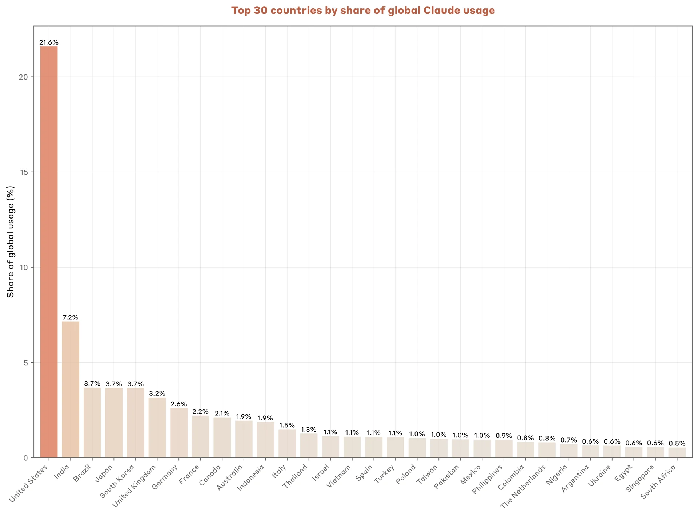
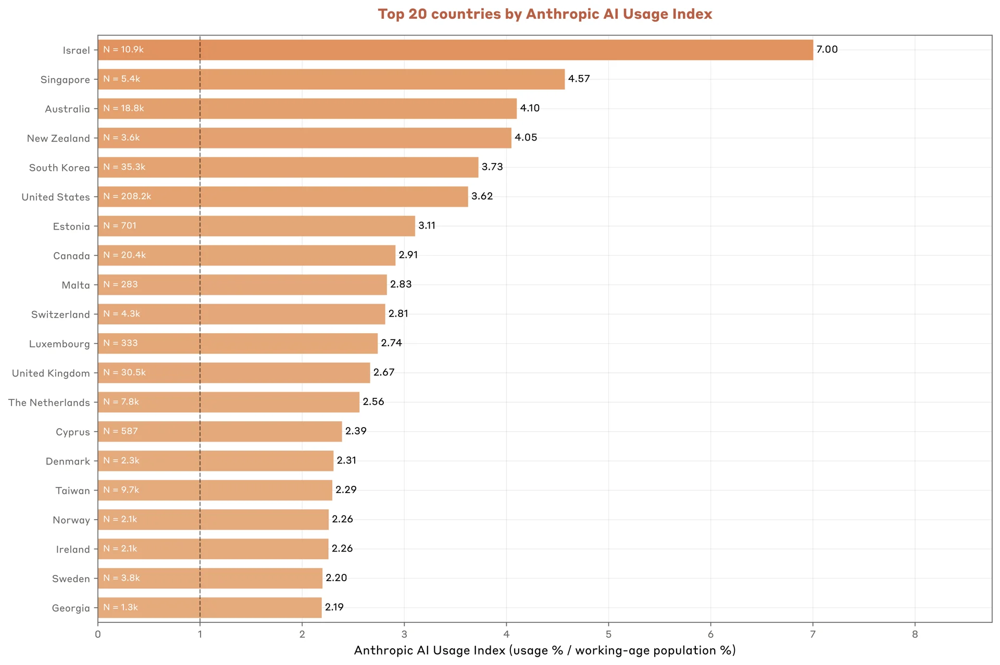
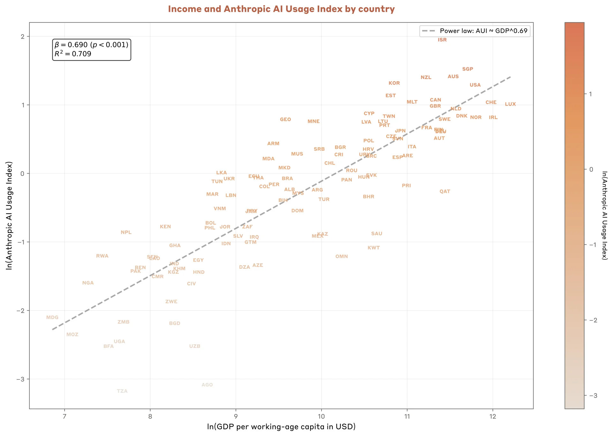
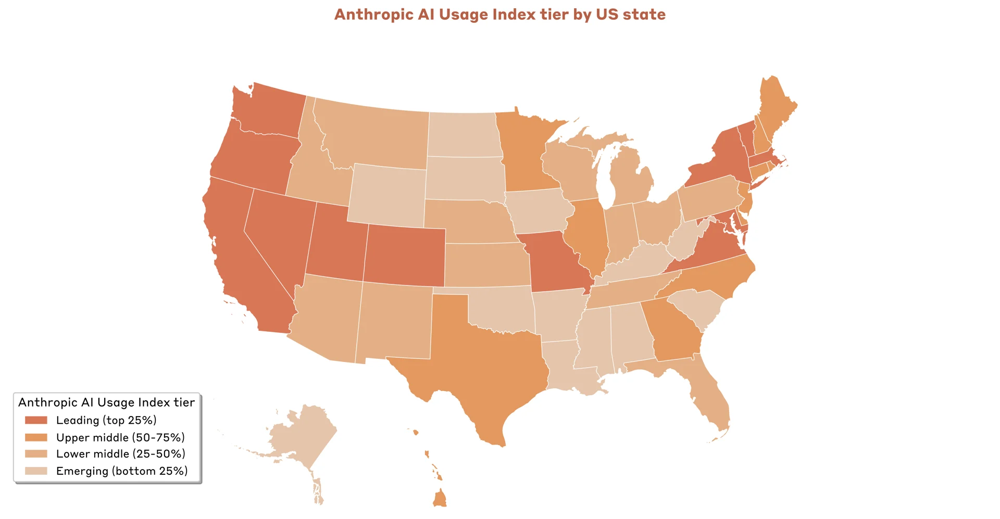
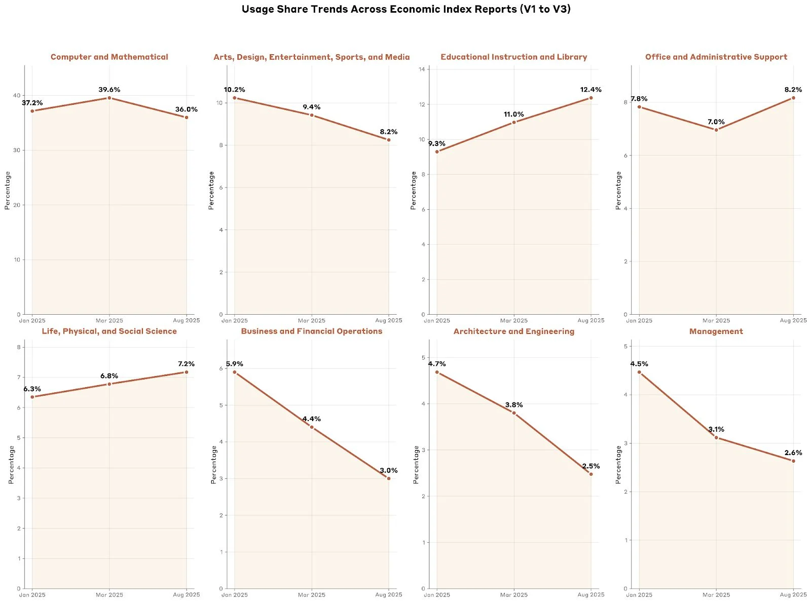
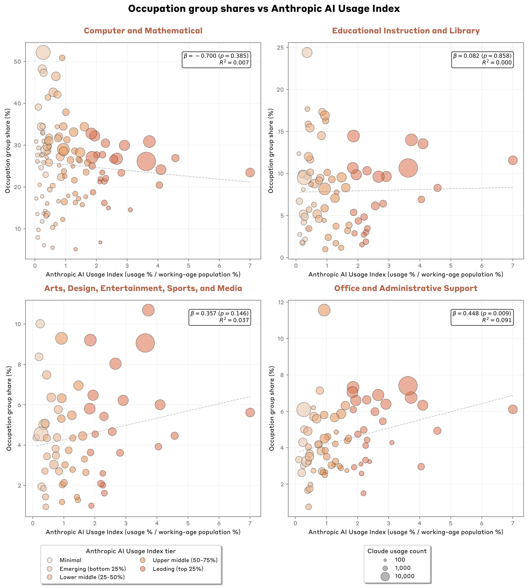
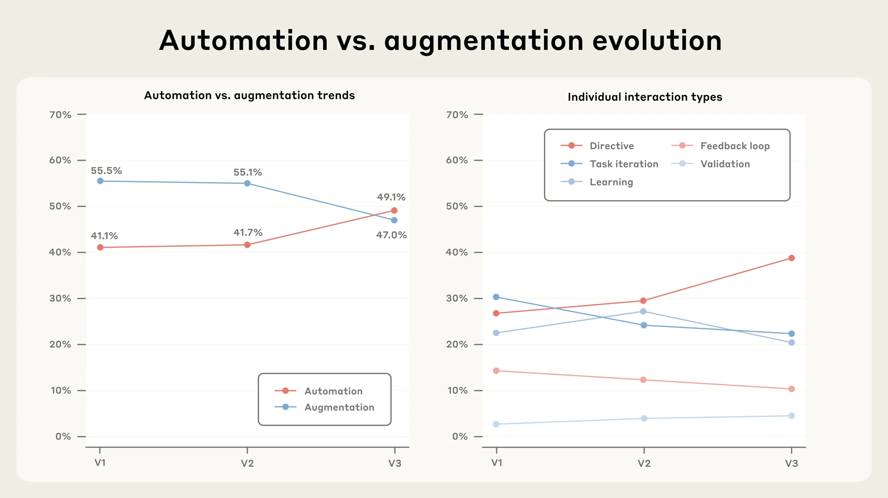
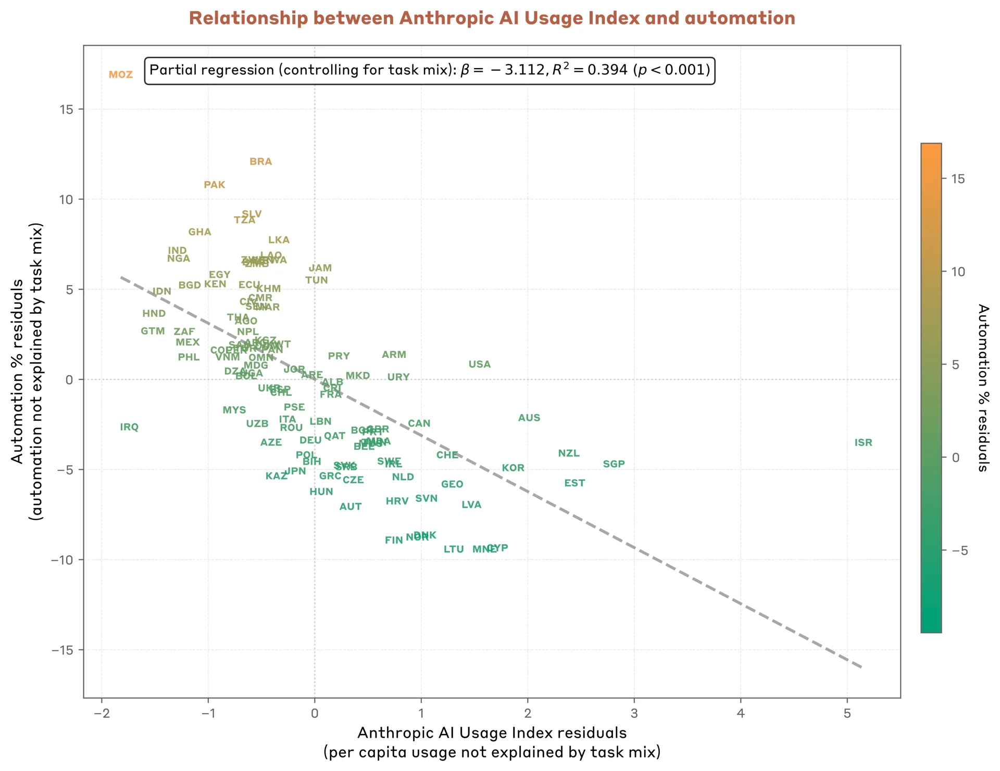
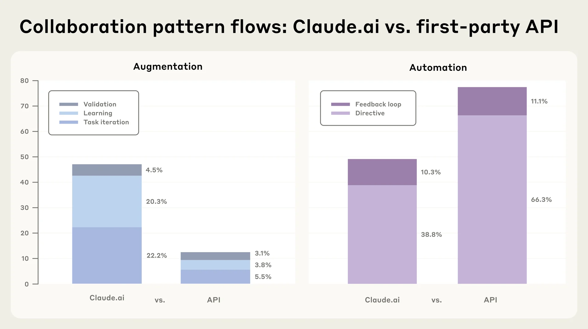
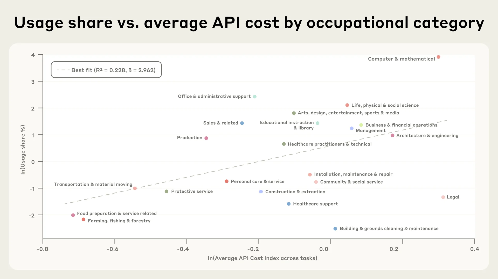

# Anthropic 经济指数：追踪 AI 在美国及全球经济中的作用

- 英文标题：Anthropic Economic Index: Tracking AI’s role in the US and global economy
- 发布日期：2025-09-15
- 官网栏目：经济学
- 原文：[Anthropic 页面](https://www.anthropic.com/research/economic-index-geography)
- 官网署名：Anthropic
- 官网推荐阅读：[探索我们的数据](http://anthropic.com/economic-index)

> 中文机器初译，未逐篇人工校对。引用研究结论时请核对英文原文。

夏威夷的旅行规划、马萨诸塞州的科学研究以及印度的 Web 应用程序构建。从表面上看，这三项活动几乎没有共同点。但事实证明，它们是Claude的一些特殊用途 *代表人数最多* 在这些地方。

这并不意味着这些是 *最受欢迎* 任务：软件工程迄今为止在世界上几乎每个州和国家仍然处于领先地位。相反，这意味着马萨诸塞州的人们比其他地方的人们更有可能向Claude寻求科学研究方面的帮助——或者，例如，巴西的Claude用户似乎对语言特别热衷：他们使用Claude进行翻译和语言学习的人数大约是全球平均水平的六倍。

这些是我们在第三次调查中发现的统计数据 [人类经济指数报告](http://anthropic.com/research/anthropic-economic-index-september-2025-report)。在最新一期中，我们加大力度记录人工智能采用的早期模式，这些模式开始重塑工作和经济。我们衡量Claude如何被不同地使用......

- **……在美国境内：** 我们首次对美国各州人工智能使用的差异进行了详细评估。我们发现，各州的经济构成决定了哪些州的人均使用Claude的次数最多，而且令人惊讶的是，使用率最高的州 *不是* 编码占主导地位的领域。
- **...跨越不同国家：** 我们的新分析发现，各国对 Claude 的使用与收入密切相关，使用率较低的国家的人们使用 Claude 来实现工作自动化 *更多* 比那些使用率较高的产品更频繁。
- **…随着时间的推移：** 我们将最新数据与 [2024年12月-2025年1月](https://www.anthropic.com/news/the-anthropic-economic-index) 和 [2025 年 2 月至 3 月](https://www.anthropic.com/news/anthropic-economic-index-insights-from-claude-sonnet-3-7)。我们发现“直接”自动化任务的比例从 27% 急剧增加到 39%，这表明人工智能的责任（以及用户的信任）迅速增加。
- **…以及企业用户：** 我们现在包含来自 Anthropic 第一方 API 客户的匿名数据（除了 [Claude.ai](http://claude.ai)），使我们能够首次分析企业的互动。我们发现 API 用户比消费者更有可能通过 Claude 实现任务自动化，这表明对劳动力市场的重大影响可能即将到来。

我们总结一下 [报告](http://anthropic.com/research/anthropic-economic-index-september-2025-report) 下面。此外，我们还设计了一个 [互动网站](http://anthropic.com/economic-index) 您可以在这里亲自探索我们的数据。您第一次可以在以下位置搜索趋势和结果 [Claude.ai](http://claude.ai) 在我们跟踪的美国每个州和所有职业中使用人工智能，以了解您居住的地方或从事类似工作的人如何使用人工智能。最后，如果您想以我们的分析为基础，我们已经制作了数据集 [公开可用](https://huggingface.co/datasets/Anthropic/EconomicIndex)以及我们之前的经济指数报告中的数据。

## 地理

我们扩展了人类经济指数以包含地理数据。下面我们将介绍我们所了解的有关 Claude 在各个国家和美国各州如何使用的信息。

### 各国

美国对Claude的使用远远超过任何其他国家。印度位居第二，其次是巴西、日本和韩国，各自所占份额相似。

在全球 Claude.ai 使用份额方面处于领先地位的国家。

然而，这些国家的人口规模存在巨大差异。考虑到这一点，我们根据每个国家在世界劳动人口中所占的比例来调整 Claude.ai 的使用比例。这给了我们我们的 **人择人工智能使用指数**，或 AUI。AUI 大于 1 的国家使用 Claude 的频率比我们仅根据其工作年龄人口所预期的要高，反之亦然。

在我们的人择人工智能使用指数中得分最高的 20 个国家/地区。

从 AUI 数据中，我们可以看到一些技术先进的小国（如以色列和新加坡）相对于其劳动年龄人口而言，Claude的收养率领先。这在很大程度上可能是通过收入来解释的：我们发现人均 GDP 和人择人工智能使用指数之间存在很强的相关性（人均 GDP 高 1% 与 AUI 高 0.7% 相关）。这是有道理的：最常使用Claude的国家通常也拥有强大的互联网连接，以及以知识工作而非制造业为导向的经济。但这确实提出了经济分化的问题：以前的通用技术，如电气化或内燃机，既带来了巨大的经济增长，也带来了经济增长。 [大分歧](https://www.aeaweb.org/articles?id=10.1257/jep.11.3.3) 世界各地的生活水平。如果人工智能的影响在富裕国家被证明是最大的，那么这种通用技术可能会产生类似的经济影响。

各国的人均Claude使用量与人均收入呈正相关。 （轴采用对数刻度。）

### 美国境内的模式

在美国各州之间进行比较时，人均 GDP 与Claude的人均使用量之间的联系也成立。事实上，这里的收入使用增长速度比其他国家更快：美国境内人均 GDP 高 1%，人口调整后的 Claude 使用量就会高 1.8%。也就是说，收入实际上有 *少* 美国内部的解释力高于各国之间的解释力，因为总体趋势的差异要大得多。也就是说：除收入之外的其他因素必须更多地解释人口调整后使用的变化。

还有什么可以解释这种采用差距？我们最好的猜测是，这是各州经济构成的差异。美国 AUI 最高的是哥伦比亚特区 (3.82)，其中 Claude 最频繁使用的是编辑文档和搜索信息，以及与华盛顿知识工作相关的其他任务。同样，与编码相关的任务在加利福尼亚州（该州总体 AUI 排名第三）尤其常见，而与金融相关的任务在纽约（排名第四）尤其常见。[1](https://www.anthropic.com/research/economic-index-geography#footnote-1) 即使在夏威夷等人口调整后克洛德使用率较低的州，其使用率也与经济结构密切相关：夏威夷人要求克洛德协助完成旅游相关任务的比例是美国其他地区的两倍。我们的 [互动网站](http://anthropic.com/economic-index) 包含大量类似的其他统计数据。

美国各州Claude收养率与其劳动年龄人口的关系。

## Claude的使用趋势

自 2024 年 12 月以来，我们一直在跟踪人们如何使用 Claude。我们使用隐私保护 [分类方法](https://www.anthropic.com/research/clio) 它将匿名对话记录分类为 O*NET 定义的任务组，O*NET 是一个美国政府数据库，对工作及其相关任务进行分类。[2](https://www.anthropic.com/research/economic-index-geography#footnote-2) 通过这样做，我们可以分析自去年以来人们给Claude的任务发生了怎样的变化，以及人们选择的协作方式——他们选择对Claude的工作进行多少监督和投入——也发生了怎样的变化。

### 任务

自 2024 年 12 月以来，Claude 的计算机和数学应用在我们的类别中占据主导地位，约占对话的 37-40%。

但很多事情都发生了变化。过去九个月，我们看到“知识密集型”领域持续增长。例如，教育教学任务增加了 40% 以上（从所有对话的 9% 增加到 13%），与物理和社会科学相关的任务比例增加了三分之一（从 6% 增加到 8%）。与此同时，传统业务任务的相对频率有所下降：与管理相关的任务从所有对话的 5% 下降到 3%，与业务和财务运营相关的任务份额减半，从 6% 降至 3%。 （当然，从绝对值来看，每个类别的对话数量仍然大幅上升。）

随着时间的推移，Claude的使用发生了变化，表明科学和教育任务的使用有所增加。

总体趋势是嘈杂的，但一般来说，随着一个国家人均 GDP 的增加，Claude的使用会发生变化 *离开* 从计算机和数学职业组的任务，到各种其他活动，如教育、艺术和设计；办公室和行政支持；以及物理和社会科学。将下面第一张图中的趋势线与其余三张图进行比较：

随着我们从采用率较低的国家转向采用率较高的国家，Claude的使用似乎转向更加多样化的任务组合，尽管整体模式很嘈杂。

尽管如此，软件开发仍然是我们跟踪的每个国家中最常见的用途。美国的情况看起来很相似，尽管我们的样本量限制了我们更详细地探索任务组合如何随采用率变化的能力。

### 互动模式

正如我们所讨论的 [以前](https://www.anthropic.com/news/the-anthropic-economic-index)，我们通常区分涉及的任务 *自动化* （其中人工智能直接以最少的用户输入生成工作）和 *增强* （用户和人工智能协作完成任务）。我们进一步将自动化分解为 *指令* 和 *反馈回路* 交互，其中指令对话涉及最少的人类交互，而在反馈循环任务中，人类将现实世界的结果传递回模型。我们还将增强分解为 *学习* （要求信息或解释）， *任务迭代* （与Claude合作），以及 *验证* （寻求反馈）。

自 2024 年 12 月以来，我们发现指令性对话的比例急剧上升，从 27% 上升到 39%。结果，其他交互模式（特别是学习、任务迭代和反馈循环）的份额略有下降。这意味着自动化 (49.1%) 首次变得比总体增强 (47%) 更普遍。对此的一个可能的解释是，人工智能正在迅速赢得用户的信心，并越来越负责完成复杂的工作。

这可能是模型功能改进的结果。 （2024 年 12 月，当我们首次收集经济指数数据时，Claude 的最新版本是 Sonnet 3.6。）随着模型能够更好地预测用户需求并生成高质量的工作，用户可能更愿意在第一次尝试时信任模型的输出。

自动化似乎随着时间的推移而不断增加。

也许令人惊讶的是，在Claude人均使用量较高的国家，Claude的使用量倾向于增加，而使用量较低的国家的人们更有可能更喜欢自动化。控制相关任务的组合后，人口调整后的 Claude 使用量每增加 1%，自动化程度就会减少约 3%。同样，人口调整后的Claude使用量的增加与转变有关 *离开* 来自自动化（如下图所示），而不是朝向。

我们还不确定这是为什么。这可能是因为每个国家的早期采用者都觉得允许Claude自动化任务更舒服，也可能是由于其他文化和经济因素。

人均Claude使用率较高的国家往往以更加协作的方式使用Claude。

## 企业

使用相同的隐私保护 [方法论](https://www.anthropic.com/research/clio) 我们用于对话 [Claude.ai](http://claude.ai)，我们已经开始对 Anthropic 的第一方 API 客户子集的交互进行采样，进行首次分析。[3](https://www.anthropic.com/research/economic-index-geography#footnote-3) API 客户通常是企业和开发人员，他们对 Claude 的使用方式与通过以下方式访问它的人非常不同： [Claude.ai](http://claude.ai)：他们按代币付费，而不是固定的每月订阅，并且可以通过自己的程序提出请求。

这些客户对 Claude 的使用特别集中在编码和管理任务上：我们的示例中 44% 的 API 流量映射到计算机或数学任务，而在 [Claude.ai](http://claude.ai)。 （事实上，所有 API 流量中约有 5% 专门专注于开发和评估人工智能系统。）这被与教育职业相关的较小比例的对话所抵消（API 中为 4%，而 API 中为 12%）。 [Claude.ai](http://claude.ai)）、艺术和娱乐（5%相对于8%）。

我们还发现，我们的 API 客户使用 Claude 进行任务自动化的频率比 [Claude.ai](http://claude.ai) 用户。我们 77% 的 API 对话显示自动化模式，其中绝大多数是指令性的，而只有 12% 显示增强型。开 [Claude.ai](http://claude.ai)，分割几乎是均匀的。这可能会产生重大的经济影响：在过去，任务自动化与大规模的经济转型以及生产率的大幅提高息息相关。

Claude 在 Claude.ai 上的增强和自动化与 API 的比较。

最后，考虑到 API 使用的付费方式，我们还可以探讨任务成本的差异（由它们消耗的代币数量差异引起）是否会影响企业选择“购买”哪些任务。在这里，我们找到一个 *积极的* 价格和使用之间的相关性：成本较高的任务类别往往会被更频繁地使用，如下图所示。这向我们表明，基本模型功能以及模型产生的经济价值对企业来说比完成任务本身的成本更重要。

根据任务类别在总对话中所占的份额绘制每项任务的成本。

## 结论

经济指数旨在对人工智能如何影响人们的工作和经济提供早期的实证评估。到目前为止我们发现了什么？

在我们在本报告中涵盖的每一项措施中，人工智能的采用似乎非常不平衡。高收入国家的人们更有可能使用Claude，更有可能寻求协作而不是自动化，并且更有可能追求编码之外的广泛用途。在美国，人工智能的使用似乎受到当地经济主导产业（从科技到旅游业）的强烈影响。与消费者相比，企业更有可能委托Claude代理和自主权。

除了不均匀的事实之外，我们特别值得注意的是，指令自动化在对话中变得更加普遍 [Claude.ai](http://claude.ai) 在过去的九个月里。人们使用 Claude 的性质显然仍在定义中：我们仍在集体决定我们对人工智能工具有多少信心，以及我们应该赋予它们多少责任。但到目前为止，我们似乎对人工智能越来越满意，并愿意让它为我们服务。我们期待着随着时间的推移重新审视这一分析，看看在哪里——或者，事实上， *如果*——随着人工智能模型的改进，用户的选择会得到解决。

如果您想亲自探索我们的数据，可以在我们的专用网站上进行 [人类经济指数网站](http://anthropic.com/economic-index)，其中包含我们国家、州和职业数据的交互式可视化。未来我们将使用更多数据更新此网站，以便您可以继续以您感兴趣的方式跟踪人工智能对就业和经济影响的演变。

我们的完整报告是 [可以在这里找到](http://anthropic.com/research/anthropic-economic-index-september-2025-report)。我们希望它可以帮助政策制定者、经济学家和其他人更有效地为人工智能提供的经济机遇和风险做好准备。

## 开放数据

与我们过去的报告一样，我们为此版本发布了一个全面的数据集，包括地理数据、任务级使用模式、按任务划分的自动化/增强细分以及 API 使用概述。数据可在以下网址下载 [人类经济指数网站](http://anthropic.com/economic-index).

### 与我们合作

如果您有兴趣在 Anthropic 工作来帮助构建支持这项研究的系统，我们鼓励您申请我们的 [研究工程师](https://job-boards.greenhouse.io/anthropic/jobs/4816634008) 角色。

## 脚注

01至于犹他州，位居第二：在进一步调查犹他州的活动时，我们发现其使用的很大一部分似乎与协调滥用的指标有关 - 这也反映在犹他州的“指令”自动化得分远高于平均水平。然而，我们进行了稳健性检查，并认为此活动并未推动结果。

02我们用“自下而上”的任务分类来补充这一点，其中Claude根据自己的分类法对对话进行分类，以解决 O*NET 类别中的任何差距。我们的隐私保护分析方法的完整细节已公开 [这里](https://www.anthropic.com/research/clio).

03本部分中的数据涵盖 2025 年 8 月以来的 100 万份记录，这些记录是从 1P API 客户池中随机抽样的，这些客户约占我们 1P API 使用量的一半。我们继续根据我们的隐私和保留政策管理数据，并且我们的分析符合我们的条款、政策和合同协议。
