# Anthropic 经济指数报告：使用节奏

- 英文标题：Anthropic Economic Index report: Cadences
- 发布日期：2026-06-26
- 官网栏目：经济学
- 原文：[Anthropic 页面](https://www.anthropic.com/research/economic-index-june-2026-report)
- 官网署名：Anthropic
- 官网推荐阅读：[阅读 PDF](https://assets.claude.com/9e0eadc8097864886c5d5060ebb1f89b02ea29d6.pdf)

> 中文机器初译，未逐篇人工校对。引用研究结论时请核对英文原文。

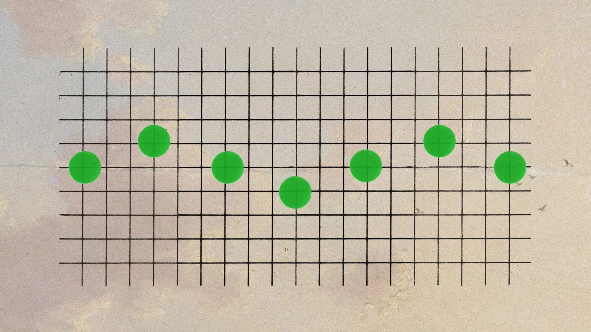

## 简介

一年前，Claude 的大部分使用都是以用户和助手之间的对话形式进行。随着 Claude Code 和 Cowork 的快速发展，Claude 会话现在越来越多地包含长期运行的代理任务。聊天记录不再完全捕捉人们如何使用人工智能，我们研究Claude经济影响的方法也必须适应。

为了跟上步伐，我们对经济指数的数据管道进行了一些更改。在此版本中，我们：

- 以更高的速率采样数据，使我们能够查看每小时级别的使用模式。
- 引入一个新的分类器来标记每个对话的输出。
- 共享更精细的数据，分解聊天和 Cowork 对话（统称为“Claude 对话”）和 1P API 的结果，按月汇总。[1](https://www.anthropic.com/research/economic-index-june-2026-report#footnote-1)

我们描述了其他方法上的变化 [附录](https://assets.claude.com/03ed1410f74a65ae4cc2a27120d0875e1e569535.pdf)。总之，这些变化让我们更清楚地了解人工智能如何反映和扩散到经济生活中。

此外，我们之前对Claude的影响缺乏了解 *外面* 用户会话数。人们如何看待人工智能正在改变他们的工作或他们可以获得的机会？他们对人工智能的使用是否影响了他们的期望？在理想的世界中，他们希望从人工智能中得到什么？我们报告了初步调查结果 [人为经济指数调查](https://www.anthropic.com/research/economic-index-survey-announcement)，于 2026 年 4 月推出。

我们预览下面的主要发现。

- 在第一章中，我们展示了外部世界的节奏如何影响Claude的使用。与工作相关的询问在周末会减少，但在高薪职业中不会那么明显；人们倾向于在早上询问新闻，而睡眠建议在凌晨 5 点左右达到高峰；在提交截止日期前后，与税务相关的请求激增。
- 第二章探讨了人们从Claude课程中获得的具体成果。这些很大程度上取决于他们使用的产品。例如，Chat 和 Cowork 比 Claude Code 提供了更多解释。产出的性质也影响了人们与Claude的互动。建立一个网站比翻译文档更需要Claude的判断，后者的答案很大程度上取决于文本。我们还发现，更多的计算与更有价值的工件相关。给定输出消耗的代币随着工作的估计价值而增加。
- 第 3 章介绍了人类经济指数调查的第一个结果，我们通过我们的网站将其与Claude使用数据链接起来。 [隐私保护系统](https://www.anthropic.com/research/clio)。人们对 Claude 的期望和体验会随着人们使用 Claude 的方式而系统性地变化：以最自动化的方式使用 Claude 的人期望 AI 在明年承担更多的任务，但对这对他们的工作意味着什么感到最乐观，预计会对薪酬、工作保障和意义产生积极影响。

## 节奏

我们新的隐私保护遥测技术每天都会对一段对话进行连续采样，使我们能够研究每日和每小时的使用模式，这与之前每份经济指数报告所采用的 7 天样本形成鲜明对比。这些分析捕捉了世界各地工作模式的潮起潮落。[2](https://www.anthropic.com/research/economic-index-june-2026-report#footnote-2)

我们发现Claude的使用情况反映了每周的工作情况，个人提示在周末激增。每小时的数据捕捉一天内的模式——人们最常在早上 5 点左右寻求睡眠建议，在下午 6 点左右寻求食谱。我们还看到使用情况反映了关键日期。例如，在 4 月 15 日美国申报截止日期之前，与税务相关的请求激增。

### 工作周

聊天和Cowork的份额[3](https://www.anthropic.com/research/economic-index-june-2026-report#footnote-3) 在样本期间，属于个人使用的对话从工作日的 35% 左右飙升至周末的略低于 50%（图 1.1）。在工作周之外，用户的对话从商务信函、营销文案和幻灯片转向情感支持、医疗问题和投资建议。这种转变对于高收入国家来说最为明显。

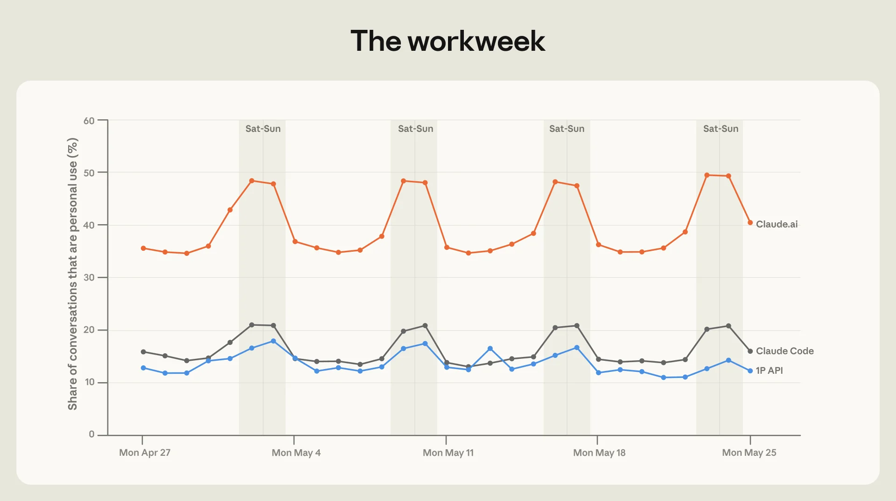

**周末私人谈话增多**每日分享的个人使用的对话 [Claude.ai](http://claude.ai)、Claude 桌面、Claude 代码和 1P API。周六和周日为灰色阴影。

Claude Code 和 1P API 流量（即直接通过 Anthropic 路由的 API 流量）中也存在类似的模式，尽管两者的个人使用基准率都较低。[4](https://www.anthropic.com/research/economic-index-june-2026-report#footnote-4)

请求集群[5](https://www.anthropic.com/research/economic-index-june-2026-report#footnote-5) 让我们更深入地了解哪些特定的Claude代码任务在工作日和周末之间波动最大。周末，下降最多的 Claude Code 使用集群包括后端架构、API 调试和数据存储。增长最多的领域包括AI 智能体设计、量化交易和游戏。

周末还可以为人们创造新的冒险空间。在各个国家/地区，与创业相关的对话在周六和周日最高。然而，周末的工作申请活动以及其他与工作相关的任务都会减少。[6](https://www.anthropic.com/research/economic-index-june-2026-report#footnote-6)

### 日常节奏

Claude每小时的使用情况反映了日常生活的节奏。图 1.2 显示了不同请求集群的每小时频率相对于其在全球流量中的总体平均值。[7](https://www.anthropic.com/research/economic-index-june-2026-report#footnote-7)

人们在当地时间早上 7 点询问新闻。商务信函（例如电子邮件起草）遵循工作日的轨迹，在上午 10 点至 11 点有一个小高峰。最大的高峰之一是菜谱请求，下午 6 点的请求频率是晚上 6 点的 2.3 倍。与平均水平相比。媒体推荐最集中在晚上，而人们则在黎明前的几个小时内寻求睡眠建议。

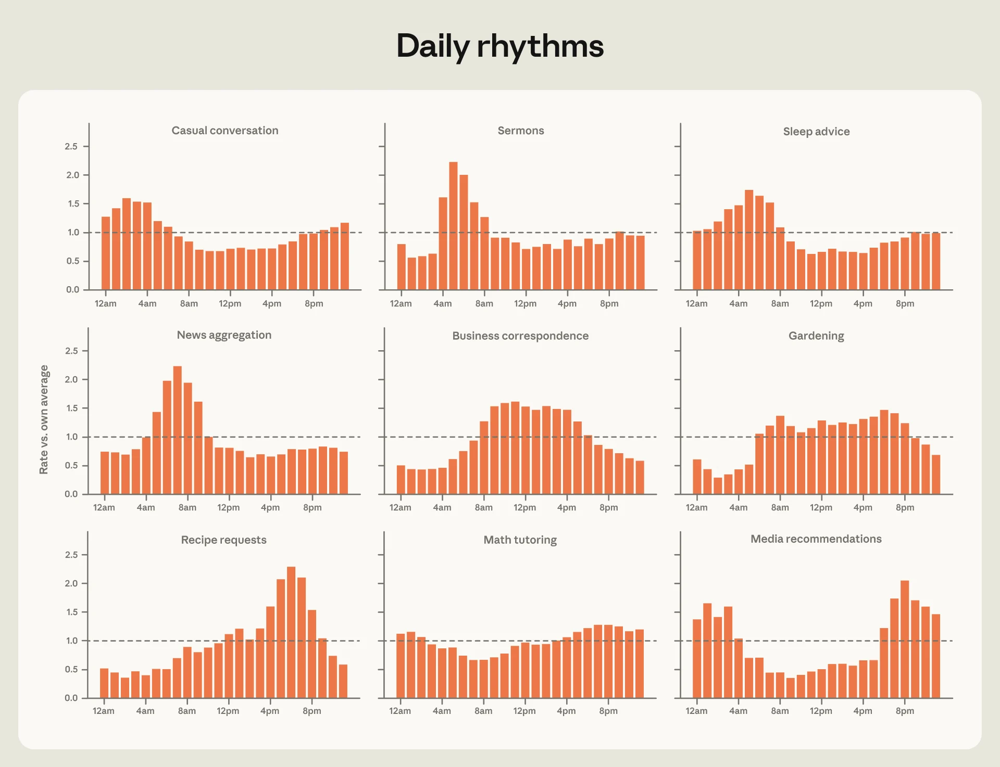

**一天中的请求集群**属于不同请求集群的标准化每小时对话份额，仅限于 Claude 聊天和 Cowork 数据。

在晚上和周末，当人们确实向Claude寻求工作时，任务会倾向于工资较高的职业（图 1.3）。虽然我们无法最终确定提出这些请求的人的工作，但这可能反映了这样一个事实：高薪职业的人（如营销经理或计算机程序员）更有可能在传统时间之外工作。相比之下，与底部两个四分位的工作相关的任务（例如电话营销和文书工作）在总对话中所占的比例较小。这种模式并不是完全由计算机和数学任务驱动的：当我们在稳健性检查中从分析中删除这些职业时，较高四分位的任务在晚上和周末仍然增加。

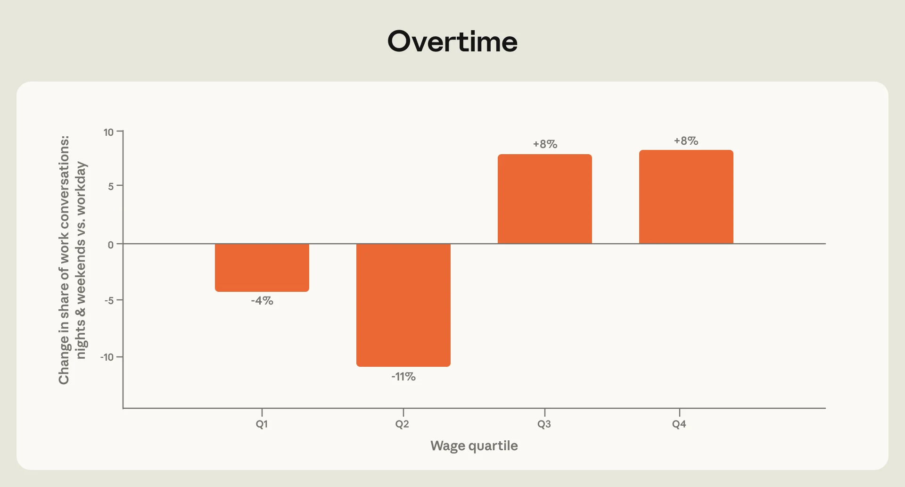

**夜间和周末与工作相关的对话比例的变化（按职业工资四分位划分）**每个条形图显示夜间和周末与工作日工作时间相比，来自指定工资四分位数的工作相关任务份额的百分比变化。工资四分位数是使用 BLS 数据计算的，并按成绩单数量加权。

### 报税日

本报告的样本期涵盖美国人的纳税申报截止日期。图 1.4 显示了截止日期前后与税务相关的对话比例大幅上升。4 月 14 日，涉税集群的发生频率是 5 月平均日的八倍，并且在 4 月 15 日仍保持在同样高的水平。4月16日，它们急剧下降。

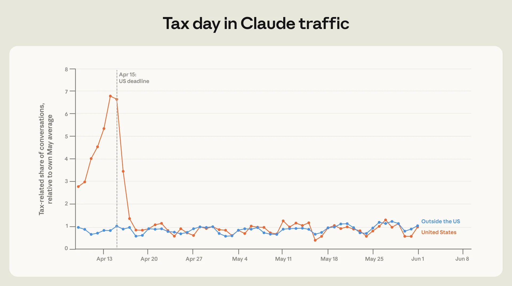

**在美国提交截止日期之前，与税务相关的讨论激增**美国和世界其他地区与税收相关的对话份额。

## 文物

在本章中，我们对聊天和 Cowork 上的每个对话进行分类（以下简称“Claude对话”）[8](https://www.anthropic.com/research/economic-index-june-2026-report#footnote-8) 根据其工件，我们将其分为 30 多个类别。我们将Claude在对话中产生的主要输出（文档、解释、一段代码、学术论文等）称为工件，无论是在聊天窗口中还是作为单独的文档呈现。工件的完整列表位于 [附录](https://assets.claude.com/03ed1410f74a65ae4cc2a27120d0875e1e569535.pdf).

我们的分类器将 93% 的 Claude 对话识别为产生工件（图 2.1）。[9](https://www.anthropic.com/research/economic-index-june-2026-report#footnote-9) 最常见的工件是解释（占对话的 17%）、文档和报告（15%）以及指南（11%）。对话输出（如解释或指导）和书面交付成果（如文档或演示文稿）各占对话的约三分之一；代码和技术工作（如应用程序或脚本）大约占六分之一。

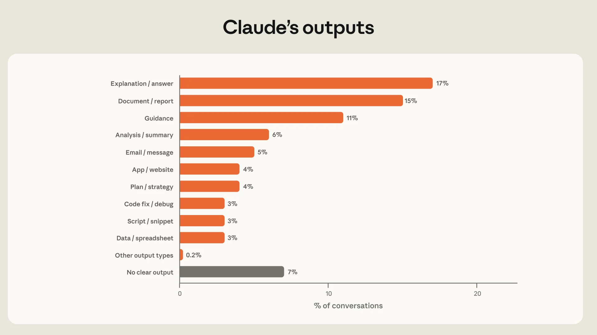

**Claude的输出**具有特定输出的对话份额。该图显示了 Claude 对话中最常见的 12 种输出类型。1P API 组合位于附录中。

输出是什么并不能告诉您它的用途：相同的工件可以是工作可交付成果或个人项目。接下来我们看看这个分裂。

### 每个神器的用途是什么？

我们的 [1月经济指数](https://www.anthropic.com/research/anthropic-economic-index-january-2026-report) 引入了一个原语，将每个对话分类为工作、个人或课程作业。在这里，我们将这种划分应用于 Claude 对话中产生的工件（图 2.2）。

某些类别的文物几乎总是个人的。超过 80% 的创意写作、指导和食谱的对话被归类为个人对话。在类别中，个人用途和工作相关用途可能看起来截然不同。例如，个人创意写作以同人小说、世界观构建和诗歌为主； 13%与工作相关的内容主要是短视频脚本、编剧和演讲的形式。最有可能与工作相关的类别包括创建营销内容 (80%)、创建博客或文章 (81%) 以及编写数据库查询 (82%)。

许多产出同样可能用于个人和工作原因，包括制定计划或策略（44% 与工作相关，49% 个人）或翻译（42% 工作，44% 个人）。例如，最常见的个人规划工件类型包括旅行行程和锻炼计划，而与工作相关的计划通常与创业或内容策略有关。

最后，课程作业的特征包括创建学术论文和论文、教育材料以及与数学相关的查询，尽管其中每个类别都有不可忽视的份额属于工作和个人类别。

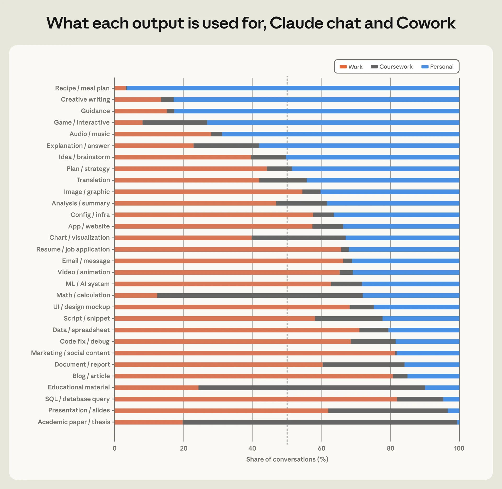

**按用例划分的工件份额**具有特定输出的对话份额，按其目的分为工作、个人和课程作业。

我们也可以翻转问题。我们不用问每个输出的用途，而是可以问每个输出会产生什么样的工作、个人和课程作业对话。工作对话最常产生文档和报告 (20%)，其次是解释 (9%)、电子邮件草稿 (7%) 以及分析和摘要 (6%)。课程作业对话看起来大致相似，其中也有文件和报告（21%），紧随其后的是解释（20%）、教育材料（11%）和学术论文（6%）。相比之下，毫不奇怪，只有 6% 的个人对话会生成文档。相反，最常见的结果是解释（25%）和建议（22%）。

### 成本追踪工作的价值

产生这些输出需要计算，我们发现计算往往会随着工作价值的增加而扩展。我们用标记来衡量每个对话的计算成本（处理和生成的文本量，包括Claude的内部推理），并通过将每个对话的分类任务映射到通常执行该任务的职业来比较不同职业。在本节中，我们将分析仅限于与工作相关的对话。

图 2.3 的左图显示了会话级别代币数量中位数与映射职业中工资中位数之间的正相关关系。[10](https://www.anthropic.com/research/economic-index-june-2026-report#footnote-10) 例如，营销经理的收入大约是编辑的两倍（每小时 80 美元对 37 美元），而与其任务相对应的对话消耗的代币数量大约是编辑的 2.5 倍。诚然，这种关系很吵闹，并且存在明显的异常情况。例如，药剂师的收入几乎是统计助理的三倍（每小时 68 美元对 24 美元），但映射到药剂师任务的对话仅使用大约二十分之一的代币。

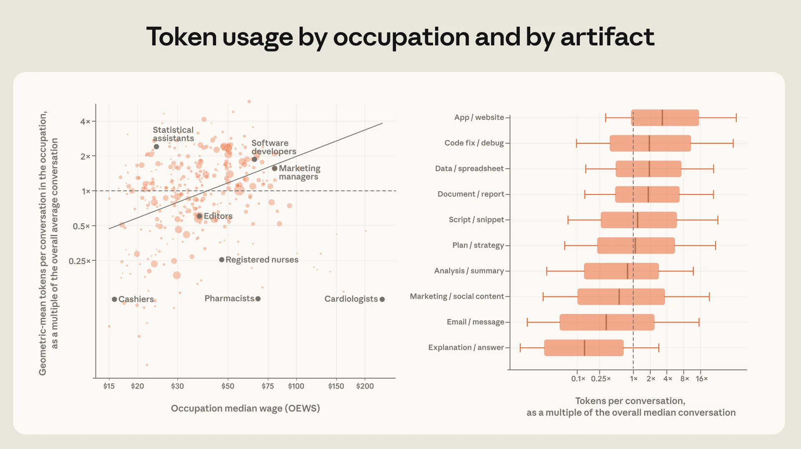

**高薪职业中的对话消耗更多代币**左图：给定职业的工资中位数与分类为属于该职业的任务之一的对话中的典型（几何平均）标记数量之间的关系，按总体平均值标准化。两个变量均以对数刻度表示。右图：用于生成给定工件的令牌分布。黑线表示中位数，方框代表 p25 和 p75，须线代表 p10 和 p90。所有数字均按令牌的总体中位数进行归一化，并以对数刻度表示。两个面板中的数据仅限于聊天和 Cowork，并且仅限于分类为与工作相关的对话。令牌计数不会根据为对话提供服务的模型进行调整。

生成不同类型的文物所消耗的代币讲述了类似的故事。更复杂和更有价值的输出往往比更简单的输出消耗更多的代币。例如，有关构建应用程序的对话使用的令牌是中值对话的三倍多。另一方面，典型的解释使用了中值对话中大约五分之一的标记。代币消费中约 44% 的工资梯度是由产出组合解释的——工资较高的职业更有可能产生计算密集型工件。

为什么这在经济上很重要？在与高工资职业对应的对话中，Claude 产生更多（每轮产出的 1.34 倍），而用户参与度更高（每轮产出的 1.53 倍）并且更频繁地进行扩展思考（34% 的对话对 31%；表 2.4）。至关重要的是，这些是共同作用的：Claude生产的更多并不意味着用户的生产减少。如果人类仍然参与最高价值的任务，那么这种模式看起来更多的是增强劳动力而不是取代劳动力。它还表明，在某种程度上，更有价值的产出成本更高。下一节将研究每次对话中有多少决策权被委托给Claude。

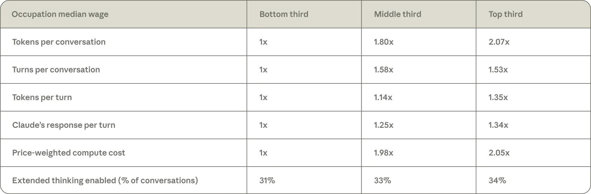

**高薪职业中代币消费较高的原因是什么**在映射到高工资职业的对话中有助于更高代币消耗的对话特征。职业按照工资中位数分为三等分，并根据与每个职业匹配的对话数量进行加权。与计算相关的度量通过其底部三分位数的几何平均值进行标准化。例如。第一行显示，映射到前三分位数职业的典型对话消耗的令牌是映射到后三分位数职业的典型对话的 2.07 倍。

### Claude有多少自主权可以自己决定？

我们按照 1-5 级进行衡量，从“无”到“极端”。易于描述或指定的任务涉及很少的自主性：最低自主性的输出是数学或计算、翻译和问答。高自主性任务是那些需要在许多可能的选择中进行选择的任务，例如创建应用程序和网站、游戏或演示文稿。此类工作需要持续的判断，历来很难实现自动化。通过将 Claude chat 和 Cowork 中的自治水平与 Claude Code 进行比较，我们发现这种情况正在开始改变。

在几乎所有类型的输出中（显示了 31 个输出中的 26 个），Claude Code 上的 AI 自主水平高于聊天或 Cowork。[11](https://www.anthropic.com/research/economic-index-june-2026-report#footnote-11) 例如，使用 Claude Code 创建的生成脚本和代码片段的对话比在聊天或 Cowork 上生成相同输出的对话多出 0.53 分的自主权（平均为 1-5 级）。在所有对话中，自主性的平均差异为 0.37 分，其主要来源有两个。[12](https://www.anthropic.com/research/economic-index-june-2026-report#footnote-12)

大约三分之二的差异是由于在 Claude Code 上使用更多授权来执行相同的任务。博客文章和文章说明了这一点：它们背后的请求和任务在两个表面上是相似的，但人们与 Claude 合作的方式却截然不同。生成博客文章或文章的聊天和 Cowork 对话中位数涉及 13 轮来回，而博客生成 Claude Code 会话中位数包含单个人工提示。剩下的三分之一反映了两个表面上输出类型的不同组合。

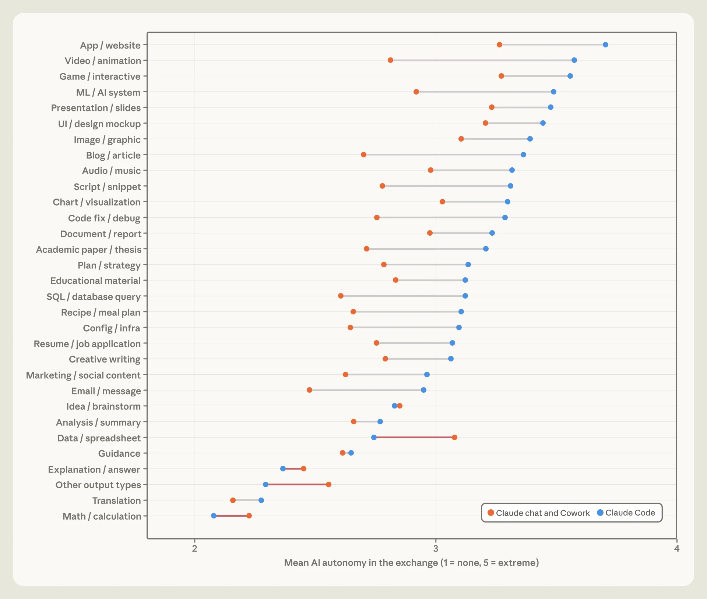

**按输出类型划分的人工智能自主权**按对话输出和表面划分的人工智能自主平均水平。AI 自主性的评级分为 1-5 级，从“无”到“极端”。

人们可能怀疑这种差异仅仅反映了模型选择。Claude Code 会话在功能最强大的模型上运行的频率要高得多（54% 由 Opus 提供服务，而聊天和 Cowork 对话中只有 10%）。然而，当我们比较同一模型提供的对话时，差距仍然存在。例如，在使用 Sonnet 的对话中，Claude Code 会话的自主性仍然高出 0.26 分，这表明所使用的产品可能比底层模型更重要。

从表面比较来看，用户委托最多的输出类型与消耗最多计算量的输出类型相同：在工件中，平均自治度和中值代币使用量一起上升（聊天和 Cowork 上 r = 0.68； [附录](https://assets.claude.com/03ed1410f74a65ae4cc2a27120d0875e1e569535.pdf) 图A.2）。

### Claude的回答高于所问的水平

对于每次对话，分类器都会估计两个阅读水平——一个用于用户的提示，一个用于Claude的响应——表示为理解文本所需的教育年限。[13](https://www.anthropic.com/research/economic-index-june-2026-report#footnote-13) 我们发现，阅读水平因工件类型而异。生成学术论文的平均查询需要超过 16 年的教育，大致相当于学士学位，其中 15% 的对话具有博士学位或以上水平（20 年或以上的教育）。另一方面是产生食谱或指导的对话，只需不到 10 年的教育就可以理解提示。

一般来说，具有较高阅读级别输出的工件类型也具有较高阅读级别提示（对话之间的相关性为 0.87）。然而，我们也观察到，几乎在每个类别中，Claude的输出都比提示的理解水平要高，平均大约一年的教育水平。当用户描述要构建的内容时，差距最大，例如图像和图形（+2.6 年）、游戏（+1.9）以及应用程序和网站（+1.7）。有些差距可能只是注册的；提示通常简洁且非正式，而Claude则倾向于用优美的散文进行答复。然而，对于面向受众的写作来说，差距接近于零（博客-0.1，学术论文+0.0，电子邮件+0.3），可能是因为提示通常起草与预期输出相同的语言或源材料。

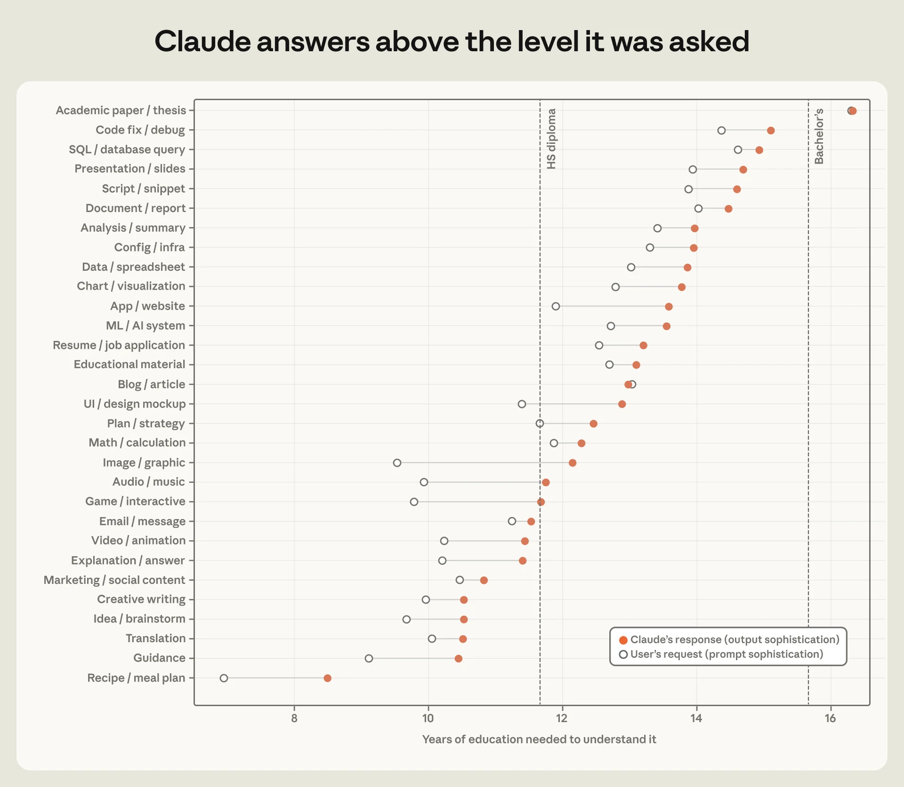

**用户提示的阅读级别和 Claude 的响应（按工件）**估计需要接受多少年的教育才能理解用户的提示和Claude的反应。仅限聊天和协同工作。

## 看法

前两章展示了人们如何使用 Claude，但没有深入了解人们在工作中体验人工智能的方式——他们期望自己的工作和工作场所如何改变，他们对人工智能当前和潜在影响的感受，以及他们希望从这项技术中得到什么。我们的 [采访 81,000 名 Claude 用户](https://www.anthropic.com/features/81k-interviews)，于 2025 年 12 月进行 [人性采访者](https://www.anthropic.com/research/anthropic-interviewer), [给了一张照片](https://www.anthropic.com/research/81k-economics)：受访者表示生产率大幅提高，但也表达了对位移的担忧。这些担忧主要集中在早期职业工人和我们观察到Claude工作最多的职业中。[14](https://www.anthropic.com/research/economic-index-june-2026-report#footnote-14)

2026 年 4 月，我们推出了 [人为经济指数调查](https://www.anthropic.com/research/economic-index-survey-announcement) 以这项工作为基础。通过这项调查，我们可以直接询问人们对人工智能和工作的体验，并探讨人们的反应如何随着 Claude 使用情况的变化而变化。我们将调查回复与五月中旬至六月初的使用数据联系起来，使用 [隐私保护方法](https://www.anthropic.com/research/clio)。为了描述每个受访者的使用模式，我们在这个时间窗口内对每人最多 20 个会话进行随机抽样（跨 Claude.ai、Cowork 和 Claude Code，以便会话的组合反映每个人跨表面的典型使用情况）。我们排除了少于五次会话的受访者，以减少抽样噪音。我们最终的关联样本由大约 9,700 名调查受访者组成。

我们发现大多数受访者预计人工智能在明年将取得重大进展。虽然人们对人工智能能力的看法取决于他们的经验、居住地点以及工作与人工智能的接触程度，但他们对未来进步速度的期望却惊人地一致，这与“[涨潮](https://arxiv.org/abs/2604.01363)”，其中人工智能能力得到广泛提高。

对于这种进步对他们自己的职业生涯意味着什么，人们的看法并不统一。职业生涯早期的工人表示，人工智能可以完成他们工作中最大份额的工作，并对失业表示最担忧。然而，与普遍的担忧相反，最常委托给Claude的人是 *大多数* 对未来劳动力市场的结果持乐观态度，并感到自己的技能价值不断增长。尽管（或者可能是因为）他们接近人工智能的前沿，但受访者对未来十年的平均期望不是替代而是合作。他们希望人工智能能够保留有意义的工作并使苦差事自动化，并且其成果将被广泛分享。

### 谁回应了经济指数调查

经济指数调查并不代表一般人群。我们随机抽取 Claude 用户样本，可能会选择谁来完成调查，并从分析中过滤掉不常使用的用户。图 3.1 显示了调查受访者的职业组合（橙色）以及美国就业情况（灰色）。计算机和数学职业的比例最高，约占受访者的 30%，与 Claude 的使用比例相当，但远高于其在美国就业中 4% 的比例。23% 的受访者表示，管理层[15](https://www.anthropic.com/research/economic-index-june-2026-report#footnote-15) 尽管仅占会话的 4%，但相对于 7% 的就业份额，其代表性也严重过高。这种差距与管理者使用Claude执行管理本身以外的任务是一致的：在调查中，判断和管理被许多受访者（尤其是那些经验丰富的人）称为人工智能缺乏的能力。运输和材料搬运、食品准备和服务相关以及建筑和采掘等体力职业类别在调查中的代表性都不足，因为它们在Claude会议中也是如此。

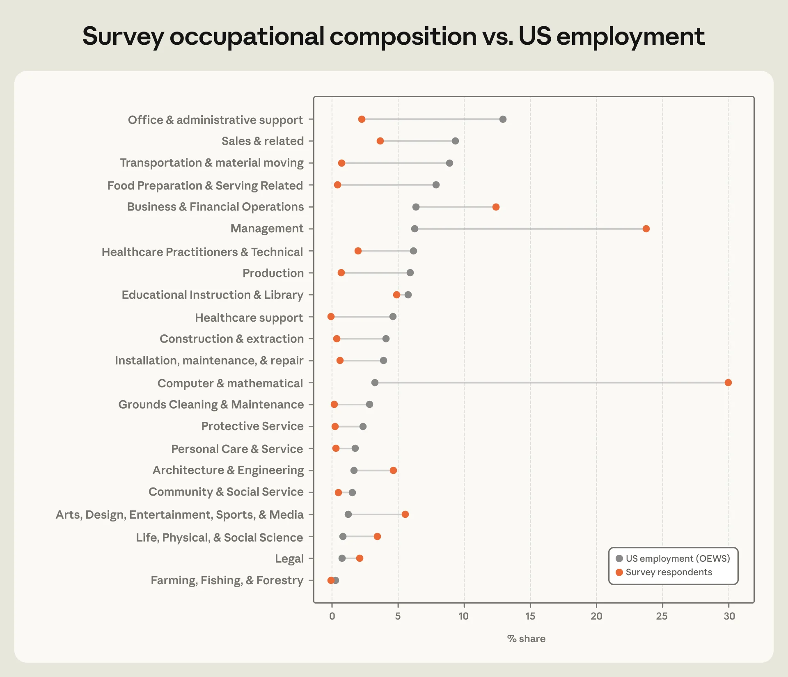

**与美国就业相比，调查受访者严重偏向计算机、数学和管理职业**报告其在 22 个主要 SOC 群体中各自职业的调查受访者比例，16 与 OEWS 中每种职业在美国就业中所占的比例进行比较。

### 人工智能和工作任务

关于人工智能影响的研究通常侧重于职业暴露，或者特定工作中人工智能可以完成哪些任务。在 [之前的工作](https://www.anthropic.com/research/labor-market-impacts)，我们构建了一个度量 *观察到的暴露*，它捕获了我们已经看到的Claude完成的职业任务的份额。我们将其与常用的衡量标准进行了比较 [*理论暴露*](https://arxiv.org/abs/2303.10130)，或者大型语言模型理论上可以完成的职业任务的份额。

了解职业暴露的另一种方法是简单地询问人们人工智能能够完成多少工作。我们询问受访者，人工智能今天可以完全独立完成哪些工作任务（以下简称 *报告的暴露*），以及他们期望它在 12 个月内处理多少份额（*预期暴露*），可以从“几乎没有”和“几乎全部”之间的五个频段中进行选择。近十分之六的受访者选择了明年比今天更高的频段。超过三分之一的人预计人工智能明年能够完成大部分或几乎所有工作任务（图 3.2）。

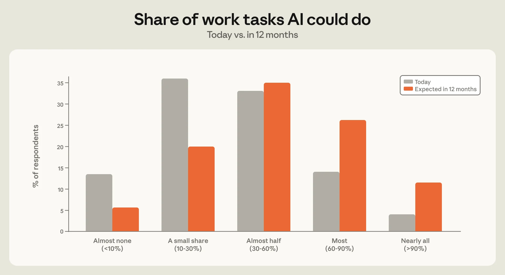

**大多数受访者预计人工智能可以完成的工作任务份额在未来 12 个月内会增加**该图显示了受访者认为人工智能现在可以完成的工作任务份额与 12 个月后的工作任务份额的分布情况。

图 3.3 将报告的和预期的暴露与观察到的和理论的暴露进行了比较。我们询问人们报告和预测的人工智能功能是否与各职业中观察到的和理论的暴露测量相一致，以及在观察或理论暴露方面得分较高的职业的受访者是否预计明年会取得更快的进展。对于第一个问题，答案是肯定的：报告的暴露量（灰点）与观察到的暴露量和理论暴露量呈正相关。对于第二个问题，答案是否定的：从现在起 12 个月后报告和预期暴露的最佳拟合线（橙色点）基本上是平行的，这意味着担任观察或理论暴露较高角色的人期望大致相同 *增加* 人工智能在明年可以完成的工作任务与那些观察和理论接触较少的角色的工作任务份额。[17](https://www.anthropic.com/research/economic-index-june-2026-report#footnote-17) 换句话说，软件工程师和施工经理预计其职业中的进步增量大致相同。

还值得注意的是，报告的暴露量系统地超过了观察到的暴露量。对此的一种解释是，并不是每个人都能完成某一职业中的所有任务，而我们的调查不成比例地涉及到更多使用人工智能的人。[18](https://www.anthropic.com/research/economic-index-june-2026-report#footnote-18) 类似地，由于理论暴露是可能的上限，而不是当前使用的衡量标准，因此理论暴露系统地夸大了报告的暴露。

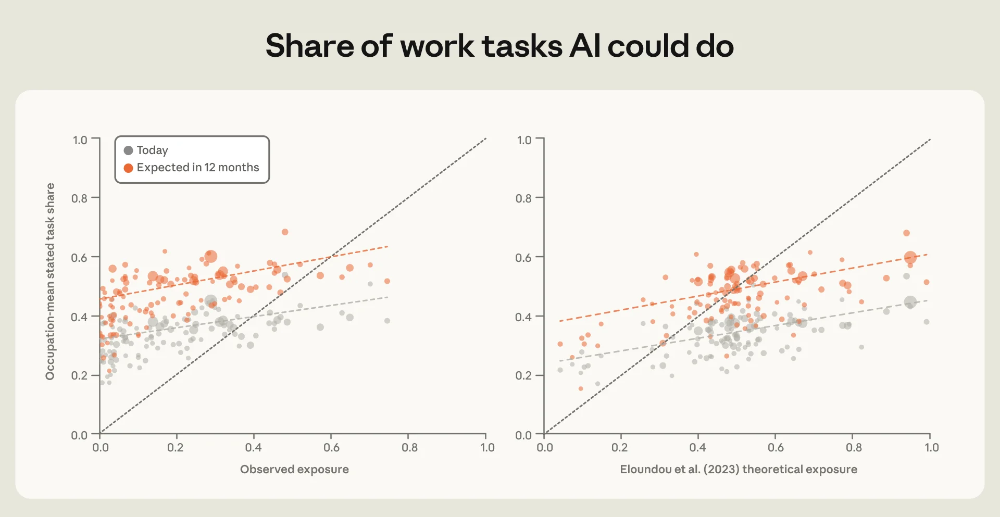

**报告和预期暴露与其他措施**人们认为人工智能今天（报告的暴露，灰色）和 12 个月后（预期暴露，橙色）可以完成的任务份额，根据观察到的暴露（左图）和理论暴露（右图）绘制。每个点都是一个职业，其中包含小样本的职业与暴露的邻居分组以确保隐私。报告的和预期的暴露量按调查受访者选择的分箱的中点计算。

我们还研究了对人工智能当前和未来能力的看法与受访者的特征和使用模式之间的关系。图 3.4 的左图显示，对人工智能能力的看法与国家 GDP 呈负相关：[19](https://www.anthropic.com/research/economic-index-june-2026-report#footnote-19) 在高收入国家中，人们报告人工智能可以为他们完成的任务的平均份额大约低 10 个百分点。这种模式与人工智能取代低收入国家工人日常工作的大部分任务的可能性是一致的，即使职业水平暴露指标（发达经济体往往更高）表明情况并非如此。确实， [国际货币基金组织注意到](https://www.imf.org/-/media/files/publications/sdn/2024/english/sdnea2024001.pdf) 虽然发达经济体总体上面临更广泛的人工智能接触，但低收入国家的工人可能较少获得互补技能和基础设施，而这些技能和基础设施使人工智能能够增强而不是取代他们的工作。在 [早期的工作](https://assets.claude.com/7b76335c444876a93fa22a63aabb4aeb820aff25.pdf) 我们记录到，即使在调整任务组合的差异时，低收入经济体也倾向于以更自动化的方式使用Claude。

中间的面板显示，报告和预期的暴露也与多年的工作经验呈负相关。[20](https://www.anthropic.com/research/economic-index-june-2026-report#footnote-20) 拥有至少 15 年经验的人表示，人工智能可以完成的任务比例比他们第一年工作时的任务比例低大约 10 个百分点。我们发现的证据表明，这可能是因为经验丰富的工人积累了人工智能难以模仿的隐性或特定背景的专业知识。在后续问题中，我们询问人们他们认为人工智能永远无法完成哪些任务以及为什么；最常见的回应强调人工智能缺乏工作所需的判断力、情境意识和情境推理。受访者（尤其是拥有至少 15 年工作经验的受访者）还指出，他们工作中的关系和人际层面（建立信任和管理人员）是人工智能无法复制的。

与人工智能的职业接触一样，我们发现对人工智能能力未来改进的看法本质上与人均 GDP 和经验年限不相关。人工智能在 12 个月内能够完成的任务的预期份额均高于目前对人工智能能力的看法。

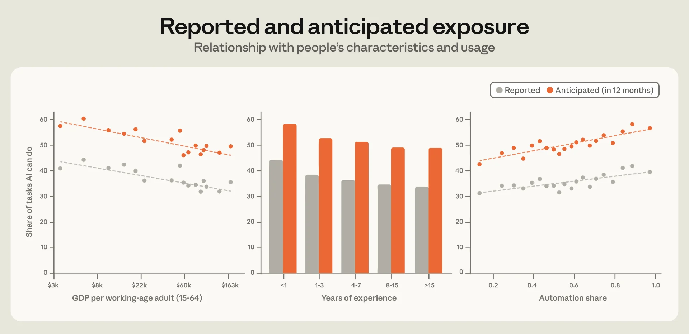

**在国内生产总值较高的国家和经验丰富的工人中，报告和预期的暴露程度较低，但随着自动化Claude的使用而增加**报告和预期（12 个月）对每个工作年龄成年人的国家 GDP 的暴露（左）、经验年数（中）以及分类为自动化的 Claude 会话比例（右）。

接下来我们研究人们如何与Claude互动以及他们当前对Claude能力的看法之间的关系。与过去的报告一样，我们区分了与Claude合作的“自动化”和“增强”模式。当Claude被要求在几乎没有用户输入的情况下完成一项任务时，我们将对话视为自动化。具体来说，自动化共享是对话的共享，其模式要么是指令（“翻译此文档”），要么是反馈循环（“编辑此电子邮件......使其更随意”）。[21](https://www.anthropic.com/research/economic-index-june-2026-report#footnote-21)

图 3.4 的右图显示，报告和预期的风险随着自动化份额的增加而增加。这可能是因为授权可以提供关于能力的信息——移交全部任务的人直接观察人工智能可以自己完成什么——或者因为已经相信人工智能可以完成工作的人最愿意移交它。当我们用专门用于工作任务的会话份额或在Claude代码中进行的共享替换自动化共享时，同样的模式也适用。[22](https://www.anthropic.com/research/economic-index-june-2026-report#footnote-22)

### 人工智能和就业

我们还询问人们如何看待他们的工作在未来 12 个月内会发生变化。超过三分之一的受访者表示，职责很可能或非常可能发生重大变化（对于他们自己、同事、初级同事和高级同事）。10% 的人认为自己有可能或非常有可能失去工作。这略低于美国失业的年化风险率；[23](https://www.anthropic.com/research/economic-index-june-2026-report#footnote-23) 然而，由于我们的受访者倾向于稳定就业的知识工作者（该群体在基线下可能面临低于平均水平的离职风险），这可能仍然表明感知风险较高。当被问到一个开放式问题是什么推动了他们的预测时，38% 认为自己可能或非常可能失业的受访者将他们的预测归因于人工智能。[24](https://www.anthropic.com/research/economic-index-june-2026-report#footnote-24) 值得注意的是，受访者平均更担心他人失业而不是自己失业。[25](https://www.anthropic.com/research/economic-index-june-2026-report#footnote-25) 受访者尤其担心初级同事失业，超过三分之一的人表示初级同事明年失业的可能性超过 60%。受访者还更担心低收入国家的失业（所有人）。

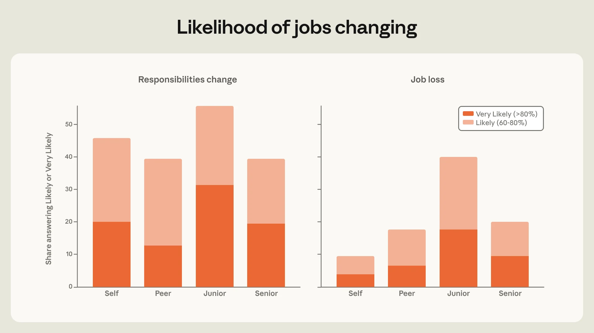

**报告明年工作职责可能或非常可能发生重大变化或者人们将非自愿失业的人数比例**表示工作职责可能会发生变化（左图）或个人将失去自己、同事、初级同事或高级同事想要保留的工作（右图）的受访者比例。

以更自动化的方式使用 Claude 的人是否也更担心失去工作？我们研究了人们对人工智能未来一年对工作六个维度的预期影响的看法：薪酬、工作保障、找到新工作的能力（经济维度）以及意义、自主性和人际互动（内在维度）；并看看这些期望如何因 Claude 使用的自动化份额而有所不同。

在所有六个维度中，自动化会话比例较高的人感觉 *更乐观* 与那些更多地使用Claude的人相比，人工智能对明年工作成果的影响。我们看到对未来薪酬和找工作能力的积极影响的预期影响最大。[26](https://www.anthropic.com/research/economic-index-june-2026-report#footnote-26)

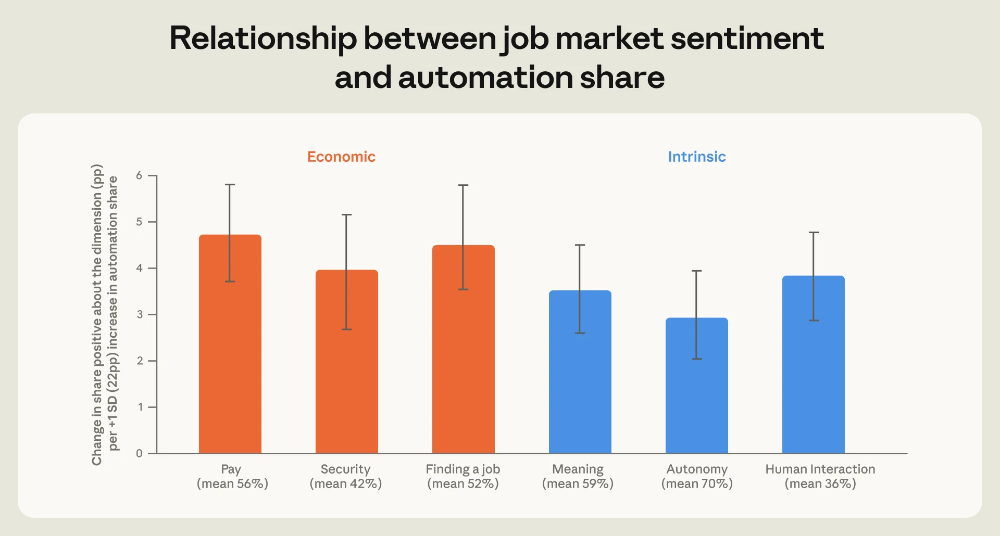

**在自动化程度更高的 Claude 用户中，报告人工智能对经济和工作质量内在维度产生积极预期影响的人数比例更高**该图显示了一个指标的线性回归系数估计值，该指标表明一个人是否期望人工智能对标准化人工智能自动化份额的工作质量的六个维度中的每一个维度产生积极影响。

一个自然的问题是为什么自动化使用和情绪会一起变化。这种关系可能是通过选择来解释的，即对人工智能最热衷的人也最愿意将全部任务交给它。我们不能完全排除这种情况，但当我们控制用户使用权时，这些估计不会发生有意义的变化 [Claude.ai](http://claude.ai)——我们可以将其视为热情的代表，因为它捕获了早期采用者与后来采用者的对比。

另一种可能性是，如今以更自动化的方式使用人工智能的人们会体验到更多人工智能的好处。与我们一致 [之前的发现](https://www.anthropic.com/research/81k-economics)，绝大多数人表示工作速度、范围和质量方面的生产力提高（分别为 86%、82% 和 69%），而 27% 的人表示通过节省原本必须购买的服务成本而获得收益。

除了显着提高生产力之外，大多数人还表示通过人工智能学到了更多东西（68%），并且感觉人工智能使他们的技能变得更有价值（57%）。图 3.7 显示了这两种结果如何随自动化会话的份额而变化。我们发现，报告人工智能正在增加其技能的市场价值的人数比例随着自动化份额的增加而上升，而报告他们了解更多内容的人数比例大致持平。

人们对授权的普遍担忧是，将全部任务交给人工智能意味着卸载思维，产出的增加是以学习和技能萎缩为代价的。我们在这里没有看到这种模式：较重的委托者报告说学习速度与其他人相同。然而，这些都是自我评估，即使技能变得更有价值，并且有人报告学习了更多知识，技能也可能会受到侵蚀，因此数据并不排除技能侵蚀的可能性。

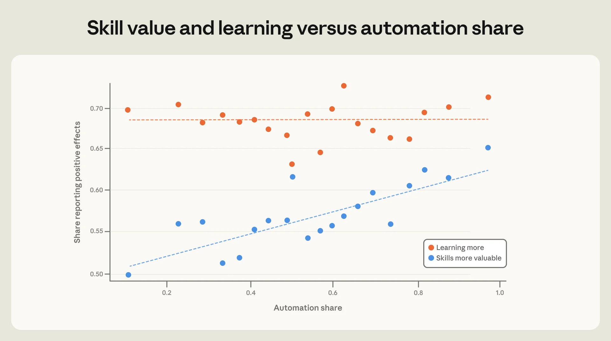

**报告称其技能获得积极预期回报的人在自动化方面所占比例正在增加，而报告称他们正在学习更多知识的人比例则持平**该图显示了任务的自动化份额与报告人工智能增加了其技能的市场价值（蓝色）的人员比例之间的关系，并且他们在使用人工智能时学到了更多知识（橙色）。

### 不同性别的使用情况有何不同

到目前为止，我们已经探讨了使用模式与期望和行为之间的关系。接下来我们学习 *谁* 以各种方式使用Claude。最显着的差异是性别差异。女性仅占我们相关受访者样本的 12%，她们对 Claude 的使用方式与男性不同。即使考虑到职业差异，他们在工作中使用 Claude 的可能性也略有降低，他们使用 Claude Code 的会话比例低了 0.24 个标准差（6.3 个百分点），他们的自动化比例低了 0.33 个标准差（7.3 个百分点）。相反，女性倾向于更频繁地使用Claude，并且她们在聊天上的活跃时间比男性更多，这是更多协作参与的信号。[27](https://www.anthropic.com/research/economic-index-june-2026-report#footnote-27)

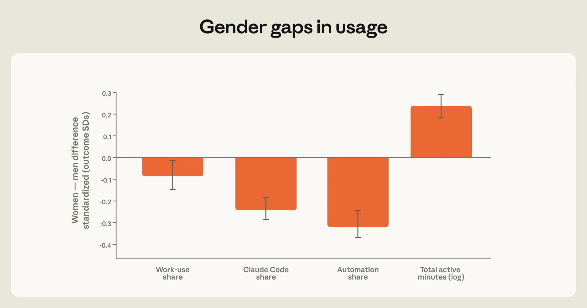

**即使在根据职业差异进行调节后，女性也有明显不同的使用模式**该图显示了女性与男性相比的使用模式。每个条形图都是女性和男性在该使用率测量上的平均值之间的差异，控制职业（SOC 次要群体），以结果的标准差表示。晶须显示 95% 的置信区间。样本仅限于女性或男性受访者。女性的Claude代码和自动化份额明显较低，但总活跃分钟数较高。

### 人们对人工智能转型的经济有何期望？

人类经济指数调查呈现了有关人工智能的积极和消极的经历和情绪，但我们以充满希望的基调结束了调查。最后一个开放式问题要求受访者“有远大的梦想：你希望十年后由人工智能塑造的经济是什么样子？”我们通过分类器运行每个调查回复，该分类器用相关主题标记回复。下面我们展示了最常被引用的五个主题。每个的附加描述可以在 [附录。](https://assets.claude.com/03ed1410f74a65ae4cc2a27120d0875e1e569535.pdf)

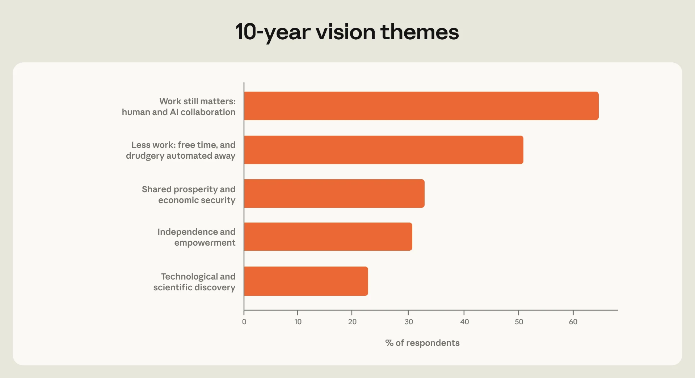

**人们希望人类与人工智能的协作、苦差事的自动化和更多的空闲时间，并希望人工智能带来的经济收益得到广泛分享**该图显示了人们对一个开放式问题的回答中最常见的五个主题，该问题涉及他们希望人工智能转型的经济在 10 年后是什么样子。

最常见的主题之一是人工智能 *增强* 的工作。超过一半的受访者表示希望与人工智能合作开展有意义的工作，希望自己的职业仍然重要，和/或希望新行业出现并创造新的就业机会。同时，超过一半的受访者希望人工智能 *自动化*——特别是工作中乏味的部分——这样他们就可以有更多的空闲时间和更多的空间来实现工作之外的意义。约三分之一的受访者表示，第三个最常见的主题是共享繁荣：希望人工智能带来的经济收益能够被广泛分享。

## 讨论

人工智能正在整个经济中迅速扩散，覆盖越来越多的表面，输出也越来越智能。在早期的人工智能聊天界面中，使用很简单，包含在聊天窗口中，无需网络搜索、工具调用、工件或其他可供性。现在，Claude 模型可以通过 Claude Code 和 Cowork 自主运行数小时。随着这些形式的变化，用户群也在发生变化。早期采用者技术含量很高。我们最近的用户将Claude应用于命令的任务 [工资较低](https://www.anthropic.com/research/economic-index-march-2026-report) 在劳动力市场上。

在本报告中，我们采取了几个步骤来进行更信息丰富的测量。首先，我们开始越来越频繁地进行测量，每小时处理一次样本数据。这揭示了日常生活的节奏如何铭刻在我们的使用日志中，并为未来的研究开辟了途径。其次，我们开始记录人工制品，或者人们从Claude那里拿走的输出。这些使Claude的工作成果更加清晰，并显示出一些直观的模式。

最后，使用数据仅包含这么多信息。我们的调查让我们第一次能够直接询问人们如何使用人工智能以及他们对此有何感受。我们发现，我们的调查受访者使用人工智能的程度超出了我们的预期——他们报告说，人工智能可以完成比他们职业中观察到的暴露程度更高的工作份额。当被要求预测明年的能力时，超过 35% 的人预测人工智能将能够做到 *大多数* 他们的工作。

对Claude所做的工作进行准确分类仍将是一个不断变化的目标。例如，随着人工智能能力的增强，人工智能可能会越来越多地相互交互和交换，也许是以人类或简单分类器难以理解的方式。最终，Claude对经济的影响将在经济总量中显现出来，例如 [就业](https://www.anthropic.com/research/labor-market-impacts) 和生产力以及其使用日志。尽管如此，人工智能很可能会在其工作最多的领域产生最早的影响，因此揭示这些不断变化的使用模式仍然是向公众通报情况的关键方式。

## 附录

可用 [在这里。](https://assets.claude.com/03ed1410f74a65ae4cc2a27120d0875e1e569535.pdf)

## 脚注

01这包括来自消费者（免费/专业/最大）帐户的聊天对话和协同工作会话 [Claude.ai](http://claude.ai) 和Claude桌面应用程序。“第一方 API”或 1P API 是指直接通过 Anthropic 自有编程接口路由的开发者流量，这与 Anthropic 面向消费者的 Claude.ai 应用程序和 Amazon Bedrock 或 Google Cloud Vertex 等第三方平台不同。我们继续根据我们的隐私和保留政策管理数据，并且我们的分析符合我们的条款、政策和合同协议。

02自始至终，所有分析都基于隐私保护分类器：转录本只能由Claude的另一个实例读取。然后，我们过滤掉任何观察不足的单元格，以确保保护隐私的分析。

03这包括在聊天和 Cowork 选项卡中进行的所有对话 [Claude.ai](http://claude.ai) 并通过Claude桌面应用程序。Claude Code 和 API 流量分别呈现。

04“第一方 API”或 1P API 是指直接通过 Anthropic 自有编程接口路由的开发者流量，这与 Anthropic 面向消费者的 Claude.ai 应用程序和 Amazon Bedrock 或 Google Cloud Vertex 等第三方平台不同。它不包括Claude代码。

05看看我们的 [Sonnet 3.7 报告](https://www.anthropic.com/news/anthropic-economic-index-insights-from-claude-sonnet-3-7) 和 [附录。](https://assets.claude.com/8eb31e1d187ff18146d248bbef8b2754971f0f5a.pdf)

06我们将创业活动定义为详细要求集群为创业、副业收入构想、资本筹集、创作者货币化、电子商务、商业模式、医疗保健业务、社会企业或活动业务的对话份额。简历活动是工件分类器将输出分类为简历或工作申请的对话。

07一天中的时间基于从对话的 IP 地址推断状态。

08本章中的数据涵盖 2026 年 4 月 10 日至 6 月 10 日期间采样的聊天和 Cowork 对话。在自治讨论比较表面的地方，包括同一时期的Claude代码会议。工资来自 BLS OEWS，2025 年 5 月发布。

09“无”是没有产生显着具体成果的对话的总称。这可能包括简短或放弃的交流、导致错误的情况或Claude提出澄清问题而用户没有继续的情况。

10我们对对话级别令牌计数使用几何平均值，因为该变量极度右偏——少数对话使用的令牌比“典型”对话多几个数量级。如果我们使用中位数或者我们根据令牌各自的成本对令牌进行加权以考虑所使用的模型的组合，则这种关系非常相似。有一些值得注意的例外，包括医生职业。

11有关Claude代码的更全面的图片，请参阅我们的 [同伴报告](https://www.anthropic.com/research/claude-code-expertise).

12最大的例外是数据和电子表格，其中聊天和 Cowork 对话比 Claude Code 涉及更多的自主权（3.09 vs 2.74）。这主要是组合性的：大约 70% 的差距反映了不同的任务组合。在聊天和 Cowork 中，此输出倾向于财务建模和仪表板，由 Claude 设计结构；在 Claude Code 上，它倾向于结构化提取和标记，其中规范是精确的。在协同工作中，数据和电子表格工作的比例过高，而且特别是自主性，占聊天和协同工作提升的一部分。

13有关用于此分类的提示的详细信息，请参阅我们的附录 [三月报告](https://www.anthropic.com/research/economic-index-march-2026-report).

14在我们的用户群之外，在由 [人择公共记录](https://www.anthropic.com/news/anthropic-public-record)，一项针对 50,000 多名美国人的全国代表性调查。

15在职业为管理人员的人群中，48.1%的人表示自己受雇于公司，24.4%的人表示自己是有员工的企业主，21.7%的人表示自己是个体户或承包商。其余的人目前没有工作，正在报告他们最近的职业。

16不包括军事。

17由于响应是分箱的（因此最低可能的编码响应超过零，而最高可能的响应低于 1），该图中的斜率偏向于零。因此，我们定性地解释斜率的比较，而不是精确的估计。然而，这些模式（正斜率和接近平行线）对于使用报告 AI 可以完成至少 60% 的工作任务的指标来估计关系来说是稳健的，而不受中点编码的影响。

18分箱响应量表可能也发挥了作用：因为中点编码将报告的任务份额拉离极端，观察到的暴露往往看起来低估了人工智能在暴露最少的职业中的能力，而夸大了人工智能在暴露最多的职业中的能力，即使没有任何实质性差异。

19人均劳动年龄成年人 GDP 的构建方式与人类经济指数相同，使用 [世界银行世界发展指数](https://wdi.worldbank.org/table/2.1) （2024）和 [联合国世界人口展望](https://population.un.org/wpp/) （2024）工作年龄人口估计，以及 [国际货币基金组织世界经济展望](https://www.imf.org/external/datamapper/datasets/WEO) （2025 年估计）GDP。

20我们向调查受访者询问他们在当前或密切相关的职位中拥有的经验年限。

21协作模式分类器将转录本映射到以下交互模式之一：- 指令：人类以最少的交互将完整的任务执行委托给人工智能- 反馈循环：人类和人工智能进行迭代对话以完成任务，人类主要提供来自环境的反馈- 任务迭代：人类和人工智能进行迭代对话，以完成任务，人类则完善人工智能输出- 学习：人类寻求理解和解释，而不是直接完成任务- 验证：人类使用人工智能来检查或验证自己的工作

22工作共享和 Claude Code 共享都与自动化呈正相关：Claude Code 是一种代理工具，其会话平均比聊天或 Cowork 会话更加自动化，而工作会话同样比个人会话更加自动化。工作使用情况也很直接——调查询问了工作任务，因此使用 Claude 进行工作的人可能会机械地期望 Claude 能够完成他们大部分的工作任务。因此，以这些措施为条件削弱了自动化份额和任务份额之间的关系（今天、12 个月后以及变化），但所有三种关系仍然是积极的且具有统计显着性。

23美国裁员和解雇率（[BLS 震动](https://www.bls.gov/charts/job-openings-and-labor-turnover/hire-seps-rates.htm)截至 2026 年 4 月的 12 个月中，每月平均就业人数约为 1.1%，年化总和约为 13.4%，因此 10% 略低于非自愿离职事件的实际年发生率。

24这个问题是关于工作变动预测和失业预测一起问的。因此，38% 是将自己的失业预测归因于人工智能的人数比例的上限。

25这反映了一种熟悉的模式，即人们对自己的处境的评价比其他人的处境更有利。类似的现象是 [在Covid期间观察到](https://www.federalreserve.gov/publications/files/2021-report-economic-well-being-us-households-202205.pdf)，当自我报告的财务状况超出了对国民经济的看法时。

26这与国家 GDP 和经验形成鲜明对比，其中较低的 GDP 和经验与较高的任务份额相关（如图 3.4 所示） *和* 更高的失业概率。

27虽然这可能是由于聊天/Cowork 和 Claude Code 之间的替换造成的，但即使在控制 Claude Code 会话共享时，该模式仍然成立。在控制职业固定效应后，这些模式也仍然存在。
