# Anthropic 经济指数报告：学习曲线

- 英文标题：Anthropic Economic Index report: Learning curves
- 发布日期：2026-03-24
- 官网栏目：经济学
- 原文：[Anthropic 页面](https://www.anthropic.com/research/economic-index-march-2026-report)
- 官网署名：Anthropic
- 官网推荐阅读：[阅读 PDF](https://assets.claude.com/4053bf3440c0c85b8852052770c5b4cf882689c3.pdf)

> 中文机器初译，未逐篇人工校对。引用研究结论时请核对英文原文。

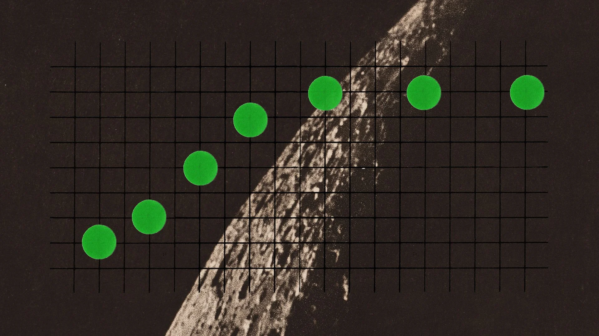

Anthropic 经济指数使用我们的隐私保护数据分析 [系统](https://www.anthropic.com/research/clio) 跟踪Claude在整个经济中的使用情况。这是我们尽早了解人工智能的经济影响的努力的一部分，以便研究人员和政策制定者有足够的时间做好准备。

这份最新报告以我们在 2026 年 2 月引入的经济原语框架为基础，研究了 Claude 在 2026 年 2 月的使用情况。 [之前的报告](https://www.anthropic.com/research/anthropic-economic-index-january-2026-report) （使用 2025 年 11 月的数据）。我们的样本涵盖 2 月 5 日至 2 月 12 日，即 Claude Opus 4.5 发布后三个月，与 Claude Opus 4.6 发布同时发生。

我们首先记录了相对于我们之前的报告使用情况发生的变化：人工智能补充用户能力的增强率、协作交互，Claude.ai 和 API 流量均略有增加。在 Claude.ai 中，使用情况多样化，上个月排名前 10 的任务所占的使用比例低于 2025 年 11 月。由于这种多样化，Claude.ai 中的平均对话任务的工资略低 [比](https://assets.claude.com/f065d6e6f92c65df8244042c83d48872ea308c3a.pdf) 在之前的报道中。

然后，我们关注Claude对劳动力市场和更广泛经济影响的一个重要决定因素：Claude采用的学习曲线。我们提供的证据表明，高级用户已经养成了习惯和策略，使他们能够更好地利用Claude的能力。事实上，我们记录了经验丰富的用户不仅尝试更高价值的任务，而且更有可能在对话中引发成功的响应。

#### 自我们上次报告以来发生了什么变化

在第一章中，我们回顾了之前的发现 [经济指数报告](https://assets.claude.com/096d94c1a91c6480806d8f24b2344c7e2a4bc666.pdf)，发表于 2026 年 1 月。我们发现：

- **Claude.ai 的用例多样化。** 编码任务继续从 Claude.ai 中的增强使用迁移到我们的第一方 API 流量中更加自动化的工作流程。[1](https://www.anthropic.com/research/economic-index-march-2026-report#footnote-1) 在这份报告中，Claude.ai 的使用情况不太集中：2 月份排名前 10 的任务占所有流量的 19%，低于 11 月份的 24%。也就是说，该样本中的几乎所有任务都出现在我们之前的至少一个样本中。大约 49% 的工作至少有四分之一的任务是使用 Claude 执行的。
- **Claude的采用范围扩大到工资较低的任务。** 随着用例的多样化，Claude所做工作的平均经济价值（以美国支付给相关职业工人的工资来衡量）略有下降。从本质上讲，这是由于有关体育、产品比较和家庭维护的个人查询增加造成的。该模式与标准的“采用曲线”故事一致，其中早期采用者偏爱特定的高价值用途，例如编码，而后来的采用者则承担更广泛的任务。
- **全球使用的不平等现象依然存在。** 使用量仍然高度集中：前 20 个国家/地区的人均使用量从 45% 上升至 48%，凸显了全球使用量的持续差距。然而，美国境内 Claude 的人均使用量继续趋同：自我们上次报告以来，使用量最高的 10 个州所占的使用量份额从 40% 下降至 38%。

#### 学习曲线

经济指数的一个核心发现是，Claude的早期采用非常不平衡：Claude在高收入国家、在美国知识工作者较多的地方使用得更频繁，并且用于相对较少的专门任务和职业。

一个重要的问题是，采用的不平等如何决定人工智能的好处将在何处以及向谁带来。例如，如果有效的人工智能使用需要互补的技能和专业知识——我们在我们的研究中提出了这一点 [之前的报告](https://assets.claude.com/096d94c1a91c6480806d8f24b2344c7e2a4bc666.pdf)——如果这些技能可以通过使用和实验获得，那么早期采用的好处可能会自我强化。

在第二章中，我们研究用户如何塑造他们从 Claude 那里获得的价值：他们如何将模型功能与手头的任务相匹配，以及使用模式和结果如何随着平台上的体验而变化。

- **模型选择与任务相匹配。** 我们表明，用户选择我们最智能的模型类 Opus 来执行通常在劳动力市场上获得较高工资的任务。例如，在付费 Claude.ai 用户中，Opus 在编码任务上的使用率比平均水平高 4 个百分点，在辅导相关任务上的使用率比平均水平低 7 个百分点。对于 API 用户来说，这种模型切换的严重程度大约是前者的两倍。
- **任期越高，成功率越高。** 一般来说，经验最丰富的 Claude 用户更常将其用于高等教育任务，而不经常用于个人用例。例如，使用 Claude 6 个月或更长时间的人的个人对话减少了 10%，而他们的输入反映的教育水平提高了 6%。最引人注目的是，这个任期较高的群体中的人在谈话中的成功率高出 10%，这种关联并不能用他们的任务选择、原籍国或其他因素来解释。虽然这可能反映了早期采用者的成熟度，但它也可能是边做边学的证据，人们通过经验可以更好地使用 Claude。

## 自我们上次报告以来发生了什么变化

### Claude.ai 用例的多样化

我们首先看看Claude被要求执行的任务类型。我们用我们的 [隐私保护系统](https://arxiv.org/abs/2412.13678)，这使我们能够在聚合水平上描述行为，而无需透露单个记录的内容。我们对双方的 100 万条对话进行了采样 [Claude.ai,](https://assets.claude.com/f065d6e6f92c65df8244042c83d48872ea308c3a.pdf) 我们面向消费者的网络产品，以及我们的第一方 API，即面向开发人员的界面，用于将 Claude 集成到产品和工作流程中。[2](https://www.anthropic.com/research/economic-index-march-2026-report#footnote-2)

编码仍然是我们平台上最常见的用途，与计算机和数学职业相关的任务占 Claude.ai 对话的 35%（请参阅 [附录](https://assets.claude.com/a3cdcd9e67c3c4c51440429dd016cacba514b35b.pdf)).[3](https://www.anthropic.com/research/economic-index-march-2026-report#footnote-3) 然而，在 2025 年 11 月至 2026 年 2 月期间，Claude.ai 上的用例变得不太集中：最常见的 10 个 O*NET 任务从对话的 24% 降至仅 19%（图 1.1）。

集中度的下降在一定程度上反映了编码任务从 Claude.ai 迁移到我们的第一方 API，其中 Claude Code 已经发展到代表了采样流量的很大一部分。Claude Code 的代理架构将编码工作拆分为更小的 API 调用，这些调用被标记为不同的任务。因此，虽然编码在 API 流量中的总体份额有所增长，但它分布在许多任务类别中，而不是集中在少数任务类别中。因此，尽管编码活动大量涌入，API 中的任务集中度仍大致持平。

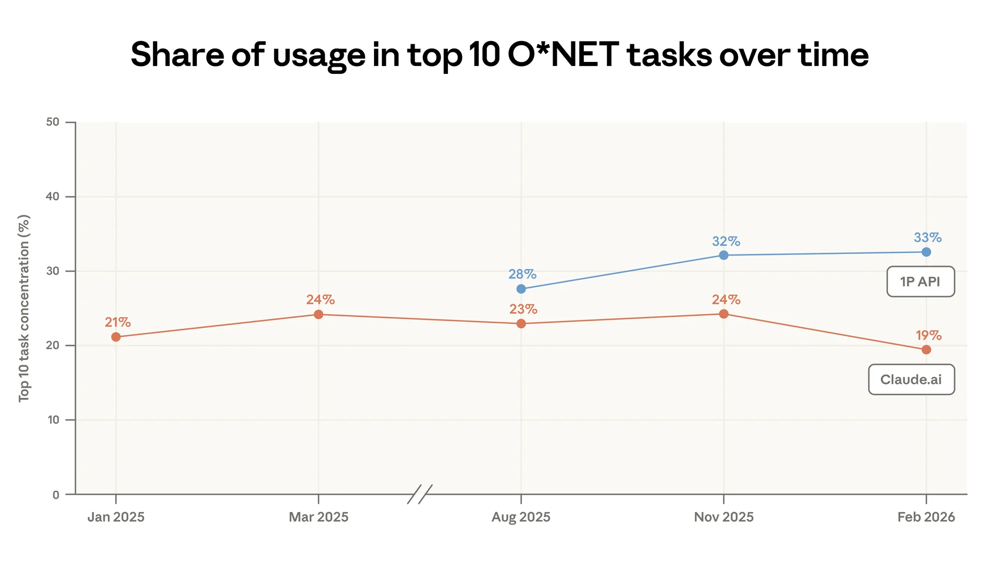

**随着时间的推移，按平台、Claude.ai 和 1P API 划分的前 10 名任务的使用情况份额。** 按平台和报告版本划分的分配给十个最流行的 O*NET 任务的对话份额。

从 Claude.ai 中迁移代码并不是导致注意力下降的唯一因素。下降的部分原因是两个时期之间用例组合的变化。课程作业从对话的 19% 下降到 12%，而个人使用的对话从 35% 上升到 42%。课程作业量的下降可以用我们样本期间学生放寒假的国家的校历来解释。[4](https://www.anthropic.com/research/economic-index-march-2026-report#footnote-4) 与此同时，从 2 月份左右开始，注册人数的增加带来了更多的休闲人工智能用户。

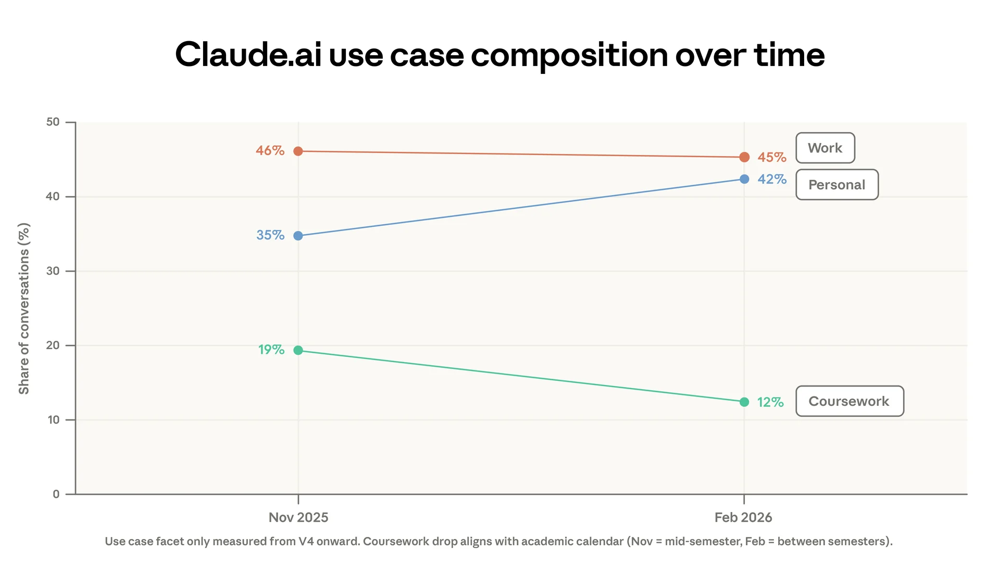

**2025 年 11 月和 2026 年 2 月 Claude.ai 上的工作、个人和课程作业使用情况。** Claude.ai 上被识别为工作、个人或课程作业的对话份额。

虽然Claude的工作任务分布变得更加多样化，但几乎所有这些都曾在我们的数据中出现过。在我们之前的报告中，我们注意到 49% 的工作岗位至少有四分之一的任务是使用 Claude 执行的。在这次数据拉取中，累积估计几乎没有变化（[附录](https://assets.claude.com/a3cdcd9e67c3c4c51440429dd016cacba514b35b.pdf) 图A.2）。我们从这份报告中获得的数据显示，新的 O*NET 任务比我们之前的报告要少得多。

自从我们的第一份报告以来，我们将对话分为五种交互类型之一——指令、反馈循环、任务迭代、验证和学习——我们将其分为两个更广泛的类别：自动化和增强。[5](https://www.anthropic.com/research/economic-index-march-2026-report#footnote-5) 图 1.3 显示 Claude.ai 中的增强略有增加。这是由验证和学习模式中的小障碍推动的。在 [附录](https://assets.claude.com/a3cdcd9e67c3c4c51440429dd016cacba514b35b.pdf) 图 A.3，我们显示 1P API 数据中的自动化程度急剧下降。

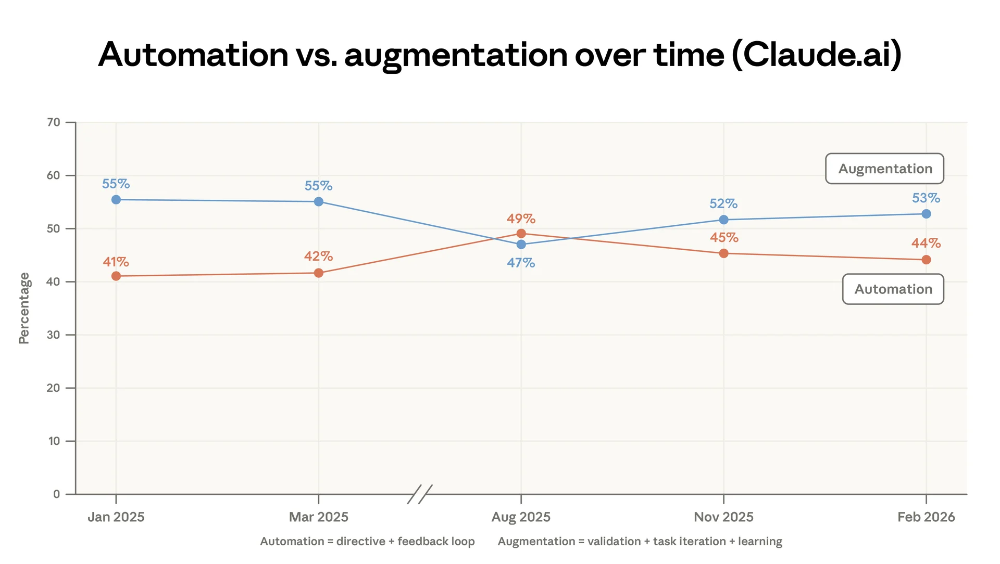

**协作模式分享，Claude.ai。** Claude.ai 中人类经济指数报告中的协作模式频率。

我们的 API 平台在计算机和数学任务中继续获得相对较高的份额（按工作类别划分的使用份额显示在 [附录](https://assets.claude.com/a3cdcd9e67c3c4c51440429dd016cacba514b35b.pdf)）。自 2025 年 8 月以来，该类别任务的份额在 API 中增加了 14%，在 Claude.ai 中减少了 18%。正如我们在报告中指出的 [劳动力市场影响](https://www.anthropic.com/research/labor-market-impacts)，我们预计从 Claude.ai 到 API 的迁移可能预示着相关工作的工作即将发生转变。Claude.ai 中与管理职业相关的任务增加，占其流量的比例从 3% 增加到 5%，这主要来自于分析任务（例如准备投资备忘录）和回答客户问题。

衡量 Claude 完成的任务组合变化的另一种方法是查看任务平均值的变化，我们将其定义为执行该任务的美国工人的平均小时工资（图 1.4）。[6](https://www.anthropic.com/research/economic-index-march-2026-report#footnote-6) Claude.ai 中任务价值的估计从 49.3 美元略有下降至 47.9 美元，主要是由于简单事实问题（例如体育结果、天气）的增加以及转向 API 时编码的减少。正如我们在 [之前的报告](https://www.anthropic.com/research/anthropic-economic-index-january-2026-report)，我们在Claude身上看到的任务往往需要高等教育。该图显示，这些任务的工资也往往高于美国全国平均水平。

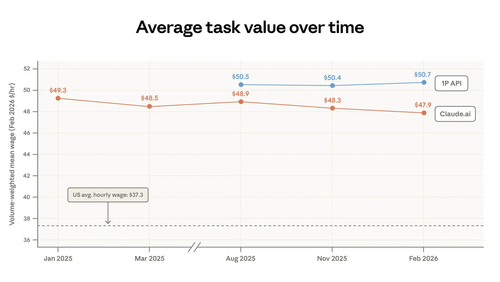

**跨版本和平台的平均任务值的变化。** 该图使用 O*NET 框架来估算在 Claude.ai 和 1P API 上执行的任务的美元价值。任务价值估计为支付给执行该任务的工人的平均小时工资。

虽然之前的报告和当前的报告之间的几个基元的变化虽然很小，但 Claude.ai 上的任务复杂性也出现了类似的下降。人类输入所需的平均受教育年限从 12.2 年下降到 11.9 年，用户赋予人工智能更多的自主权，人类单独完成任务所需的时间下降了约 2 分钟。一项变化表面上是相反的：Claude执行的任务被认为对于无法接触人工智能的人类来说不太可能完成。

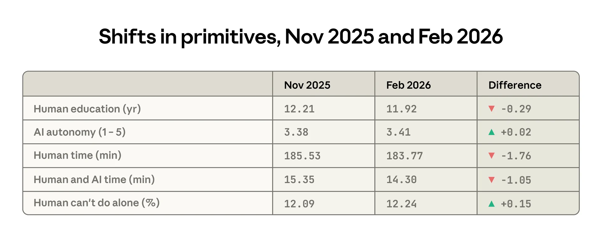

**关键原语的变化。** 该表显示了 Claude.ai 与之前的经济指数报告相比的平均基元。所有差异均具有统计学显着性（p<0.001），但仅人类时间（p<0.05）除外。有关这些原语的定义，请参阅附录。

### 新兴的自动化模式

随着任务迁移到 API，它们可能会更加自动化。API 工作流程更有可能是指令性的，不需要人工参与循环。在一个 [之前的报告](https://assets.claude.com/a42bc3fc08283562f08fd8bdee8f6f9a3d506e87.pdf)，我们强调了 API 数据中普遍存在的客户服务任务，例如，对支付和计费问题的自动支持。这些有助于提高客户服务代表的观察曝光度——据记录，Claude在自动化工作流程中完成了大部分任务，因此随着人工智能的扩散，这些工作可能更有可能发生变化。

我们重点介绍两个 API 工作流程，与三个月前相比，二月份出现的频率更高，在我们的最新样本中，它们的份额至少翻了一番：[7](https://www.anthropic.com/research/economic-index-march-2026-report#footnote-7)

- **业务销售和外展自动化：** 销售支持生成、B2B 潜在客户资格研究、客户数据丰富、冷电子邮件起草。
- **自动交易和市场操作：** 监控市场或头寸，提出具体投资建议，向交易者通报市场状况和相关任务。

### 重新审视地理融合

在我们之前的报告中，我们注意到，根据某个地区的工作年龄人口调整使用情况的人类人工智能使用指数（AUI）在美国各州迅速趋同：最初人均使用率较低的州显示出更快的采用速度。

图 1.6 的左图显示，这种趋同在我们最新的数据中仍在继续，但速度较慢。从 2025 年 8 月到 2026 年 2 月，前五个州的人均使用量份额从 30% 下降到 24%。自 2025 年 8 月以来，基尼系数一直在下降，但收敛速度有所放缓。当我们更新我们的估计时 [之前的报告](https://assets.claude.com/096d94c1a91c6480806d8f24b2344c7e2a4bc666.pdf)，我们发现按照这个速度，各国将在 5 至 9 年内达到大致相等的人均使用量，而不是 2 至 5 年。[8](https://www.anthropic.com/research/economic-index-march-2026-report#footnote-8)

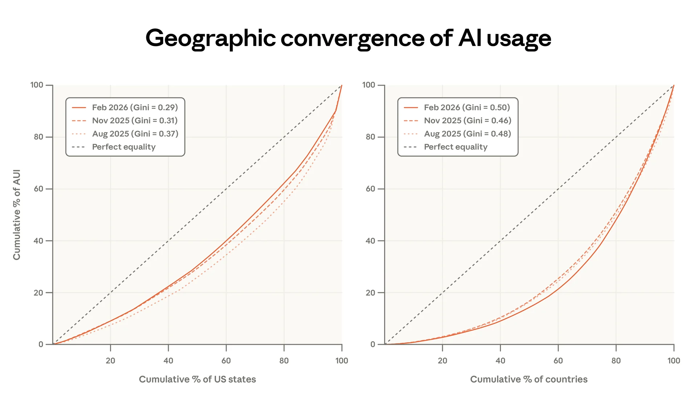

**地理趋同。** 该图显示了美国各州（左图）和国家（右图）的人类使用指数的洛伦兹曲线。

在各个国家（右图），情况正好相反：使用量变得稍微更加集中，基尼系数同期上升。使用 Claude 最多（人均）的国家/地区目前在总体使用量中所占份额较大，根据人口调整后，排名前 20 的国家/地区的使用量从 45% 增至 48%。

## 学习使用人工智能

在本章中，我们重点关注反映人们如何部署和学习使用人工智能的两个使用特征：模型选择和长期用户的习惯。

首先，我们通过研究人们何时选择 Opus（我们表现最好的模型类别）来阐明对智力的需求。人们对人工智能用户如何在不同模型之间进行选择、如何在速度、性能和成本之间进行权衡知之甚少。如果用户正在调整手头的任务，我们应该会看到 Opus 专注于更困难、更高价值的工作。

接下来，我们研究使用情况如何根据任期而变化，找出不同时间注册的用户之间的差异。这揭示了学习曲线：有经验的用户会随着时间的推移变得更好吗？它们的用法有何不同？我们找到了与边做边学相一致的证据。任期较高的用户不仅在对话中取得更大的成功，他们还与 Claude 进行更多的合作，为 Claude 带来更具挑战性的任务，并且更有可能利用 Claude 来完成工作目的和更广泛的任务。

### 选型

不同的 Claude 模型类（Haiku、Sonnet 和 Opus）在成本、速度和性能方面提供了权衡。Opus 类模型使用最多的代币，并且擅长复杂的任务，但在我们的 API 上每个代币的价格更高。如果用户意识到这一点并注意成本和使用限制，他们应该将最复杂和最有价值的任务带到 Opus，同时选择其他模型来完成更简单的任务。这大致就是我们在数据中观察到的情况。

下面的图 2.1 显示，对于可以访问所有模型类的付费 Claude.ai 帐户，55% 的计算机和数学任务（如编码软件）使用 Opus，而教育任务的这一比例为 45%。技术用户可能会注意到性能提升并主动放弃默认的 Sonnet。或者注重效率的用户可能会学习使用 Sonnet 来完成更简单的任务，以避免达到使用限制。与此相关的是，这里的差异可能反映出大多数教育任务对于 Sonnet 来说已经相当容易，或者学生更有可能注意使用限制。

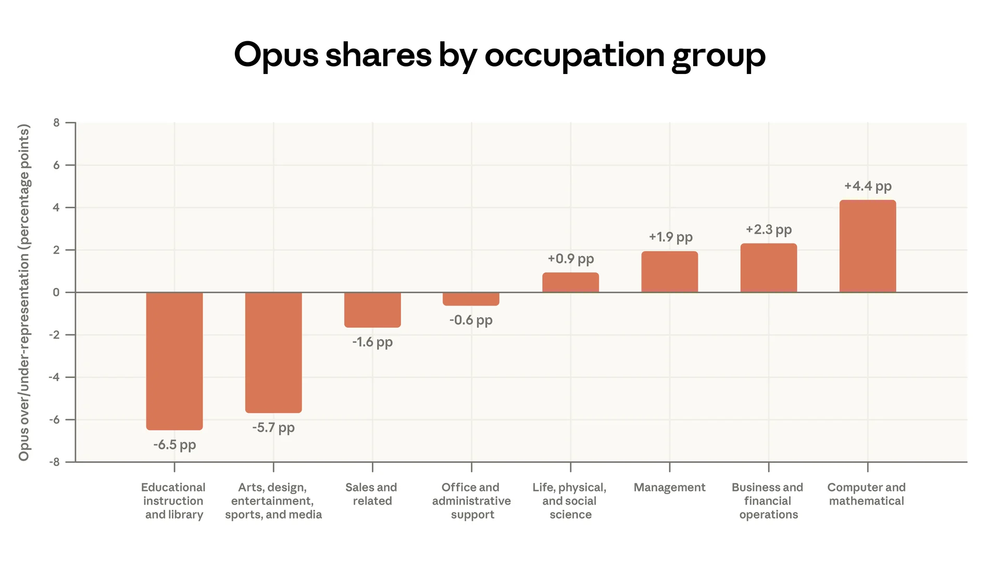

**模型选择和职业领域。** 该图显示了付费的 Claude.ai 用户根据任务所在的职业领域选择 Opus 类模型的程度。在此示例中，总体使用量的 51% 是 Opus，计算机和数学使用量的 55% (+4.4pp) 是 Opus。

下面的图 2.2 以更精细的方式显示了这一点。当用户执行与高薪相关的任务时 *职位*，他们更频繁地使用 Opus。例如，在 Claude.ai 上，34% 的软件开发人员任务涉及 Opus，而导师任务中只有 12%。总体而言，一项任务的时薪每增加 10 美元，Claude.ai 用户使用 Opus 进行对话的比例就会增加 1.5 个百分点。1P API 流量显示出对任务复杂性的更多响应。其斜率约为两倍，任务价值每 10 美元，Opus 份额就会增加 2.8 个百分点。与 Web 用户相比，部署编程工作流的用户可能有更多理由在模型之间进行切换。

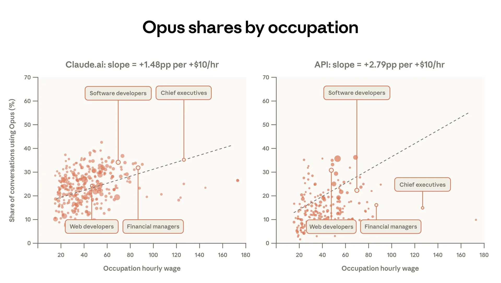

**模特选择和职业。** 该图显示了用户根据任务关联的职业选择 Opus 模型类别的频率。每个点都是一个职业（x 轴）及其作品份额（y 轴）。左侧面板显示 Claude.ai 用户，右侧面板显示 1P API 用户。

### 学习曲线

第一个 Claude 模型于 2023 年 3 月发布。从那时起，Claude.ai 和 API 上的用户群都迅速增长。我们最新的样本包含多种用户，其中一些人注册了 Claude 的第一个版本，还有一些人在我们测量其使用情况的前一天注册。与Claude一起工作的经历如何影响他们的经历？[9](https://www.anthropic.com/research/economic-index-march-2026-report#footnote-9)

表 2.1 显示了低任期用户和高任期用户之间的差异，其中后者被定义为至少 6 个月前注册了 Claude，而低任期用户是其他所有人。[10](https://www.anthropic.com/research/economic-index-march-2026-report#footnote-10) 高任期用户更有可能使用 Claude 来迭代他们的工作，而不太可能通过指令使用模式委派更大的责任。他们使用 Claude 从事工作以及使用 Claude 从事往往需要更高教育水平的任务的可能性高出 7 个百分点。最后，它们的使用不太集中在某些任务上。前 10 个 O*NET 任务在高任期组中的使用份额略低（20.7% 比 22.2%）。

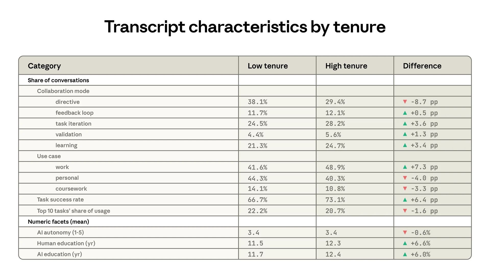

**高任期用户和低任期用户之间的差异。** 该表显示了高任期用户和低任期用户的平均特征。我们将高保有用户定义为在我们提取数据之前至少六个月注册 Claude 的用户。

下面，我们将进一步深入研究上面讨论的两个基元：与每次对话相关的人类受教育年限，以及供个人使用的记录的份额。

在左侧面板中，我们显示，Claude每增加使用一年，理解人类提示所需的学校教育年限就会增加近一年。在右侧面板中，我们显示，与此同时，个人使用情况有所减少：一年前注册的用户将 38% 的对话用于个人使用案例，而最新用户的这一比例为 44%。

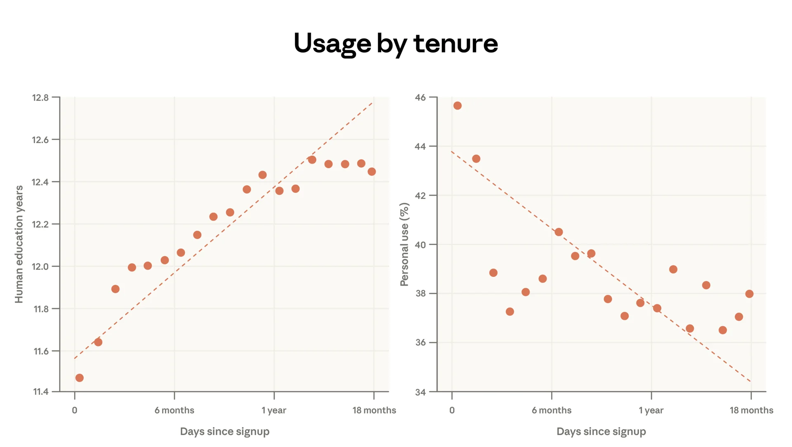

**任期如何与教育年限和个人使用相关。** 该图显示了两个分箱散点图。左图显示了人类受教育年数与注册后的天数。右侧面板显示个人使用对话的百分比与注册后天数的关系。

有几个因素可以解释快速发展的通用技术的用户群中的这些模式。高保有用户是自我选择的，这里的差异可以反映稳定的特征。例如，他们可能是计算机程序员，他们更有可能成为早期采用者。此外，存在固有的生存偏差：在我们的数据提取前一年注册的人可能会从他们的使用中看到积极的结果。我们没有观察到一年前注册但不再使用 Claude 的人。

研究结果反映了我们在《经济原语》报告中看到的情况：收入较低、受教育程度较低的国家在某些情况下却表现出更复杂的使用。最早的采用者通常拥有高价值的技术用例。在采用率低得多的较贫穷国家，这些早期采用者仍然主导着用户群。

当人工智能扩散到更广泛的人群时，就会出现更多的随意使用。事实上，在请求集群中，平均任期最高的任务包括：人工智能研究、git 操作、修改手稿和初创公司筹款。平均任期最低的任务有更简单的工作流程，例如写俳句、检查体育成绩以及为聚会推荐食物。[11](https://www.anthropic.com/research/economic-index-march-2026-report#footnote-11)

#### 体验效果

我们在下面的图 2.4 中详细探讨了这些关系，使用日志级别数据来精细地控制对话的功能。在顶部面板中，规范 (1) 显示了一个简单的二元回归，其中任务成功作为结果，长期任期指标作为预测变量。成功是Claude对对话是否成功的评估， [我们之前的报告中描述过](https://assets.claude.com/096d94c1a91c6480806d8f24b2344c7e2a4bc666.pdf)。该图显示，长期使用权用户进行成功对话的可能性大约高出 5 个百分点。

这可能反映出任期较长的用户更擅长提示。但如果这反映出他们给Claude带来了不同的任务——更有可能成功呢？

在规范 (2) 中，我们包含了特定 O*NET 任务和请求集群的固定效应。这相当于在同一狭义定义的任务中比较高任期和低任期用户，而不是跨任务。例如，我们有一个名为“为特定公司执行公司财务分析、估值和建模”的请求集群。固定效应比较该集群内的高保有期用户和低保有期用户，同样在每个其他集群内。平均而言，如果长期用户在这些任务内比较中更加成功，我们只会观察到正系数。这种控制在一定程度上缓和了效果，使其接近 3 个百分点。

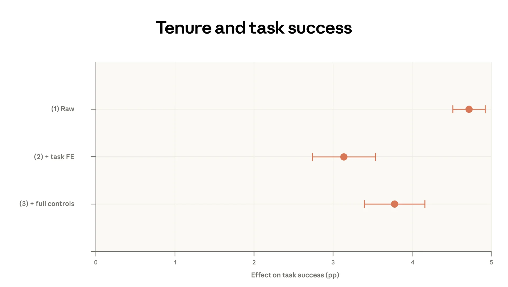

**经验与成功之间的联系。** 该图显示了我们对高任期指标进行二元成功衡量的回归结果，并进行了越来越严格的控制。系数以百分点给出，胡须给出 95% 的置信区间。“Task FEs”表示 O*NET 任务和请求集群的固定效果。完全控制增加了模型、用例和国家/地区固定效应。

最后，我们询问这种关系是否受到长期用户选择不同模型、以不同语言进行交流、具有不同用例或在不同国家/地区登录的影响。这种回归对高任期产生的影响略高，表明完全控制的成功率高出 4 个百分点。

这些结果表明，高级用户在Claude对话中取得了更大的成功，这并不是由于语言或正在执行的任务等简单因素造成的。一种有趣的潜在解释是，这些用户更好地学会了从人工智能中提取他们想要的东西。这些平台的设施可能是成功的关键决定因素，并且似乎随着经验的增加而扩大。

## 讨论

本报告重新审视了我们用于跟踪 Claude 使用情况的核心指标，并首次分析了模型选择和成功情况。自 2025 年 8 月以来，1P API 使用变得更加集中，排名前 10 的 O*NET 任务目前占流量的 33%，高于 28%。另一方面，自 2025 年 11 月的数据以来，Claude.ai 的任务已经多样化。美国低使用率州的采用速度继续加快，但速度比上次报告中的速度要慢。采用率低的国家稍微落后一些。

通过这份报告，我们可以开始追踪各种经济原语是如何变化的。课程作业的使用比例有所下降，而个人对话的使用比例却有所增加。我们还注意到 Claude.ai 中提示的总体复杂性略有下降，Claude.ai 中的对话显示出不太复杂的输入和更短的估计完成时间。

总体而言，Claude从事高价值、复杂的工作，但不能广泛代表美国经济。但随着用户群的增长，报酬较低的任务已成为稍大的流量份额。自我们的第一份报告以来，Claude.ai 上任务的平均价值（以支付给与这些任务相关的职业的工人的估计工资来衡量）已经下降，而 API 用户的平均价值却在上升。在这两个表面上，用户将最复杂的任务带到我们更强大的模型类 Opus 中。对于 API 客户来说，这种变化更为强烈。

经验丰富的用户往往会出于更多与工作相关的原因、在更复杂的任务中更加协作地使用 Claude，并取得更大的成功。这反驳了我们去年做出的假设，即自动化使用可能更常见于更有经验、更成熟的用户；相反，我们发现最高级的用户更有可能与 Claude 进行迭代。这也与边做边学是一致的：一个人花在人工智能上的时间越多，利用它的效率就越高。

当然，另一种解释是这些结果是由队列效应或生存偏差驱动的。早期采用者可能更具技术性。那些继续使用 Claude 的人可能是那些承担着 Claude 明显有能力完成的任务的人。但仔细控制的回归排除了这种混淆的简单版本，例如长期用户带来不同类型的任务。随着时间的推移，我们将能够更清晰地将队列和生存偏差与边做边学隔离开来。

这些观察到的成功率差异可能会加深劳动力市场的不平等。经济学家早就注意到了潜力 [以技能为导向的技术变革](https://www.aeaweb.org/articles?id=10.1257/0022051026976)：提高高技能工人工资同时压低其他工人工资的创新。我们在本报告中的分析确定了这种偏向技能的转型可能已经展开的渠道：具有高技能任务的早期采用者与后来的技术含量较低的采用者相比，与Claude的互动更为成功。这些早期采用者可能同时是 [最暴露的](https://www.anthropic.com/research/labor-market-impacts) 人工智能驱动的颠覆，在这些最初的、增强的采用浪潮中最受人工智能的帮助。

## 附录

可用 [在这里。](https://assets.claude.com/a3cdcd9e67c3c4c51440429dd016cacba514b35b.pdf)

### 数据可用性

该报告中的数据可用 [这里](https://huggingface.co/datasets/Anthropic/EconomicIndex).

## 脚注

01“第一方 API”或 1P API 是指直接通过 Anthropic 自有编程接口路由的开发者流量，这与 Anthropic 面向消费者的 Claude.ai 应用程序和 Amazon Bedrock 或 Google Cloud Vertex 等第三方平台不同。

02这包括来自克劳德·代码的数据。

03该数字使用 2019 年 O*NET-SOC 代码，而之前的报告使用 2010 年版本。

04在学期活跃的国家/地区，课程作业对话下降了 5 个百分点，而在大多数学生放假的国家/地区，课程作业对话下降了 12 个百分点。

05有关交互类型的定义，请参阅附录。

06例如，任务“使用数学和化学程序计算水分或盐含量、成分百分比、配方或其他产品因素。”该任务仅由食品科学技术人员完成，他们的平均工资为 26.15 美元，因此这就是该任务的价值。本次练习的数据源是 [2024 年 5 月美国劳工统计局职业就业和工资统计 (OEWS) 表](https://www.bls.gov/oes/tables.htm)。当多名工人执行同一任务时，我们会根据就业情况和花在该任务上的时间比例来平均他们的工资。

07为了找到新出现的模式，我们筛选了以下 O*NET 任务：(i) 在当前数据中至少出现 300 次；(ii) 与之前的报告相比至少增长了 2 倍。

08给出的范围是为了反映在我们的模型中运行模型的不同估计 [之前的报告](https://assets.claude.com/096d94c1a91c6480806d8f24b2344c7e2a4bc666.pdf) 带（5 年）或不带（9 年）重量。

09在此分析中，我们使用日志级别数据来估计具有相同隐私阈值的模型。有关该方法的更多信息，请参阅附录。

10这些结果是相似的，但我们定义了高任期。

11我们的采样期与超级碗广告的发布重叠，这带来了许多首次用户。
