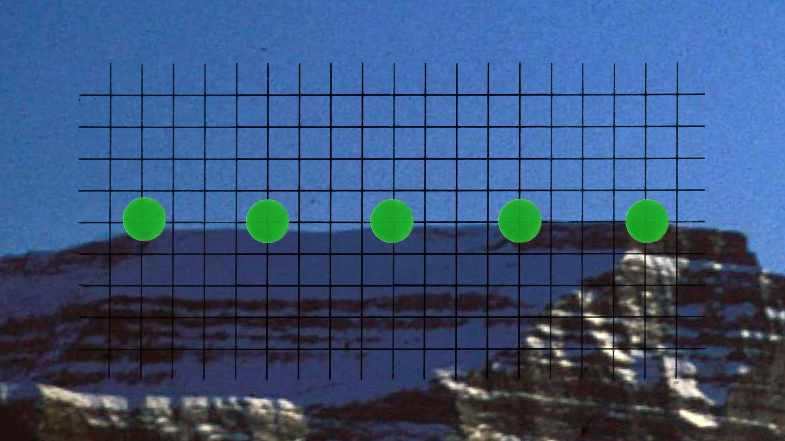
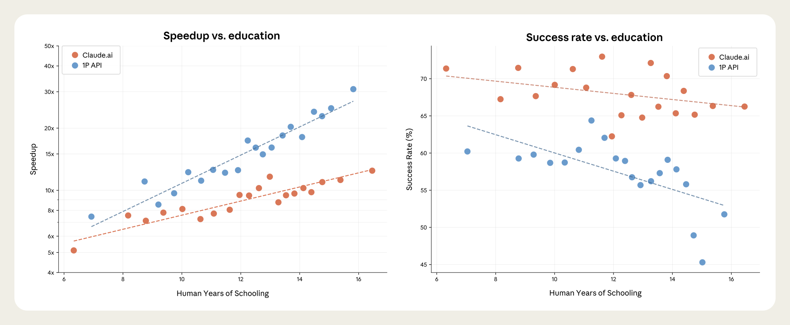
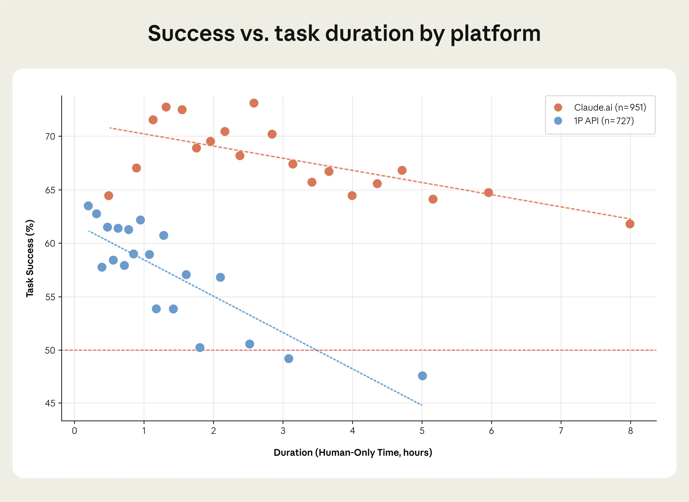
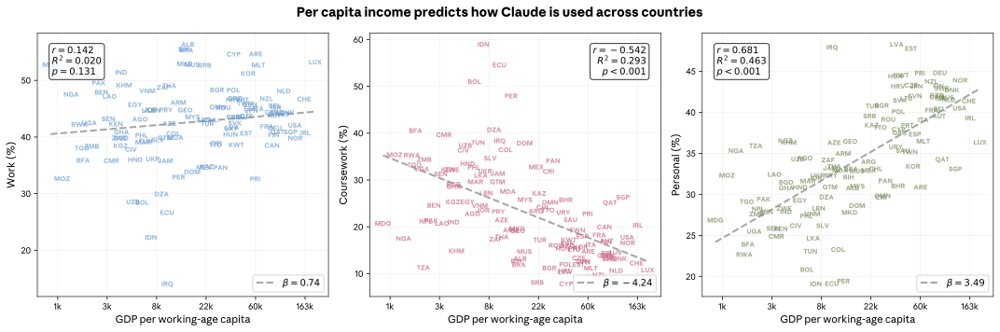
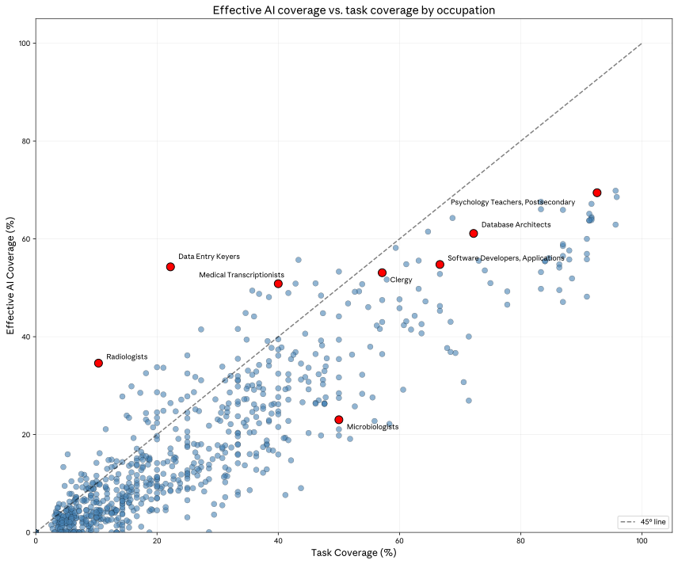
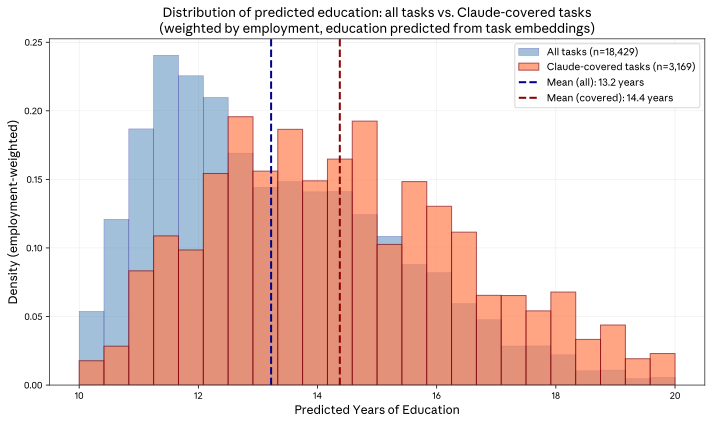

# Anthropic 经济指数：理解 AI 使用的新维度

- 英文标题：Anthropic Economic Index: New building blocks for understanding AI use
- 发布日期：2026-01-15
- 官网栏目：经济学
- 原文：[Anthropic 页面](https://www.anthropic.com/research/economic-index-primitives)
- 官网署名：Anthropic
- 官网推荐阅读：[阅读完整报告](https://www.anthropic.com/research/anthropic-economic-index-january-2026-report)

> 中文机器初译，未逐篇人工校对。引用研究结论时请核对英文原文。

人工智能真的能让人们工作得更快吗？人工智能最支持什么类型的任务？它会如何改变人们职业的性质？

在 Anthropic，我们正在持续衡量现实世界中人工智能的使用情况，以回答类似的问题。我们的隐私保护 [分析方法](https://www.anthropic.com/research/clio) 使我们能够了解更多有关对话的信息 [Claude.ai](http://claude.ai) （捕获消费者的使用情况）和我们的第一方 API（主要捕获企业的使用情况）。[1](https://www.anthropic.com/research/economic-index-primitives#footnote-1) 在过去的报告中，我们通过以下方式评估人工智能任务 [职业和工资水平](https://www.anthropic.com/news/the-anthropic-economic-index), 更仔细地观察 [软件开发](https://www.anthropic.com/research/impact-software-development)，并研究了人工智能的使用 [按国家和美国各州](https://www.anthropic.com/research/economic-index-geography).

我们现在正在为经济指数添加新的详细程度。在我们的第四份报告中，我们介绍了我们所说的 **经济原语**：一组五个简单的基础衡量标准，用于跟踪Claude随时间推移的经济影响。我们的初始设置包括任务复杂性、技能水平、目的（工作、教育或个人使用）、人工智能自主性和成功。[2](https://www.anthropic.com/research/economic-index-primitives#footnote-2) 我们通过要求 Claude 回答有关本报告样本中每个对话的一组常见问题来得出这些原语。

这些原语提供了人工智能潜在经济影响的领先指标，并使我们能够回答有关人工智能如何改变工作的更复杂的问题。我们的最新报告对 2025 年 11 月的对话进行了采样（主要使用 Claude Sonnet 4.5），使用我们的原语来探索我们无法回答的广泛问题，包括 Claude 的任务级别成功率如何随着更复杂的任务而变化，以及迄今为止使用 Claude 是否预示着对许多工作的净去技能效应。

您可以阅读第四期经济指数报告 [这里](https://www.anthropic.com/research/anthropic-economic-index-january-2026-report)。下面，我们总结其结果。

## 我们从经济原语中学到了什么

我们将经济原语应用于有关个人任务、职业的问题，以及我们观察到的变化可能产生的总体影响。 （我们的完整方法论 - 包括我们如何测试原语准确性的详细信息 - 在第二章中描述 [完整报告](https://www.anthropic.com/research/anthropic.com/research/anthropic-economic-index-january-2026-report).)

### 任务

#### 人工智能可以加速哪些任务，加速多少？

我们发现Claude对更复杂的任务的加速速度最快。我们通过 Claude 估计的理解对话输入所需的受教育年限来衡量这一点：在 Claude.ai 中，带有提示要求高中教育（12 年）的任务加速了 9 倍，而那些需要大学学位（16 年）的任务加速了 12 倍。（在 API 上，加速更快。）这些结果意味着人工智能的生产力收益目前在需要相对较高人力的任务中不断增加。资本，与 [证据](https://www.nber.org/papers/w32966) 白领专业人士更有可能在工作中使用人工智能。

当我们根据任务的成功率进行调整时，同样的趋势仍然存在——尽管形式较弱。Claude在 66% 的情况下成功完成了需要大学学位的任务，而在那些需要高中以下学历的任务中，这一比例为 70%。这减少了但并没有消除总体影响：Claude对任务加速的影响随复杂性的增加而增加，而不是复杂性与成功率下降的相关性。

**加速和成功率与人类受教育年限的比较。** 左侧图表显示了在 O*NET 任务级别测量的加速与人类受教育年限之间关系的散点图。虚线显示最佳拟合线。右图显示了与成功率的关系。

#### Claude可以支持任务的时间范围是多长？

[米特](https://metr.org/)AI 的衡量标准 [任务范围](https://metr.org/blog/2025-03-19-measuring-ai-ability-to-complete-long-tasks/) 表明人工智能模型更难完成较长的任务。但随着模型变得更好，人工智能模型可以工作的时间长度正在稳步增加：这一指标现已成为人工智能进步的关键指标。

我们能够使用我们的经济原语来补充 METR 的分析。在下图中，我们显示了Claude的任务级成功率相对于人类完成同一任务所需的时间，两者都在 [Claude.ai](http://claude.ai) 在我们的 API 上：

**任务成功与纯人类时间。** 此图表显示了任务成功率 (%) 与任务需要人员单独完成的时间之间的关系，所有这些都在 O*NET 任务级别进行测量并按平台划分。虚线显示线性回归的拟合结果。

METR 的基准测试表明，Claude Sonnet 4.5（我们自己分析的模型）在 2 小时的任务上实现了 50% 的成功率。相比之下，我们自己的 API 数据发现，Claude 在耗时近两倍（大约 3.5 小时）的任务上取得了 50% 的成功，而在 Claude.ai 上，持续时间还要长得多 — 大约 19 小时。但这可能并不像看起来那么不一致：我们的方法在一些重要方面与 METR 的不同。在我们的示例中，用户可以将复杂的任务分解为更小的步骤，创建一个反馈循环，使Claude能够纠正方向。我们的样本不是一组固定的任务，而是包含一种选择偏差：用户将任务交给Claude，让他们更有信心能够完成任务。

我们的分析表明Claude是如何 *有效的* 时间范围可能与具有一致任务集的研究中发现的时间范围不同。我们将在进一步的报告中跟踪该指标。

#### Claude的工作性质在不同国家有何不同？

我们发现，Claude在不同经济发展阶段的国家完成了截然不同的任务。在人均 GDP 较高的国家，Claude 更频繁地用于工作或个人用途，而另一端的国家更有可能将其用于教育课程。这符合一个简单的“采用曲线”故事，其中低收入国家在教育和较少数量的工作任务中显示出很大一部分人工智能使用，而随着国家变得更加富裕，人工智能的使用朝着个人目的多样化。

这些结果与最近的工作一致 [由微软](http://microsoft.com/en-us/research/wp-content/uploads/2025/12/New-Future-Of-Work-Report-2025.pdf) 它将人工智能在教育中的使用与较低的人均收入联系起来，将人工智能在休闲中的使用与较高的收入联系起来。我们的 [最近的合作伙伴关系](https://www.anthropic.com/news/rwandan-government-partnership-ai-education) 卢旺达政府和技术培训提供商 ALX 的设计考虑到了这一点：参与者从培养人工智能素养开始，我们正在试点一项计划，为一些毕业生提供为期一年的 Claude Pro 访问权限，支持从教育用途向更广泛的应用的过渡。

**人均收入预测了Claude在各个国家的使用情况。** 每幅图都显示了 Claude.ai 对话的特定类型使用（工作、课程作业或个人）的份额与人均 GDP 之间的关系。

### 职业

#### 覆盖范围

在我们的 [第一份报告](https://www.anthropic.com/news/the-anthropic-economic-index)根据 2025 年 1 月的数据，我们发现样本中 36% 的工作中至少有四分之一的任务由 Claude 完成。汇总各报告的数据，这一比例已上升至 49%。但一旦我们考虑到Claude的 *成功* *率* （我们根据工人执行该任务的频率和任务所需的时间来衡量），我们对哪些工作受人工智能的使用影响最大有不同的了解。

在下图中，我们绘制了职业任务覆盖率的早期衡量标准 *x* 轴，以及我们新的、调整后的测量值 *y* 轴。尽管两者确实相关，但我们现在发现某些职业（如数据输入打字员和放射科医生）受人工智能的影响比单独任务覆盖范围所暗示的要严重得多，而其他职业（如教师和软件开发人员）受到的影响相对较小。

**有效的人工智能覆盖率与任务覆盖率。** 该图显示了任务有效 AI 覆盖率 (%) 与任务覆盖率之间的关系（以职业级别衡量）。根据 Claude.ai 的数据，有效的人工智能覆盖范围可以跟踪人工智能可以成功执行的工人时间加权职责的份额。任务覆盖率是 Claude.ai 使用中出现的任务的份额。虚线显示有效人工智能覆盖率份额等于任务覆盖率。

也就是说，即使我们修改后的评估仍然有限：我们只评估在 Claude.ai 上执行的任务，并且并不总是清楚这些对话如何映射到现实世界的变化。这是我们计划在未来进一步深入研究的领域。

#### 任务内容

我们提出的另一个问题是人工智能涵盖的任务是否代表特定职业的较高技能或较低技能的组成部分。根据我们对每项任务所需技能水平的估计，我们发现Claude相对更有可能涵盖需要的任务 *更高* 教育水平——具体来说，需要平均受教育年限为 14.4 年（相当于美国副学士学位）的任务，相对于经济体的平均教育年限为 13.2 年（如下所示）。这与我们之前的发现一致，即白领更频繁地使用Claude。

**所有任务的教育水平对比Claude负责的任务。** 蓝色条给出了 O*NET 数据库中所有任务所需的预测任务级别教育的分布，并按就业加权。橙色条显示相同的内容，仅限于 Claude.ai 数据中出现的任务。

作为一项实验，我们估计了删除这些Claude涵盖的任务将如何改变人们工作的任务构成。作为一阶效应，这将 *桌面技能* 平均就业机会，因为它将消除那些高等教育任务。技术作家、旅行社和教师等职业将受到影响（正如我们在 [报告](https://www.anthropic.com/research/anthropic.com/research/anthropic-economic-index-january-2026-report)），尽管少数人（如房地产经理）会看到相反的影响。

我们不一定 *预测* 这种去技能化将会发生：有可能 *即使* 人工智能完全自动化了它目前支持的任务，劳动力市场将以这种分析没有考虑到的方式进行动态调整。 （当然，随着模型的改进，人工智能涵盖的任务构成也会发生变化。）也就是说，我们认为这提供了一个有用的信号，表明人工智能在不久的将来可能对职业产生最直接的影响。[3](https://www.anthropic.com/research/economic-index-primitives#footnote-3)

### 总体影响

在我们早期的研究中，我们 [估计的](https://www.anthropic.com/research/estimating-productivity-gains) 人工智能的广泛采用可能会使美国劳动生产率在未来十年内每年增长 1.8 个百分点，大约是趋势增长率的两倍。我们的新原语使我们能够重新审视这一分析。

仅根据我们对任务加速的估计，我们重复了之前发现的 1.8 个百分点的增长（即使我们添加了 API 数据）。但是当我们考虑任务时 *可靠性*——也就是说，当我们根据任务完成的概率来调整对任务级时间节省的估计时 *成功的*，我们对完成的任务的估计下降了大约三分之一 [Claude.ai](http://claude.ai) （每年 1.2 个百分点），对于在我们的 API 上完成的通常更具挑战性的任务，则略高一些（至 1.0 个百分点）。

即使每年劳动生产率增长 1 个百分点，也仍然引人注目：这将使美国生产率增长恢复到 1990 年代末和 2000 年代初的水平。而且，正如我们在我们的文章中提到的 [早期研究](https://www.anthropic.com/research/estimating-productivity-gains)，这一顶线估计并没有考虑到人工智能模型变得更加强大，或者人工智能在工作中的使用变得更加复杂的可能性——这可能会使这个数字更高。事实上，自我们的调查以来，随着 Claude Opus 4.5 的发布，Claude 变得更加强大。

## 我们之前措施的更新

除了我们的基元之外，我们还收集了关于我们在之前的报告中跟踪的措施的新一轮数据。这使我们能够找出 2025 年 1 月到 11 月人工智能使用的趋势。在这里，我们大多发现与之前的分析结果相比只有很小的变化，这表明Claude的使用分布不均匀。

首先，我们发现 Claude 的使用仍然高度集中在某些任务中：尽管我们的样本包括 Claude.ai 上的 3000 个独特的工作任务，但前十名占该组任务的 24%，从 2025 年 1 月的 21% 稳步增长。更具体地说，计算机和数学任务继续主导 Claude 使用：它们约占 Claude.ai 上所有对话的三分之一，以及我们 API 流量的近一半。

其次，我们的新报告发现，增强（52% 的对话）已经超过自动化（45%），成为与 Claude 互动的最流行模式。 [Claude.ai](http://claude.ai)。这与我们在 8 月份的样本中看到的情况相反（当时自动化领先 49% 到 47%），但是，当我们在更长的时间范围内评估这个问题时，我们仍然看到了缓慢的增长 *自动化*任务份额：去年 1 月增强型领先，增长 55% 至 41%，3 月增长 55% 至 42%。

第三，我们的最新分析表明，人工智能使用的地理集中度（正如我们所见） [上次讨论过](https://www.anthropic.com/research/economic-index-geography)）仍然很明显。美国、印度、日本、英国和韩国在 Claude.ai 的总体使用方面仍处于领先地位，并且采用率仍然可以通过人均 GDP 得到很好的解释。也就是说，在美国，我们观察到了更大的变化：Claude的使用在美国各州的分布明显更加均匀。事实上，如果这种趋势持续下去，我们的模型预测Claude的使用将在两到五年内在全国范围内实现均衡。我们更详细地讨论这个模型 [在报告中](https://www.anthropic.com/research/anthropic.com/research/anthropic-economic-index-january-2026-report).

## 结论

我们最新的经济指数报告最直接的结论是，人工智能对全球劳动力的影响仍然非常不平衡：人工智能的使用仍然集中在特定的国家和职业，并且它以与其他职业截然不同的方式影响某些职业，正如任务覆盖范围的证据所表明的那样。

更一般地说，这份报告为我们提供了一个新的基准，可以用来比较我们未来的调查。随着Claude的进步，我们预计它会被要求承担更艰巨的任务，并且它可能会取得更大的成功。我们还预计任务可能会从 [Claude.ai](http://claude.ai) 随着 API 变得更加可靠（即从主要消费者到主要企业），如果这种情况发生，考虑到企业采用人工智能对生产力影响的重要性，这将为我们提供即将到来的经济影响的另一个可能的迹象。通过我们的原语，我们将能够衡量此类变化如何开始影响现实世界的结果，包括人们工作的性质，以及在这个快速技术转型时期哪些人（以及哪里）可能受到最大的影响。

与此同时，研究人员、记者和公众可以使用我们的数据来指导他们自己的研究和思考，并为我们可能需要的潜在政策反应提供实证基础。有关我们上面讨论的每个领域的更多详细信息，请参阅我们的 [完整报告](https://www.anthropic.com/research/anthropic-economic-index-january-2026-report).

## 脚注

01与之前的报告一样，我们所有的分析都是基于隐私保护分析。在整个报告中，我们分析了来自 Claude.ai Free、Pro 和 Max 对话的 100 万个对话的随机样本（我们也将其称为“消费者数据”，因为它主要代表消费者使用情况）以及来自我们的第一方 (1P) API 流量的 100 万个记录（我们也将其称为“企业数据”，因为它主要代表企业使用情况）。

02更具体地说，

1. **任务复杂度** 捕获任务的复杂性可能会有所不同，包括完成它们需要多长时间以及它们有多困难。O*NET 中的“调试”任务可以指 Claude 修复函数中的小错误或全面重构代码库，这对劳动力需求有非常不同的影响。我们通过估计人类在没有人工智能的情况下完成任务的时间、使用人工智能完成任务所花费的时间以及用户是否在一次对话中处理多个任务来衡量复杂性。
2. **人类和人工智能技能** 解决自动化如何与技能水平相互作用。如果人工智能不成比例地取代需要较少专业知识的任务，同时补充更高技能的工作，那么这可能是另一种形式的技能偏向的技术变革——增加对高技能工人的需求，同时取代低技能工人。我们衡量用户是否可以在没有 Claude 的情况下完成任务，以及理解用户提示和 Claude 响应所需的教育年限。
3. **使用案例** 区分专业用途、教育用途和个人用途。劳动力市场的影响最直接来自工作场所的使用，而教育用途可能表明未来劳动力正在何处培养人工智能补充技能。
4. **人工智能自主性** 衡量用户将决策委托给 Claude 的程度。我们的最新报告记录了用户完全委托任务的“指令”使用的增加。跟踪自治级别（从主动协作到完全授权）有助于预测自动化的步伐。
5. **任务成功** 衡量Claude对Claude是否成功完成任务的评估。任务成功有助于评估任务是否可以有效自动化（任务是否可以自动化？）和高效（自动化任务需要多少次尝试？）。也就是说，任务的成功对于自动化劳动任务的可行性和成本都很重要。

03确实，有些 [历史证据](https://www.michaelwebb.co/webb_ai.pdf) 表明当自动化工作任务的技术出现在专利数据中时，暴露职业的就业和工资随之下降。
