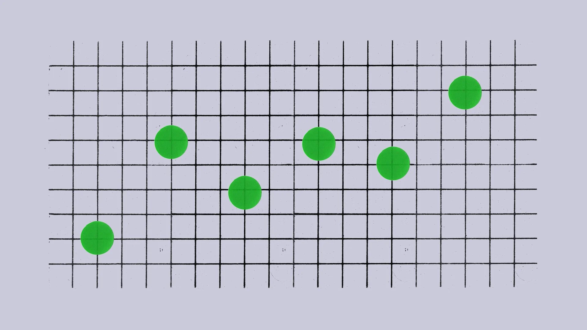

# 发布 Anthropic 经济指数调查

- 英文标题：Announcing the Anthropic Economic Index Survey
- 发布日期：2026-04-22
- 官网栏目：经济学
- 原文：[Anthropic 页面](https://www.anthropic.com/research/economic-index-survey-announcement)
- 官网署名：Anthropic

> 中文机器初译，未逐篇人工校对。引用研究结论时请核对英文原文。

的 [经济研究](https://www.anthropic.com/research/team/economic-research) 团队正在启动人类经济指数调查，这是一项通过以下方式进行的月度调查 [人性采访者](https://privacy.claude.com/en/articles/12996960-how-does-anthropic-interviewer-collect-and-use-my-data).

了解人工智能的经济影响需要超越我们今天拥有的定量数据。使用和扩散指标告诉我们人工智能是如何部署的，而传统的劳动力市场指标——如就业率、工资趋势和裁员——追踪已经发生的事情，通常会出现有意义的延迟。两者都很重要，但都没有体现出人们如何体验人工智能给经济带来的变化，也没有体现出随着人工智能能力的进步，他们期望会发生什么。

虽然人工智能有望产生巨大影响，但人工智能将如何影响就业、生产力和失业（以及在什么时间范围内）存在很大的不确定性。为了预测仍在展开的转变，我们需要听取正在经历这一转变的人们的意见，并且我们需要以能够识别出现的变化的节奏来这样做。

在人类经济指数调查中，我们的目标是获取丰富的新定性数据语料库。这项努力补充了 [同伴报告](https://www.anthropic.com/research/81k-economics) 需要从经济角度来看待 [81,000 个开放式](https://www.anthropic.com/features/81k-interviews) 12 月份通过 Anthropic Interviewer 收集的调查回复。我们将询问Claude用户人工智能是否正在改变他们今天的工作——他们可能会移交哪些任务，他们是否看到生产力的提高，他们在招聘和角色方面可能观察到的变化——他们对未来的期望，以及他们希望妥善处理的过渡是什么样子。

每月收集这些数据不仅可以衡量人们的体验和期望，还可以衡量他们的观点随着人工智能能力的发展而变化的速度。结合 Claude 使用数据 [隐私保护方式](https://www.anthropic.com/research/clio)，这些第一手资料可以在劳动力市场总体数据出现之前揭示变化。

该调查于今天启动。每个月，我们都会邀请一小群随机选择的Claude用户：任何拥有至少两周的个人帐户的人都可能会被邀请。我们每个月都会轮换样本，以便随着时间的推移我们能听到尽可能广泛的人的意见。如果您受到邀请，您会看到一条横幅 [Claude.ai](http://claude.ai)，或者如果您主要在移动设备上使用 Claude，则会收到一封电子邮件。我们希望您能参加。我们计划在未来的人类经济指数报告和其他研究简报中发布见解。有关更多信息，请参阅下面的常见问题解答。

### 常见问题

**我如何访问该研究？**

从今天开始，帐户至少两周的Claude用户的一小部分随机样本将在 [Claude.ai](http://claude.ai)、Cowork 桌面应用程序或电子邮件（如果您仅在移动设备上使用 Claude）。我们每个月都会邀请一组新的 Claude 用户，所以如果您这次没有被选中，请留意。

**研究会问我什么？**

我们将使用人择面试官来询问您的工作情况，您注意到自己的角色或组织发生了哪些变化，您预计明年会发生什么变化，以及您希望人工智能塑造的经济在十年后会是什么样子。

**您将如何使用这些数据？**

我们将分析这项研究的见解，作为我们经济研究的一部分，发布我们的研究结果，并利用它来改进我们的模型和服务，以反映我们所学到的知识。我们通过本研究收集的数据将根据我们的规定进行处理 [补充隐私政策](https://privacy.claude.com/en/articles/14139821-supplemental-anthropic-interviewer-privacy-policy)。我们还可能在已发布的调查结果中包含来自选择加入的用户的去识别化回复。 [了解更多。](https://privacy.claude.com/en/articles/12996960-how-does-anthropic-interviewer-collect-and-use-my-data)

*如果您还有其他疑问，请通过我们的右下角的消息图标联系我们 [帮助中心](https://support.claude.com/en/articles/9015913-how-to-get-support).*
