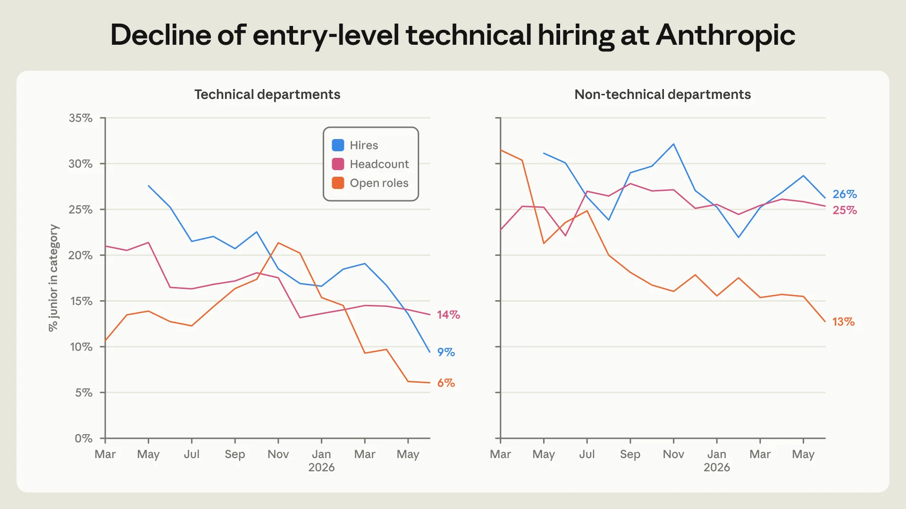
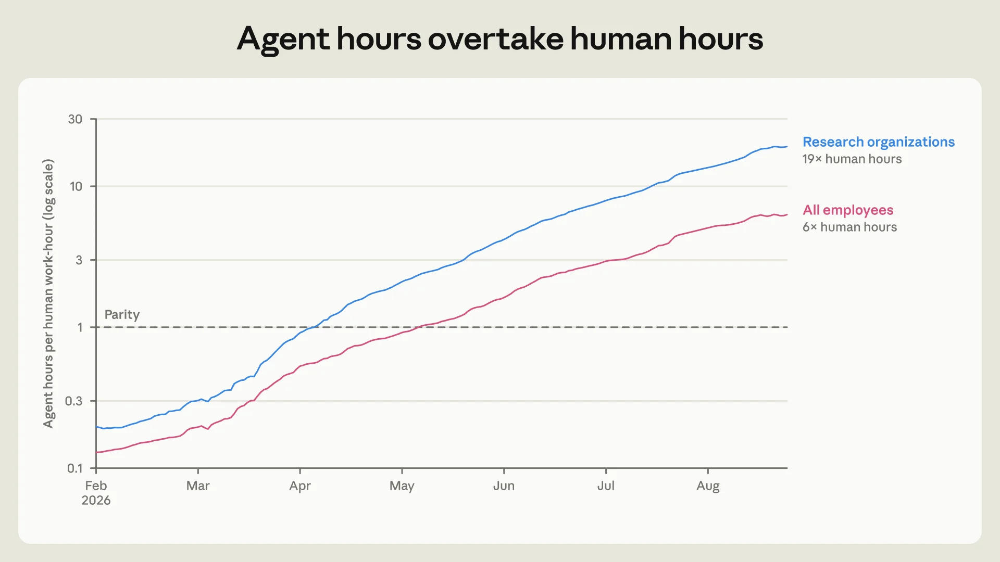
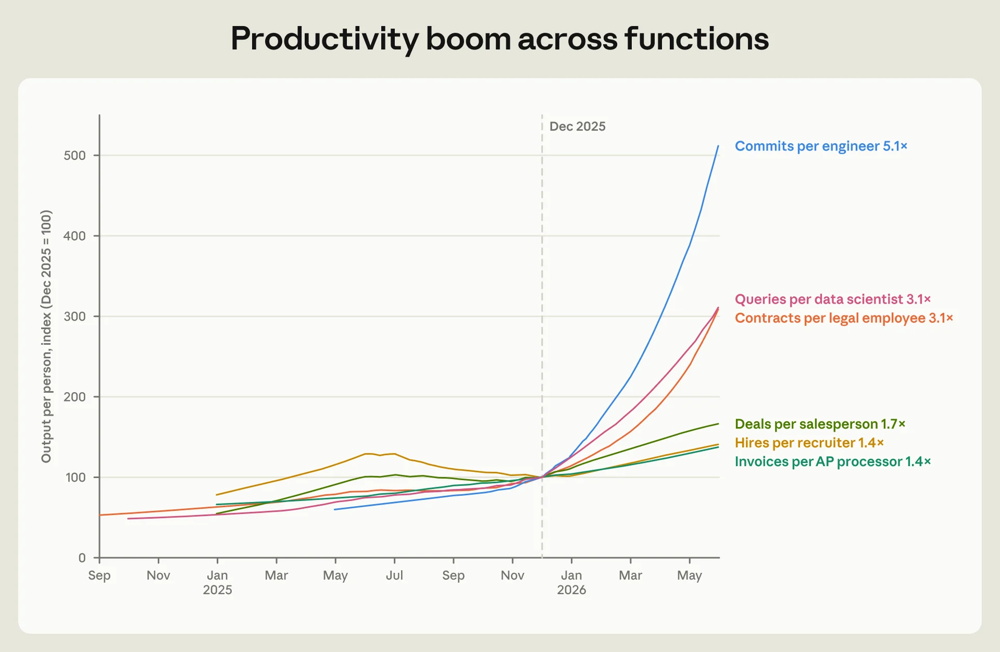
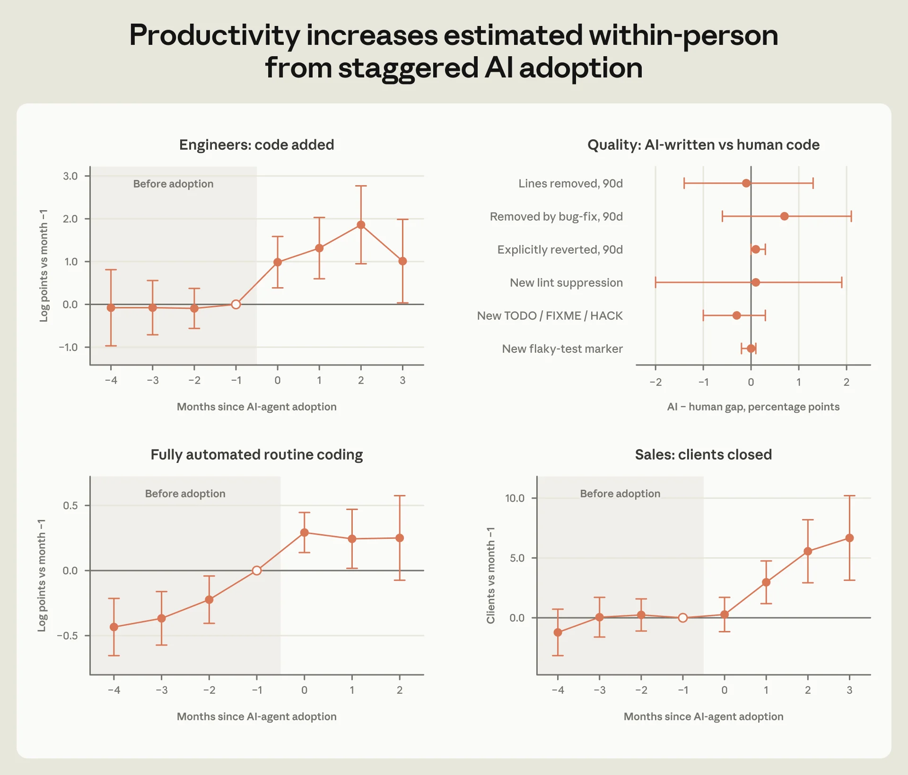
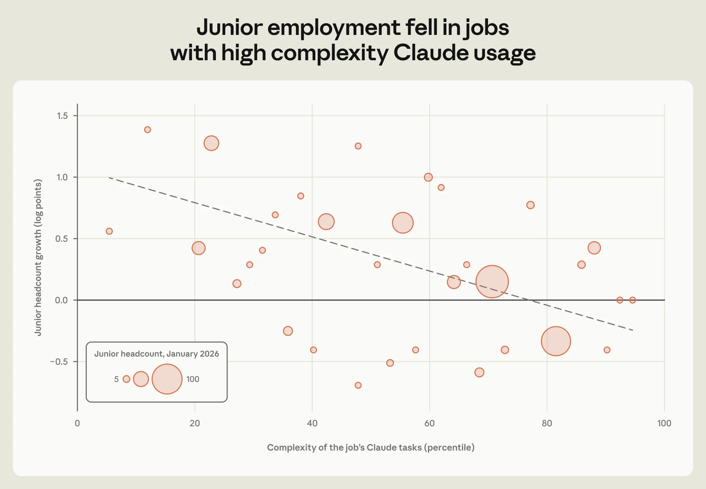
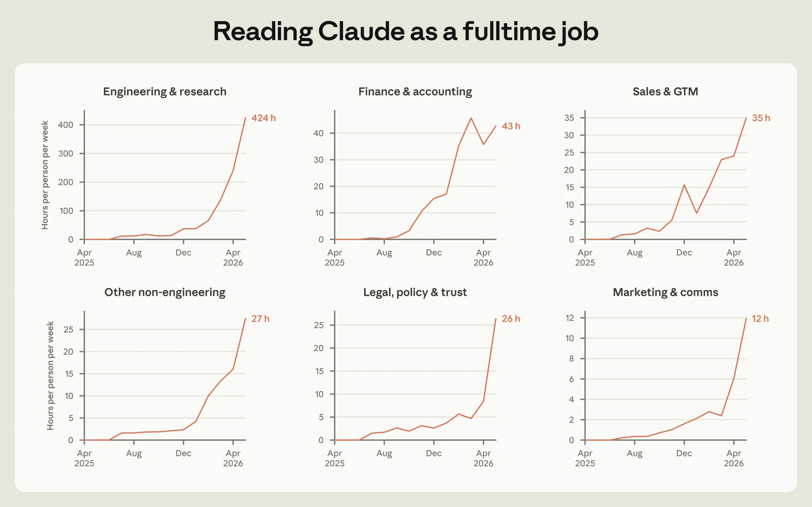
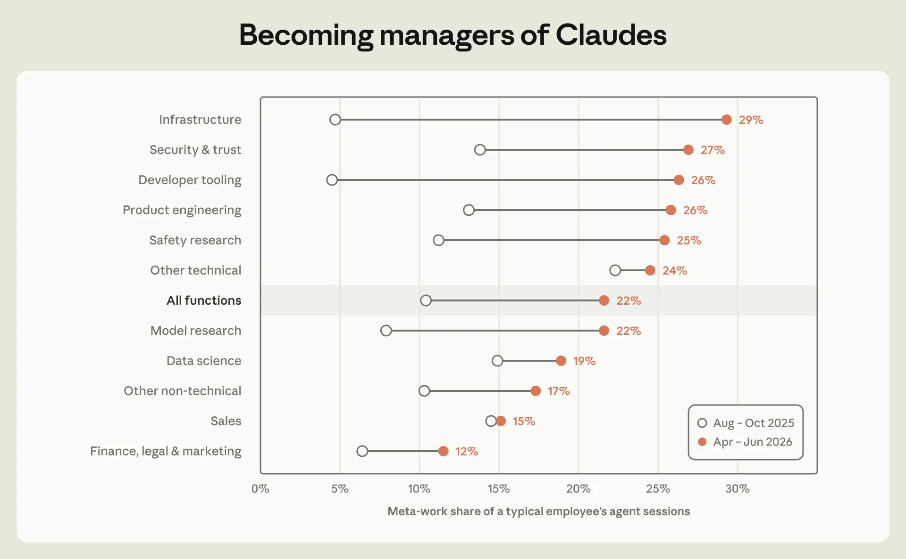

# Anthropic 的用工情况如何变化

- 英文标题：How employment is changing at Anthropic
- 发布日期：2026-10-16
- 官网栏目：经济学
- 原文：[Anthropic 页面](https://www.anthropic.com/research/employment-at-anthropic)
- 官网署名：Anthropic
- 官网推荐阅读：[阅读 PDF](https://assets.claude.com/72628f1863c53432195db83279252dfd2cb53158.pdf)

> 中文机器初译，未逐篇人工校对。引用研究结论时请核对英文原文。


*内森·威尔默斯、雷吉娜·卡蒂庞、马克西姆·马森科夫、彼得·麦克罗里*

AI 如何重组 Anthropic 的工作和就业？作为一家处于人工智能应用前沿的公司，Anthropic 可能成为人工智能将如何改变整个经济的工作组织、招聘和劳动力需求的领先指标。

### 主要发现

- Anthropic 一直在招聘较小比例的初级技术职位。这是因为AI 智能体相对于员工的工作时间迅速增加。截至 8 月，交互式AI 智能体的工作时间与员工的比例为六比一。
- 随着AI 智能体在公司中的扩散，Anthropic 开始为每人编写更多的代码，为每位代表完成更多的销售额，并处理更多的合同。随着时间的推移，跟踪同一名员工，随着他们采用新的人工智能工具，产出也会增加。
- 这种加速使得人类注意力成为智能体输出的瓶颈。即使对于非技术员工来说，阅读Claude代理的所有输出也需要花费他们半周的工作时间。作为回应，员工转向“元工作”，即构建可见性工具和监控代理管道。
- 工作组织的变化反映在招聘经理优先事项的转变上，他们越来越强调相对于技术领域专业知识和实施的自主性和判断力。

### 简介

在日益强大的人工智能下，我们可以期待工作和就业发生哪些转变？Anthropic 值得研究，因为它彻底围绕人工智能塑造了工作流程。客服人员浏览 Slack 聊天并安排会议。他们自主修复错误并共同解决大型工程项目。座席工作时间与人工工作时间之比为 6 比 1。Anthropic 发生的变化现在发出了有关未来可能的工作和就业的先进信号。

该报告利用了全面的内部 Anthropic 数据，涵盖就业、人工智能使用、产出指标、员工调查、内部沟通模式、员工日历数据和招聘决策记录。它将这些定量数据与 17 名员工访谈联系起来。

我们发现，即使公司不断发展，初级技术职位的相对招聘速度也有所放缓。当工程师和非技术员工采用编码代理时，他们的生产力都大幅提高。招聘经理越来越强调申请人相对于特定技术专长的自主权和判断力。在人工智能密集型组织中工作的一个决定性特征是，在可能的情况下，不断有压力让自己摆脱这个瓶颈位置。一位工程师将工作描述为“面对着一群Claude，每个人都在寻求我的关注”。 Anthropic 的员工仍然持批评态度。但他们贡献的性质已经改变。

Anthropic 通过建立预警系统来应对这些变化，以跟踪面临中断风险的工作，并且随着工作的发展，公司优先考虑内部重新部署。这些在人工智能发展和工作场所变革前沿采取的行动表明，具体的组织承诺如何影响人工智能对就业的影响。但他们也提出了一些棘手的问题，即这些承诺到底应该是什么。

### 边境劳动力需求

人类已经迅速扩张。但与前一代大型科技公司相比，它每美元收入所雇用的员工数量较少。成立五年后，Anthropic 的每位员工收入是 Meta 和 Google 的 2 到 4 倍，因为它们在自身的快速增长中达到了顶峰。[1](https://www.anthropic.com/research/employment-at-anthropic#footnote-1)

哪些职位缺失？在 Anthropic 内部，2026 年 1 月，核心技术职能部门出现了对初级技术员工需求下降的讨论。在自己的工作中最依赖 Claude 的团队发现，编写代码和查找错误可以越来越多地交给 Claude。新功能模型加速了这种看法：“令人惊讶的是性能工程师的提升，尤其是它基本上在一夜之间改变了我们所寻求的东西。”

到四月份，工程和研究团队已经不再强调招聘较低级别的技术职位。在同月的调查中，大多数经理描述了由于人工智能而招聘不同技能的人。大约三分之一的 ML 经理和五分之一的 SWE 经理表示，由于人工智能，招聘人数减少。

就业份额的变化是惊人的。图 1 显示，自 2025 年初以来，Anthropic 技术部门初级员工的比例从 21% 下滑至 14%。初级技术人员的比例下降得更快，从 27% 降至 9%。自 2025 年 12 月以来，青少年职位的下降尤其严重。



**Anthropic 的入门级技术招聘人数减少。**

与此同时，Anthropic 内部技术部门的整体就业比例已从去年的 61% 下降至 56%。随着公司的扩张，技术招聘的绝对数量持续增长，但销售、财务和招聘方面的密集招聘已经超过了这一增长。这种转变的一部分是随着公司规模的扩大，业务功能的自然扩展。部分可能反映出编码工具越来越多地允许非技术员工自己制作软件。例如，一位销售代表设计了适合其工作的自定义仪表板和管道：“像这样的构建超出了我的掌控范围，尤其是连接所有工具、MCP 的 UI。但我可能在三到四个小时内就完成了这个，只是迭代而已。”针对非技术员工（即基线时没有提交代码的员工，不包括新员工）的以编码为中心的 AI 智能体会话从 2025 年 8 月的每月 2 次跃升至 2026 年 5 月的每月 90 次。

然而，招聘结构的这种转变不仅仅是一个关于自动化编码的故事，让它扩散到 [其他领域专家](https://www.anthropic.com/research/claude-code-expertise)。在技术部门内，截至 2026 年 4 月的一年中，不积极编码的员工（定义为在过去 30 天内没有提交代码的员工）比例下降了近一半。部分原因是非工程师比例下降：例如，工程师与产品经理的比例约为 17 比 1，并且自 2025 年以来有所增加。管理者的提交数量也增加了一倍。技术团队中的监督和协调角色越来越多地涉及构建和交付代码。

非技术性招聘没有加速的一个领域是行政职能，这些职能通常随着公司规模的扩大而扩大。尽管 Anthropic 发展迅速，但代理助理、自动审核和票务服务外包的结合使得其文书工作变得轻薄。一位财务经理建立了一个采购请求审查代理，并向同事解释说：“这只是试图找到需要花费大量时间的事情，以便他们可以专注于其他事情。”

即使是与面对面互动密切相关的文书工作也增长缓慢。一位行政助理曾为日程安排和电子邮件分类建立了个人助理代理，他解释说：“我认为我们已经超越了Claude增强真正入门级管理类型角色的观点，”而是将他们的工作重点放在更高级别的“参谋长”任务上。

这些变化已经涉及到重新分配：2026 年，在公司工作至少一年的员工每月跨部门流动的可能性比 2025 年增加 50%。整个团队也被重新分配，因为他们将工作移交给代理。考虑一个产品设计团队，他们在 Claude.ai 上写下了类似问候语的内容：“你好，夜猫子；” “和Claude一起喝咖啡吗？” 2026 年春季，该团队开发了一个上下文图，可以有效指导代理编写引人注目的产品内容。其经理解释说，这“扩大了团队规模”，但也提出了人类作家还剩下什么的问题。然后，团队转向代理提示，并开始为 Claude 编写模型评估和提示。“那些用语言来驱动人类行为的作家现在正在用它来驱动Claude的行为。”

### 人工智能是否正在推动 Anthropic 生产力的提高？

这些转变归因于人工智能吗？在 Anthropic，人类只是不断壮大的AI 智能体队伍中的薄薄一层。根据座席会话遥测，2026 年 3 月，自主和交互式座席的工作时间总和首次超过了人类工作时间。其中一部分是代理团队进行工业规模的软件工程，填写无数的例行测试和检查，对越来越多的基础设施代码进行维护，并推动协调一致的活动来翻译大量代码库。但即使缩小到由个别员工部署的代理（如图 2 所示），到 8 月份，代理的工作时间也是人工处理人员的 6 倍。



**代理工作时间超过人工工作时间。** 注意：我们仅限于员工主导的交互式会话和池子代理。工作时间概念是代理运行时间，包括推理和主动工具使用，但不包括任何超过 30 分钟的等待。人工工作时间按人数计算，假设每周 40 小时。

Anthropic 是一家软件生产商，流经这些代理的大量代币都用于生产软件代码。仪表板监控整个公司运营的代理队伍。但个人助理代理还监控员工日历和消息、安排时间、发送从传入消息中积累的待办事项列表，并自动向员工介绍即将举行的会议的人员和目的。代币涉及越来越多的日常工作任务。



**各职能部门的生产力蓬勃发展。** 注意：Loess 更平滑地拟合基础索引输出数据。

所有这些代币相当于什么？图 3 绘制了一系列具有可测量输出的工作职能随时间变化的输出。与之前的报道一致 [测量人类工程师](https://www.anthropic.com/research/how-ai-is-transforming-work-at-anthropic) 并描述 [模型训练和研究的自动化](https://www.anthropic.com/institute/recursive-self-improvement)，每位工程师的代码提交量增长最快，速度是六个月前的 5 倍。数据科学家也在更多地查询不断增长的人类数据，要求Claude代理向仪表板和决策者获取实时指标。但图 3 显示，随着编码代理的扩散，即使是非技术员工也看到了产出的增加：律师处理了更多的合同；通过发票引入应付账款；销售人员完成了更多交易。

但这一切都是因为Claude的使用吗？同一时期，该公司业务出现爆炸性增长。当您销售强大的模型时，更容易达成交易。为了评估人工智能的独立效果，我们将采用代理编码工具的员工的产出与尚未采用这些工具的员工进行了比较。这让我们可以比较在公司同一个月工作的员工，因此接触到类似的业务环境，但使用不同的工具来处理它。但请注意，工具的采用并不是随机的：例如，如果即将推动某个大型新项目的员工决定为其配备工具，这就会使我们的估计产生偏差。

我们跟踪了 192 名工程师采用编码代理的情况，而在研究期间有 74 名工程师没有采用代理。图 4 显示，在采用后的几个月内，工程师添加的代码量急剧增加。更多代码并不一定意味着更好的代码或 [业务影响](https://www.nber.org/papers/w35275)。为了测试 AI 代码溢出，我们研究了 Anthropic 的代码提交。我们比较同一名员工在同一个月、同一编码目录中提交的代码，但这些代码是由编码代理编写的，而不是由人类员工直接编写的。代码质量有很多维度，人工智能错误可能比人类错误更难识别。但我们发现随后删除或恢复的代码行率没有差异。

图 4 还显示了工程师采用第一个完全自主代理后会发生什么。与未采用者相比，采用者的比例已经急剧上升。这表明，转向完全自主代理的员工已经在提高他们的产出。



**预计人工智能的交错采用会提高人的生产力。** 注：系数将编码代理采用者与未采用者进行比较，并具有个人和日历月双向固定效应。治疗时间基于患者第一个月至少进行五次药物治疗。条形图是根据个人聚类的标准误差的 95% 置信区间。质量小组将某人直接编写的代码与同一人的编码代理编写的代码进行比较。质量指标是 90 天内因任何原因删除的线路所占的比例；通过错误修复专门删除的共享；整个提交是否显式恢复；添加 lint-suppression 注释；添加需要修复的注释；并将测试标记为要跳过、重试或允许失败。

这些模式是否超越了编码，进入了更广泛的知识工作转变？从去年九月开始，Anthropic 销售代表稳步采用AI 智能体。图4显示，销售代表采用代理后，他们与更多客户达成了交易。这种模式的部分原因可能是由拥有更多销售机会选择自动化的代表推动的。但它也可以反映日志记录和日常通信的自动化。一位客户主管解释说，Claude 自动化处理了电子邮件起草和客户管理软件集成，取代了他们之前约 20% 的工作任务。另一位员工指出，类似的自动化让他们能够专注于面对面的时间，让他们与以前多了 30% 的客户交谈：“任何时候你第二次做任何事情时，你都会想，好吧，我怎样才能使用 Claude 来做这件事，这样我就不必做第三次了？”

除了销售之外，一位 Anthropic 律师还构建了一系列 Claude 自动化程序来扫描风险和机会、对法律问题进行分类，并首先通过面向公众的副本进行法律审查。一位招聘人员让Claude帮助寻找候选人、跟踪申请和进行分析，这些工作可能需要“几周的时间”，这样他就可以重新设计过时的面试问题并会见更多的申请人。

所有这些都表明，随着人工智能能力的提高，它会影响 Anthropic 的广泛工作。从描述性的角度来看，我们发现使用 Claude 执行最复杂任务的初级职位就业率正在放缓（图 5）。



**初级就业增长受Claude使用复杂性影响。** 注：在工作层面进行绘图。增长率是将 2026 年 1 月与 2026 年 7 月的员工人数进行比较。AI 复杂性基于代理日志的自动编码器（就业下降之前，2025 年 10 月至 2025 年 12 月）和百分位数转换。点按该职位一月份的就业情况进行缩放；回归线适合加权点。

### 瓶颈和流程：人工智能密集型工作场所中的新任务和旧任务

人工智能的广泛采用不仅重塑了就业和生产力。它还推动工作流程的不断变化，产生新任务并改变员工对工作场所的看法。一名员工将其描述为“Anthropic 面临的永恒压力，要求他们尽快行动并让Claude来做所有事情”，另一名员工则表示“我们期望在一周内完成的事情是在其他地方需要三个月才能完成的事情”。一项内部员工调查询问 Anthropic 的工作流程是否使受访者尽可能提高工作效率：2024 年底，44% 的员工表示同意；到 2025 年 11 月，这一比例将达到 58%（2026 年 4 月，75% 的人回答“是”，但由于删除了“尽可能”，这个问题被削弱了）。截至八月， [Anthropic 的员工预计](https://www.anthropic.com/research/ai-expectations-gap) 到 2030 年，人工智能将能够完成他们 75% 的工作，而其他美国人只能完成 28%。

内部模型发布的节奏加剧了这些不断提高的生产力预期。一旦有新模型可用，Anthropic 员工就开始在交互式编码代理会话中解决更棘手的问题。我们通过自动Claude评分器根据所涉及系统的深度、范围和数量对未识别会话的任务需求进行评级来衡量这一点。旧模型难度高于 90% 的任务比例急剧上升约 30%（从所有任务的 10% 增加到 13%），并在模型发布后的几周内保持较高水平。分配给代理的任务的轻松结束变化不大。

不断上升的代理生产力转化为在人类屏幕和注意力上的输出。一位工程师将其与保姆进行了比较：

他们就像，我需要打开我的果汁盒，而且我的果汁盒打开是紧急情况。这与那些割破手指流血的人表达的担忧程度是一样的。 [...]当你照顾孩子时，每个孩子都会给你带来同样的担忧，同样需要你的关注，不同的[Claude]也会这样做。

在 2026 年 4 月的调查中，关于人工智能如何影响日常工作的开放式问题中，27% 的人描述了 Claude 工具提高了生产力，20% 的人描述了他们的角色从实际工作转向管理 Claude。

在这种模型驱动的加速过程中，人类的注意力始终是一个瓶颈。在交互式、多轮会话中，座席的绝大多数会话时间根本没有花在工作上，而是花在等待上。我们通过从每个交互会话的总挂钟时间中减去每个代理的活跃工作时间来跟踪空闲时间。Claude 会话中大约 80% 的时间都在等待人工输入。正如一位工程师所说，人们正在“成为代理的瓶颈”。

阅读Claude在交互式会话中的所有输出到底需要多少时间？对于每个交互式会话，我们假设平均人类阅读速度，将每个会话的代理输出标记转换为字数。图 6 显示，在过去六个月中，技术职能部门的编码代理产出量大幅增加。但即使对于非技术团队来说，交互式 Claude 会议也能输出足够的内容，足以占用一周一半以上的工作时间。Claude的大量文本需要整理。



**把阅读Claude当成全职工作。** 注意：通过将输出标记转换为单词来估计时间，假设每个标记 0.75 个单词，每分钟读取 250 个单词。

应对这种洪流的一个解决方案是提高自动化程度。但这需要不同类型的工作。给代理人的书面长期指示从 2025 年 7 月的几百条增加到一年后的 8,500 条。一名工程师设立了一名代理参谋长来对代理请求进行分类。另一位员工为他们的Claude团队写了一份绩效评估：“嘿，让我们来谈谈我们的沟通方式中哪些是有效的，哪些是无效的。”招聘人员构建了集成仪表板，让座席发现问题并采取行动。一位律师将他们的注意力从审查法律问题转移到做“搜索引擎优化以获得法律建议，你需要编写[客户的]代理发现的框架。”

图 7 显示，此类元工作从 2025 年秋季普通员工互动 Claude 会话的 10% 跃升至 2026 年春季的 22%。这一增长很大程度上归因于代理管理：为多代理运行编写规范、循环一个代理以检查另一个代理的输出以及监控管道。在各个功能中，人类的参与越来越多地从特定的代码片段或编写使代理有效完成任务所需的工具中抽象出来。



**成为Claude的经理。** 注意：元工作估计基于自动编码器评估 2,000 个 1 行聊天摘要的样本，根据它们是否专注于构建 Claude 技能、其他代理的计划和审查、代理管道的仪表板和监视器，并记录工作是如何完成的（与实际工作本身相比）。

尽管代理的可靠性有所提高，并且在监督代理的工具上进行了大量投资，但人类的信任和责任仍然至关重要。一名员工解释说，越来越多地追查错误“发现了这些组织或系统或技术债务问题，这些问题实际上需要一定程度的人力召集、决策和治理才能解决。”在一次又一次的采访中，员工们表示面对面的协调是不可或缺的。根据日历数据，员工花在会议上的时间中位数比一年前增加了 20%。这在一定程度上反映了公司的发展，以及向会议密集型非技术角色的转变。但即使是担任技术个人贡献者角色的员工，会议时间也比过去一年增加了 16%。大局战略问题涉及广泛的杠杆立场，通常需要与他人进行辩论和接触。摆脱管理代理的休息通常看起来像是参加一个会议。

从广义上讲，技术和非技术角色的工作实现部分都实现了自动化（编写代码、识别错误、记录进度、起草电子邮件）。工程师们描述了自己成为代理人的领导者和管理者；非技术员工描述了他们工作中越来越多的战略部分：“20% 的战略部分变成了工作的 90%。”但对于许多非技术角色来说，核心实施工作也是人际交往的：销售电话、面试、针对复杂问题的跨职能协调。所有这一切仍然是人性的。

还要考虑提供人类通信的首页和后台渠道的 Slack 渠道。代理通过 Slack 扩散，最终出现在近一半的活跃公共渠道中。图 8 放大了单个大型部门的通信网络，利用了部门成员进行交互的所有公共 Slack 渠道。它通过人类和代理参与者是否参与 Slack 线程来将他们联系起来。该图显示了代理的显着崛起，橙色点在网络中遍地开花并占据主导地位。

[原文媒体](https://assets.claude.com/8f9591116db7ee91487f770222ddc524d551d867.mp4)

**代理来到通信网络。** 注：蓝点为员工；橙色点是代理线程。关系是同一线程中人类或代理之间的交互。

代理不成比例地出现在Claude与人类互动的专用渠道中，而不是在现有的人类渠道中大量发送消息。人类交流的基本结构和密度变化不大。代理并没有取代人类交互，而是对其进行了补充：该部门中的人类线程维持了相同数量的人类响应，同时还对代理响应进行了分层。代理成为单个员工的团队，而不是同时与许多员工具有高连接性的节点。

随着人类在越来越多的AI 智能体中工作，他们面临着将人类工作转移到代理可见渠道的压力。如果在面对面的会议上做出决定，并且没有出现任何注释或报告，那么代理就缺少更新其目标和假设的关键背景。一名员工解释说，几个月前的一份关于Claude赃物的文件上有他们的名字，这意味着在他们的职责发生变化很久之后，特工们仍不断提出购买 T 恤和马克杯的请求。在人工智能密集的工作场所中，未记录的会议和直接消息中的私人工作是看不见的、令人困惑的和令人沮丧的。一位研究人员将这种默认的开放性描述为 Anthropic 彻底整合人工智能的关键：“大多数组织并不以这种方式运作，我认为这是一个很大的转变，因为领导者必须公开捍卫反馈。”为人工智能提供环境的需要需要对人类工作和决策的可观察性。

谁能在这样的工作场所茁壮成长？Anthropic 工作内容的变化也表现为招聘经理在招聘决策中优先考虑的技能的变化。自 2024 年以来，我们使用自动编码器来处理 Anthropic 雇用的数千名员工的招聘经理面试记分卡。这些评论是面试官评估候选人表现的定性反应。最明显的变化是更加重视候选人是否创造性地使用人工智能工具。到 2024 年，招聘经理在约 5% 的技术职位评估中会注意到候选人在人工智能工具方面的记录，而在非技术职位评估中则占 7%。到 2026 年，技术职位的比率增加了两倍，非技术职位的比率增加了四倍。招聘经理越来越关注候选人是否有效地使用人工智能。

评估方面更深层次的变化也显而易见。在技​​术候选人的面试中，增幅最大的是对申请人自主性和判断力的评论。对领域专业知识的讨论在整体评估中所占的比例有所下降。正如一位经理所解释的那样，“我预计模型将继续呈锯齿状，因此对于我的团队来说，我希望它们能够跨领域互换。”同样，对于非技术候选人来说，客户和任务导向增加，而对执行技能的讨论减少。招聘经理越来越多地根据申请人的判断和承诺来评估申请人，而不是人工智能工具自动化的特定领域技能和执行力。

### 雇主可以做什么

Anthropic 对人工智能的深入采用使其成为一个有用的案例。随着人工智能的传播和改进，工作组织可能会像之前的技术变革浪潮中那样发生变化。铁路为我们提供了管理公司，蒸汽动力为我们提供了工厂，个人电脑为我们提供了初创公司。使用工具、推理的法学硕士需要哪些新组织，我们在其中扮演什么角色？一种可能性是单人初创公司，每家初创公司都有一位人类创始人，带领大批代理人赚取数十亿美元的收入。另一个是由人工智能天才首席执行官创建的公司，雇用人类代理人只是为了挥舞移液器并在国会作证。

人择看起来不像其中任何一个。去年它的规模增加了两倍。它不再是一家小型初创公司。它也没有放弃对其模型的执行控制权。书面的 Slack 辩论和面对面的会议指导着从公司战略到团队决策的一切，而AI 智能体的投入很少。在整个公司保持人类工作的可见性可以确保自主代理从新的环境中进行推理。就所需知识和工作中的相互依赖性而言，协调代理团队的个人贡献者看起来更像管理者。对于人工智能密集型组织来说，公开工作和决策至关重要。

随着员工越来越多地将自己的工作视为管理Claude团队，他们花更多的时间构建在自己独特的领域有效地做到这一点所需的工具。这种实验意味着员工不断地自动化自己的任务。在某些角色中，他们越来越脱离最初培养其技能的对象级工作。当代理快速完成工作流程时，人类的注意力和判断力成为系统面临的瓶颈。从销售到法律，人类员工需要完成更多不同的任务。角色范围扩大到包括构建产品、管理代理以及处理战略和人际工作，这些工作仍然超出了最好的法学硕士的范围。

组织和工作内容的这些变化伴随着初级技术职位在员工人数、招聘和发布方面所占比例的下降而出现。招聘经理越来越关注求职者的自主权和判断力，而不是执行力和狭隘的专业知识。总体而言，Anthropic 相对于就业增长的收入增长速度甚至超过了上一代科技公司早期生产率的快速增长。

纵观整个经济体的这些模式，我们发现人工智能的扩散可能会带来工人失业的风险。之前的工作还发现 [人工智能原生初创公司](https://www.hbs.edu/ris/Publication%20Files/26-090_96f92aa0-37d9-4789-beaa-5c0cb87a4032.pdf) 和 [人工智能采用者](https://www.nber.org/papers/w34162) 更平坦并雇用 [入门级较少](https://papers.ssrn.com/sol3/papers.cfm?abstract_id=5425555) 员工。关于如何以服务于周围人类的方式管理人工智能剧变，我们可以从 Anthropic 学到什么？

在这里我们要小心行事。Anthropic 的就业实践有很多部分无法在整个经济领域复制。

但有三个特点很突出。首先，广泛的股权让员工对公司的成功产生了浓厚的兴趣。当然，对于一家估值大幅上涨的公司来说，这是一个容易的姿态。对于许多公司来说，共享所有权可能是不够的，或者是不可取的。但很难想象一个有利于工人的人工智能采用版本，其中工人在成功推出时不持有经济利益。正如受访者所说，如果个人贡献者被期望“管理代理”、“做出副总裁级决策”并成为“自己的业务线”，那么将他们的利益与组织保持一致就至关重要。20世纪50年代达成的二战后工会与管理层的解决方案正是基于这种讨价还价：汽车工人联合会和钢铁工人联合会等工会允许管理层在工作重组（甚至集约化）方面拥有特权，以换取与生产率提高和一系列丰富福利挂钩的加薪。无论受人工智能影响的员工和雇主之间的新协议是什么，分享采用人工智能带来的好处的机制都是至关重要的。在 Anthropic，工人们将他们的专业知识编入机器中，看到他们的工作程序不断地混乱和扰乱，并且看到他们工作的很大一部分变成了快速阅读人工智能合作者的输出。他们并不是免费这样做的。

其次，Anthropic 正在建立一个持续的预警系统，以监控面临人工智能驱动转型的工作。根据人工智能功能和使用来读取一系列角色级别的需求和生产力指标。这些汇总指标有助于标记工作的转移方向。预警系统使公司能够开始将受影响的员工重新分配到技能适合、风险较小的工作岗位。随着整个经济领域的公司重新定位，加快工作重组的步伐，指导内部员工重新分配的有效系统将变得越来越有价值。人工智能进步越快，转向外部劳动力市场来满足人工智能进步所需的每一项新任务将成为更严重的瓶颈。在这份报告中，我们发现部门之间的流动性增加，工作内容发生变化，并且随着旧任务的自动化，员工转移到新任务。对于人工智能密集型组织来说，构建能够在内部灵活重新分配员工的系统至关重要。

这种对内部员工重新分配的承诺引发了重要的权衡。运作良好的劳动力市场应该将工人转移到最具生产力的职位，无论是在当前雇主还是另一雇主。重新分配现有员工的承诺可能会让雇主不愿冒险雇用新员工。在正常的经济条件下，尤其是竞争激烈的经济条件下，此类承诺的成本可能会很高。

但优先考虑重新分配迫使采用人工智能的公司考虑如何利用人工智能为新产品和新市场创造新任务，而不是将人工智能应用程序用于取代人类工人以节省劳动力成本。这可以帮助雇主抵制“[马马虎虎](https://pubs.aeaweb.org/doi/pdfplus/10.1257/jep.33.2.3) 或‘[效率低下](https://academic.oup.com/restud/article-abstract/92/1/69/7612958?redirectedFrom=fulltext)在自动化中，人工智能或其他技术勉强超过了人类工人：雇主取代了人类工人，给失业工人带来了巨大的收入损失，同时带来了最低限度的生产力收益。

从我们在《人择》中看到的情况来看，新颖且持久的人类任务仍然与人工智能的密集使用并存。由于未来一系列任务的不确定性，建议保留灵活的劳动力。正如一位 Anthropic 高管指出的那样，“一支焦急不安的员工队伍并不能发挥出最佳工作状态。”

这些行动都无法阻止强大的人工智能扰乱工作。事实上，没有任何报告直接解决本报告中记录的初级员工招聘放缓的问题。对现任者的就业保护不会让那些一开始就没有被聘用的人受益。雇主的私人行动必须与有远见的政府政策相结合 [再培训](https://www.anthropic.com/research/reviewing-the-evidence-on-worker-retraining-programs) 和收入支持。此类政策应以人工智能可以带来的工作场所变革规模的清晰蓝图为指导。

### 建议引用

```
@techreport{wilmers2026employment,

author = {Nathan Wilmers and Regina Catipon and Maxim Massenkoff and Peter McCrory},

title = {How employment is changing at Anthropic},

institution = {The Anthropic Institute},

type = {Technical Report},

year = {2026},

month = oct,

url = {https://www.anthropic.com/research/employment-at-anthropic}

}
```

### 引用的作品

阿西莫格鲁、达龙和帕斯夸尔·雷斯特雷波。2019.“自动化和新任务：技术如何取代和恢复劳动力。”经济展望杂志 33 (2): 3–30。 <https://doi.org/10.1257/jep.33.2.3>

贝拉贾、马丁和内森·佐尔兹。2025 年。“自动化效率低下。”经济研究评论92（1）：69-96。 <https://academic.oup.com/restud/article-abstract/92/1/69/7612958>

德米尔、梅尔特、莱昂·穆索尔夫和杨丽媛。2026 年。“写代码 vs 写代码运输代码：各代人工智能编码工具对生产力的影响。” NBER 工作文件 35275。 <https://doi.org/10.3386/w35275>

埃文斯、迈克尔和泽维尔·吉鲁。2025 年。“公司等级制度。” NBER 工作文件 34162。 <https://doi.org/10.3386/w34162>

法瓦罗、玛丽娜和杰克·克拉克。2026 年。“当人工智能自我构建时。”人类研究所。 <https://www.anthropic.com/institute/recursive-self-improvement>

Hitzig、佐伊、马克西姆·马森科夫、伊娃·柳比奇、张绍一、瑞安·海勒和彼得·麦克罗里。2026 年。“代理编码和专业知识的持续回报。”人类，6 月 16 日。 <https://www.anthropic.com/research/claude-code-expertise>

胡赛尼·马苏姆、赛义德·马赫迪和盖伊·利希廷格。2025 年。“生成式人工智能作为有资历偏见的技术变革：来自美国的证据简历和职位发布数据。” SSRN 工作文件 5425555。 <https://papers.ssrn.com/sol3/papers.cfm?abstract_id=5425555>

黄、Saffron、Bryan Seethor、Esin Durmus、Kunal Handa、Miles McCain、Michael Stern 和 Deep Ganguli。2025 年。“人工智能如何改变 Anthropic 的工作方式。”人类，12 月 2 日。 <https://www.anthropic.com/research/how-ai-is-transforming-work-at-anthropic>

金、贤真和伦布兰德·科宁。2026 年。“人工智能本土公司。”哈佛商学院工作论文 26-090。 <https://www.hbs.edu/ris/Publication%20Files/26-090_96f92aa0-37d9-4789-beaa-5c0cb87a4032.pdf>

大卫·鲁德曼和马克西姆·马森科夫。2026 年。“补贴职业培训的证据审查。”人类研究所工作论文 2026-01。 <https://www.anthropic.com/research/reviewing-the-evidence-on-worker-retraining-programs>

## 脚注

01人为估计来自截至 2026 年 4 月（大约成立五年后）的 12 个月的内部财务和员工记录。Google 和 Meta 的就业和收入数据基于成立 5 年后（分别为 2003 年和 2009 年）的 10-K 表格文件。所有数字均按 2025 年美元计算。
