# 从 Claude 对话估算 AI 带来的生产率提升

- 英文标题：Estimating AI productivity gains from Claude conversations
- 发布日期：2025-11-25
- 官网栏目：经济学
- 原文：[Anthropic 页面](https://www.anthropic.com/research/estimating-productivity-gains)
- 官网署名：Anthropic
- 官网推荐阅读：[以 PDF 形式阅读](https://assets.claude.com/e5645986a7ce8fbcc48fa6d2fc67753c87642c30.pdf)

> 中文机器初译，未逐篇人工校对。引用研究结论时请核对英文原文。

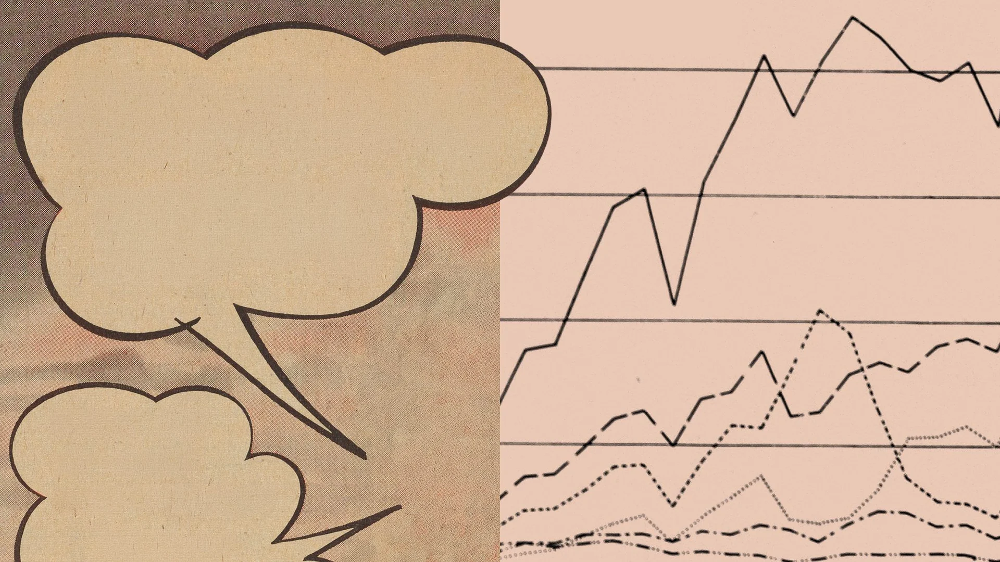

## 概述

*关于人工智能对劳动生产率的影响，与Claude的真实对话告诉我们什么？使用我们的隐私保护 [分析方法](https://www.anthropic.com/research/clio)，我们从以下样本中抽取了十万个真实对话 [Claude.ai](http://claude.ai)，估计这些对话中的任务在有或没有人工智能辅助的情况下需要多长时间，并研究对整个经济的生产力影响。根据Claude的估计，如果没有人工智能的帮助，这些任务平均需要大约 90 分钟才能完成，而Claude将单个任务的速度提高了大约 80%。*

*推断这些估计表明 **当前一代** 未来十年人工智能模型可以使美国劳动生产率每年增长 1.8%*—*大约是近年来运行率的两倍。但这并不是对未来的预测，因为我们没有考虑采用率或功能更强大的人工智能系统对生产力的更大影响。*

*我们的分析有其局限性。最值得注意的是，我们无法解释人们在与Claude对话之外的任务上花费的额外时间，包括验证Claude工作的质量或准确性。但随着人工智能模型在时间估计方面变得更好，我们认为本研究报告中的方法对于理解人工智能如何塑造实际工作可能会变得越来越有用。*

*以下是我们结果的更详细总结：*

- **在 10 万次现实世界对话中，Claude 估计 AI 将任务完成时间缩短了 80%。** 我们使用 Claude 来评估匿名的 Claude.ai 成绩单，以估计人工智能对生产力的影响。根据Claude的估计，人们通常使用人工智能来完成复杂的任务，平均需要 1.4 小时才能完成。通过将任务与 O*NET 职业和 BLS 工资数据进行匹配，我们估计这些任务将花费 55 美元的人力。
- **任务的估计范围、成本和时间节省因职业而异。** 根据 Claude 的估计，人们使用 Claude 执行法律和管理任务需要花费近两个小时，但用于食物准备任务则只需要 30 分钟。我们发现医疗保健援助任务的完成速度可以提高 90%，而硬件问题则可以节省 56% 的时间。这没有考虑到人类可能花在这些任务上的时间 *超越* 他们的谈话 [Claude.ai](http://claude.ai)然而，因此我们认为这些估计可能至少在某种程度上夸大了当前生产力的影响。
- **将这些结果推断到经济中，当前一代人工智能模型可能会在未来十年内使美国劳动生产率年增长率提高 1.8%。这将使美国自 2019 年以来的年增长率翻一番，** **并将我们的估计置于上限 [最近的估计](https://www.oecd.org/content/dam/oecd/en/publications/reports/2024/11/miracle-or-myth-assessing-the-macroeconomic-productivity-gains-from-artificial-intelligence_fde2a597/b524a072-en.pdf).** 根据Claude对任务级效率提升的估计，我们使用标准方法计算出未来十年美国劳动生产率隐含的年增长率为 1.8%。然而，这一估计并未考虑人工智能模型的未来改进（或更复杂的当前技术的使用），这可能会显着放大人工智能的经济影响。
- **随着人工智能加速某些任务，其他任务可能会成为瓶颈**：我们看到某些任务的速度大幅提高，而另一些任务的速度则小得多，即使是在相同的职业群体中也是如此。如果人工智能的作用较小，这些任务可能会成为瓶颈，可能成为增长的限制。

**这为我们提供了一个新的视角来了解人工智能如何随着时间的推移对经济产生影响，我们将继续跟踪这一点，作为我们的研究的一部分 [经济指数](https://www.anthropic.com/economic-index):** 根据现实世界中Claude的对话计算这些估计值，为我们提供了了解人工智能生产力的新视角。这补充了其他方法，例如狭窄领域的实验室研究或提供更粗粒度见解的政府统计数据。我们将跟踪这些估计如何随着时间的推移而变化，以便随着功能和采用的不断进步，了解这些问题的演变情况。

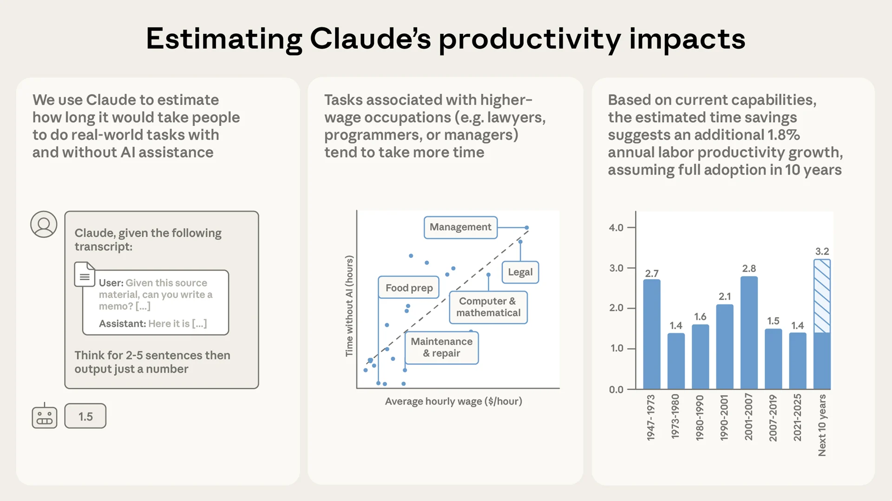

我们的方法和一些主要结果的概述。请参阅下文，了解我们如何验证Claude的估计、我们所做的假设以及我们分析的局限性。

## 简介

作为 [人为经济指数](https://www.anthropic.com/economic-index)，我们记录了人们如何在不同的任务、行业和地点使用 Claude。我们已经捕获了 **广度** 用途——人们如何使用Claude来完成法律、科学和编程任务——但不是他们的 **深度**。人们使用 Claude 完成的任务有多大？Claude 为他们节省了多少时间？

当前版本的经济指数无法反映这一点 **任务内异质性**例如，它无法区分需要五分钟的报告编写任务和需要五天的任务，或者需要一个下午的财务建模任务和需要几周的任务。这使得评估 AI 的经济影响变得困难：软件开发人员可能会使用 Claude 在一天内编写 10 个拉取请求，但如果其中 9 个是次要文档更新，1 个是关键的基础设施更改，那么仅仅计算使用 Claude 执行的这些任务的数量就没有意义。

不仅如此，随着模型能力的提高，我们想了解它们是否做了更高价值的工作。要了解人工智能如何重塑工作和生产力，我们不仅需要了解 *其中* Claude处理的任务，但是 *多么重大* 这些任务和节省的时间是。

几个小组已经开始进行随机对照试验来衡量狭窄领域的生产力提高，包括 [软件](https://arxiv.org/abs/2302.06590) [工程](https://papers.ssrn.com/sol3/papers.cfm?abstract_id=4945566) [任务](https://metr.org/blog/2025-07-10-early-2025-ai-experienced-os-dev-study/), [写作](https://www.science.org/doi/10.1126/science.adh2586), 和 [客户服务](https://www.nber.org/papers/w31161)。METR 的工作 [衡量人工智能完成长时间任务的能力](https://metr.org/blog/2025-03-19-measuring-ai-ability-to-complete-long-tasks/) 已经证明人工智能系统可以独立应对扩展的、多步骤的挑战。但这些评估只考虑了一小部分问题，而不是广泛的现实世界使用。评估人工智能 *整体* 为了对经济产生影响，我们需要一种方法来分析数百或数千个现实世界的人工智能应用程序。

本报告朝着这一目标迈出了第一步。它使用Claude来估计人类完成Claude处理的任务需要多少时间，并将其与Claude和人类一起花费的时间进行比较，从而计算出人工智能节省了多少时间。虽然人工智能模型缺乏有关用户专业知识、工作流程和约束的背景信息，但我们发现，相对于人类估计的完成时间和时间跟踪结果，模型估计的时间对于软件工程任务的数据集显示出有希望的准确性。

接下来，我们将介绍估计任务级时间节省的方法，根据真实数据验证我们的方法，然后使用这些估计来评估哪些任务和职业显示人工智能带来的生产力收益最大。然后，我们探讨随着人工智能开始在整个经济中采用，我们的任务级别估计对总体生产力意味着什么。

## 估计任务长度和节省的时间

使用我们的 [隐私保护分析系统](https://www.anthropic.com/research/clio)中，我们分析了 Claude.ai（免费、专业和最大级别）的 100,000 份对话记录，以衡量 Claude 处理的任务的长度和节省的时间。我们为每个任务生成了两个核心估计：

- **没有人工智能的时间估计**：在没有人工智能帮助的情况下，人类专业人员完成任务所需的时间
- **使用 AI 估算时间：** 在人工智能辅助下完成任务所需的时间

我们使用 Claude 为每次对话生成这些估计。跟随我们的 [经济指数编制方法](https://www.anthropic.com/news/the-anthropic-economic-index)，然后我们将这些单独的聊天对话聚合到 [昂*网](https://www.onetcenter.org/database.html) 通过对每项任务进行时间估计的中位数来进行分类。这使我们能够探索这种时间估计如何随着经济中的任务和职业而变化。分类提示见附录。

分析现实世界的文字记录使我们能够解释 *任务内变异*。例如，即使总体份额 *设计制造设备* 任务保持固定，转录级信息让我们了解人们是否随着时间的推移使用人工智能处理更复杂、时间更长的项目（或节省更多时间）。我们的 [经济指数](https://www.anthropic.com/economic-index) 将跟踪这些估计如何随着时间的推移而变化，并共享研究人员可以用来做出自己的预测和结论的汇总数据集。

### 验证

估计任务持续时间为 [对人类来说是出了名的困难](https://web.mit.edu/curhan/www/docs/Articles/biases/67_J_Personality_and_Social_Psychology_366,_1994.pdf)。人工智能模型的工作更加困难，因为它们缺乏关于更广泛的任务背景的关键背景（尽管我们预计这种背景会随着时间的推移而增加，因为诸如 [记忆](https://www.anthropic.com/news/memory) 和 [外部集成](https://www.anthropic.com/news/claude-and-slack) 变得更加全面）。为了评估Claude的估计是否具有信息性，我们进行了两项验证分析。

**自我一致性测试：** 首先，我们评估Claude是否能够在不同的对话样本或提示的变化中对任务长度进行稳定的估计。

我们创建多种提示变体，例如询问“具有适当技能的员工”与“熟练的专业人员”，以评估估计对提示措辞方式的敏感程度。我们分析了每个变体的 1,800 个对话，其中用户同意与我们分享这些对话，并计算提示变体之间的相关性。结果显示出很强的自我一致性，其对数尺度相关性为 *r*各变体 =0.89–0.93。

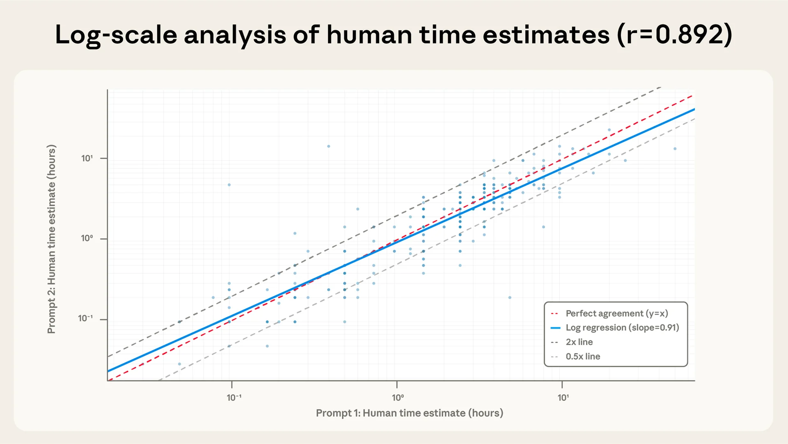

**Claude估计的人类完成时间显示出提示变化之间的高度相关性。** 提示 1 要求 Claude 估计“具有适当技能的员工”完成该任务所需的时间，提示 2 询问“在相关领域有能力”的“人类工人”。两个提示显示的对数尺度相关性为 0.89，表明高度一致。分析执行于 [Claude.ai](http://claude.ai) 用户同意出于研究目的与我们分享的成绩单。

**外部基准测试：** 如果模型的预测与现实不太吻合，那么自我认同就没有多大意义。为了检查这一点，我们针对数千个现实世界的数据集测试了 Claude 的时间估计能力 [软件开发任务](https://zenodo.org/records/7022735) 从开源存储库的 JIRA 票证中收集，包括开发人员估计和实际跟踪的完成时间。

这对于 Claude 来说是一项非常具有挑战性的任务，因为 Claude 仅收到 JIRA 票证的标题和描述，而人类开发人员拥有代码库和票证的完整上下文，并且已经了解完成类似任务需要多长时间。在该基准测试的 1000 个任务的子集上：

- 人类开发人员自己实现了与实际时间的 ρ=0.50 Spearman 相关性，以及对数值的 r_log=0.67 的 Pearson 相关性，表明相关性中等强度（两个值越高越好）。
- Claude Sonnet 4.5 达到 ρ=0.44 和 r_log=0.46
- Claude Sonnet 4.5 具有 10 个任务示例及其真实时间长度，显示较差的 ρ=0.39，但改进了 r_log=0.48

该分析表明Claude的估计提供了 *定向的* 该信息仅比软件开发人员自己的估计稍差一些。然而，我们观察到Claude的估计比人类要压缩得多——对较短的任务预测相对较长的时间，反之亦然——并且总体上更容易高估。这表明任务之间的任务长度的实际差异可能比我们报告的要大，并且实际任务长度可能会稍微短一些。总体而言，这些发现表明，模型预测与现实世界的结果具有有意义的相关性，至少在这个领域是如此，这使得它们对于将一项任务与另一项任务进行比较或跟踪随时间的变化非常有用。我们还观察到，与 Claude Sonnet 4 相比，Claude Sonnet 4.5 的相关性更高，这表明这些估计可能会随着模型功能的增加而继续改进。

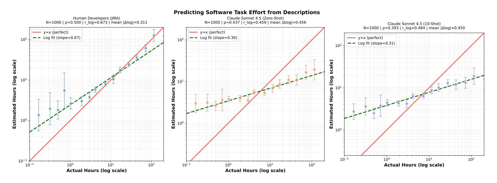

软件工程任务实际花费时间与开发人员和Claude估计的相关性。左：开发人员的初始时间估计与最终时间跟踪结果的相关性。开发人员熟悉完整的代码库，并了解请求背后的完整上下文以及类似任务需要多长时间。中：与 Claude Sonnet 4.5 的估计的相关性，仅给出 JIRA 票证的任务标题和描述。右图：与 Claude Sonnet 4.5 的估计的相关性，在提示中给出了 10 个示例来进行校准。总体而言，Claude的估计与开发商具有相似的方向相关性：斯皮尔曼的估计 *ρ*=0.44，相比之下 *ρ*对于开发人员来说 =0.50，尽管 Claude 显着高估了短期任务并低估了长期任务。轴以对数（以 10 为底）缩放。误差线为每个 bin 的 95% CI。

## 结果

我们首先使用上述方法来估计任务层面的节省，然后将其汇总为对整个经济影响的估计。

### 任务级节省

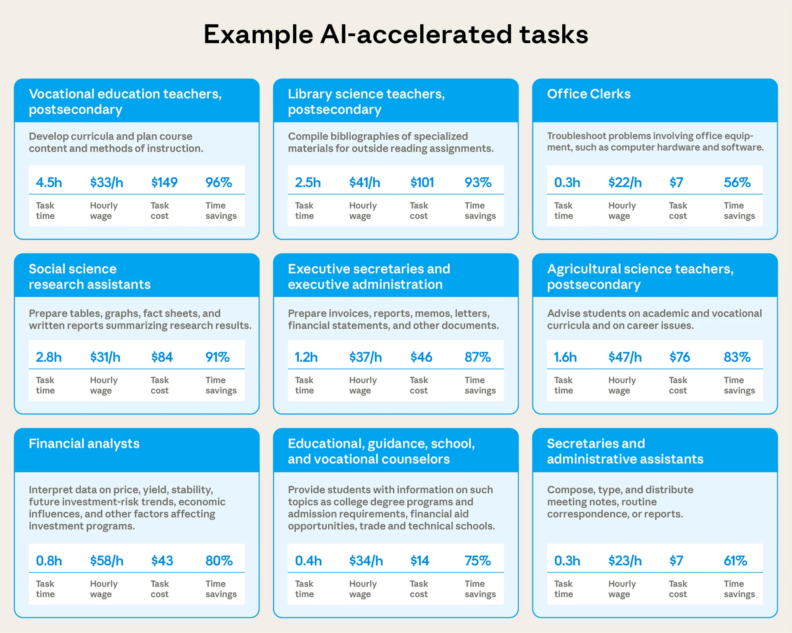

Claude的估计任务时间、该职业的平均小时工资、隐含任务成本以及九种不同任务的节省时间。 **任务时间** 通过让 Claude 预测专业人员在没有人工智能帮助的情况下执行任务需要多长时间来估算。 **小时工资** 来自职业就业和工资统计 (OEWS) 2024 年 5 月的数据。 **任务成本** 通过将任务时间乘以小时工资来计算。 **节省时间** 通过估计人类完成任务和计算所花费的时间来计算 *1 - time_with_ai / time_without_ai*.

#### 示例任务展示了一系列的时间节省

研究职业中的个人任务提供了人工智能在何处以及如何节省时间的具体例子。在最极端的情况下，我们看到用户只需 11 分钟即可完成 Claude 认为需要 4.5 小时的课程开发任务。根据教师的平均时薪计算，此类任务的隐含劳动力成本为 115 美元。

人们还使用人工智能来节省 87% 的编写发票、备忘录和其他文档的时间（至少对于要求Claude处理的文档类型）。最后，人工智能在财务分析师任务上节省了 80% 的时间，例如为通常需要花费 31 美元工资的任务解释财务数据。

#### 不同职业的任务长度差别很大

人类时间估计表明，Claude根据职业的不同，处理的任务长度也有很大不同。在下图中，我们显示了 Claude 所执行的任务子集中每个职业类别的平均值[1](https://www.anthropic.com/research/estimating-productivity-gains#footnote-1)。使用 Claude 的平均管理任务（例如选择投资）估计需要人类 2.0 小时才能完成，其次是法律（1.8 小时）、教育（1.7）和艺术/媒体任务（1.6）。另一方面，食物准备任务（例如规划或定价菜单项）、安装/维护和运输任务平均需要 0.3-0.5 小时，这表明任务的限制更多，或者等待时间更少的任务。鉴于Claude的时间估计往往会低估长任务并高估短任务，因此在实践中这些差异可能会更大。

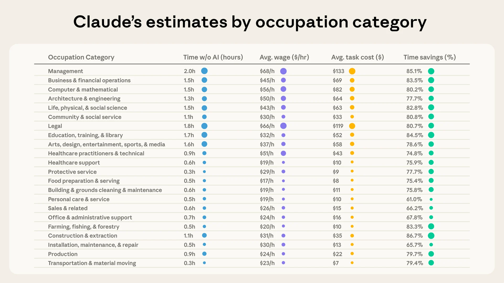

各种数字源自 Claude 对 SOC 主要群体的时间估计。不同职业的人力时间估计差异很大——人们使用Claude执行管理和法律任务，估计在无人协助的情况下需要大约 2 小时，而医疗保健支持和食物准备任务平均需要半小时左右。职业类别的平均小时工资是从 OEWS 2024 数据中检索的。平均任务成本的计算方法是将每个职业的小时工资乘以其任务时间中位数，并计算样本中每个任务的普遍程度加权的平均值。节省的时间通过以下方式计算 *1 - time_with_ai / time_without_ai*.

成本估算放大了人工智能影响的这种变化：估算时间最长的任务也往往是劳动力成本最高的任务。我们通过将每项任务的中位时间乘以 OEWS 2024 年 5 月数据中相关职业的平均工资来计算这些成本估算。专业人士的平均管理任务成本为 133 美元，而法律任务的平均成本为 119 美元，与食品准备和服务相关的任务为 8 美元。商业和财务任务平均 69 美元，而计算机和数学任务平均 82 美元。

在我们观察到的所有任务中，我们估计 Claude 处理的工作平均需要花费 54 美元的专业劳动力来聘请专家来执行每次对话中的工作。当然，尽管最近的研究表明，当前模型的实际性能在许多任务上可能会比人类专家差 [差距正在缩小](https://openai.com/index/gdpval/) 跨越广泛的不同应用。

在主要职业群体中，我们观察到样本中任务/职业的平均小时工资与要求Claude处理的任务的人类时间等效持续时间之间存在正相关关系。例如，管理和法律职业类别在平均时薪方面排名最高，这与Claude在复杂知识工作中的优势相符。

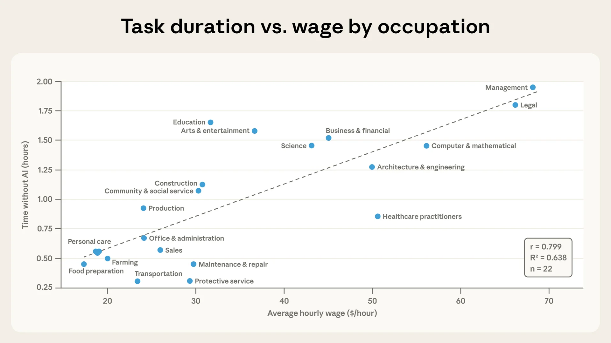

我们样本中职业类别的平均小时工资与Claude估计的平均任务持续时间之间的相关性。高薪职业类别（例如管理和法律）在我们的示例中具有更复杂用法的任务（*r*=0.8).

#### 不同职业节省的时间极不平衡

我们的人力时间和成本估算反映了 *震级* 人们用人工智能处理的任务。但时间 *储蓄*Claude对人工智能完成工作速度的估计反映了使用人工智能完成这些任务可能带来的生产力提升。

尽管我们发现任务和类别之间存在很大差异，但对话的时间中值估计节省了 84%。例如，检查诊断图像的任务仅节省了 20% 的时间，可能是因为这已经是专家无需人工智能辅助即可快速完成的任务。相比之下，从报告中编译信息的任务可以节省大约 95% 的时间，这可能是因为人工智能系统可以比人类更快地读取、提取和引用信息。总体而言，任务节省的时间分布集中在 50-95% 范围内，峰值在 80-90% 之间。

这些大量的时间节省与Claude的阅读和写作速度远超人类的能力相一致。然而，我们的方法没有考虑人们需要做的额外工作来将 Claude 的输出优化为完成状态，或者他们是否继续在多个会话中迭代工作产品，这两者都会导致节省的时间较少。过去的随机对照试验通常发现节省的时间较少，包括 [56%](https://arxiv.org/abs/2302.06590), [40%](https://www.science.org/doi/10.1126/science.adh2586), [26%](https://papers.ssrn.com/sol3/papers.cfm?abstract_id=4945566), [14%](https://www.nber.org/papers/w31161) 甚至 [消极的](https://metr.org/blog/2025-07-10-early-2025-ai-experienced-os-dev-study/) 不同应用程序之间的时间节省——可能是由于这些影响，或者是因为这些研究检查了前几代模型。

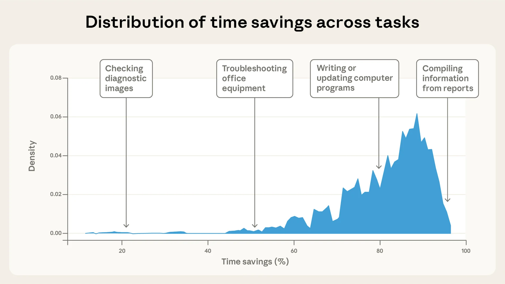

我们示例中 O*NET 任务节省时间的密度图。我们发现，在我们的样本中，Claude 估计的不同任务节省的时间并不均衡，大多数都在 50% 到 95% 之间。整体节省中位数为 81%。节省的时间计算如下 *1 - time_with_ai / time_without_ai*。我们的估计没有考虑在聊天窗口之外改进Claude输出所花费的时间。

### 从任务层面的效率提升到整个经济的生产力影响

上述估计反映了人工智能在任务层面驱动的生产力提升。为了了解宏观层面的影响，本节模拟了这些收益如何在整个经济中聚合，假设它们按照Claude的估计发挥作用。

#### 方法论

为了估计整个经济的生产率影响，我们使用胡尔滕定理，这是一种标准方法，使我们能够将任务层面的效率收益汇总到更广泛的美国经济[2](https://www.anthropic.com/research/estimating-productivity-gains#footnote-2)。如在 [阿塞莫格鲁 (2024)](https://economics.mit.edu/sites/default/files/2024-04/The%20Simple%20Macroeconomics%20of%20AI.pdf)的“基线”方法中，我们将劳动生产率的隐含增长建模为任务级生产率增长的加权平均值——这种建模选择隐含地假设资本投资将由于与人工智能采用相关的全要素生产率（TFP）的提高而增加。在这个框架中，隐含的全要素生产率增长是劳动生产率的提高乘以劳动收入份额[3](https://www.anthropic.com/research/estimating-productivity-gains#footnote-3).

**任务构成**：对于每个职业，我们从 O*NET 获取工作任务列表。然后，我们使用 Claude 来估计工人花在每项任务上的时间比例。例如，Claude 估计程序员将 23% 的时间用于编写和维护代码，15% 的时间用于分析和重写程序，一小部分时间用于测试、文档和会议。

**任务级生产力提高**：在上一节中，我们提供了估计值，可用于计算在人工智能辅助下完成每项任务的速度有多快。我们取没有人工智能的时间和没有人工智能的时间之间的对数差 *与* 人工智能生成生产力改进值，并保守地将我们样本中未观察到的任务分配为零改进。

**整体经济预估**：我们使用两个因素根据其经济重要性来衡量每项任务的隐含生产力收益：(i) Claude估计职业在该任务上花费的时间比例（如上所述），以及 (ii) 该职业在美国工资总额中所占的份额（该职业类别的就业人数乘以平均工资，然后除以所有职业的工资总额）。对于工资总额，我们使用 2024 年 5 月的 OEWS 数据。这种方法隐含地假设Claude产生的时间估计代表了每个任务的所有实例的可靠平均值，并且Claude或类似的人工智能系统将在整个美国经济中得到采用。

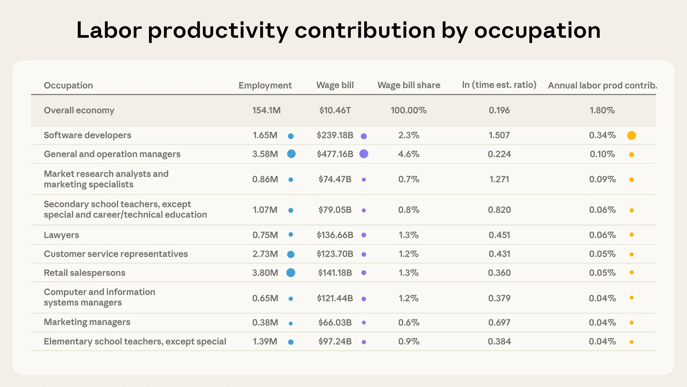

**美国经济整体劳动生产率影响：十大职业。** 总体而言，Claude的估计意味着，假设当前的人工智能系统在我们观察到的所有任务中普遍采用，并由软件、管理、营销和客户服务任务驱动，那么美国劳动生产率将年化增长 1.8%（虚线）。这相当于 TFP 隐含的 1.08% 年化增长率。平均 *ln(时间估算比)* 代表每个职业中所有任务的时间加权生产力增益，其中 *时间估算比=有AI的时间/没有AI的时间*。劳工统计数据源自 OEWS 2024 数据。

### 研究结果

假设人工智能在美国经济中得到普遍采用，并使用当前模型，我们计算出 Claude 的估计意味着美国劳动生产率每年将增长 1.8%。这将是目前长期增长率的近一倍，自 1947 年以来平均每年增长 2.1%，自 2019 年以来平均每年增长 1.8%。假设劳动生产率占全要素生产率的比重为0.6[4](https://www.anthropic.com/research/estimating-productivity-gains#footnote-4)，这意味着全要素生产率每年提高 1.1%。鉴于自 2000 年代初以来 TFP 增长率往往低于 1%，这些估计表明，即使广泛部署当前的人工智能系统也可能导致增长率翻倍：达到 1990 年代末、1960 年代和 1970 年代的增长率[5](https://www.anthropic.com/research/estimating-productivity-gains#footnote-5).

任务级效率提升所暗示的总劳动生产率的估计增长处于人工智能对生产率潜在影响的最新估计范围内，尽管它位于上限（Filippucci、Gal 和 Schief，2024）。

重要的是，这项练习假设人工智能的能力（以及人类使用人工智能的有效性）在未来 10 年内与我们抽取样本时保持相同。不过，这似乎不太可能成立：我们认为人工智能将 [继续快速改善](https://www.anthropic.com/news/core-views-on-ai-safety) 未来几年。

因此，这一估计应被视为一项探索可能发生的情况的练习 *当前的使用模式，* 并不是对实际最有可能发生的对生产力影响的预测。正如我们在其他工作中所写的那样，我们对人工智能导致劳动力市场严重混乱的可能性保持高度警惕，这可能与人工智能带来的生产率的大幅提高有关。随着模型的进步，这可能代表人工智能对生产力影响的近似下限，尽管我们的估计没有考虑采用的不均匀性，这可能会在短期内减少现实世界生产力的提高。

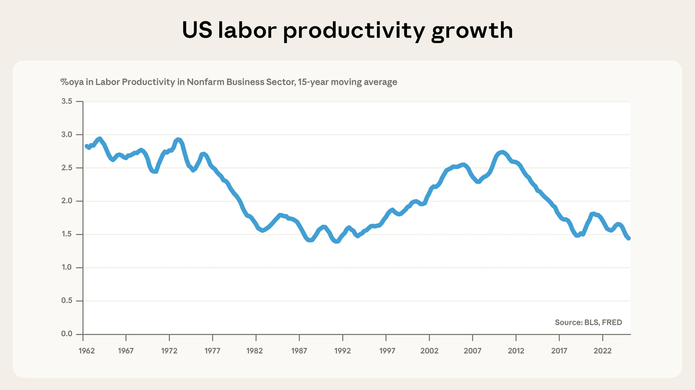

非农商业部门劳动生产率增长。该图表显示了劳动生产率同比变化百分比的五年移动平均值。我们看到整体下降，从 20 世纪 60 年代的近 3% 下降到最近几年的 1.5% 左右。

反映出这样一个事实 [某些任务和职业在我们的数据中出现的频率比其他任务和职业高得多](https://assets.anthropic.com/m/218c82b858610fac/original/Economic-Index.pdf)，我们在职业对劳动生产率的贡献中也观察到类似的现象。软件开发人员对人工智能带来的总劳动生产率提高的贡献最大（19%）。综合和运营经理（约 6%）、市场研究分析师和营销专家（5%）、客户服务代表（4%）和中学教师（3%）位列前五。

相比之下，餐馆、医疗保健服务、建筑和零售业对整体生产力影响的贡献要小得多。这主要是因为他们的任务很少出现在我们的数据中，很大程度上是因为这些职业在我们的样本中几乎没有相关任务。

### 人工智能将如何改变员工打发时间的方式？

如果工人能够通过人工智能加速其部分职业任务，那么人工智能提供的加速较少的任务可能会在这些职业工作中占据更大、更重要的份额。例如，人工智能可能会帮助房屋检查员准备报告，但如果检查员仍然需要花费相同的时间亲自前往房产进行检查，这可能会使检查在整个工作中所占的比例更大。

下图说明了一些职业的情况。对于软件开发人员来说，人工智能加快了软件开发、测试、文档编制和操作数据的过程。但我们目前还没有看到有意义的人工智能用于协调系统安装或监督其他技术人员或工程师的工作。对于教师来说，我们看到人工智能可以帮助制定课程和活动计划，但不能帮助赞助课外俱乐部或在课堂上执行规则。

从增长的角度来看，这些观察结果与最近的观察结果非常吻合 [阿吉翁、琼斯和琼斯](https://www.nber.org/papers/w23928)：“增长可能不是受到我们所擅长的事物的限制，而是受到必要但难以改进的事物的限制。”

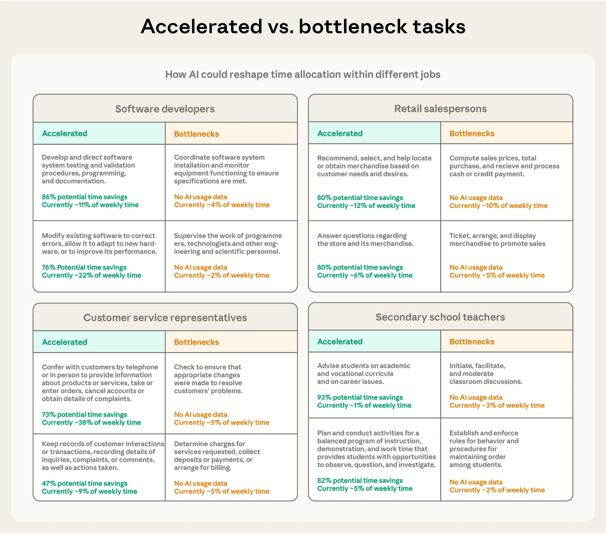

四种不同的职业以及显示出大量潜在节省时间的“加速”任务，以及未出现在我们的样本中的潜在“瓶颈”任务。例如，软件工程师在开发和调试软件方面看到了估计的大量时间节省，但在监督程序员方面却没有看到。每周时间分数由 Claude 估计（参见上一节）。

## 局限性

我们的方法有一些局限性，我们认为需要对此主题进行进一步研究：

- **Claude的预测并不完美，我们缺乏对Claude时间估计的现实验证**：人工智能系统是不完美的预测器，无法看到用户完成与模型的交互后发生的活动。虽然我们预计这些估计将随着模型的功能而改进，但使用模型估计会引入一个重要的噪声源。虽然我们的估计表明模型在估计任务时间方面正在接近人类的表现，而人类本身也远非完美，但我们缺乏现实世界的数据来验证Claude提供的估计。
- **任务分类的局限性**：实际工作比 O*NET 任务列表更复杂，并且我们为每个任务估计的时间分配只是近似值。工作的许多重要方面——隐性知识、关系、不确定性下的判断——并没有出现在这些正式的任务描述中，而且它们之间的联系也没有出现。 *之间* 任务对生产力的影响可能与单独完成这些任务节省的时间一样重要，甚至更重要。虽然我们预测单个任务可以节省大量时间， [最近的一项随机对照试验](https://metr.org/blog/2025-07-10-early-2025-ai-experienced-os-dev-study/) 研究端到端软件功能并没有因为人工智能而节省时间。
- **结构假设：** 在上面的计算中，我们将专业人员在没有人工智能的情况下完成给定任务所需的时间与使用人工智能所需的时间进行了比较。但这也可以 *轻描淡写* 生产力的提高——因为我们没有考虑到雇佣员工和沟通环境需要额外的资源，如果人工智能的工作质量比人类的工作质量差，那么可能会夸大其词。
- **组织重组：** 从历史上看，单个企业最大的生产力提升来自于 [重组业务运营](https://www.jstor.org/stable/2006600) 采用新技术。我们的模型可以帮助预测 *效果* 的重组，但它无法预测公司可能如何决定重组，或者这个过程可能会多快发生。
- **创新的作用：** 技术创新是 [发动机](https://www.jstor.org/stable/1926047) 经济增长。我们的模型没有捕捉到人工智能系统如何加速甚至自动化科学过程，也没有捕捉到它对生产力、增长和工作结构的影响。
- **数据有限**：我们的数据集来自 [Claude.ai](http://claude.ai) 仅对话。这个样本并不能代表人工智能的全部用途，而且可能存在一些选择效应，人们使用 Claude 执行的任务实例是他们认为 Claude 最有用的任务。此外，由于我们的样本量有限，我们可能会错过一些不太常见的人工智能任务。

我们在这里开发的测量基础设施能够连续跟踪人工智能对大规模时间节省的影响。随着模型的改进和更好的方法解决这些限制，我们可以重新估计这些节省的时间，并确定这些能力的改进如何转化为更广泛的经济影响。我们期望在未来几个月和几年内跟踪这些变化。

## 结论

Claude处理的任务复杂程度各不相同——从需要几分钟才能完成的简单的食物准备问题，到需要几个小时才能完成的复杂的法律和管理任务。但这项工作的总体效果是什么呢？

根据 Claude 对每项任务的时间估计（并假设未来 10 年普遍采用），我们发现使用 *当前* 模型表明，美国劳动生产率每年可能增长 1.8%，是近期劳动生产率增长率的两倍。根据目前人工智能的使用情况，这些收益将集中在技术、教育和专业服务领域，而零售、餐饮和运输行业受到的影响微乎其微。作为我们的一部分，我们将随着时间的推移跟踪这些变化 [经济指数](https://www.anthropic.com/economic-index) 随着模型功能、产品和采用的不断进步。

这些生产力的提高来自于更快地完成现有任务。然而，从历史上看，变革性的生产力提高——无论是电气化、计算还是互联网——并不是来自于加快旧任务的速度，而是来自于从根本上重组生产。在这样的未来中，人工智能不仅可以更快地实现功能，而且公司可以重组会议和代码审查，以更快地验证和交付这些功能，无论是使用人工智能还是通过其他方式。

我们的框架可用于帮助估计此类重组的影响，但它无法预测将会发生哪些变化或多快发生。未来工作的一个重要方向是理解这个问题——更好地了解企业何时以及如何围绕新兴人工智能能力进行重组。答案将决定人工智能何时从提供显着但有限的生产力提升，转变为代表历史上定义的技术革命的结构转型。

## 附录

### Claude的估计与其他估计的比较

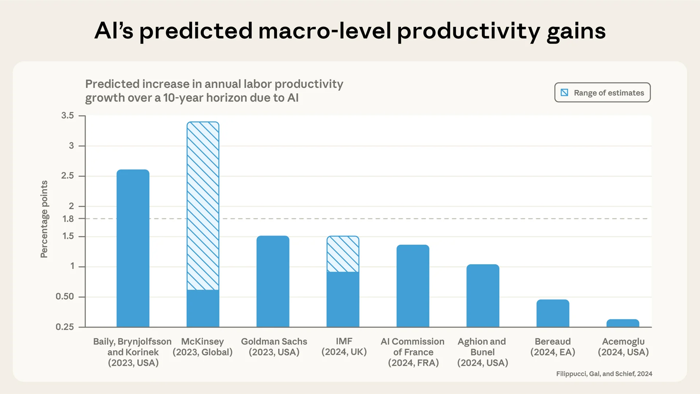

由于人工智能，预计 10 年内劳动生产率将有所提高。图转载自 Filippucci、Gal 和 Schief，2024 年。虚线是 1.8%，来自 Claude 的估计。

### 用于我们时间估计的提示

#### 人工时间估算提示

```
Human: Consider the following conversation:

<conversation>
{{TRANSCRIPT}}
</conversation>

Estimate how many hours a competent professional would need to complete the tasks done by the Assistant.
Assume they have:
- The necessary domain knowledge and skills
- All relevant context and background information
- Access to required tools and resources

Before providing your final answer, use <thinking> tags to break down your reasoning process:
<thinking>
2-5 sentences of reasoning estimating how many hours would be needed to complete the tasks.
</thinking>

Provide your output in the following format:
<answer>A number representing hours (can use decimals like 0.5 for shorter tasks)</answer>

Assistant: <thinking>
```

#### 交互时间预估提示

```
Human: Consider the following conversation:

<conversation>
{{TRANSCRIPT}}
</conversation>

Estimate how many minutes the user spent completing the tasks in the prompt with the model.
Consider:
- Number and complexity of human messages
- Time reading Claude's responses
- Time thinking and formulating questions
- Time reviewing outputs and iterating
- Realistic typing/reading speeds
- Time implementing suggestions or running code outside of the converesation (only if directly relevant to the tasks)

Before providing your final answer, use <thinking> tags to break down your reasoning process:
<thinking>
2-5 sentences of reasoning about how many minutes the user spent.
</thinking>

Provide your output in the following format:
<answer>A number representing minutes</answer>

Assistant: <thinking>
```

#### 软件开发时间预估提示

```
Human: You are estimating software development tasks for open-source projects. Provide ONLY a number in hours (e.g., 0.3, 1.6, 15). Do not explain.
Task: {task}
Description: {description}:
Estimate (hours):
Assistant:
```

#### 任务时间预估提示

```
You are estimating how much time workers in the occupation "{occupation_title}" spend on each of their job tasks.

Below is the complete list of tasks for this occupation. For each task, estimate how many hours per week a typical worker spends on it.

Important: Don't worry about making the hours sum to exactly 40 or any specific total - we'll normalize the results afterward. Just give your best estimate for each task independently based on what seems realistic.

Tasks:
{tasks}

Return ONLY a JSON object mapping each task_id to your estimated hours per week, with no additional text, explanations, or commentary. Format:
{{
  "task_id_1": hours,
  "task_id_2": hours,
  ...
}}"""
```

## 脚注

01Claude很容易对时间范围和成本做出异常估计；例如，它将某些编程任务归类为需要人类花费数年才能完成或价值数百万美元的任务。虽然这是可能的，但为了产生更保守的估计，我们取每个任务的中值的平均值，并按每个任务中的对话数量进行加权。

02胡尔滕定理指出，在没有扭曲的竞争均衡中，微观层面生产率增长对全要素生产率的贡献与该生产要素的 Domar 权重一阶近似成正比。某个要素的Domar权重是其总产出值与GDP的比率。在 Acemoglu (2024) 提出的基于任务的模型中，劳动密集型任务的 Domar 权重等于该任务在工资账单中的份额乘以收入中的劳动份额。有关 Hulten 定理的最新处理和扩展，请参阅 Baqaee 和 Farhi (2019)。从公式上讲，胡尔滕定理指出，TFP 的对数变化等于微观生产率对数变化的 Domar 加权和。在我们的例子中，日志变化被视为 ln（没有 AI 的完成时间）减去 ln（有 AI 的完成时间）。

03TFP的增长比劳动生产率的增长更为原始。劳动生产率是每个工人的产出比率，即使在全要素生产率不变的情况下，劳动生产率也会由于劳动力以外的其他生产要素的增加而增加。

04[阿塞莫格鲁 2024](https://www.nber.org/papers/w32487) 计算出人工智能相关行业的劳动力份额为 0.57；为简单起见，我们使用整体经济份额 0.6，因为它非常接近。

05有关全要素生产率的历史数据，请参阅旧金山联邦储备银行的估计： <https://www.frbsf.org/research-and-insights/data-and-indicators/total-factor-productivity-tfp/>。2015年至2024年全要素生产率平均增速为0.7%。二十年前，1995年至2004年TFP的平均增长率为1.6%。
