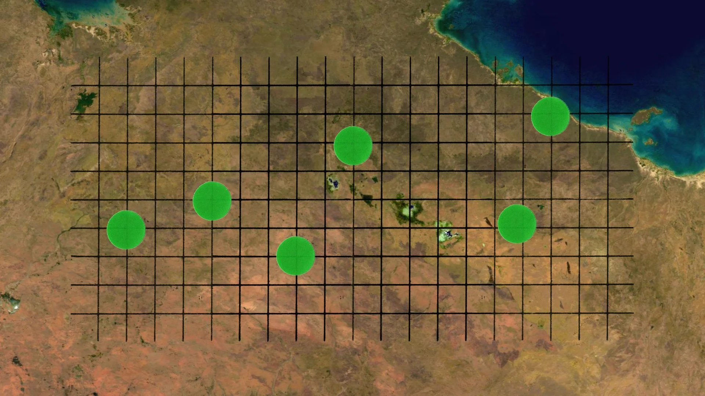
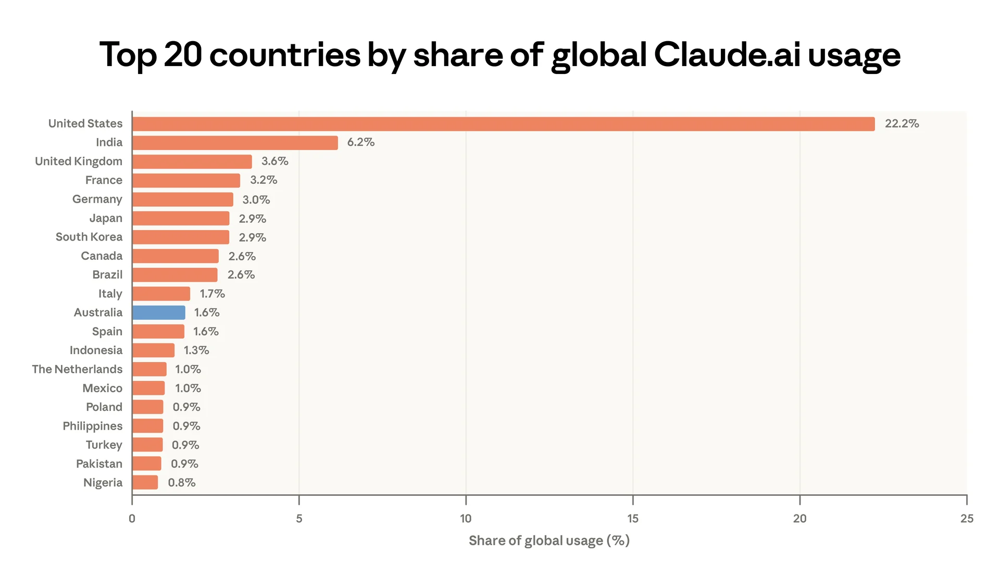
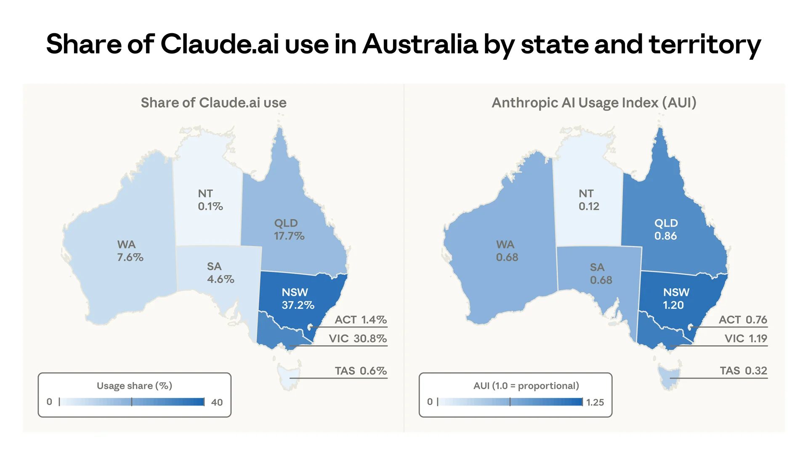
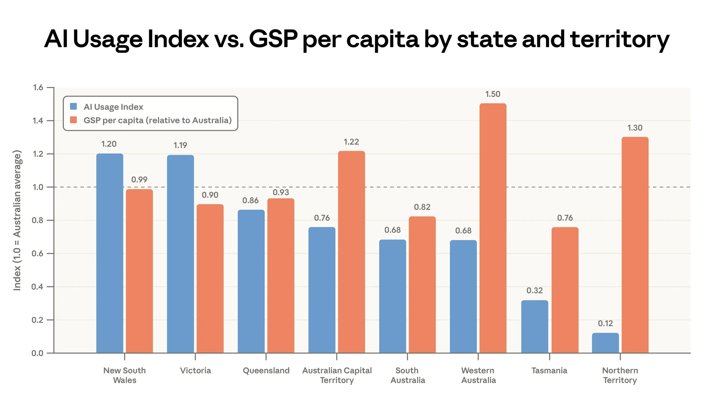
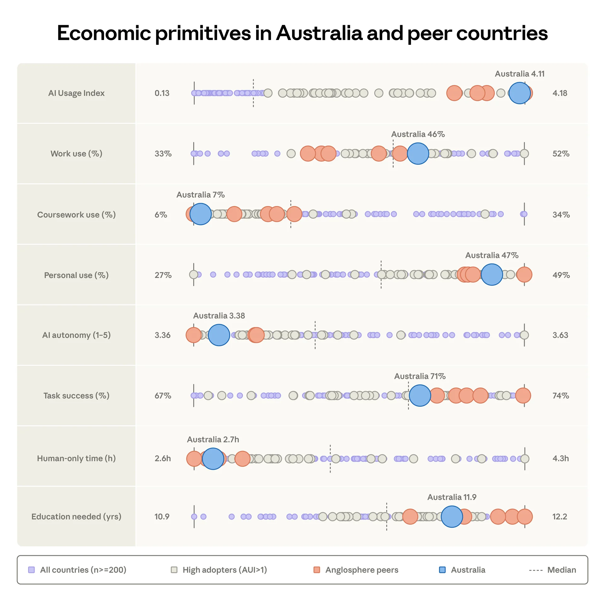
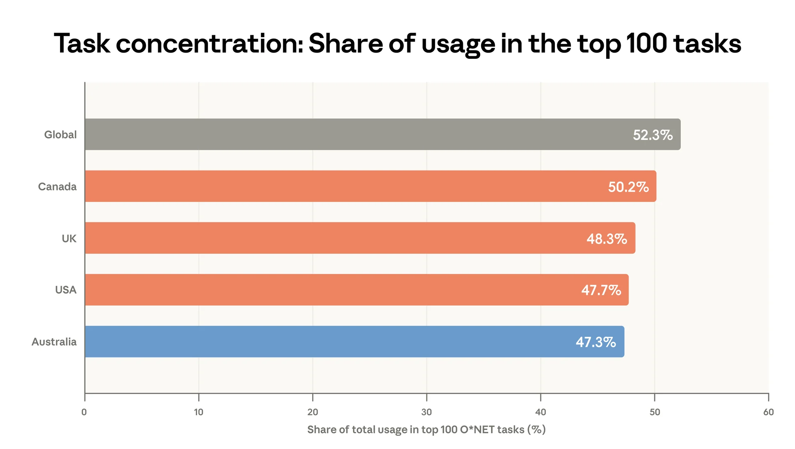
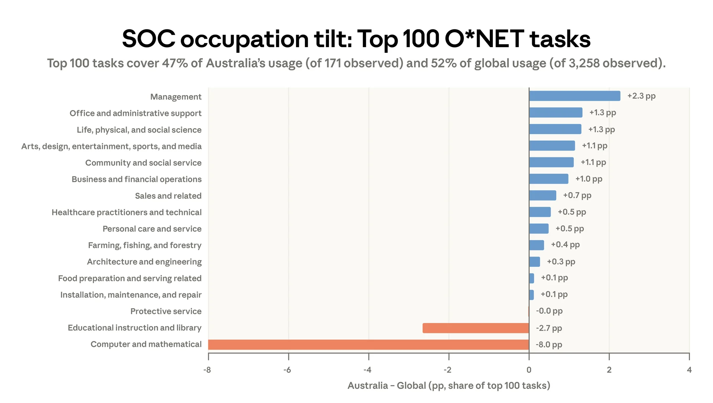
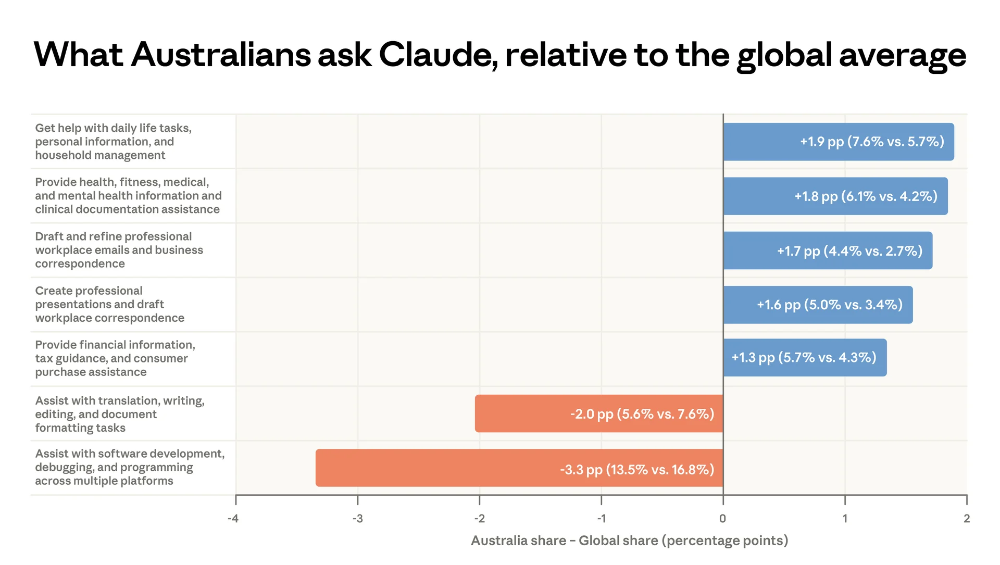

# 澳大利亚如何使用 Claude：Anthropic 经济指数的研究发现

- 英文标题：How Australia uses Claude: Findings from the Anthropic Economic Index
- 发布日期：2026-03-31
- 官网栏目：经济学
- 原文：[Anthropic 页面](https://www.anthropic.com/research/how-australia-uses-claude)
- 官网署名：Anthropic

> 中文机器初译，未逐篇人工校对。引用研究结论时请核对英文原文。

*Anthropic 正在扩展到澳大利亚。我们正在开设一个 [新办公室](https://www.anthropic.com/news/sydney-fourth-office-asia-pacific) 未来几周将在悉尼举行，我们已经签署了一份 [谅解备忘录](https://www.anthropic.com/news/australia-MOU) 与澳大利亚政府合作开展人工智能安全研究并支持澳大利亚国家人工智能计划的目标。为了纪念这一时刻，我们认为我们应该更仔细地了解澳大利亚人如何使用Claude。*

### 主要发现

- 澳大利亚是 Claude 的主要采用者之一，占全球 Claude.ai 流量的 1.6%。澳大利亚人对Claude的人均使用率比其人口规模预期高出四倍多。
- 澳大利亚境内的收养行为集中在两个州：新南威尔士州（占对话的 37%）和维多利亚州（31%）。其他所有州和地区的人均Claude使用率都较低。
- 澳大利亚的用例组合总体上与英语圈的同行保持一致：46% 的 Claude 对话用于工作，7% 用于课程作业，47% 用于个人用途。这是高收入、高采用率经济体的典型特征。
- 但澳大利亚的任务组合更加多样化。与其他国家/地区一样，计算机和数学任务仍然是我们数据集中最大的类别，但该类别比全球基线低约 8 个百分点。它被高于平均水平的办公、销售、管理和个人生活任务所抵消。
- 澳大利亚的用户倾向于提示Claude完成更复杂的任务，这是根据理解提示所需的估计受教育年限来衡量的。同时，我们估计这些任务需要花费的时间 *没有* AI 比平均水平低大约 20%。换句话说，相对于世界其他地方如何使用Claude，澳大利亚人的任务与受教育程度较高但持续时间较短有关。
- 与许多其他高采用率经济体一样，澳大利亚的“人工智能自治”得分相对较低（1-5 分制为 3.38），这表明澳大利亚人以更多协作、更少授权的方式使用 Claude。

## 整体采用率较高，但各州和地区分布不均

澳大利亚占全球 Claude.ai 流量的 1.6%，在我们 2026 年 2 月样本中的所有国家中排名第十一位（图 1）。其人择人工智能使用指数 (AUI) 为 4.1，这意味着澳大利亚人使用 Claude 的数量是其工作年龄人口预测的四倍多。这使得澳大利亚成为Claude人均采用率最高的国家，排名第七，落后于新加坡、以色列、卢森堡、瑞士、美国和加拿大。

**全球 Claude.ai 使用量排名前 20 的国家/地区**澳大利亚占全球 Claude.ai 消费者使用量的 1.6%，排名第 11 位。条形图显示每个国家/地区在 2026 年 2 月从 Claude.ai 采样的 100 万条对话中所占的份额。澳大利亚以蓝色突出显示。

在澳大利亚，使用集中在人口最多的州。新南威尔士州占对话量的 37.2%，其次是维多利亚州，占 30.8%，昆士兰州占 17.7%，其余各州和地区合计占 14%（图 2）。各州和领地的劳动年龄人口规模在很大程度上解释了这种排序。然而，对此进行调整后，新南威尔士州的 AUI 为 1.20，维多利亚州的 AUI 为 1.19。这是仅有的两个人均采用率高于预期的州；其他所有州或领地的 AUI 均低于 1，采用率最低的是西澳大利亚州，为 0.68，塔斯马尼亚州为 0.32，北领地为 0.12。

**澳大利亚各州和领地的 Claude.ai 使用比例**新南威尔士州在澳大利亚 Claude.ai 使用量中所占份额最大（37.2%），其次是维多利亚州（30.8%）、昆士兰州（17.7%）、西澳大利亚州（7.6%）、南澳大利亚州（4.6%）、澳大利亚首都特区（1.4%）、塔斯马尼亚州（0.6%）和北领地（0.1%）。2026 年 2 月的数据。

与收入和Claude人均使用量之间的密切相关性相反，我们 [跨国观察](https://www.anthropic.com/research/anthropic-economic-index-september-2025-report)，收入似乎并不能预测澳大利亚各州和地区的采用情况（图 3）。也就是说，由于我们只能对八个指标进行比较，因此收入和使用率之间缺乏相关性只是暗示性的，而不是决定性的。

当地劳动力构成可能是澳大利亚各州和地区采用率与收入脱钩的一个可能因素：矿业密集的西澳大利亚州是人均普惠制最高的州，但人均使用率较低。北领地的人均普惠制同样较高，而 AUI 较低。这可能反映了这些人口稀少的州和地区，从事Claude倾向于采用的职业的工人比例相对较小。澳大利亚首都地区的人均收入高于平均水平，但Claude使用率低于预期，这可能反映了其庞大的公共部门劳动力采用该技术的障碍。新南威尔士州和维多利亚州收养率最高的两个州的收入略低于平均水平；这些州的高采用率可能反映了金融、专业服务和科技行业的工人比例较高，而这些行业的Claude使用率往往较高。

**澳大利亚各州和地区人均人工智能使用指数 (AUI) 和人均相对生产总值 (GSP)**每个州的 AUI 与其州人均生产总值一起显示，相对于澳大利亚平均水平（101,438 美元）表示；两者均已编入索引，因此 1.0 表示奇偶校验。州和领地按 AUI 排序。资料来源：人类经济指数，2026 年 2 月； ABS 估计居民人口，2025 年 6 月季度； ABS 澳大利亚国民账户：国家账户，2024-25。

## 澳大利亚对Claude的使用类似于其英语圈同行

我们的第四个 [经济指数报告](https://www.anthropic.com/research/anthropic-economic-index-january-2026-report) 引入了四个经济原语：用例组合、Claude的自主程度、任务成功度和任务复杂性。图 4 显示了澳大利亚相对于其他英语圈国家（橙色）、其他高采用率经济体（灰色）以及我们样本中的所有国家（紫色）的情况。

就Claude的使用方式而言，澳大利亚与英语圈国家类似。46% 的澳大利亚对话被归类为与工作相关，接近中位数，处于英语圈范围的中间。课程作业占澳大利亚使用量的 7%，接近分布的底部（低于美国、英国和加拿大）；人均采用率较低的国家的课程作业比例是其两到三倍。供个人使用的对话比例为 47%，接近分布的顶部。

澳大利亚的这种模式与我们在经济原语中记录的关系一致 [报告](https://www.anthropic.com/research/anthropic-economic-index-january-2026-report) 人均收入和使用案例之间：较富裕的国家往往拥有较低的课程作业份额和较高的个人使用份额。

**澳大利亚和同类国家的经济原语**该图显示了澳大利亚与其他国家相比各种经济要素的价值。大蓝点代表澳大利亚。橙色点对应其他英语圈国家（美国、英国、加拿大、新西兰、爱尔兰）。灰点表示至少有 200 个来自 Claude.ai 的对话样本且人类人工智能使用指数 (AUI) 高于 1 的国家/地区。紫色小点代表至少有 200 个样本对话的所有其他国家/地区。

澳大利亚的人工智能自主权处于低端，在 1-5 等级中为 3.38，其他英语圈国家也紧随其后。较低的自主权表明用户在对话中保留更多的决策控制权，而不是完全委托给模型。这与高采用率经济体倾向于以更具协作性、更少指导性的方式使用Claude是一致的。

澳大利亚在一项任务复杂性衡量标准上低于中位数，但在另一项衡量标准上却接近中位数。澳大利亚的平均任务本身的时间密集度相对较低：在没有人工智能的情况下，熟练的专业人员估计需要 2.7 小时才能完成任务，而跨国平均时间为 3.3 小时。但澳大利亚用户的提示估计需要 11.9 年的学校教育才能理解，这与其他英语圈国家相当，并且高于全球中位数。这两种模式都与我们在我们的报告中记录的跨国关系一致。 [1月经济指数报告](https://www.anthropic.com/research/anthropic-economic-index-january-2026-report)，其中Claude采用的强度与人类即时复杂性呈正相关，与“无人工智能”任务持续时间的估计呈负相关。

## 在澳大利亚，任务组合更广泛，编码份额更小

澳大利亚对Claude的使用比其他英语圈国家的使用更加多样化，并且相对于更广泛的全球平均水平。图 5 显示了每个地理区域 100 个最常见任务所涵盖的使用份额（其中任务根据 O*NET 进行分类，O*NET 是一种描述整个经济中工作特征的任务分类法）。该图中较低的值表明 Claude 用于更广泛的任务，因为前 100 个任务所占的份额较小。澳大利亚排名前 100 的任务占其使用量的 47.3%，低于美国（47.7%）、英国（48.3%）和加拿大（50.2%），比全球 52.3% 低 5 个百分点。

**澳大利亚和其他英语圈国家中前 100 名 O*NET 任务的任务集中度**该图显示了每个地区的 Claude.ai 使用情况的集中程度，以该地区 100 个最常见的 O*NET 任务捕获的分类使用份额来衡量。较低的值表明用途更加多样化。在英语圈国家中，新西兰和爱尔兰被省略，因为观察到的不同任务少于 100 项。资料来源：人类经济指数，2026 年 2 月。

澳大利亚境内使用的更广泛多样性主要来自于编码相关任务的比例较低。图 6 显示了按 SOC 主要群体（美国劳工统计局定义的广泛职业类别）划分的澳大利亚前 100 项任务的构成与全球前 100 项任务的构成有何不同。澳大利亚的计算机和数学任务下降了 8.0 个百分点。尽管教育相关任务比全球平均水平低近三个百分点，但没有其他类别的使用与全球平均水平相差如此之大。抵消的积极影响分布在许多群体中，其中以管理（+2.3pp）、办公室和行政支持（+1.3pp）以及生活、物理和社会科学职业（+1.3pp）为首。

**按 SOC 主要组划分的澳大利亚前 100 项任务相对于全球前 100 项任务的构成**条形图显示每个 SOC 组在澳大利亚前 100 名 O*NET 任务中所占的份额与该组在全球前 100 名中的份额之间的差异（以百分点为单位）。正值表示澳大利亚的代表性过高。前 100 项任务涵盖澳大利亚分类使用量的 47%（观察到的 171 个不同任务）和全球分类使用量的 52%（观察到 3,258 个不同任务）。资料来源：人类经济指数，2026 年 2 月。

在单个请求集群级别（用户要求 Claude 执行的操作的类别），模式是相似的（图 7）。相对于全球分布，澳大利亚代表性最不足的类别是一般编码协助，澳大利亚使用率为 13.5%，而全球使用率为 16.8%。文件翻译的代表性也不足，这与澳大利亚是一个以英语为主的市场是一致的。比例最高的类别是个人使用（例如个人生活管理（+1.9pp）和健康与福祉支持（+1.8pp））以及非技术专业工作，包括工作场所信函（+1.7pp）、商业文件（+1.6pp）和财务指导（+1.3pp）。

**相对于全球分布，澳大利亚的请求集群代表性过高或过低**   
条形图显示每个集群在澳大利亚 Claude.ai 对话中所占份额与其在全球对话中所占份额之间的差异（以百分点为单位）。括号中的值分别显示澳大利亚和全球的份额。资料来源：人类经济指数，2026 年 2 月。

采用率较高的国家/地区通常更广泛地使用 Claude，因此预计澳大利亚的编码份额较低。澳大利亚的计算机和数学缺口为 8.0 个百分点，与英语圈 8.9 个百分点的平均缺口一致。澳大利亚与其他国家的不同之处在于填补了空白：它更倾向于管理（+2.3pp vs 英语圈的+1.2pp）以及办公室和行政支持（+1.3pp vs +0.1pp），而不是教育教学（−2.7pp vs 同行的+1.6pp）。

## 结论

澳大利亚是Claude人均采用率领先的国家之一，其使用率是其工作年龄人口预测的四倍多。这种用法的特点——主要是工作和个人而不是课程作业，复杂的提示解决相对较短的任务，并且较少委托给Claude——密切跟踪人类经济指数中明显的其他英语圈经济体和跨国关系。

澳大利亚更独特的地方在于Claude的用途广泛。澳大利亚的使用情况比全球总体更加多样化，几乎完全是因为与编码相关的工作所占比例较低；抵消收益分布在办公室、销售、管理和个人生活等各个类别，而不是集中在任何一个类别。与其他高采用率国家一样，澳大利亚的用户倾向于更多地与 Claude 合作，而较少委托决策。

在澳大利亚，采用率集中在新南威尔士州和维多利亚州，州一级的变化跟踪的是劳动力构成而不是人均收入——与美国各州的模式一致，但与各国的收入梯度形成鲜明对比。
