# 加拿大如何使用 Claude：Anthropic 经济指数的研究发现

- 英文标题：How Canada uses Claude: Findings from the Anthropic Economic Index
- 发布日期：2026-07-14
- 官网栏目：经济学
- 原文：[Anthropic 页面](https://www.anthropic.com/research/how-canada-uses-claude)
- 官网署名：Anthropic

> 中文机器初译，未逐篇人工校对。引用研究结论时请核对英文原文。

*法国西装。*

### 主要发现

- 根据最新发布的人类经济指数，加拿大处于Claude收养率的前列。加拿大占全球 Claude.ai 流量的 2.6%，按总流量排名第 8 位。鉴于其人口规模，人均使用量比预期高出四倍多。
- 加拿大的高采用率总体上与其高收入经济体一致，但在同类国家中仍然脱颖而出。在合计占总使用量一半以上的前十个国家中，加拿大的人均使用量仅次于美国。
- 在加拿大，采用情况集中在地区。安大略省占对话的 43.9%。与魁北克省、不列颠哥伦比亚省和艾伯塔省一起，这四个最大的省份约占全国使用量的 94%。按人口计算，不列颠哥伦比亚省的人均增长率比预期高出 1.4 倍，其次是安大略省，为 1.1 倍；其他所有省份的收养率均低于均等，纽芬兰和拉布拉多为 0.2 倍。
- 与全球跨国模式相比，省级人均收入似乎并不能解释这一差距。相反，产业构成显得更为重要：专业、科学和技术服务业规模较大的省份使用Claude最多。这与其他证据相一致，即与劳动力构成相匹配的模型能力决定了高收入国家的总体采用水平。
- 加拿大的使用模式在很大程度上与采用率无关：在每个省，工作占对话的 34-40%，课程作业占 13-18%，个人使用占 44-51%。
- 我们发现有证据表明特定用例与当地经济特征相符。翻译请求跟踪各省的公共行政就业份额，这可能反映了加拿大在联邦服务和通信领域的官方双语政策：新不伦瑞克省、新斯科舍省和魁北克省的公共行政就业率最高，而且专门翻译的对话比例也最大。
- 与英语圈同行相比，文档翻译也是加拿大最独特的用例。更一般而言，加拿大的使用倾向于学术和早期职业使用：学术课程、编码帮助和简历起草都被过多地使用，而专业沟通和日常个人任务则被低估。

## 加拿大处于Claude收养的前沿

Claude在加拿大的收养率很高。根据 2026 年 2 月 Claude.ai 对话样本，全球流量的 2.6% 来自加拿大。根据人口调整后，其人择人工智能使用指数 (AUI) 为 4.4，这意味着人均人工智能使用量比基于工作年龄人口的预期高出四倍多。在Claude总体使用量领先的前十个国家中，加拿大的 AUI 位居第二，仅次于美国（图 1）。

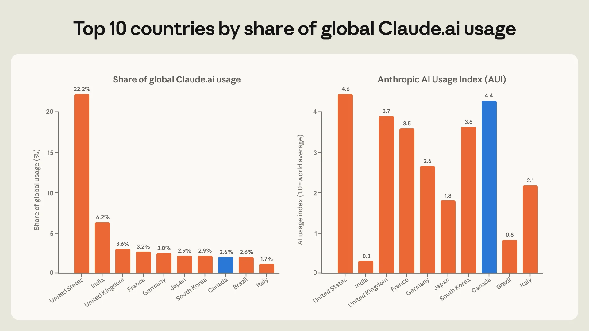

**全球 Claude.ai 使用量排名前十的国家的使用份额和人均采用率**条形图显示了每个国家/地区的份额（左图）和基于 2026 年 2 月从 Claude.ai 采样的 100 万条对话的人类人工智能使用指数（右图）。加拿大以蓝色突出显示。人类人工智能使用指数 (AUI) 衡量一个国家相对于其工作年龄人口而言，Claude的使用率是否过高或过低。加拿大占全球 Claude.ai 消费者使用量的 2.6%，在全球排名第八，按 AUI 排名第二。资料来源：人类经济指数，2026 年 2 月；世界银行。

这在一定程度上反映了加拿大是一个高收入国家的事实。根据国际货币基金组织的定义，在发达经济体中，人均使用量与人均劳动年龄 GDP 之间存在明显的联系。但加拿大的采用率超出了其收入的预期（图 2）。从这个意义上说，与其他国家相比，加拿大在人工智能采用曲线上走得更远，这或许反映出其劳动力受过高等教育并且接近美国技术前沿。

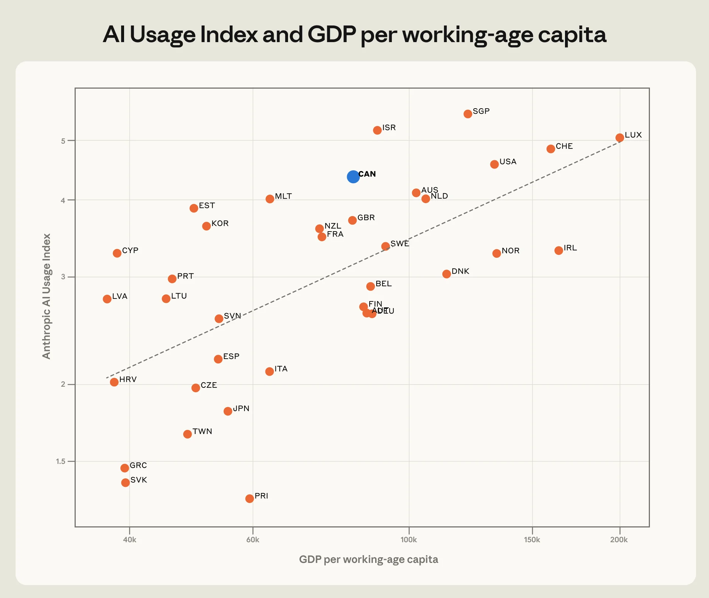

**人择人工智能使用指数 (AUI) 和人均劳动年龄 GDP**该图显示了 IMF 发达经济体中每个国家的 AUI 与人均 GDP 之间的二元关系，样本中至少有 200 个对话。虚线显示最佳拟合线。加拿大以蓝色突出显示。资料来源：人类经济指数，2026 年 2 月；国际货币基金组织;世界银行。

## 在加拿大，采用情况集中并跟踪劳动力构成

正如克洛德的全球采用率不成比例地集中在少数国家一样，加拿大境内各省的使用率分布也不均匀。安大略省占对话的 43.9%。加拿大境内另外 50% 的使用量来自魁北克省 (20.8%)、不列颠哥伦比亚省 (18.9%) 和艾伯塔省 (10.2%)。根据人口进行调整后，排序发生变化：不列颠哥伦比亚省的Claude使用率比根据其工作年龄人口预期高出 1.4 倍，其次是安大略省（1.1 倍）。其余省份的采用率均低于均等。纽芬兰和拉布拉多省的 AUI 为 0.2。

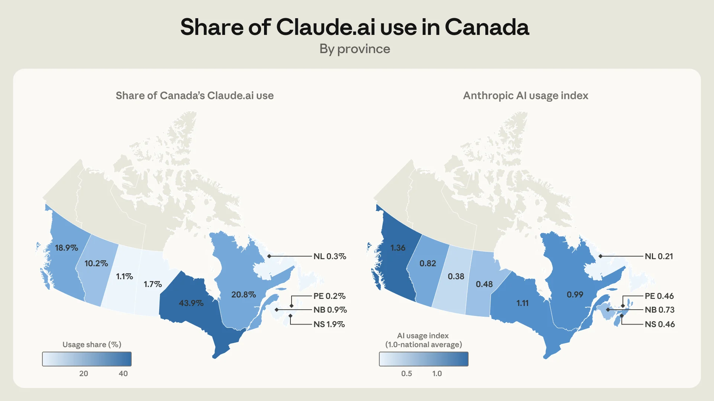

**加拿大 Claude.ai 按省份和地区划分的使用比例**左图：每个省在加拿大 Claude.ai 对话中所占的份额。右图：各省的 AUI，其中 1.0 表示使用量与该省的劳动年龄人口成比例。领土低于报告阈值。资料来源：人类经济指数，2026 年 2 月；加拿大统计局。

如何解释区域采用模式？我们在图 4 中探讨这个问题。与全球收入和使用量之间的关系相比，我们发现各省的人均使用量大多与收入不相关。相反，我们发现区域经济的产业构成是使用强度的关键决定因素：专业、科学和技术服务部门规模较大的地区（以就业份额衡量）的人均使用量系统性较高。

显然，劳动力构成——而不是收入本身——是加拿大境内采用模式的关键决定因素。这个证据与我们的一致 [早期发现](https://www.anthropic.com/research/anthropic-economic-index-january-2026-report) 关于美国境内的采用扩散。高收入国家的人工智能采用情况似乎主要取决于模型能力与当地经济结构的匹配程度。

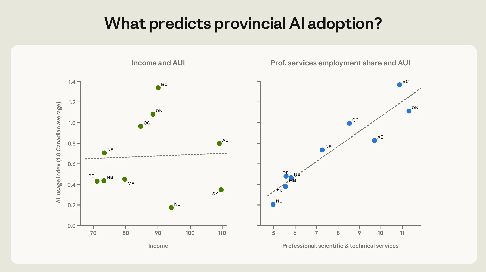

**人择人工智能使用指数（AUI）和省级经济特征**小组根据省级特征绘制了省级 AUI：人均劳动年龄人口 GDP（左）和专业、科学和技术服务的就业份额（右）。资料来源：人类经济指数，2026 年 2 月；加拿大统计局。

## 了解Claude在加拿大的独特用途

尽管地区差异较大 *费率* 关于 Claude 的用法，加拿大各地的人们倾向于以大致相似的方式使用 Claude。在每个省份，个人用途（查找健康信息、研究产品、获取食谱或房屋维修帮助）占对话的 44% 至 51%。与工作相关的使用，即 Claude 用于排除软件故障、起草工作电子邮件和构建业务应用程序，约占 34% 至 40%。剩下的就是使用 Claude 协助完成与课程作业相关的任务（图 5）。

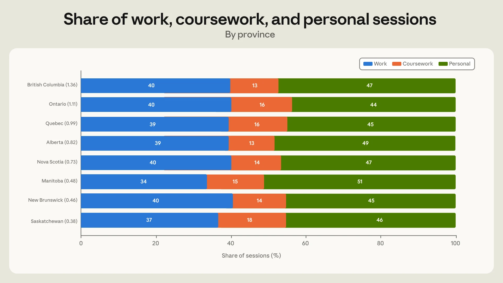

**加拿大各省的用例组合**   
每个省的对话份额被分类为工作、课程作业或个人，由省 AUI 排序（括号中）。资料来源：人类经济指数，2026 年 2 月。

虽然各省的广泛使用模式是一致的，但我们仍然发现有证据表明特定的使用案例往往与当地的经济特征相一致。例如，我们发现，在该国公共行政就业比例较大的部分地区，使用Claude进行翻译和编辑请求的情况普遍较高，这也许反映了加拿大对公共部门官方双语制的承诺，这在政府就业集中的地方产生了对英法翻译的需求。事实上，新不伦瑞克省、新斯科舍省和魁北克省的公共行政就业率最高，与翻译援助相关的对话比例也最高。

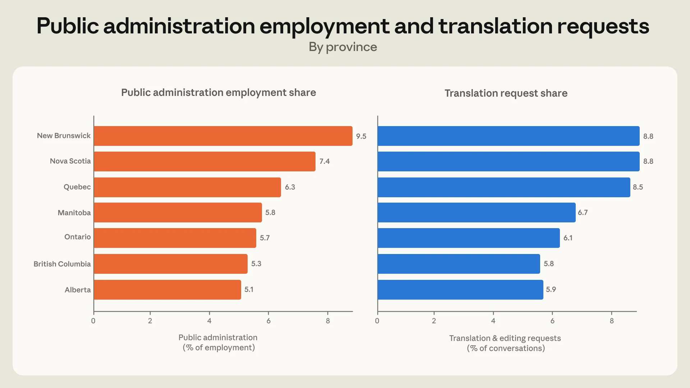

**各省和公共行政部门的翻译使用情况**左图：公共行政就业占全省就业总数的比例。右图：高于报告门槛的七个省份的翻译和编辑请求占省级对话的比例。资料来源：人类经济指数，2026 年 2 月；加拿大统计局。

事实上，与同样拥有大量 Claude 使用量的其他英语圈国家（澳大利亚、英国和美国）相比，文档翻译的使用是整个加拿大最独特的用例（图 7）。更一般地说，我们发现加拿大的使用倾向教育和劳动力市场进入：学术课程（数学和 STEM）、编码帮助和简历起草是相对于其他国家而言最常见的类别。加拿大运行的以下类别倾向于专业沟通（工作场所电子邮件、营销内容、法律援助）以及协助烹饪、家庭维护和健康问题的日常个人任务。

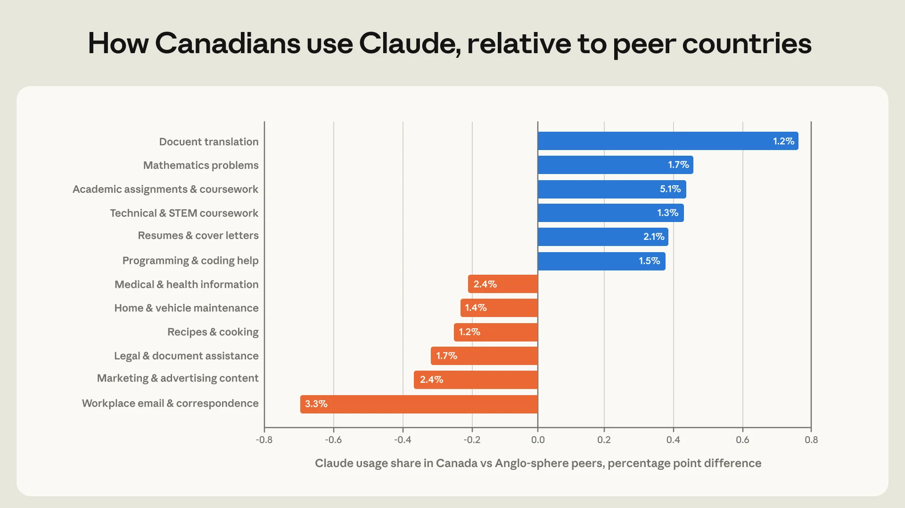

**加拿大与英语圈同行（澳大利亚、英国和美国）相比，Claude的独特用例**该图显示了加拿大对话百分比与澳大利亚、英国和美国平均对话百分比的净差异，这些对话分组至少占加拿大对话的 1%（6 个最独特的加拿大对话和 6 个最独特的同类国家对话）。资料来源：人类经济指数，2026 年 2 月。

## 结论

无论是从总量（占全球 Claude.ai 流量的 2.6%）还是根据人口规模进行调整后来看，加拿大都是全球 Claude 采用率最高的国家之一。如此密集的采用率使我们能够更好地了解Claude的使用如何反映加拿大经济结构和更广泛的经济状况。

在全国范围内，专业、科学和技术服务人员比例较高的省份采用率最高。这与以下观点是一致的：与当地经济构成良好匹配的模型功能主要推动整体采用率。这与全球采用模式形成鲜明对比，全球采用模式似乎与人均收入联系更紧密。

特定用例也反映了加拿大经济的结构。翻译在公共行政部门就业较多的省份更为常见，这符合加拿大大部分公共部门适用的官方语言要求，而且与英语圈同行相比，文件翻译是加拿大对克洛德的最独特的使用。更广泛地说，加拿大的使用偏向于教育和劳动力市场进入，学术课程、编码协助和简历起草相对于澳大利亚、英国和美国来说都过多。

## 加拿大Claude的利用：人类经济指数的现状

### 校长会议

- 人类经济指数的最新版本显示加拿大是由Claude（IA）Claude支付的。Le Canada compte pour 2,6 % du trafic mondial de Claude.ai et se classe au 8e 范围是总体积。居民的利用是人口的主要用途。
- 加拿大的收养水平与全球经济地位和收入水平相符，可能是其他支付方式的标志。Parmi les dix Premiers 支付 qui、ensemble、representent plus de la moitié de l’utilization totale、le Canada se Classe deuxième après es États-Unis en termes d’utilization parhabitant。
- 在加拿大，收养集中在某些地区。L’Ontario 的对话占 43.9%。四大省份（安大略省、魁北克省、哥伦比亚-不列颠省和阿尔伯塔省）占全国利用率的 94%。哥伦比亚-不列颠居民在 1,4 岁以上的居民中抵达，并参加了安大略省的 1,1 岁居民的人口活动。所有其他省份的收养儿童和参加者，只要是新地和拉布拉多，就在 0,2 小时内。
- 世界各地观察到的支付地区的趋势对比，各省居民的收入与这些地区的情况不一样。事实上，经济组织的构成以及重要的作用和重要的服务业、科学和技术占据了Claude的主要地位，这也证实了两者之间的关系IA 模式的能力和主要作品的构成决定了在收入水平上采用的全球品牌。
- 加拿大使用观察习惯与收养相关：34% 至 40% 与省级专业人士的对话，13% 至 18% 涉及学习和 44% 至 51% 与使用人员相关。
- 该设备的某些特定用途类型与当地经济特征一致。要求翻译人员对不同省份公共职能的重要性进行翻译，并在联邦政府的服务和通讯方面反映加拿大官方双语政治；新不伦瑞克省、新省和魁北克省都在公共职能和翻译领域开展了大规模的就业活动。
- 这些文件的翻译构成了加拿大与英语国家的良好关系的使用类型和特征。在一般情况下，Claude在加拿大的使用往往会优先考虑其学习背景和首次亮相：学生工作、编程和简历编辑，以及通信专业人士等代表人员的日常工作。

### 加拿大是收养人的钱加Claude

Claude在加拿大的收养经历。在 2026 年 Claude.ai 上注册的对话中，加拿大全球流量占 2.6%。如果人口统计，人类人工智能使用指数（Anthropic AI 使用指数，ou AUI）位于加拿大 4,4 小时，这意味着居民的利用是四项最高人口统计数据的一部分，这也是人口统计数据的主要内容劳作者。总理的工资由Claude、加拿大和澳大利亚的高级官员支付，只是国家大学的费用（图 1）。

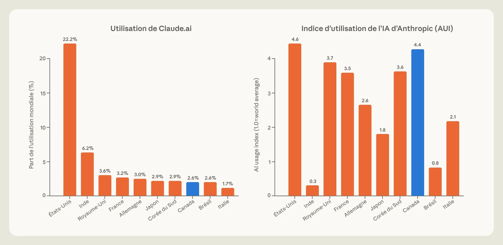

**居住者的部分利用和收养部分由 les dix 支付 qui utilisent le plus Claude.ai**  
Les barres indiquent la part de chaque pays (graphique de gauche) 和 l’indice d’utilization de l’IA d’Anthropic (graphique de droite)，计算 2026 年 Claude.ai 上百万对话的一部分。加拿大是蓝色的证据。人类的利用指数 (AUI) 是Claude的利用指数，可以与劳动人口的关系融洽。加拿大代表 Claude.ai 世界使用率的 2.6%，这就是世界各地的情况，主要是 AUI 的情况。资料来源：人类经济指数，février 2026；世界银行。

加拿大的实际情况是，收入水平得到了提高。Au sein des économies avancées (selon la définition du FMI)，它存在于居住者和工作人员的 PIB 中。加拿大的领养已经过去了，并参与了收入的功能（图 2）。事实上，加拿大与其他国家的儿子收养关系良好，与美国的主要技术水平和技术接近。

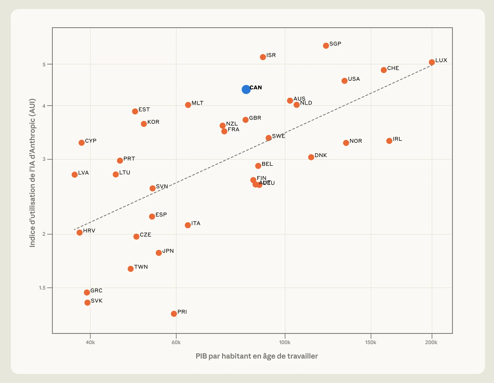

**人类居住指数 (AUI) 和 PIB 居民劳动年龄指数**该图解说明了 AUI 和 PIB 之间的双向关系，包括 200 个对话中的经济发展（FMI 定义）。La ligne pointillée 代表最佳调整权。加拿大是蓝色的证据。资料来源：人类经济指数，février 2026； FMI；世界银行。

### 加拿大内部，收养与主要作品的组成一致

克洛德在世界范围内的收养年龄，在小名额上的情况不成比例，儿子在加拿大的某些省份的利用情况不集中。L’Ontario 的对话占 43.9%。加拿大的剩余利用率为 50%，其中魁北克省 (20.8%)、哥伦比亚-不列颠省 (18.9%) 和阿尔伯塔省 (10.2%)。如果人口计分，分类变更：哥伦比亚-不列颠计分 1,4 fois 加上 Claude que ce qui pourrait être attendu selon la 人口 en âge de travailler, suivie par l’Ontario (1,1 fois)。其他省份与中部国家收养儿童有关。最后位置，Terre-Neuve-et-Labrador affiche un AUI de 0,2。

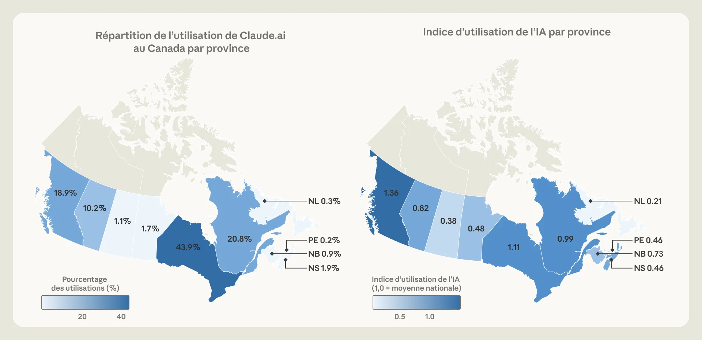

**加拿大各省和领土之间 Claude.ai 的重新分配**  
À 粗俗：加拿大 Claude.ai 上的对话中的查克省部分内容。 À droite ：AUI 省份，où 1,0 对应于省份人口利用率。Les territoires se situent en dessous du seuil d’inclusion。资料来源：人类经济指数，février 2026；加拿大统计局。

收养过程中的地理差异是什么？通过图 4 来探索这一点。世界范围内收入与利用之间的关系观察到，各省居民利用之间的差异与收入相关。相反，区域经济工业组织的组成是利用强度的决定因素：专业服务、科学和技术在区域中占据着重要地位，也是居民和高层利用系统的重要组成部分。

加拿大收养趋势的决定因素是主要的收入 (plutôt que le revenu)。协和飞机 Cette 状态 [前线观察](https://www.anthropic.com/research/anthropic-economic-index-january-2026-report) sur le taux d’adoption aux États-Unis。IA 的采用与收入的支付取决于 IA 模式能力和当地经济结构之间的一致性。

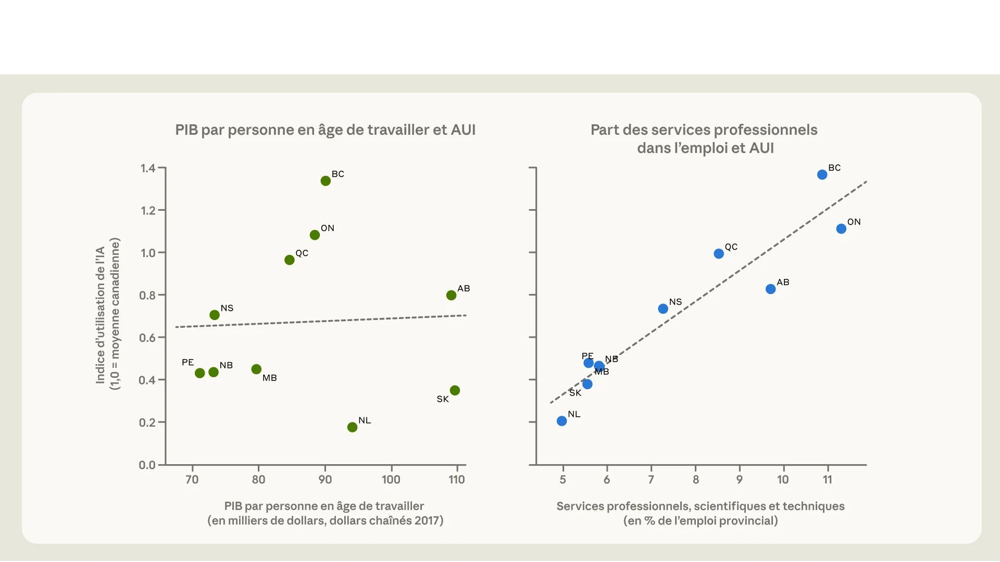

**人类利用指数 (AUI) 和省级经济特征**  
比较省份 AUI 的某些经济特征的图形：PIB 是劳动者 (à gauche) 的人员和劳动市场 (à droite) 方面的专业服务、科学和技术的倾注。资料来源：人类经济指数，février 2026；加拿大统计局。

### 加拿大Claude利用差异分析

区域内重要变化 *陶克斯* Claude的利用，加拿大人倾向于使用类似的全球鳍。在各省份、人员使用情况（健康信息研究、产品研究、房屋拆装工作的研究或咨询）中，对话占 44% 和 51%。专业应用（例如 Claude sert par example à dépanner deslogiciels, à rédiger des corriels et à développer des applications d’entreprise）代表环境 34 % 至 40 % 的对话。Claude 的使用方法与 scolaires 相同（图 5）。

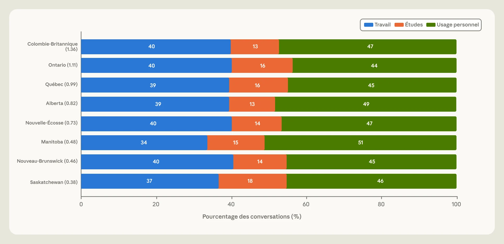

**加拿大各省的利用类型**  
与查克省的人员进行劳动、练习和交流的资源； les 省份sont classées par l’AUI 省级（括号内）。资料来源：人类经济指数，février 2026。

如果其他省份的利用趋势与其他省份相似，那么利用趋势的类型与当地经济特征相一致。例如，Claude利用Claude的翻译和修订系统，以及在支付地区的公共职能，在就业市场上占据主导地位，这是加拿大最喜欢的参与方式公共职能中的双语是一种要求相对强的英法翻译能力的双语制度。事实上，新不伦瑞克省、新省和魁北克省都在公共职能和翻译方面进行了广泛的讨论。

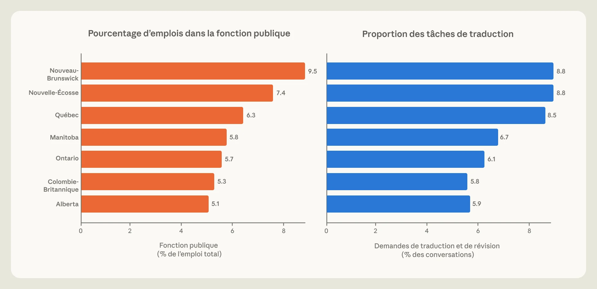

**各省和公共职能的翻译比例**粗略图表：与查克省的总体就业关系有关的公共职能部分就业情况。法律图表：在七省份包容性对话中的翻译和修订要求部分。资料来源：人类经济指数，février 2026；加拿大统计局。

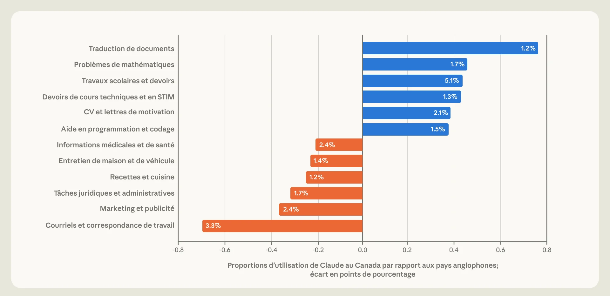

**Claude在加拿大与英语国家的关系的利用类型（澳大利亚、皇家大学和国家大学）**该图说明了加拿大和澳大利亚的中年注册者之间的差异，以及皇家大学和国家大学代表的不同类型的对话 1 % 加拿大对话（6 个主题以及加拿大典型和 6 个主题）主题 les plus caractéristiques des pays 同类）。资料来源：人类经济指数，février 2026。

事实上，文件翻译的使用与加拿大与英语母语国家的使用存在巨大差异，与Claude、澳大利亚、皇家大学和国家大学的使用情况相当（图 7）。一般情况下，Claude在加拿大的使用主要是教育方面的原则和工作的进展：学生工作（数学和 STIM），以及 CV 字体部分的代码和编辑surreprésentées par rapport aux pays 比较。相反，加拿大通讯职业领域（专业人士、持续营销、司法助理）和日常人员（烹饪、管理人员和健康顾问）领域的一般趋势结果附件。

### 结论

加拿大数字 Parmi les 支付了 Claude 的收养费，加上全球范围内的力量（Claude.ai 的全球流量的 2.6%），并获得人口奖。我们完全理解Claude的利用，反映了加拿大经济的结构和一般经济的背景。

在国家级，这是在各省的专业服务场所，在就业市场上的科学和技术是最重要的。Cette constatation a thèse que ce sont surtout les capacités des modeles d’IA, lorsqu’elles sont bien adjustmentes à la leconomie locale, qui qui déterminent les d’adoption en général, contairement aux trends observées ailleurs dans le monde,您可以通过收养来获得居住者的收入。

某些类型的利用会影响加拿大经济结构。在各省使用翻译歌曲以及在公共职能中使用的频率，这相当于加拿大公共职能中相关官方语言的紧急情况；其结果是，文件的翻译结果是利用了加拿大克洛德的特色，与英语圈的其他国家建立了良好的关系。总体而言，Claude在加拿大的利用对学习和插入工作的学习和插入是不利的，是学生劳动的动力，也是加拿大人的简历的助手和编辑。澳大利亚，皇家大学和国家大学。
