# AI 如何助力科学发现：研究人员怎样使用 Claude

- 英文标题：AI for scientific discovery: How researchers use Claude
- 发布日期：2026-11-05
- 官网栏目：经济学
- 原文：[Anthropic 页面](https://www.anthropic.com/research/how-researchers-use-claude)
- 官网署名：Anthropic
- 官网推荐阅读：[下载 PDF](https://assets.claude.com/6e7c6446c0d8405dba73b91dabd36aac069dea2e.pdf)

> 中文机器初译，未逐篇人工校对。引用研究结论时请核对英文原文。

Johannes Hermle†、Ben Jones†、Lukas Althoff†、Ryan Heller、Thomas Lyttelton、Carolyn Stein、Nathan Wilmers、Maxim Massenkoff、Peter McCrory

† 报告的主要作者。

## 摘要

- **我们测量什么。** AI 有可能加快科学发现，能加快多少取决于 AI 的能力，以及科学家怎样使用它。我们采用保护隐私的方法研究了 207,000 个 Claude 和 Claude Code 科研会话，了解不同学科和研究任务如何使用 Claude。这项研究旨在帮助公众了解当下 AI 在科研中的应用，并评估它未来可能对科学发现产生的影响。
- **科学家在哪些领域和任务中使用 Claude。** 按各领域的研究人员数量来衡量，计算机科学、数学和统计学等形式科学使用 Claude 较多，健康领域和依赖实验室的自然科学使用较少。科学家主要用 Claude 分析数据和写作。仅数据分析就约占 Claude 科研会话的三分之一，约占 Claude Code 科研会话的一半。研究人员较少用它构思或收集数据，尽管随附调查显示，他们认为这两项任务对科学发现最重要。专为科研设计的 AI 工具可能缩小这一差距。例如，在 Claude Science 中，构思所占的使用比例约是普通 Claude 的两倍。
- **Claude 的使用量如何反映 AI 的能力。** 我们设计了一个指标，估计 AI 理论上能多好地完成各类科研任务。按该指标排名前 20% 的任务，其 Claude 实际使用量是根据研究人员投入时间所推算值的两到四倍；末尾 20% 的任务（其中包括大多数实体操作）很少使用 Claude。学科之间也呈现相同的规律：在计算机科学和统计学等 AI 擅长更多任务的领域，Claude 使用得更频繁。
- **这对科学发现速度意味着什么。** 我们用一个简单模型探索了 AI 可能将科研加快多少。如果现有 AI 能力得到广泛采用，某些领域的研究产出可能翻倍。如果 AI 能承担所有无需实体操作的研究工作，计算机科学和统计学等领域的产出最高可能达到原来的 15 倍；受实体实验条件制约的化学、生物学等领域，产出可能达到原来的三到四倍。在我们调查的积极使用 AI 的科研人员中，约 40% 预计到 2030 年，AI 模型能独立完成整个研究项目。

## 简介

科学被描述为“无尽的前沿”（Bush 1945）。但我们探索这一前沿领域的速度历来受到稀缺资源的限制：人类研究人员的时间和才能。人工智能可以通过扩大研究人员的能力、改变发现过程和探索速度来缓解这一限制（Wang 等人，2017）。2023；阿莫代 2024）。人工智能的应用对于人类福祉来说没有什么比这更重要的了。与大多数经济部门相比，考虑到研究的高度认知性，人工智能的影响可能特别大，而且在这个领域的早期发展。

最近的例子表明人工智能在科学发现中发挥着越来越大的作用。在结构生物学中，AlphaFold 预测了超过 2 亿种蛋白质的三维形状（Jumper 等，2017）。2021 年；瓦拉迪等人。2024），及其创造者分享了 2024 年诺贝尔化学奖。在材料科学领域，GNoME 预测会出现 380,000 个稳定的新晶体（Merchant 等，2017）。2023）。在数学领域，研究人员利用人工智能系统帮助解决了数十年之久的 Erdős 问题，为千年奖问题提供了潜在的证明，并在其他重大问题上取得了进展，从开放猜想到验证里程碑式的证明（Anthropic 2026a, 2026b；OpenAI 2026a, 2026b；Tsoukalas 等，2026）。2026）。

除了这些发展之外，大多数科学进步还涉及许多专门的、相互关联的研究任务，这些任务在不同领域之间可能存在很大差异。人工智能在多大程度上加速了科学发现不仅取决于人工智能的能力，还取决于它在这些任务中的应用方式。在本报告中，我们使用隐私保护基础设施来研究Claude、Claude代码和Claude科学的科学用途。我们记录了不同领域和任务的使用情况，确定了这些使用模式的解释，并概述了人工智能如何加速研究的场景。

Claude在科学中的使用因领域而异。相对于研究人员的数量，计算机科学、数学和统计学等正规科学更多地使用Claude，而健康和基于实验室的物理科学则较少使用它。在研究任务中，科学家更多地使用Claude来分析数据和写作，而不是收集数据或产生想法和假设。这与一项附带的科学家调查中自我报告的人工智能使用情况是一致的。

为了理解这些差异，我们开发了一种理论人工智能能力的衡量方法。在此指标上得分较高的任务和领域中，Claude的使用率较高。这些本质上也往往更具认知性，更适合强化学习，其中人工智能从重复尝试的反馈中学习。简而言之，科学家们似乎在最有效的地方使用人工智能。

基于这些发现，我们概述了人工智能如何加速科学进步的场景。以目前的能力，某些领域的研究成果可能会增加一倍，这主要来自于任务级别的增强。我们调查中的研究人员预计未来会有更强大的功能。在人工智能完全自动化所有非体力工作的假设场景中，计算机科学或统计学等高度认知领域的产出可能会增加 15 倍。由于加速潜力最大的领域包括那些本身产生人工智能的领域，因此这些成果可能会创造一个额外的反馈循环，在这个循环中，更快的人工智能研究会产生更强大的人工智能，从而进一步加速研究。

虽然更快的科学发现可以给人类带来巨大的好处，但人工智能驱动的研究也带来风险和不确定性。较少的人为监督可能会导致危险或不道德的研究。人工智能还可以重塑研究人员的职业生涯，使研究工作或多或少有所回报，并改变与人类追求知识相关的使命感。

## 我们如何进行这项研究

我们这项研究的目标是衡量科学家使用Claude的不同方式，同时保护他们的工作细节。为此，我们使用隐私保护基础设施来分析 Claude 在消费者计划中的科学用途。此处用作“分类器”的语言模型读取每个会话记录，并根据预定义的分类法（Alamos 和 Althoff 2026 的 SciNet 分类法）用一组固定的类别对其进行标记，例如其涉及的领域和研究任务。由此产生的标签，例如“化学”或“数据清理”，是研究团队为本报告保留和分析的这些对话中的唯一信息。本研究中使用的分类器不会提取和存储开放式信息或研究内容的详细信息，例如研究数据集、假设、实验方法、早期发现或未发表的论文。结果仅以汇总形式报告，并且仅针对满足最小数量不同帐户的单元格。本研究中引入的所有分类器都列在 [附录](https://assets.claude.com/fafb3d4237f9b53fe114fef4fb5109b9cf5b5e60.pdf).

我们的测量涉及两个步骤。第一分类器识别会话记录是否涉及科学工作。然后，第二个分类器将每个转录本分配给 SciNet 分类中的一个字段、子字段和任务。SciNet 包含 7,262 个任务，涵盖 34 个领域和 318 个子领域。分类学中的一些任务，例如起草手稿，对于所有领域都是通用的。其他则特定于各个字段或子字段。例如，在分类学中，预测光学吸收和发射光谱的任务是材料科学特有的。这些任务共同涵盖了产生新研究成果的整个过程。

我们的主要样本包括 2026 年 8 月 2 日至 9 月 30 日期间有关消费者计划的 207,049 场会议，这些会议被分配了一个科学领域和一项研究任务：其中 128,914 场来自 Chat 和 Cowork（两个用于对话和知识工作的通用界面，以下简称“Claude”），78,135 场来自 Claude Code（一种直接处理用户文件、编写和运行代码的代理编码工具）。我们还研究了Claude科学课程的补充样本。有关示例构建的详细信息，请参阅 [附录](https://assets.claude.com/fafb3d4237f9b53fe114fef4fb5109b9cf5b5e60.pdf).

将使用数据和研究任务的结构化分类相结合，使我们能够研究哪些领域采用了Claude以及研究过程的哪些部分。这项研究有助于越来越多的工作尝试衡量人工智能技术在科学发现中的采用情况（Kobak 等，2017）。2025；梁等人。2025；郝等人。2026；科德雷亚努等人。2026）。

## Claude在不同科学领域的使用有何不同

我们首先描述Claude在不同科学领域的使用有何不同。图 1 比较了某个领域的会议份额与该领域全球研究人员的份额，让我们了解每个科学领域的相对使用情况。[1](https://www.anthropic.com/research/how-researchers-use-claude#footnote-1) 在 Claude 看来，会议份额最大的三个领域是计算机科学（11.9%）、工程学（8.4%）和医学（7.7%），这也是全球研究人员数量最多的领域之一。[2](https://www.anthropic.com/research/how-researchers-use-claude#footnote-2) 总体而言，研究人员比例较大的领域也往往占 Claude 会话的比例较大（双对数相关性为 0.79）。

然而，Claude在每个领域的使用不能仅用研究人员的数量来解释。在图 1 中，45 度线上方的字段相对于其大小显示出较高的使用率，而该线下方的字段显示出较低的使用率。对于正规科学，包括计算机科学、数学和统计学，相对使用率尤其高。社会科学的使用率也很高。相比之下，化学等物理科学的工作通常在实验室进行，因此相对使用率往往较低。医学也是如此，按会议量计算，医学是第三大领域，研究人员将大量时间花在患者身上。

在 Claude Code 上，使用情况与领域大小的相关性不太强（与研究人员数量的对数相关性为 0.62），并且集中在更多定量领域。尽管计算机科学仅占全球研究人员的 4.3%，但仅计算机科学就占了 Claude Code 会议的 32.7%。[3](https://www.anthropic.com/research/how-researchers-use-claude#footnote-3) 其他正规科学，例如数学和统计学，也显示出较高的相对使用率。除经济学这一相对定量的领域外，艺术、人文学科和社会科学的相对使用率较低。

**Claude在科学领域的使用。** 每个点代表一个字段。横轴显示该领域研究人员的份额，纵轴显示该领域研究会议的份额，两者均采用对数尺度。顶部面板显示了 Claude 的会议；底部面板显示了 Claude Code 的会话。

在比较这 34 个字段内的 318 个子字段的使用情况时，我们观察到类似的模式（图 2）。[4](https://www.anthropic.com/research/how-researchers-use-claude#footnote-4) 这种更细粒度的子领域视图表明，人工智能和机器学习脱颖而出，尽管仅占全球研究人员的 1.2%，但 Claude 的会话份额为 5.0%，Claude Code 的会话份额为 15.2%。更一般地说，无论科学领域如何广泛，计算子领域都是最强大的采用者之一。这些子领域包括计算生物学、计算语言学和计算神经科学。机器人技术也显示出较高的相对使用率，可能是因为尽管它专注于物理系统，但它很大程度上建立在计算方法的基础上。

**Claude在科学子领域的使用。** 每个点代表一个子字段。横轴显示子领域研究人员的份额，纵轴显示子领域研究会议的份额，两者均采用对数尺度。顶部面板显示了 Claude 的会议；底部面板显示了 Claude Code 的会话。出于隐私原因，不会显示帐户太少的子字段。

## Claude在不同研究任务中的使用方式有何不同

除了了解哪些领域使用Claude之外，我们还想了解科学家使用它的用途。研究涉及许多不同的任务，从生成假设和分析数据到在研究论文中撰写研究结果。为了更好地了解Claude如何支持科学发现，我们研究了这些任务的使用情况如何变化。为此，我们将每个会话分配给 SciNet 中 7,262 个任务之一。这些任务可以适用于所有领域，例如起草手稿，也可以特定于领域或子领域，例如进行差异基因表达分析以比较与癌症生物学相关的肿瘤亚型。该分类法区分了研究任务（研究人员为产生新的科学发现而执行的任务）和非研究任务（例如教学、同行评审以及为部门或领域提供服务）。[5](https://www.anthropic.com/research/how-researchers-use-claude#footnote-5) 我们的分析仅限于八类研究任务：(1) 数据分析，(2) 写作和交流，(3) 数据收集，(4) 阅读和知识获取，(5) 理论分析，(6) 设计和开发（软件、材料和创意作品），(7) 构思和假设生成，以及 (8) 其他，例如管理研究。

对于每个任务类别，我们分别计算其 Claude 和 Claude Code 会话的份额。为了评估某个类别的使用率是高还是低，我们会考虑研究人员通常花在该类别上的时间比例（根据 SciNet 的估计）。这些时间估计基于法学硕士分类器，并使用湿实验室研究协议进行验证，该协议记录了研究人员在每项任务上花费的时间以及数千篇学术论文中的任务频率（请参阅 [附录](https://assets.claude.com/fafb3d4237f9b53fe114fef4fb5109b9cf5b5e60.pdf)）。这提供了一个基准来评估Claude在不同任务类别中的使用比例是否遵循或偏离研究人员花费时间的方式。

**按任务类别划分的使用情况。** 从绝对值来看，数据分析任务的使用率最高，并且相对于研究人员的时间而言，所占比例过高。数据分析占 Claude 会话的 33.7%，Claude Code 占 48.1%，而研究人员的时间为 27.6%。写作和交流任务的使用率也很高，尤其是 Claude（32.0%，而研究人员时间为 16.0%）。[6](https://www.anthropic.com/research/how-researchers-use-claude#footnote-6) 数据收集任务的相对使用率较低，占研究人员时间的 28.6%，但仅占 Claude 会话的 11.5% 和 Claude Code 的 11.9%。对于有物理障碍的任务（例如临床或生化数据的收集），数据收集的代表性不足尤其严重。可以依赖更多数字化流程的数据收集任务（例如检索档案文档或文本）的代表性较少，而纯粹的数字数据收集任务（例如收集在线数据）的代表性可能过高。构思和假设生成任务的使用率也较低，占 Claude 会话的 4.2% 和 Claude Code 的 2.1%，而研究人员的时间为 7.1%。

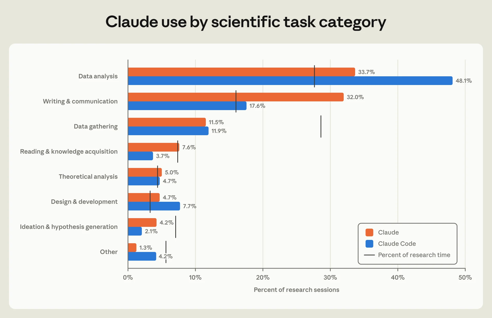

**Claude按科学任务类别使用。** 每行代表八个任务类别之一。橙色条代表Claude研究会议专门针对每个类别的份额；蓝色条代表Claude代码研究会议的相同内容。黑线代表根据 SciNet 计算出的研究时间的估计份额（参见 [附录](https://assets.claude.com/fafb3d4237f9b53fe114fef4fb5109b9cf5b5e60.pdf)).

**将观察到的使用情况与调查证据进行比较。** 在对 Claude 和 Claude Code 会议进行分析的同时，我们还对 528 名科学家进行了调查，他们自我报告的人工智能使用情况与我们在这些会议中观察到的模式相符。该样本主要由生命和健康科学领域的研究人员组成，他们是人工智能的积极采用者。[7](https://www.anthropic.com/research/how-researchers-use-claude#footnote-7) 与图 3 所示的Claude使用模式一致，调查参与者自我报告的人工智能使用率最高的是数据分析、写作和交流，而较低的是构思、假设生成和数据收集。参与者还报告更多地共享或委托使用人工智能进行数据分析、写作和交流（图 4）。

该调查还询问哪些类别对于产生重要研究成果最重要。受访者将构想和假设生成排在第一位，数据收集排在第二位。值得注意的是，这些类别在自我报告的使用情况以及Claude会议中的代表性不足。造成这种代表性不足的原因可能有所不同。大部分数据收集都是物理性的，而构思则不然。对于构思，科学家可能更喜欢自己产生想法，或者他们可能认为人工智能的能力有限。我们的数据也可能低估了创意，因为它往往与许多其他研究任务交织在一起并且难以分类。但人工智能在高层次思维方面也可能确实较弱，例如选择要追求的研究问题并设计一项研究来回答它。

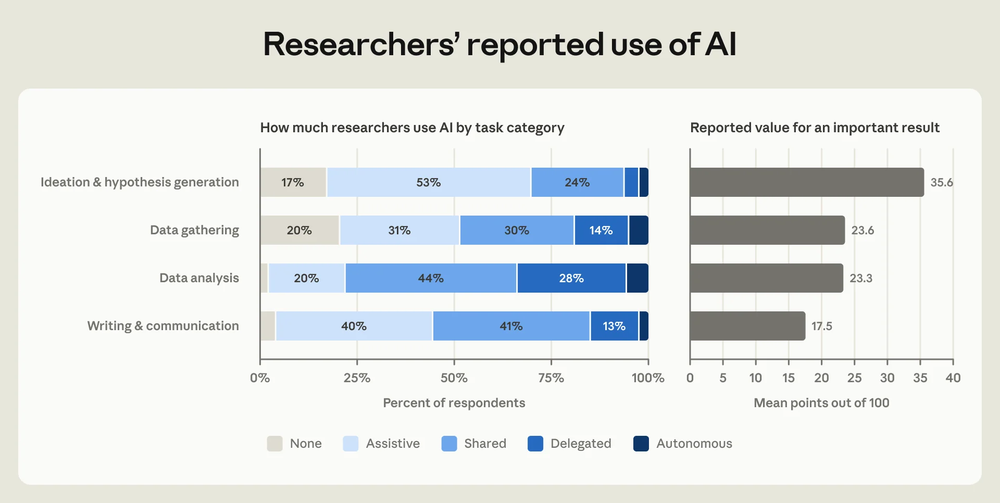

**研究人员报告了人工智能的使用。** 左图显示了四个研究任务类别中从不使用人工智能到自主使用人工智能的各个级别的调查受访者的百分比。右图显示了受访者如何评价每个类别对于产生重要研究结果的重要性（在四个类别中分配 100 分）。

**Claude科学的生物学和生物医学用途。** 虽然 Claude 和 Claude Code 是通用接口，但用于科学的专用人工智能工具越来越多。为了研究这些工具是否支持更专业和要求更高的研究，我们使用隐私保护分析基础设施将 Claude Science 上的生物学和生物医学工作与 Claude 和 Claude Code 上的生物学和生物医学工作进行比较。

Claude Science 将 Claude 与许多原本分散的研究工具和数据库连接起来，以整合和加速科学工作流程。科学家必须经常使用不同的平台，每个平台都具有独特的数据结构或查询语言，以便在研究中结合不同的工具和数据库。例如，研究现有药物是否可以作用于特定蛋白质的生物学家通常必须查阅有关该蛋白质的功能、其结构、已针对该蛋白质进行测试的化合物以及相关药物试验或论文的单独数据库。Claude Science 将这些整合到一个工作流程中。

Claude科学的用途集中在生命科学领域。排名前两位的领域是生物医学科学和生物学，这两个领域合计占会议的 50% 以上。在这些领域中，我们评估了哪些任务相对于Claude执行的任务来说最多。

我们发现研究人员使用 Claude Science 来完成比 Claude 更专业的任务（图 5）。例如，任务“提出蛋白质-蛋白质或蛋白质-配体相互作用的机制模型”出现在 Claude Science 上的可能性是 Claude 的 5.6 倍。这项任务涉及在单个分子接触的水平上解释一种蛋白质如何与另一种蛋白质或药物等小分子结合。Claude Science 非常适合这项任务，因为它可以从多个连接的数据库中收集蛋白质结构和结合数据，并将它们组合成可测试的相互作用模型。相比之下，Claude Science 用于一般任务的情况相对较少，例如起草手稿或与合作者协调。此外，我们发现构思和假设生成占 Claude Science 会议的 8%，与这些任务所花费的研究人员时间份额大致相当，这表明专门的科学人工智能工具可以促进更复杂和创造性的工作。

**Claude科学跨领域和任务的使用。** 顶部面板按所有 Claude Science 研究会议的份额显示前 10 个领域。底部面板显示了与Claude在生物学和生物医学科学领域相关的最典型和最不典型的Claude科学任务，计算如下：（任务在这些领域的Claude科学研究会议中所占的份额）/（在这些领域中Claude研究会议中的份额）。

专注于生物医学科学和生物学，并使用我们的经济原语框架中引入的措施 [之前的工作](https://www.anthropic.com/research/anthropic-economic-index-january-2026-report) （阿佩尔等人。2026），我们发现 Claude Science 上的任务比 Claude 和 Claude Code 上的任务更长、更复杂且执行更自主（图 6）。这与用于执行更苛刻任务的专用人工智能工具是一致的。[8](https://www.anthropic.com/research/how-researchers-use-claude#footnote-8) Claude科学会议包含的工作在没有人工智能的情况下需要花费近两倍的时间才能完成，而Claude和Claude代码的工作则需要近两倍的时间才能完成。这些会议的内容也更加高级。据估计，超过 80% 的 Claude Science 使用需要博士级培训（20 年教育），而其他界面的这一比例约为 50-70%。超过 70% 的 Claude Science 课程是在高度人工智能自主下进行的，远远高于 Claude (23.7%)，略高于 Claude Code (64.1%)。

**在生物学和生物医学科学中使用特征。** 比较生物学和生物医学领域的 Claude、Claude Code 和 Claude Science 任务的人类任务时间、博士级内容和自主水平。阴影橙色和蓝色条重新加权了 Claude 和 Claude Code 执行的子字段和任务，以匹配 Claude Science 执行的子字段和任务。

**Claude使用的输出。** 最后，Claude 制作的工件显示出跨领域的明显差异（图 7）。[9](https://www.anthropic.com/research/how-researchers-use-claude#footnote-9) 相对于自然科学和形式科学，文档、报告或学术论文等书面制品在社会科学和人文学科中更为常见。相反，代码、软件输出和数据等技术工件在自然科学和形式科学中更为常见。就所产生的文物而言，健康科学总体上与社会科学更相似。Claude代码上的技术工件大约是Claude代码上的两倍，但跨领域的广泛模式是相似的（请参阅 [附录](https://assets.claude.com/fafb3d4237f9b53fe114fef4fb5109b9cf5b5e60.pdf)).

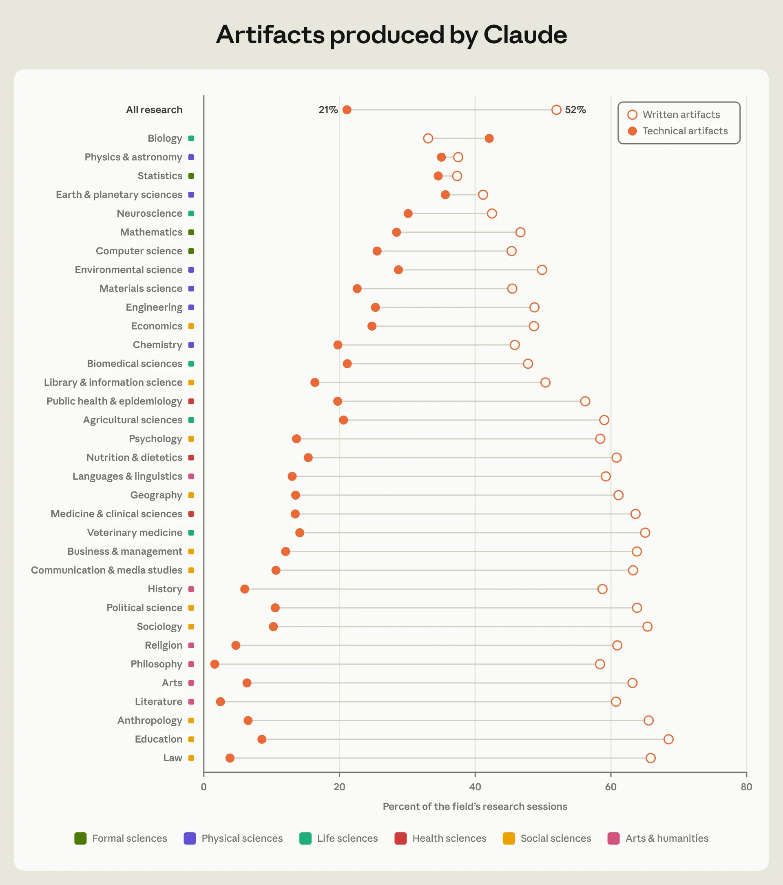

**Claude制作的文物。** 按领域产生书面工件和技术工件的 Claude 会议份额。字段按照书面工件和技术工件的份额之间的差异进行排序。

## 使用与能力有何关系

人工智能的使用情况是否会追踪人工智能的能力？场地大小解释了Claude使用的一些变化，但不是全部。例如，计算机科学领域的研究人员对Claude的使用远远超出了该领域的规模预测，而营养学领域的研究人员对Claude的使用则远远少于该领域的预测。同样，研究人员将自己的时间花在哪里并不能完全预测他们在哪里使用Claude最多。一些广泛的任务类别，例如数据分析和写作，其使用比例比研究时间大得多，而其他任务类别，例如数据收集、构思和假设生成，则使用比例要小得多。在这里，我们测试这些使用差异是否反映了人工智能实际可以做什么。

为了衡量特定任务的人工智能能力，我们首先使用 LLM 分类器构建能力分数。对于每项任务，SciNet 提供了科学家完成任务所需执行的各个步骤的列表。例如，在化学中，一项任务涉及纯化反应混合物，而该任务的步骤之一涉及填充色谱柱。分类器会看到整个分类中的一对步骤，并询问哪个人工智能可以表现更好。我们使用 Bradley-Terry 模型汇总这些比较，该模型与 Elo 评级背后的模型相同，该模型根据交锋结果对国际象棋棋手进行排名。当一个步骤赢得比较时，它的分数就会上升；当它失去比较时，它的分数就会下降。然后，我们对每个任务的步骤进行平均以获得任务级别分数（请参阅 [附录](https://assets.claude.com/fafb3d4237f9b53fe114fef4fb5109b9cf5b5e60.pdf) 了解详情）。我们给这个措施贴上标签 *理论AI能力*。我们将任务的具体分数称为 *AI能力评分*.

为了比较不同任务的使用情况，我们询问相对于研究人员在该任务上花费的时间，Claude对于某项任务的使用情况是更高还是更低。例如，一项任务占用研究人员 5% 的时间，但占 Claude 会话的 10%，则其使用量是预期的两倍，比率为 2。比率为 1 表示 Claude 使用情况与研究人员在该任务上花费的时间一致。比率低于 1 表示根据任务所需的研究人员时间量，Claude 的使用量低于预期。

图 8 显示，该使用率随着任务的 AI 能力得分而急剧上升。对于能力得分最低 20% 的任务，例如纯化反应混合物和进行参与者观察，几乎不使用Claude。在能力得分中位数下，该比率大约为 1，因此使用情况与研究人员的时间一致。对于能力得分前 20% 的任务，例如可视化数据和应用统计测试，与研究人员在这些任务上花费的典型时间相比，Claude 的使用率约为两倍，Claude Code 的使用率约为四倍。这些模式表明科学家对 Claude 的使用密切跟踪人工智能能力得分。Claude Code 的陡峭梯度反映了其对计算工作的关注，而计算工作具有更高的能力得分。

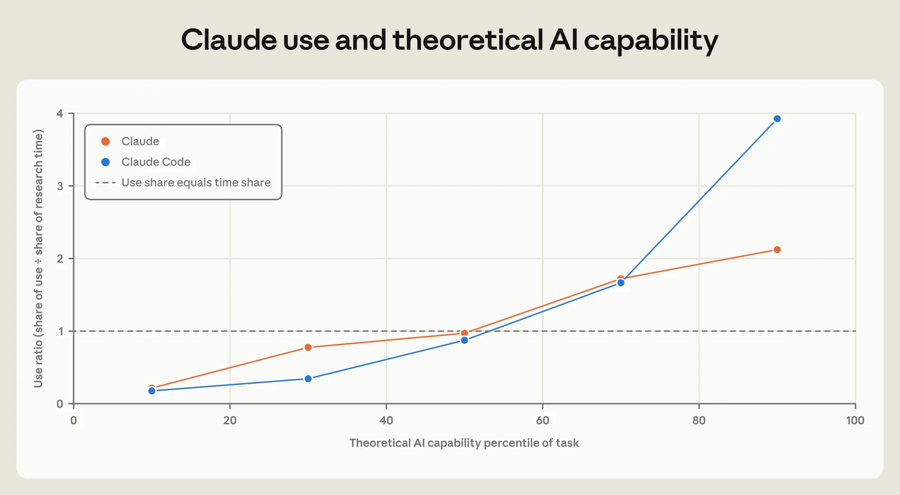

**Claude使用和理论人工智能能力。** 纵轴代表每个能力五分位数中任务的使用率，计算方法为致力于这些任务的研究会话份额除以 SciNet 估计的研究时间份额。横轴代表任务的AI能力得分（百分位数）。橙色点代表Claude每个人工智能能力五分位中任务的平均使用率；蓝点代表Claude代码相同。

由于多种原因，理论上的人工智能能力可能因任务而异。为了理解这些差异，我们将每个任务的 AI 能力得分与三组 LLM 派生的任务特征相关联：强化学习 (RL) 的适用性；工作是否主要是认知、人际或体力工作；以及监管限制是否限制人工智能的使用（图 9；参见 [附录](https://assets.claude.com/fafb3d4237f9b53fe114fef4fb5109b9cf5b5e60.pdf) 的定义和数据源）。

考虑强化学习的适用性。在强化学习中，人工智能模型会反复尝试一项任务，并在成功时获得奖励，从而使模型能够学习如何执行该任务。当任务很容易验证成功、可以在计算环境中模拟许多示例以及可以快速提供反馈时，任务特别适合强化学习（Lambert 等人，2017）。2024；郭等人。2025）。我们对这三个 RL 相关组件使用 SciNet 的特定于任务的度量，并将它们总结在一个索引中。任务的能力得分与其单独分类的 RL 指数得分高度相关（相关性为 0.78）。这表明人工智能最有能力完成强化学习最容易应用的研究任务。

其他重要的任务特征涉及工作的性质。一些研究任务从根本上来说是认知性的，而另一些则需要身体动作或人际接触。一般来说，物理任务超出了纯粹认知机器的能力范围。还可能存在限制人工智能使用的监管限制。以认知工作为特征的任务的 AI 能力得分较高（相关性为 0.69）。相比之下，涉及更多体力劳动的研究任务的人工智能能力得分较低（-0.57）。对于包括人际工作（-0.31）或涉及人工智能使用监管限制（-0.38）的研究活动，得分也往往较低。

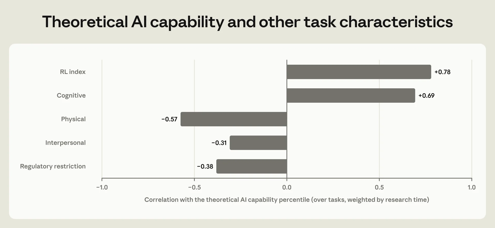

**理论人工智能能力和其他任务特征。** 研究任务的人工智能能力得分百分位与任务的其他特征之间的相关性。

相同的任务特征还可以预测研究人员在给定任务中使用 Claude 的程度（图 10）。Claude 几乎不用于执行 RL 适宜性排名后五分之一的任务。对于前五名的任务，相对于研究人员花在这些任务上的时间而言，Claude 使用率高得不成比例：Claude 的使用率是 Claude 的两倍，Claude Code 的使用率是 Claude Code 的四倍。这类似于 Claude 使用与 AI 能力总体得分之间的关​​联，其中前 20% 的任务也吸引了预期使用的两到四倍。

在以认知为主的任务中，Claude的使用率也异常高。相比之下，Claude在体力和人际任务上的使用率较低。对于监管障碍限制人工智能协助的任务，Claude的使用率也较低。总体而言，在高度专业化的研究任务中，使用和能力衡量指标密切相关。

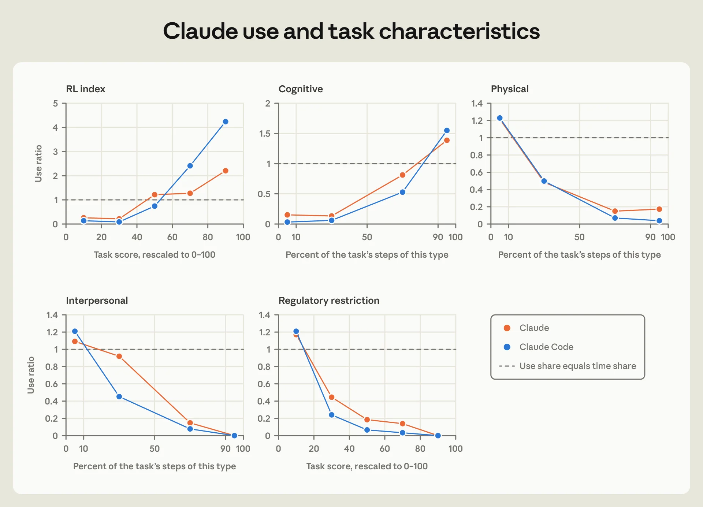

**Claude的用途和任务特点。** 每个小组考虑不同的任务特征。纵轴表示在该特征上具有不同分数的任务组（“箱”）的使用率。水平轴代表特征强度的度量。橙色点代表 Claude 上每个 bin 中任务的平均使用率；蓝点代表Claude代码相同。零处的点表示出于隐私原因而隐藏的垃圾箱，因为负责该用途的帐户太少。

不同的科学领域依赖于不同的研究活动组合。狭窄研究任务的使用率和能力得分之间的相关性是否有助于解释为什么某些领域比其他领域更多地使用Claude？我们的数据表明确实如此：子领域的每个研究人员对 Claude 的使用往往会随着其任务中的平均 AI 能力得分而上升（Claude 的相关性为 0.45，Claude 代码的相关性为 0.57），如图 11 所示。

不同领域之间也存在很大差异，这表明Claude的使用受到人工智能无法做到的因素的影响。与他们任务中的人工智能能力得分相比，健康科学研究人员对Claude的使用相对较少，可能是因为医疗数据和研究的监管限制了人工智能的使用或使其更难以集成。正规科学、社会科学以及艺术和人文学科的研究人员对Claude的使用超出了人工智能能力分数的预测。这些领域的大部分工作都是通过文本和代码完成的，这可能有助于人工智能工具的采用。Claude在物理科学和生命科学中的使用通常更密切地跟踪人工智能能力得分，尽管各个子领域可能会有所不同。

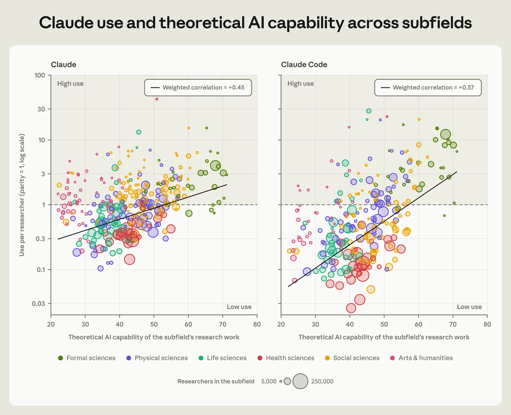

**Claude跨子领域的使用和理论人工智能能力。** 两个面板都将每个子领域显示为一个点，其大小由该子领域的研究人员数量决定。纵轴以对数刻度显示每个研究人员的使用情况。每个研究人员的使用量计算为子领域在研究会话中所占的份额除以子领域在研究人员总数中所占的份额。横轴显示子领域的人工智能能力得分，通过按研究人员时间加权的所有子领域研究任务的汇总来计算。黑线显示最佳拟合，每个面板报告按子字段大小加权的相关性。左图显示了Claude研究会议的结果；右侧面板显示了Claude代码研究会议的结果。

理论人工智能能力还可以预测研究人员允许Claude自主工作的程度。图 12 显示自主使用与该子领域的理论人工智能能力相关。换句话说，人工智能理论能力更强的子领域不仅更多地使用人工智能，而且以更自主的方式使用人工智能。

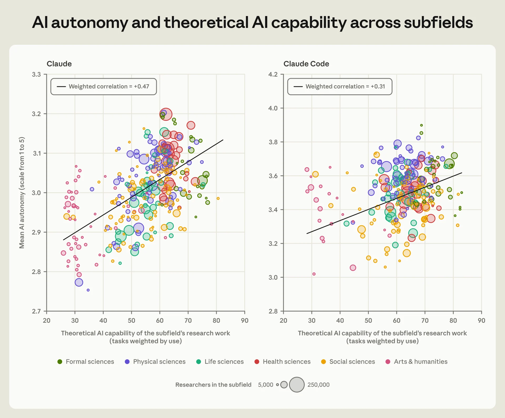

**跨子领域的人工智能自主性和理论人工智能能力。** 两个面板都将每个子领域显示为一个点，其大小由该子领域的研究人员数量决定。左图代表Claude的研究会议；右侧面板代表Claude代码的研究会议。纵轴显示子字段中会话的平均自主得分，按会话量加权。横轴显示子领域任务的平均理论能力，也按使用情况进行加权。任何会话未涵盖的任务都被排除在分析之外，因为它们无法对自主性进行评分。为了便于阅读，异常值子字段已被删除，但它们包含在最佳拟合线和相关性计算中。相关性按子字段大小加权。

## 利用人工智能研究加速场景

科学技术进步的步伐取决于好的想法和实现这些想法的手段。从历史上看，两者都受到人类能力的限制。研究人员的数量有限，每个人也只有有限的时间来提出假设、设计正确的测试、进行分析并综合研究结果。

人工智能可以通过两种方式缓解这些限制。首先，它可以承担研究人员现在所做的工作，让他们能够追求更多的想法。其次，它可以贡献研究人员可能无法识别的想法。第二个因素最终可能最重要，但衡量起来要困难得多，因此我们的分析重点是第一个因素。

### 方法

我们考虑通过人工智能加速科学发展的三种场景。根据我们的调查和人工智能能力评分估计，场景 1 假设当前人工智能能力得到广泛采用。场景 2 和 3 是假设的未来，其中 AI 完全自动化 75% 或 100% 的非物理研究步骤（构成 SciNet 中每项研究任务的单独操作），从具有最高 AI 能力得分的步骤开始。在这三种情况下，研究人员都会继续执行物理步骤。这些是说明性情景，而不是预测。它们展示了体力劳动、人工智能理论能力和人工智能成本如何影响科学研究的加速，以及哪些领域加速最快。

对于每种情况，我们报告两种措施。第一个是 *人工智能分享*：研究人员花在人工智能可以承担的研究上的时间比例。考虑到研究人员目前如何分配时间，它衡量了人工智能可以释放多少人类研究时间，并且它直接来自我们上面的分析。研究人员可以将腾出的时间转移到其他工作上，从而增加研究成果。我们的第二项措施， *加速度*，估计这种增益：相对于没有人工智能的研究产出，固定研究预算的研究产出增加。它告诉我们相同的预算可以产生多少更多的研究成果。腾出的时间并不能一对一地转化为更多的产出，这既是因为研究人员将他们的精力转向了人工智能帮助较少的任务，也因为人工智能本身是有成本的。

我们根据调查构建了场景 1 的人工智能份额，该调查记录了人工智能使用的五个级别：无、辅助、共享、委托和自主。我们假设这些水平对应于 AI 在给定任务步骤中占用研究人员 0%、25%、50%、75% 和 100% 的时间。在每个任务类别中，我们根据人工智能能力得分对任务步骤进行排名。然后，我们按照调查中报告的相同比例为每个任务步骤分配人工智能使用级别，最高级别分配给得分最高的步骤。例如，对于构思和假设生成，17% 的受访者表示没有使用人工智能，53% 的受访者表示使用了辅助工具。因此，AI 能力得分最低的 17% 的构思任务步骤没有分配 AI 份额，接下来的 53% 则分配 25%，依此类推。由于受访者可能是人工智能的重度采用者，因此我们将他们报告的使用情况视为人工智能当今可以做什么的代表。最后，我们汇总了人工智能从步骤到领域释放的研究人员时间（请参阅 [附录](https://assets.claude.com/fafb3d4237f9b53fe114fef4fb5109b9cf5b5e60.pdf)).

为了计算加速度，我们使用创意生产函数，这是一种标准经济模型，用于说明研究投入（例如研究人员的时间）如何转化为研究产出。在这个模型中，一篇论文需要许多研究任务（Jones 2026）。这些任务是互补的，一个任务的优势不能完全弥补另一个任务的弱点。随着人工智能使某些任务变得更便宜，研究人员将精力转向人工智能帮助较少的任务，从而缓解限制总体收益的瓶颈。例如，研究人员可以花更多时间提出新问题或进行更多物理实验来扩大经验证据。我们使用 Ahmadpoor 和 Jones (2019) 来校准这些瓶颈对总体增益的限制程度。对于人工智能的成本，我们假设AI 智能体一小时的时间成本为 30 美元，而研究人员一小时的时间成本为 95 美元，并且人工智能每节省一个研究时间就运行 0.2 小时。这些是说明性假设：人工智能成本使用今天的公开标价。这些成本越小，在给定预算内可以完成的研究就越多，加速也越大，正如我们下面讨论的那样。的 [附录](https://assets.claude.com/fafb3d4237f9b53fe114fef4fb5109b9cf5b5e60.pdf) 描述模型和假设。

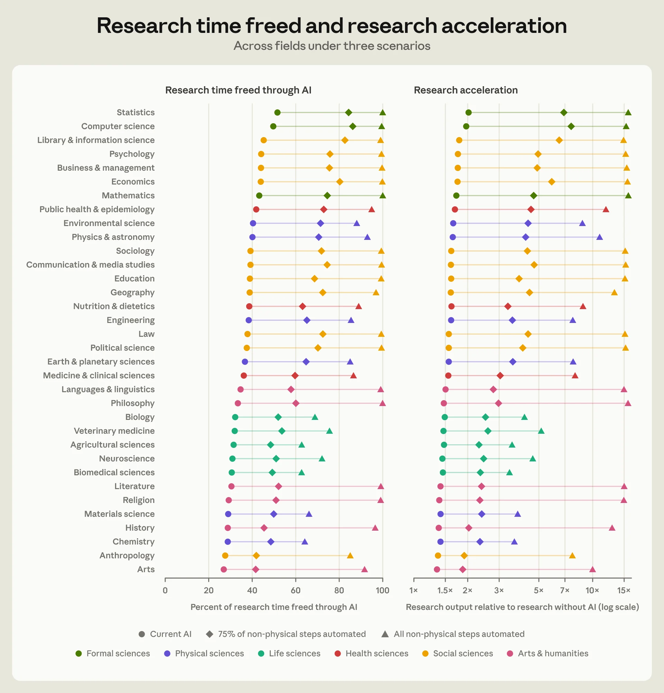

**人工智能和研究加速释放了研究时间。** 每一行都是一个字段。左图显示了按人工智能可能承担的研究人员时间估计份额排名的领域。圆圈显示对当前能力的估计；菱形显示如果 75% 的非物理步骤实现自动化，预计可节省的时间比例；三角形显示如果 100% 的非物理步骤实现自动化，则可释放的时间估计比例。右图显示了在给定某个领域的研究预算的情况下的研究加速。它的横轴显示了在我们的三种情况下，人工智能的研究输出是没有人工智能的输出的倍数（1x =没有变化）。

### 场景 1：当前能力

凭借目前的能力，如果广泛采用，人工智能可能会占用研究人员进行新研究所需时间的 27-52%，跨领域的中位数为 38%（图 13，左图）。这些份额意味着研究加速范围从艺术领域的 1.35 倍、人类学领域的 1.36 倍和化学领域的 1.41 倍，到计算机科学领域的 1.96 倍和统计学领域的 2.02 倍（图 13，右图）。加速仍然有限，因为当今的人工智能工作主要是辅助或共享的，而不是自主的，因此研究人员仍然在几乎每一步上花费大量时间。即使是最适合人工智能的领域，其工作几乎完全是认知性的，也只能达到大约 2 倍的加速。这些估计假设人工智能广泛传播，并且研究人员将其应用到当今有用的每一步。

有两个因素解释了不同领域之间的大部分差异。首先是体力工作，如果没有物理集成，人工智能就无法承担这项工作。在农业科学、生物医学科学、化学和材料科学等实验室和现场科学中，研究人员 38-41% 的时间用于物理步骤，而中位领域的这一比例为 4%。仅物理份额就解释了人工智能份额变化的大约三分之一。第二个因素是人工智能能力得分在认知工作中的分布。艺术和历史在物理步骤上花费的时间很少（分别为 10% 和 4%），但它们的认知步骤的 AI 能力得分较低，这可能是因为定性和解释性工作不太适合强化学习。相比之下，在数据分析的推动下，计算机科学和统计学在各领域人工智能能力得分最高的工作类型中得分较高，人工智能份额也较大。

Claude使用率较高的领域往往拥有较大的人工智能份额（图 14）。人工智能份额的计算没有任何Claude使用数据，因此这种关系进一步证明人工智能使用跟踪理论人工智能能力。

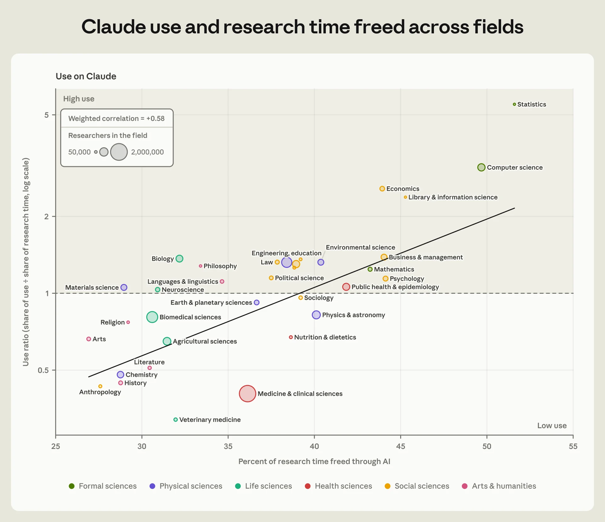

**人工智能跨领域释放了Claude的使用和研究时间。** 观察到的 Claude 使用情况与每个领域的 AI 份额之间的相关性。每个字段都是一个点，其大小由研究人员的数量决定。纵轴以对数刻度显示Claude的字段使用率。横轴显示了人工智能以当前能力可以完成的人类研究时间的估计份额。

### 场景 2 和 3：更高程度的自动化

在这些更具投机性的场景中，很大程度上依赖于对人工智能的影响范围和成本的假设，更大的自动化程度大大提高了人工智能的份额和加速，并扩大了领域之间的差异。

在场景 2 中，75% 的非物理步骤可以通过人工智能完成，计算机科学的加速达到约 8 倍，统计、图书馆和信息科学的加速达到 7 倍，经济学的加速达到 6 倍。大多数其他社会科学、数学、物理和天文学达到 4-5 倍，而基础科学和医学科学达到约 2-3 倍。基础科学以及艺术和人文学科获益最少，但原因不同。在实验室科学中，大部分工作都是物理性的，仍然必须由研究人员完成。在艺术和人文学科中，这项工作主要是认知性的，但人工智能能力得分较低，因此很少有步骤是自动化的。在计算机科学领域，自动化步骤占非物理研究人员时间的 82%，但在艺术领域仅占 28%。历史、人类学和艺术的增速约为 2 倍或更少。

在场景 3 中，艺术和人文学科领先，而基础科学仍然落后。一旦人工智能自动化所有非物理步骤，低人工智能能力分数就不再限制认知工作，人工智能可以承担许多领域的几乎所有研究工作（图 13，左图）。在这种推测场景中，体力任务很少的领域，包括统计学、计算机科学、经济学、数学、心理学以及大多数社会科学、艺术和人文学科，达到约 15-16 倍。具有大量实验室或现场工作的领域，例如生物学、化学、材料科学、农业科学和生物医学科学，仅达到 3-4 倍。如果没有自动化实验室，其物理步骤（约占研究人员时间的 40%）仍然是瓶颈。

从这些场景中可以得出两个教训。首先，物理瓶颈仍然很严重。如果没有物理集成，人工智能无法执行的步骤将占据研究人员的时间和预算，从而限制加速。其次，如果不存在这样的瓶颈，超凡的进步速度就成为可能，而人工智能的成本就成为限制。根据我们的假设，人工智能完全自动化的任务成本仍然是研究人员执行成本的十六分之一左右，因此加速接近 16 倍左右，然后就到此为止。较低的人工智能成本将相应地提高这一上限，例如，将人工智能成本减半将使进展速度加倍。如果成本大幅下降，包括人工智能稍后自动化的更困难的任务，那么没有物理瓶颈的领域的加速速度可能会远远超出这些估计。

这些计算在两个方向上都有重要的限制。我们不考虑某个领域而不是研究团队层面的限制。例如，大型强子对撞机等设施只能运行有限的实验。我们还只计算研究人员和人工智能时间的成本，而不计算机器或实验投入的成本，这在健康、物理和生命科学领域可能是巨大的。我们也不考虑用模拟来取代物理实验，这可以缓解某些领域的瓶颈。最后，我们不考虑创意的质量。如果人工智能能够识别出更好的假设并具有更高的成功机会，那么研究可能会进一步加速；如果研究品味仍然是人类独有的，那么加速速度将会更慢。

### 研究人员的期望

上述场景描述了一系列可能性。研究人员自己的期望可以提供基于专业知识的独特指南。为了收集他们的观点，我们对生命和健康科学领域的研究人员进行了调查，询问他们何时认为人工智能独立工作可以匹配各自领域最优秀的研究人员进行不同类别的研究工作（图 15）。受访者对近期的期望很高：超过一半的人预计到 2027 年人工智能将在数据分析方面与顶尖研究人员相媲美，38% 的人表示人工智能已经达到了这一水平。到 2030 年，94% 的人预计人工智能将在数据分析方面与最优秀的研究人员相媲美，89% 的人预计人工智能将在写作方面与最优秀的研究人员相媲美，72% 的人预计人工智能将在构思和数据收集方面与最优秀的研究人员相媲美。对构思和数据收集的期望较低，这与当今Claude较少使用这些任务相一致。

对没有人类参与的端到端人工智能研究的期望更为保守，但研究人员仍然期望取得显着进展。约 40% 的受访者预计人工智能将在 2030 年之前开展全面的研究项目，约 64% 的受访者预计到 2035 年人工智能将开展全面的研究项目，但 16% 的受访者表示这永远不会发生。对于人工智能将自主产生科学突破的预期仍然更加谨慎，大约一半的研究人员预计这只会在 2035 年之后发生（如果有的话）。总体而言，许多研究人员预计未来十年将实现高水平的自动化，这与我们更大的自动化场景大致相符。这些期望实现的速度和程度不仅取决于人工智能作为软件技术的进步，还取决于建立克服物理障碍的自动化实验室的努力。

将过去的调查证据与已实现的结果进行比较表明，人工智能的进步常常被大大低估（Rosenberg 等，2017）。2026）。例如，在 2022 年中期的一项调查中，领域专家对人工智能在国际数学奥林匹克竞赛中取得金牌级表现的中位估计为 2030 年，超级预测者为 2035 年（Karger 等人，2017）。2023）。人工智能于 2025 年实现了这一里程碑，比这些预测提前了大约 5 到 10 年。虽然预测者系统性地低估了人工智能能力的进步，但也有一些例外，主要是在需要在物理世界中执行的领域，例如人工智能辅助的生物学实验室任务。

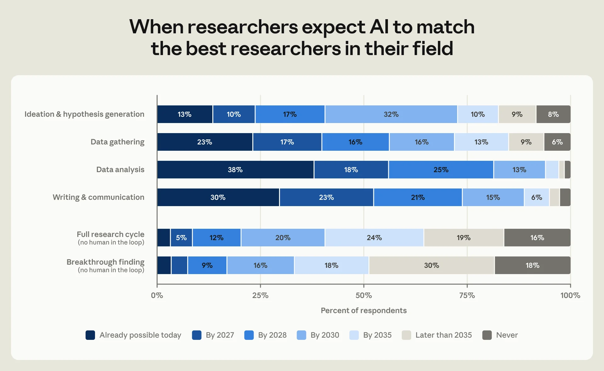

**当研究人员期望人工智能能够与所在领域最优秀的研究人员相匹配时。** 结果来自我们自己的调查。前四行对应于研究人员期望人工智能独立工作时能够在不同任务类别中匹配各自领域的最佳研究人员。底部两行对应于研究人员期望人工智能在没有人类科学家介入的情况下“从问题到发现”并产生“您所在领域认为是各自领域重大进步的发现”的情况。

## 讨论

如果人工智能有助于加速科学发现，它可能有助于提高生活水平并加快疾病治疗的进展。我们的估计表明潜在收益是巨大的。但人工智能研究能力的进步并不会自动转化为快速进步；实现这样的加速还取决于我们如何应对一些限制。

首先，采用可能严重滞后于能力。新技术的传播通常很缓慢（Comin 和 Hobijn 2010），只有围绕新技术进行组织重组后，生产力的提高才能实现（David 1990；Brynjolfsson、Rock 和 Syverson 2021）。个人学习过程、组织或系统层面的摩擦以及人工智能访问或基础设施的限制都会减缓采用速度。

其次，研究可能继续面临人工智能无法消除的瓶颈。物理实验可能成本高昂且缓慢，即使拥有极其强大的人工智能，也会严重限制进展。我们在上述场景的实验科学中尤其看到了这一点。选择学习内容可能是另一个瓶颈。研究问题在很大程度上决定了研究项目的价值，而人工智能产生好问题的能力仍不清楚。如果构思是一个瓶颈，即使回答给定问题变得更便宜，它也会限制加速。相反，如果人工智能在提出高质量假设方面超过人类，那么加速可能会更加显着，特别是在测试假设成本高昂的领域。

第三，人工智能支持的研究可以提高研究成果的数量或质量，对科学产生不同的影响。新研究论文的激增可能会更快地推进一个领域的发展，但也会压垮科学家吸收或验证结果的能力。另一方面，从显微镜、望远镜到统计软件等新技术，历来都提高了科学见解的质量，而人工智能同样可以使更全面的分析和更雄心勃勃的项目变得可行。随着论文变得更容易发表，研究界可能会越来越多地奖励特别新颖或高质量的工作。更高效的研究是否会带来更多数量或更高质量，将取决于研究人员的选择以及期刊、资助者和机构设定的激励措施。

第四，研究的组织方式可能会以难以预料的方式发生变化。随着人工智能变得更加强大和自主，人工智能系统可以在验证、裁判和传达重要结果方面起带头作用，这将缓解上面讨论的吸收问题。未来，人工智能研究人员还可能利用机器人技术和自动化实验室，独立于人类，在自己的大型社区中推动科学前沿。这种自主的人工智能研究将引发人们如何跟踪新知识、是否能够理解它以及它是如何产生的问题。

第五，更加自主的人工智能系统可能会增加确保人工智能驱动的研究与人类目标保持一致的挑战。随着人工智能体变得更加强大和富有创造力，让人类参与关键的研究决策，例如要研究哪些问题以及如何研究这些问题，可能对安全和人类福祉很重要。发现本身或研究的副产品也可能带来风险，特别是在生物学领域，加速医学进步的相同能力也可能产生危险的知识或材料。在这种情况下，可能需要在研究过程中故意设置检查点，要求我们接受较慢的进展以降低风险。

最后，研究人员所从事的工作可能会发生重大变化。影响之一可能是研究人员工作满意度的变化。如果人工智能接管令人愉快或有回报的任务，满意度可能会下降，选择研究职业的人也会减少。如果人工智能接管研究人员认为乏味的任务，满意度可能会上升。行政工作是潜在目标之一。在美国，联邦资助项目的主要研究人员报告称，他们大约 44% 的研究时间用于满足行政要求，而不是进行研究（Schneider 等，2017）。2020），减轻这一负担可能是一个很大的好处，可以节省时间并提高整体满意度。最终，净效应是不确定的，并且可能会随着人工智能能力的发展而改变。乐观的观点是，人工智能将扩大发现的机会，这是使研究生涯有意义的核心。如果科学是一次通往“无尽前沿”的航程，那么人工智能可能就是一艘新船，让研究人员能够在广阔的研究问题和发现中走得更远。

## 附录

[可以在这里找到](https://assets.claude.com/fafb3d4237f9b53fe114fef4fb5109b9cf5b5e60.pdf).

## 参考文献

艾哈迈德普尔、穆罕默德和本杰明 F.琼斯，“解码团队和个人对科学和发明的影响” *美国国家科学院院刊*, 2019, 116 (28), 13885–13890.

Alamos、Cristian 和 Lukas Althoff，“SciNet：科学解剖”数据集，2026 年。 <https://www.anatomyofscience.com/>

Amodei, Dario，“慈爱的机器：人工智能如何让世界变得更美好”，文章，2024 年 10 月。 <https://darioamodei.com/essay/machines-of-loving-grace>

Anthropic，“了解更多有关Claude数学能力的信息”，研究文章，2026 年 8 月 10 日a。 <https://www.anthropic.com/research/riemann-zeta>

Anthropic，“形式化费马大定理”，研究文章，2026 年 9 月 4 日b。 <https://www.anthropic.com/research/formalizing-fermats-last-theorem>

Appel, Ruth 等人，“人类经济指数报告：经济原语”，研究文章，2026 年 1 月 15 日。 <https://www.anthropic.com/research/anthropic-economic-index-january-2026-report>

Brynjolfsson、Erik、Daniel Rock 和 Chad Syverson，“生产力 J 曲线：无形资产如何补充通用技术” *美国经济杂志：宏观经济学*, 2021, 13 (1), 333–372.

布什、万内瓦尔、 *科学，无尽的前沿：给总统的报告*，华盛顿特区：美国政府印刷局，1945 年。

Codreanu、Mihai 等人，“科学中的人工智能：早期见解”，arXiv 预印本 arXiv：2609.28504，2026 年。 <https://arxiv.org/abs/2609.28504>

Comin、Diego 和 Bart Hobijn，“技术扩散的探索” *美国经济评论*, 2010, 100 (5), 2031–2059.

David, Paul A.，“发电机和计算机：现代生产力悖论的历史视角” *美国经济评论*, 1990, 80 (2), 355–361.

Eloundou, Tyna 等人，“GPT 就是 GPT：法学硕士对劳动力市场的影响潜力”， *科学*, 2024, 384 (6702), 1306–1308.

Guo, Daya 等人，“DeepSeek-R1 通过强化学习激励法学硕士的推理”， *自然*, 2025, 645 (8081), 633–638.

郝千月等人，“人工智能工具扩大了科学家的影响力，但合同科学的重点”， *自然*, 2026, 649 (8099), 1237–1243.

Jones, Benjamin F.，“研究与开发中的人工智能”，载于 Ajay Agrawal、Erik Brynjolfsson 和 Anton Korinek 编辑， *变革性人工智能的经济学*，芝加哥：芝加哥大学出版社，2026 年，37-61。

Jumper, John 等人，“使用 AlphaFold 进行高度准确的蛋白质结构预测” *自然*, 2021, 596 (7873), 583–589.

Karger, Ezra 等人，“预测存在风险：来自长期预测锦标赛的证据”，预测研究所工作论文 1，2023 年。 <https://forecastingresearch.org/research/existential-risk-persuasion-tournament>

Kobak, Dmitry 等人，“通过过量词汇深入研究生物医学出版物中的法学硕士辅助写作”， *科学进步*，2025，11（27），eadt3813。

Lambert, Nathan 等人，“Tülu 3：推动开放语言模型训练后的前沿”，arXiv 预印本 arXiv：2411.15124，2024 年。 <https://arxiv.org/abs/2411.15124>

Liang，Weixin 等，“量化科学论文中大型语言模型的使用”， *自然人类行为*, 2025, 9 (12), 2599–2609.

Liu, Yinhong 等人，“与人类判断保持一致：成对偏好在大型语言模型评估器中的作用”，载于 *第一届语言建模会议 (COLM) 论文集*, 2024.

Mantiuk、Rafał K.、Anna Tomaszewska 和 Radosław Mantiuk，“图像质量评估的四种主观方法的比较” *计算机图形学论坛*, 2012, 31 (8), 2478–2491.

Massenkoff、Maxim 等人，“人类经济指数报告：Cadences”，研究文章，2026 年 6 月 26 日。 <https://www.anthropic.com/research/economic-index-june-2026-report>

Merchant、Amil 等人，“扩展深度学习以促进材料发现”， *自然*, 2023, 624 (7990), 80–85.

OpenAI，“OpenAI 模型反驳了离散几何的中心猜想”，研究文章，2026 年 5 月 20 日a。 <https://openai.com/index/model-disproves-discrete-geometry-conjecture/>

OpenAI，“关于纳维-斯托克斯千年奖问题”，研究文章，2026 年 9 月 8 日b。 <https://openai.com/index/navier-stokes-solution/>

Parshall、Daniel 和 Andrea Lopez-Luzuriaga，“衡量人工智能的经济影响力：多维任务分类法”，乔治华盛顿大学经济研究中心工作论文 2026-005，2026 年。 <https://www2.gwu.edu/~forcpgm/2026-005.pdf>

Robinson-Garcia、Nicolas 等人，“元研究：跨研究职业的任务专业化” *电子生活*, 2020, 9, e60586.

Rosenberg、Josh 等人，“到目前为止，人工智能进展预测有多准确？”研究岗位，预测研究所，2026 年 9 月 22 日。 <https://forecastingresearch.org/research/ai-progress-accuracy-update>

Schneider, Sandra L. 等人，“2018 年 FDP 教员工作量调查：主要调查结果报告”，联邦示范合作伙伴关系，2020 年。 <https://thefdp.org/wp-content/uploads/FDP-FWS-2018-Primary-Report.pdf>

Shah, Nihar B. 等人，“什么时候比较比评分更好？” arXiv 预印本 arXiv:1406.6618, 2014。 <https://arxiv.org/abs/1406.6618>

Tomei、Philip Moreira 和 Bouke Klein Teeselink，“人工智能可以学习哪些工作？通过强化学习测量暴露”，arXiv 预印本 arXiv:2605.02598，2026。 <https://arxiv.org/abs/2605.02598>

Tsoukalas、George 等人，“通过人工智能驱动的形式证明搜索推进数学研究” *科学*, 2026, 394 (6820), 234–239.

Varadi, Mihaly 等人，“2024 年的 AlphaFold 蛋白质结构数据库：为超过 2.14 亿个蛋白质序列提供结构覆盖” *核酸研究*, 2024, 52 (D1), D368–D375.

Wang, Hanchen 等，“人工智能时代的科学发现”， *自然*, 2023, 620 (7972), 47–60.

## 脚注

01在计算每个领域的全球研究人员数量时，我们排除了没有Claude的国家。

02我们从 SciNet 获取研究人员数量。有关该措施的详细信息，请参阅 [附录](https://assets.claude.com/fafb3d4237f9b53fe114fef4fb5109b9cf5b5e60.pdf).

03成绩单是根据所进行的研究而不是所使用的工具来分配给领域的，因此其他计算科学中的编码工作不被算作计算机科学。

04子字段级使用份额的估计不如字段级份额精确，特别是对于会话量较低的子字段，因为采样变化和分类噪声更大。因此，我们关注广泛的模式，而不是任何单个低容量子领域的位置。

05虽然我们的分析侧重于研究任​​务，但教学、服务和管理等非研究任务可能会占用研究人员的大部分时间预算。然而，我们的科学用法分类器故意撇开本科教学，如果不直接服务于研究或研究，则不会选择行政或日常工作。此外，我们的样本并不局限于学术职位的科学家，他们自然承担着更高的教学和服务工作量。因此，我们将人工智能在这些工作流程中的使用研究留给未来的研究。

06就个人任务而言，起草手稿是Claude（18.6%）和Claude代码（11.1%）最常见的任务。对于 Claude，接下来最常见的任务是审查和综合文献（6.8%）以及回复同行评审员的评论（6.7%）。在 Claude Code 上，他们正在设计、构建和完善工件 (4.8%) 以及可视化数据和结果 (4.6%)。

07受访者是从 Anthropic 的 AI for Science 和相关资助项目的申请者中招募的，隶属于美国和加拿大的研究机构。由于他们申请了人工智能研究学分，因此他们可能是比典型科学家更密集的人工智能用户。请参阅 [附录](https://assets.claude.com/fafb3d4237f9b53fe114fef4fb5109b9cf5b5e60.pdf) 了解详情。

08Claude Science 上执行的任务的差异可能部分反映了它的使用者。任何付费用户都可以访问 Claude Science，但采用者可能是那些拥有更专业或要求更高的用例的人。因此，我们将产品之间的差异描述为使用模式。

09为了识别每个 Claude 会话的工件，我们使用我们的 [之前的工作](https://www.anthropic.com/research/economic-index-june-2026-report) （马森科夫等人。2026）。分类器识别Claude在交易所中产生的最突出的输出。我们将更精细的响应分为两类：书面工件和技术工件。书面工件主要包括文档、报告、学术论文或演示文稿。技术工件主要包括软件输出，例如脚本、代码修复以及数据和图表。非书面工件或技术工件包括分析或总结以及解释或建议。
