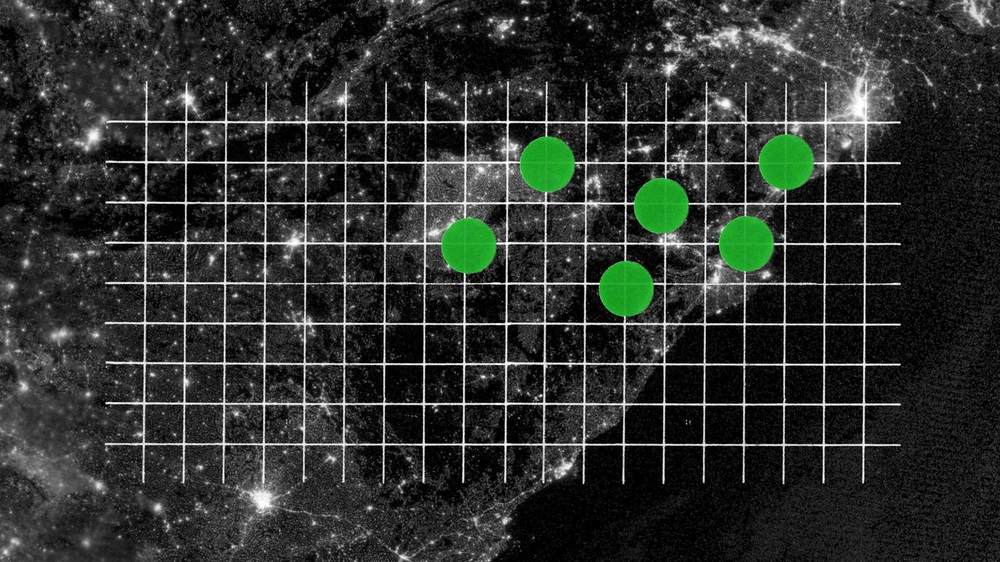
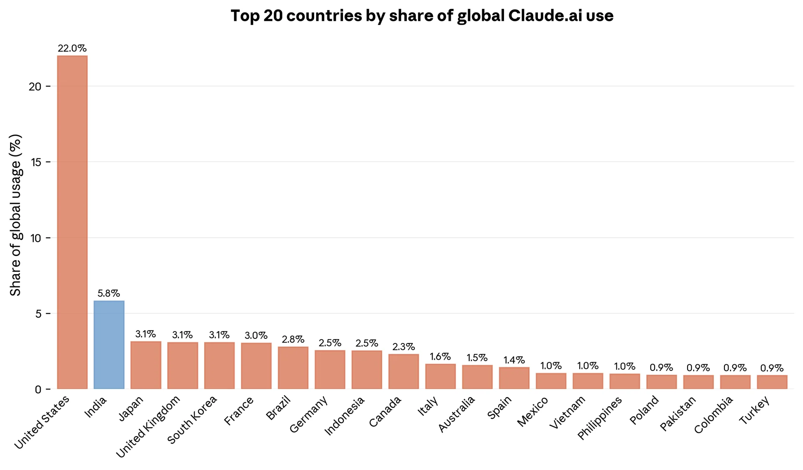
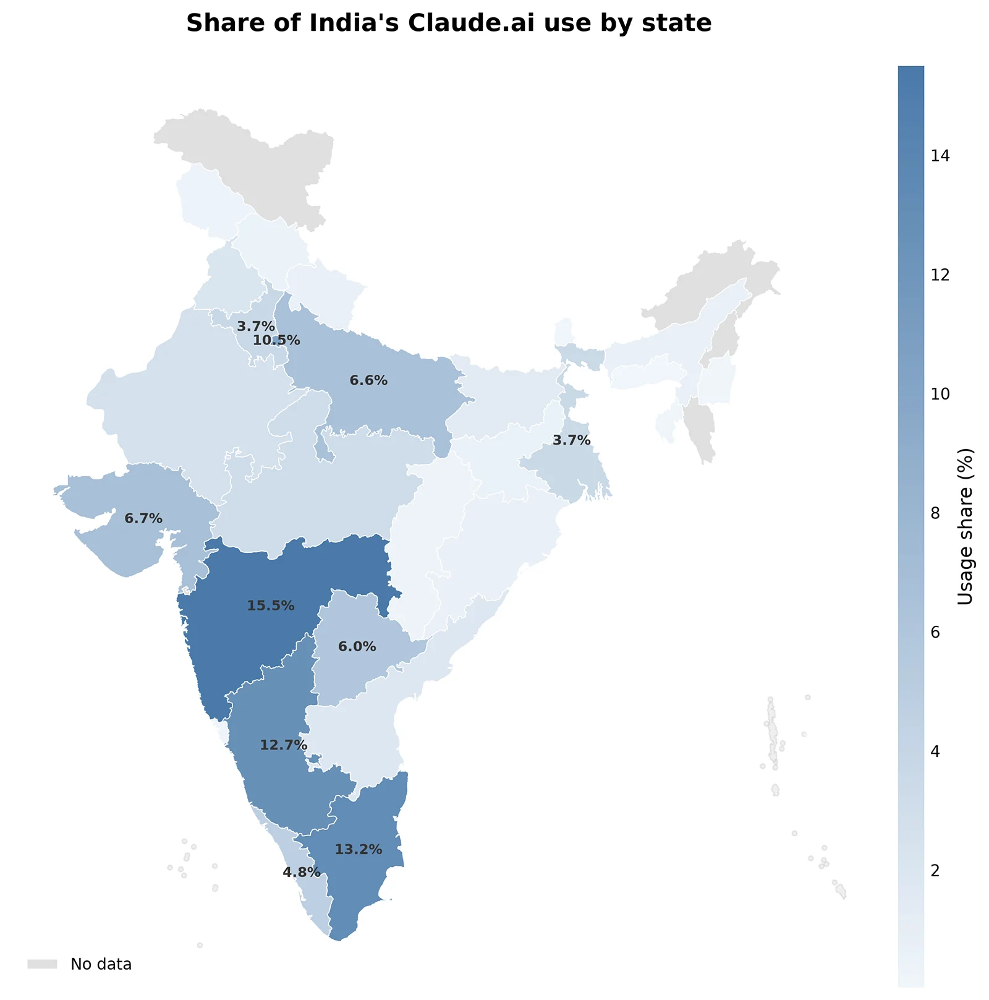
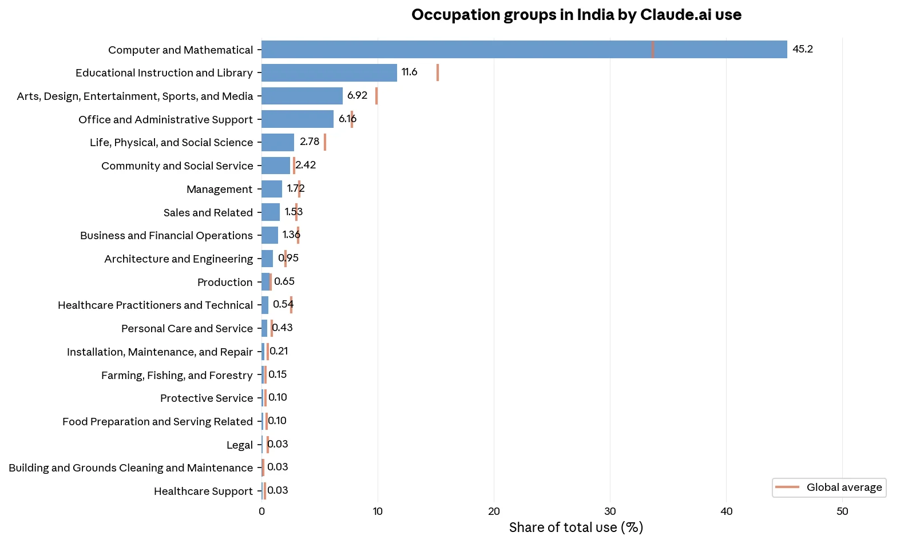
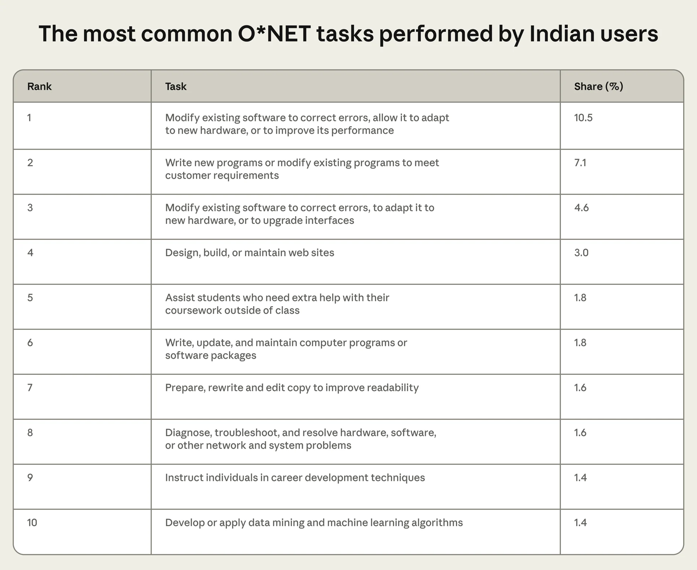
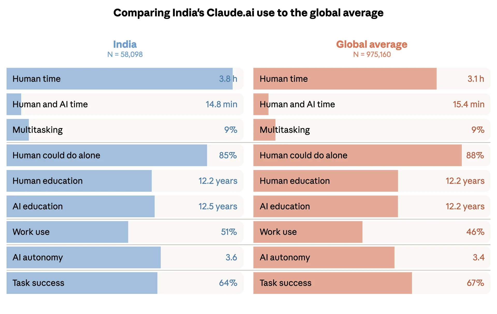

# Anthropic 经济指数：印度简报

- 英文标题：India Country Brief: The Anthropic Economic Index
- 发布日期：2026-02-16
- 官网栏目：经济学
- 原文：[Anthropic 页面](https://www.anthropic.com/research/india-brief-economic-index)
- 官网署名：Anthropic

> 中文机器初译，未逐篇人工校对。引用研究结论时请核对英文原文。

## 执行摘要

印度已经是全球最大的 IT 服务出口国，也是全球人工智能用户群增长最快的国家之一。了解人工智能在印度的使用方式以及它与其他国家的不同之处对于为该国的人工智能政策、投资和部署提供信息至关重要。本简报利用来自 Claude.ai 的数据，提供了有关 Claude.ai 在印度使用情况的见解 [第四份人类经济指数报告](https://www.anthropic.com/research/anthropic-economic-index-january-2026-report) 2025 年 11 月期间，覆盖全球约 100 万条 Claude.ai 对话。印度占 Claude.ai 总使用量的 5.8%，仅次于美国。然而，目前的采用仍然集中，这表明存在着在人群中更广泛地扩大使用范围的重大机会。

调查结果表明，用户群在专业环境中更广泛地应用人工智能，赋予其更多自主权，并为Claude带来了在没有帮助的情况下需要更耗时才能完成的任务。人类无法单独完成的复杂任务所占比例较高，这表明印度用户正在前沿使用该技术。

## 印度是全球人工智能采用的领先国家之一

按 Claude.ai 总使用量比例计算，印度在所有国家中排名第二，仅次于美国。然而，按人均计算，调整劳动年龄人口后，印度在观测量充足的 116 个国家中排名第 101 位，低于新加坡或马来西亚等其他亚洲国家。这一差距表明，印度总体上Claude的高使用率反映了其人口的庞大规模，而不是普通人大量使用Claude。这表明了提高采用率的重大机会。

全球 Claude.ai 使用量排名前 20 的国家/地区。印度占全球 Claude.ai 消费者使用量的 5.8%，仅次于美国。条形图显示每个国家/地区在 2025 年 11 月 13 日至 20 日观察到的总对话中所占的份额。印度以蓝色突出显示； N = 975，全球 160 个对话。

## 印度境内集中使用

### 地理集中度

使用集中在少数经济高度活跃的州。马哈拉施特拉邦、泰米尔纳德邦、卡纳塔克邦和德里合计占印度 Claude.ai 总使用量的一半以上。这种模式密切反映了印度 IT 行业的地理位置和城市经济产出。

印度各邦对 Claude.ai 的使用比例。地图显示了每个邦在印度 Claude.ai 总使用量中所占的份额。排名最高的邦：马哈拉施特拉邦（15.5%）、泰米尔纳德邦（13.2%）、卡纳塔克邦（12.7%）、德里（10.5%）。灰色区域表示数据不足。2025 年 11 月数据。来自 Natural Earth 的地图的 Shapefile。

这四个邦（班加罗尔、海得拉巴、金奈、孟买和德里 NCR 的所在地）的集中表明，当前人工智能的采用主要是由印度成熟的技术劳动力推动的，而不是广泛的消费者采用。

### 职业任务的集中度

通过将任务映射到相关职业推断，印度 Claude.ai 使用的职业组合偏向于软件开发和工程角色，这与该国庞大的 IT 服务行业一致。

印度的职业群体由 Claude.ai 使用。水平条显示了每个 SOC 职业组的印度 Claude.ai 使用份额。橙色标记表示用于比较的全球平均值。2025 年 11 月数据。

印度用户执行的最常见的 O*NET 任务证实了软件密集型配置文件：

Claude 在印度使用的最常见的 O*NET 任务。为了便于阅读，一些任务名称被缩短。

印度在软件相关任务的人工智能使用比例方面排名全球第一（占所有 O*NET 映射任务的 45.2%），领先于越南（42.1%）和埃及（39.2%）。在最常见的个人任务中（参见表 1）以及将任务聚合到职业组时（参见图 3），教育任务的存在表明了学习和教学中的其他常见用例。

## 经济原语：印度如何以不同的方式使用人工智能

[我们最新的经济指数报告](https://www.anthropic.com/research/anthropic-economic-index-january-2026-report) 引入了“经济原语”——人类和人工智能如何协作的基本衡量标准。将印度与全球平均水平进行比较，可以发现几个独特的模式。

将印度的 Claude.ai 使用率与全球平均水平进行比较。该小组将印度（N = 58,098）与全球平均水平（N = 975,160）在九个经济基元上进行了比较。2025 年 11 月数据。

**更大的生产力加速。** 印度用户使用 AI 平均需要 14.8 分钟才能完成任务，而没有 AI 则需要 3.8 小时，加速了 15 倍。在全球范围内，用户平均需要 15.4 分钟才能完成在没有 AI 的情况下需要 3.1 小时的任务，速度提高了 12 倍。这表明人工智能正在为印度用户带来的更复杂的任务带来巨大的生产力提升。

**工作导向更加坚定。** 印度 51.3% 的 Claude.ai 使用与工作相关，而全球这一比例为 46%。课程作业占 20.9%（对比全球为 19.3%），个人使用为 27.8%（相比之下）全球 34.7%）。工作重、个人使用较少的情况与印度庞大的专业服务部门以及主要报告的发现一致，即人均 GDP 较低的国家倾向于工作和课程而不是个人使用。

**更高的人工智能自主性。** 印度用户将更多的决策自主权委托给人工智能（3.60 vs.3.38 全球范围内采用 1-5 等级，其中 1 表示无授权，5 表示极端授权）。这表明人们更愿意让人工智能独立运行，而不是纯粹将其用作助手。

**降低人类独有的能力。** 我们衡量的数据点之一是人工智能是否被用来做人类自己无法完成的事情，比如用他们不知道的语言编写代码。我们发现 84.6% 的任务可以由人类单独完成（相比之下）全球为 87.9%），这表明印度用户更频繁地将他们无法轻松独立完成的任务交给人工智能。

**提示技巧很重要。** 作为人类和人工智能在对话中带来的技能的代表，我们估计了一个人需要接受多少年的教育才能理解对话中的用户提示或人工智能响应。我们发现提示的人类教育水平（12.2 年）和回答的人工智能教育水平（12.5 年）相对相似，反映了输入质量影响输出质量的全球模式。与各国人工智能教育平均水平相比，印度排名前 10%，这表明印度用户正在从 Claude 那里获得复杂的输出。

## 影响

**扩大人工智能的经济影响需要超越软件和 IT 服务。** 45.2% 的任务属于软件相关职业——这一比例在所有国家中最高。四个邦（马哈拉施特拉邦、泰米尔纳德邦、卡纳塔克邦和德里）占全部使用量的一半以上。这反映了印度 IT 行业的地理分布，并表明当前人工智能的采用很大程度上是现有专业优势和专注于 IT 的工作流程的延伸。

**投资人工智能可以带来可观且可衡量的生产力提升。** 印度用户将人工智能应用于原本需要 3.8 小时的任务，将其压缩至约 15 分钟，速度提高了 15 倍，而全球的速度为 12 倍。这意味着印度已经从人工智能中获取了巨大的价值：带来更艰巨的任务，并比全球平均水平进一步压缩完成这些任务所需的时间。

**缩小绝对使用量与人均使用量之间的差距需要解决结构性障碍。** 印度的总使用量排名第 2，但人均使用量排名第 101。这两个数字之间的差距既反映了印度庞大的人口数量，也反映了当前采用率的集中程度。在全球范围内，人均人工智能采用率与人均收入密切相关。印度的人均使用量与这种关系的预测一致。如果不解决与收入、数字基础设施和 IT 行业之外的意识相关的结构性障碍，印度人工智能的采用可能会保持集中。

**接受人工智能自主似乎对印度用户很有好处。** 更高的自主得分、更长的基线任务时间以及频繁使用人类可以单独完成的任务表明，印度专业人士相信人工智能可以做出决策，并利用它来增强人类的能力。

**投资人工智能技能可以获得高回报。** 全球数据中的即时复杂性和响应质量之间的密切相关性表明，专注于有效使用人工智能的培训计划（尤其是针对印度当前 IT 密集用户群之外的工人）可以有意义地提高更广泛采用人工智能的回报。

### 方法论

该分析利用了 2025 年 11 月 13 日至 20 日 Claude.ai 消费者使用情况的隐私保护数据，如 [第四份人类经济指数报告](https://www.anthropic.com/research/anthropic-economic-index-january-2026-report)。经济原语是使用该报告中详述的方法计算的。地理分配使用基于 IP 的地理定位。职业和任务分类基于 O*NET 任务分类法和 SOC 职业组的映射。对于国家/地区级别排名，我们仅在样本中包含至少 200 个观察值的国家，因为随机样本中低使用率国家/地区的衡量标准具有不确定性。底层数据包括 Claude.ai Free、Pro 和 Max 使用情况。

*有关完整的方法、全球调查结果和时间序列分析，请参阅 [人类经济指数 2026 年 1 月报告](https://www.anthropic.com/research/anthropic-economic-index-january-2026-report).*
