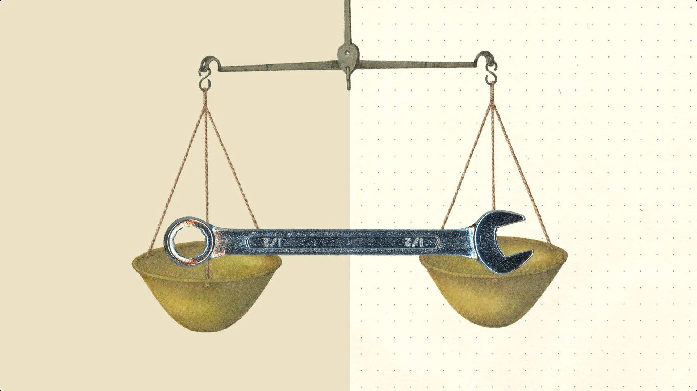
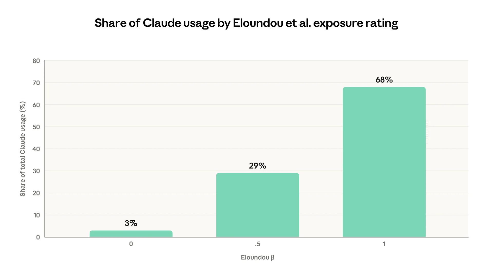
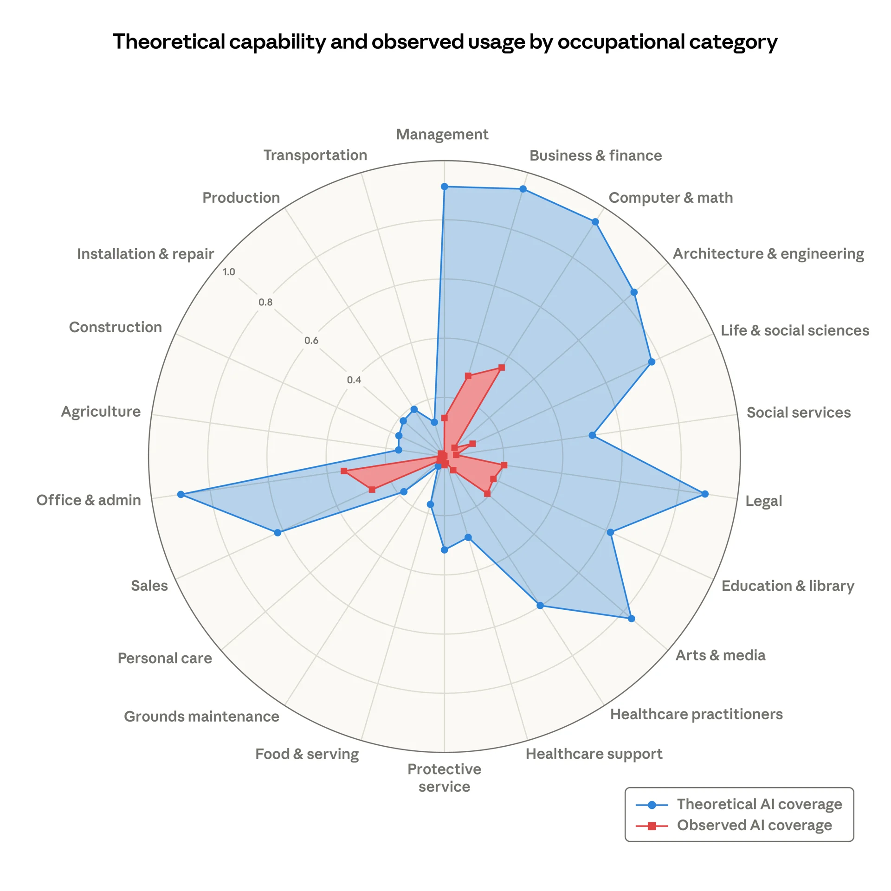
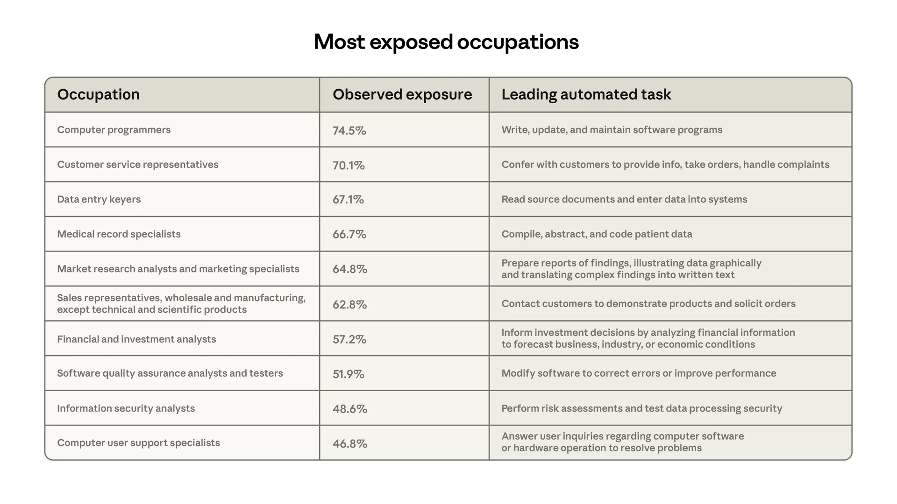
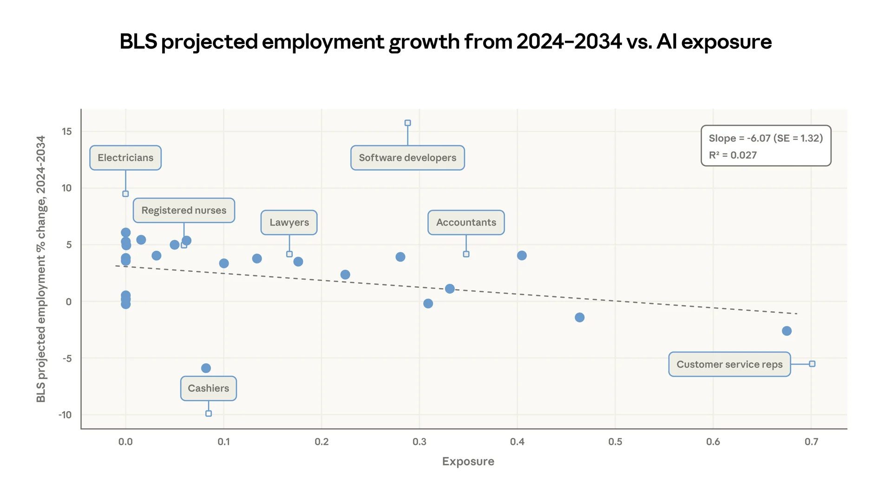
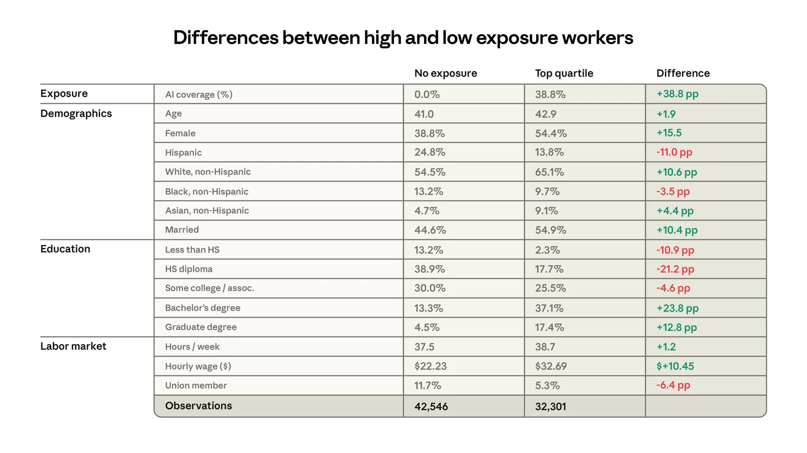
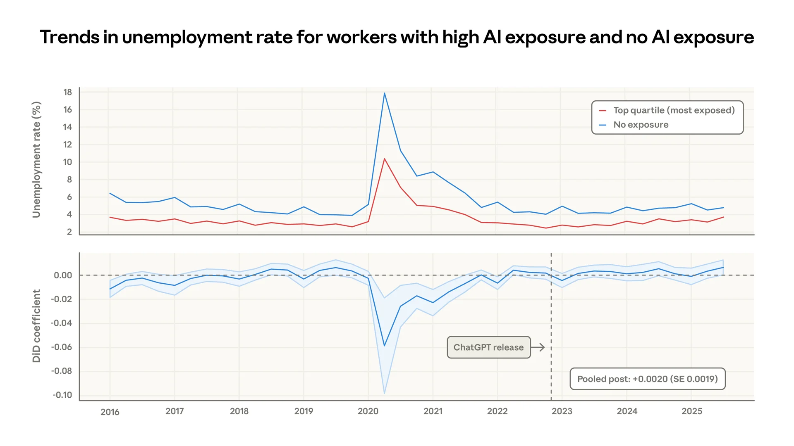
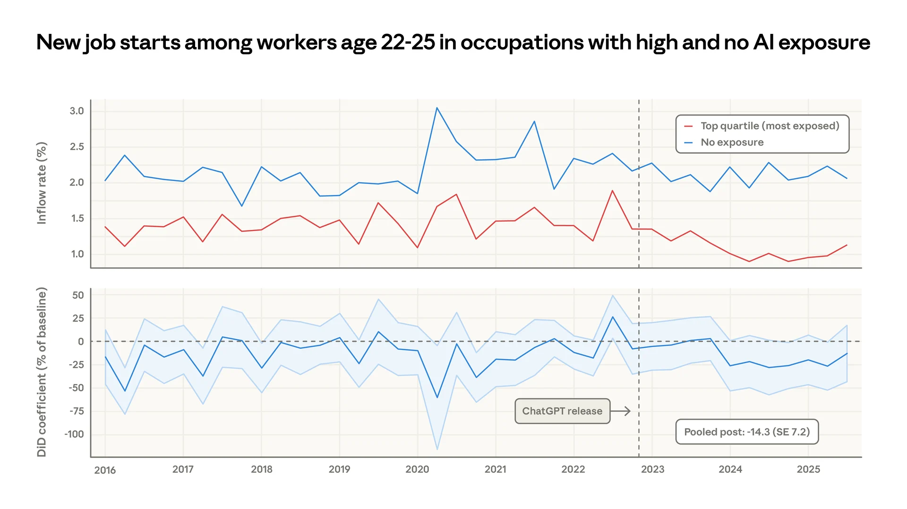

# AI 对劳动力市场的影响：新指标与初步证据

- 英文标题：Labor market impacts of AI: A new measure and early evidence
- 发布日期：2026-03-05
- 官网栏目：经济学
- 原文：[Anthropic 页面](https://www.anthropic.com/research/labor-market-impacts)
- 官网署名：Maxim Massenkoff、Peter McCrory
- 官网推荐阅读：[阅读 PDF](https://assets.claude.com/2b5bbaf2c1eb81dbf6e6fb813c1a24e35a64d376.pdf)

> 中文机器初译，未逐篇人工校对。引用研究结论时请核对英文原文。

### 主要发现

- 我们引入了一种新的人工智能替代风险衡量标准， *观察到的暴露*，结合了理论法学硕士能力和现实世界的使用数据，更重视自动化（而不是增强）和工作相关的使用
- 人工智能远未达到其理论能力：实际覆盖范围仍只是可行的一小部分
- 美国劳工统计局 (BLS) 预计，到 2034 年，观察到的暴露量较高的职业增长幅度将较小
- 暴露程度最高的职业中的工人更有可能年龄较大、女性、受教育程度更高、收入更高
- 自 2022 年底以来，我们发现高风险工人的失业率没有系统性增加，尽管我们发现有暗示性证据表明高风险职业中年轻工人的雇用速度有所放缓

## 简介

人工智能的快速传播正在掀起一波研究浪潮，衡量和预测其对劳动力市场的影响。但过去的做法记录让我们有理由保持谦逊。

例如，一项衡量工作离岸能力的重要尝试发现，大约四分之一的美国工作岗位属于脆弱岗位，但十年过去了，这些工作岗位中的大多数都保持了健康的就业增长。政府自己的职业增长预测虽然方向正确，但除了对过去趋势的线性外推之外，几乎没有增加任何预测价值。即使事后看来，重大经济动荡对劳动力市场的影响也往往不清楚。关于工业机器人就业影响的研究得出了相反的结论，而中国贸易冲击造成的失业规模仍在争论中。[1](https://www.anthropic.com/research/labor-market-impacts#footnote-1)

在本文中，我们提出了一个新的框架来理解人工智能对劳动力市场的影响，并根据早期数据对其进行测试，发现迄今为止人工智能影响就业的证据有限。我们的目标是建立一种衡量人工智能如何影响就业的方法，并定期重新审视这些分析。这种方法无法涵盖人工智能重塑劳动力市场的每一个渠道，但通过在有意义的影响出现之前奠定基础，我们希望未来的研究结果能够比事后分析更可靠地识别经济破坏。

人工智能的影响可能是显而易见的。当影响不明确时，该框架最有用，并且可以帮助在失业明显之前确定最脆弱的工作。

## 反事实

当影响较大且突然时，因果推断会更容易。COVID-19 大流行和随之而来的政策措施对经济造成了严重破坏，以至于许多问题都不需要复杂的统计方法。例如，在大流行的最初几周，失业率急剧上升，几乎没有其他解释的余地​​。

然而，人工智能的影响可能不像新冠疫情，而更像是互联网或与中国的贸易。从总体失业数据中可能无法立即看出其影响；贸易政策和商业周期等因素可能会影响趋势线的解释。

一种常见的方法是比较或多或少接触人工智能的工人、公司或行业之间的结果，以便将人工智能的影响与混杂因素隔离开来。[2](https://www.anthropic.com/research/labor-market-impacts#footnote-2) 暴露通常是在任务级别定义的：例如，人工智能可以对作业进行评分，但不能管理教室，因此教师被认为比整个工作可以远程完成的工人暴露得更少。

我们的工作遵循这种基于任务的方法，在汇总到职业之前，结合了理论人工智能能力和现实世界使用的衡量标准。[3](https://www.anthropic.com/research/labor-market-impacts#footnote-3)

## 测量暴露量

我们的方法结合了来自三个来源的数据。

1. 的 [昂*网数据库](https://www.onetcenter.org/database.html)，其中列举了与美国大约 800 种独特职业相关的任务。
2. 我们自己的使用数据（如测量 [人为经济指数](https://www.anthropic.com/economic-index)).
3. Eloundou 等人的任务级暴露估计。 （2023），衡量法学硕士在理论上是否有可能以至少两倍的速度完成任务。

Eloundou 等人的指标 β 以简单的尺度对任务进行评分：如果一项任务仅通过法学硕士就能将速度提高一倍，则为 1；如果需要在法学硕士基础上构建的额外工具或软件，则为 0.5；否则为 0。[4](https://www.anthropic.com/research/labor-market-impacts#footnote-4)

为什么实际使用可能达不到理论能力？由于模型限制，一些理论上可行的任务可能不会在使用中出现。由于法律限制、特定软件要求、人工验证步骤或其他障碍，其他技术可能传播缓慢。例如，Eloundou 等人。将“授权药品补充并向药房提供处方信息”标记为完全暴露（β=1）。我们还没有观察到Claude执行这项任务，尽管评估似乎是正确的，因为从理论上讲，法学硕士可以加快这项任务的速度。

也就是说，这些理论能力和实际使用的衡量标准是高度相关的。如图 1 所示，在前四份经济指数报告中观察到的任务中有 97% 属于 Eloundou 等人评为理论上可行的类别。 （β=0.5 或β=1.0）。

**Eloundou 等人分享的 Claude 使用情况。任务暴露等级**该图显示了 Claude 在 O*NET 任务中的使用情况分布，并按其理论 AI 暴露程度进行分组。评分为 β=1（仅对 LLM 完全可行）的任务占观察到的 Claude 使用情况的 68%，而评分为 β=0（不可行）的任务仅占 3%。Claude使用情况的数据来自之前的四份经济指数报告。

### 职业暴露的新衡量标准

我们的新措施， *观察到的暴露*，旨在量化：法学硕士理论上可以加速的那些任务中，哪些任务实际上在专业环境中得到了自动化使用？理论能力涵盖更广泛的任务。通过跟踪这一差距如何缩小，观察到的风险敞口可以洞察经济变化的出现。

我们的衡量标准定性地捕捉了人工智能使用的几个方面，我们认为这些方面可以预测工作影响。如果满足以下条件，则工作的曝光度会更高：

- 理论上它的任务可以通过人工智能实现
- 它的任务在人类经济指数中有重要用途[5](https://www.anthropic.com/research/labor-market-impacts#footnote-5)
- 其任务在与工作相关的环境中执行
- 自动化使用模式或 API 实现的比例相对较高
- 受人工智能影响的任务在整体角色中所占的比例更大[6](https://www.anthropic.com/research/labor-market-impacts#footnote-6)

我们在中给出了数学细节 [附录](https://assets.claude.com/e5f77fc0e77c0185110b5e4b909602791ae76eae.pdf)。如果理论上能够获得 LLM 的任务在 Claude 流量中看到足够的与工作相关的使用，我们会将其视为涵盖的任务。然后，我们根据任务的执行方式进行调整：完全自动化的实施获得全部权重，而增强使用获得一半的权重。最后，将任务级别覆盖率测量值平均到按每项任务花费的时间比例加权的职业级别。

图 2 显示了与 Eloundou 等人的 β 值相比观察到的暴露量（红色）。 （蓝色），说明了我们平台上理论使用和实际使用之间的差异，按广泛的职业类别分组。我们首先根据时间分数衡量的职业水平权重进行平均，然后根据总就业人数对职业类别权重进行平均。例如，β 度量显示了法学硕士在计算机与数学 (94%) 和办公室与管理 (90%) 职业的大多数任务中的渗透范围。

**按职业类别划分的理论能力和观察到的暴露程度**法学硕士理论上可以执行的工作任务份额（蓝色区域）以及我们自己根据使用数据得出的工作覆盖范围衡量标准（红色区域）。

红色区域描绘了人类经济指数中法学硕士的使用情况，显示了人们如何在专业环境中使用Claude。这些报道表明人工智能远未达到其理论能力。例如，Claude 目前仅完成了计算机和数学类别中所有任务的 33%。

随着功能的进步、采用的扩展和部署的深入，红色区域将逐渐覆盖蓝色区域。还有一大片未覆盖的区域；当然，许多任务仍然超出了人工智能的能力范围——从修剪树木和操作农业机械等体力农业工作到在法庭上代表客户等法律任务。

图 3 显示了在此措施下暴露程度最高的 10 个职业。与显示 Claude 广泛用于编码的其他数据一致，计算机程序员位居首位，覆盖率为 75%，其次是客户服务代表，我们越来越多地在第一方 API 流量中看到他们的主要任务。最后，数据输入键控人员（其主要任务是读取源文档和输入数据）已实现显着自动化，覆盖率为 67%。

**暴露最多的职业**使用我们的任务覆盖率衡量的前十名最容易暴露的职业。

在最底端，30% 的员工覆盖率为零，因为他们的任务在我们的数据中出现的频率太低，无法满足最低阈值。例如，该群体包括厨师、摩托车机械师、救生员、调酒师、洗碗机和更衣室服务员。

## 暴露程度如何与预计的就业增长和工人特征相匹配

美国劳工统计局 (BLS) 定期发布就业预测，最新一组发布于 2025 年，涵盖 [预测的](https://data.bls.gov/projections/occupationProj) 2024 年至 2034 年各职业的就业变化。在图 4 中，我们将我们的工作级别覆盖率衡量标准与他们的预测进行了比较。

按当前就业加权的职业水平回归发现，对于暴露程度较高的工作，增长预测稍弱。覆盖率每增加 10 个百分点，劳工统计局的增长预测就会下降 0.6 个百分点。这提供了一些验证，因为我们的衡量标准跟踪了劳动力市场分析师独立得出的估计，尽管这种关系很小。有趣的是，使用 Eloundou 等人的研究并没有这种相关性。单独测量。

**美国劳工统计局 (BLS) 预测 2024 年至 2034 年的就业增长与观察到的敞口**具有 25 个相同大小的箱的分箱散点图。每个实心点显示其中一个垃圾箱的平均观察到的暴露和预计的就业变化。虚线显示了一个简单的线性回归拟合，按当前就业水平加权。小菱形标记了个别示例职业以供说明。

图 5 使用当前人口调查的数据显示了 ChatGPT 发布前三个月（即 2022 年 8 月至 10 月）中暴露量最高四分之一的工人和零暴露工人的 30% 的特征。[7](https://www.anthropic.com/research/labor-market-impacts#footnote-7) 这些群体非常不同。暴露程度较高的群体中，女性的可能性高出 16 个百分点，白人的可能性高出 11 个百分点，亚裔的可能性几乎是其两倍。他们的平均收入高出 47%，并且受教育程度较高。例如，拥有研究生学历的人占未接触人群的 4.5%，但占接触最多人群的 17.4%，几乎是四倍的差异。

**高暴露工人和低暴露工人之间的差异，当前人口调查**

## 优先考虑结果

掌握了这些暴露措施后，问题是要寻找什么。研究人员采取了不同的方法。例如，金贝尔等人。 （2025）使用当前人口调查跟踪职业组合的变化。他们的论点是，人工智能带来的任何重要的经济重组都会表现为就业分配的变化。（他们发现，到目前为止，变化并不显着。）Brynjolfsson 等人。 (2025) 使用工资处理公司 ADP 的数据来研究按年龄组划分的就业水平，而 Acemoglu 等人。 （2022）和汉普尔等人。 (2025) 分别使用来自 Burning Glass（现为 Lightcast）和 Revelio 的职位发布数据。

我们将失业作为我们的首要结果，因为它最直接地反映了潜在的经济危害——失业的工人想要一份工作但尚未找到工作。在这种情况下，职位发布和就业并不一定表明需要采取政策应对措施；相关职位空缺的增加可能会抵消高度暴露职位职位发布的减少。人工智能最有害的劳动力市场发展可以说应该包括一段失业增加的时期，因为失业的工人正在寻找替代方案。当前人口调查非常适合跟踪这一点，因为失业受访者报告了他们以前的工作和行业。

## 初步结果

接下来，我们研究失业趋势，将我们的职业水平衡量标准与当前人口调查中的受访者进行匹配。

解释我们的覆盖范围措施的一个关键问题是哪些工人应该被视为得到治疗？仅 10% 的任务覆盖率是否会带来就业变化？Gans 和 Goldfarb (2025) 表明，如果 O 形环模型最能描述工作，那么只有当所有任务都具有一定程度的人工智能渗透时，就业效应才可能显现出来。汉普尔等人。 （2025）认为平均暴露减少了劳动力需求，但是 *浓度* 只有在某些任务中暴露才能抵消这一点。Autor 和 Thompson（2025）强调了其余任务所需的专业知识水平。

着眼于简单性，并注意到我们最关心的是大的影响，我们将分析集中在这样的想法上：平均暴露程度最高的群体应该最能感受到影响。我们将时间加权任务覆盖范围内排名前四分之一的员工与排名底部的员工进行比较。如果人工智能能力快速发展，较低百分位的任务覆盖率可能会很高，这可能会使绝对阈值更有帮助。但我们假设影响应该首先影响暴露程度最高的工人，并根据我们用来定义治疗的临界值提供不同的结果。

图 6 的上图显示了自 2016 年以来暴露程度最高四分之一的工人和未暴露群体的失业率的原始趋势。在新冠疫情期间，接触人工智能较少的工人（他们更有可能从事面对面的工作）的失业率增幅更大。从那时起，两组之间的趋势基本相似。下图在双重差异框架中衡量了接触最多和最少的工人之间的差距大小，反映了原始数据的结果。自 ChatGPT 发布以来，差距的平均变化很小且不显着，这表明更多暴露群体的失业率略有上升，但效果与零几乎没有区别。[8](https://www.anthropic.com/research/labor-market-impacts#footnote-8)

**当前人口调查中观察到的暴露于人工智能和未暴露于人工智能的前四分之一工人的失业率趋势**顶部面板显示了暴露程度最高四分之一的工人（红线）和暴露程度为零的 30% 工人的失业率。底部面板在双重差异框架中衡量这两个系列之间的差距。

这个框架可以识别什么样的场景？根据汇总估计的置信区间，可以检测到大约 1 个百分点的失业率差异增长（这将随着新数据的出现而改变，因此这只是一个大概的估计）。如果收入最高的 10% 的所有工人都被解雇，那么收入最高的 25% 群体的失业率就会从 3% 增加到 43%，总失业率也会从 4% 增加到 13%。

影响较小但仍令人担忧的情况是“白领工人的大衰退”。 2007-2009 年经济大衰退期间，美国失业率翻了一番，从 5% 升至 10%。如果最高四分之一的人的风险敞口增加一倍，其失业率将从 3% 上升至 6%。这在我们的分析中也应该可见。请注意，我们的核心估计基于 *微分* 与暴露程度较低的群体相比，暴露群体的失业率变化。如果所有工人的失业率同时增加，我们不会将其归因于人工智能的进步，因为人工智能的进步仍然使许多任务不受影响。

特别值得关注的一个群体是年轻工人。布林约尔松等人。报告称，22 至 25 岁工人中暴露职业的就业人数下降了 6% 至 16%。他们将这一下降主要归因于招聘放缓，而不是离职人数增加。[9](https://www.anthropic.com/research/labor-market-impacts#footnote-9)

我们发现，从事暴露职业的年轻工人的失业率持平（见 [附录](https://assets.claude.com/e5f77fc0e77c0185110b5e4b909602791ae76eae.pdf)）。但招聘放缓不一定会表现为失业率上升，因为许多年轻工人是劳动力市场的进入者，但 CPS 数据中没有列出职业，他们可能会退出劳动力市场，而不是表现为失业。为了直接解决招聘问题，我们使用 CPS 的面板维度，计算随着时间的推移，在暴露程度较高的职业中开始新工作的年轻工人（22-25 岁）的百分比。图 7 显示了年轻工人的每月求职率（即，当工人报告上个月没有找到的工作时），按他们是否进入高暴露职业和低暴露职业进行划分。

**当前人口调查显示，22-25 岁的工人开始从事新工作，从事观察到的暴露程度高且没有人工智能暴露的职业**上图显示了在高风险职业和无风险职业中开始新工作的年轻工人的百分比。底部面板在双重差异框架中衡量这两个系列之间的差距。

除了 2020-2021 年出现一些大幅波动外，这些系列在 2024 年出现视觉上的分歧，年轻工人受雇从事暴露职业的可能性相对较小。暴露程度较低的职业的就业率稳定在每月 2%，而暴露程度最高的职业的就业率则下降了约半个百分点。与 2022 年相比，后 ChatGPT 时代的平均估计暴露职业的就业率下降了 14%，尽管这在统计上几乎不显着。 （25 岁以上的工人没有这种减少。）

这可能提供了人工智能对就业的早期影响的一些信号，并与 Brynjolfsson 等人的研究结果相呼应。但还有几种不同的解释。未被雇用的年轻工人可能会留在现有工作岗位、从事其他工作或返回学校。与数据相关的进一步警告是，工作转换可能更容易受到调查中误测的影响。[10](https://www.anthropic.com/research/labor-market-impacts#footnote-10)

## 讨论

本报告介绍了一种了解人工智能对劳动力市场影响的新措施，并研究了对失业和招聘的影响。工作更多地接触人工智能，因为他们的任务在理论上对于法学硕士来说是可行的，并且在我们的平台上自动化、与工作相关的用例中观察到。我们发现计算机程序员、客户服务代表和财务分析师是暴露程度最高的人群。使用美国的调查数据，我们发现对受影响最大的职业工人的失业率没有影响，尽管有初步证据表明这些职业的 22-25 岁工人的招聘略有放缓。

我们的工作是对人工智能对劳动力市场的影响进行分类的第一步。我们希望随着有关就业和人工智能使用的新数据的出现，本报告中采取的分析步骤，特别是围绕覆盖范围和反事实的分析步骤，将很容易更新。一种既定的方法可以帮助未来的观察者将信号与噪声分开。

目前的工作还有几处需要改进。我们的使用数据将纳入未来的更新中，形成经济中任务和工作覆盖范围的不断发展的图景。埃罗杜等人。自 2023 年初起，该指标也可能会更新，使其与 LLM 能力相关联。而且，考虑到有关年轻工人和劳动力市场进入者的启发性结果，下一步的关键可能是看看在暴露地区拥有教育证书的应届毕业生如何在劳动力市场中航行。

## 附录

可用 [在这里。](https://assets.claude.com/e5f77fc0e77c0185110b5e4b909602791ae76eae.pdf)

## 参考文献

Acemoglu、Daron 和 Pascual Restrepo，“机器人和工作：来自美国劳动力市场的证据” *政治经济学杂志*, 2020, 128 (6), 2188–2244.

Acemoglu、Daron、David Autor、Jonathon Hazell 和 Pascual Restrepo，“人工智能与工作：来自在线职位空缺的证据” *劳动经济学杂志*, 2022, 40 (S1), S293–S340.

Appel、Ruth、Maxim Massenkoff、Peter McCrory、Miles McCain、Ryan Heller、Tyler Neylon 和 Alex Tamkin，“人类经济指数报告：经济原语”，2026 年。

Autor，David H、David Dorn 和 Gordon H Hanson，“中国综合症：美国进口竞争对当地劳动力市场的影响” *美国经济评论*, 2013, 103 (6), 2121–2168.

作者：David H 和 Thompson, N. (2025)。专业知识。NBER 工作文件，(w33941)。

布林德 (Alan S) 等人，“美国有多少工作岗位可能可以外包？” *世界经济*, 2009, 10 (2), 41.

Borusyak、Kirill、Peter Hull 和 Xavier Jaravel，“准实验轮班共享研究设计” *经济研究评论*, 2022, 89 (1), 181–213.

Brynjolfsson、Erik、Bharat Chandar 和 Ruyu Chen，“煤矿里的金丝雀？有关人工智能近期就业影响的六个事实” *数字经济*, 2025.

Eckhardt、Sarah 和 Nathan Goldschlag，“人工智能和就业：最终结果（直到下一个）”，经济创新集团 (EIG)，2025 年 8 月。可以在： <https://eig.org/ai-and-jobs-the-final-word/>

Eloundou、Tyna、Sam Manning、Pamela Mishkin 和 Daniel Rock，“Gpts 就是 gpts：对大型语言模型对劳动力市场影响潜力的早期观察”，arXiv 预印本 arXiv:2303.10130, 2023, 10。

Fujita, S.、Moscarini, G. 和 Postel-Vinay, F. (2024)。衡量雇主之间的重新分配。 *美国经济杂志：宏观经济学*, 16(3), 1-51.

Gans, Joshua S. 和 Goldfarb, Avi，“O 形环自动化”，NBER 工作论文第 1 号34639，2025 年 12 月。可在 SSRN 获取： <https://ssrn.com/abstract=5962594>

Gimbel、Martha、Molly Kinder、Joshua Kendall 和 Maddie Lee，“评估人工智能对劳动力市场的影响：当前状况”，研究报告，耶鲁大学预算实验室，康涅狄格州纽黑文，2025 年 10 月。可以在： <https://budgetlab.yale.edu>.

格奥尔格·格雷茨和盖伊·迈克尔斯，《工作中的机器人》 *经济学与统计学评论*, 2018, 100 (5), 753–768.

Hampole、Menaka、Dimitris Papanikolaou、Lawrence DW Schmidt 和 Bryan Seegmiller，“人工智能与劳动力市场”，技术报告，国家经济研究局 2025 年。

Handa、Kunal、Alex Tamkin、Miles McCain、Saffron Huang、Esin Durmus、Sarah Heck、Jared Mueller、Jerry Hong、Stuart Ritchie、Tim Belonax、Kevin K.Troy、Dario Amodei、Jared Kaplan、Jack Clark 和 Deep Ganguli，“人工智能可以执行哪些经济任务？来自数百万Claude对话的证据”，2025 年。

Hui、Xiang、Oren Reshef 和 Luofeng Zhou，“生成型人工智能对就业的短期影响：来自在线劳动力市场的证据” *组织科学*, 2024, 35 (6), 1977–1989.

Johnston、Andrew 和 Christos Makridis，“生成式人工智能对劳动力市场的影响：人工智能暴露的双重差异分析”，可在 SSRN 5375017，2025 年获取。

Massenkoff, Maxim，“工作岗位消失的可预测性如何？职业展望的证据”，2025 年。 *工作文件。*

Ozimek, Adam，“离岸恐惧太过分”，2019 年。 <https://papers.ssrn.com/sol3/papers.cfm?abstract_id=3777307>

Tamkin、Alex 和 Peter McCrory，“估算 Claude 对话中 AI 生产力的提升”，2025 年。

Tomlinson, K.、Jaffe, S.、Wang, W.、Counts, S. 和 Suri, S. (2025)。使用人工智能：衡量生成式人工智能对职业的适用性。 arXiv 预印本 arXiv：2507.07935。

## 脚注

01 工作离岸能力：Blinder 等人。 （2009）和奥齐梅克（2019）；政府增长预测：Massenkoff（2025）；机器人：Graetz 和 Michaels (2018) 以及 Acemoglu 和 Restrepo (2020)；中国冲击：Autor 等人。 (2013) 和 Borusyak 等人。 （2022）。

02 布林约尔松等人。 (2025) 使用 Eloundou 等人的任务暴露测量，比较了更多和更少接触人工智能职业的工人的就业趋势。 (2023) 和来自 ADP 的工资数据。Johnston 和 Makridis (2025) 使用美国行政数据进行了类似的基于任务的分析，但他们将处理汇总到行业水平。惠等人。 (2024) 研究了 Upwork 上的自由职业如何响应 ChatGPT 和高级图像生成工具的发布，将直接受影响类别的工人与未受影响类别的工人在每个工具发布日期之前和之后进行比较。汉普尔等人。 (2025) 使用历史大学招聘网络进行公司级人工智能采用的工具：过去从大学招聘毕业生后来进入人工智能相关职位的公司面临较低的采用成本。

03 我们的任务和职业级别暴露测量可以轻松纳入其他使用数据，并扩展到不同的国家。随着时间的推移，我们打算将这种方法应用于新的设置。

04 在他们的框架中，“直接暴露”的任务是那些可以用法学硕士一半的时间完成的任务（输入限制为 2,000 字，并且无法访问最新事实）。“使用工具公开”的任务是那些与可以访问信息检索和图像处理等软件的法学硕士具有相同加速效果的任务。使用 LLM 时，未公开的任务的持续时间不能减少 50% 或更多。

05 我们使用前两个人类经济指数数据集，涵盖 2025 年 8 月和 11 月的使用情况。对于语义高度相似的 ONET 任务，我们将计数分开。

06 每一步都涉及判断。Eloundou 等人应该吗？ (2023) 测量输入为 {0, 0.5, 1} 还是其他？什么决定了“重大”使用？我们如何处理看起来与高使用率的任务非常相似，但由于太罕见而无法在经济指数抽样中专门挑选出来的任务？与增强相比，自动化工作流程应该重要多少？我们在附录中详细阐述的一个令人放心的发现是，这些问题的许多解决方案中工作暴露的 Spearman（等级-等级）相关性非常高。

07 为了将 O*NET-SOC 代码与 CPS 中的 occ1990 代码进行匹配，我们使用由 [艾克哈特和戈德施拉格 (2025)](https://eig.org/ai-and-jobs-the-final-word/).

08 我们通过三种方式进一步探讨这一点 [附录](https://assets.claude.com/e5f77fc0e77c0185110b5e4b909602791ae76eae.pdf)。首先，我们询问用于定义治疗的百分位数截止值是否重要，将其从中位数到第 95 个百分位数进行变化。在所有情况下，影响都是持平或负面的（意味着受影响群体的失业率下降）。接下来，我们特别关注年轻工人，即像 Brynjolfsson 等人那样年龄在 22 至 25 岁之间的工人。 （2025）。最后，我们使用劳工部失业保险申请人的数据来衡量失业情况，而不是 CPS 调查的答复。在任何情况下，我们都没有发现对暴露的工作有明显的影响。

09 这个范围很宽，因为作者提供了针对多个反事实的估计。与就业增长持平的反事实相比，下降了 6 个百分点。16 个百分点的估计值来自对同一公司不同职业的类似员工进行比较的设计。

10 参见藤田等人。 （2024）。
