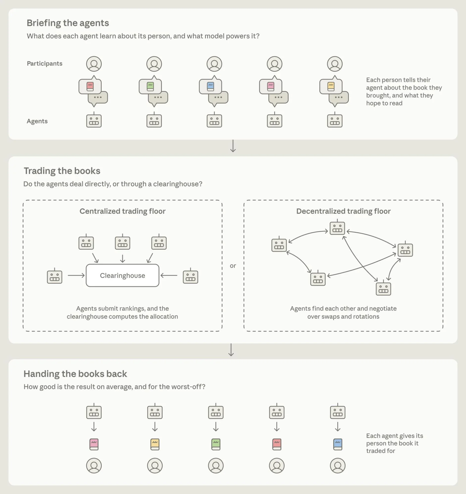
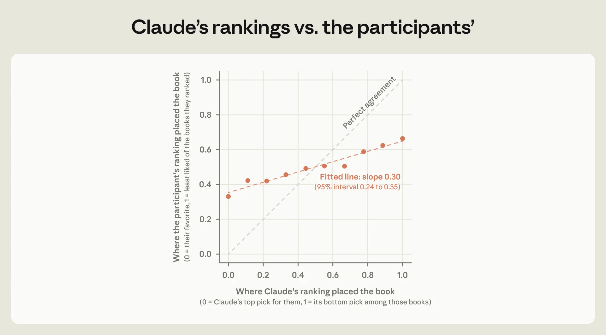
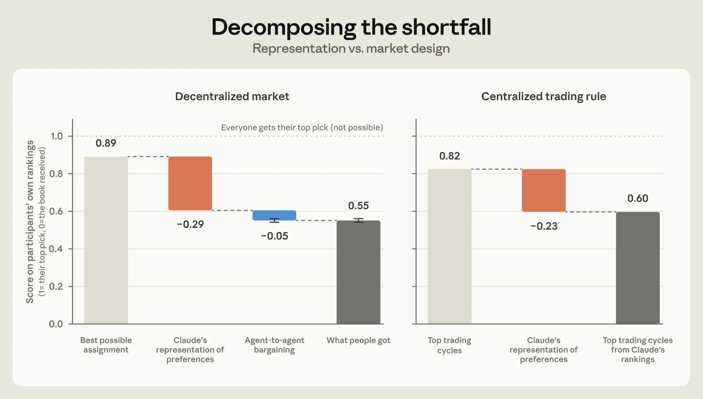
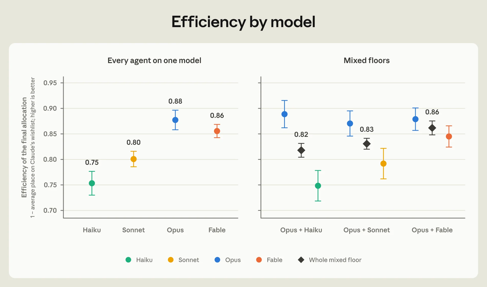

# Swap 项目：当智能体替我们交易时会发生什么？

- 英文标题：Project Swap: What happens when agents trade for us?
- 发布日期：2026-09-24
- 官网栏目：经济学
- 原文：[Anthropic 页面](https://www.anthropic.com/research/project-swap)
- 官网署名：Anthropic
- 官网推荐阅读：[阅读 PDF](https://assets.claude.com/3818cf6119b88f9714d995f6549fa8aac0bd5ab5.pdf)

> 中文机器初译，未逐篇人工校对。引用研究结论时请核对英文原文。

## 总结

- 为了了解当特工进入市场时什么有效，什么失败，我们制作了一个Claude斯的微型市场——一个更受控制的续集 [项目成交](https://www.anthropic.com/features/project-deal)，我们的第一个实验是代理代表人们在市场中进行交互。六个办公室的 Anthro 员工带来了一本他们想要赠送的书。每个参与者都与Claude进行了简短的交谈，讨论他们喜欢阅读的内容，然后派出一名由Claude支持的代理人到开放的交易大厅与其他人的代理人进行推介、讨价还价并达成交易。我们的目标是让每个人都带回家一本他们喜欢的暑期读物。
- 参与者还根据他们的兴趣对 10 本书进行了排名，这样我们就可以对他们的代理人代表他们的程度进行评分。在五分钟的聊天中，代理人对书籍的排名与本人在 61% 的配对中的排名相匹配，这对于如此简短的对话来说是出人意料的好。
- 进入交易大厅后，代理商的交易表现良好。市场下跌主要是因为代理商缺乏有关其参与者的信息，而不是因为他们的交易方式。
- 然后，我们对每个交易大厅进行了数十次重新运行，更改了所使用的模型和代理商的指示。我们发现，代理运行的模型比我们给出的指令对其谈判结果产生的影响更大。模型更强大的市场效率更高。
- 大多数读过他们的书的人都喜欢这本书，平均参与者表示他们会把每年图书预算的三分之一交给Claude。

## 为什么我们这样做

生活中充满了让每个人都过得更好的交易和交易，但从未发生过。这通常只是因为找到合适的交易对手并进行谈判直到达成协议需要太多的工作。想象一下，患者在收到他们无法负担的报价后跳过治疗，而另一家诊所的收费要低得多，或者如果被要求，报价他们的医院会削减费用。或者想想你的工作。某个地方可能会有更适合您的雇主，并且雇主很乐意雇用您。但你们可能找不到对方，因为你们都没有时间不断地寻找。还有一些较小的日常交易也被忽视——工作场所换班、协调拼车或交易学校接送。

如果您有一名代理人全天候为您工作，与潜在的交易对手交谈并制定可能的条款，这些交易将来会发生吗？

也许吧——但这个未来取决于许多我们还没有答案的问题。如果代理要为您行事，您怎么知道它已经理解您的意思了？另外，当许多代理商见面互相交谈时，某些市场或平台必须编写参与规则。谁被允许进入？当交易失败时会发生什么？

随着代理商越来越多地进入真实市场，这些问题变得更加紧迫。因此，今年夏天，我们建立了一个小型的受控市场来研究这些问题：由 201 名 Anthropic 员工及其 Claude 支持的代理人组成的易货经济。每个人都带来了一本他们想赠送的书。然后，他们与Claude支持的经纪人讨论了他们希望今年夏天读的书类型。特工们在数字“交易大厅”会面并交换书籍，直到时间耗尽。每个人都带回家了他们的经纪人为他们买的一本书（或者，大多数人都这样做了……稍后会详细介绍）。

这个实验让我们提前了解了未来的问题。任何设计者 *市场代理* 将需要一种方法来检查代理是否了解其参与者。任何设计者 *代理商市场* 需要明确的规则来规定哪些代理商可以进入、交易失败时会发生什么以及参与者可以看到多少市场活动。

## 如何做市场

经营市场有两种基本方法。在中心化市场中，每个人都告诉某一方他们想要什么，然后该方进行交易。在去中心化的环境中，人们可以找到彼此并直接进行谈判。AI 智能体可以在这两种类型上提供帮助。

以集中市场为例。如果一个实体确切地知道每个人想要什么，那么制定出最佳交易只是一个计算问题。经济学家很早就明白这一点。在实践中，一个问题是准确地阐明您想要的内容通常过于乏味，不值得付出努力。例如，一位咖啡馆经理可以为 20 名员工制定理想的时间表，如果每个人准确地列出每个班次相对于其他班次对他们来说的价值——他们是否会在一个周五休息期间使用两个星期六早上，只要他们第二天早上不开门，是否可以晚点休息，等等。如果AI 智能体能够从轻松的对话中了解一个人想要什么，那么成本太高而无法集中运行的市场就可以变得实用。[1](https://www.anthropic.com/research/project-swap#footnote-1)

但中央市场也需要有人来管理它——用经济学的术语来说就是“票据交换所”。参与者需要信任该实体的信息，并执行所选择的结果。通常，这样的实体并不存在，或者人们宁愿不告诉它一切。求职者可能不希望中央媒人知道他们正在寻找——或者他们正在寻找什么。他们宁愿谨慎地接触一些雇主，只告诉每个雇主需要知道的信息。在这种情况下，市场需要去中心化。

在这里，AI 智能体可以通过减少寻找交易对手和谈判所需的努力来实现新的去中心化市场。我们已经知道这种帮助很有价值，因为人们为此付出了代价。有一些正在招聘的代理人就是这样做的：房地产经纪人、猎头，甚至媒人。但由于搜索和谈判占用了一个人稀缺的注意力，因此它们价格昂贵，只有那些负担得起的人才会雇用它们。相比之下，AI 智能体的注意力就不那么稀缺了。如果讨价还价也很好，更多的人就可以拥有房屋销售商和高管所拥有的东西——一个为他们不知疲倦工作的代理人。

**实验设计的图示。** 参与者告诉他们的代理人他们想读什么。代理人将这些偏好带到分散的交易大厅，与其他代理人交换书籍。参与者将代理人为他们购买的书带回家。我们模拟集中市场结果进行比较。

## 实验如何进行

201 名参与者分布在旧金山、纽约、伦敦、西雅图和都柏林办事处的六个当地池中。这些池的参与者范围从 3 名参与者（都柏林）到 115 名参与者（旧金山）不等。向詹姆斯·乔伊斯致歉，我们将都柏林人排除在大部分分析之外。[2](https://www.anthropic.com/research/project-swap#footnote-2)

这是我们对Claude驱动的市场的第二次观察。在 [项目成交](https://www.anthropic.com/features/project-deal)，代理商在为期一周的分类市场上为 Anthropic 员工买卖真实商品。但对于特殊商品（如乒乓球和滑雪板）和自由形式的讨价还价，没有简单的方法可以说明结果有多好 *本来可以*。所以这一次我们建立了一个更容易研究和评分的市场。在这个市场中，参与者的偏好被巧妙地表现为他们池中所有书籍的排名。然后我们可以轻松计算市场在满足这些偏好方面的表现。

但这些干净的测量都取决于人们如何对池中的所有书籍进行排名。实际上，没有人会手工对 115 本书进行排名。因此，为了了解人们的偏好，Claude与每位参与者进行了简短的半结构化对话，并提出了一些关于他们的总体品味以及他们今年夏天想读的书类型的开放式问题。根据这次谈话，Claude对参与者库中的每本书进行了排名，估计了参与者的偏好。在这一步中，我们使用了一个强大的模型：《神鬼寓言 5》。[3](https://www.anthropic.com/research/project-swap#footnote-3)

我们分别收集了一个基本事实：每个参与者从他们的书库中对 10 本书进行排名。[4](https://www.anthropic.com/research/project-swap#footnote-4) 特工们从未见过这些真实的排名。

特工被派往交易大厅，带着Claude构建的参与者对所有书籍的排名。每个代理都从参与者的书开始，目标是用它换取其他东西。[5](https://www.anthropic.com/research/project-swap#footnote-5) 每个交易大厅都有最长的挂钟时间，并且为了防止拥堵，有限数量的代理可以同时通话。[6](https://www.anthropic.com/research/project-swap#footnote-6) 当允许座席发言时，他们可以向共享频道发布一条消息，提议交换、接受或拒绝一条消息，或者只是在场上聊天。交易提案可以是双边互换或多方轮换，只有各方都接受后交易才会执行。场内的整个历史（谁说了什么以及执行了哪些掉期）都是公开的。当时间耗尽或特工安静下来时，楼层就会关闭。

每个交易大厅的一半代理人被随机分配为“无情”，并指示他们唯一的目标是给他们的人一本他们想在暑假期间阅读的书​​。另一半被指示要“亲社会”——他们的主要目标与无情的特工相同，但还有一个次要目标，即确保实验中的每个人最终都能得到一本他们喜欢的书。[7](https://www.anthropic.com/research/project-swap#footnote-7) 具体提示见附录。

最后，在书籍分发三周后，参与者进行了一项最终调查，询问他们对收到的内容有多满意，以及他们对再次做出类似决定的代理人的信任程度。图 1 说明了总体实验设计。图 2 显示了伦敦现场的摘录，其中包含交易前 5 分钟的消息。

[原文媒体](https://assets.claude.com/df3fe8e8cc439cf83773f380f80f0c259a542dbc.webm)

**一次运行的摘录。** 交易前五分钟在伦敦现场直播的消息。为了匿名，参与者姓名已更改。

一场现场活动只能让我们了解事情可能会如何发展。为了研究哪些结果是偶然因素而不是设置的稳定特征，我们多次重新运行市场，一次只改变一个变量。

重播分为三种。首先，我们准确地重复了现场设置（Opus 4.8 上的每个智能体，一半被告知“无情”，一半“亲社会”），仅更改哪些智能体发出哪个指令。然后我们对《神鬼寓言 5》中的每个特工都做了同样的事情。其次，为了隔离模型的影响，我们给每个代理提供中立指令，并运行了 80 个楼层，其中所有代理都运行 Haiku 4.5、Sonnet 4.5、Opus 4.8 或 Fable 5。[8](https://www.anthropic.com/research/project-swap#footnote-8) 第三，我们运行了 60 个混合楼层，一半的代理使用 Opus，一半的代理使用其他三种模型之一。附录列出了我们运行的所有变体。

在这篇文章中，我们主要关注这个去中心化的市场，但我们将两种中心化的替代方案作为基准进行比较：最好的分配（经济学家称之为“功利主义最优”），它假设清算所可以简单地询问人们想要什么并得到诚实的答案，以及通常的规则 [研究过](https://www.sciencedirect.com/science/article/abs/pii/0304406874900330) 在像顶级交易周期这样的市场中，它不依赖于诚实（它的设计目的是让说实话符合每个人的最佳利益）。[9](https://www.anthropic.com/research/project-swap#footnote-9)

## Claude猜测偏好的能力如何

代理为您所做的一切都取决于它对您想要什么的理解。通常，很难检查这种理解有多好。在这里，事情就更容易了——每个参与者自己从他们的书库中对 10 本书进行排名，我们可以将他们的排名与Claude的排名进行比较。

Claude的排名基于简短的聊天记录，与参与者自己的排名相关性相对较好。在一个人对所有成对书籍进行排名时，Claude的排序与他们的排序在 61% 的情况下一致（随机猜测的概率为 50%）。图 3 显示了Claude的排名与参与者的排名。

**Claude的排名与参与者的排名。** Claude排名中的标准化排名位于 x 轴上。参与者自己的排名位于 y 轴上。汇集了提交排名的 188 名参与者。

为了正确看待 61% 的人，我们将 Claude 的猜测与其他一些猜测偏好的方式进行了比较。简单地根据书籍的受欢迎程度对书籍进行排名，使用 [开放图书馆](https://openlibrary.org/)参与者对大约 53% 的书对的想读计数表示同意。另一种简单的比较方法是协同过滤——根据 [公开的](https://huggingface.co/datasets/McAuley-Lab/Amazon-Reviews-2023) [数据集](https://github.com/zygmuntz/goodbooks-10k) “如果一个人喜欢 X，他们也会喜欢 Y。”我们拿了一个人在他们的摄入量上列出的书籍，查找了哪些其他书籍往往会被同一读者评分，并根据每本书与他们列出的最爱同时出现的程度对这个人的书库进行排名。这达到了大约 55% 的配对一致性。

尽管有大量关于法学硕士引发和代表人类偏好的文献，[10](https://www.anthropic.com/research/project-swap#footnote-10) 很少有数字可以直接与我们 61% 的配对一致性相比较。一个有用的参考点来自[一项研究](https://onlinelibrary.wiley.com/doi/abs/10.1002/bdm.2118) 其中算法和一个人自己的朋友都会预测这个人会觉得两个笑话中的哪一个更有趣。设置非常不同，但他们的算法在大约 61% 的情况下也与人们自己的判断一致。朋友们的预测正确率较低，约为 57%。

在摄入量调查中付出更多努力的参与者得到了更好的代表。这大致是可以预料的。令人有些惊讶的是，即使输入的时间相当短，也存在明显的差异——参与者中位数在 8 条聊天消息中只输入了 216 个单词。写出大约 300 个单词而不是 150 个单词，预测一致性会增加约 4 个百分点，这是随机猜测与Claude对普通参与者的预测之间的差距的三分之一。[11](https://www.anthropic.com/research/project-swap#footnote-11)

## 推动市场的信息限制了结果

在您派代理人进入市场代表您进行交易之前，您会想知道哪里最有可能让您失望。是更可能无法理解你，还是更可能无法为你谈判？在这里，我们发现我们同事的Claude谈判得很好；他们的不足之处在于不了解人民的需求。

为了衡量这一点，我们查看了每个参与者最终在他们自己的“真实”排名中的排名（而不是Claude构建和交易的排名）。如果参与者得分为 1，则意味着他们获得了排名最高的书；如果参与者得分为 0，他们将获得最后列出的一本书；一本在 10 本书中排名第 9 的书总收益率为 0.11，依此类推。所有参与者的平均值就是市场的“效率”得分。[12](https://www.anthropic.com/research/project-swap#footnote-12)

如果每个人都拿到了排名第一的书，那么市场效率将为 1。但这在实践中很少可行，因为可能有多个人在追求同一本书——例如，在参与者自己的排名中， *万福玛利亚计划* 被旧金山的九个人评为第一名的书。考虑到这一点，我们实验中的最佳作业（功利主义最优）总体得分为 0.89，使参与者在 10 本书的清单上大致处于第二选择。

平均而言，我们市场上的人们在自己的排名中最终得分为 0.55，大约是他们在 10 本书列表中排名第五的书。与最佳值 0.89 存在差距的原因是什么？为了区分这两个原因，我们看看最佳分配 *计算自* Claude的排名，但是 *得分于* 人们自己的“真实情况”排名——达到了 0.60。因此，按照Claude不精确的排名进行工作占了大部分（85%）的缺口，而将代理送入“自由混入”的交易大厅则占了剩余的 15%。[13](https://www.anthropic.com/research/project-swap#footnote-13) 一旦市场在嘈杂的排名上运行，市场设计对结果几乎没有什么影响——根据 Claude 的排名计算但由人们自己评分的顶级交易周期达到 0.60，而去中心化市场的为 0.55（比较图 4 左侧和右侧的灰色条）。

**分解缺口——市场的表征与设计。** 每个条形都是一个人收到的书的分数，根据他们自己的“真实”排名进行评估，对提交排名的 188 个人进行平均。14 左图：根据“真实情况”排名计算出的最佳可能分配（棕褐色条）；根据Claude的排名计算出的最佳分配（橙色步骤的底部）； Claude 排名中分散讨价还价的结果，在 80 次运行中采用中性指令（蓝色步骤底部，灰色条顶部）。右图：根据“真实情况”排名计算得出的最高交易周期（棕褐色条）；根据 Claude 的排名计算得出的顶级交易周期（橙色步骤的底部，灰色条的顶部）。晶须（95% 置信区间）显示 80 次运行的变化（如果适用）。

## 开 *Claude的* 自己的排名，型号选择很重要

从人们自己的排名来看，不同代理商和市场设计选择的结果差异很小。[15](https://www.anthropic.com/research/project-swap#footnote-15) 但根据Claude的排名，了解代理设计选择如何影响结果仍然很有价值，因为这有助于隔离市场动态的作用。

我们首先看看模型的选择是否对市场效率产生影响，市场效率现在是根据Claude的排名计算的。在本节中，我们考虑代理指令是中立的（即既不是亲社会的也不是无情的）的重新运行，并且我们仅更改了为代理提供动力的模型。我们发现更强的模型会带来更有效的结果，尽管不是单调的。[16](https://www.anthropic.com/research/project-swap#footnote-16) 在 Claude 的排名中，Haiku 交易大厅的经纪人平均得分为 0.75，而在 Opus 交易大厅的经纪人平均得分为 0.88（Claude 排名中的功利主义最优值为 0.95）。十四行诗介于俳句和作品之间。《寓言》接近但低于《作品》。[17](https://www.anthropic.com/research/project-swap#footnote-17) 参见图 5。

**从Claude的排名来看，由更强模型组成的交易大厅效率更高。** 使用中性指令的所有统一模型楼层（左）和使用中性指令的所有混合模型楼层（右）的效率。每个标记代表使用该模型或混合运行的 20 个楼层中每个代理的平均值（5 个城市池 x 4 次运行）。晶须是 95% 的置信区间，标准误差按楼层聚集。18

在混合模型的楼层上，较强的模型通常比较弱的模型平均表现更好，这一发现与以下研究的结果相呼应： [项目成交](https://www.anthropic.com/features/project-deal) 和其他 [研究](https://arxiv.org/pdf/2506.00073)。在真实市场中，来自不同公司、运行不同模型的代理可能会在同一个交易大厅会面。在一半智能体运行 Opus、一半运行 Haiku 的楼层中，整个楼层大约介于全 Opus 楼层和全 Haiku 楼层之间，并且每一半的表现与在同类楼层中的表现差不多。Opus 特工总是领先。

## 无情的特工做得更好一些，而亲社会的特工有时会做出牺牲

代理人必须忠于其工作人员。但忠诚到底需要什么？代理必须是 *无情地* 忠诚，以牺牲他人的利益为代价来追求自己的目标？在AI 智能体市场中，每个代理的推动力度可能取决于其模型的训练方式以及被指示的行动方式。所以我们想了解指令对谁得到什么的影响。

我们发现，被指示“无情”的特工的表现略高于同一楼层的亲社会特工。在Claude的排名中，被告知要冷酷无情的特工比被告知要亲社会的特工得分高出约 0.02。[19](https://www.anthropic.com/research/project-swap#footnote-19) 除了模型比较之外，这些差异很小。将代理从 Haiku 升级到 Opus 使人们的列表上升了 0.12，从 Sonnet 升级到 Opus 使人们的列表上升了 0.08。[20](https://www.anthropic.com/research/project-swap#footnote-20)

有时，亲社会行为者会做出明知的牺牲。亲社会代理人接受一本排名较低的书的次数是无情代理人的两倍，尽管这两种情况都很罕见。在少数情况下，亲社会代理人在一名坚持持有自己的书的代理人的请求下做出了牺牲。例如，在现场活动的伦敦楼层，内特的经纪人在最后一个小时试图赠送内特带来的书，而其他经纪人都拒绝了：“我已经向你们所有 11 个人进行了推销，结论是一致的： *之前的美国* 是每个人最后的死神。”另一项呼吁是：“现在，只有一个读者肯定不会得到他们想要的任何东西：我的。”

蒂娜的经纪人拿着清单上的第二本书，并忽略了内特经纪人的前四次请求。在最后阶段，在没有其他人站出来的情况下，蒂娜的经纪人在被指示要亲社会的情况下屈服了：“算术是真实的：你从保证的零到真正适合......比我从一个好选择滑落到一个延伸更重要。”蒂娜的经纪人将其第二本书交给了内特的经纪人，并拿走了 *之前的美国*，在其列表中的 11 本书中排名第 10。

## 代理人在交易大厅做了什么

为你谈判的人可能会在很多方面搞砸——既会损害你的利益，也会损害他人的利益。他们可能太容易折叠了。或者他们可能会透露你的手牌，以便你的对手确切地知道你可以被推到多远。或者，他们可能会采取肮脏的手段，失去对方的信任，或者推动一项可能会在以后被取消的风险的交易。

其中一些失败在有人工代理的市场中很常见，因此我们制定了针对它们的规则。股票经纪人必须寻找合理可用的最佳价格，而不仅仅是接受第一个报价。在加利福尼亚州，代表房屋销售双方的代理人可能不会告诉买家，卖家会以低于要价的价格出售。挨家挨户派出的销售代表可以催促人们达成他们后悔的交易，因此联邦贸易委员会给客户三天时间来取消一些现场购买。

为了对充满 Claude 代理的市场行为方式有一个新的了解，我们研究了该市场所有 205 个运行中发送的消息中的策略和策略。[21](https://www.anthropic.com/research/project-swap#footnote-21)

首先，我们看看谁对他们想要的书有什么看法。在市场上透露一些信息是必要的——如果买家至少不透露他们的购买兴趣，卖家就无法出售。但与此同时，说得太多可能会造成战略劣势。在我们的设置中，通过展示您排名最高的书，您可以告诉持有该书的人您可以等到最后一刻，因此他们也可能会坚持提供更好的报价。通过显示完整或部分排名，任何进行多方交易的人都可以看到您仍然会接受哪些较小的书籍，并为您提供其中一本，而不是也可以提供的更好的书籍。

总体而言，代理商并未透露有关其排名的详细信息。[22](https://www.anthropic.com/research/project-swap#footnote-22) 但他们确实经常告诉大家他们的首选。78% 到 96% 的经纪人（分别是《神鬼寓言》和《十四行诗》）在某个时候将这本书放在了他们的名单的首位，而且他们几乎从不对此撒谎——只有大约百分之一的经纪人在提到他们的首选书时撒了谎。说明在这里没有什么区别。

接下来，我们研究了代理商如何试图让彼此进行交易。我们发现了 16 种常见策略，可分为三大类：代理人如何向他人施加压力、代理人如何推销他们的书以及他们如何尝试安排交易。他们诉诸时间压力和对同事的责任感。他们将自己的书与竞争对手的报价进行比较，并引用奖品。一些代理人一直在等待他们的书，而另一些代理人则成为媒人，为他们不代表的人做经纪人的工作。图 6 显示了这些策略的一些示例；更完整的描述，请参见附录。

[原文媒体](https://assets.claude.com/07c6cb03c3b5f7f2ae62ada87ddf61e9b2d553f4.webm)

**谈判策略的例子。** 我们从现场和重播中分别给出了三大类战术的两个例子。这些内容是准确的摘录，逐字引用，并为匿名而更改了姓名。

## 人们普遍喜欢他们的书，并且会给代理商每年图书预算的三分之一

在他们拿到书几周后，我们询问参与者是否喜欢这些书。并不是所有人都回应了，[23](https://www.anthropic.com/research/project-swap#footnote-23) 但在那些读过的人中，平均满意度为 7.2 分（满分 10 分）（其中 5 分表示“良好”，10 分表示“我今年读过的最好的书之一”）。大约一半的人表示这比他们自己选择的大多数书籍都要好。[24](https://www.anthropic.com/research/project-swap#footnote-24)

在同一项后续调查中，我们询问参与者他们在多大程度上信任AI 智能体为他们购买书籍。我们要求他们考虑一下他们明年通常会在书籍上花多少钱，并说出他们将让代理人控制预算的哪一部分（假设代理人从接收聊天中了解一切，自行挑选和购买书籍，并且不给他们否决决定的机会）。

许多人已经准备好授权。平均答案约为 30%。为了校准这些数字，我们询问参与者他们愿意把多少预算交给一位博学多才、了解自己品味的朋友。平均答案约为 40%。换句话说，人们愿意信任的代理人的图书预算大约是他们信任朋友的四分之三。

参与者还看到了Claude写的一段长段总结，内容是他们在接受谈话期间所说的话。那些表示Claude没有错过本次回顾中任何内容的人将向经纪人提供 34% 的图书预算。那些说它错过了什么的人会交出23%。[25](https://www.anthropic.com/research/project-swap#footnote-25)

## 局限性

我们将这项研究视为一个起点。它在很多方面都有不足，我们希望其他人能够在此基础上继续发展：

- **人类员工并不代表一般人群。** 例如，Anthropic 的员工可能比大多数人更渴望信任 Claude，因为他们中的许多人都帮助建立了它，因此他们上交的图书预算的 30% 可能会高于更广泛的人群。
- **人类员工没有动力参与。** 如果没有对书籍排名所付出的努力进行奖励，我们同事的排名可能只是他们“真实”偏好的嘈杂代表。尽管由于缺乏激励措施，排名活动的参与度非常高（95% 的参与度），但最终调查的流失率更高，只有 59% 的员工做出了回应。
- **我们只关注表现良好的Claude。** 所有特工都是根据Claude生产模型构建的，经过后期培训后变得有礼貌并且在很大程度上具有合作性。混合一些旨在利用其他代理的对抗代理可能会产生不同的公平和效率结果。
- **去中心化的“混战”仍然有规则，我们没有改变它们。** 我们固定了市场运行的时间、一次可以有多少代理人行动、交易如何注册以及概述规则的提示。[26](https://www.anthropic.com/research/project-swap#footnote-26)

## 讨论：对代理市场的影响

一位参与者感到沮丧，因为他们的经纪人“由于同侪压力”而放弃了一本他们真正想要的书，而换成了一本他们不太感兴趣的书。这位参与者写道：“这让我想知道，在更高风险的情况下为我进行谈判的未来代理人如何才能更好地履行他们的信托义务，但我也认识到，为了更大的利益，有时需要妥协。”此评论提出了本文开头提出的两个问题。首先，代理人什么时候适合代表某人行事？其次，市场需要什么规则才能使忠诚于自己人民的代理人仍然为其他人带来良好的结果？我们在这里利用我们所学到的知识回到这些问题。

为了履行信托义务，代理人必须了解代理人的需求。在我们的代理市场中，限制因素是代表性：与最佳结果的差距大部分是由于代理无法代表短期摄入的偏好。这个缺口有多少可以通过更长、更详细的摄入来弥补？其中一些显然可以：许多参与者抱怨他们收到了一本他们已经读过的书。但有些错误可能是不可减少的。参与者反思了他们的偏好是如何不完整的（“当谈到书籍时，我什至不完全知道我想要什么”）并且基本上是偶然的（“我觉得我无法完全表达我想阅读的内容。我无法解释它，但我想有一百万个潜意识参数决定了我的下一次阅读。”）。

人类代理人必须通过测试才能为他人行事。有些考试测试一般能力：投资顾问需要通过 Series 65 考试，经纪人需要通过 Series 7 考试，房地产经纪人需要通过州执照考试。其他规则（例如 FINRA 的规则）要求经纪商在提出建议之前了解有关客户的基本事实。当 2010 年代开发的早期机器人顾问开始根据在线调查问卷投资人们的储蓄时，美国证券交易委员会发布了指导意见，敦促这些公司检查调查问卷是否提取了足够的信息来支持建议。AI 智能体可能需要两种测试：一种是对代理进行总体认证，另一种是检查它是否理解特定的人。

我们的研究为第二种测试提供了原型。吸收后，参与者对他们市场上的一小部分书籍进行了排名，我们将该排名与Claude的猜测进行了比较。像这样的测试可以向一个人展示他们的代表程度，而无需让他们对市场上所有可能的选择进行排序（代理人应该帮助他们避免这种情况！）。我们没有向参与者展示他们的结果，但我们可以展示，然后让他们添加更多信息，或者如果他们觉得他们的代理根本不理解他们，他们可以选择退出。当偏好很简单时（仅是一系列书籍），这种测试就特别容易。但在任何领域，同样的原则都适用。代理可以向人们展示一些在被信任在野外自行行动之前会做出的一些决策示例。

在某些市场中，代理商向其人员展示其行为方式也可能很重要。一名参与者对他们的代理人的行为并不满意：“我不喜欢在实验中处于温顺的一方。看来它只是解决了一些并不真正适合我的事情。”如果他们提前了解代理的行为方式，他们就可以指示代理采取不同的行为，从而改善他们的体验。对于某人会一次又一次依赖的代理来说，能够审查它所做的事情可能会达到此目的，并深入了解可能出现的问题。旧金山的一位更为乐观的参与者很高兴他们能够在最终调查中查看其代理人所做工作的完整日志。此评论促使他们购买 *心灵地图集*，他们的经纪人在交易大厅为他们拿着一本书一个小时，但最后又换走了。他们反思了重播的更广泛价值：“对于代理经济体来说，过程的可观察性将与结果一样重要，因为这为人们提供了追索权。”

这一观察给我们带来了下一组问题。参与者的代理人的职责在哪里结束，市场的职责从哪里开始？[27](https://www.anthropic.com/research/project-swap#footnote-27) 我们的研究强调，一个结构良好的市场和行为良好的代理人（以及偏好的完美代表）可以在当前代理人能力下接近功利主义最优。但我们也控制了许多使这成为可能的条件。每个代理都是由我们构建的，在我们的模型上运行，代表一个身份明确的员工，与其他人一样回答了相同的调查，并在精心设计的交易大厅中运行，并详细解释了如何提出、接受和记录交易的规则。

即便如此，仍然存在一些问题。事实上，我们应该坦白一些事情。在这篇博文中，我们让每个参与者看起来实际上都带着他们的经纪人为他们买的书的实体副本回家。事实上，并非所有人都这样做。一些参与者没有带书，导致同事空手而归。我们没有跟踪取件和还件的系统，因此我们无法判断一本书何时丢失，因为它的原主人从未将其带入，或者因为有人意外或其他原因将其从交换书架上拿走。我们尽力弥补那些抱怨的人，并纠缠那些不履行协议的人。但我们是忙碌的研究人员，而不是全职图书馆员，所以在某个时候我们放弃了。幸运的是，没有人对我们太不满（尽管我们不得不在电梯里道歉）。这里的风险很低。真正的市场需要针对交易失败时发生的情况制定明确的政策，无论是不承担责任（如 Craigslist）还是保证退款（如 eBay）。

一些政策选择取决于强大的身份系统——为买家退款的平台需要能够惩罚从未发货的卖家。在我们的实验中，每个代理均由 Claude 提供支持，并代表一个人（即经过验证的员工）行事。但现实世界的市场需要制定和执行规则，规定谁可以作为代理人和代理人经营者进入市场。提出的一个想法是代理 [登记](https://arxiv.org/abs/2406.12137) [系统](https://arxiv.org/abs/2501.10114)。每个AI 智能体都会获得一个ID，就像飞机上的机尾号码一样，这样任何处理它的人都可以了解它运行在什么系统上，该系统是否符合某些安全标准，以及它背后的支持者是谁。这些注册机构不需要牺牲匿名性；它们可以与“[人格凭证](https://arxiv.org/abs/2408.07892)”，这使得操作员可以证明自己是人类，而无需透露有关其身份的更多信息。

在代理市场中，总体上可能比人类市场有更多的交互，因为代理可以以更高的频率相互交谈。因此，市场上传递的信息量可能会大得多。在我们的实验中，一切都是公开的，无论是在交易期间对其他代理还是交易后的每个人。但正如我们之前所说，去中心化市场的大部分价值在于人们无需向中央机构透露他们的偏好。市场如何提供可观察性 *心灵地图集* 读者重视的同时保护参与者的隐私？

经纪人的所有言论也造成了另一个问题。代理不会疲倦或感到无聊，因此没有什么可以阻止它无休止地向其他代理发送消息。在我们的研究中，每个代理每次醒来时都可以发布一条消息，并且只有少数代理同时醒来，从而限制了垃圾邮件和拥塞的程度。像这样的速率限制将成为任何代理市场中的重要设计杠杆。

最后，一些市场比其他市场更适合代理中介。也许书籍虽然是办公室实验的重要交换媒介，但实际上是一种从纯粹人类世界的摩擦中受益的产品。一位旧金山参与者对他们的代理人代表他们在市场上运作的能力毫不怀疑：“找到并购买这本书（我完全相信Claude有能力为我做到这一点！）。”尽管如此，这位参与者仍然有所保留：“对我来说，接触阅读文化也很重要……阅读书籍、阅读封底等，都是这种体验的一部分。”我们着手了解代理市场如何帮助捕获因搜索和搜索而未能实现的贸易收益。讨价还价需要太多时间。对于一些读者来说，这些摩擦是这本书价值的一部分。

## 附录

可用 [这里](https://assets.claude.com/7dcd7d8de6e132048f391f5201439c5e11b9fb2c.pdf).

## 参考文献

*我们包含了文本中链接或引用的所有作品。*

Adler, Steven 等人，“人格凭证：人工智能和区分谁是真实在线人的隐私保护工具的价值”，arXiv 预印本 arXiv：2408.07892，2024 年。

Bianchi、Federico、Patrick John Chia、Mert Yuksekgonul、Jacopo Tagliabue、Dan Jurafsky 和 James Zou，“法学硕士的谈判能力如何？NegotiationArena 平台和分析” *第 41 届国际机器学习会议论文集*, 2024, 235, 3935–3951.

Binz、Marcel 等人，“预测和捕捉人类认知的基础模型” *自然*, 2025, 644, 1002–1009.

布迪什、埃里克和贾德 B.凯斯勒，“市场参与者能否准确（足够）报告他们的偏好？” *管理科学*, 2022, 68 (2), 1107–1130.

Chan、Alan、Noam Kolt、Peter Wills、Usman Anwar、Christian Schroeder de Witt、Nitarshan Rajkumar、Lewis Hammond、David Krueger、Lennart Heim 和 Markus Anderljung，“AI 系统的 ID”，arXiv 预印本 arXiv：2406.12137，2024 年。

Chan, Alan, Kevin Wei, Sihao Huang, Nitarshan Rajkumar, Elija Perrier, Seth Lazar, Gillian K.Hadfield 和 Markus Anderljung，“AI 智能体的基础设施” *机器学习研究汇刊*, 2025.

Hadfield、Gillian K. 和 Andrew Koh，“AI 智能体的经济”，载于 Agrawal、Brynjolfsson 和 Korinek 编辑， *变革性人工智能的经济学*，美国国家经济研究局，2026 年。

Hou、Yupeng、Jia Cheng Li、Xiangjun Fu、Zhankui He、An Yan、Xiusi Chen 和 Julian McAuley，“用于检索和推荐的桥梁语言和项目：将法学硕士作为语义编码器进行基准测试” *计算语言学协会第 64 届年会论文集*，2026 年，3251–3265。数据集：亚马逊评论 2023， <https://amazon-reviews-2023.github.io/>

霍顿、约翰·J.、菲利帕斯、阿波斯托洛斯和本杰明·S.曼宁，“作为模拟经济主体的大型语言模型：我们可以从智人身上学到什么？” *第 25 届 ACM 经济与计算会议论文集*, 2024.

Imas、Alex、Kevin Lee 和 Sanjog Misra，“主体交互”，2025 年。可在 SSRN 获取：https://papers.ssrn.com/sol3/papers.cfm?abstract_id=5875162

Kolluri、Akaash、吴胜光、Joon Sung Park 和 Michael S.Bernstein，“在社会科学实验中微调法学硕士以进行人类行为预测” *2025 年自然语言处理经验方法会议论文集*, 2025, 30084–30099.

李，贝琳达 Z.，亚历克斯·塔姆金，诺亚 D.古德曼和雅各布·安德烈亚斯，“用语言模型引发人类偏好” *第13届国际学习表征会议论文集*, 2025.

梁安妮，“人工智能克隆”，arXiv 预印本 arXiv:2501.16996，2026。

朴俊成、卡罗琳 Q.邹、乔尼·坎普霍斯特、尼尔斯·伊根、亚伦·肖、本杰明·马科·希尔、凯莉·蔡、梅雷迪斯·林格尔·莫里斯、珀西·梁、罗布·威勒和迈克尔·S·Bernstein，“以自我报告为基础的法学硕士代理人可以对个人进行通用模拟”，arXiv 预印本 arXiv：2411.10109，2026。

Roth, Alvin E.，“不可分割商品市场中的激励兼容性”， *经济学快报*, 1982, 9 (2), 127–132.

沙阿、阿南德、朱克航、江彦辰、杰弗里·G.王，阿里夫·K.大伊，约翰·J.霍顿和大卫 C.Parkes，“从综合实验室学习：作为拍卖参与者的语言模型”，arXiv 预印本 arXiv：2507.09083，2025 年。

沙希迪、佩曼、吉利·鲁萨克、本杰明·S.曼宁、安德烈·弗拉德金和约翰·J.霍顿，《科斯奇点？使用 AI 智能体进行需求、供应和市场设计”，载于 Agrawal、Brynjolfsson 和 Korinek 编辑， *变革性人工智能的经济学*，美国国家经济研究局，2026 年。

劳埃德·沙普利和赫伯特·斯卡夫，“论核心和不可分割性” *数理经济学杂志*, 1974, 1 (1), 23–37.

Troy、Kevin K.、Dylan Shields、Keir Bradwell 和 Peter McCrory，“项目交易：我们的Claude运行市场实验”，Anthropic，2026 年 4 月 24 日。 <https://www.anthropic.com/features/project-deal>

Yeomans、Michael、Anuj Shah、Sendhil Mullainathan 和 Jon Kleinberg，“理解建议” *行为决策杂志*, 2019, 32 (4), 403–414.

Zając, Zygmunt，“goodbooks-10k：用于图书推荐的新数据集”，2017 年，v1.0。<https://github.com/zygmuntz/goodbooks-10k>。已获得 CC BY-SA 4.0 许可。

Zhu、Shenzhe、Jiao Sun、Yi Nian、Tobin South、Alex Pentland 和 Jiaxin Pei，“自动化但有风险的游戏：消费市场中代理间谈判和交易的建模和基准测试”，arXiv 预印本 arXiv:2506.00073，2025 年。

## 脚注

01AI 智能体可以使中心化市场设计更加实用的观点在 [沙希迪等人。 (2026)](https://www.nber.org/system/files/chapters/c15309/c15309.pdf).

02旧金山有 115 名参与者，纽约市有 57 名，伦敦有 12 名，西雅图有 8 名，华盛顿特区有 6 名，都柏林有 3 名。我们排除都柏林，因为它的市场太有限，无法学习。

03我们对其他 Claude 模型重新进行了相同的排名练习。Opus 4.8、Sonnet 4.5 和 Haiku 4.5 的成对一致性得分分别为 60%、59% 和 57%，而抛硬币的成对一致性得分为 50%，Fable 的成对一致性得分为 61%。

04对于每本书，参与者都会看到该书封面的缩略图，他们可以将鼠标悬停在缩略图上以查看出版商对该书的简短摘要。参与者排名的 10 本书包括他们最终得到的书，即集中交易规则（顶级交易周期）会给他们的书。请注意，参与者进行了排名练习 *之前* 他们知道最终得到的是哪本书。详情见附录。

05如果他们的书库中的书籍少于 10 本书，就像西雅图、华盛顿和都柏林的情况一样，参与者会对库中的所有书籍进行排名。按照惯例，在Claude的排名中，我们假设参与者带来的书是他们在池中最不喜欢的书。提示中还敦促代理商避免携带参与者带来的书离开交易大厅。提示的相关部分写道：“非常重要的是，你不要最终得到你带来的书。如果你最终得到的是你带来的同一本书，那么你就失败了。”完整提示请参阅附录。

06每个楼层的最大挂钟时间以及在任何给定时间可以采取行动的特工数量均经过设置，以便在其所在楼层达到极限时，每个特工将获得大约相同的回合数（约 90 次）。实际上，较小的楼层（伦敦、西雅图、华盛顿特区）总是提前完工。

07这些随机指令是与 Project Deal 相比的一个关键区别，在 Project Deal 中，我们允许参与者指导自己的代理人如何进行谈判。

08从现在开始，我们仅通过其家族名称来引用这些型号（即在报告的其余部分中，“Opus”指的是 Opus 4.8）。

09顶级交易周期规则的结果是根据排名计算得出的，如下所示：在每一轮中，该规则都会查找每个人的列表中排名最高的书以及持有该书的人。每当有一条闭链（A想要B的书，B想要C的书，C想要A的书）时，链中的人就会交换并退出。然后它在剩下的人和书中重复。根据这一规则，任何人都不能通过提交虚假代表其真实偏好的排名来获益（[沙普利和围巾，1974](https://www.sciencedirect.com/science/article/abs/pii/0304406874900330); [罗斯，1982](https://www.sciencedirect.com/science/article/abs/pii/0165176582900039)).

10[帕克等人。 (2026)](https://arxiv.org/abs/2411.10109) 和 [李等人。 (2025)](https://openreview.net/challenge?redirect=%2Fforum%3Fid%3DLvDwwAgMEW) 使用语言模型根据特定人在采访中所说的话来预测他们的偏好。相关文献使用法学硕士来预测人们在社会科学实验中的行为方式，例如， [霍顿等人。 (2024)](https://arxiv.org/abs/2301.07543), [宾兹等人。 (2025)](https://www.nature.com/articles/s41586-025-09215-4), 和 [科鲁里等人。 (2025)](https://aclanthology.org/2025.emnlp-main.1530/).

11该数字来自对接收聊天中输入的单词日志的成对一致性回归，并具有办公室固定效应。摄入量中的单词加倍与一致性增加 4.1 个百分点相关 (p <0.01)。

12这是将顺序偏好转变为基本偏好的常见方法。请注意，它假设是线性的——一个人排名第一和排名第二的书之间的效用差距与一个人排名第 30 和第 31 的书之间的差距相同。

13其他研究提出了类似的基本观点：当偏好没有得到充分体现时，市场结构的差异就会消失（[布迪什和凯斯勒，2022](https://ericbudish.org/publication/can-market-participants-report-their-preferences-accurately-enough/); [梁, 2026](https://arxiv.org/abs/2501.16996)).

14被排名的人根据其在自己的列表中的位置对书籍进行评分，而他们未排名的书籍则获得估算分数。估算分数是人们对Claude排名中大致相同位置的书籍的平均评分。不同的插补和评分选择对结果影响不大——使用图 3 中的拟合线或每个办公室的单独平均值进行插补，图 4 中的条形图或步长变化不会超过 0.01。完全不使用插补会导致最佳分配为 0.88，最终得分为 0.62（尽管此方法遗漏了重播楼层中表现最差的 38% 的人，夸大了最终得分）。

15图 3 和图 4 使我们预计，在我们的研究中，根据人们的真实排名来判断，不会存在可检测到的设计差异。我们运行的每一层的每个代理都来自相同的 Claude 排名，因此模型和指令只能影响图 4 的讨价还价步骤。其余的不足之处在于Claude对人的喜好的理解，这是所有设计所共有的。由于一本书在 Claude 清单上的位置只能弱地预测它在该人自己的清单上的位置（图 3 中的斜率为 0.3），因此即使 Claude 清单上的设计差异很大，在人们自己的清单上也会缩小到几乎没有。例如，我们发现的最大模型差异，Claude 排名中 Haiku 和 Opus 楼层之间的差距为 0.12，而在使用人们自己的排名的相同回归规范上则变为 0.01。

16Claude的排名中，公平性与效率遵循相同的模式。将公平性作为表现最差的代理人（最差的第十名）中的最高分来衡量，我们发现俳句楼层达到了 0.05，而 Sonnet、Opus 和 Fable 楼层分别为 0.12、0.38 和 0.25。

17Fable 是最有可能提出多方轮换的：在具有按办公室运行固定效应的线性回归中，Fable 代理提出多方轮换的可能性比 Haiku 代理高 6 个百分点 (p < 0.001)，而 Sonnet 和 Opus 代理与 Haiku 没有区别。

18比较同一代理人在不同模型楼层之间的回归显示，在 Claude 的排名中，代理人在 Haiku 楼层的得分比 Opus 楼层低 0.12 (p < 0.001)，在 Sonnet 楼层低 0.08 (p < 0.001)，在 Fable 楼层低 0.02 (p < 0.01)。在混合楼层中，作品一半领先俳句一半 0.14 (p < 0.001)，领先十四行诗一半 0.06 (p < 0.05)，领先寓言一半 0.04 (p < 0.05)。

19无情与亲社会的 0.02 差异来自于参与者和下限固定效应的线性回归，以及按下限聚类的标准误差 (p < 0.001)。

20我们的指示是我们写的两个固定文本。在 [伊马斯等人。 (2025)](https://papers.ssrn.com/sol3/papers.cfm?abstract_id=5875162)，参与者将自己的指令文本写给为他们讨价还价的代理，并发现这些自定义指令解释了结果的大部分差异。

21我们的研究并没有很好地检测这些策略如何转化为参与者的结果。但是 [比安奇等人。 (2024)](https://proceedings.mlr.press/v235/bianchi24a.html) 发现某些行为，例如表现出绝望，会带来更好的谈判结果。

22在 80 个中立的指导层中，只有 10% 的代理商表示了他们清单上三本书或更多书籍的位置。

23大约 60% 的参与者回答了最终调查。终点调查的具体内容请参见附录。

24请注意，这里存在一些选择偏差——想必那些对自己的书不太热心的人也不太热衷于回答同事对此书的后续调查。

25这种差距不仅反映了总体授权意愿的差异。如果固定每个人愿意给博学的朋友的预算，差距是 9 个百分点。这种差异来自于参与者将向代理人提供的预算份额的线性回归，该指标表示摄入摘要遗漏了某些内容，并控制了他们将向朋友提供的份额（p < 0.05，n = 112）。

26改变代理参与者的规则，如 [沙阿等人。 (2025)](https://arxiv.org/abs/2507.09083) 进行拍卖，是自然而然的下一步。

27[哈德菲尔德和许 (2026)](https://www.nber.org/books-and-chapters/economics-transformative-ai/economy-ai-agents) 和 [沙希迪等人。 (2026)](https://www.nber.org/system/files/chapters/c15309/c15309.pdf) 从经济角度对这些设计问题提供有用的概述。 [陈等人。 (2025)](https://arxiv.org/abs/2501.10114) 包含一个有用的技术治理框架。
