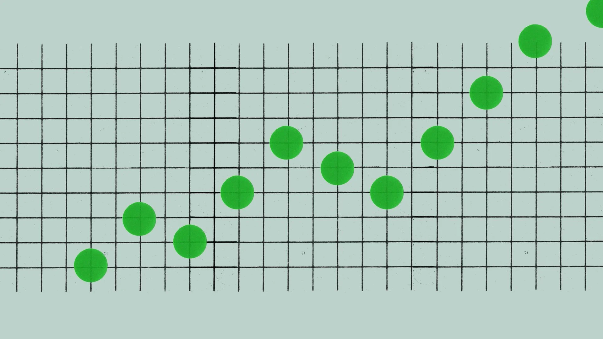
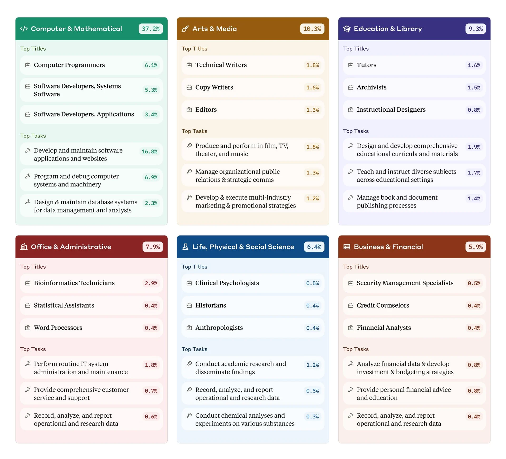
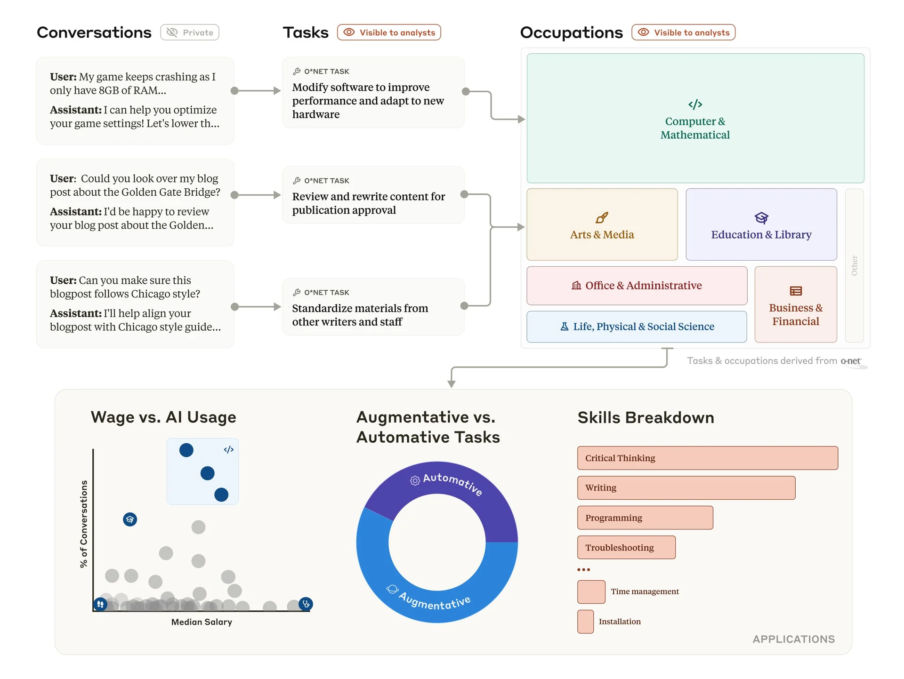
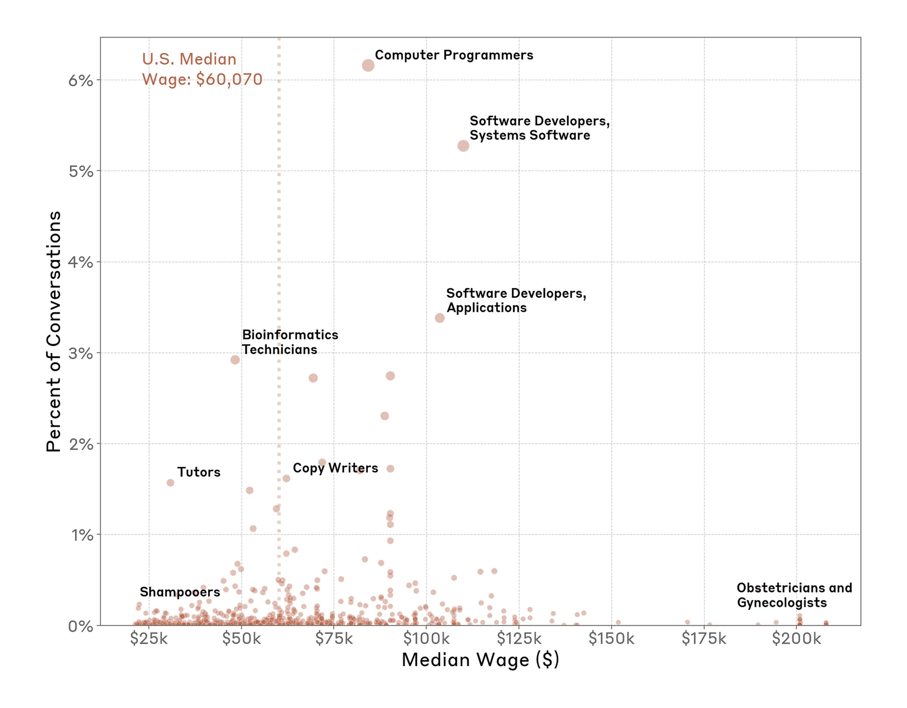
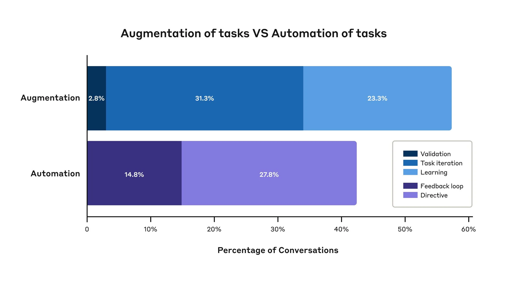

# Anthropic 经济指数

- 英文标题：The Anthropic Economic Index
- 发布日期：2025-02-10
- 官网栏目：经济学
- 原文：[Anthropic 页面](https://www.anthropic.com/research/the-anthropic-economic-index)
- 官网署名：Anthropic
- 官网推荐阅读：[阅读论文](http://arxiv.org/abs/2503.04761)

> 中文机器初译，未逐篇人工校对。引用研究结论时请核对英文原文。

未来几年，人工智能系统将对人们的工作方式产生重大影响。为此，我们推出 [人为经济指数](https://www.anthropic.com/economic-futures)，一项旨在了解人工智能随着时间的推移对劳动力市场和经济的影响的倡议。

该指数的 [初步报告](http://arxiv.org/abs/2503.04761) 提供基于数百万匿名对话的首创数据和分析 [Claude.ai](http://claude.ai)，揭示了人工智能如何融入现代经济中的现实世界任务的最清晰的图景。

我们也是 [开源数据集](https://huggingface.co/datasets/Anthropic/EconomicIndex/)用于此分析，以便研究人员可以基于并扩展我们的发现。制定政策应对措施以应对即将到来的劳动力市场转型及其对就业和生产率的影响，需要从多种角度考虑。为此，我们还邀请经济学家、政策专家和其他研究人员 [提供输入](https://docs.google.com/forms/d/e/1FAIpQLSfDEdY-mT5lcXPaDSv-0Ci1rSXGlbIJierxkUbNB7_07-kddw/viewform?usp=dialog) 在指数上。

经济指数第一篇论文的主要发现是：

- 如今，其使用主要集中在软件开发和技术写作任务中。超过三分之一的职业（约 36%）至少在四分之一的相关任务中使用了人工智能，而大约 4% 的职业在四分之三的相关任务中使用了人工智能。
- 与人工智能直接执行任务的自动化 (43%) 相比，人工智能的使用更倾向于增强 (57%)，即人工智能与人类协作并增强人类能力。
- 人工智能的使用在计算机程序员和数据科学家等中高工资职业相关的任务中更为普遍，但对于最低和最高工资的职位来说，人工智能的使用率较低。这可能反映了当前人工智能能力的局限性，以及使用该技术的实际障碍。

有关我们初步发现的更多详细信息，请参阅下文。

人工智能在整个经济中的应用地点和方式，来自 Claude.ai 的实际使用数据。这些数字是指与Claude进行的与这些个人任务、职业和类别相关的对话的百分比。

## 绘制整个劳动力市场的人工智能使用情况

我们的 [新纸](http://arxiv.org/abs/2503.04761) 建立在对技术对劳动力市场影响的长期研究的基础上，从工业革命的珍妮纺纱机到当今的汽车制造机器人。我们关注人工智能的持续影响。我们不会调查人们对人工智能的使用情况，也不会试图预测未来；相反，我们拥有有关人工智能实际使用方式的直接数据。

### 分析职业任务

我们的研究始于一个重要的 [来自经济学文献的见解](https://academic.oup.com/qje/article-abstract/118/4/1279/1925105): 有时关注是有意义的 *职业任务* 而不是 *职业本身*。工作通常具有某些共同的任务和技能：例如，视觉模式识别是由设计师、摄影师、安全检查员和放射科医生执行的任务。

某些任务比其他任务更适合自动化或通过新技术增强。因此，我们期望人工智能能够选择性地应用于不同职业的不同任务，并且除了整个工作之外，分析任务将使我们更全面地了解人工智能如何融入经济。

### 使用 Clio 将 AI 的使用与任务相匹配

这项研究是通过Claude的见解和观察而得以实现的，或者"[克里奥](https://www.anthropic.com/research/clio)”，一种自动分析工具，使我们能够分析与 Claude 的对话，同时保护用户隐私[1](https://www.anthropic.com/research/the-anthropic-economic-index#footnote-1)。我们在与 Claude 大约一百万次对话的数据集上使用了 Clio（具体来说，免费和专业对话 [Claude.ai](http://claude.ai)），并用它来按职业任务组织对话。

我们按照美国的分类来选择任务。劳工部，维护着一个包含大约 20,000 个特定工作相关任务的数据库，称为职业信息网络，或者 [昂*网](https://www.onetonline.org/)。Clio 将每个对话与最能代表对话中 AI 角色的 O*NET 任务进行匹配（下图总结了该过程）。然后，我们遵循 O*NET 方案将任务分组为最能代表的职业，并将职业分组为一小组总体类别： *教育和图书馆，* *商业和金融，* 等等。

我们的 Clio 系统将与 Claude 的对话（严格保密；左上）转换为职业任务（中上）和源自 O*NET 的职业/职业类别（右上）的过程。然后可以将这些输入到各种分析中（底行；下面将更详细地讨论）。

## 结果

**按工作类型划分的人工智能使用情况。** 迄今为止，我们的数据集中采用人工智能最多的任务和职业是“计算机和数学”类别，其中很大程度上涵盖了软件工程角色。发送给 Claude 的查询中有 37.2% 属于此类，涵盖软件修改、代码调试和网络故障排除等任务。

第二大类别是“艺术、设计、体育、娱乐和媒体”（占查询量的10.3%），主要反映人们使用Claude进行各种写作和编辑。毫不奇怪，涉及高度体力劳动的职业，例如“农业、渔业和林业”类别的职业（占查询的 0.1%），所占比例最少。

我们还将数据中的比率与总体劳动力市场中每种职业出现的比率进行了比较。比较如下图所示。

对于每种工作类型，与 Claude 的相关对话的百分比以橙色显示，与美国经济中从事该工作类型的工人的百分比（来自美国）相比。劳工部的 O*NET 类别）为灰色。

**人工智能在职业中的使用深度。** 我们的分析发现，很少有职业在大多数相关任务中使用人工智能：只有大约 4% 的工作在至少 75% 的任务中使用人工智能。然而，人工智能的适度使用更为广泛：大约 36% 的工作在至少 25% 的任务中使用了人工智能。

正如我们预测的那样，这个数据集中没有证据表明工作是完全自动化的：相反，人工智能分散在经济中的许多任务中，对某些任务组的影响比其他任务组的影响更大。

**人工智能的使用和薪资。** O*NET 数据库提供了列出的每个职业的美国工资中位数。我们将这些信息添加到我们的分析中，使我们能够比较职业的中位数工资以及人工智能在相应任务中的使用水平。

有趣的是，低薪和高薪工作的人工智能使用率都非常低（这些工作通常涉及大量手工操作，例如洗发水和产科医生）。根据我们的数据，中位工资范围内的特定职业（例如计算机程序员和文案撰稿人）是人工智能的最大用户之一。

年工资（x 轴）与与Claude涉及该职业的对话百分比（y 轴）。突出显示了一些说明性职业。

**自动化与增强。** 我们还更详细地查看了 *如何* 具体来说，任务涉及“自动化”（人工智能直接执行格式化文档等任务）与“增强”（人工智能与用户协作执行任务）。

总体而言，我们看到稍微倾向于增强，57% 的任务被增强，43% 的任务被自动化。也就是说，在超过一半的情况下，人工智能并没有被用来取代人们执行任务，而是发挥作用 *与* 他们参与验证（例如，仔细检查用户的工作）、学习（例如，帮助用户获取新知识和技能）和任务迭代（例如，帮助用户集思广益或以其他方式执行重复的生成性任务）等任务。

与 Claude 的对话涉及增强与自动化的百分比，以及每个类别中任务子类型的细分。我们的论文中对子类型的定义如下。指令：以最少的交互完成任务委派；反馈循环：以环境反馈引导任务完成；任务迭代：协同细化过程；学习：知识的获取和理解；验证：工作验证和改进。

### 注意事项

我们的研究为人工智能如何改变劳动力市场提供了独特的视角。但与所有研究一样，它也有重要的局限性。其中一些包括：

- 我们无法确定使用Claude执行任务的人是否正在完成工作任务。有人向Claude寻求写作或编辑建议 *可以* 他们可能是在工作中这样做，但也可能是为了兴趣而写小说。
- 相关的，我们不知道 *如何* 用户正在使用Claude的回复。例如，它们是复制粘贴代码片段吗？他们是对答复进行事实核查还是不加批判地接受它们？我们的数据中出现的一些自动化实际上可能是增强：例如，用户可能会要求Claude为他们写一份完整的备忘录（这将显示为自动化），但随后自己编辑它（这将是增强）。
- 我们也只分析来自 [Claude.ai](http://claude.ai) 免费和专业版计划，而不是 API、团队或企业用户。虽然 Claude.ai 数据包含一些非工作对话，但我们使用语言模型来过滤这些数据，使其仅包含与职业任务相关的对话，这有助于减轻这种担忧。
- 不同任务的数量之多意味着 Clio 可能错误地分类了一些对话（请参阅全文，特别是附录 B，了解我们如何验证分析的详细信息）；
- Claude 无法生成图像（除非通过代码间接生成），因此数据中不会引用一些创意用途；
- 鉴于 Claude 被宣传为最先进的编码模型，我们可能会期望编码作为一个用例被过度代表。因此，我们并不认为数据集中的用途是一般人工智能用途的代表性样本。

## 结论和未来研究

人工智能的使用正在迅速扩大，模型的能力也变得越来越强大。在相对较短的时间内，劳动力市场的情况可能会大不相同。因此，我们将随着时间的推移重复上述许多分析，以帮助跟踪可能发生的社会和经济变化。我们将定期发布结果和相关数据集，作为人类经济指数的一部分。

这些纵向分析可以让我们对人工智能和就业市场有新的见解。例如，我们将能够监控职业中人工智能使用深度的变化。如果人工智能仅用于某些任务，并且只有少数工作使用人工智能来完成绝大多数任务，那么未来可能是大多数现有工作都会发展而不是消失。我们还可以监控自动化与增强的比率，提供自动化变得更加普遍的领域的信号。

我们的研究提供了有关人工智能如何使用的数据，但没有提供政策处方。关于如何为人工智能对劳动力市场的影响做好准备的问题的答案不能直接来自孤立的研究；相反，它们将来自广泛视角的证据、价值观和经验的结合。我们期待使用我们的新方法来进一步阐明这些问题。

阅读 [全文](http://arxiv.org/abs/2503.04761) 了解我们的分析和结果的更多详细信息。

## 开放数据并征集意见

本文以及人类经济指数最重要的贡献是其新方法提供了有关人工智能影响的详细数据。我们将立即公开共享用于上述分析的数据集，并计划在将来进一步共享此类数据集。

完整数据集可以下载 [这里](https://huggingface.co/datasets/Anthropic/EconomicIndex).

研究人员可以提供对我们的数据提供反馈并建议新研究方向的表格 [这里](https://docs.google.com/forms/d/e/1FAIpQLSfDEdY-mT5lcXPaDSv-0Ci1rSXGlbIJierxkUbNB7_07-kddw/viewform?usp=dialog).

### 与我们合作

如果您有兴趣在 Anthropic 工作以研究人工智能对劳动力市场的影响，我们鼓励您申请我们的社会影响计划 [研究科学家](https://boards.greenhouse.io/anthropic/jobs/4524032008) 和 [研究工程师](https://boards.greenhouse.io/anthropic/jobs/4251453008) 角色。

## 脚注

01Clio 获取大量对话并将它们聚合到更高级别的类别中进行分析。重要的是，为了保护用户隐私，人类研究人员无法看到原始对话。您可以阅读有关 Clio 的更多信息 [这里](https://www.anthropic.com/research/clio).
