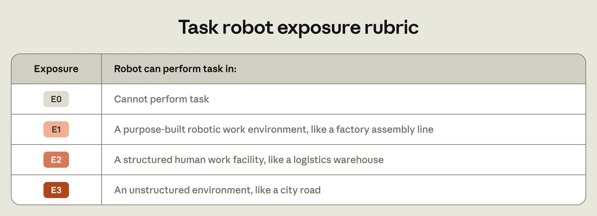
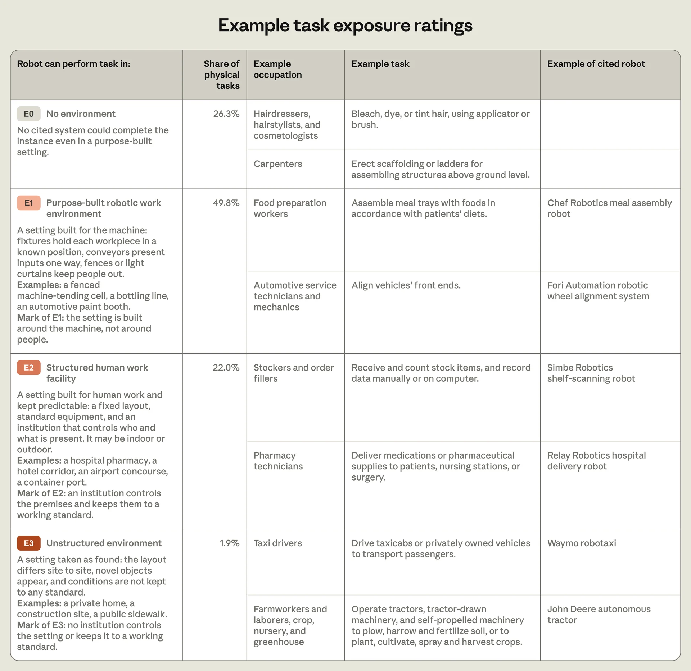
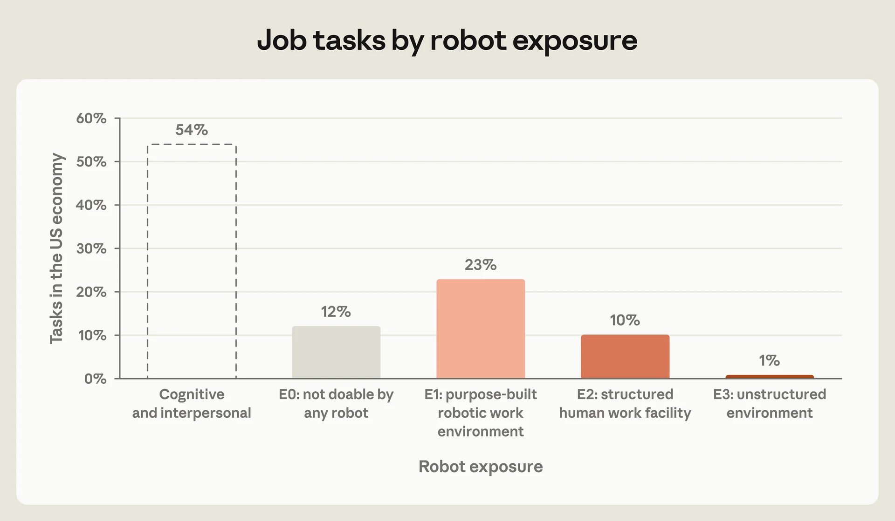
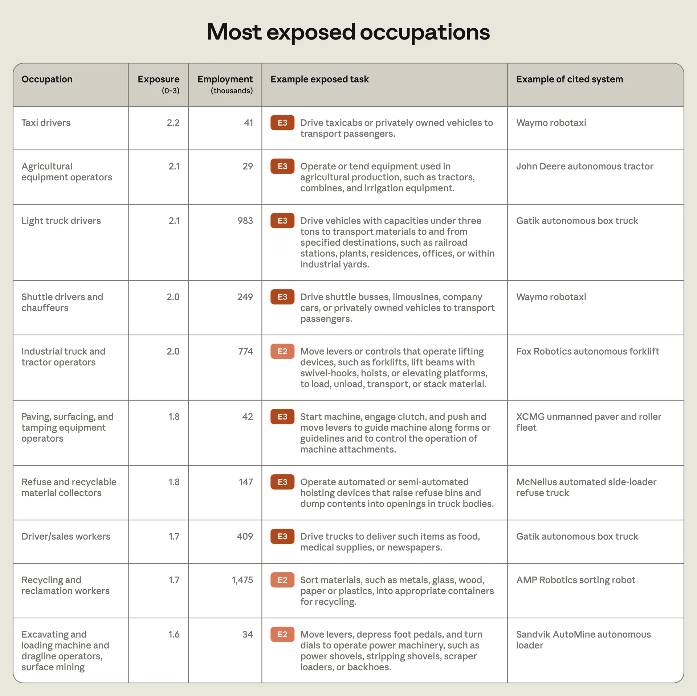
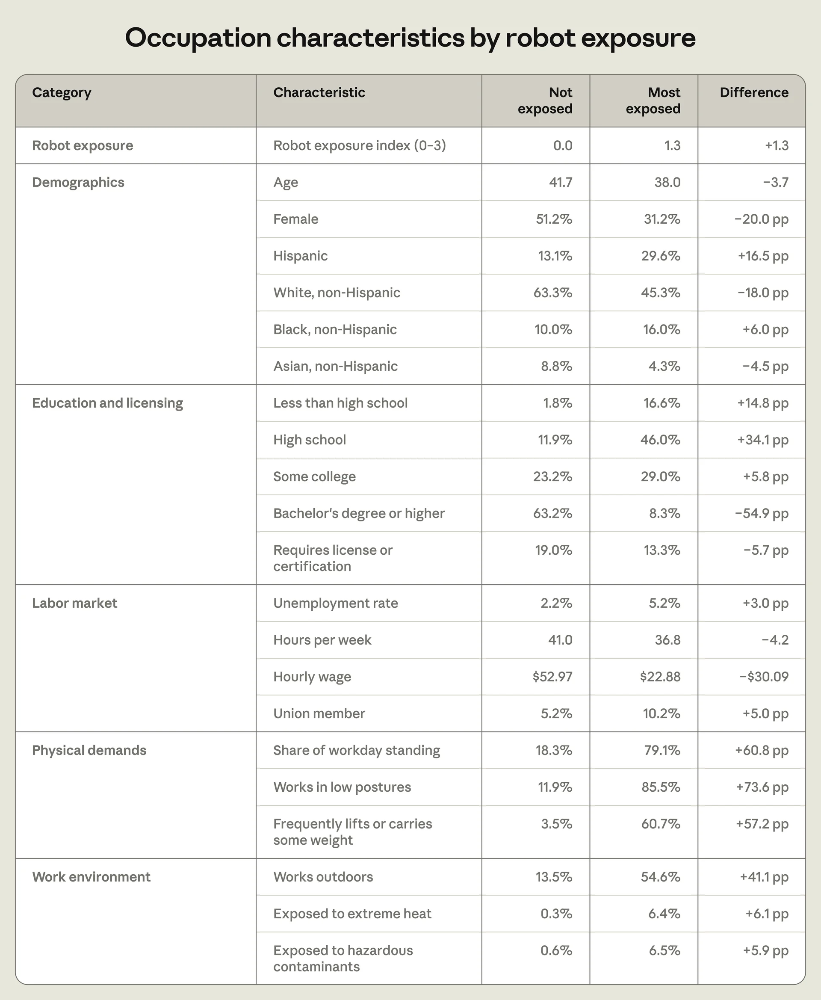
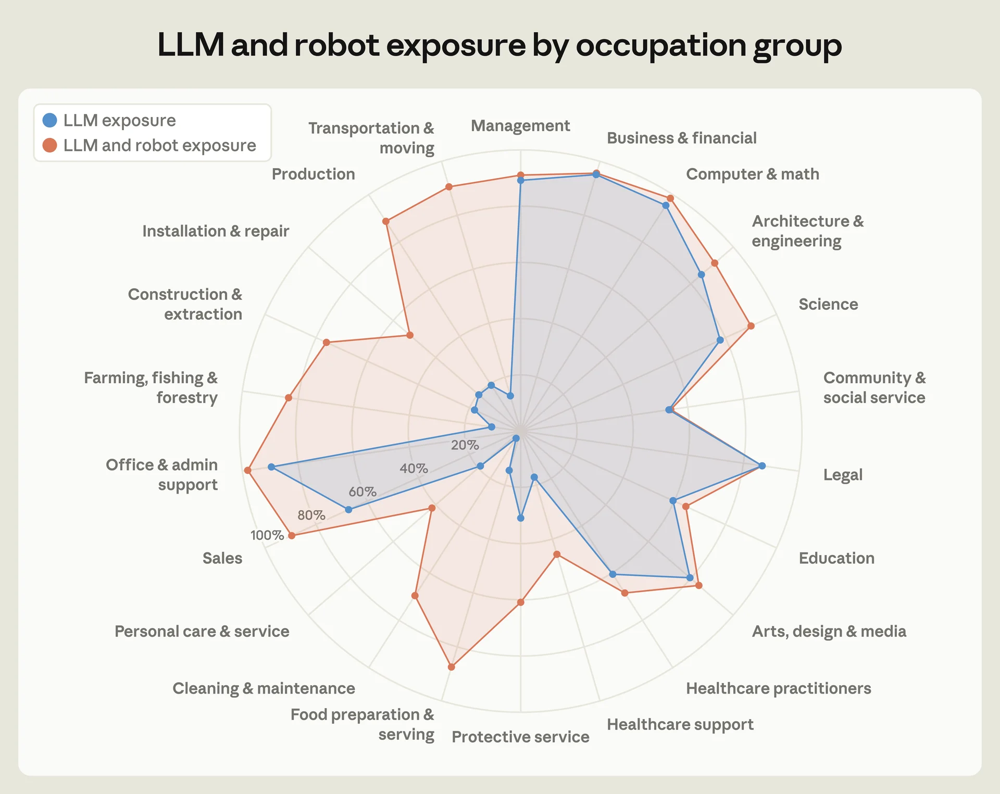
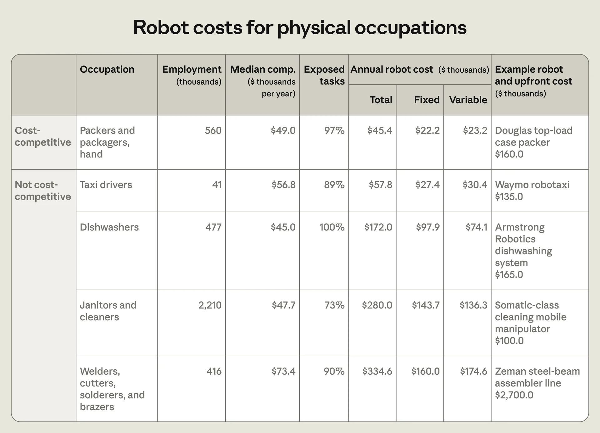
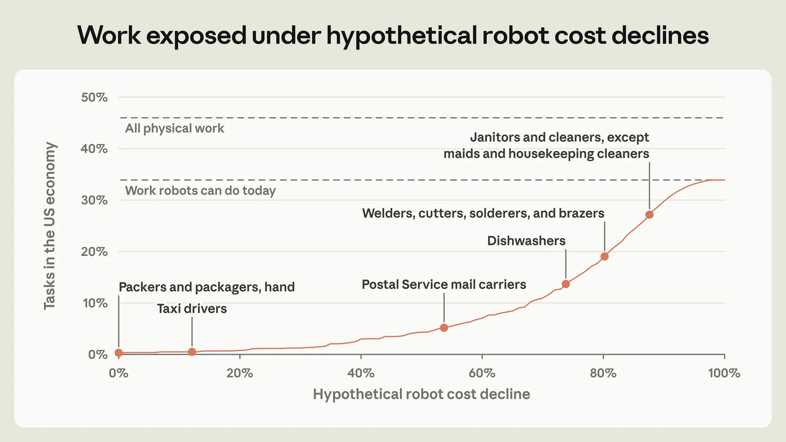

# 机器人能做哪些工作？

- 英文标题：What work can robots do?
- 发布日期：2026-09-30
- 官网栏目：经济学
- 原文：[Anthropic 页面](https://www.anthropic.com/research/what-work-can-robots-do)
- 官网署名：Russell Legate-Yang、Maxim Massenkoff
- 官网推荐阅读：[下载 PDF](https://assets.claude.com/401a473469db99fd39bba1ca6d9a5653a70e2f12.pdf)

> 中文机器初译，未逐篇人工校对。引用研究结论时请核对英文原文。

## **主要发现**

- 我们根据机器人今天执行工作任务的能力提出了一个机器人暴露指数。
- 我们将机器人定义为能够感知和行动的自主物理机器，在美国可以执行四分之三的体力任务，占工作时间的 34%，但大多是在有限的环境中进行。接触机器人的工人更有可能是男性，受教育程度较低，工资也较低。例如，驾驶和仓库工作高度依赖当前可用的机器人；护理和一般维修工作则不然，因为即使在高度控制的环境中，当今的机器人也只能完成很少的工作。
- 总体而言，按工作时间计算，大约 80% 的工作任务是由机器人或法学硕士负责的。机器人可以完成法学硕士无法完成的工作。剩下的未暴露的工作是高度人际交往的，或者需要当今机器人所不具备的身体技能。
- 虽然机器人现在可以完成大多数体力工作任务，但它们比人类劳动力昂贵得多。机器人仅在 0.3% 的工作任务上具有成本竞争力。如果机器人价格按照过去的趋势下降，则需要 40 年时间该份额才能达到 10%。除了价格之外，能力、偏好和法规等因素也对机器人自动化构成了进一步的障碍。
- 过去 50 年来，与机器人接触较多的工作岗位的工资和就业下降幅度比其他工作岗位更大。与此同时，工作机会也在增加：每年，机器人能够完成大约 2% 以前无法完成的体力工作。

## **简介**

大型语言模型的进步提高了自动化大量工作的可能性。但许多工作都是体力工作。人工智能对经济的影响部分取决于机器人技术。

预测机器人的进步速度很困难，但我们认为，列举今天的能力可以让我们深入了解未来几年。我们开发了一种衡量机器人工作暴露程度的方法，使用Claude来评估当今机器人执行工作任务的能力。当机器人可以在不受控制的环境中完成更多任务时，工作就会更加暴露。当机器人能够以比人类工人更便宜的成本完成同样的任务时，它就具有成本竞争力。

我们发现，在美国，机器人已经可以完成 74% 的体力任务，占工作时间的 34%。机器人和法学硕士一起暴露了除五分之一之外的所有就业机会。

但我们也发现了采用的重大障碍：大多数机器人需要高度结构化的环境，并且仅完成 0.3% 的工作，与人类相比具有成本竞争力。如果机器人价格按照过去的趋势下降，那么这个份额需要 40 年才能达到 10%。除了成本之外，主要障碍是能力，例如解开电线所需的灵活性。人类的偏好和法规进一步限制了机器人在大部分任务中的采用。

我们的核心前提是，当机器人今天已经可以完成工作时，工作就更有可能受到影响。50 年的回溯测试验证了这一方法：从 1977 年到今天，更多地接触现有机器人的工作在随后的几十年中经历了工资和就业下降。

如果以过去为鉴的话，出租车司机和仓库包装工将比护士和机械师更快地看到变化。我们预计，今天机器人已经立足的体力工作将首先实现自动化。

## **机器人的今天和明天**

如今，大多数机器人都在工厂等受控环境中运行。机器人通常需要进行编程才能与物理世界交互，而人类则可以适应他们的工作环境。这是商业上可行的机器人的主要障碍。²但人工智能可以帮助机器人解释和响应周围的环境，使仓库机器人和自动驾驶车辆能够与人类一起操作。

许多观察家预计人工智能将迅速提高机器人的能力。⁴尽管机器人支出仍占美国设备总投资的 1% 左右，但商业调查显示，美国机器人的采用率可能在三年内几乎翻一番。⁵ 企业正在投资数十亿美元来开发与人类身体能力相匹配的人工智能驱动的机器人。⁶

很难准确预测这些努力将如何影响就业和生产力。一个 *排名* 当前机器人任务覆盖范围的职业表明影响将首先出现在哪里。机器人应该影响它们已经可以完成的工作，而不是只能通过新技术以及在某些情况下适应法规才能完成的工作。当前的能力也是具体且可衡量的，而对未来能力的预测必须押注于哪些技术将取得成功。⁷ 仍在开发中的机器人支持我们对当前暴露的关注：公司正在汽车工厂和仓库以及机器人已经很常见的结构化环境中测试人形机器人。⁸

## **测量暴露量**

我们的分析使用来自 O*NET 的数据，该数据库包含约 900 种职业，与约 19,000 项工作任务的描述相关联。我们确定了一系列我们认为没有机器人就无法自动化的体力工作任务。为此，我们在测量体力、认知和人际工作要求的标题上对Claude的任务描述进行了评分。⁹“挖战壕”任务是体力任务；它是一项体力任务。 “教舞蹈学生”也是如此，尽管这也需要认知和人际交往能力。虽然打字员用手“使用加法机或计算器计算和验证报告表格、请购单或账单上的总计”，但这项任务不算数。附录 A 提供了详细信息，附录 F 列出了我们的提示。

我们对机器人暴露的任务级测量提出了这样的问题：机器人现在可以执行这项任务吗？如果可以，在什么情况下可以执行？我们认为机器人是指能够感知和行动的自主物理机器，其中包括扫描汽车以调整喷雾器的洗车场，但不包括完全由外科医生控制的遥控手术机器。1⁰我们根据机器人执行任务所需的工作环境类型来测量暴露程度。11

具体来说，我们根据机器人可以执行每项任务的位置，将任务分为四层，以增加暴露程度：

- E0：机器人无法执行任务。
- E1：机器人可以在专门构建的机器人工作环境中执行任务，例如工厂装配线。
- E2：机器人可以在结构化的人类工作设施中执行任务，例如物流仓库。
- E3：机器人可以在非结构化环境中执行任务，例如城市道路。

图 1 也显示了该标题。

**任务机器人曝光量规**被确定为体力的工作任务按照该机器人暴露标准进行评级。例如，如果有仓库机器人可以完成在仓库从卡车上卸下箱子的任务，则该任务的评级为 E2。

我们认为环境控制是衡量近期自动化风险的一个很好的指标。由于机器人很难适应不可预测的环境，因此大多数部署的机器人在工程环境中工作，例如在装配线上为汽车喷漆的环境。虽然这些困难在过去被认为减缓了物理自动化的速度，但人工智能驱动的机器人可以更好地适应它们的环境。

为了确定暴露程度，我们指示 Claude 搜索与每项任务相关的特定机器人，并直接引用消息来源来评估其能力和操作环境。我们询问机器人是否可以在或多或少结构化的任务典型工作环境版本中执行任务。让机器人完成看似简单的任务，例如装载洗碗机，需要许多复杂的物理技能，因此只有展示出的机器人能力才算数。 机器人还必须像人类一样出色地完成任务，同时考虑可靠性、错误率和速度。

例如，2010年代初，自动驾驶汽车无法在真实道路上“驾驶出租车或私人车辆运送乘客”。但他们确实在为测试而建造的模拟城镇中行驶，这是迈向当今自动驾驶汽车的一步。 1⁴ 我们的评分标准将当时的驾驶乘客评为 E1 级（机器人可以在专门构建的机器人工作环境中执行任务）和今天的 E3 级（在非结构化环境中）。 15

这个标题需要很多判断。O*NET 任务语句通常很简洁，并且省略了对人类来说可能很容易但对机器人来说却很难的细节。为了更具体地描述工作，我们引出了当前如何执行任务以及这些任务发生的频率的详细示例。然后，Claude使用网络搜索对这些示例的曝光度进行评分，以衡量机器人的能力。引用的来源必须显示机器人部署、商业销售或演示，如果我们省略依赖于演示的评级，结果是相似的。任务暴露由多数规则设定：机器人可以完成至少一半任务示例的结构化程度最低的环境，按时间加权。

考虑“挖战壕”这个任务。我们首先要求Claude提供示例，描述工人今天如何执行这项任务以及执行频率。例如，Claude估计，25% 的情况下，这项任务需要“在开阔的地面上开凿一条线性沟槽”。另外 20% 的情况下，需要“在现有埋地管道、出油管、电缆和导管周围手工仔细挖掘”。这些活动需要不同类型的身体能力，例如与精细运动灵活性和感知（用手在管道周围挖掘）相比，导航和力量（线性沟槽）。

Claude将第一个例子评为 E3 曝光，引用了一个控制系统，该系统改造了液压挖掘机以自动挖掘沟渠。 1⁸ 如今的机器人无法在埋地管道周围仔细挖掘，因此后一个示例未在 E0 曝光。更多“挖沟”的例子类似于仔细挖掘而不是线性挖沟，因此总的来说，这项任务在我们的评级中没有暴露。

图 2 给出了任务评级的示例，以及我们的暴露提示中每个暴露级别的更完整描述，以及支持每个评级的机器人。我们还计算了每一层中体力任务的份额：在这里和整个过程中，每项任务都根据执行该任务的工人数量以及他们花在该任务上的工作时间比例进行加权，这是我们与 Claude 一起估计的。

**任务暴露评级示例**  
机器人暴露水平如我们用于评估Claude暴露程度的提示中所述。对 7,594 项归类为体力的工作任务进行了暴露评级。体力任务在第 2 列中的权重任务按职业中每项任务所花费的时间比例（由 Claude 估计）和该职业的就业情况（BLS，2025）。例如，RelayRx 机器人在医院运送药品。医院是结构化的人类工作场所，因此“向患者、护理站或手术室运送药物或药品用品”的任务被评为 E2。按工作时间计算，E2 级任务占体力任务的 22%。

按预计工作时间计算，机器人无法完成的任务 (E0) 约占体力任务的四分之一。这些任务需要机器人难以具备的身体技能，例如“使用涂抹器或刷子漂白、染色或染色头发”的精细运动灵活性，以及​​“在地面上搭建脚手架或梯子以组装结构”的力量、平衡和移动性。

机器人可以在专门构建的环境中完成一半的物理任务，但不能在更广泛的环境中完成 (E1)。食物准备机器人在传送带上包装即食饭菜，带有人工智能的新模型可以适应不同的食材、份量和托盘，因此“根据患者饮食将食物组装到餐盘中”的任务被评为E1。

另外 22% 的体力任务可以由机器人在结构化的人类工作场所中完成 (E2)。例如，医院输送机器人“向患者、护理站或手术室输送药物或药品用品。”如今的机器人在非结构化环境中仅完成 2% 的体力任务 (E3)。这些通常涉及驾驶，由自动驾驶汽车、拖拉机和其他车辆完成。²⁰

我们随附的数据发布包含Claude对所有评级任务的推理和引用来源。例如，Claude将“在平面、垂直或头顶位置焊接组件”任务评级为 E1，并引用了一篇有关人工智能机器人焊机的文章：“Path Robotics 表示，其两个焊接单元都可以自动焊接钢部件，并部署在美国和加拿大的制造车间中。”21

我们为工作定义了一个机器人暴露指数，将工作的任务暴露评级平均分为 0-3 级。该指数随着公开任务的份额和机器人在这些任务上的能力而上升，并通过估计的工作时间对任务进行加权。

理想的暴露指数将完美预测未来几年的机器人自动化。由于我们无法及时预测，因此我们尝试使用工作和任务描述的历史数据来验证我们的衡量标准。我们对自 1977 年以来的几年机器人暴露程度进行了评估，并将暴露程度与工资和就业的变化联系起来。当一项工作更多地接触机器人时，即使考虑到行业趋势和其他潜在的混杂因素，其工资和就业率也会在接下来的几十年里下降。附录 B 中详细介绍的这些结果让我们相信我们的措施可以预测未来的工作中断。

## **机器人可以做什么工作？**

图 3 总结了机器人在美国经济中所有工作任务中的暴露情况，根据职业和该职业的就业中每项任务花费的估计时间比例对任务进行加权。按工作时间计算，认知和人际工作占任务的 54%。其余 46% 的任务是体力任务。在所有任务中，大约 12% 的任务目前任何机器人都无法完成（E0），23% 的任务可以由机器人在专门构建的环境中完成（E1），10% 的任务可以在结构化的人类工作场所中完成（E2），1% 的任务可以在非结构化环境中完成（E3）。如果算上任何暴露水平，在某些情况下，74% 的体力劳动或所有劳动的 34% 可以由机器人完成。

**机器人曝光的工作任务**  
所有的工作任务都包括在内。任务根据职业在每项任务上花费的时间比例以及该职业的就业情况进行加权。机器人暴露程度是针对确定为体力的任务进行评级的。例如，23% 的工人时间花在机器人可以在专门构建的环境中执行的任务上。按类别划分的示例任务：教学课程、设计系统（认知和人际）；拘留人员、提供急救（E0）；配药、组装电子产品 (E1)；清洁地板、搬运仓库货物（E2）；调节田间灌溉、从空中检查财产以及驾驶，这些都是机器人在非结构化环境中执行的任务（E3）。就业数据来自 BLS (2025)，我们使用 Claude 来估计任务占用时间。

机器人可以在经济的许多领域完成体力任务。自主移动仓库机器人行驶至装货码头和拖车内。它们使用吸盘抓取包裹并将其装载到移动传送带上。 由于这些机器人在结构化的人类工作场所中导航，因此许多仓储任务被评为 E2，例如“手动或使用卡车、拖拉机或其他设备将货物、库存或其他材料移入和移出存储或生产区域、装卸码头、送货车辆、船舶或集装箱。”导航和处理方面的进步使得此类机器人在物流和运输中很常见。²³

图 4 显示了我们的机器人暴露指数中暴露程度最高的 10 种职业。在这10个职业中，有9个是车辆操作员。负责驾驶工作的机器人包括自动驾驶汽车、拖拉机、卡车和摊铺机。出租车司机的暴露指数为 2.2.²⁴ 由于驾驶是大部分工作，因此他们的工作时间中位任务暴露于 E3，而诸如“吸尘和清洁内部以及清洗和抛光汽车外部”等辅助任务可以由机器人完成，但在比开放道路更结构化的环境中。自动驾驶汽车尚未大规模颠覆驾驶工作，但其能力表明这些工作比其他工作面临更高的自动化风险。²⁵

**暴露最多的职业**  
暴露范围从 0（机器人无法完成任何任务）到 3（机器人在非结构化环境中可以完成所有任务）。工作暴露对任务暴露进行平均，按每项任务花费的时间进行加权。为每个职业列出了一个高度暴露的任务以及一个可以执行该任务的机器人。显示了 10 个最暴露的职业，至少有 20,000 个工作岗位。例如，对班车司机和司机的平均任务暴露给出的指数为 2.0（满分 3）。Claude 引用 Waymo 自动驾驶汽车来执行一些任务。BLS (2025) 的就业数据有时会结合多个 O*NET 职业头衔；我们平等地分配了他们的就业机会，包括回收和回收工人。我们与 Claude 一起估算任务时间要求。

一个职业可以涵盖许多工作环境。在美国，机器人可能只在其中一些环境中运行，而国外的机器人有时会涵盖所有这些环境。例如，库存员和订单填写员在零售店和仓库中执行“在货架、货架、箱子、箱子和桌子上存放新的或转移的商品”的任务。在美国的仓库中，带有触摸传感器的人工智能机器人会挑选和存放商品。²⁶ 在美国零售业中，移动机器人会扫描空货架，但必须提醒人类补货。²⁷ 日本便利店的机器人会自行给冰箱补货。²⁸ 由于仓储机器人要求将物品放在它们附近，因此这项任务被评为 E1。我们估计，库存人员将 70% 的时间花在像这样 E1 级的任务上，另外 16% 的时间花在 E2 级的任务上。总的来说，他们的机器人暴露指数得分为 1.0。

如果工作的许多任务是适度暴露的，或者如果一些最耗时的任务是高度暴露的，那么工作就可以暴露给机器人。将完成石膏板且暴露指数为 1.6 的锥体与对回收进行分类且暴露指数为 1.7 的回收和回收工人进行比较。

锥度的任务分为未曝光和高度曝光。建造内墙的工人使用纸胶带和一种称为泥浆的糊状物来平滑干墙板上的接缝、接缝和螺钉。泥土和胶带是杂乱的材料，因此机器人无法执行“将纸带压在接缝上，将胶带嵌入密封剂中并密封接缝”的任务。第一层胶带涂层干燥后，工人们“涂上更多的涂层来填充孔并使表面光滑。”该任务被评为 E3：自动干墙机器人使用人工智能扫描墙壁，喷涂额外的密封剂涂层，并在干燥后对墙壁进行打磨。 ²⁹ 总体而言，按工作时间计算，41% 的锥体任务在 E3 级下完成，而机器人无法完成另外 26% 的任务。

相比之下，对于回收和回收工人来说，在 E2 级的工作时间内，机器人可以完成四分之三以上的任务。他们只有 8% 的工作时间没有暴露在外。例如，具有计算机视觉和吸力夹具的机器人可以执行“将金属、玻璃、木材、纸张或塑料等材料分类到适当的容器中进行回收”的任务。3⁰这些机器人代表工人从传送带上拾取回收物，因此这项任务和其他任务被评为 E2 级。

机器人在锥度的特定任务上能力很强，而对于回收工人来说，接触范围更广，但机器人的适应性较差。锥度的混乱任务可能会阻碍自动化。也有可能最大的回收设施较早使用机器人，而较小的设施则较晚采用机器人。不管怎样，如果广泛部署，机器人似乎可能会改变这两种工作。

## **暴露工作的特点**

确定了风险敞口衡量标准后，我们现在考虑风险敞口对劳动力市场可能意味着什么。

图 5 将机器人接触指数排名前五分位的工人与未接触机器人的工人进行了比较，后者占工作岗位的 20% 左右。2020-2024 年美国社区调查的数据显示，高度暴露的工人中女性的可能性要低 20 个百分点，西班牙裔的可能性要高 16 个百分点。这些工人持有学士学位或更高学位的可能性也降低了 55 个百分点，每小时收入减少了约 30 美元，并且面临着两倍以上的失业率。

美国劳工统计局编制的职业要求统计数据还显示，与机器人接触的工作更有可能需要搬运重量以及在极热或接近危险污染物的情况下工作。这种暴露模式在很多方面都与法学硕士的典型情况相反。³²

**机器人暴露的职业特征**暴露程度最高的工人是那些处于机器人暴露指数前五分之一的工人；未接触过的工人的接触量为零，约占工作岗位的 20%。人口统计、教育和劳动力市场数据来自 2020-2024 年美国社区调查（工会会员资格和许可除外）。工会成员资格来自 Hirsch 等人列出的统计数据。 (2026) 2020-2024 年当前人口调查。许可来自 2025 年 BLS 职业要求调查，体力需求和工作环境变量也是如此（对于某些职业，这些来自 2023 年调查）。统计数据是就业加权的。

## **机器人和法学硕士接触**

接下来我们分析机器人是否会扩大工作中断风险，而不仅仅是法学硕士的风险。借鉴 Eloundou 等人的经验。 (2024) 和 Massenkoff 和 McCrory (2026)，我们比较了两种职业暴露测量：

- 法学硕士暴露：法学硕士可以将所需时间减半的工作任务份额（在法律中称为理论能力） [我们之前的工作](https://www.anthropic.com/research/labor-market-impacts)).
- LLM 和机器人暴露：LLM 或机器人暴露的工作任务比例，对每项任务取 LLM 暴露和 E1+ 机器人暴露中的较高者。

机器人和法学硕士的暴露评级衡量的概念有些不同，但两者都表明技术可以完成大部分给定的任务。虽然将法学硕士和机器人整合到实际工作中可能会带来新的挑战或实现新的能力，但这两项措施根据当今的能力提供了对工作暴露的初步洞察。

图 6 绘制了仅法学硕士（蓝色）以及法学硕士和机器人（橙色）的工作暴露情况，按广泛的职业类别分组。与仅法学硕士相比，机器人可以提供更多且不同类型的工作。虽然不到 15% 的运输和搬家任务仅由法学硕士负责，但其中约 90% 的任务由机器人负责。同样，机器人将办公室和行政支持工作（主要涉及计算机工作和轻度体力任务）的暴露率提高到近 100%。总体而言，大约一半的工作仅涉及法学硕士，但考虑到机器人时，这一比例上升至 81%。

**按职业组划分的法学硕士和机器人接触情况**  
LLM 暴露是 Eloundou 等人所评价的暴露任务的比例。 （2024）（正𝛽）。接触法学硕士和机器人的职业增加了 E1 或更高机器人接触评级的任务。职业组是 2 位 SOC 代码，并且按任务时间份额和就业情况进行组平均权重。例如，在防护服务职业中，31% 的工作任务涉及法学硕士，61% 的工作任务涉及法学硕士或机器人。就业数据来自 BLS (2025)。我们与 Claude 一起估算任务时间份额。

如今，哪些工作是法学硕士和机器人不能做的？以个人护理和服务工作为例，其中大约 40% 的任务是公开的。法学硕士和机器人都难以应对的面对面社交互动和与人类的身体接触对于这些工作来说非常重要。这个例子表明，高度人际交往的工作，或者需要精细操作的工作，可能不太容易受到近期自动化的影响。 安装和维修、医疗保健支持以及社区和社会服务等职业群体也符合这种模式，接触率相对较低。虽然法学硕士和机器人如今无法执行这些任务，但没有一个职业群体的总体暴露率低于 40%。随着时间的推移，技术的进步可能使新型自动化成为可能。

未公开的任务还有助于描述哪些因素会导致工作难以自动化。我们将共享相似文本的未公开任务陈述分组，并要求Claude描述这些（附录 C.1）。如今，法学硕士或机器人未接触到的任务往往是亲自动手和面对面的，并且有时会受到监管。医疗保健任务通常结合这些功能，例如“给患者服用药物并监测患者的反应或副作用”。

在附录 C.2 中，我们研究了哪些障碍最可能阻碍物理任务的自动化。我们问Claude，如果不解决的话，今天哪些障碍会阻止机器人完成每项体力任务的重要部分，无论是否暴露。我们将其分为四类：能力、人类偏好、监管和成本。对于受能力限制的任务，我们让Claude从操纵、计划和推理、移动性和力量以及感知中挑选出最重要的缺失技能。

我们发现能力和成本是机器人采用的最大障碍。大约 70% 的体力任务无法被采用。操纵能力非常突出：除非机器人变得更加擅长触摸和处理物体，否则一半的体力任务不会大规模自动化。人工智能似乎最有可能改善规划和推理技能方面的缺陷，但限制了机器人自动化完成 8% 的体力任务。对于几乎所有任务来说，成本都需要下降。

我们的估计表明，当今的法规不允许机器人执行 14% 的体力任务。监管对于医疗保健、防护服务和教育方面的任务很重要，但对于食品准备、清洁、生产、建筑、维修和材料运输方面的任务则不那么重要，这些工作约占体力工作的一半。人类的偏好阻碍了机器人完成四分之一的任务。这可能是因为人们不信任机器人（“给孩子穿衣服、换尿布”），或者因为他们重视社交互动（“迎接客人，护送他们到座位上，并向他们提供菜单和酒单”）。

如果机器人能力快速发展，这些结果意味着什么？大约 30% 的体力任务受到偏好或法规的限制。如果机器人变得有能力且具有成本效益，这将使大多数体力工作暴露出来，尽管其余的可能成为拖累总体生产力加速的薄弱环节。如果机器人变得更聪明，但仍然无法像人类一样处理物体，那么能力的不平衡进步也可能会减慢机器人的采用速度。也就是说，更好的机器人还可以减少对自动化的阻力，例如通过缓解安全问题。接下来我们讨论机器人成本，这是这些估算中最常见的障碍。

## **机器人成本和采用**

尽管如今机器人可以完成大部分体力工作，但这样做可能并不经济。用昂贵的硬件制造的机器人不像软件或法学硕士那样容易复制和分发。与评估能力但不评估成本的法学硕士接触措施相比，区分接触具有成本竞争力的机器人的工作尤为重要。

对于每项暴露的任务，我们根据任务暴露测量中引用的特定机器人来估计机器人执行此任务的年度成本。我们提示Claude使用网络搜索和每项任务引用的机器人列表来估算成本。自动化执行 E1 任务可能需要重新设计工作场所以适应机器人，而执行 E3 任务的机器人可能会使用昂贵的传感器来导航非结构化环境。

估算涵盖了部署机器人执行每项任务的全部成本。为了使机器人和劳动力成本具有可比性，我们首先要求 Claude 估算人类工人一年内完成一项任务通常会产生多少成本。例如，负责“擀、揉、切或成型面团”的面包师每年估计会生产 180,000 个成型面团。然后Claude估算了机器人生产相同产量所需的成本。由于面包师在不同的环境中执行此任务，Claude 对零售、中型和工业面包店的机器人部署成本进行了平均。固定成本按年计算，以反映硬件的使用寿命和资金的时间价值。

通过这种方式计算，机器人执行任务的成本可以与工人的工资进行比较。如果一项任务的机器人成本低于其劳动力成本，则我们称某项任务将由具有成本竞争力的机器人承担，劳动力成本计算为职业从 BLS 获得的总报酬除以该任务所花费的时间比例。标准经济模型预测这些任务是自动化的，尽管考虑到采用摩擦和成本不确定性，这一衡量标准更具启发性。参见附录 D.1 了解详细信息和机器人任务成本的工作示例。

机器人通常执行多项工作任务，但我们会估算职业中各个任务的成本。简单地累加任务成本可能会重复计算机器人或低估实际部署中的协调成本。我们按职业进行汇总，为Claude提供任务成本估算，并要求扣除裁员和新增成本后的总成本。如果机器人的总成本低于其总薪酬（按机器人可以完成的任务所花费的时间比例计算），我们就说该职业面临着具有成本竞争力的机器人。

图 7 显示了机器人执行其暴露任务的五种高度体力工作和成本估算。包装工和包装工是接触具有成本竞争力的机器人的最大职业。需要多台机器人来完成包装工和包装工的任务，包括包装集装箱、在仓库周围移动材料、目视检查货物、竖立纸板箱、打印和粘贴标签以及密封包装。 3⁹ 这些机器人的购买和安装成本估计超过 200 万美元，但可以取代大约 14 名工人每年的工作。固定成本分摊在大约 10 年的使用寿命内，资本成本为 8%。维护、兼职人工监督和能源等运营费用每年更换一名员工的成本约为 45,000 美元。由于包装工和​​打包工 97% 的时间都花在机器人可以完成的任务上，且成本约为 49,000 美元，因此机器人完成这项工作每年的成本减少约 2,500 美元。

**体力劳动的机器人成本**  
就业和总薪酬使用数据来自 BLS（OEWS 2025，ECEC 2026）。暴露任务是暴露 E1-E3 时该职业任务的份额，按每项任务花费的估计时间进行加权。Claude估计了机器人执行每种职业暴露任务的年度成本。成本包括年化固定成本和可变成本。最后一栏列出了每个成本估算中包含的一个机器人及其预计购买价格。

美国目前雇用了大约 560,000 名包装工人。企业面临着采用摩擦，例如监管或借贷限制，而这些成本估算都是近似的。例如，机器人出租车的成本估计仅比出租车司机高 7,000 美元左右，但面临监管障碍。⁴⁰ 也就是说，对于具有成本竞争力的机器人可以完成的体力工作来说，自动化风险可能更高。自 2015 年以来，包装工和包装工的就业人数下降了 22%。美国劳工统计局预计，到 2035 年，该职业的裁员数量将在所有职业中排名第 11 位，仅落后于惩教人员以及 9 个销售和办公室职业。⁴1

对于图 7 中所示的其他工作，机器人的成本比人类高得多，尽管它们可以完成大部分工作。在金属加工中，配备摄像头和人工智能的机器人可以自主焊接。⁴²但是人类焊工可以执行许多能够实现焊接的任务，例如定位大型金属零件、爬梯子焊接难以到达的接头、检查质量以及研磨和精加工材料。自动化这项工作需要机器人，其成本大约是人类焊工的五倍。

洗碗机、门卫和清洁工的工资比焊工少 25,000 至 30,000 美元。但他们的机器人类似物仍然贵几倍。清洁很难标准化和简化，机器人清洁工通常比人类慢并且仅限于特定任务。⁴³

图 8 通过绘制假设的机器人成本均匀下降时对具有成本竞争力的机器人的暴露情况来总结机器人成本。例如，如果今天机器人的成本降低 20%，那么对于 280 万工人完成的体力工作来说，它们将具有成本竞争力。这些工人平均 42% 的时间都花在与机器人接触的工作上，占经济中所有工作时间的 0.8%。作为参考，行业和政府数据表明，自 20 世纪 90 年代以来，机器人价格每年下降约 3%。按照这个速度，大约需要七年时间才能实现成本下降 20%。附录 E 更详细地讨论了历史机器人价格数据。

尽管理论上机器人可以完成占所有工作时间 34% 的任务，但目前它们的成本竞争力仅为 0.3%。尽管如此，其中包括大约 300,000 名工人，机器人可以为他们完成 95% 的任务。⁴⁴ 如图 7 所示，对于包装工、打包工和出租车司机来说，如今的机器人具有成本竞争力或接近其成本竞争力，但对于大多数其他工作而言，却远非如此。

要让机器人在当今 10% 的人类工作中具有成本竞争力，成本需要下降约 70%。如果按照每年 3% 的速度下降，大约需要 40 年的时间。也就是说，新的、功能更强大的机器人（如人形机器人）或新的制造工艺可能会降低人类工作自动化的成本。报告表明，如果对人形机器人和其他机器人有强烈的需求，全球生产可能会迅速扩大。⁴⁵

**假设机器人成本下降所暴露的工作**  
通过比较机器人和人工成本来计算。劳动力成本是花在公开任务上的时间乘以职业总报酬的分数。鉴于机器人成本下降，该曲线绘制了机器人成本低于劳动力的所有工作任务的份额。任务根据估计的时间需求和职业就业进行加权。机器人和劳动力成本在工人薪酬分布的六个点进行比较；详细信息参见附录D.2。所选职业的机器人成本低于劳动力成本中位数。例如，机器人完成了 94% 的邮政服务邮递员任务。为了匹配工人一年的生产量，机器人的成本将达到 166,000 美元。邮政服务邮递员的总薪酬中位数为 82,000 美元，因此如果成本下降 54%（166,000 美元 x 46%< 82,000 美元 x 94%），机器人将具有成本竞争力。总薪酬根据 BLS 的数据计算（OEWS 2025、ECEC 2026）。

人类和机器人之间的成本平价也不一定意味着高失业率或快速经济增长。工人仍在执行的任务可能会成为瓶颈，而这些机器人成本估算通常包括人工监督、异常处理或维修工作。正如 Acemoglu 和 Restrepo（2019）以及 Jones 和 Tonetti（2026）所强调的那样，自动化只有在机器比人类便宜得多的情况下才能提高生产率，而不是在成本平价的情况下。

我们将这些成本估算应用于两个扩展。附录 D.2 计算了另一种职业暴露衡量标准，该衡量标准考虑了机器人可以做什么以及它们的成本有多低。与我们主要的、以能力为中心的衡量标准相比，成本核算产生的职位排名非常相似（排名相关性为 0.95）。

附录 E 还介绍了机器人采用的典型场景（如果机器人变得更便宜、生产力更高）。这些场景借鉴了 20 世纪 90 年代以来工业机器人的创新和采用经历，以及分析师对类人机器人的预测。我们持有固定的任务和工资，并询问成本下降和能力提升的历史速度多久才能使机器人具有成本竞争力。

为了模拟机器人如何随着时间的推移承担新的工作，我们对 1977 年使用当今机器人的工作任务的暴露程度进行了评估，并与 1977 年的机器人暴露程度进行了比较。1977年，机器人无法完成62%的体力任务。如今的机器人只能完成其中 24% 的相同任务。随着时间的推移，这意味着每年机器人能够完成以前无法完成的任务的 2%（参见附录 B.4）。

再加上每年 3% 的成本下降，到 2085 年，机器人在目前一半的体力劳动中都不具有成本竞争力。但机器人技术的快速进步可能会加快这些时间表。在快速采用的场景中，质量调整成本下降速度提高了四倍，机器人完成新任务的速度提高了一倍，到 2050 年，机器人在完成一半的体力工作方面将具有成本竞争力。如今，90% 的体力工作实现自动化仍需要 53 年。

需要注意的是，我们的场景对每项任务都应用相同的成本下降或能力增加，因此按照当今相对于工人工资的成本排名，任务变得具有成本竞争力。该排名抓住了广泛的经济激励，但机器人公司也可能出于其他原因首先瞄准某些功能。例如，人形演示有时会展示家务劳动，而机器人制造商可能会优先考虑对自己运营有用的工厂工作，就像人工智能公司优先考虑编码代理一样。⁴⁶

总体而言，机器人需要在未来几十年内保持创纪录的价格下降和质量提高速度，以实现快速的物理自动化。即便如此，这些成本预测对就业的影响不太确定，因为它们忽略了偏好和监管等力量以及工资下降等反馈效应。

## **讨论**

我们引入了一种新的机器人工作暴露程度测量方法。当机器人可以执行其任务时，工作就会暴露出来。像人类一样工作的机器人比那些需要重建工作场所的机器人（例如工厂机器人）更容易暴露。

我们发现，由于自动驾驶汽车的出现，驾驶工作受到的影响最大。今天的大多数机器人不像无人驾驶汽车，只能在受控环境中运行。但机器人可以以某种能力完成大部分体力工作，尽管对于同样的工作，它们的成本比人类高几倍。接触机器人的工作与接触法学硕士的工作有很大不同。他们付出的代价更少，对体力的要求更高。

我们希望这些措施有助于分析物理自动化，因为人工智能扩展了机器人的功能。今天的暴露模式可能会告诉我们，未来更强大的机器人将颠覆哪些工作。这项工作的定期更新可以跟踪机器人的能力。

我们的暴露程度是基于这样的想法：当今天的机器人已经在某些环境中完成工作时，工作就会面临更大的风险。我们发现这种评估机器人的方式可以预测历史劳动力市场的影响。但人工智能驱动的机器人可以超越我们的规模，完成目前无法完成的工作，例如学习爬梯子或更灵活地使用手臂和抓手。

机器人和人工智能如何重塑经济仍存在很多不确定性。人工智能的增长预测通常假设机器人可以缓解的物理瓶颈将拖累自动化认知工作的收益。我们也没有考虑人工智能如何在没有机器人的情况下影响体力工作，例如通过更好地预测工厂机器何时需要维护。在短期内，追踪人工智能影响的努力可以观察司机和仓库包装工等暴露的职业，以发现早期破坏迹象。更进一步来说，一个关键问题是工作本身将如何改变，随着机器人和人工智能的进步，工作可能会变得更加社交化和人际化。

## **附录**

可用 [这里](https://assets.claude.com/d27288375b0ac486cb9da0a30a94423b36ff0443.pdf).

#### 数据可用性

该报告中的数据可用 [这里](https://huggingface.co/datasets/Anthropic/EconomicIndex).

## **参考文献**

亚伯拉罕，凯瑟琳·G.和詹姆斯·R.Spletzer，“新工作是好工作吗？”，凯瑟琳·G.亚伯拉罕，詹姆斯·R.斯普莱泽和迈克尔·J.哈珀编辑， *新经济中的劳动力*，芝加哥大学出版社，2010，101-143。

Acemoglu、Daron 和 David Autor，“技能、任务和技术：对就业和收入的影响”，载于 *劳动经济学手册*，卷。4B，爱思唯尔，2011 年，1043-1171。

阿西莫格鲁、达伦、大卫·奥托、大卫·多恩、戈登·H.Hanson 和 Brendan Price，“进口竞争和 2000 年代美国就业大衰退” *劳动经济学杂志*, 2016, 34 (S1), S141-S198.

Acemoglu、Daron、Andrea Manera 和 Pascual Restrepo，“美国税法有利于自动化吗？” *布鲁金斯经济活动论文*，2020 年春季，231-300。

Acemoglu、Daron 和 Pascual Restrepo，“人与机器之间的竞赛：技术对增长、要素份额和就业的影响” *美国经济评论*, 2018, 108 (6), 1488-1542.

Acemoglu、Daron 和 Pascual Restrepo，“自动化和新任务：技术如何取代和恢复劳动力” *经济展望杂志*, 2019, 33 (2), 3-30.

Acemoglu、Daron 和 Pascual Restrepo，“机器人和工作：来自美国劳动力市场的证据” *政治经济学杂志*, 2020, 128 (6), 2188-2244.

Acemoglu、Daron 和 Pascual Restrepo，“任务、自动化和美国的崛起”工资不平等” *计量经济学*, 2022, 90 (5), 1973-2016.

阿加斯卡、阿米亚、斯里拉姆·西瓦、威廉·皮克林、凯尔·奥布莱恩、查尔斯·凯克、亚历山大·奥米加·加尔沃·巴博萨、李安、布里安娜·加洛·萨克、艾丽西亚·蔡、马尤尔·内马德、查伦·塔泰、迪佳明、艾萨克·艾扬格、拉米亚·达鲁尔、迪诺·基鲁阿尼、吉米·厄斯金、塔米尔·赫加齐、斯科特·尼库姆、乌斯曼·A·Khan、费德里科·佩科拉和约瑟夫·W.Durham，“DeepFleet：移动机器人的多代理基础模型”，arXiv：2508.08574，2025。

阿吉翁，菲利普，本杰明·F.琼斯和查理一世。琼斯，“人工智能与经济增长”，载于 Ajay Agrawal、Joshua Gans 和 Avi Goldfarb 编辑， *人工智能经济学：议程*，芝加哥大学出版社，2019，237-282。

空中客车公司，“空中客车公司完成 ATTOL 完全自主飞行测试”，新闻稿，2020 年 6 月 29 日。 <https://www.airbus.com/en/newsroom/press-releases/2020-06-airbus-concludes-attol-with-fully-autonomous-flight-tests>

空中客车公司，“空中客车公司测试新技术以增强飞行员援助”，新闻稿，2023 年 1 月 12 日。 <https://www.airbus.com/en/newsroom/press-releases/2023-01-airbus-tests-new-technologies-to-enhance-pilot-assistance>

亚马逊，“Vulcan 简介：亚马逊首款具有触觉的机器人”，关于亚马逊，2025 年 5 月 7 日。 <https://www.aboutamazon.com/news/operations/amazon-vulcan-robot-pick-stow-touch>

Andreassen, Dag，“Jæren 的机器人成功”，挪威科学技术博物馆，2024 年 9 月 3 日。 <https://www.tekniskmuseum.no/en/stories/a-robotic-success-from-the-fighter>

Andrychowicz、Marcin、Bowen Baker、Maciek Chociej、Rafal Józefowicz、Bob McGrew、Jakub Pachocki、Arthur Petron、Matthias Plapert、Glenn Powell、Alex Ray、Jonas Schneider、Szymon Sidor、Josh Tobin、Peter Welinder、Lilian Weng 和 Wojciech Zaremba，“学习灵巧的双手”操纵，” *国际机器人研究杂志*, 2020, 39 (1), 3-20.

阿兰特斯，Ana P.，Nadja Bressan，Ludymila R.博尔赫斯，克里斯 A.McGibbon，“用于中风后机器人辅助上肢康复的新型实时自适应辅助控制器的评估” *公共科学图书馆一号*, 2023, 18 (10), e0292627.

Atalay、Enghin、Phai Phongthiengtham、Sebastian Sotelo 和 Daniel Tannenbaum，《美国工作的演变》 *美国经济杂志：应用经济学*, 2020, 12 (2), 1-34.

作者 David H.，《为什么还有这么多工作岗位？工作场所自动化的历史和未来，” *经济展望杂志*, 2015, 29 (3), 3-30.

作者：David、Caroline Chin、Anna Salomons 和 Bryan Seegmiller，《新前沿：新作品的起源和内容，1940-2018》 *经济学季刊*, 2024, 139 (3), 1399-1465.

Autor，David H. 和 David Dorn，“低技能服务工作的增长和美国劳动力市场的两极分化”， *美国经济评论*, 2013, 103 (5), 1553-1597.

奥托 (David H.)、大卫·多恩 (David Dorn) 和戈登 H.汉森，“中国综合症：美国进口竞争对当地劳动力市场的影响” *美国经济评论*, 2013, 103 (6), 2121-2168.

作者：David H.、Lawrence F.卡茨和艾伦 B.克鲁格，“计算不平等：计算机改变了劳动力市场吗？” *经济学季刊*, 1998, 113 (4), 1169-1213.

奥托 (David H.)、弗兰克·利维 (Frank Levy) 和理查德·J.Murnane，“近期技术变革的技能内容：实证探索” *经济学季刊*, 2003, 118 (4), 1279-1333.

Autor、David、David Mindell 和 Elisabeth Reynolds，“未来的工作：在智能机器时代打造更好的就业机会”，麻省理工学院未来工作工作组，2020 年。

作者：David H. 和 Neil Thompson，《专业知识》 *欧洲经济协会杂志*, 2025, 23 (4), 1203-1271.

Badger Technologies，“Badger Technologies 和 Stop & Shop Stores 在 300 多个地点升级机器人 Marty，以改善客户购物体验”，新闻稿，2023 年 9 月 18 日。 <https://www.badger-technologies.com/news/press-releases/stop-and-shop-upgrade-marty-the-robot.html>

美国银行，“人形机器人 101”，美国银行全球研究，2025 年 4 月 29 日。

日本央行，“2020 年生产者价格指数基础：机器人 [PRCG20_2201350029]”，时间序列数据搜索，2026 年。 <https://www.stat-search.boj.or.jp/>

Baptista、Eduardo、Ju-min Park 和 Laurie Chen，“Unitree 首席执行官表示，机器人已准备好迎接‘ChatGPT 时刻’”，路透社，2026 年 8 月 20 日。 <https://www.reuters.com/world/asia-pacific/robots-poised-chatgpt-moment-unitree-ceo-says-2026-08-20/>

Billard、Aude 和 Danica Kragic，“机器人操作的趋势和挑战” *科学*，2019，364（6446），eaat8414。

达蒙·宾德，“AGI 将引发工业爆炸” *人工智能前沿*，2026 年 8 月 11 日。 <https://ai-frontiers.org/articles/agi-will-set-off-an-industrial-explosion>

Bishop, Todd，“亚马逊机器人数量超过 100 万：这就是他们所做的” *极客线*，2025 年 7 月 1 日。 <https://www.geekwire.com/2025/amazons-robot-workforce-hits-1-million-heres-what-they-all-do/>

宝马集团，“宝马集团通过斯巴达堡的 Figure 03 项目推进物理人工智能在生产中的应用”，新闻稿，2026 年 6 月 25 日。 <https://www.press.bmwgroup.com/global/article/detail/T0458778EN/bmw-group-advances-the-use-of-physical-ai-in-production-with-figure-03-project-in-spartanburg?language=en>

波士顿咨询集团，“机器人革命：制造业的下一次大飞跃”报告，2015 年 9 月。 <https://www.bcg.com/publications/2015/lean-manufacturing-innovation-robotics-revolution-next-great-leap-manufacturing>

波士顿动力公司，“伸展”，产品页面，2026 年。 <https://bostondynamics.com/products/stretch/>

罗德尼·布鲁克斯，“为什么今天的类人机器人不会学习敏捷”，rodneybrooks.com，2025 年 9 月 26 日。 <https://rodneybrooks.com/why-todays-humanoids-wont-learn-dexterity/>

Building Robotics，“世界上第一个完全自主的挖沟解决方案”，Exosystem 产品页面，2026 年。 <https://www.builtrobotics.com/solutions/trenching>

Canvas，“干墙涂饰机器人”，产品页面，JLG Industries，2026 年。 <https://www.jlg.com/en/canvas>

卡扎尼加、Mauro、Florence Jaumotte、李龙基、Giovanni Melina、Augustus J.潘顿、卡洛·皮齐内利、艾玛·J.Rockall 和 Marina Mendes Tavares，“Gen-AI：人工智能和工作的未来”，国际货币基金组织工作人员讨论说明 SDN/2024/001，2024 年。

查帕罗-里科，贝齐·D.M.、Daniele Cafolla、Paolo Tortola 和 Giuseppe Galardi，“使用 Lokomat 工具评估中风亚急性期麻痹和非麻痹下肢的刚度、关节扭矩和活动度” *应用科学*, 2020, 10 (18), 6168.

Chen、Jiafeng 和 Jonathan Roth，“带零的对数？一些问题和解决方案” *经济学季刊*, 2024, 139 (2), 891-936.

克利夫兰诊所，“达芬奇机器人手术”，健康图书馆，最后更新于 2025 年 4 月 29 日。 <https://my.clevelandclinic.org/health/treatments/16908-da-vinci-surgery>

Cockburn、Iain M.、Rebecca Henderson 和 Scott Stern，“人工智能对创新的影响：探索性分析”，载于 Ajay Agrawal、Joshua Gans 和 Avi Goldfarb 编辑， *人工智能经济学：议程*，芝加哥大学出版社，2019，115-146。

联邦法规，“飞行机组的组成”，14 CFR 121.385，2026 年 9 月 21 日检索。 <https://www.ecfr.gov/current/title-14/section-121.385>

CORDIS，“减少浪费/赠品、加工时间、人类参与和污染的新鲜肉类包装自动化系统 (AUTOMEATIC)”，欧盟委员会，拨款协议 775913，定期报告摘要，2018 年。 <https://cordis.europa.eu/project/id/775913>

Counterpoint Research，“在商业部署的推动下，2026 年上半年全球人形机器人出货量同比飙升近 300%”，2026 年 8 月 20 日。 <https://counterpointresearch.com/en/insights/global-humanoid-robot-shipments-soar-nearly-300-percent-yoy-in-h1-2026>

Davidson、Tom 和 Rose Hadshar，“工业爆炸”，Forethought Research，2025 年 5 月。 <https://www.forethought.org/research/the-industrial-explosion>

Davidson、Tom、Basil Halperin、Thomas Houlden 和 Anton Korinek，“自动化研究何时会产生爆炸性增长？”EconTAI 工作论文，2026 年 1 月。 <https://www.econtai.org/research/AutomatingAIResearch.pdf>

戴明，大卫·J.，“社交技能在劳动力市场中日益增长的重要性”， *经济学季刊*, 2017, 132 (4), 1593-1640.

Denain、Jean-Stanislas 和 Yann Rivière，“机器人生产规模扩大有多快？”Epoch AI，2026 年 4 月。 <https://epoch.ai/publications/how-fast-could-robot-production-scale-up>

Drankhan, Holly，“机器人乳头喷雾器的发展降低了成本和劳动力” *进步乳业*，2016 年 9 月 30 日。 <https://www.agproud.com/articles/28362-developments-in-robotic-teat-sprayers-cut-costs-and-labor>

杜尔集团，“借助 x-light 和 x-wheel 完美驾驶”，durrmore 杂志，2018 年 11 月 13 日。 <https://www.durr-group.com/en/duerrmore/2019/autonomous-driving/x-light-and-x-wheel>

Eloundou、Tyna、Sam Manning、Pamela Mishkin 和 Daniel Rock，“GPT 就是 GPT：法学硕士对劳动力市场的影响潜力” *科学*, 2024, 384 (6702), 1306-1308.

安百拓，“自主物料搬运：迈向未来矿山的关键一步”，客户案例，2024 年 4 月 17 日。 <https://www.epiroc.com/en-me/customer-stories/2024/autonomous-material-handling-a-crucial-step-toward-the-mine-of-the-future>

杰克·尤因，“会走路和说话的机器人即将进入汽车工厂” *纽约时报*，2026 年 8 月 11 日。 <https://www.nytimes.com/2026/08/11/business/humanoid-robots-car-factories.html>

Fabrico，“维护成本占 RAV 的百分比：消除借口的基准”，博客，2026 年 6 月 26 日。 <https://www.fabrico.io/blog/maintenance-cost-as-percent-of-rav/>

美国联邦航空管理局 (FAA)，“飞机自动化安全框架”，2025 年 9 月。 <https://www.faa.gov/aircraft/air_cert/step/safety_framework_aircraft_automation>

Fine，Sidney A.，“工人职能的结构”， *人事与指导期刊*, 1955, 34 (2), 66-73.

法恩 (Sidney A.) 和 Wretha W.威利, *职能工作分析简介*，密歇根州卡拉马祖：W.E.普约翰就业研究所，1971 年。

Firoozi、Roya、Johnathan Tucker、Stephen Tian、Anirudha Majumdar、Jiankai Sun、Weiyu Liu、Yuke Zhu、Shuran Song、Ashish Kapoor、Karol Hausman、Brian Ichter、Danny Driess、Jiajun Wu、Cewu Lu 和 Mac Schwager，“机器人学基础模型：应用、挑战和未来” *国际机器人研究杂志*, 2025, 44 (5), 701-739.

Fori Automation，“脚趾工具系统”，产品页面，2025 年。 <https://foriauto.com/our-products/end-of-line/alignment-systems/wheel-alignment-systems/toe-tool-systems>

弗雷、卡尔·贝内迪克特和迈克尔·A.奥斯本，“就业的未来：工作对计算机化的影响有多大？” *技术预测和社会变革*, 2017, 114, 254-280.

小威廉·弗里德尔、托马斯·S.贝当古，丹尼尔·L.弗里曼，“采用电子分选的番茄收获”，美国专利号 4,033,099，1977 年 7 月 5 日颁发。 <https://patents.google.com/patent/US4033099A/en>

小威廉·C·弗里德尔 (Friedel, William C., Jr.) 和查尔斯·F.Dietz，“番茄收获分选系统”，美国专利号 4,118,311，1978 年 10 月 3 日颁发。 <https://patents.google.com/patent/US4118311A/en>

Goldman, Sharon，“一年前，Nvidia 的 Jensen Huang 表示机器人技术的‘ChatGPT 时刻’即将到来。现在他说“快到了”。但真的是这样吗？” *财富*，2026 年 1 月 6 日。 <https://fortune.com/2026/01/06/nvidia-jensen-huang-chatgpt-moment-for-robotics/>

González Huarte、Javier、Maite Ortiz de Zarate 和 Aitor Ibarguren，“航空领域线束制造的基于 CAD 的机器人编程解决方案” *机器人技术*, 2023, 12 (5), 130.

格奥尔格·格雷茨和盖伊·迈克尔斯，《工作中的机器人》 *经济学与统计学评论*, 2018, 100 (5), 753-768.

Gridwise，“机器人出租车如何影响自动驾驶城市中的司机薪酬？”博客，2025 年 8 月。 <https://gridwise.io/blog/how-are-robotaxis-affecting-driver-pay-in-av-cities>

赫希，巴里·T.，大卫·A.麦克弗森和威廉·E.甚至，“工会会员资格、覆盖范围和 CPS 收入”[数据集]，Unionstats.com，2026 年。 <https://unionstats.com/>

Honerkamp, Paxton，“在 Uber-Waymo Split 内部，一场关于自动驾驶汽车的关键劳工斗争正在国家首都展开”，CNBC，2026 年 8 月 1 日。 <https://www.cnbc.com/2026/08/01/uber-waymo-autonomous-vehicle-regulation.html>

霍夫曼，华莱士 E.，“美国劳动力节省型机械化的现状水果和蔬菜的收获” *选择*, 2012, 27 (2). <https://www.choicesmagazine.org/choices-magazine/theme-articles/immigration-and-agriculture/the-status-of-labor-saving-mechanization-in-us-fruit-and-vegetable-harvesting>

Humlum, Anders，“机器人采用和劳动力市场动态”，岩棉基金会研究单位研究论文 175，2021 年。

Hwang、Jyh-Jing、Runsheng Xu、Hubert Lin、Wei-Chih Hung、Jingwei Ji、Kristy Choi、Di Huang、Tong He、Paul Covington、Benjamin Sapp、Yin Zhou、JamesGuo、Dragomir Anguelov 和 Mingxing Tan，“EMMA：自动驾驶端到端多模式模型” *机器学习研究汇刊*, 2025.

Ibarz、Julian、Jie Tan、Chelsea Finn、Mrinal Kalakrishnan、Peter Pastor 和 Sergey Levine，“如何使用深度强化学习训练机器人：我们学到的经验教训” *国际机器人研究杂志*, 2021, 40 (4-5), 698-721.

Ingenia，“水果采摘机器人”，第 93 期，2022 年 12 月。 <https://www.ingenia.org.uk/articles/fruit-picking-robots/>

国际标准化组织 (ISO)，“机器人 — 词汇”，ISO 8373:2021，日内瓦，2021 年。

Jarrett, Cosette，“关于帮助交付亚马逊包裹的人工智能机器人的 12 个酷事实”，关于亚马逊，2023 年 12 月 11 日。 <https://www.aboutamazon.com/news/operations/amazon-robotics-cool-facts>

Jones、Charles I. 和 Christopher Tonetti，“过去的自动化和未来的人工智能：薄弱环节如何抑制增长爆炸”，工作论文，斯坦福大学，2026 年。 <https://web.stanford.edu/~chadj/JonesTonetti_Automation.pdf>

Jurkat、Anne、Rainer Klump 和 Florian Schneider，“追踪机器人的崛起：IFR 数据库及其应用的调查”，MPRA 论文 111812，慕尼黑个人 RePEc 档案，2021 年 10 月。 <https://mpra.ub.uni-muenchen.de/111812/>

卡茨，劳伦斯 F. 和凯文 M.墨菲，“1963-1987 年相对工资的变化：供给和需求因素” *经济学季刊*, 1992, 107 (1), 35-78.

川崎机器人公司，“处于 FRP 自动化的前沿：由 KADO × IEC 开创的喷射和切割工艺创新”，案例研究，2026 年。 <https://kawasakirobotics.com/case-studies/at-the-forefront-of-frp-automation-spray-up-and-cutting-process-innovations-pioneered-by-kado-x-iec/>

Charles C. Kemp、Aaron Edsinger 和 Eduardo Torres-Jara，“人类环境中机器人操作的挑战”， *IEEE 机器人与自动化杂志*, 2007, 14 (1), 20-29.

Kim、Moo Jin、Karl Pertsch、Siddharth Karamcheti、Ted Shaw、Ashwin Balakrishna、Suraj Nair、Rafael Rafailov、Ethan P.福斯特，潘纳格·R.Sanketi、Quan Vuong、Thomas Kollar、Benjamin Burchfiel、Russ Tedrake、Dorsa Sadigh、Sergey Levine、Percy Liang 和 Chelsea Finn，“OpenVLA：开源视觉-语言-动作模型”，载于 *第八届机器人学习会议论文集 (CoRL 2024)*，机器学习研究论文集，2025, 270, 2679-2713。

科伯，延斯，J.Andrew Bagnell 和 Jan Peters，“机器人强化学习：一项调查” *国际机器人研究杂志*, 2013, 32 (11), 1238-1274.

科根、列昂尼德、迪米特里斯·帕帕尼科劳、劳伦斯 D.W.Schmidt 和 Bryan Seegmiller，“技术与劳动力流失：专利与工人数据关联的证据”，NBER 工作论文 31846，2023 年。

Kroemer、Oliver、Scott Niekum 和 George Konidaris，“机器人操作学习综述：挑战、表示和算法” *机器学习研究杂志*, 2021, 22 (30), 1-82.

链接，阿尔伯特·N.，扎卡里·T.奥利弗和艾伦 C.O'Connor，“先进制造技术基础设施需求的经济分析：先进机器人和自动化”，NIST GCR 16-005，美国国家标准与技术研究所，2016 年 8 月。 <https://doi.org/10.6028/NIST.GCR.16-005>

Lise、Jeremy 和 Fabien Postel-Vinay，“多维技能、分类和人力资本积累” *美国经济评论*, 2020, 110 (8), 2328-2376.

Ludwig、Jens、Sendhil Mullainathan 和 Ashesh Rambachan，“大型语言模型：应用计量经济学框架”，NBER 工作论文 33344，2025 年。

Lung, Natalie，“纽约的 Robotaxi 计划使 Waymo 扩张受挫”，彭博新闻，2026 年 2 月 19 日。 <https://www.bloomberg.com/news/articles/2026-02-19/new-york-s-robotaxi-plan-pulled-in-setback-to-waymo-expansion>

Madrigal，Alexis C.，“Waymo 训练自动驾驶汽车的秘密世界” *大西洋报*，2017 年 8 月 23 日。 <https://www.theatlantic.com/technology/archive/2017/08/inside-waymos-secret-testing-and-simulation-facilities/537648/>

梅森，马修·T.，“走向机器人操纵”， *控制、机器人和自主系统年度回顾*, 2018, 1, 1-28.

Massenkoff、Maxim 和 Peter McCrory，“人工智能对劳动力市场的影响：新衡量标准和早期证据”，Anthropic，2026 年 3 月 5 日。 <https://www.anthropic.com/research/labor-market-impacts>

Mayekawa，“剔骨机”，产品页面，2026a。 <https://mayekawa.com/products/deboning_machines/>

Mayekawa，“通过可靠的去骨技术减少工作量并稳定生产以满足猪肉市场需求”，与 Mayekawa 合作，2026b（日期不详；检索于 2026 年 9 月 29 日）。 <https://mayekawa.com/with/stories/hamdas/>

麦肯锡公司，“机器人技术的未来：智能、适应性强，取决于您的团队”，下一个常态，2026 年。 <https://www.mckinsey.com/featured-insights/the-next-normal/robotics>

梅茨格、让-克洛德、奥利维尔·兰伯西、安东内拉·卡利菲、达里亚·迪纳奇、克劳迪奥·佩特里洛、保罗·罗西、法比奥·M。Conti 和 Roger Gassert，“机器人辅助治疗中运动难度的评估驱动选择和适应：手部康复机器人的试点研究” *神经工程与康复杂志*, 2014, 11, 154.

汉斯·莫拉维克, *Mind Children：机器人和人类智能的未来*，剑桥，马萨诸塞州：哈佛大学出版社，1988 年。

摩根士丹利，“人形机器人市场预计到 2050 年将达到 5 万亿美元”，2025 年 5 月 14 日。 <https://www.morganstanley.com/insights/articles/humanoid-robot-market-5-trillion-by-2050>

摩根士丹利研究部，“类人机器人：嵌入式人工智能的投资影响”报告，2024 年 6 月 26 日。

Navas-Reascos、Gabriel E.、David Romero、Johan Stahre 和 Alberto Caballero-Ruiz，“协作机器人支持的线束装配过程：文献综述和研发呼吁”， *机器人技术*, 2022, 11 (3), 65.

《日食新闻》，《前川制作所が豚もも肉脱骨ロボット「ハムダス」発売》[前川制作所推出HAMDAS猪肉火腿去骨机器人]， *日本食粮新闻*，1998 年 9 月 14 日。 <https://news.nissyoku.co.jp/news/nss-8423-0032>

迈克·奥茨曼，“制药机器人推动自动化奶牛医疗保健” *机器人报告*，2025 年 7 月 13 日。 <https://www.therobotreport.com/pharm-robotics-advances-automated-dairy-cow-healthcare/>

Oxmaint，“食品制造维护预算：规划、基准和成本控制”，2026 年 3 月 28 日。 <https://oxmaint.com/industries/food-manufacturing/food-manufacturing-maintenance-budgeting-benchmarks-cost-control>

Pallottino，Lucia，“仓库和物流机器人：技术、挑战和未来方向” *控制、机器人和自主系统年度回顾*, 2026, 9, 377-401.

波兰尼、迈克尔、 *默契维度*，纽约花园城：双日，1966 年。

Pumacay、Wilbert、Ishika Singh、Jiafei Duan、Ranjay Krishna、Jesse Thomason 和 Dieter Fox，“罗马斗兽场：评估机器人操作泛化的基准”，arXiv：2402.08191，2024 年。

路透社，“认识 SwagBot，人工智能驱动的机器人牧牛人，防止土壤退化”，Rappler，2024 年 12 月 12 日。 <https://www.rappler.com/technology/innovations/swagbot-artificial-intelligence-powered-robot-cattle-herder/>

Rivière、Yann 和 Jean-Stanislas Denain，“自主性发挥作用：评估 2026 年机器人能力”，Epoch AI，2026 年。 <https://epoch.ai/publications/where-autonomy-works-evaluating-robot-capabilities-in-2026>

Robbins, Jacob，“人形机器人的风险投资资金激增 300%，Apptronik 筹集了 5.2 亿美元”，PitchBook 新闻，2026 年 2 月 11 日。 <https://pitchbook.com/news/articles/apptronik-raises-520m-as-vc-funding-for-humanoid-robotics-explodes-300>

机器人报告，“Path Robotics 筹集 1 亿美元用于自动化焊接”，2024 年 10 月 28 日。 <https://www.therobotreport.com/path-robotics-raises-100m-to-automate-welding/>

机器人报告，“Okibo 开设新泽西总部并在美国推出 EG7 机器人市场”，2025 年 4 月 11 日。 <https://www.therobotreport.com/okibo-opens-new-jersey-hq-and-launches-eg7-robot-in-u-s-market/>

罗森，C.A.，“机器视觉和机器人：工业要求”，乔治·G.多德和洛萨·罗索尔编辑， *计算机视觉和基于传感器的机器人*，施普林格，1979 年，3-22。

SAE International，“道路机动车辆驾驶自动化系统相关术语的分类和定义”，SAE 建议实践 J3016_202104，2021 年 4 月。

山特维克，“山特维克推出 AutoMine AutoLoad 2.0 以改进自动铲斗装载”，新闻稿，2023 年 6 月 14 日。 <https://www.mining.sandvik/en/news-and-media/news-archive/2023/06/sandvik-introduces-automine-autoload-2.0-for-improved-autonomous-bucket-loading>

Schenck RoTec，“车轮装配线：单独和完整的解决方案”，产品页面，2025 年。 <https://www.schenck-rotec.com/en-us/product/wheel-assembly-lines/>

Scoop，“Scott Technology 与 Silver Fern Farms 的‘黄金机会’”，Scott Technology 公告，2022 年 9 月 14 日。 <https://www.scoop.co.nz/stories/BU2209/S00201/golden-opportunity-for-scott-technology-with-silver-fern-farms.htm>

Simbe Robotics，“Tally”，产品页面，2026 年。 <https://www.simberobotics.com/store-intelligence/tally>

Statista，“1970 年至 2025 年美国工业消费者的平均零售电价”，2026 年 4 月 28 日。 <https://www.statista.com/statistics/190680/us-industrial-consumer-price-estimates-for-retail-electricity-since-1970/>

Suresh、Sudharshan、Haozhi Qi、Tingfan Wu、Taosha Fan、Luis Pineda、Mike Lambeta、Jitendra Malik、Mrinal Kalakrishnan、Roberto Calandra、Michael Kaess、Joseph Ortiz 和 Mustafa Mukadam，“带有神经场的神经感觉：手部操作的视觉触觉感知” *科学机器人*，2024，9（96），eadl0628。

Svanberg、Maja、Wensu Li、Martin Fleming、Brian Goehring 和 Neil Thompson，“超越 AI 暴露：哪些任务通过计算机视觉实现自动化具有成本效益？”，麻省理工学院 FutureTech 工作论文，2024 年 1 月。 <https://futuretech.mit.edu/publication/beyond-ai-exposure-which-tasks-are-cost-effective-to-automate-with-computer-vision>

Tamkin、Alex、Miles McCain、Kunal Handa、Esin Durmus、Liane Lovitt、Ankur Rathi、Saffron Huang、Alfred Mountfield、Jerry Hong、Stuart Ritchie、Michael Stern、Brian Clarke、Landon Goldberg、Theodore R.Sumers、Jared Mueller、William McEachen、Wes Mitchell、Shan Carter、Jack Clark、Jared Kaplan 和 Deep Ganguli，“Clio：对现实世界人工智能使用的隐私保护见解”，arXiv：2412.13678，2024 年。

Tamkin、Alex 和 Peter McCrory，“从 Claude 对话中估算 AI 生产力收益”，Anthropic，2025 年。 <https://www.anthropic.com/research/estimating-productivity-gains>

泰德雷克、拉斯、 *机器人操作：感知、规划和控制*，MIT 6.421, 2026 课程笔记。 <http://manipulation.mit.edu>

Telexistence，“Telexistence 将开始在 300 家 FamilyMart 商店安装人工智能机器人“TX SCARA””，新闻稿，2022 年 8 月 10 日。 <https://tx-inc.com/en/blog/2022/08/10/11737/>

Thomas, Charlotte，“机器人的崛起”，METSTRADE，2023 年 10 月 23 日。 <https://www.metstrade.com/news/superyacht/rise-of-the-robots>

Trammell、Philip 和 Anton Korinek，“变革性人工智能下的经济增长” *经济学年度评论*, 2026, 18, 589-611.

转型中心线束，“2026 年机器人挑战赛”，2026 年。 <https://www.leitungssatz-hub.de/en/robotik-challenge/robotik-challenge-2026/>

瑞银，“世界准备好迎接 10 亿个机器人了吗？”，瑞银全球研究 Q 系列，2025 年 6 月 17 日。

密歇根大学，“密歇根大学为联网和无人驾驶车辆开放 Mcity 测试环境”，密歇根工程新闻，2015 年 7 月 20 日。 <https://news.engin.umich.edu/2015/07/u-m-opens-mcity-test-environment-for-connected-and-driverless-vehicles/>

美国经济分析局 (BEA)，“按类型划分的私人固定设备投资价格指数：计算机和外围设备 [B935RG3A086NBEA]”，NIPA 表 5.5.4，取自圣路易斯联邦储备银行 FRED路易斯，2026。 <https://fred.stlouisfed.org/series/B935RG3A086NBEA>

美国美国劳工统计局 (BLS)，“一种估算美国工作时间的新方法”劳动生产率测量”，生产力和技术办公室技术说明，2022 年 11 月 3 日。 <https://www.bls.gov/productivity/technical-notes/labor-productivity-hours-worked-method-using-ces-all-employee-hours-nov-2022.htm>

美国美国劳工统计局 (BLS)，“职业就业和工资统计 (OEWS)：2025 年 5 月全国职业就业和工资估计”，2025 年。 <https://www.bls.gov/oes/tables.htm>

美国美国劳工统计局 (BLS)，“所有城市消费者的消费价格指数：新车，美国”城市平均值，未经季节性调整 [CUUR0000SETA01]，”2026a。 <https://www.bls.gov/cpi/>

美国劳工统计局 (BLS)，“就业水平 - 农业及相关产业 [LNS12034560] 和就业水平 [CE16OV]”，当前人口调查，取自圣路易斯联邦储备银行 FRED路易斯，2026b。 <https://fred.stlouisfed.org/series/LNS12034560>

美国美国劳工统计局 (BLS)，“职业就业和工资统计：常见问题”，2026c，2026 年 9 月 21 日检索。 <https://www.bls.gov/oes/oes_ques.htm>

美国人口普查局，“年度资本支出调查：机器人设备支出，2019-2022 年”，2024 年。 <https://www.census.gov/programs-surveys/aces.html>

美国运输部监察长办公室，“加强 FAA 监督可以减少与增加驾驶舱自动化使用相关的危险”，审计报告 AV-2016-013，2016 年 1 月 7 日。 <https://www.oig.dot.gov/sites/default/files/FAA%20Flight%20Decek%20Automation_Final%20Report%5E1-7-16.pdf>

维蒂洛，V.，K.-W.郭，G.-Z。Yang，“机器人辅助微创手术 (MIS) 简介”，载于 Paula Gomes 编辑， *医疗机器人：微创手术*，伍德海德出版，2012 年，1-40。

华莱士·尼尔，“屠夫机器人的回报是每头尸体的美元” *农民周刊* （新西兰），2022 年 9 月 30 日。 <https://www.farmersweekly.co.nz/technology/butcher-bot-pays-off-in-dollars-per-carcase/>

华莱士·尼尔，“机器人肉类工厂的一次巨大飞跃” *农民周刊* （新西兰），2024 年 4 月 22 日。 <https://www.farmersweekly.co.nz/technology/one-giant-leap-for-robo-meatworks/>

王汉辰、付天凡、杜远奇、高文浩、黄可欣、刘子明、Payal Chandak、刘胜超、Peter Van Katwyk、Andreea Deac、Anima Anandkumar、Karianne Bergen、Carla P.Gomes、Shirley Ho、Pushmeet Kohli、Joan Lasenby、Jure Leskovec、刘铁岩、Arjun Manrai、Debora Marks、Bharath Ramsundar、Le Song、孙继猛、Jian Tang、Petar Veličković、Max Welling、Linfeng Zhang、Connor W.Coley、Yoshua Bengio 和 Marinka Zitnik，“人工智能时代的科学发现” *自然*, 2023, 620, 47-60.

Waste360，“问答：AMP 的 Matanya Horowitz 关于将人工智能引入回收世界以及技术如何进步”，2023 年 11 月。 <https://www.waste360.com/waste-recycling/q-a-amp-s-matanya-horowitz-on-bringing-ai-to-the-recycling-and-how-the-tech-is-advancing>

WATTAgNet，“新一代自动剔骨机”，2018 年 10 月 1 日。 <https://www.wattagnet.com/broilers-turkeys/processing-slaughter/article/15526256/the-new-generation-of-automated-deboning-machines-wattagnet>

迈克尔·韦伯，“人工智能对劳动力市场的影响”，工作论文，斯坦福大学，2020 年。

Wessling，Brianna，“通过新的资金，将其建筑机器人引入美国的重大计划，” *机器人报告*，2026 年 7 月 17 日。 <https://www.therobotreport.com/with-new-funding-monumental-plans-bring-construction-robots-u-s/>

Wishart-Smith、Heather，“Built Robotics 推出自主打桩机器人，加速太阳能推广” *福布斯*，2023 年 3 月 20 日。 <https://www.forbes.com/sites/heatherwishartsmith/2023/03/20/built-robotics-unveils-autonomous-pile-driving-robot-expediting-solar-rollout/>

伊万·约佐夫、何塞·玛丽亚·巴雷罗、尼古拉斯·布鲁姆、菲利普·邦恩、史蒂文·J·戴维斯，凯文·M.福斯特，亚伦·贾尔卡，布伦特·H.迈耶、保罗·米森、迈克尔·A.Navarrete、Pawel Smietanka、Gregory Thwaites 和 Ben Zhe Wang，“人工智能的坚定数据”，NBER 工作论文 34836，2026。 <https://doi.org/10.3386/w34836>

Yu，Zhen，Jingyu Wang，Ting Zuo，James Alm，Xun Li，和Xue Li，“机器人出租车降低出租车司机的收入”， *人文社会科学传播*，2026年13期，第629条。

约瑟夫·泽拉，《工人、机器和经济增长》 *经济学季刊*, 1998, 113 (4), 1091-1117.

Ziemerink, Jan，“如何成功管理自动犊牛饲喂器”，Förster-Technik 北美演讲，Vita Plus，2018 年。 <https://www.vitaplus.com/wp-content/uploads/2018/06/Successfull-Calfraising_with-Auto-feeders2018_2.pdf>

## **数据来源**

Althobaiti、Shahad、Ahmad Alabdulkareem、Judy Hanwen Shen、Iyad Rahwan、摩根弗兰克、Esteban Moro 和 Alex Rutherford。“标题词典”[数据集]。哈佛数据宇宙，2022 年。 <https://doi.org/10.7910/DVN/DQW8IP>

作者：大卫、卡罗琳·钦、安娜·所罗门斯和布莱恩·西格米勒。复制数据：“新领域：新作品的起源和内容，1940-2018”。哈佛数据宇宙，V1.1，2024 年。 <https://doi.org/10.7910/DVN/7RYD2E>，检索日期：2026 年 7 月 30-31 日。

作者：大卫·H. 和大卫·多恩。2013年。“低技能服务工作的增长和美国劳动力市场的两极分化。” 《美国经济评论》103 (5)：1553-1597。职业人行横道 (occ1990dd) 和离岸外包措施： <https://www.ddorn.net/data.htm>.

日本银行。2020 年生产者价格指数：机器人 [PRCG20_2201350029]。时间序列数据搜索，检索日期：2026 年 9 月 16 日。 <https://www.stat-search.boj.or.jp/>

埃罗杜、泰娜、萨姆·曼宁、帕梅拉·米什金和丹尼尔·洛克。2024 年。“GPT 是 GPT：法学硕士的劳动力市场影响潜力。”科学 384 (6702): 1306-1308。任务级暴露标签： <https://github.com/openai/GPTs-are-GPTs>.

赫希，巴里·T.，大卫·A.麦克弗森和威廉·E.甚至。CPS 的工会会员资格、覆盖范围和收入[数据集]。Unionstats.com，2026 年。 <https://unionstats.com/>。Hirsch、Barry T. 和 David A. 对此进行了描述。麦克弗森。2003年。“当前人口调查的工会会员和覆盖数据库：注。”劳资关系评论 56 (2): 349-354。

美国国家科学院职业分类与分析委员会。职业头衔词典 (DOT)：第一部分 - 当前人口调查，1971 年 4 月，增强了 DOT 特征，第二部分 - 1970 年人口普查类别第四版 DOT 分数词典。密歇根州安娜堡：政治和社会研究大学间联盟[发行人]，2006-09-06。 <https://doi.org/10.3886/ICPSR07845.v2>

国家 O*NET 开发中心。O*NET 数据库，版本 29.3 (2025)、13.0 (2008) 和 4.0 (2002)； O*NET-SOC 分类人行横道；以及 DOT 至 O*NET-SOC 2019 Crosswalk。华盛顿特区：美国劳工、就业和培训管理部。 <https://www.onetcenter.org/database.html>; <https://www.onetcenter.org/taxonomy.html>; <https://www.onetcenter.org/crosswalks/dot/>

史蒂文·拉格尔斯、莎拉·弗拉德、马修·索贝克、丹尼尔·巴克曼、格蕾丝·库珀、朱莉娅·A·里维拉·德鲁、斯蒂芬妮·理查兹、雷娜·罗杰斯、乔纳森·施罗德和卡里·C.W.威廉姆斯.IPUMS USA：版本 16.0 [数据集]。明尼苏达州明尼阿波利斯：IPUMS，2025 年。 <https://doi.org/10.18128/D010.V16.0>

美国经济分析局（BEA）。个人消费支出：链式价格指数 [PCEPI]，取自圣路易斯联邦储备银行 FRED路易斯. <https://fred.stlouisfed.org/series/PCEPI>，2026 年 9 月 21 日。

美国经济分析局（BEA）。表 5.5.4。按类型划分的设备私人固定投资价格指数：计算机和外围设备 [B935RG3A086NBEA]，取自圣路易斯联邦储备银行 FRED路易斯. <https://fred.stlouisfed.org/series/B935RG3A086NBEA>，2026 年 9 月 16 日。

美国劳工统计局 (BLS)。所有城市消费者的消费价格指数，美国城市平均值，未经季节性调整：新车 [CUUR0000SETA01]。华盛顿特区：美国劳工部。检索日期：2026 年 9 月 16 日。 <https://www.bls.gov/cpi/>

美国劳工统计局 (BLS)。2004 年至 2023 年和 2026 年 3 月雇主员工薪酬成本 (ECEC)。华盛顿特区：美国劳工部。 <https://www.bls.gov/ecec/>

美国劳工统计局 (BLS)。就业预测，2025-35：表 1.6，就业下降幅度最大的职业。华盛顿特区：美国劳工部，2026 年 8 月 27 日。 <https://www.bls.gov/emp/tables/occupations-largest-job-declines.htm>

美国劳工统计局 (BLS)。职业就业和工资统计 (OEWS)：2002 年、2008 年 5 月、2015 年 5 月和 2025 年 5 月全国职业就业和工资估计。华盛顿特区：美国劳工部。 <https://www.bls.gov/oes/tables.htm>

美国劳工统计局 (BLS)。2023 年和 2025 年职业要求调查 (ORS)。华盛顿特区：美国劳工部。 <https://www.bls.gov/ors/>

美国人口普查局。2018 年人口普查职业代码列表与人行横道，以及 2018 年 ACS PUMS 和 2018 年 SIPP 公共使用职业代码列表 [数据集]，2018 年。 <https://www2.census.gov/programs-surveys/demo/guidance/industry-occupation/2018-occupation-code-list-and-crosswalk.xlsx>; <https://www2.census.gov/programs-surveys/demo/guidance/industry-occupation/2018-ACS-PUMS-and-2018-SIPP-Public-Use-Occupation-Code-List.xlsx>

美国人口普查局。年度资本支出调查：结构和设备的资本支出，表 1a 和 1b，2019-2022 年发布。 <https://www.census.gov/data/tables/2022/econ/aces/2022-aces-summary.html>

美国劳工、就业和培训管理部。职业职称词典，第四版。华盛顿特区：美国政府印刷局，1977 年。

美国劳工部、美国就业服务局和北卡罗来纳州职业分析现场中心。职业职称词典 (DOT)：修订第四版，1991 年。密歇根州安娜堡：政治和社会研究大学间联盟[发行人]，2026-02-19。 <https://doi.org/10.3886/ICPSR06100.v2>。劳工部行政法法官办公室 DOT 页面和 <https://occupationalinfo.org>.

韦伯、迈克尔.2020.“人工智能对劳动力市场的影响。”工作论文，斯坦福大学。机器人暴露百分位数和 2010 年劳动力供应权重： <https://web.stanford.edu/~mww/>，检索日期：2026 年 7 月 18 日；现在在 <https://www.michaelwebb.co/>.

## 脚注

01例如参见 Aghion 等人。 （2019），戴维森等人。 (2026) 以及 Jones 和 Tonetti (2026) 关于薄弱环节和互补性在爆炸性经济增长情景中的作用。人们通常认为人工智能对数字工作的影响比对体力工作的影响更大。例如，参见 Cazzaniga 等人。 （2024）。

02例如，请参阅 Autor（2015）关于“环境控制”作为物理自动化障碍的内容。另请参阅 Link 等人的第 6 节。 （2016）。我们在“测量暴露”中更详细地讨论了这一点。

03参见 Firoozi 等人。 （2025）关于机器人的人工智能基础模型。Rivière 和 Denain (2026) 讨论了人工智能提供的机器人功能。参见阿加斯卡等人。 （2025）和黄等人。 (2025) 关于人工智能驱动的仓储和驾驶机器人。人工智能还可以加快机器人技术的创新步伐；参见 Cockburn 等人。 （2019），王等人。 （2023）和戴维森等人。 （2026）。

04参见巴普蒂斯塔等人。 (2026) 和 Goldman (2026) 探讨机器人技术中潜在的“ChatGPT 时刻”。另请参阅摩根士丹利研究部 (2024) 和麦肯锡公司 (2026) 的预测。

052022 年年度资本支出调查的机器人投资数据（美国）人口普查局，2024 年）。Yotzov 等人于 2025 年 11 月对美国高管进行的调查。 (2026) 显示，按就业加权，13% 的公司现在使用机器人技术，而 22% 的公司预计在调查后三年内使用机器人技术。英国、德国和澳大利亚的预期用途大致相似。

06请参阅 Robbins (2026) 关于对人形机器人初创公司的投资，以及 Ewing (2026) 关于大型汽车制造商使用人形机器人的努力。

07例如，一些机器人仅使用摄像头，而其他机器人则使用触摸传感器。有关这些方法，请参阅 Brooks (2025)，以及 Andrychowicz 等人对视觉和触觉机器人的研究。 （2020）和苏雷什等人。 （2024）。

08有关人形机器人市场概述，请参阅 Counterpoint Research (2026)；如今，大多数类人机器人都用于娱乐和数据收集。请参阅 BMW Group (2026)，了解汽车工厂中的人形机器人部署。

09我们的分类法建立在劳动经济学和职业分析的悠久传统之上。O*NET 的前身是职业头衔词典，按“数据/人/事物”对工作进行分类。参见 Fine (1955)、Fine 和 Wiley (1971)、Autor 等人。 (2003)、Acemoglu 和 Autor (2011) 以及戴明 (2017)。

10机器人的精确定义各不相同。我们在暴露提示（附录 F.3）中描述了机器人，并依靠 Claude 来判断哪些机器符合这个标准。国际标准化组织将机器人定义为“具有一定程度自主执行运动、操纵或定位的编程驱动机构”，将自主定义为“基于当前状态和感知执行预期任务的能力，无需人工干预”（ISO 2021）。

11我们对当今机器人功能的关注与 Eloundou 等人类似。 （2024），他们通过截至 2023 年法学硕士可以加快哪些任务来衡量人工智能的暴露程度。Massenkoff 和 McCrory (2026) 中描述了其他人工智能暴露测量。

12请参阅 Autor (2015) 将“环境控制”视为自动化的瓶颈，以及 Autor 等人。 （2020）关于集成如何减缓机器人的采用。美国国家标准与技术研究所的一份关于机器人技术经济影响的报告强调了机器人在非结构化环境中的能力；参见 Link 等人的第 6 节。 （2016）。科伯等人。 (2013)，伊巴兹等人。 （2021），以及 Kim 等人。 （2025）讨论机器人性能如何推广到新的任务和环境。参见 Firoozi 等人。 （2025）关于机器人基础模型与专用机器人控制系统的比较。有关机器人操作进展的调查，请参阅 Kemp 等人。 (2007) 和克罗默等人。 （2021）。参见普马凯等人。 （2024）操纵基准。有关复杂环境中机器人功能的清单，请参阅 Rivière 和 Denain (2026)。

13例如，Mason (2018) 和 Tedrake (2026) 讨论了机器人操纵物体所需的复杂技能。

14例如，参见 Madrigal（2017）关于前空军基地模拟城镇的例子，以及密歇根大学（2015）关于 Mcity 的类似设施。

15今天，我们对这项任务的评级确实为 E3，而在我们对 2008 年曝光度进行评级的衡量标准中，我们的评级确实为 E3（附录 B）。正如我们的标题所示，非结构化环境中的性能会影响自动驾驶汽车的性能标准；请参阅国际汽车工程师协会 (2021)。

16Moravec（1988）特别指出了这一点。另请参见 Polanyi (1966)，应用于 Autor (2015) 中的自动化。

17附录 A.4 介绍了我们的暴露测量的变体；这些会根据曝光度产生类似的职位排名。

18请参阅内置机器人外系统 (2026)。

19根据 2020-2024 年美国社区调查，按每周正常工作时间对不同职业进行加权，结果也类似。

20人类也在受控环境中工作：“向患者、护理站或手术室运送药物或药品用品”等任务是在医院和诊所完成的。在附录 A.4 中，我们通过机器人执行任务的位置与人类执行任务的位置之间的差距来衡量机器人的暴露程度。这产生了几乎相同的按曝光度排列的职位排名。

21机器人报告 (2024)。

22参见波士顿动力伸展运动。

23参见帕洛蒂诺（2026）。

24图 4 中的就业数据来自 BLS OEWS，因此拼车服务的独立承包商被排除在出租车司机就业之外。

25早期证据表明，接触自动驾驶网约车的司机的工资会下降。参见 Gridwise (2025) 和 Yu 等人。 （2026）。

26参见亚马逊的 Vulcan 机器人。

27看看獾马蒂和辛贝计数。

28请参阅 Telexistence TX SCARA。

29请参阅 Canvas 干墙机器人。

30请参阅 AMP 皮质（Waste360，2023）。

31限于体力工作（至少一半是体力工作），暴露的工人的工资仍然较低，受教育程度较低，女性较少，西班牙裔较多，失业较多，尽管大多数差距较小。

32例如，参见 Massenkoff 和 McCrory (2026)。

33戴明 (2017) 以及弗雷和奥斯本 (2017)。

34过去几十年对自动化和劳动力市场的分析普遍强调计算机和软件而不是物理自动化。例如，参见 Autor 等人。 (2003) 讨论了计算机化，Acemoglu 和 Restrepo (2020) 讨论了迄今为止机器人对美国就业的有限总体影响。斯文伯格等人。 (2024) 估算自动化计算机视觉任务的成本。

35我们指示Claude将机器人本身、配件、集成和安装、维护和服务、软件、能源和其他操作投入、监督和操作、保险、报废退役以及任何其他成本包括在内。Claude将固定成本与估计的资本成本进行年度化。

36我们通过将 BLS 职业工资乘以 BLS 雇主员工薪酬调查中各职业组工资加带薪休假之间的比率来估算总薪酬。总薪酬包括带薪休假、补充工资、保险、退休金和储蓄，以及法定雇主付款（例如 FICA 和失业保险）。

37关于任务模型中的自动化，请参阅 Zeira (1998)、Acemoglu 和 Autor (2011) 以及 Acemoglu 和 Restrepo (2018) 等。

38在这些比较中，机器人可能比工人便宜，但只能完成其中的一些任务。例如，档案管理员执行两项体力任务：他们唯一与机器人接触的一项是“保存记录、文档和物品，根据需要将记录复制为胶片、录像带、录音带、磁盘或计算机格式。”我们估计机器人完成这项任务每年的成本为 5,500 美元。档案管理员花费大约 8% 的时间在这上面，他们的总薪酬中位数为 85,000 美元，因此这项任务的劳动力成本为每年 6,800 美元。机器人对于这项任务具有成本竞争力，但自动化一项任务不太可能取代档案管理员。

39引用的机器人和系统包括 Douglas 顶部装载装箱机（包装）、Boston Dynamics 的 Stretch and Agility Robotics 的 Digit（物料搬运）、机器视觉检查站（检查）、Combi 机器人随机装箱机（纸箱组装）、打印贴标机（贴标）和 3M-Matic 随机装箱封口机（密封）。

40例如参见 Honerkamp (2026) 和 Lung (2026)。

41美国劳工统计局 2025-35 年就业预测计划对 2026 年 8 月的预测，表 1.6。包装工和包装工在失业方面排名第 11 位，仅次于惩教人员和狱卒以及 9 个销售和办公室职业（SOC 对第 41 组和第 43 组的“高级聚合”名称）。来自 BLS OEWS 2015 年和 2025 年的就业数据。

42例如，请参阅 Path Robotics AW-3 自主焊接单元。

43尽管清洁机器人可能工作时间更长，但它们的速度比人类慢 10 倍。参见 Rivière 和 Denain (2026)。

44这个数字包括轮胎制造商和包装商。在这些职业中，按工作时间计算，至少 95% 的任务都由机器人完成，而机器人成本低于部分工人的总薪酬。

45参见 Davidson 和 Hadshar (2025) 以及 Denain 和 Rivière (2026)。

46比较 Eloundou 等人的法学硕士经历。 （2024 年）针对计算机程序员（人类评分者排名第 25 位，法学硕士评分者排名第 6 位）和诗人、作词家和创意作家（人类评分排名第 11 位，法学硕士排名第 14 位）。这两个职业也受到了类似的曝光，但人工智能开发人员此后将精力更多地转向编码而不是创意写作。
