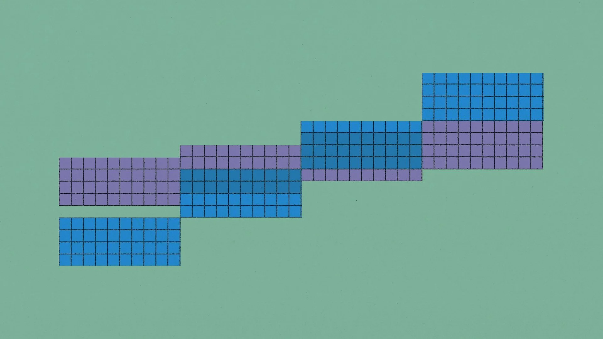
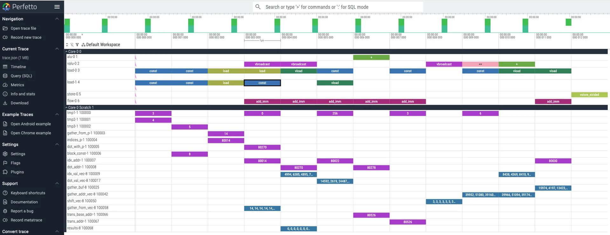
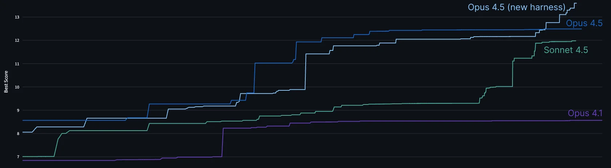

# 设计不易被 AI 攻破的技术考核

- 英文标题：Designing AI-resistant technical evaluations
- 发布日期：2026-01-21
- 官网栏目：工程
- 原文：[Anthropic 页面](https://www.anthropic.com/research/AI-resistant-technical-evaluations)
- 官网署名：Anthropic

> 中文机器初译，未逐篇人工校对。引用研究结论时请核对英文原文。

*由 Anthropic 性能优化团队的负责人 Tristan Hume 撰写。Tristan 设计并重新设计了带回家的测试，帮助 Anthropic 聘请了数十名性能工程师。*

随着人工智能能力的提高，评估技术候选人变得更加困难。今天可以很好区分人类技能水平的结论明天可能会通过模型轻松解决，从而使其对评估毫无用处。

自 2024 年初以来，我们的性能工程团队一直在使用带回家的测试，让候选人优化模拟加速器的代码。超过 1,000 名候选人已经完成了该任务，现在有数十人在这里工作，其中包括开发我们的 Trainium 集群并交付自 Claude 3 Opus 以来所有模型的工程师。

但每一个新的Claude模型都迫使我们重新设计测试。当给定相同的时间限制时，Claude Opus 4 的表现优于大多数人类申请者。这仍然让我们能够区分出最强的候选者，但 Claude Opus 4.5 甚至可以与这些候选者相媲美。在给予无限时间的情况下，人类仍然可以超越模型，但在带回家的测试的限制下，我们不再有办法区分我们最优秀的候选者和我们最有能力的模型的输出。

我现在已经迭代了我们带回家的三个版本，试图确保它仍然带有信号。每一次，我都学到了一些新的东西，了解什么使得评估对于人工智能辅助来说是稳健的，什么不是。

这篇文章描述了最初的带回家的设计，每个Claude模型如何击败它，以及我必须采取的越来越不寻常的方法，以确保我们的测试保持领先于我们顶级模型的能力。虽然我们所做的工作随着模型的发展而发展，但我们仍然需要更强大的工程师——只是用越来越有创意的方式来找到他们。

为此，我们将原始成果作为公开挑战发布，因为在无限的时间内，人类的最佳表现仍然超过了Claude所能达到的水平。如果您能超越 Opus 4.5，我们很乐意听取您的意见 - 详细信息位于本文底部。

## 带回家的起源

2023 年 11 月，我们准备训练并启动 Claude Opus 3。我们已经获得了新的 TPU 和 GPU 集群，我们的大型 Trainium 集群即将到来，我们在加速器上的支出比过去要多得多，但我们没有足够的性能工程师来支持我们的新规模。我 [发布在推特上](https://x.com/trishume/status/1730386529997238605?s=20) 要求人们给我们发电子邮件，这带来了比我们通过标准面试流程评估的更有前途的候选人，这一过程消耗了员工和候选人的大量时间

我们需要一种更有效地评估候选人的方法。因此，我花了两周时间设计了一个带回家的测试，可以充分捕捉该职位的需求并识别最有能力的申请人。

### 设计目标

带回家的名声不好。通常它们充满了工程师觉得无聊的通用问题，并且导致过滤器很差。我的目标不同：创造一些真正有吸引力的东西，让候选人兴奋地参与，并让我们以高清晰度捕捉他们的技术技能。

在评估性能工程技能方面，这种形式还比现场面试具有优势：

**更长的时间范围：** 工程师在编码时很少会遇到少于一小时的最后期限。4 小时的窗口（后来减少到 2 小时）更好地反映了工作的实际性质。它仍然比大多数实际任务要短，但我们需要平衡它与它的繁重程度。

**现实环境：** 没有人观看或期待旁白。候选人可以在自己的编辑器中不受干扰地工作。

**理解和使用工具的时间：** 性能优化需要了解现有系统，有时还需要构建调试工具。在正常的 50 分钟采访中很难对两者进行现实评估。

**与AI辅助的兼容性：** 人择的 [一般候选人指导](https://www.anthropic.com/candidate-ai-guidance) 除非另有说明，否则要求考生在没有人工智能的情况下完成作业。对于这个结论，我们明确指出了其他情况。

人工智能更难完全解决长期问题，因此候选人可以使用人工智能工具（就像在工作中一样），同时仍然需要展示自己的技能。

除了这些特定格式的目标之外，我还应用了设计任何采访时使用的相同原则来获得收获：

**实际作品代表：** 这个问题应该让候选人了解工作实际涉及的内容。

**高信号：** 总结应该避免依赖单一见解的问题，并确保候选人有很多机会展示他们的全部能力——尽可能少地留有机会。它还应该有广泛的评分分布，并确保足够的深度，即使是优秀的候选人也无法完成所有内容。

**没有特定领域知识：** 具有良好基础的人可以了解工作中的细节。要求狭窄的专业知识不必要地限制了候选人库。

**乐趣：** 快速的开发循环、有趣的深度问题以及创造力的空间。

### 模拟机

我为具有类似于 TPU 特性的假加速器构建了一个 Python 模拟器。考生使用热重载优化在本机上运行的代码 [完美](https://perfetto.dev/) 显示每条指令的跟踪，类似于 [我们在 Trainium 上拥有的工具](https://awsdocs-neuron.readthedocs-hosted.com/en/latest/tools/neuron-explorer/overview-device-profiles.html).

该机器包含的功能使加速器优化变得有趣：手动管理的暂存器内存（与 CPU 不同，加速器通常需要显式内存管理）、VLIW（每个周期并行运行的多个执行单元，需要高效的指令打包）、SIMD（每条指令对多个元素进行向量操作）和多核（跨内核分配工作）。

该任务是并行树遍历，故意不采用深度学习风格，因为大多数性能工程师尚未从事深度学习工作，并且可以在工作中学习领域细节。该问题的灵感来自无分支 SIMD 决策树推理，这是一种经典的 ML 优化挑战，是对过去的致敬，之前只有少数候选人遇到过这种情况。

考生从完全串行实现开始，并逐步利用机器的并行性。预热是多核并行，然后考生选择是处理 SIMD 矢量化还是 VLIW 指令打包。原始版本还包含一个错误，考生需要首先调试，锻炼他们构建工具的能力。

## 早期结果

最初的带回家效果很好。Twitter 批次中的一个人的得分远远高于其他人。他于二月初开始工作，距离我们通过标准渠道招聘第一批员工两周后。测试证明是有预测性的：他立即开始优化内核，并找到了解决涉及张量索引数学溢出 32 位的启动阻塞编译器错误的解决方法。

在接下来的一年半时间里，大约 1,000 名候选人完成了结业考试，这帮助我们聘用了目前性能工程团队的大部分成员。事实证明，这对于纸面上经验有限的候选人来说尤其有价值：我们的几位表现最好的工程师直接来自本科生，但在实际操作中表现出了足够的技能，让我们可以自信地聘用他们。

反馈是积极的。许多候选人的工作时间超过了 4 小时，因为他们很享受。最强大的无限时间提交包括完全优化的迷你编译器和一些我没有预料到的巧妙优化。

### 然后Claude Opus 4击败了它

到 2025 年 5 月，Claude 3.7 Sonnet 已经发展到超过 50% 的候选人完全委托给 Claude Code 会更好。然后我在带回家中测试了 Claude Opus 4 的预发布版本。它在 4 小时的限制内想出了比几乎所有人类都更优化的解决方案。

这不是我第一次在面试中被Claude模型击败。我在 2023 年专门设计了一个现场面试问题，因为我们当时的问题是基于早期 Claude 模型拥有大量知识并且可以轻松解决的常见任务。我尝试设计一个需要更多解决问题技能而不是知识的问题，仍然基于我在工作中解决的真实（但小众）问题。Claude 3 Opus 击败了该问题的第 1 部分；Claude 3.5 十四行诗击败第 2 部分。我们仍然使用它，因为我们的其他实时问题也不能抵抗人工智能。

对于带回家来说，有一个简单的解决办法。这个问题的深度远远超过任何人在 4 小时内所能探索的深度，因此我使用 Claude Opus 4 来确定它开始陷入困境的地方。这成为版本 2 的新起点。我编写了更清晰的入门代码，添加了新的机器功能以获得更多深度，并删除了多核（Claude已经解决了这个问题，这只会减慢开发循环而不添加信号）。

我还把时间限制从4小时缩短到2小时。我最初根据候选人的反馈选择了 4 个小时，希望他们在遇到 bug 或混乱时能减少陷入困境的风险，但调度开销导致我们的流程延迟了数周。两个小时更适合周末。

版本 2 强调对调试和代码量的巧妙优化见解。它对我们很有帮助——持续了几个月。

### 然后 Claude Opus 4.5 击败了它

当我测试预发布的 Claude Opus 4.5 检查点时，我观看 Claude Code 处理该问题 2 小时，逐渐改进其解决方案。它解决了最初的瓶颈，实现了所有常见的微观优化，并在一小时内达到了我们的通过门槛。

然后它停了下来，确信它已经遇到了无法克服的内存带宽瓶颈。大多数人都会得出同样的结论。但有一些巧妙的技巧可以利用问题结构来解决该瓶颈。当我告诉Claude可以实现的周期数时，它想了一会儿，找到了窍门。然后进行调试、调整并实施进一步的优化。到 2 小时时，它的得分与人类在该时间限制内的最佳表现相匹配，并且该人类大量使用了 Claude 4 的转向功能。

我们在内部测试时计算工具中对其进行了更严格的测试，并确认它既可以在 2 小时内击败人类，又可以随着时间的推移继续攀爬。发布后，我们甚至以通用方式改进了我们的安全带，并获得了更高的分数。

我有一个问题。我们即将发布一个模型，其中我们带回家的最佳策略将委托给 Claude Code。

## 考虑选项

一些同事建议禁止人工智能援助。我不想这样做。除了执行方面的挑战之外，我有一种感觉，鉴于人们继续在我们的工作中发挥着至关重要的作用，我应该能够弄清楚 *一些* 让他们在某个环境中脱颖而出的方式 *与人工智能——*就像他们在工作中一样。我还不想屈服于 [想法](https://metr.org/blog/2025-03-19-measuring-ai-ability-to-complete-long-tasks/) 人类只有在几个小时以上的任务上才有优势。

其他人则建议提高标准，“远远超过克劳德·科德单独取得的成就”。这里的问题是Claude工作速度很快。在开始优化之前，人们通常会花两个小时的一半时间来阅读和理解问题。试图引导Claude的人很可能会一直落后，只有在事后才了解Claude做了什么。占主导地位的策略可能是袖手旁观。

如今，Anthropic 的性能工程师还有很多工作要做，但看起来更像是艰难的调试、系统设计、性能分析，弄清楚如何验证我们系统的正确性，以及弄清楚如何使 Claude 的代码更简单、更优雅。不幸的是，如果没有大量的时间或共同的背景，这些事情很难以客观的方式进行测试。设计代表该职位的面试一直很困难，但现在比以往任何时候都更难。

但我也担心，如果我投资设计一个新的带回家的东西，要么 Claude Opus 4.5 也能解决这个问题，要么它会变得如此具有挑战性，以至于人类不可能在两个小时内完成。

### 尝试 1：不同的优化问题

我意识到Claude可以帮助我快速实现我的设计，这激励我尝试开发一个更难的带回家的东西。我选择了一个基于我在 Anthropic 所做的更棘手的内核优化之一的问题：高效的数据 [转置](https://en.wikipedia.org/wiki/Transpose) 在 2D TPU 寄存器上，同时避免 [银行冲突](https://feldmann.nyc/blog/smem-microbenchmarks)。我在模拟机器上将其提炼为一个更简单的问题，并让Claude在一天之内实施了这些更改。

Claude Opus 4.5 发现了一个我从未想到过的伟大优化。通过仔细分析，它意识到它可以转置整个计算，而不是弄清楚如何转置数据，并相应地重写了整个程序。

在我的实际情况中，这是行不通的，所以我修复了问题以删除该方法。Claude随后取得了进展，但找不到最有效的解决方案。似乎我遇到了新问题，现在我只能希望人类候选人能够足够快地解决它。但我有一些挥之不去的疑问，所以我使用 Claude Code 的“超思考”功能和更长的思考预算进行了仔细检查……它解决了这个问题。它甚至知道解决银行冲突的技巧。

事后看来，这不是值得尝试的正确问题。许多平台上的工程师都在努力解决数据转置和银行冲突问题，因此 Claude 有大量的培训数据可供利用。虽然我从第一原理中找到了解决方案，但Claude可以利用更大的经验工具箱。

### 尝试2：变得更奇怪

我需要一个人类推理能够赢得Claude更大的经验基础的问题：足够不分布的东西。不幸的是，这与我的目标相冲突，即让自己看起来像这份工作。

我思考了我喜欢并解决的最不寻常的优化问题 [扎克电子游戏](https://www.zachtronics.com/)。这些编程益智游戏使用不寻常的、高度受限的指令集，迫使您以非常规的方式进行编程。例如，在 [深圳I/O](https://www.zachtronics.com/shenzhen-io/)，程序被分割在多个通信芯片上，每个芯片仅包含大约 10 条指令以及一两个状态寄存器。聪明的优化通常涉及将状态编码到指令指针或分支标志中。

我设计了一个新的带回家的游戏，其中包含使用小型且严格受限的指令集的谜题，优化了解决方案以实现最少的指令数量。我实现了一个中等难度的谜题，并在 Claude Opus 4.5 上进行了测试。它失败了。我填写了更多的谜题，并让同事们证实，那些比我更不热衷于这个问题的人仍然可以超越Claude。

与 Zachtronics 游戏不同，我故意不提供可视化或调试工具。起始代码仅检查解决方案是否有效。构建调试工具是正在测试的一部分：您可以插入精心设计的打印语句或要求编码模型在几分钟内生成交互式调试器。关于如何投资工具的判断是信号的一部分。

我对新带回家的东西相当满意。它可能比原始问题具有更低的方差，因为它包含更多独立的子问题。早期结果令人鼓舞：分数与候选人过去的工作水平密切相关，而且我最有能力的同事之一的得分比迄今为止任何候选人都高。

我仍然为放弃原作的现实主义和不同深度而感到难过。但现实主义可能已成为我们不再拥有的奢侈品。原作之所以有效，是因为它类似于真实的作品。替代品之所以有效，是因为它模拟了新颖的工作。

## 公开挑战

我们正在发布原版带回家供任何人无限时间尝试。人类专家 [保持优势](https://metr.org/blog/2025-03-19-measuring-ai-ability-to-complete-long-tasks/) 在足够长的时间范围内超过当前模型。有史以来提交的最快的人类解决方案远远超过了Claude所取得的成就，即使在大量的测试时间计算下也是如此。

发布的版本从头开始（与版本 1 类似），但使用版本 2 的指令集和单核设计，因此周期数与版本 2 相当。

性能基准（以模拟机器的时钟周期为单位进行测量）：

- **2164 周期**：Claude Opus 4 经过数小时的测试时计算工具
- **1790个周期**：休闲 Claude Code 会话中的 Claude Opus 4.5，大约相当于 2 小时内人类的最佳表现
- **1579 周期**：在我们的测试时计算工具中运行 2 小时后的 Claude Opus 4.5
- **1548 周期**：经过 2 个多小时的测试计算后的 Claude Sonnet 4.5
- **1487 周期**：使用安全带 11.5 小时后 Claude Opus 4.5
- **1363 周期**：Claude Opus 4.5 经过多个小时后在改进的测试时间计算工具中

[在 GitHub 上下载](https://github.com/anthropics/original_performance_takehome)。如果您的优化次数低于 1487 个周期，击败了 Claude 在发布时的最佳表现，请给我们发送电子邮件： [绩效招聘@anthropic.com](mailto:performance-recruiting@anthropic.com) 与您的代码和简历。

或者你可以 [通过我们的典型流程申请](https://www.anthropic.com/careers/jobs)，它使用我们（现在）的抗Claude带回家。我们很好奇它能持续多久。
