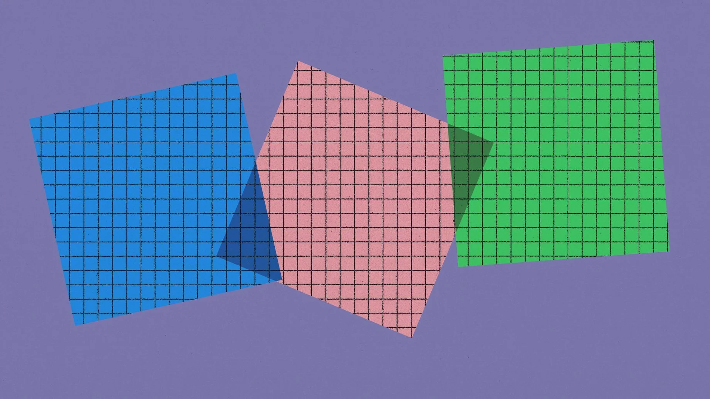
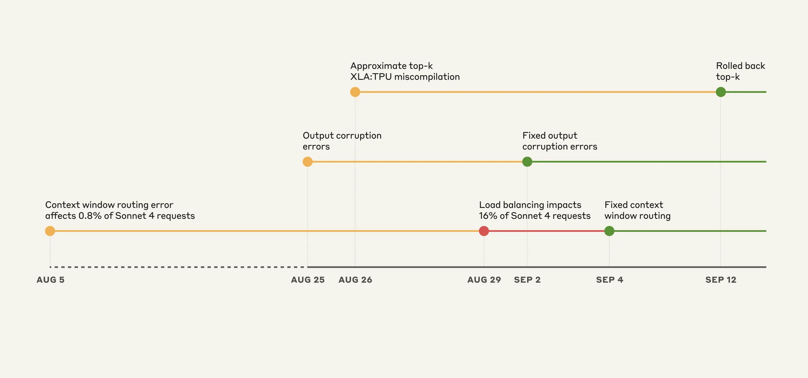
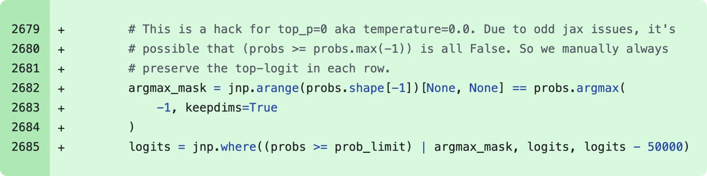
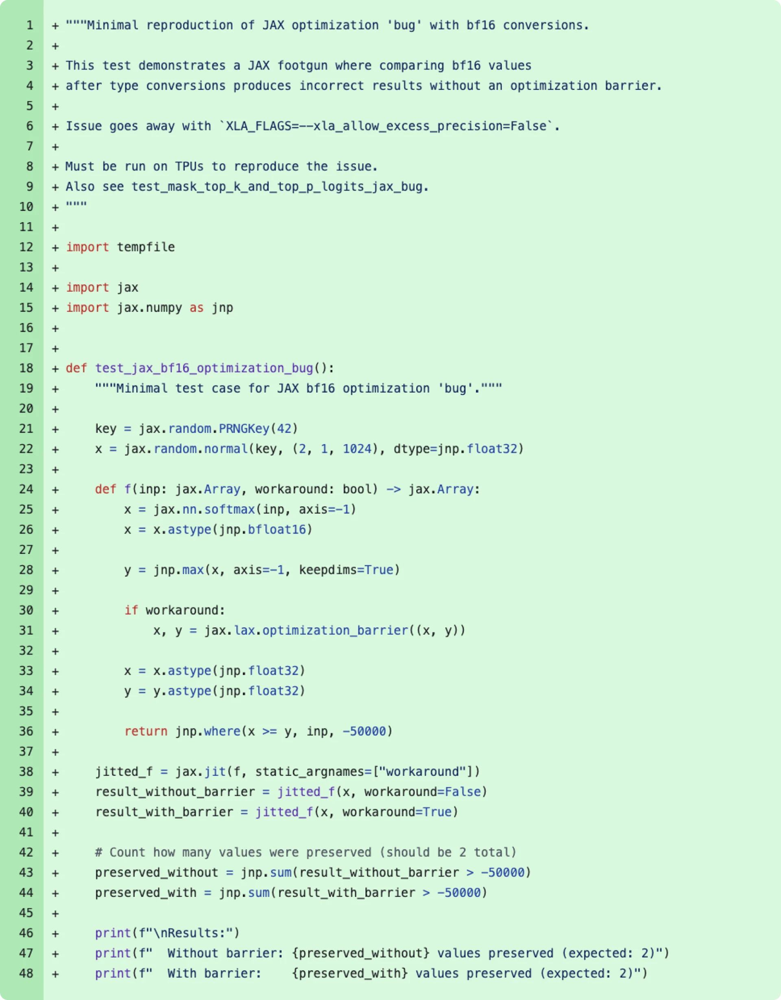
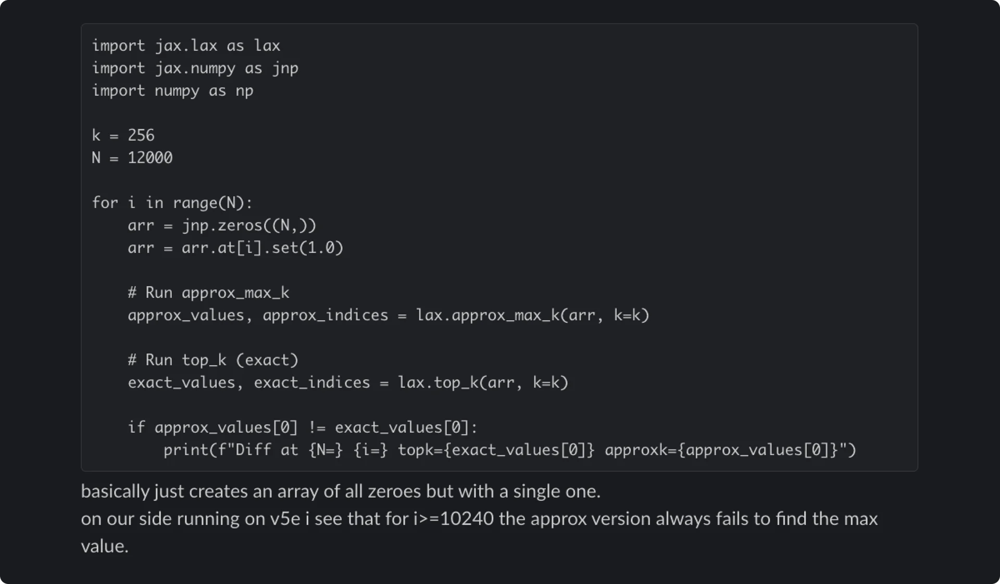

# 近期三个问题的复盘

- 英文标题：A postmortem of three recent issues
- 发布日期：2025-09-17
- 官网栏目：工程
- 原文：[Anthropic 页面](https://www.anthropic.com/research/a-postmortem-of-three-recent-issues)
- 官网署名：Anthropic

> 中文机器初译，未逐篇人工校对。引用研究结论时请核对英文原文。

从 8 月到 9 月初，三个基础设施错误间歇性地降低了 Claude 的响应质量。我们现在已经解决了这些问题，并想解释一下发生了什么。

八月初，一些用户开始报告Claude的反应质量下降。这些初始报告很难与用户反馈的正常变化区分开来。到 8 月底，这些报告的频率和持续性不断增加，促使我们展开调查，发现了三个独立的基础设施错误。

简单地说：我们绝不会因为需求、一天中的时间或服务器负载而降低模型质量。我们的用户报告的问题仅仅是由于基础设施缺陷造成的。

我们认识到用户期望 Claude 提供一致的质量，并且我们保持极高的标准以确保基础设施变化不会影响模型输出。在最近发生的这些事件中，我们没有遇到那个酒吧。以下事后分析解释了出了什么问题、为什么检测和解决问题花费的时间比我们预期的要长，以及我们正在采取哪些更改来防止未来发生类似事件。

我们通常不会分享有关我们的基础设施的这种级别的技术细节，但这些问题的范围和复杂性证明有必要进行更全面的解释。

## 我们如何大规模为Claude提供服务

我们通过我们的第一方 API、Amazon Bedrock 和 Google Cloud 的 Vertex AI 为 Claude 提供服务。我们在多个硬件平台上部署 Claude，即 AWS Trainium、NVIDIA GPU 和 Google TPU。这种方法提供了为全球用户提供服务所需的容量和地理分布。

每个硬件平台都有不同的特性，需要特定的优化。尽管存在这些差异，我们对模型实现有严格的等效标准。我们的目标是，无论哪个平台满足用户的请求，用户都应该得到相同质量的响应。这种复杂性意味着任何基础设施更改都需要跨所有平台和配置进行仔细验证。

## 事件时间表

事件的说明性时间表 **克劳德·阿皮伊**。黄色：检测到问题，红色：性能恶化，绿色：已部署修复。

这些错误的重叠性质使得诊断特别具有挑战性。第一个错误于 8 月 5 日引入，影响了对 Sonnet 4 发出的约 0.8% 的请求。8 月 25 日和 26 日的部署中又出现了两个错误。

尽管最初的影响有限，但 8 月 29 日的负载平衡更改开始增加受影响的流量。这导致更多的用户遇到问题，而其他用户却继续看到正常的性能，从而产生了令人困惑和矛盾的报告。

## 三个重叠的问题

下面我们描述了导致性能下降的三个错误、它们发生的时间以及我们如何解决它们：

### 1.上下文窗口路由错误

8 月 5 日，一些 Sonnet 4 请求被错误路由到为即将到来的 [1M代币](https://docs.claude.com/en/docs/build-with-claude/context-windows#1m-token-context-window) [上下文窗口](https://docs.claude.com/en/docs/build-with-claude/context-windows)。此错误最初影响了 0.8% 的请求。8 月 29 日，例行负载平衡更改无意中增加了路由到 1M 上下文服务器的短上下文请求的数量。在 8 月 31 日受影响最严重的时刻，Sonnet 4 请求的 16% 受到影响。

在此期间发出请求的 Claude Code 用户中，大约 30% 至少有一条消息被路由到错误的服务器类型，从而导致响应质量下降。在 Amazon Bedrock 上，自 8 月 12 日起，错误路由的流量达到峰值，占所有 Sonnet 4 请求的 0.18%。8 月 27 日至 9 月 16 日期间，错误的路由影响了 Google Cloud Vertex AI 上不到 0.0004% 的请求。

然而，一些用户受到的影响更为严重，因为我们的路由是“粘性的”。这意味着一旦请求由错误的服务器提供服务，后续的后续请求很可能由同一个错误的服务器提供服务。

**分辨率：** 我们修复了路由逻辑，以确保短上下文和长上下文请求被定向到正确的服务器池。我们于 9 月 4 日部署了修复程序。我们的第一方平台和 Google Cloud 的 Vertex AI 的部署已于 9 月 16 日完成，AWS Bedrock 的部署则于 9 月 18 日完成。

### 2.输出损坏

8 月 25 日，我们向 Claude API TPU 服务器部署了错误配置，导致令牌生成期间出现错误。由运行时性能优化引起的问题有时会将高概率分配给在给定上下文的情况下很少生成的标记，例如根据英文提示生成泰语或中文字符，或在代码中产生明显的语法错误。例如，一小部分用英语提问的用户可能会在回复的中间看到“สวัสดี”。

这种损坏影响了 8 月 25 日至 28 日向 Opus 4.1 和 Opus 4 发出的请求，以及 8 月 25 日至 9 月 2 日向 Sonnet 4 发出的请求。第三方平台未受此问题影响。

**分辨率：** 我们发现了该问题并于 9 月 2 日回滚了更改。我们在部署过程中添加了针对意外字符输出的检测测试。

### 3.近似 top-k XLA:TPU 错误编译

8 月 25 日，我们部署了代码来改进 Claude 在文本生成过程中选择标记的方式。此更改无意中触发了 XLA:TPU 中的潜在错误1 编译器，已被确认影响对 Claude Haiku 3.5 的请求。

我们还认为这可能会影响 Claude API 上的 Sonnet 4 和 Opus 3 的子集。第三方平台未受此问题影响。

**分辨率：** 我们首先观察到影响 Haiku 3.5 的错误，并于 9 月 4 日将其回滚。我们后来注意到用户报告 Opus 3 存在与此错误兼容的问题，并于 9 月 12 日将其回滚。经过广泛调查后，我们无法在 Sonnet 4 上重现此错误，但出于谨慎考虑，我们决定将其回滚。

同时，我们 (a) 一直在与 XLA:TPU 团队合作修复编译器错误，并 (b) 推出修复程序以使用精确的 top-k 并提高精度。有关详细信息，请参阅下面的深入探讨。

## 仔细看看 XLA 编译器错误

为了说明这些问题的复杂性，以下是 XLA 编译器错误的表现方式以及诊断起来特别困难的原因。

当 Claude 生成文本时，它会计算每个可能的下一个单词的概率，然后从此概率分布中随机选择一个样本。我们使用“top-p 采样”来避免无意义的输出——仅考虑累积概率达到阈值（通常为 0.99 或 0.999）的单词。在 TPU 上，我们的模型跨多个芯片运行，概率计算在不同位置进行。为了对这些概率进行排序，我们需要协调芯片之间的数据，这很复杂。2

2024 年 12 月，我们发现我们的 TPU 实现有时会在以下情况下丢弃最可能的代币： [温度](https://docs.claude.com/en/docs/about-claude/glossary#temperature) 为零。我们部署了一种解决方法来解决此问题。

2024 年 12 月补丁的代码片段，用于解决温度 = 0 时意外丢失令牌的错误。

根本原因涉及混合精度算术。我们的模型计算下一个令牌的概率 [BF16](https://github.com/tensorflow/tensorflow/blob/f41959ccb2d9d4c722fe8fc3351401d53bcf4900/tensorflow/core/framework/bfloat16.h) （16 位浮点）。然而，矢量处理器是 [fp32-本机](https://dl.acm.org/doi/pdf/10.1145/3360307)，因此TPU编译器（XLA）可以通过将一些操作转换为fp32（32位）来优化运行时。此优化过程由 `xla_allow_excess_precision` 标志默认为 true。

这导致了不匹配：本应就最高概率令牌达成一致的操作正在以不同的精度级别运行。精度不匹配意味着他们无法就哪个令牌具有最高概率达成一致。这导致最高概率的令牌有时完全从考虑中消失。

8 月 26 日，我们重写了采样代码，以解决精度问题并改进我们处理达到 top-p 阈值的概率的方式。但在解决这些问题的过程中，我们暴露了一个更棘手的问题。

代码片段显示了作为 8 月 11 日更改的一部分合并的最小化重现器，该更改是导致 2024 年 12 月解决“错误”的根本原因。事实上，这是预期的行为 `xla_allow_excess_precision` 标志。

我们的修复删除了 12 月的解决方法，因为我们相信我们已经解决了根本原因。这导致了更深层次的错误 [近似top-k](https://docs.jax.dev/en/latest/_autosummary/jax.lax.approx_max_k.html) 操作——一种快速找到最高概率标记的性能优化。3 这种近似有时会返回完全错误的结果，但仅限于某些批量大小和模型配置。12 月份的解决方法无意中掩盖了这个问题。

与 XLA:TPU 工程师共享的底层近似 top-k bug 的重现者 [开发了算法](https://arxiv.org/pdf/2206.14286)。该代码在 CPU 上运行时返回正确的结果。

该错误的行为不一致，令人沮丧。它的变化取决于不相关的因素，例如之前或之后运行的操作，以及是否启用了调试工具。相同的提示可能在一个请求上完美运行，但在下一个请求上可能会失败。

在调查过程中，我们还发现确切的 top-k 操作不再像以前那样造成令人望而却步的性能损失。我们从近似切换到精确的 top-k，并对 fp32 精度的一些附加操作进行了标准化。4 模型质量是不容协商的，因此我们接受了较小的效率影响。

## 为什么检测困难

我们的验证过程通常依赖于基准以及安全评估和性能指标。工程团队进行抽查并首先部署到小型“金丝雀”组。

这些问题暴露了我们应该尽早发现的关键差距。我们进行的评估根本没有反映用户报告的性能下降情况，部分原因是Claude经常从孤立的错误中恢复得很好。我们自己的隐私实践也给调查报告带来了挑战。我们的内部隐私和安全控制限制了工程师访问用户与 Claude 交互的方式和时间，特别是当这些交互未作为反馈报告给我们时。这保护了用户隐私，但阻止了工程师检查识别或重现错误所需的有问题的交互。

每个错误在不同平台上以不同的速度产生不同的症状。这造成了令人困惑的混合报告，没有指出任何单一原因。它看起来像是随机的、不一致的退化。

更根本的是，我们过于依赖嘈杂的评估。尽管我们意识到在线报告有所增加，但我们缺乏明确的方法将这些报告与我们最近的每项更改联系起来。当 8 月 29 日负面报告激增时，我们没有立即将其与其他标准负载平衡更改联系起来。

## 我们正在改变什么

随着我们不断改进我们的基础设施，我们也在改进我们在为 Claude 提供服务的所有平台上评估和防止上述错误的方式。以下是我们要更改的内容：

- **更敏感的评估：** 为了帮助发现任何给定问题的根本原因，我们开发了评估方法，可以更可靠地区分正常实施和损坏的实施。我们将不断改进这些评估，以密切关注模型质量。
- **更多地方的质量评价：** 尽管我们对我们的系统进行定期评估，但我们将在真正的生产系统上持续运行它们，以捕获诸如上下文窗口负载平衡错误之类的问题。
- **更快的调试工具：** 我们将开发基础设施和工具，以更好地调试来自社区的反馈，而不牺牲用户隐私。此外，如果将来发生类似事件，这里开发的一些定制工具将用于减少补救时间。

评估和监控很重要。但这些事件表明，当Claude的反应未达到通常的标准时，我们也需要来自用户的持续信号。观察到的特定变化的报告、遇到的意外行为的示例以及不同用例的模式都有助于我们隔离问题。

对于用户继续直接向我们发送反馈仍然特别有帮助。您可以使用 `/bug` Claude Code 中的命令，或者您可以使用 Claude 应用程序中的“拇指向下”按钮来执行此操作。开发人员和研究人员经常创建新的、有趣的方法来评估模型质量，以补充我们的内部测试。如果您想分享您的，请联系 [反馈@anthropic.com](mailto:feedback@anthropic.com).

我们仍然感谢社区做出的这些贡献。
