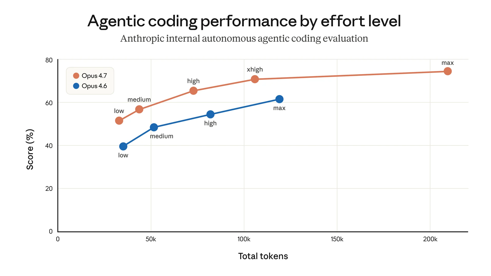
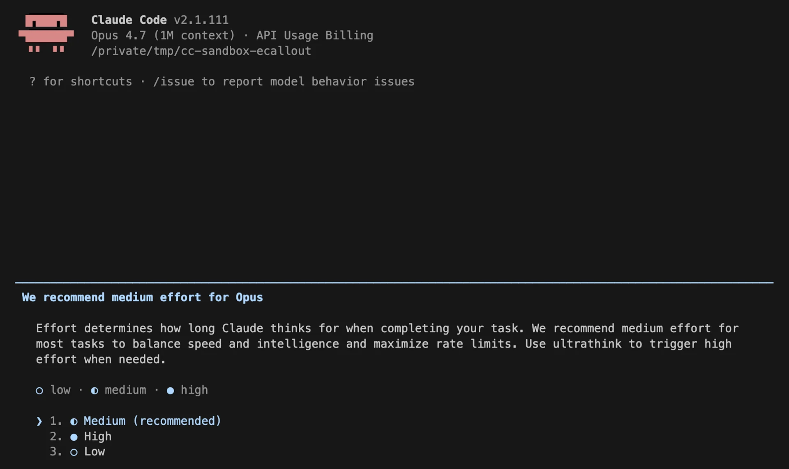
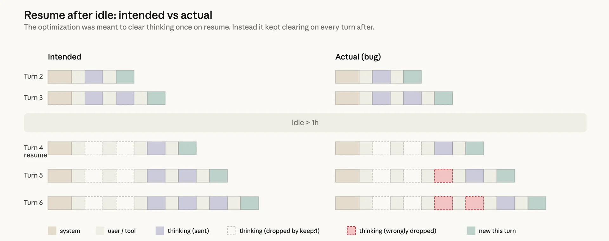

# 关于近期 Claude Code 质量反馈的更新

- 英文标题：An update on recent Claude Code quality reports
- 发布日期：2026-04-23
- 官网栏目：工程
- 原文：[Anthropic 页面](https://www.anthropic.com/research/april-23-postmortem)
- 官网署名：Anthropic

> 中文机器初译，未逐篇人工校对。引用研究结论时请核对英文原文。

在过去的一个月里，我们一直在调查有关Claude对某些用户的反应恶化的报告。我们将这些报告追溯到影响 Claude Code、Claude Agent SDK 和 Claude Cowork 的三个独立更改。API 没有受到影响。

截至 4 月 20 日 (v2.1.116)，所有三个问题均已得到解决。

在这篇文章中，我们将解释我们发现了什么、修复了什么，以及我们将采取哪些不同的措施来确保类似问题不再发生。

我们非常重视有关退化的报告。我们从来没有故意降低我们的模型，并且我们能够立即确认我们的 API 和推理层不受影响。

经过调查，我们发现了三个不同的问题：

1. 3 月 4 日，我们将 Claude Code 的默认推理工作从 `high` 到 `medium` 为了减少很长的延迟（足以使 UI 看起来冻结），一些用户看到 `high` 模式。这是错误的权衡。在用户告诉我们他们更愿意默认更高的智能并选择减少简单任务的工作量之后，我们于 4 月 7 日恢复了这一更改。这影响了 Sonnet 4.6 和 Opus 4.6。
2. 3 月 26 日，我们进行了一项更改，以清除闲置一个多小时的会话中 Claude 的旧想法，以减少用户恢复这些会话时的延迟。一个错误导致这种情况在剩下的比赛中每回合都会发生，而不是只发生一次，这让Claude看起来健忘且重复。我们于 4 月 10 日修复了该问题。这影响了 Sonnet 4.6 和 Opus 4.6。
3. 4 月 16 日，我们添加了系统提示指令以减少冗长。与其他即时更改相结合，它损害了编码质量，并于 4 月 20 日恢复。这影响了 Sonnet 4.6、Opus 4.6 和 Opus 4.7。

由于每次更改都会影响不同时间表的不同流量部分，因此总体影响看起来像是广泛的、不一致的退化。虽然我们在三月初开始调查报告，但一开始很难区分用户反馈中的正常变化，而且我们的内部使用和评估最初都没有重现所发现的问题。

这不是用户应该从 Claude Code 获得的体验。自 4 月 23 日起，我们将重置所有订阅者的使用限制。

## Claude Code 默认推理工作的更改

当我们二月份在 Claude Code 中发布 Opus 4.6 时，我们将默认推理工作设置为 `high`.

不久之后，我们收到用户反馈，称 Claude Opus 4.6 在高工作量模式下偶尔会思考太长时间，导致 UI 显得冻结，并导致这些用户的延迟和令牌使用量不成比例。

一般来说，模型思考的时间越长，输出就越好。工作量级别是 Claude Code 让用户进行权衡的方式 — 更多思考与更低延迟和更少使用限制命中。当我们校准模型的工作量水平时，我们会考虑这种权衡，以便沿着测试时间计算曲线挑选点，为人们提供最佳的选择范围。然后，在产品层中，我们选择将这条曲线上的哪个点设置为默认值，这就是我们发送到消息 API 作为工作量参数的值；然后我们通过以下方式提供其他选项 `/effort`.

在我们的内部评估和测试中，中等努力实现的智能程度稍低，并且大多数任务的延迟显着减少。它也没有遇到同样的问题，即偶尔出现很长的思考尾部延迟，并且它有助于最大限度地提高用户的使用限制。因此，我们推出了一项更改，使媒介成为默认工作，并通过产品内对话框解释了基本原理。

推出后不久，用户开始报告 Claude Code 感觉不太聪明。我们进行了多次设计迭代，使当前的工作量设置更加清晰，以便提醒人们可以更改默认值（启动时的通知、内联工作量选择器和恢复 ultrathink），但大多数用户保留了中等工作量默认值。

在听取了更多客户的反馈后，我们于 4 月 7 日撤销了这一决定。所有用户现在默认为 `xhigh` Opus 4.7 的努力，以及 `high` 所有其他模型的努力。

## 放弃先验推理的缓存优化

当Claude推理一项任务时，该推理通常会保存在对话历史记录中，以便在随后的每个回合中，Claude都可以了解为什么要进行编辑和工具调用。

3 月 26 日，我们发布了旨在提高此功能效率的功能。我们使用提示缓存来使用户的连续 API 调用更便宜、更快。Claude 在发出 API 请求时将输入令牌写入缓存，然后在一段时间不活动后，该提示将从缓存中逐出，为其他提示腾出空间。缓存利用率是我们仔细管理的事情（更多关于我们的 [方法](https://claude.com/blog/lessons-from-building-claude-code-prompt-caching-is-everything)).

设计应该很简单：如果一个会话空闲了一个多小时，我们可以通过清除旧的思维部分来降低用户恢复该会话的成本。由于无论如何该请求都会出现缓存未命中，因此我们可以从请求中删除不必要的消息，以减少发送到 API 的未缓存令牌的数量。然后我们将继续发送完整的推理历史记录。为此，我们使用了 `clear_thinking_20251015` API 标头以及 `keep:1`.

实施有一个错误。它不是一次性清除思维历史，而是在接下来的会议中每次都清除它。会话一旦超过空闲阈值后，该过程其余部分的每个请求都会告诉 API 仅保留最近的推理块并丢弃之前的所有内容。这使得事情变得更加复杂：如果你在Claude正在使用工具时发送了一条后续消息，那么就会在损坏的标志下开始新的回合，所以即使是当前回合的推理也会被放弃。Claude将继续执行，但越来越不记得为什么选择这样做。这表现为人们报告的健忘、重复和奇怪的工具选择。

因为这会不断地从后续请求中删除思考块，所以这些请求也会导致缓存未命中。我们相信，这就是导致使用限制的单独报告比预期消耗得更快的原因。

两个不相关的实验使我们一开始很难重现该问题：一个与消息队列相关的仅限内部的服务器端实验；我们在大多数 CLI 会话中显示思维方式的正交变化抑制了这个错误，所以即使在测试外部构建时我们也没有发现它。

这个错误出现在 Claude Code 的上下文管理、Anthropic API 和扩展思维的交叉点上。它引入的更改使其通过了多次人工和自动代码审查，以及单元测试、端到端测试、自动验证和测试。再加上这种情况仅发生在极端情况（陈旧的会话）中，并且重现该问题的难度很大，我们花了一周多的时间才发现并确认了根本原因。

作为调查的一部分，我们进行了回溯测试 [代码审查](https://code.claude.com/docs/en/code-review) 使用 Opus 4.7 针对有问题的拉取请求。当提供收集完整上下文所需的代码存储库时，Opus 4.7 发现了该错误，而 Opus 4.6 则没有。为了防止这种情况再次发生，我们现在支持额外的存储库作为代码审查的上下文。

我们于 4 月 10 日在 v2.1.101 中修复了此错误。

## 系统提示更改以减少冗长

我们的最新型号 Claude Opus 4.7 相对于其前身有一个显着的行为怪癖：因为我们 [写了关于](https://www.anthropic.com/news/claude-opus-4-7) 在发布时，它往往非常冗长。这使得它在解决难题时变得更加聪明，但它也产生了更多的输出令牌。

在我们发布 Opus 4.7 的几周前，我们开始调整 Claude Code 做准备。每个模型的行为都略有不同，我们在每次发布之前都会花时间优化其线束和产品。

我们有许多工具可以减少冗长的内容：模型训练、提示和改进产品中的思维用户体验。最终我们使用了所有这些，但是系统提示中的一项添加对Claude代码的情报产生了巨大的影响：

> *“长度限制：工具调用之间的文本长度不超过 25 个单词。除非任务需要更多细节，否则最终回复的长度应控制在 ≤100 个字以内。”*

经过数周的内部测试并且我们运行的一组评估没有出现任何回归，我们对这一更改充满信心，并于 4 月 16 日与 Opus 4.7 一起发布。

作为这项调查的一部分，我们使用更广泛的评估集进行了更多的消融（从系统提示中删除行以了解每行的影响）。其中一项评估显示 Opus 4.6 和 4.7 均下降了 3%。作为 4 月 20 日版本的一部分，我们立即恢复了该提示。

## 展望未来

我们将采取不同的措施来避免这些问题：我们将确保更多的内部员工使用 Claude Code 的确切公共版本（而不是我们用来测试新功能的版本）；我们将改进我们的 [代码审查](https://code.claude.com/docs/en/code-review) 我们内部使用的工具，并将此改进版本交付给客户。

我们还对系统提示更改添加了更严格的控制。我们将为Claude代码的每个系统提示更改运行一套广泛的每个模型评估，继续消融以了解每行的影响，并且我们构建了新的工具以使提示更改更容易审查和审计。我们还向 CLAUDE.md 添加了指导，以确保特定于模型的更改与他们所针对的特定模型相关。对于任何可能损害智能的变化，我们将添加浸泡期、更广泛的评估套件和逐步推出，以便我们更早发现问题。

我们最近在 X 上创建了@ClaudeDevs，为我们提供了深入解释产品决策及其背后推理的空间。我们将在 GitHub 上的集中线程中共享相同的更新。

最后，我们要感谢我们的用户：使用 `/feedback` 与我们分享问题的命令（或者在网上发布具体的、可重现的示例）最终让我们能够识别并解决这些问题。今天，我们正在重置所有订阅者的使用限制。

我们非常感谢您的反馈和耐心。
