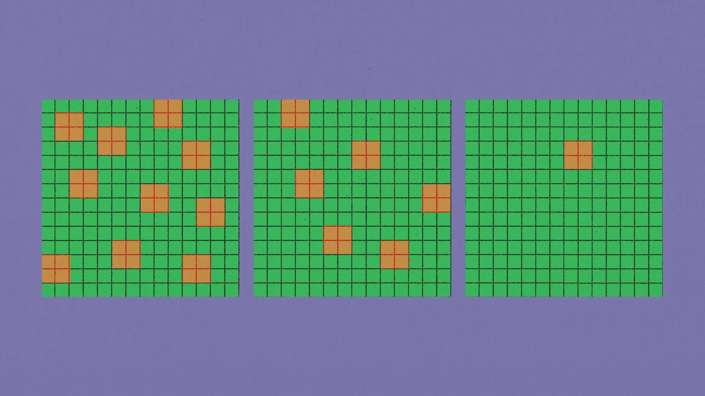
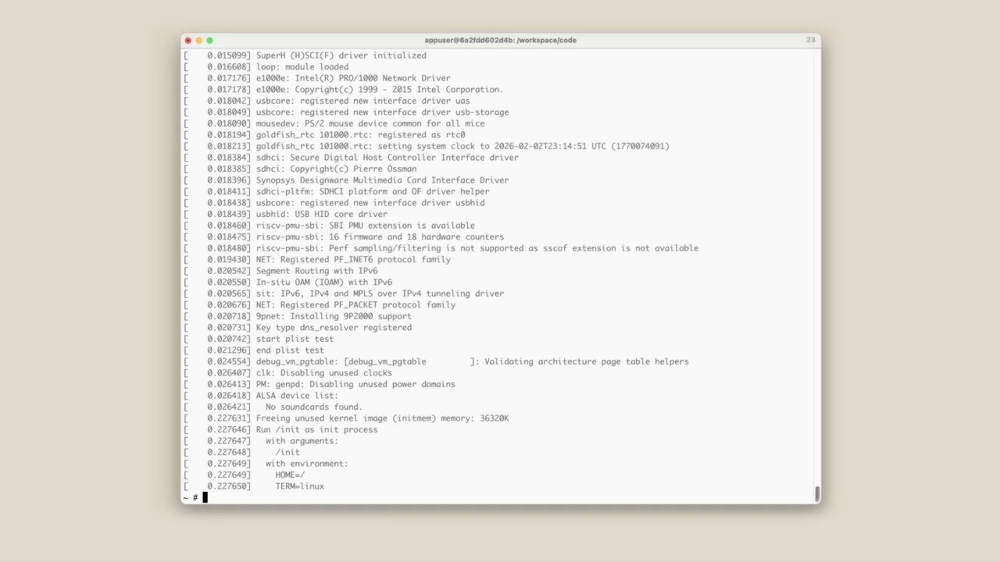

# 让多个 Claude 并行构建 C 编译器

- 英文标题：Building a C compiler with a team of parallel Claudes
- 发布日期：2026-02-05
- 官网栏目：工程
- 原文：[Anthropic 页面](https://www.anthropic.com/research/building-c-compiler)
- 官网署名：Anthropic

> 中文机器初译，未逐篇人工校对。引用研究结论时请核对英文原文。



*由我们保障团队的研究员尼古拉斯·卡利尼 (Nicholas Carlini) 撰写。*

我一直在尝试一种监督语言模型的新方法，我们称之为“代理团队”。

通过代理团队，多个 Claude 实例可以在共享代码库上并行工作，无需主动人工干预。这种方法极大地扩展了 LLM 代理所能实现的范围。

为了对其进行压力测试，我让 16 名特工从头开始编写一个基于 Rust 的 C 编译器，能够编译 Linux 内核。经过近 2,000 个 Claude Code 会话和 20,000 美元的 API 成本，代理团队制作了一个 100,000 行编译器，可以在 x86、ARM 和 RISC-V 上构建 Linux 6.9。



[编译器是一个有趣的神器](https://github.com/anthropics/claudes-c-compiler) 就其本身而言，但我在这里重点介绍我在为长期运行的自主代理团队设计工具方面所学到的知识：如何编写测试以使代理在没有人工监督的情况下保持在正轨上，如何构建工作以便多个代理可以并行取得进展，以及这种方法在哪里达到了上限。

## 启用长时间运行的 Claudes

现有的代理脚手架（例如 Claude Code）需要操作员在线并可以共同工作。如果您要求解决一个漫长而复杂的问题，模型可能会解决其中的一部分，但最终它会停止并等待继续输入 - 问题、状态更新或澄清请求。

为了获得持续、自主的进步，我制作了一个安全带，将Claude固定在一个简单的循环中（如果你见过拉尔夫循环，这应该看起来很熟悉）。当它完成一项任务时，它会立即开始执行下一项任务。 *（在容器中运行它，而不是在您的实际机器中）。*

```
#!/bin/bash

while true; do
    COMMIT=$(git rev-parse --short=6 HEAD)
    LOGFILE="agent_logs/agent_${COMMIT}.log"

    claude --dangerously-skip-permissions \
           -p "$(cat AGENT_PROMPT.md)" \
           --model claude-opus-X-Y &> "$LOGFILE"
done
```

在代理提示中，我告诉 Claude 要解决什么问题，并要求它通过将问题分解为小块来解决问题，跟踪它正在做什么，弄清楚下一步要做什么，并有效地继续下去，直到完美为止。 （对于最后一点，Claude别无选择。这个循环永远持续下去——尽管有一次，我确实看到了Claude `pkill -9 bash` 意外时，从而自杀并结束循环。哎呀！）。

## 并行运行Claude

并行运行多个实例可以解决单代理工具的两个弱点：

- 一个 Claude Code 会话一次只能做一件事。特别是随着项目范围的扩大，并行调试多个问题的效率要高得多。
- 运行多个 Claude 代理可以实现专业化。虽然一些代理的任务是解决手头的实际问题，但可以调用其他专门的代理来（例如）维护文档、关注代码质量或解决专门的子任务。

我对并行 Claude 的实现很简单。创建一个新的裸 git 存储库，并且对于每个代理，都会启动一个 Docker 容器，并将该存储库安装到 `/upstream`。每个代理克隆一个本地副本到 `/workspace`，完成后，从其自己的本地容器推送到上游。

为了防止两个代理尝试同时解决同一问题，该工具使用了一种简单的同步算法：

1. Claude 通过将文本文件写入 current_tasks/ 来“锁定”任务（例如，一个代理可能锁定 current_tasks/parse_if_statement.txt，而另一个代理则锁定 current_tasks/codegen_function_definition.txt）。如果两个代理尝试执行相同的任务，git 的同步会强制第二个代理选择不同的任务。
2. Claude 处理该任务，然后从上游拉取，合并来自其他代理的更改，推送其更改，并删除锁。合并冲突经常发生，但Claude足够聪明，能够解决这一问题。
3. 无限代理生成循环在新容器中生成新的Claude代码会话，然后重复该循环。

这是一个非常早期的研究原型。我还没有实现代理之间的任何其他通信方法，也没有强制执行任何管理高级目标的流程。我不使用编排代理。

相反，我让每个Claude特工决定如何行动。在大多数情况下，Claude都会发现“下一个最明显”的问题。当遇到错误时，Claude 通常会维护一个包含失败方法和剩余任务的运行文档。在 [git 存储库](https://github.com/anthropics/claudes-c-compiler) 在项目中，您可以阅读历史记录并观察它对各种任务的锁定。

## 与 Claude 代理团队一起编程的经验教训

脚手架在循环中运行 Claude，但只有当 Claude 能够告诉如何取得进展时，该循环才有用。我的大部分精力都花在围绕Claude设计环境上——测试、环境、反馈——这样它就可以在没有我的情况下自行定位。我发现这些方法在编排多个 Claude 实例时最有帮助。

### 编写极其高质量的测试

Claude会自主地解决我提出的任何问题。所以任务验证器近乎完美很重要，否则Claude就会解决错误的问题。改进测试工具需要找到高质量的编译器测试套件，为开源软件包编写验证器和构建脚本，并观察 Claude 所犯的错误，然后在识别这些故障模式时设计新的测试。

例如，在项目接近尾声时，Claude开始在每次实现新功能时频繁地破坏现有功能。为了解决这个问题，我构建了一个持续集成管道并实施了更严格的执行，使 Claude 能够更好地测试其工作，以便新的提交不会破坏现有代码。

### 设身处地为Claude着想

我必须不断提醒自己，我是为 Claude 而不是为自己编写这个测试工具，这意味着要重新思考我关于测试应如何传达结果的许多假设。

例如，每个代理都会被放入一个没有上下文的新容器中，并且将花费大量时间进行自我定位，尤其是在大型项目中。在我们进行测试之前，为了帮助 Claude 自助，我提供了维护大量自述文件和进度文件的说明，这些文件应该根据当前状态经常更新。

我还牢记这样一个事实：语言模型具有固有的局限性，在这种情况下，需要围绕这些局限性进行设计。这些包括：

- **上下文窗口污染：** 测试工具不应打印数千个无用的字节。它最多应该打印几行输出并将所有重要信息记录到一个文件中，以便Claude在需要时可以找到它。日志文件应该很容易自动处理：如果有错误，Claude 应该写 ERROR 并将原因放在同一行，以便 grep 找到它。它有助于预先计算汇总汇总统计数据，因此 Claude 无需重新计算它们。
- **时间盲目性：** Claude无法分辨时间，如果独自一人，他会很高兴地花几个小时进行测试，而不是取得进展。该工具很少打印增量进度（以避免污染上下文）并包含默认值 `--fast` 运行 1% 或 10% 随机样本的选项。该子样本对于每个代理来说是确定性的，但在虚拟机之间是随机的，因此 Claude 仍然覆盖所有文件，但每个代理都可以完美地识别回归。

### 让并行变得简单

当有许多不同的失败测试时，并行化就很简单了：每个代理都会选择一个不同的失败测试来处理。测试套件达到 99% 的通过率后，每个代理都致力于编译不同的小型开源项目（例如 SQlite、Redis、libjpeg、MQuickJS、Lua）。

但当特工们开始编译 Linux 内核时，他们陷入了困境。与包含数百个独立测试的测试套件不同，编译 Linux 内核是一项艰巨的任务。每个代理都会遇到相同的错误，修复该错误，然后覆盖彼此的更改。让 16 个代理运行并没有什么帮助，因为每个代理都在解决相同的任务。

修复方法是使用 [海湾合作委员会](https://gcc.gnu.org/) 作为在线已知良好的编译器 oracle 进行比较。我编写了一个新的测试工具，使用 GCC 随机编译大部分内核，并使用 Claude 的 C 编译器仅编译剩余的文件。如果内核工作正常，那么问题就不在Claude的文件子集中。如果它损坏了，那么它可以通过使用 GCC 重新编译其中一些文件来进一步完善。这让每个代理并行工作，修复不同文件中的不同错误，直到Claude的编译器最终可以编译所有文件。 （此操作成功后，仍然需要应用增量调试技术来查找一起失败但独立工作的文件对。）

### 多个代理角色

并行性还可以实现专业化。LLM 编写的代码经常重新实现现有功能，因此我委托一名代理合并其发现的任何重复代码。我让另一个负责提高编译器本身的性能，第三个负责输出高效的编译代码。我请另一位代理从 Rust 开发人员的角度批评项目的设计，并对项目进行结构更改以提高整体代码质量，另一位代理则负责文档工作。

## 压力测试代理团队的极限

该项目被设计为能力基准。我有兴趣对法学硕士的极限进行压力测试 *勉强* 实现今天的目标，以帮助我们为未来可靠实现的模型做好准备。

我一直使用 C 编译器项目作为整个 Claude 4 模型系列的基准。正如我在之前的项目中所做的那样，我首先起草了我想要的东西：一个从头开始优化的编译器，没有依赖项，兼容 GCC，能够编译 Linux 内核，并设计为支持多个后端。虽然我指定了设计的某些方面（例如，它应该具有 SSA IR 以启用多个优化过程），但我没有详细说明如何做到这一点。

之前的 Opus 4 模型几乎无法生成函数式编译器。Opus 4.5 是第一个跨过门槛的版本，它可以生成可以通过大型测试套件的函数式编译器，但它仍然无法编译任何真正的大型项目。我使用 Opus 4.6 的目标是再次测试极限。

### 评价

在两周的近 2,000 个 Claude Code 会话中，Opus 4.6 消耗了 20 亿个输入代币并生成了 1.4 亿个输出代币，总成本略低于 20,000 美元。与最昂贵的克劳德·马克斯计划相比，这是一个极其昂贵的项目。但这个总数只是我自己制作这个所需成本的一小部分——更不用说整个团队了。

这是一个洁净室实施（Claude 在其开发过程中的任何时候都没有互联网接入）；它仅依赖于 Rust 标准库。100,000 行编译器可以在 x86、ARM 和 RISC-V 上构建可启动的 Linux 6.9。它还可以编译 QEMU、FFmpeg、SQlite、postgres、redis，并且在大多数编译器测试套件（包括 [GCC 酷刑测试套件](https://gcc.gnu.org/onlinedocs/gccint/Torture-Tests.html)。它还通过了开发人员的终极试金石：它可以编译并运行 Doom。

然而，编译器并非没有限制。这些包括：

- 它缺少从实模式启动 Linux 所必需的 16 位 x86 编译器。为此，它调用 GCC（x86_32 和 x86_64 编译器是它自己的）。
- 它没有自己的汇编器和链接器；这些是 Claude 开始自动化的最后部分，但仍然存在一些问题。该演示视频是使用 GCC 汇编器和链接器制作的。
- 编译器成功构建了许多项目，但不是全部。它还不是真正编译器的直接替代品。
- 生成的代码效率不是很高。即使启用了所有优化，它输出的代码效率也低于启用所有优化的 GCC *禁用。*
- Rust 代码质量是合理的，但远不及专业 Rust 程序员可能产生的质量。

由此产生的编译器几乎达到了 Opus 能力的极限。我尝试（努力！）解决上述几个限制，但没有完全成功。新功能和错误修复经常会破坏现有功能。

作为一个特别具有挑战性的示例，Opus 无法实现启动至 16 位实模式所需的 16 位 x86 代码生成器。虽然编译器可以通过 66/67 操作码前缀输出正确的 16 位 x86，但生成的编译输出超过 60kb，远远超过 Linux 强制执行的 32k 代码限制。相反，Claude 只是在这里作弊，并在此阶段调用 GCC（仅适用于 x86 的情况）。对于ARM或者RISC-V，Claude的编译器完全可以自己编译。）

的 [编译器的源代码可用](https://github.com/anthropics/claudes-c-compiler)。下载它，通读代码，然后在您最喜欢的 C 项目中尝试它。我一直发现，理解语言模型功能的最佳方法就是将它们推向极限，然后研究它们在哪里开始崩溃。在接下来的几天里，如果您想跟随Claude继续尝试解决这些限制，我将继续让Claude推动新的改变。

## 展望未来

每一代语言模型都开辟了新的使用方式。早期的模型对于 IDE 中的制表符补全很有用。不久之后，模型就可以从其文档字符串完成函数体。Claude Code 的推出将代理带入主流，并使开发人员能够与 Claude 结对编程。但这些产品中的每一个都假设用户定义一个任务，LLM 运行几秒钟或几分钟并返回答案，然后用户提供后续操作。

代理团队展示了自主实施整个复杂项目的可能性。作为这些工具的用户，这使我们能够更加雄心勃勃地实现我们的目标。

我们还处于早期阶段，完全自主的开发会带来真正的风险。当开发人员在开发过程中与 Claude 坐在一起时，他们可以确保一致的质量并实时发现错误。对于自治系统，很容易看到测试通过并假设工作已经完成，但这种情况很少发生。我曾经从事渗透测试工作，利用大公司生产的产品中的漏洞，程序员部署他们从未亲自验证过的软件的想法是一个真正令人担忧的问题。

所以，这个实验虽然让我兴奋，但也让我感到不安。构建这个编译器是我最近最有趣的事情之一，但我没想到这会在 2026 年初实现。语言模型和我们用来与之交互的支架的快速进步为编写大量新代码打开了大门。我预计积极的应用将超过消极的，但我们正在进入一个新世界，这将需要新的策略来安全航行。
