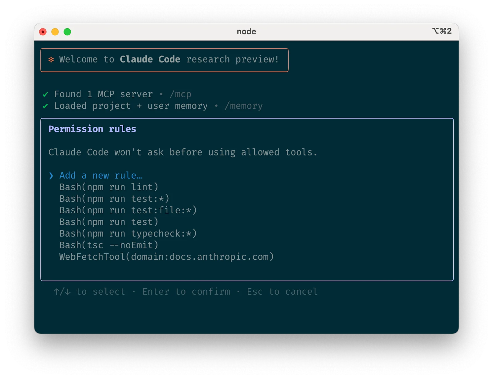
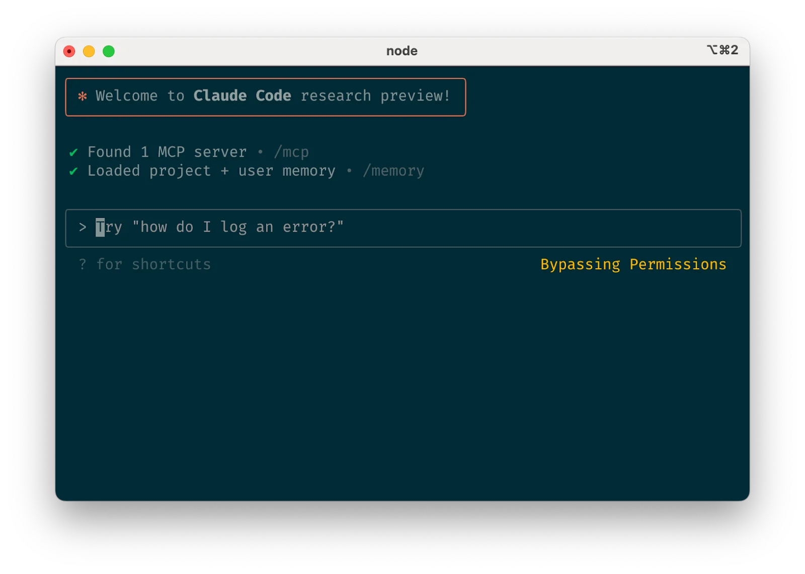
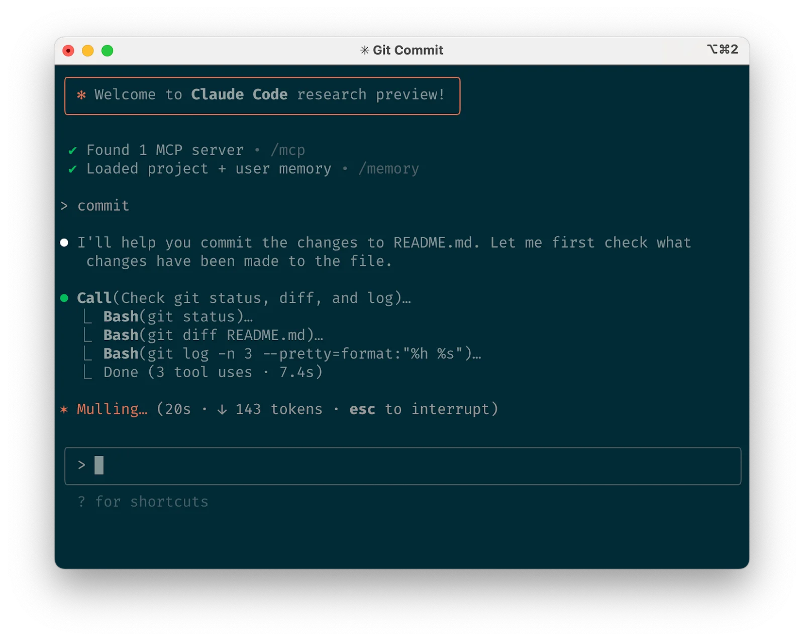
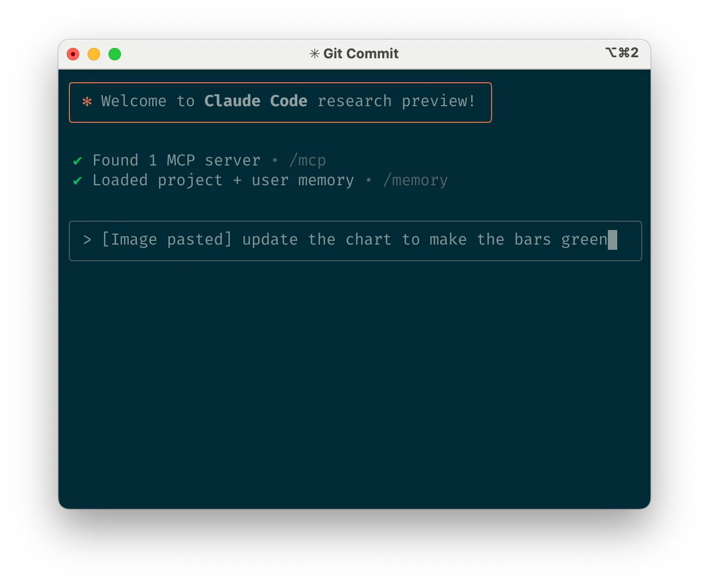
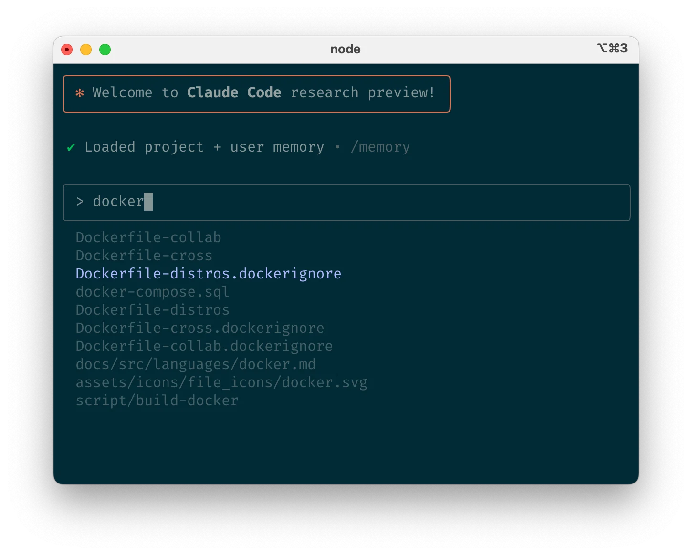
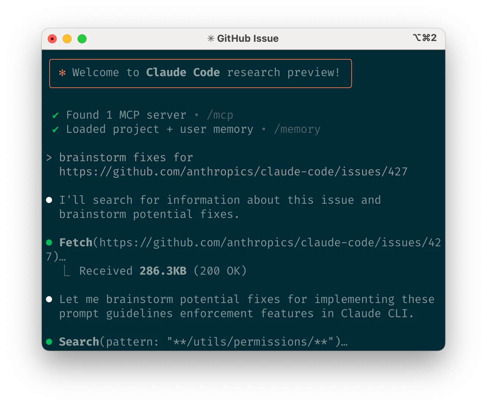

# Claude Code：智能体编程实践

- 英文标题：Claude Code: Best practices for agentic coding
- 发布日期：2025-04-18
- 官网栏目：工程
- 原文：[Anthropic 页面](https://www.anthropic.com/research/claude-code-best-practices)
- 官网署名：Anthropic

> 中文机器初译，未逐篇人工校对。引用研究结论时请核对英文原文。

- 2026 年 1 月 26 日

  ### Claude代码最佳实践已移至文档

  这篇博文不再维护。有关最新的 Claude Code 最佳实践，请参阅官方文档 (https://code.claude.com/docs/en/best-practices)，该文档随着 Claude Code 的发展而不断更新。

---

我们最近 [发布Claude代码](https://www.anthropic.com/news/claude-3-7-sonnet)，用于代理编码的命令行工具。Claude Code 作为一个研究项目开发，为 Anthropic 工程师和研究人员提供了一种更原生的方式将 Claude 集成到他们的编码工作流程中。

Claude Code 故意采用低级别且不带偏见的方式，提供接近原始模型的访问，而不强制执行特定的工作流程。这种设计理念创造了一种灵活、可定制、可编写脚本且安全的电动工具。虽然功能强大，但这种灵活性为刚接触代理编码工具的工程师提供了一个学习曲线——至少在他们开发自己的最佳实践之前是这样。

这篇文章概述了已被证明有效的一般模式，对于 Anthropic 的内部团队和在各种代码库、语言和环境中使用 Claude Code 的外部工程师来说都是有效的。此列表中的任何内容都不是一成不变的，也不是普遍适用的；将这些建议视为起点。我们鼓励您尝试并找到最适合您的方法！

*寻找更详细的信息？我们的综合文档位于 [claude.ai/代码](https://claude.ai/code)* *涵盖了本文中提到的所有功能，并提供了额外的示例、实现细节和高级技术。*

## 1.自定义您的设置

Claude Code 是一个代理编码助手，可以自动将上下文拉入提示中。这种上下文收集会消耗时间和令牌，但您可以通过环境调整来优化它。

### 一个。创建 `CLAUDE.md` 文件

`CLAUDE.md` 是一个特殊文件，Claude在开始对话时自动将其拉入上下文。这使其成为记录文档的理想场所：

- 常见的 bash 命令
- 核心文件和实用函数
- 代码风格指南
- 测试说明
- 存储库礼仪（例如，分支命名、合并与变基等）
- 开发人员环境设置（例如，使用 pyenv、哪些编译器可以工作）
- 项目特有的任何意外行为或警告
- 您希望Claude记住的其他信息

没有要求的格式 `CLAUDE.md` 文件。我们建议保持它们简洁且易于阅读。例如：

```
# Bash commands
- npm run build: Build the project
- npm run typecheck: Run the typechecker

# Code style
- Use ES modules (import/export) syntax, not CommonJS (require)
- Destructure imports when possible (eg. import { foo } from 'bar')

# Workflow
- Be sure to typecheck when you’re done making a series of code changes
- Prefer running single tests, and not the whole test suite, for performance
```

您可以放置 `CLAUDE.md` 文件位于多个位置：

- **你的仓库的根目录**，或者无论你跑到哪里 `claude` 来自（最常见的用法）。命名它 `CLAUDE.md` 并将其签入 git，以便您可以在会话之间以及与您的团队共享它（推荐），或者将其命名 `CLAUDE.local.md` 和 `.gitignore` 它
- **目录的任何父目录** 你跑到哪里 `claude`。这对于 monorepos 最有用，您可以在其中运行 `claude` 来自 `root/foo`，并且有 `CLAUDE.md` 两者中的文件 `root/CLAUDE.md` 和 `root/foo/CLAUDE.md`。这两个都将被自动拉入上下文
- **目录的任何子目录** 你跑到哪里 `claude`。这与上面的相反，在这种情况下，Claude将拉入 `CLAUDE.md` 当您处理子目录中的文件时按需文件
- **您的主文件夹** (`~/.claude/CLAUDE.md`），这适用于你所有的 *Claude* 会议

当你运行 `/init` 命令，Claude会自动生成一个 `CLAUDE.md` 为了你。

### b.调整你的 `CLAUDE.md` 文件

你的 `CLAUDE.md` 文件成为 Claude 提示的一部分，因此它们应该像任何常用提示一样进行完善。一个常见的错误是添加大量内容而不迭代其有效性。花时间进行实验并确定什么可以根据模型产生最佳指令。

您可以将内容添加到您的 `CLAUDE.md` 手动或按 `#` 键给Claude一个指令，它会自动合并到相关的 `CLAUDE.md`。许多工程师使用 `#` 在编码时经常记录命令、文件和风格指南，然后包括 `CLAUDE.md` 承诺的变化使团队成员也受益。

在 Anthropic，我们偶尔会跑步 `CLAUDE.md` 文件通过 [及时改进](https://docs.anthropic.com/en/docs/build-with-claude/prompt-engineering/prompt-improver) 并经常调整说明（例如用“重要”或“你必须”强调）以提高依从性。



### c.管理Claude允许使用的工具列表

默认情况下，Claude Code 请求任何可能修改系统的操作的权限：文件写入、许多 bash 命令、MCP 工具等。我们采用这种刻意保守的方法来设计Claude代码，以优先考虑安全性。您可以自定义白名单以允许您知道安全的其他工具，或允许易于撤消的潜在不安全工具（例如文件编辑、 `git commit`).

有四种方法可以管理允许的工具：

- **选择“始终允许”** 在会话期间出现提示时。
- **使用`/permissions`命令** 启动 Claude Code 以在允许列表中添加或删除工具后。例如，您可以添加 `Edit` 始终允许文件编辑， `Bash(git commit:*)` 允许 git 提交，或者 `mcp__puppeteer__puppeteer_navigate` 允许使用 Puppeteer MCP 服务器进行导航。
- **手动编辑** 你的 `.claude/settings.json` 或 `~/.claude.json` （我们建议将前者检查到源代码管理中以便与您的团队共享）*.*
- **使用 `--allowedTools` CLI 标志** 用于特定于会话的权限。

### d.如果使用 GitHub，请安装 gh CLI

Claude知道如何使用 `gh` CLI 与 GitHub 交互以创建问题、打开拉取请求、阅读评论等。没有 `gh` 安装后，Claude 仍然可以使用 GitHub API 或 MCP 服务器（如果已安装）。

## 2.给Claude更多的工具

Claude 可以访问您的 shell 环境，您可以在其中为其构建一组方便的脚本和函数，就像为自己构建一样。它还可以通过 MCP 和 REST API 利用更复杂的工具。

### 一个。将 Claude 与 bash 工具结合使用

Claude Code 继承您的 bash 环境，使其可以访问您的所有工具。虽然 Claude 了解常见的实用程序，例如 UNIX 工具和 `gh`，如果没有说明，它不会知道您的自定义 bash 工具：

1. 告诉Claude工具名称和使用示例
2. 让Claude跑`--help`查看工具文档
3. 记录常用工具 `CLAUDE.md`

### b.将Claude与 MCP 结合使用

Claude Code 既充当 MCP 服务器又充当客户端。作为客户端，它可以连接到任意数量的 MCP 服务器，以通过三种方式访问其工具：

- **在项目配置中** （在该目录中运行 Claude Code 时可用）
- **在全局配置中** （适用于所有项目）
- **在办理登机手续时 `.mcp.json` 文件** （任何在您的代码库中工作的人都可以使用）。例如，您可以将 Puppeteer 和 Sentry 服务器添加到您的 `.mcp.json`，以便每个处理您的存储库的工程师都可以开箱即用地使用它们。

与 MCP 合作时，启动 Claude 也很有帮助 `--mcp-debug` 标志来帮助识别配置问题。

### c.使用自定义斜杠命令

对于重复的工作流程（调试循环、日志分析等），将提示模板存储在 Markdown 文件中 `.claude/commands` 文件夹。当您键入时，可以通过斜线命令菜单使用这些命令 `/`。您可以将这些命令签入 git，以便团队的其他成员可以使用它们。

自定义斜杠命令可以包含特殊关键字 `$ARGUMENTS` 从命令调用传递参数。

例如，下面是一个斜杠命令，您可以使用它来自动拉取并修复 Github 问题：

```
Please analyze and fix the GitHub issue: $ARGUMENTS.

Follow these steps:

1. Use `gh issue view` to get the issue details
2. Understand the problem described in the issue
3. Search the codebase for relevant files
4. Implement the necessary changes to fix the issue
5. Write and run tests to verify the fix
6. Ensure code passes linting and type checking
7. Create a descriptive commit message
8. Push and create a PR

Remember to use the GitHub CLI (`gh`) for all GitHub-related tasks.
```

将以上内容放入 `.claude/commands/fix-github-issue.md` 使其可用作为 `/project:fix-github-issue` Claude代码中的命令。然后你可以例如使用 `/project:fix-github-issue 1234` 让 Claude 修复问题 #1234。同样，您可以将自己的个人命令添加到`~/.claude/commands` 文件夹中包含您希望在所有会话中可用的命令。

## 3.尝试常见的工作流程

Claude Code 没有强加特定的工作流程，让您可以灵活地按照自己的意愿使用它。在这种灵活性提供的空间内，我们的用户社区中出现了几种有效使用 Claude Code 的成功模式：

### 一个。探索、计划、编码、提交

这种多功能的工作流程可以解决许多问题：

1. **要求 Claude 阅读相关文件、图像或 URL**，提供通用指针（“读取处理日志记录的文件”）或特定文件名（“读取logging.py”），但明确告诉它暂时不要编写任何代码。
   1. 这是工作流程的一部分，您应该考虑大力使用子代理，尤其是对于复杂的问题。告诉 Claude 使用子代理来验证细节或调查可能存在的特定问题，尤其是在对话或任务的早期，往往会保留上下文可用性，而不会在效率损失方面产生太大的负面影响。
2. **要求Claude制定一个如何解决特定问题的计划**。我们建议使用“思考”一词来触发扩展思维模式，这为Claude提供了额外的计算时间来更彻底地评估替代方案。这些特定短语直接映射到系统中不断增加的思维预算水平：“思考”<“认真思考”<“更加努力思考”<“超思考”。每个级别都会分配逐渐更多的思考预算供Claude使用。
   1. 如果此步骤的结果看起来合理，您可以让 Claude 创建一个文档或 GitHub 问题及其计划，以便在实施（步骤 3）不是您想要的情况时您可以重置到此位置。
3. **要求 Claude 用代码实现其解决方案**。这也是要求它在实现解决方案的各个部分时明确验证其解决方案的合理性的好地方。
4. **要求 Claude 提交结果并创建拉取请求**。如果相关的话，这也是让 Claude 更新任何自述文件或变更日志并解释其刚刚所做的事情的好时机。

步骤#1-#2 至关重要——如果没有这些步骤，Claude 往往会直接跳到编写解决方案。虽然有时这就是您想要的，但要求 Claude 首先进行研究和计划可以显着提高需要预先进行更深入思考的问题的性能。

### b.编写测试，提交；编码、迭代、提交

这是人类最喜欢的更改工作流程，可以通过单元、集成或端到端测试轻松验证。通过代理编码，测试驱动开发 (TDD) 变得更加强大：

1. **要求 Claude 根据预期的输入/输出对编写测试**。明确您正在进行测试驱动开发这一事实，以便避免创建模拟实现，即使对于代码库中尚不存在的功能也是如此。
2. **告诉Claude运行测试并确认它们失败**。明确告诉它不要在此阶段编写任何实现代码通常会有所帮助。
3. **要求 Claude 进行测试** 当你对他们感到满意时。
4. **要求 Claude 编写通过测试的代码**，指示它不要修改测试。告诉Claude继续前进，直到所有测试通过。Claude 通常需要几次迭代来编写代码、运行测试、调整代码并再次运行测试。
   1. 在这个阶段，可以要求它与独立的子代理一起验证实施是否过度适合测试
5. **要求 Claude 提交代码** 一旦您对更改感到满意。

当 Claude 有明确的迭代目标（视觉模拟、测试用例或其他类型的输出）时，它会表现最佳。通过提供测试等预期输出，Claude可以做出改变、评估结果并逐步改进，直到成功。

### c.编写代码，截图结果，迭代

与测试工作流程类似，您可以为 Claude 提供视觉目标：

1. **给Claude一个浏览器截图的方法** （例如，与 [Puppeteer MCP 服务器](https://github.com/modelcontextprotocol/servers/tree/c19925b8f0f2815ad72b08d2368f0007c86eb8e6/src/puppeteer), 一个 [iOS模拟器MCP服务器](https://github.com/joshuayoes/ios-simulator-mcp)，或手动将屏幕截图复制/粘贴到 Claude 中）。
2. **给Claude一个视觉模拟** 通过复制/粘贴或拖放图像，或为 Claude 提供图像文件路径。
3. **要求 Claude 实现设计** 在代码中，截取结果的屏幕截图，然后进行迭代，直到其结果与模拟匹配。
4. **要求Claude做出承诺** 当你满意的时候。

与人类一样，Claude的输出往往会随着迭代而显着提高。虽然第一个版本可能不错，但经过​​ 2-3 次迭代后，它通常看起来会好得多。为 Claude 提供工具以查看其输出以获得最佳结果。



### d.安全的YOLO模式

您可以使用 `claude --dangerously-skip-permissions` 绕过所有权限检查，让Claude不间断地工作直到完成。这对于修复 lint 错误或生成样板代码等工作流程非常有效。

让 Claude 运行任意命令是有风险的，可能会导致数据丢失、系统损坏，甚至数据泄露（例如，通过提示注入攻击）。为了最大限度地减少这些风险，请使用 `--dangerously-skip-permissions` 在没有互联网访问的容器中。你可以按照这个 [参考实现](https://github.com/anthropics/claude-code/tree/main/.devcontainer) 使用 Docker 开发容器。

### e.代码库问答

加入新的代码库时，请使用 Claude Code 进行学习和探索。在结对编程时，您可以向 Claude 提出与该项目的其他工程师相同的问题。Claude 可以自动搜索代码库来回答一般问题，例如：

- 日志记录如何工作？
- 如何创建新的 API 端点？
- 什么是 `async move { ... }` 在第 134 行执行 `foo.rs`?
- 边缘情况有什么作用 `CustomerOnboardingFlowImpl` 处理？
- 我们为什么打电话 `foo()` 而不是 `bar()` 333号线？
- 第 334 行相当于什么 `baz.py` 在Java中？

在 Anthropic，以这种方式使用 Claude Code 已成为我们的核心入职工作流程，显着缩短了启动时间并减少了其他工程师的负担。不需要特别提示！只需提出问题，Claude就会探索代码来寻找答案。



### f.使用Claude与git交互

Claude 可以有效地处理许多 git 操作。许多 Anthropic 工程师使用 Claude 完成我们 90% 以上的工作 *git* 互动：

- **搜寻中 *git* 历史** 回答诸如“v1.2.3 进行了哪些更改？”、“谁拥有此特定功能？”或“为什么此 API 如此设计？”等问题它有助于明确提示 Claude 查看 git 历史记录来回答此类查询。
- **编写提交消息**.Claude将自动查看您的更改和最近的历史记录，并考虑所有相关上下文来撰写消息
- **处理复杂的 git 操作** 例如恢复文件、解决变基冲突以及比较和嫁接补丁

### g。使用Claude与GitHub交互

Claude Code 可以管理许多 GitHub 交互：

- **创建拉取请求**：Claude 理解简写“pr”，并将根据差异和周围上下文生成适当的提交消息。
- **实施一次性解决方案** 对于简单的代码审查评论：只需告诉它修复 PR 上的评论（可选地，给它更具体的说明）并在完成后推回到 PR 分支。
- **修复失败的构建** 或 linter 警告
- **对未决问题进行分类和分类** 要求 Claude 循环处理未解决的 GitHub 问题

这消除了记住的需要 `gh` 命令行语法，同时自动执行日常任务。

### h.使用 Claude 处理 Jupyter 笔记本

Anthropic 的研究人员和数据科学家使用 Claude Code 来读写 Jupyter 笔记本。Claude 可以解释输出（包括图像），提供一种快速的方式来探索数据并与数据交互。没有必需的提示或工作流程，但我们建议的工作流程是使用 Claude Code 和 `.ipynb` 在 VS Code 中并排打开文件。

您还可以要求 Claude 清理或改进您的 Jupyter 笔记本，然后再将其展示给同事。具体告诉它让笔记本或其数据可视化“美观”往往有助于提醒它它正在针对人类观看体验进行优化。

## 4.优化您的工作流程

以下建议适用于所有工作流程：

### 一个。请在您的说明中具体说明

通过更具体的说明，Claude Code 的成功率显着提高，尤其是在第一次尝试时。预先给出明确的指示可以减少事后修正路线的需要。

例如：

可怜

好

为 foo.py 添加测试

为 foo.py 编写一个新的测试用例，涵盖用户注销的边缘情况。避免嘲笑

为什么 ExecutionFactory 有这么奇怪的 api？

查看 ExecutionFactory 的 git 历史并总结其 api 是如何形成的

添加日历小部件

看看现有的小部件是如何在主页上实现的，以了解模式，特别是代码和界面是如何分离的。HotDogWidget.php 是一个很好的入门示例。然后，按照该模式实现一个新的日历小部件，该小部件允许用户选择月份并向前/向后分页以选择年份。除了代码库其余部分中已使用的库之外，无需使用任何库从头开始构建。

Claude可以推断意图，但无法读心。特异性可以更好地符合期望。



### b.给Claude图像

Claude擅长通过多种方法处理图像和图表：

- **粘贴截图** （专业提示：点击 *cmd+ctrl+shift+4* 在 macOS 中截图到剪贴板以及 *Ctrl+V* 粘贴。请注意，这不是您通常在 Mac 上粘贴的 cmd+v，并且不能远程工作。）
- **拖放** 图片直接进入提示输入
- **提供文件路径** 对于图像

当使用设计模拟作为 UI 开发的参考点以及用于分析和调试的可视化图表时，这特别有用。如果您没有在上下文中添加视觉效果，那么向 Claude 明确说明结果具有视觉吸引力的重要性仍然会有所帮助。



### c.提及您希望Claude查看或处理的文件

使用制表符补全功能快速引用存储库中任何位置的文件或文件夹，帮助 Claude 查找或更新正确的资源。



### d.给Claude网址

将特定 URL 粘贴到提示旁边，以便 Claude 获取和阅读。要避免相同域（例如 docs.foo.com）的权限提示，请使用`/permissions` 将域添加到您的白名单。

### e.尽早且经常纠正航向

虽然自动接受模式（Shift+Tab 切换）可以让 Claude 自主工作，但通过成为积极的协作者并指导 Claude 的方法，您通常会获得更好的结果。一开始就向Claude彻底解释任务可以获得最好的结果，但你也可以随时纠正Claude。

这四个工具有助于修正方向：

- **请Claude制定计划** 在编码之前。明确告诉它不要编码，直到你确认它的计划看起来不错。
- **按 Esc 键中断** Claude 在任何阶段（思考、工具调用、文件编辑），保留上下文，以便您可以重定向或扩展指令。
- **双击 Escape 可跳回到历史记录**，编辑先前的提示，并探索不同的方向。您可以编辑提示并重复，直到获得所需的结果。
- **要求 Claude 撤消更改**，通常与选项 #2 结合使用以采取不同的方法。

尽管 Claude Code 有时会在第一次尝试时就完美地解决问题，但使用这些校正工具通常会更快地产生更好的解决方案。

### f.使用 `/clear` 保持上下文集中

在长时间会话期间，Claude的上下文窗口可能会充满不相关的对话、文件内容和命令。这会降低性能，有时还会分散Claude的注意力。使用 `/clear` 在任务之间频繁命令以重置上下文窗口。

### g。使用清单和草稿本处理复杂的工作流程

对于具有多个步骤或需要详尽解决方案的大型任务（例如代码迁移、修复大量 lint 错误或运行复杂的构建脚本），可以通过让 Claude 使用 Markdown 文件（甚至 GitHub 问题！）作为清单和工作便笺簿来提高性能：

例如，要修复大量 lint 问题，您可以执行以下操作：

1. **告诉 Claude 运行 lint 命令** 并将所有产生的错误（带有文件名和行号）写入 Markdown 清单
2. **指示Claude一一解决每个问题**，在检查并移至下一个之前进行修复和验证

### h.将数据传递给Claude

有多种方法可以向 Claude 提供数据：

- **复制并粘贴** 直接进入提示（最常见的方法）
- **通过管道输入 Claude 代码** (e.g., `cat foo.txt | claude`)，对于日志、CSV 和大数据特别有用
- **告诉 Claude 提取数据** 通过 bash 命令、MCP 工具或自定义斜杠命令
- **让Claude读文件** 或获取 URL（也适用于图像）

大多数会议都涉及这些方法的组合。例如，您可以通过管道输入日志文件，然后告诉 Claude 使用工具提取其他上下文来调试日志。

## 5.使用无头模式自动化您的基础设施

Claude代码包括 [无头模式](https://docs.anthropic.com/en/docs/agents-and-tools/claude-code/overview#automate-ci-and-infra-workflows) 适用于 CI、预提交挂钩、构建脚本和自动化等非交互式上下文。使用 `-p` 带有启用无头模式提示的标记，以及 `--output-format stream-json` 用于流式 JSON 输出。

请注意，无头模式在会话之间不会持续存在。您必须在每个会话中触发它。

### 一个。使用 Claude 进行问题分类

无头模式可以支持由 GitHub 事件触发的自动化，例如在存储库中创建新问题时。例如，公众 [Claude代码存储库](https://github.com/anthropics/claude-code/blob/main/.github/actions/claude-issue-triage-action/action.yml) 使用 Claude 检查新出现的问题并分配适当的标签。

### b.使用 Claude 作为 linter

Claude代码可以提供 [主观代码审查](https://github.com/anthropics/claude-code-action/blob/main/action.yml) 超越传统 linting 工具检测的范围，识别拼写错误、陈旧注释、误导性函数或变量名称等问题。

## 6.通过多 Claude 工作流程进行升级

除了独立使用之外，一些最强大的应用程序还涉及并行运行多个 Claude 实例：

### 一个。让Claude写代码；使用另一个Claude来验证

一种简单但有效的方法是让一个Claude编写代码，而另一个人检查或测试代码。与与多个工程师合作类似，有时拥有单独的上下文是有益的：

1. 使用Claude写代码
2. 运行 `/clear` 或在另一个终端启动第二个Claude
3. 让第二个Claude回顾一下第一个Claude的作品
4. 开始另一个Claude（或 `/clear` 再次）阅读代码并查看反馈
5. 让Claude根据反馈编辑代码

您可以对测试执行类似的操作：让一个 Claude 编写测试，然后让另一位 Claude 编写代码以使测试通过。您甚至可以让 Claude 实例相互通信，方法是为它们提供单独的工作暂存器并告诉它们要写入哪一个以及从哪一个读取。

这种分离通常比让一个Claude处理所有事情产生更好的结果。

### b.对您的存储库进行多次结账

Anthropic 的许多工程师所做的不是等待 Claude 完成每一步，而是：

1. **创建 3-4 个 git checkout** 在单独的文件夹中
2. **打开各个文件夹** 在单独的终端选项卡中
3. **在每个文件夹中启动Claude** 具有不同的任务
4. **循环浏览** 检查进度并批准/拒绝权限请求

### c.使用 git 工作树

这种方法适用于多个独立任务，为多个结帐提供了更轻量级的替代方案。Git 工作树允许您将同一存储库中的多个分支检出到不同的目录中。每个工作树都有自己的工作目录，其中包含独立的文件，同时共享相同的 Git 历史记录和引用日志。

使用 git worktrees 使您能够在项目的不同部分同时运行多个 Claude 会话，每个会话都专注于自己的独立任务。例如，您可能让一个Claude重构您的身份验证系统，而另一个则构建一个完全不相关的数据可视化组件。由于任务不重叠，每个 Claude 都可以全速工作，无需等待对方的更改或处理合并冲突：

1. **创建工作树**: `git worktree add ../project-feature-a feature-a`
2. **在每个工作树中启动 Claude**: `cd ../project-feature-a && claude`
3. **创建额外的工作树** 根据需要（在新终端选项卡中重复步骤 1-2）

一些提示：

- 使用一致的命名约定
- 每个工作树维护一个终端选项卡
- 如果您在 Mac 上使用 iTerm2， [设置通知](https://docs.anthropic.com/en/docs/agents-and-tools/claude-code/overview#notification-setup) 当Claude需要关注时
- 对不同的工作树使用单独的 IDE 窗口
- 完成后清理： `git worktree remove ../project-feature-a`

### d.使用无头模式与自定义线束

`claude -p` （无头模式）以编程方式将 Claude Code 集成到更大的工作流程中，同时利用其内置工具和系统提示。使用无头模式有两种主要模式：

1. **呈扇形展开** 处理大型迁移或分析（例如，分析数百个日志中的情绪或分析数千个 CSV）：

1. 让Claude编写一个脚本来生成任务列表。例如，生成需要从框架A迁移到框架B的2k文件列表。
2. 循环遍历任务，以编程方式为每个任务调用 Claude，并为其提供一个任务和一组可以使用的工具。例如： `claude -p “migrate foo.py from React to Vue. When you are done, you MUST return the string OK if you succeeded, or FAIL if the task failed.” --allowedTools Edit Bash(git commit:*)`
3. 多次运行脚本并完善提示以获得所需的结果。

2. **流水线** 将 Claude 集成到现有的数据/处理管道中：

1. 致电 `claude -p “<your prompt>” --json | your_command`, 其中 `your_command` 是您处理流程的下一步
2. 就是这样！JSON 输出（可选）可以帮助提供更容易自动化处理的结构。

对于这两种用例，使用 `--verbose` 用于调试 Claude 调用的标志。我们通常建议在生产中关闭详细模式以获得更清晰的输出。

您使用 Claude Code 的技巧和最佳实践是什么？标记@AnthropicAI，以便我们可以看到您正在构建的内容！
