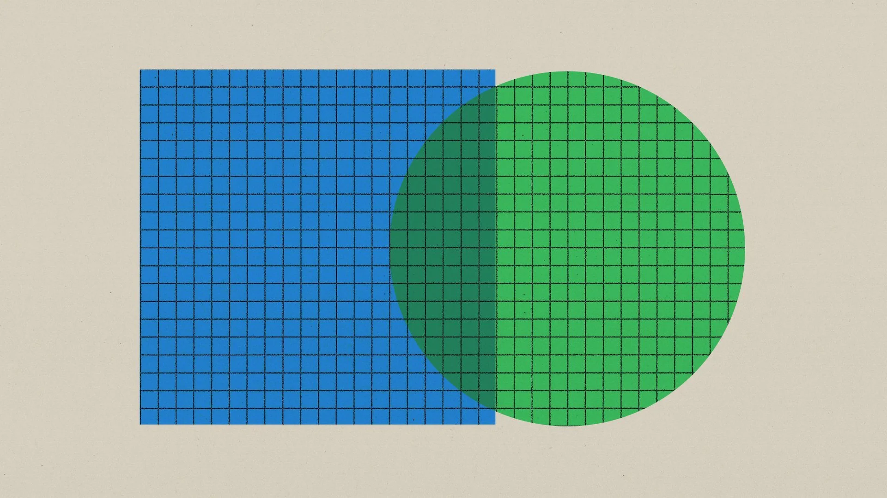
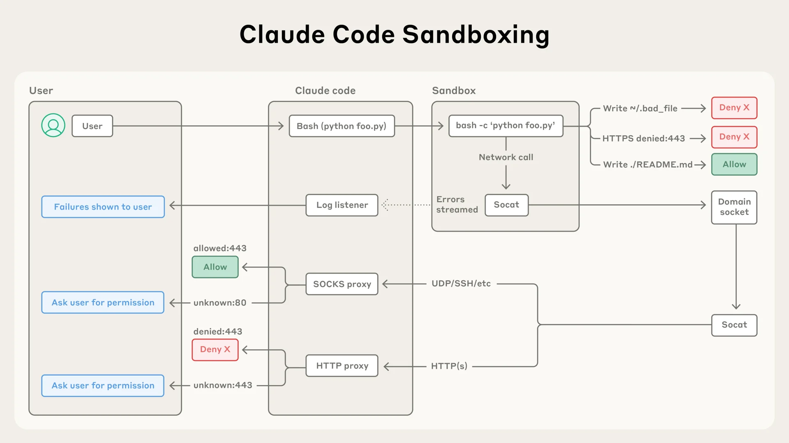
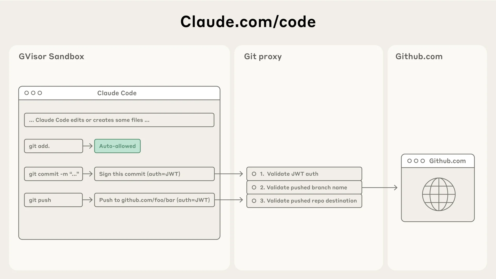

# 超越权限弹窗：让 Claude Code 更安全、更自主

- 英文标题：Beyond permission prompts: making Claude Code more secure and autonomous
- 发布日期：2025-10-20
- 官网栏目：工程
- 原文：[Anthropic 页面](https://www.anthropic.com/research/claude-code-sandboxing)
- 官网署名：Anthropic

> 中文机器初译，未逐篇人工校对。引用研究结论时请核对英文原文。

在 [克劳德·科德](https://www.claude.com/product/claude-code)，Claude 与您一起编写、测试和调试代码，浏览您的代码库，编辑多个文件，并运行命令来验证其工作。为 Claude 提供对代码库和文件的如此多的访问权限可能会带来风险，尤其是在提示注入的情况下。

为了帮助解决这个问题，我们在 Claude Code 中引入了两个基于沙箱构建的新功能，这两个功能都旨在为开发人员提供更安全的工作场所，同时还允许 Claude 更加自主地运行并减少权限提示。在我们的内部使用中，我们发现沙箱可以安全地将权限提示减少 84%。通过定义Claude可以自由工作的界限，他们增加了安全性和代理性。

## 确保用户在 Claude Code 上的安全

Claude Code 在基于权限的模型上运行：默认情况下，它是只读的，这意味着它在进行修改或运行任何命令之前会请求权限。有一些例外：我们自动允许安全命令，如 echo 或 cat，但大多数操作仍然需要明确批准。

不断点击“批准”会减慢开发周期，并可能导致“批准疲劳”，用户可能不会密切关注他们正在批准的内容，进而降低开发的安全性。

为了解决这个问题，我们为 Claude Code 启动了沙箱。

## 沙盒：一种更安全、更自主的方法

沙箱创建了预定义的边界，Claude可以在其中更自由地工作，而不是为每个操作请求许可。启用沙箱后，您获得的权限提示会大大减少，安全性也会提高。

我们的沙箱方法建立在操作系统级功能之上，以实现两个边界：

1. **文件系统隔离**,这确保了Claude只能访问或修改特定的目录。这对于防止提示注入的Claude修改敏感系统文件尤其重要。
2. **网络隔离**,这确保Claude只能连接到批准的服务器。这可以防止提示注入的Claude泄露敏感信息或下载恶意软件。

值得注意的是，有效的沙箱需要 *两者* 文件系统和网络隔离。如果没有网络隔离，受感染的代理可能会泄露 SSH 密钥等敏感文件；如果没有文件系统隔离，受感染的代理可以轻松逃离沙箱并获得网络访问权限。通过使用这两种技术，我们可以为 Claude Code 用户提供更安全、更快速的代理体验。

### Claude Code 中的两个新沙箱功能

#### 沙盒 bash 工具：无需权限提示即可安全执行 bash

我们正在介绍 [新的沙箱运行时](https://docs.claude.com/en/docs/claude-code/sandboxing)，在测试版中作为研究预览提供，它允许您准确定义代理可以访问的目录和网络主机，而无需启动和管理容器的开销。这可用于沙箱任意进程、代理和 MCP 服务器。它也可以作为 [开源研究预览](https://github.com/anthropic-experimental/sandbox-runtime).

在 Claude Code 中，我们使用此运行时来沙箱 bash 工具，这允许 Claude 在您设置的定义限制内运行命令。在安全沙箱内，Claude可以更加自主地运行，安全地执行命令，无需权限提示。如果Claude试图访问某些东西 *外面* 沙箱，您会立即收到通知，并可以选择是否允许。

我们将其构建在操作系统级原语之上，例如 [Linux 气泡膜](https://github.com/containers/bubblewrap) 和 MacOS 安全带，以在操作系统级别强制执行这些限制。它们不仅涵盖 Claude Code 的直接交互，还涵盖由命令生成的任何脚本、程序或子进程。如上所述，此沙箱强制执行以下两项：

1. **文件系统隔离，** 允许对当前工作目录进行读写访问，但阻止修改该目录之外的任何文件。
2. **网络隔离，** 只允许通过连接到沙箱外部运行的代理服务器的 unix 域套接字访问互联网。此代理服务器对进程可以连接到的域实施限制，并处理新请求的域的用户确认。如果您希望进一步提高安全性，我们还支持自定义此代理以对传出流量实施任意规则。

这两个组件都是可配置的：您可以轻松选择允许或禁止特定的文件路径或域。

Claude Code 的沙箱架构将代码执行与文件系统和网络控制隔离，自动允许安全操作，阻止恶意操作，并仅在需要时请求许可。

沙箱确保即使成功的提示注入也是完全隔离的，并且不会影响整体用户安全。这样，受损的 Claude 代码就无法窃取您的 SSH 密钥，也无法通过电话连接到攻击者的服务器。

要开始使用此功能，请在 Claude Code 中运行 /sandbox 并查看 [更多技术细节](https://docs.claude.com/en/docs/claude-code/sandboxing) 关于我们的安全模型。

为了让其他团队更容易构建更安全的代理，我们有 [开源的](https://github.com/anthropic-experimental/sandbox-runtime) 这个功能。我们认为其他人应该考虑为自己的代理采用这项技术，以增强其代理的安全状况。

#### 网络上的 Claude Code：在云中安全地运行 Claude Code

今天我们还发布了 [克劳德·代码在网络上](https://docs.claude.com/en/docs/claude-code/claude-code-on-the-web) 使用户能够在云中的隔离沙箱中运行 Claude Code。网络上的 Claude Code 在隔离的沙箱中执行每个 Claude Code 会话，在沙箱中它可以以安全可靠的方式完全访问其服务器。我们设计这个沙箱是为了确保敏感凭证（例如 git 凭证或签名密钥）永远不会出现在 Claude Code 的沙箱内。这样，即使沙箱中运行的代码受到损害，用户也可以免受进一步的伤害。

网络上的 Claude Code 使用自定义代理服务，透明地处理所有 git 交互。在沙箱内，git 客户端使用自定义的范围凭据对此服务进行身份验证。代理验证此凭证和 git 交互的内容（例如，确保它仅推送到配置的分支），然后在将请求发送到 GitHub 之前附加正确的身份验证令牌。

Claude Code 的 Git 集成通过安全代理路由命令，该代理验证身份验证令牌、分支名称和存储库目标，从而实现安全的版本控制工作流程，同时防止未经授权的推送。

## 开始使用

我们新的沙盒 bash 工具和网络上的 Claude Code 为使用 Claude 进行工程工作的开发人员提供了安全性和生产力方面的重大改进。

要开始使用这些工具：

1. 在 Claude 中运行 `/sandbox` 并查看 [我们的文档](https://docs.claude.com/en/docs/claude-code/sandboxing) 关于如何配置此沙箱。
2. 前往 [claude.com/code](http://claude.ai/code) 在网络上尝试 Claude Code。

或者，如果您正在构建自己的代理，请查看我们的 [开源沙箱代码](https://github.com/anthropic-experimental/sandbox-runtime)，并考虑将其融入到您的工作中。我们期待看到您构建的内容。

要在网络上了解有关Claude代码的更多信息，请查看我们的 [发布博客文章](https://www.anthropic.com/news/claude-code-on-the-web).
