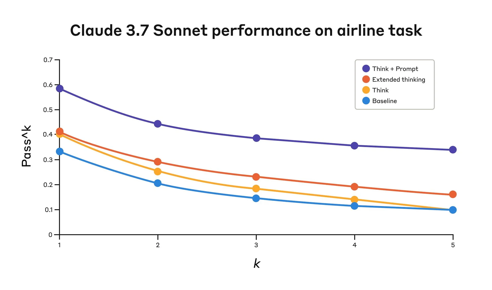
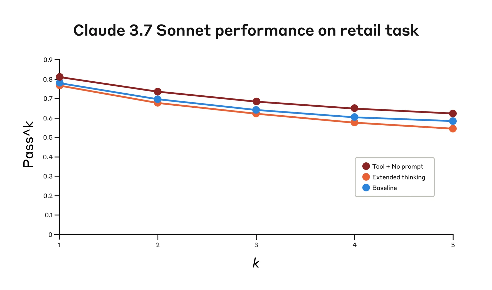

# “思考”工具：让 Claude 在复杂工具调用中暂停思考

- 英文标题：The "think" tool: Enabling Claude to stop and think in complex tool use situations
- 发布日期：2025-03-20
- 官网栏目：工程
- 原文：[Anthropic 页面](https://www.anthropic.com/research/claude-think-tool)
- 官网署名：Anthropic

> 中文机器初译，未逐篇人工校对。引用研究结论时请核对英文原文。

- 2025 年 12 月 15 日

  ### 延伸思维更新

  自最初发布以来，扩展思维功能得到了改进，因此我们建议在大多数情况下使用该功能而不是专用的思维工具。扩展思维提供了类似的好处——为Claude提供推理复杂问题的空间——以及更好的集成和性能。有关实施细节，请参阅我们的扩展思维文档。

---

随着我们不断增强Claude解决复杂问题的能力，我们发现了一种特别有效的方法：一种“思考”工具，可以在复杂任务期间为结构化思维创造专用空间。

这种简单而强大的技术——正如我们将在下面解释的那样，与Claude的新“[延伸思考](https://www.anthropic.com/research/visible-extended-thinking)” 能力（请参阅此处 [延伸思维实施细节](https://platform.claude.com/docs/en/build-with-claude/extended-thinking)）——使得Claude的代理工具使用能力有了显着的提高。这包括遵循策略、做出一致的决策以及处理多步骤问题，所有这些都只需最小的实施开销。

在这篇文章中，我们将探讨如何在不同的应用程序上实施“思考”工具，并根据经过验证的基准测试结果为开发人员分享实用指南。

## 什么是“思考”工具？

通过“思考”工具，我们让 Claude 能够包含一个额外的思考步骤（包括自己指定的空间），作为得出最终答案的一部分。

虽然听起来与扩展思维相似，但这是一个不同的概念。扩展思考是关于Claude在开始产生响应之前所做的事情。Claude深思熟虑，反复思考自己的计划，然后才采取行动。“思考”工具是供Claude使用的，一旦它开始生成响应，就添加一个步骤来停下来思考它是否拥有前进所需的所有信息。这在执行长链工具调用或与用户进行长时间的多步骤对话时特别有用。

这使得“思考”工具更适合 Claude 不具备仅根据用户查询制定响应所需的全部信息以及需要处理外部信息（例如工具调用结果中的信息）的情况。Claude使用“思考”工具进行的推理不如通过扩展思维获得的推理全面，并且更侧重于 *新的* 模型发现的信息。

我们建议对更简单的工具使用场景（例如非顺序工具调用或简单的指令遵循）使用扩展思维。当您不需要 Claude 调用工具时，扩展思维对于编码、数学和物理等用例也很有用。“思考”工具更适合 Claude 需要调用复杂工具、在长链工具调用中仔细分析工具输出、通过详细指南导航政策密集的环境，或者做出顺序决策（其中每个步骤都建立在先前步骤的基础上且错误代价高昂）的情况。

这是使用来自以下标准工具规范格式的示例实现 [τ-工作台](https://arxiv.org/abs/2406.12045):

```
{
  "name": "think",
  "description": "Use the tool to think about something. It will not obtain new information or change the database, but just append the thought to the log. Use it when complex reasoning or some cache memory is needed.",
  "input_schema": {
    "type": "object",
    "properties": {
      "thought": {
        "type": "string",
        "description": "A thought to think about."
      }
    },
    "required": ["thought"]
  }
}
```

## τ-Bench 上的表现

我们使用 τ-bench (tau-bench) 评估“思考”工具，这是一个综合基准测试，旨在测试模型在实际客户服务场景中使用工具的能力，其中“思考”工具是评估标准环境的一部分。

τ-bench 评估 Claude 的能力：

- 与模拟用户进行真实的对话
- 始终遵循复杂的客户服务代理政策指南
- 使用各种工具访问和操作环境数据库

τ-bench 中使用的主要评估指标是 pass^*k*，它衡量所有的概率 *k* 独立任务试验对于给定任务是成功的，对所有任务进行平均。与pass@不同*k* 其他 LLM 评估常见的指标（衡量是否至少有一项 *k* 试验成功），通过^*k* 评估一致性和可靠性，这是客户服务应用程序的关键品质，在这些应用程序中，一致遵守策略至关重要。

### 绩效分析

我们的评估比较了几种不同的配置：

1. 基线（没有“思考”工具，没有扩展的思维模式）
2. 单独扩展思维模式
3. 单独“思考”工具
4. 具有优化提示的“思考”工具（针对航空公司域）

当 Claude 3.7 在基准的“航空公司”和“零售”客户服务领域有效使用“思考”工具时，结果显示出显着的改进：

- **航空公司域名**：带有优化提示的“思考”工具在 pass^1 指标上取得了 0.570 的成绩，而基线的成绩仅为 0.370，相对提高了 54%；
- **零售领域**：仅“思考”工具即可达到 0.812，而基线为 0.783。



Claude 3.7 Sonnet 在四种不同配置下的 Tau-Bench 评估“航空公司”域上的性能。

## Claude 3.7 Sonnet 在 Tau-Bench 评估的“航空公司”域上的表现

配置

*k*=1

*k*=2

*k*=3

*k*=4

*k*=5

“思考”+提示

0.584

0.444

0.384

0.356

0.340

“想”

0.404

0.254

0.186

0.140

0.100

延伸思考

0.412

0.290

0.232

0.192

0.160

基线

0.332

0.206

0.148

0.116

0.100

四种不同配置的评估结果。分数是比例。

航空领域的最佳性能是通过将“思考”工具与优化的提示相结合来实现的，该提示给出了分析客户请求时使用的推理方法类型的示例。下面是优化后的提示示例：

```
## Using the think tool

Before taking any action or responding to the user after receiving tool results, use the think tool as a scratchpad to:
- List the specific rules that apply to the current request
- Check if all required information is collected
- Verify that the planned action complies with all policies
- Iterate over tool results for correctness 

Here are some examples of what to iterate over inside the think tool:
<think_tool_example_1>
User wants to cancel flight ABC123
- Need to verify: user ID, reservation ID, reason
- Check cancellation rules:
  * Is it within 24h of booking?
  * If not, check ticket class and insurance
- Verify no segments flown or are in the past
- Plan: collect missing info, verify rules, get confirmation
</think_tool_example_1>

<think_tool_example_2>
User wants to book 3 tickets to NYC with 2 checked bags each
- Need user ID to check:
  * Membership tier for baggage allowance
  * Which payments methods exist in profile
- Baggage calculation:
  * Economy class × 3 passengers
  * If regular member: 1 free bag each → 3 extra bags = $150
  * If silver member: 2 free bags each → 0 extra bags = $0
  * If gold member: 3 free bags each → 0 extra bags = $0
- Payment rules to verify:
  * Max 1 travel certificate, 1 credit card, 3 gift cards
  * All payment methods must be in profile
  * Travel certificate remainder goes to waste
- Plan:
1. Get user ID
2. Verify membership level for bag fees
3. Check which payment methods in profile and if their combination is allowed
4. Calculate total: ticket price + any bag fees
5. Get explicit confirmation for booking
</think_tool_example_2>
```

特别有趣的是不同方法的比较。使用带有优化提示的“思考”工具比扩展思维模式（显示与无提示“思考”工具相似的性能）取得了明显更好的结果。单独使用“思考”工具（没有提示）可以提高基准性能，但仍然达不到优化方法。

“思考”工具与优化提示的结合以显着的优势提供了最强的性能，这可能是由于问题的高度复杂性 [航空公司政策](https://github.com/sierra-research/tau-bench/blob/main/tau_bench/envs/airline/wiki.md) 基准测试的一部分，其中模型从如何“思考”的示例中获益最多。

在零售领域，我们还测试了各种配置，以了解每种方法的具体影响



在三种不同配置下，Claude 3.7 Sonnet 在 Tau-Bench 评估的“零售”域上的性能。

## Claude 3.7 Sonnet 在 Tau-Bench 评估“零售”领域的表现

配置

*k*=1

*k*=2

*k*=3

*k*=4

*k*=5

“思考”+无提示

0.812

0.735

0.685

0.650

0.626

延伸思考

0.770

0.681

0.623

0.581

0.548

基线

0.783

0.695

0.643

0.607

0.583

三种不同配置的评估结果。分数是比例。

即使没有额外提示，“思考”工具也获得了 0.812 的最高通过^1 分数。的 [零售政策](https://github.com/sierra-research/tau-bench/blob/main/tau_bench/envs/retail/wiki.md) 与航空公司领域相比，导航明显更容易，Claude仅通过拥有思考空间而无需进一步指导就能够进行改进。

### τ-基准分析的主要见解

我们的详细分析揭示了几种可以帮助您有效实施“思考”工具的模式：

1. **在困难领域显着提示问题**。简单地提供“思考”工具可能会在一定程度上提高性能，但将其与优化的提示相结合可以为困难的领域带来更好的结果。然而，简单的领域可能会受益于简单的“思考”。
2. **提高试验的一致性**。使用“think”的改进在 pass^k 到 k=5 的范围内保持不变，这表明该工具帮助 Claude 更有效地处理边缘情况和异常场景。

## SWE-Bench 上的性能

在评估 Claude 3.7 Sonnet 时，我们的 SWE 基准设置中添加了类似的“思考”工具，从而获得了 0.623 的最先进分数。改编后的“思考”工具定义如下：

```
{
  "name": "think",
  "description": "Use the tool to think about something. It will not obtain new information or make any changes to the repository, but just log the thought. Use it when complex reasoning or brainstorming is needed. For example, if you explore the repo and discover the source of a bug, call this tool to brainstorm several unique ways of fixing the bug, and assess which change(s) are likely to be simplest and most effective. Alternatively, if you receive some test results, call this tool to brainstorm ways to fix the failing tests.",
  "input_schema": {
    "type": "object",
    "properties": {
      "thought": {
        "type": "string",
        "description": "Your thoughts."
      }
    },
    "required": ["thought"]
  }
}
```

我们的实验（*n*=30 个带有“思考”工具的样本， *n*=144 个样本（没有）显示包含此工具的孤立效果平均将性能提高 1.6%（Welch 的 *t*-测试： *t*(38.89) = 6.71, *p* < .001, *d* = 1.47).

## 何时使用“思考”工具

根据这些评估结果，我们确定了Claude从“思考”工具中获益最多的特定场景：

1. **工具输出分析。** 当 Claude 需要在采取行动之前仔细处理先前工具调用的输出并且可能需要回溯其方法时；
2. **政策密集的环境**。当Claude需要遵循详细的指导方针并验证合规性时；和
3. **顺序决策**。当每个操作都建立在之前的操作之上时，错误的代价就会很高（通常出现在多步骤域中）。

## 实施最佳实践

为了充分利用 Claude 的“思考”工具，我们基于 τ 台实验推荐以下实施实践。

### 1.通过特定领域的示例进行战略提示

最有效的方法是提供关于何时以及如何使用“思考”工具的明确说明，例如用于 τ-bench 航空公司领域的工具。提供针对您的特定用例量身定制的示例可显着提高模型使用“思考”工具的效率：

- 推理过程中预期的详细程度；
- 如何将复杂的指令分解为可操作的步骤；
- 用于处理常见场景的决策树；和
- 如何检查是否已收集所有必要的信息。

### 2.在系统提示中放置复杂的指导

我们发现，当它们很长和/或很复杂时，在系统提示中包含有关“思考”工具的说明比将它们放在工具描述本身中更有效。这种方法提供了更广泛的背景，并帮助模型更好地将思维过程整合到其整体行为中。

## 当 *不* 使用“思考”工具

尽管“思考”工具可以提供实质性改进，但它并不适用于所有工具用例，并且确实以增加提示长度和输出标记为代价。具体来说，我们发现“思考”工具在以下用例中没有提供任何改进：

1. **非顺序工具调用**。如果Claude只需要进行单个工具调用或多个并行调用来完成一项任务，那么添加“思考”不太可能带来任何改进。
2. **简单说明如下**。当Claude需要遵守的约束不多，并且其默认行为足够好时，额外的“思考”不太可能带来收益。

## 开始使用

“思考”工具是对 Claude 实施的直接补充，只需几个步骤即可产生有意义的改进：

1. **使用代理工具使用场景进行测试。** 从具有挑战性的用例开始——Claude 目前在长工具调用链中难以满足策略合规性或复杂推理的用例。
2. **添加工具定义**。实施针对您的领域定制的“思考”工具。它需要最少的代码，但可以实现更结构化的推理。还可以考虑在系统提示中包含有关何时以及如何使用该工具的说明，以及与您的域相关的示例。
3. **监控和完善**。观看Claude如何在实践中使用该工具，并调整您的提示以鼓励更有效的思维模式。

最好的部分是，添加此工具对性能结果的影响最小。除非 Claude 决定使用它，否则它不会改变外部行为，并且不会干扰您现有的工具或工作流程。

## 结论

我们的研究表明，“思考”工具可以显着提高 Claude 3.7 Sonnet 的性能[1](https://www.anthropic.com/research/claude-think-tool#footnote-1) 需要在长链工具调用中遵守策略和推理的复杂任务。“思考”并不是一种万能的解决方案，但它为正确的用例提供了巨大的好处，并且实现复杂度最低。

我们期待看到您如何使用“思考”工具与 Claude 一起构建更强大、更可靠、更透明的人工智能系统。

## 脚注

01虽然我们的 τ-Bench 结果侧重于使用“思考”工具改进 Claude 3.7 Sonnet，但我们的实验表明 Claude 3.5 Sonnet（新）也能够通过与 3.7 Sonnet 相同的配置实现性能提升，这表明这种改进也适用于其他 Claude 模型。
