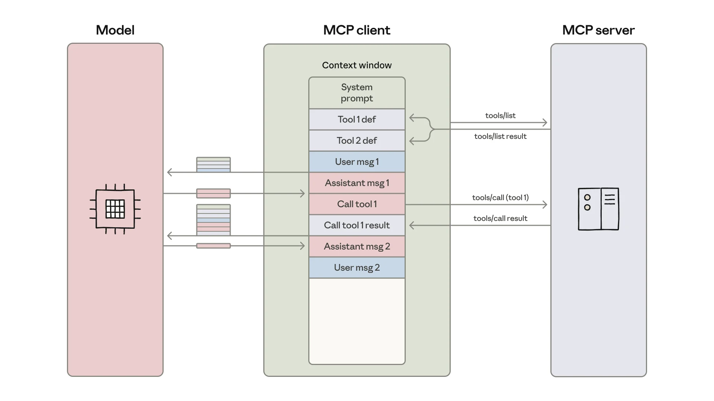

# 通过 MCP 执行代码：构建更高效的智能体

- 英文标题：Code execution with MCP: Building more efficient agents
- 发布日期：2025-11-04
- 官网栏目：工程
- 原文：[Anthropic 页面](https://www.anthropic.com/research/code-execution-with-mcp)
- 官网署名：Anthropic

> 中文机器初译，未逐篇人工校对。引用研究结论时请核对英文原文。


[模型上下文协议 (MCP)](https://modelcontextprotocol.io/) 是将AI 智能体连接到外部系统的开放标准。传统上，将代理连接到工具和数据需要为每个配对进行自定义集成，从而产生碎片和重复工作，从而难以扩展真正连接的系统。MCP 提供了一个通用协议——开发人员在其代理中实施 MCP 一次，即可解锁整个集成生态系统。

自 2024 年 11 月推出 MCP 以来，采用速度很快：社区已经建立了数千个 [MCP服务器](https://github.com/modelcontextprotocol/servers), [软件开发工具包](https://modelcontextprotocol.io/docs/sdk) 适用于所有主要编程语言，业界已采用 MCP 作为将代理连接到工具和数据的事实上的标准。

如今，开发人员通常会构建能够访问数十个 MCP 服务器上的数百或数千种工具的代理。然而，随着连接工具数量的增长，预先加载所有工具定义并通过上下文窗口传递中间结果会减慢代理速度并增加成本。

在本博客中，我们将探讨代码执行如何使代理能够更有效地与 MCP 服务器交互，在使用更少令牌的同时处理更多工具。

## 工具过度消耗代币会导致代理效率降低

随着 MCP 使用规模的扩大，有两种常见模式可能会增加代理成本和延迟：

1. 工具定义使上下文窗口过载；
2. 中间工具结果消耗额外的令牌。

### 1.工具定义使上下文窗口过载

大多数 MCP 客户端将所有工具定义直接加载到上下文中，使用直接工具调用语法将它们暴露给模型。这些工具定义可能如下所示：

```
gdrive.getDocument
     Description: Retrieves a document from Google Drive
     Parameters:
                documentId (required, string): The ID of the document to retrieve
                fields (optional, string): Specific fields to return
     Returns: Document object with title, body content, metadata, permissions, etc.
```

```
salesforce.updateRecord
    Description: Updates a record in Salesforce
    Parameters:
               objectType (required, string): Type of Salesforce object (Lead, Contact,      Account, etc.)
               recordId (required, string): The ID of the record to update
               data (required, object): Fields to update with their new values
     Returns: Updated record object with confirmation
```

工具描述占用更多上下文窗口空间，增加响应时间和成本。如果代理连接到数千个工具，他们在读取请求之前需要处理数十万个令牌。

### 2.中间工具结果消耗额外的代币

大多数MCP客户端允许模型直接调用MCP工具。例如，您可能会询问您的代理：“从 Google 云端硬盘下载我的会议记录并将其附加给 Salesforce 领导。”

该模型将进行如下调用：

```
TOOL CALL: gdrive.getDocument(documentId: "abc123")
        → returns "Discussed Q4 goals...\n[full transcript text]"
           (loaded into model context)

TOOL CALL: salesforce.updateRecord(
			objectType: "SalesMeeting",
			recordId: "00Q5f000001abcXYZ",
  			data: { "Notes": "Discussed Q4 goals...\n[full transcript text written out]" }
		)
		(model needs to write entire transcript into context again)
```

每个中间结果都必须经过模型。在此示例中，完整的通话记录经过两次。对于 2 小时的销售会议，这可能意味着额外处理 50,000 个代币。即使更大的文档也可能超出上下文窗口限制，从而破坏工作流程。

对于大型文档或复杂的数据结构，模型在工具调用之间复制数据时可能更容易出错。



MCP 客户端将工具定义加载到模型的上下文窗口中，并编排一个消息循环，其中每个工具调用和结果在操作之间通过模型传递。

## 使用 MCP 执行代码可提高上下文效率

随着代码执行环境对于代理来说变得越来越普遍，解决方案是将 MCP 服务器呈现为代码 API，而不是直接工具调用。然后，代理可以编写代码来与 MCP 服务器交互。这种方法解决了这两个挑战：代理只能加载他们需要的工具，并在将结果传递回模型之前在执行环境中处理数据。

有多种方法可以做到这一点。一种方法是从连接的 MCP 服务器生成所有可用工具的文件树。这是使用 TypeScript 的实现：

```
servers
├── google-drive
│   ├── getDocument.ts
│   ├── ... (other tools)
│   └── index.ts
├── salesforce
│   ├── updateRecord.ts
│   ├── ... (other tools)
│   └── index.ts
└── ... (other servers)
```

那么每个工具对应一个文件，类似于：

```
// ./servers/google-drive/getDocument.ts
import { callMCPTool } from "../../../client.js";

interface GetDocumentInput {
  documentId: string;
}

interface GetDocumentResponse {
  content: string;
}

/* Read a document from Google Drive */
export async function getDocument(input: GetDocumentInput): Promise<GetDocumentResponse> {
  return callMCPTool<GetDocumentResponse>('google_drive__get_document', input);
}
```

我们上面的 Google Drive 到 Salesforce 示例变成了代码：

```
// Read transcript from Google Docs and add to Salesforce prospect
import * as gdrive from './servers/google-drive';
import * as salesforce from './servers/salesforce';

const transcript = (await gdrive.getDocument({ documentId: 'abc123' })).content;
await salesforce.updateRecord({
  objectType: 'SalesMeeting',
  recordId: '00Q5f000001abcXYZ',
  data: { Notes: transcript }
});
```

代理通过探索文件系统来发现工具：列出 `./servers/` 目录来查找可用服务器（例如 `google-drive` 和 `salesforce`），然后读取它需要的特定工具文件（例如 `getDocument.ts` 和 `updateRecord.ts`）了解每个工具的界面。这使得代理仅加载当前任务所需的定义。这将代币使用量从 150,000 个代币减少到 2,000 个代币 — 节省了 98.7% 的时间和成本**.**

云耀 [发表了类似的发现](https://blog.cloudflare.com/code-mode/)，将 MCP 的代码执行称为“代码模式”。核心见解是相同的：LLM 擅长编写代码，开发人员应该利用这一优势来构建能够更有效地与 MCP 服务器交互的代理。

## 使用 MCP 执行代码的好处

使用 MCP 执行代码使代理能够通过按需加载工具、在数据到达模型之前过滤数据以及在一个步骤中执行复杂的逻辑来更有效地使用上下文。使用这种方法还具有安全性和状态管理优势。

### 渐进式披露

模型非常擅长导航文件系统。将工具呈现为文件系统上的代码允许模型按需读取工具定义，而不是预先读取它们。

或者，一个 `search_tools` 可以在服务器中添加工具来查找相关定义。例如，当使用上面使用的假设 Salesforce 服务器时，代理会搜索“salesforce”并仅加载当前任务所需的工具。在中包含详细级别参数 `search_tools` 该工具允许代理选择所需的详细程度（例如仅名称、名称和描述或带有模式的完整定义），还可以帮助代理保存上下文并有效地查找工具。

### 上下文有效的工具结果

在处理大型数据集时，代理可以在返回结果之前过滤和转换代码中的结果。考虑获取一个 10,000 行的电子表格：

```
// Without code execution - all rows flow through context
TOOL CALL: gdrive.getSheet(sheetId: 'abc123')
        → returns 10,000 rows in context to filter manually

// With code execution - filter in the execution environment
const allRows = await gdrive.getSheet({ sheetId: 'abc123' });
const pendingOrders = allRows.filter(row => 
  row["Status"] === 'pending'
);
console.log(`Found ${pendingOrders.length} pending orders`);
console.log(pendingOrders.slice(0, 5)); // Only log first 5 for review
```

代理看到的是 5 行而不是 10,000 行。类似的模式适用于聚合、跨多个数据源的联接或提取特定字段，所有这些都不会使上下文窗口膨胀。

#### 更强大且上下文高效的控制流

循环、条件和错误处理可以使用熟悉的代码模式来完成，而不是链接单个工具调用。例如，如果您需要 Slack 中的部署通知，代理可以编写：

```
let found = false;
while (!found) {
  const messages = await slack.getChannelHistory({ channel: 'C123456' });
  found = messages.some(m => m.text.includes('deployment complete'));
  if (!found) await new Promise(r => setTimeout(r, 5000));
}
console.log('Deployment notification received');
```

这种方法比通过代理循环在 MCP 工具调用和睡眠命令之间交替进行更有效。

此外，能够写出执行的条件树还可以节省“第一个令牌的时间”延迟：代理可以让代码执行环境执行此操作，而不必等待模型评估 if 语句。

### 隐私保护操作

当代理使用 MCP 执行代码时，中间结果默认保留在执行环境中。这样，代理只能看到您显式记录或返回的内容，这意味着您不希望与模型共享的数据可以流经您的工作流程，而无需进入模型的上下文。

对于更敏感的工作负载，代理工具可以自动标记敏感数据。例如，假设您需要将客户联系详细信息从电子表格导入 Salesforce。代理人写道：

```
const sheet = await gdrive.getSheet({ sheetId: 'abc123' });
for (const row of sheet.rows) {
  await salesforce.updateRecord({
    objectType: 'Lead',
    recordId: row.salesforceId,
    data: { 
      Email: row.email,
      Phone: row.phone,
      Name: row.name
    }
  });
}
console.log(`Updated ${sheet.rows.length} leads`);
```

MCP 客户端在数据到达模型之前拦截数据并标记 PII：

```
// What the agent would see, if it logged the sheet.rows:
[
  { salesforceId: '00Q...', email: '[EMAIL_1]', phone: '[PHONE_1]', name: '[NAME_1]' },
  { salesforceId: '00Q...', email: '[EMAIL_2]', phone: '[PHONE_2]', name: '[NAME_2]' },
  ...
]
```

然后，当数据在另一个 MCP 工具调用中共享时，它会通过 MCP 客户端中的查找来取消标记。真实的电子邮件地址、电话号码和姓名从 Google Sheets 流向 Salesforce，但从未通过模型。这可以防止代理意外记录或处理敏感数据。您还可以使用它来定义确定性安全规则，选择数据可以流入和流出的位置。

### 状态坚持和技能

通过文件系统访问执行代码允许代理跨操作维护状态。代理可以将中间结果写入文件，使他们能够恢复工作并跟踪进度：

```
const leads = await salesforce.query({ 
  query: 'SELECT Id, Email FROM Lead LIMIT 1000' 
});
const csvData = leads.map(l => `${l.Id},${l.Email}`).join('\n');
await fs.writeFile('./workspace/leads.csv', csvData);

// Later execution picks up where it left off
const saved = await fs.readFile('./workspace/leads.csv', 'utf-8');
```

代理还可以将自己的代码保留为可重用函数。一旦代理为任务开发了工作代码，它就可以保存该实现以供将来使用：

```
// In ./skills/save-sheet-as-csv.ts
import * as gdrive from './servers/google-drive';
export async function saveSheetAsCsv(sheetId: string) {
  const data = await gdrive.getSheet({ sheetId });
  const csv = data.map(row => row.join(',')).join('\n');
  await fs.writeFile(`./workspace/sheet-${sheetId}.csv`, csv);
  return `./workspace/sheet-${sheetId}.csv`;
}

// Later, in any agent execution:
import { saveSheetAsCsv } from './skills/save-sheet-as-csv';
const csvPath = await saveSheetAsCsv('abc123');
```

这与以下概念密切相关： [技能](https://docs.claude.com/en/docs/agents-and-tools/agent-skills/overview)、可重用指令、脚本和模型资源的文件夹，可提高专门任务的性能。将 SKILL.md 文件添加到这些保存的函数中会创建模型可以参考和使用的结构化技能。随着时间的推移，这允许您的代理构建一个具有更高级别功能的工具箱，不断发展其最有效工作所需的脚手架。

请注意，代码执行会带来其自身的复杂性。运行代理生成的代码需要具有适当的安全执行环境 [沙箱](https://www.anthropic.com/engineering/claude-code-sandboxing)、资源限制和监控。这些基础设施要求增加了直接工具调用所避免的操作开销和安全考虑。代码执行的好处——降低代币成本、降低延迟和改进工具组合——应该与这些实施成本进行权衡。

## 总结

MCP 为代理连接到许多工具和系统提供了基础协议。然而，一旦连接太多服务器，工具定义和结果可能会消耗过多的令牌，从而降低代理效率。

尽管这里的许多问题感觉很新奇——上下文管理、工具组合、状态持久性——但他们已经从软件工程中找到了已知的解决方案。代码执行将这些已建立的模式应用于代理，让它们使用熟悉的编程结构更有效地与 MCP 服务器交互。如果您采用这种方法，我们鼓励您与 [MCP社区](https://modelcontextprotocol.io/community/communication).
