# 智能体记忆的组成部分

- 英文标题：The components of agent memory
- 发布日期：2026-11-06
- 官网栏目：工程
- 原文：[Anthropic 页面](https://www.anthropic.com/research/components-of-agent-memory)
- 官网署名：Anthropic

> 已逐段对照英文原文校订。

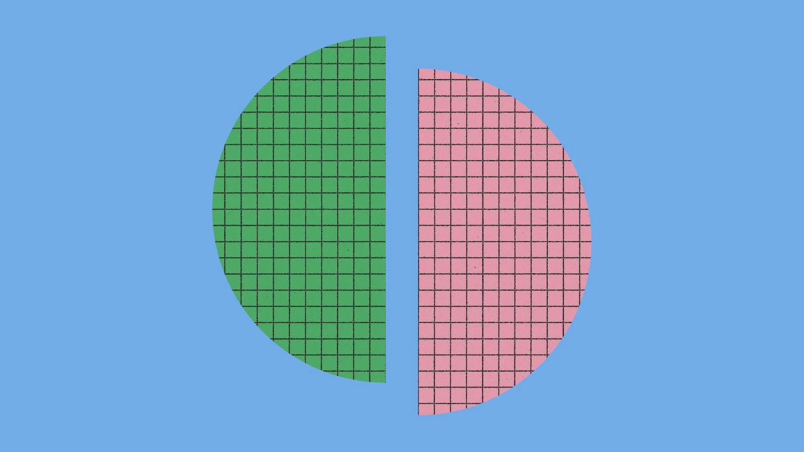

索伦·克尔凯郭尔写道：人生只能*回顾*着理解，却必须*向前*生活。我们为 AI 智能体设计记忆时，也碰到了类似的难题。

人每天都在不断编码记忆。[海马体](https://stanford.edu/~jlmcc/papers/McCMcNaughtonOReilly95.pdf)在其中起着关键作用：它捕捉当下的经历，让记忆迅速形成并可立即调用。但只有[一部分经历](https://www.science.org/doi/10.1126/science.adk8261?referrer=https%3A%2F%2Fwww.google.com%2F)会巩固为长期知识。

许多巩固活动似乎发生在大脑离线时。我们睡觉或[安静休息](https://www.nature.com/articles/s41467-018-06213-1)时，海马体会重放近期经历。研究者认为，这个过程会逐渐提炼经历，并把它们[整合进新皮质](https://www.nature.com/articles/s41593-019-0467-3)。我们通常所说的知识，大多储存在那里。

智能体的记忆也可以采用类似的分工。智能体把大部分工作写入日志或会话记录。Letta 和加州大学伯克利分校的研究人员提出了[睡眠时计算](https://arxiv.org/abs/2504.13171)，让模型利用两次交互之间的空闲时间重组已有上下文。同样的思路也能帮助智能体整理记忆：回看日志、纠正错误，或生成新的笔记和表示。这个过程常[被称为](https://platform.claude.com/docs/en/managed-agents/dreams)[*做梦*](https://research.google/blog/the-sleep-framework-a-new-way-for-llms-to-retain-knowledge-in-continual-learning/)（图 1）。

我们发现，做梦能帮助 Claude 形成有用的记忆。本文讨论我们怎样理解智能体记忆、用哪些评估研究记忆和做梦机制，以及各个组件怎样帮助整理记忆。

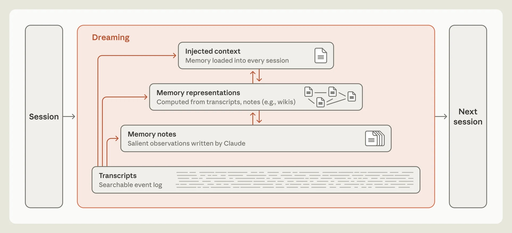

Claude 可以通过做梦整理记忆，包括纠正错误、创建笔记、构建新的记忆表示，或调整预先加载到后续会话的内容。

### 记忆笔记

这里的“智能体记忆”指 Claude 从用户互动、分配的任务等经历中习得的知识。这些知识以可回读的上下文保存，跨会话保留。这个定义不包括其他学习或管理上下文的方式，如改变*权重*（训练时确定的内部参数）、[*上下文学习*](https://www.anthropic.com/research/in-context-learning-and-induction-heads)（在单次对话中获得知识），或[*上下文压缩*](https://platform.claude.com/docs/en/build-with-claude/compaction)（Claude 编写摘要替换较早的轮次，以在新的上下文窗口中继续工作）。

人脑在经历之前、期间或之后释放的化学信号，可以[把某段记忆标记为重要](https://www.nature.com/articles/385533a0)。离线时，有标记的记忆通常重放得更频繁。这个过程称为*重放*，有助于稳固记忆并把它整合到长期记忆中。

类似地，Claude 可以在事件发生时在会话日志中标记重点，以便以后找到，也可以把它们[写入](https://platform.claude.com/docs/en/agents-and-tools/tool-use/memory-tool)记忆存储，例如记忆笔记文件夹（图 2）。可是在还不知道接下来会发生什么时，Claude 怎样判断眼下什么值得记住？

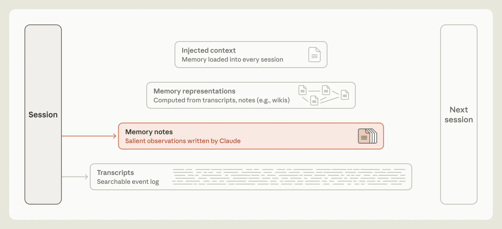

Claude 可以把笔记写入记忆。

### 记忆可以是对未来需求的预测

记忆有时是一种预测。智能体写下一条规则时，隐含地预测这条规律之后还用得上。比如，记下一个已验证的事实，是在预测未来会话中的智能体会直接依赖它，无需再核实。Claude 在这方面已进步许多。

以[持续学习基准 CL-Bench 1.0](https://continual-learning-bench.com/news/cl-bench-1-0/)为例。它评估智能体能否借助记忆处理长程任务。其中一项任务要求 Claude 查询数据库，回答一连串问题。每次作答后，Claude 都会得到正确答案，并可写下记忆供日后使用。

记忆可以支持一轮持续学习。答错时，Claude 可以记录失败、提出原因假设、检验假设，再把发现整理成未来作答的规则。

我们用 [Claude Managed Agents](https://platform.claude.com/docs/en/managed-agents/overview)运行这项任务。每道题都从新会话开始，唯一的跨会话信息来自一个可读取的[持久记忆目录](https://platform.claude.com/docs/en/managed-agents/memory)。

不同模型建立学习闭环的程度各不相同。Claude Sonnet 4.6 能提出答错的可能原因。它的记忆目录里留下零散文件，每个文件都列了几条未经检验的猜测。

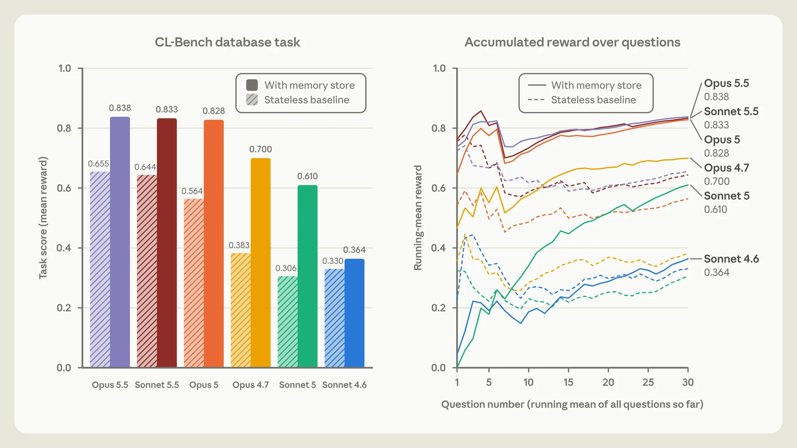

CL-Bench 数据库任务比较不同模型使用记忆时的表现与无状态基线。

Claude Opus 4.7 把笔记合并成一份参考文档，开始标明哪些事实核实过、哪些尚未确认。Claude Sonnet 5 在评分器核对后标记正确答案，答错时写下纠正说明。

Claude Opus 5 是这些模型里第一个完成学习闭环的。它大多数条目都写下规则及其验证依据、先前问题的答案，以及途中发现的陷阱（图 3）。

Claude Opus 5.5 和 Claude Sonnet 5.5 也像 Opus 5 一样完成了闭环，把经验证、能帮助以后作答的规则存入记忆。使用记忆时，两者得分与 Opus 5 相近，无记忆时的基线略高。

### Claude 学会了判断什么值得记住

我们还用《宝可梦 红》测试 Claude 对*哪些*内容值得保存的判断。这个游戏[要求 Claude 处理复杂的长程任务](https://www.youtube.com/watch?v=CXhYDOvgpuU)。每次运行开始时，我们给模型一个可以在游戏中读写的记忆文件夹（图 4）。

我们分别对 Claude Sonnet 3.7 和 Claude Fable 5 运行一次，在各自进行约 10,000 步时比较记忆文件夹。两者的重要差别在于认为什么值得记。Sonnet 3.7 认为一切都可能有用，于是不加区分地保存记录。它经常为每场战斗、每件道具和每位遇到的非玩家角色各建一个文件。最终它在 225 个文件夹中写下 413 个文件，获得一枚徽章（徽章标记游戏进度）。

Fable 5 在两个文件夹中写了九个文件，另有一个顶层文件 `global.md`，获得四枚徽章。

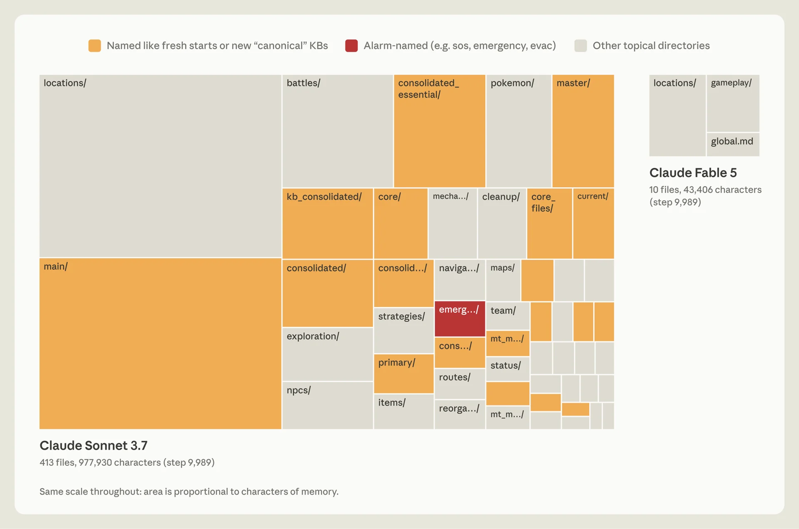

Sonnet 3.7 和 Fable 5 玩宝可梦时的记忆目录。

Sonnet 3.7 的做法主要有一个问题：游戏状态不断变化，详尽的记录也不断过时。随着游戏推进，Claude 得花更多时间和资源翻查记忆，挤占了实际游戏的时间。例如在第 10,000 步左右，Sonnet 3.7 新建了第四个“主记忆”文件夹。接下来的 17 步，它创建了六个文件，删除了九个文件，却没在游戏里采取任何行动。

Fable 5 用记忆保存游戏界面不直接提供的东西。Sonnet 3.7 记下的钱数和地图位置等信息，每轮都可从屏幕读取，保存是冗余的。策略、计划和检验过的规则则需要 Claude 自己推导，不写下来就会丢失。

Fable 5 据此组织记忆。`global.md` 像一个仪表盘，存有当前目标、挑战道馆以获取徽章的计划，以及模型自行制定的记忆使用规则。`locations` 目录存放特定路线的导航计划，`gameplay` 目录存放根据摸索到的机制制定的策略。例如，连用七个精灵球仍没抓住一向容易捕捉的鲤鱼王后，Claude 记下：连续三次或更多次失败时，改变按键时机，在菜单操作之间插入额外等待。它刚这么做就抓到了。

记忆文件夹小得多的 Fable 5，游戏进度远超 Sonnet 3.7。Opus 5.5 也采取了类似做法，用少量笔记追踪当前目标和下一步，随游戏进展改写笔记，最终通关。

### 引导 Claude 写入记忆

我们发现，告诉 Claude 记忆的用途有帮助，使用方法可以交给它自行决定。做 CL-Bench 评估时，我们只告诉 Claude 有一个记忆目录可用。这样的通用提示已经足以让 Opus 4.7 和 Opus 5 有效使用记忆，并显著改善表现（图 3）。

我们还测试了明确规定应记什么，每次测试一条规则，然后比较加规则和不加规则时记忆带来的增益。要求“只记录失败”后，Opus 5 和 Opus 4.7 丧失了很大一部分增益（图 5 右）。对更强的模型，自行判断什么重要的效果优于事先规定，固定规则甚至可能拖累表现。

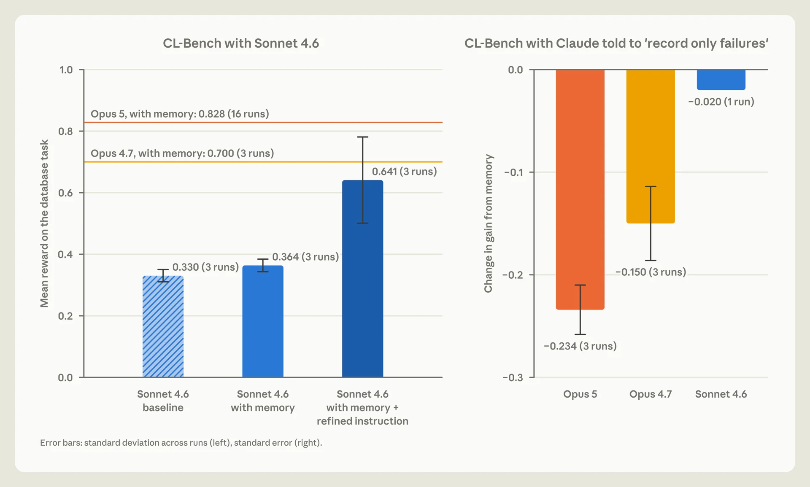

左图比较有无记忆使用提示时，Sonnet 4.6 在数据库任务上的表现。右图显示要求只记录失败后，各模型的记忆增益变化。

明确的引导对旧模型帮助最大。比如，Sonnet 4.6 往往不读记忆目录，也不检验自己对出错原因的假设。

如果要求 Claude 先读记忆文件再答题，并明确检验自己的假设，Sonnet 4.6 的基准分数几乎翻倍（图 5 左）。Sonnet 5 无需提示就会这样做，十次中有九次先读记忆再回答。Sonnet 4.6 不到一半。

对前沿 Claude 模型，我们通常只给简单指引：用户要求时，或确实遇到值得记下的事时，就创建记忆笔记。具体判断交给 Claude。

### 做梦可以纠正记忆

Claude 根据本次会话中对重要性的判断写记忆。一条起初就写错的笔记，或者随环境变化而失准的笔记，可能在之后的会话中被 Claude 读到并深信不疑。

做梦能让 Claude 对照原始会话记录检查笔记（图 6）。我们让 Claude 使用挂载记忆目录的 Managed Agents 玩宝可梦时，观察到一个成功例子。

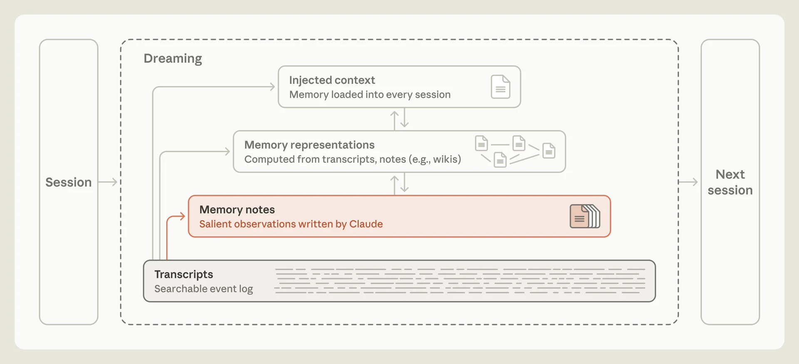

做梦可以纠正记忆里的错误。

游戏中有一段需要穿过月见山。洞穴入口在地图西侧，出口在东侧。入口附近有个陷阱：一段单向断崖，跳下去会回到来时的路线，也没有明显的办法爬回去。Claude 把山入口处的宝可梦中心当作地标。它会不会跳下断崖，取决于它以为宝可梦中心在山的哪一侧。

有一次，Claude 错把宝可梦中心记在东侧。它走出中心时说月见山已在身后，并更新笔记，标记月见山已通过。实际上它还在山的入口一侧。做了几个动作后，Claude 跳下断崖，落回来时的路线（图 7）。导航工具没有显示这一步落差，于是 Claude 以为自己只是往西走过了头，并误以为先前所在的一侧是正确的。

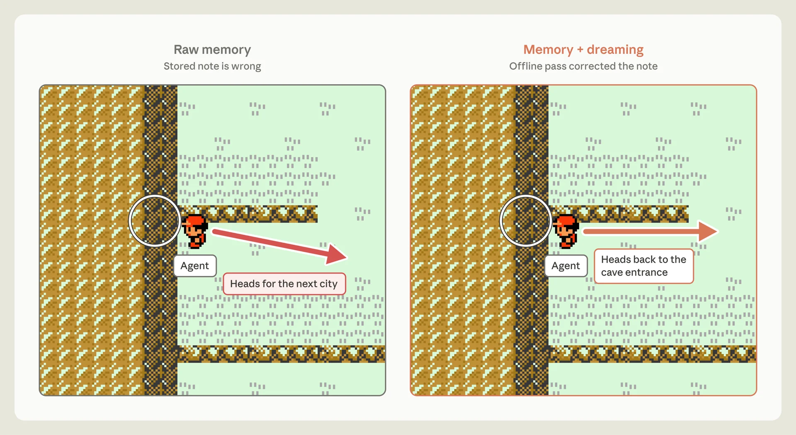

改正笔记改变了游戏结果。使用原始记忆时，Claude 以为已越过月见山，朝下一座城市前进，却回到了来路。做梦修正笔记后，它判断要找洞穴入口，并重新进洞。

为检验做梦能否帮助 Claude 避开陷阱，我们对存有错误位置的记忆目录运行了一次做梦。Claude 用会话记录核对笔记，找出错误并改写。原始记录为验证记忆提供了事实依据。依据改正后的笔记，Claude 直接返回月见山，最后到达华蓝市。

在未修正笔记的一次运行中，Claude 三次掉回之前的路线。第三次失败后，它似乎想放弃，表示宁可停下，也不想继续循环。自动回复让它继续，于是它一路退回山前的尼比市，想在那里恢复状态并补给。这次运行结束时始终没到华蓝市。

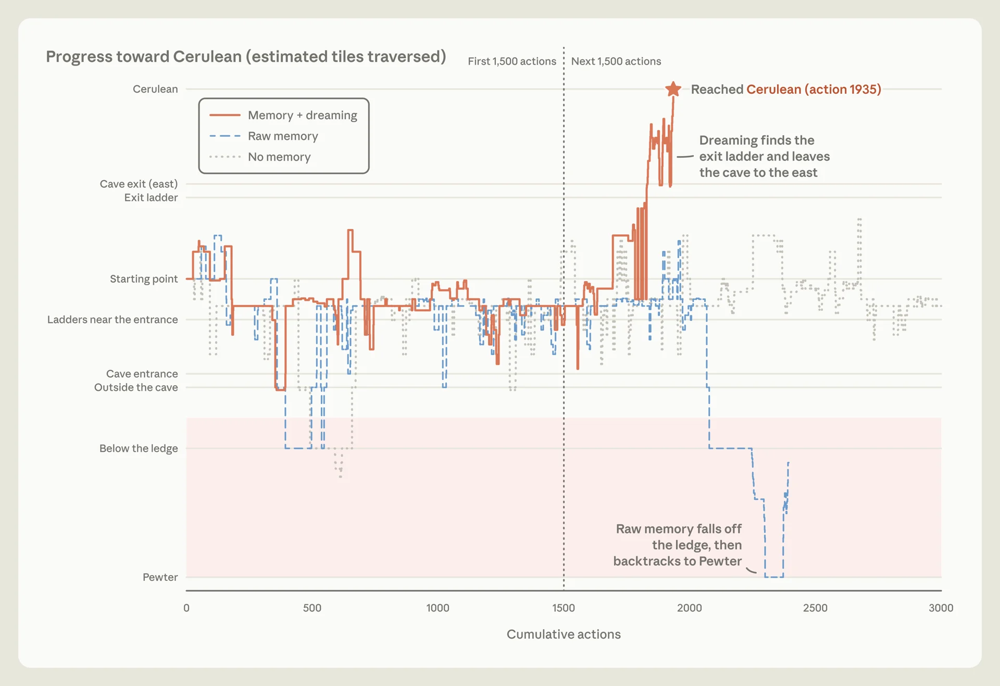

做梦纠正记忆后，Claude 重进洞穴，抵达下一座城市。使用原始记忆和完全不使用记忆的两次都没能越过月见山。

### 做梦可以构建新的记忆表示

Claude 可以借助做梦构建便于检索的记忆表示（图 9）。其中一种是 [*Wiki*](https://gist.github.com/karpathy/442a6bf555914893e9891c11519de94f)，由 Claude 编写和维护一组页面，把某个主题的知识汇集起来，并链接到其他笔记。这些链接构成一张供 Claude 浏览和定位记忆的地图。

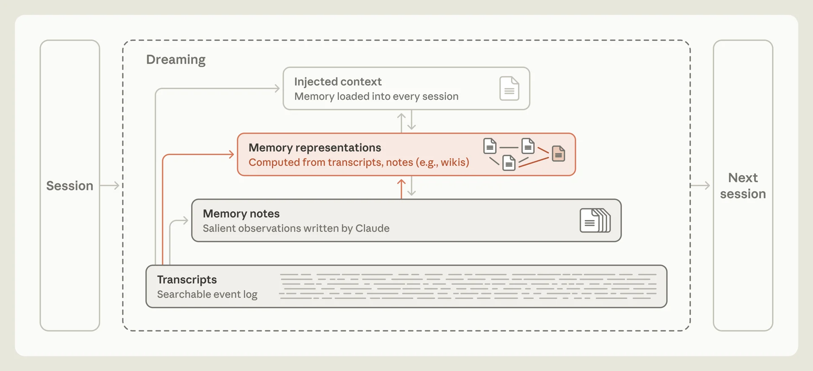

做梦可以构建记忆表示。

Wiki 有助于 Claude 查阅不断增长的知识库。我们使用 Stainless 的内部文档语料检验这种做法。Stainless 是我们在五月收购的软件公司，语料约有 35 万个文件、4.2 亿个 token。我们提出 25 道关于语料的问题，给 Claude 搜索工具，并让它通过做梦为这些文件建立 Wiki。在 128 个会话里，我们要求 Opus 5 智能体查阅文件、编写或纠正互相链接的页面、合并重复内容，并对照原始文档核实说法。

每个会话都参考此前已完成的工作，用共享日志协调。做梦会话从 2 次增加到 128 次后，25 道题的评分标准达成率从 13% 升到 48%（图 10）。

Claude 逐步构建 Wiki。建立初版后，随后的做梦会补充、编辑或删减内容。早期 Wiki 像新员工的知识，仅凭 Wiki 回答问题的能力有限。做梦越多，知识地图就越丰富，像资深员工的积累。测试中，Wiki 搭配搜索工具效果最好。随 Wiki 增长，同时使用两者的综合得分从 54% 升到 61%，仅使用搜索工具为 53%，仅用 Wiki 的最佳得分是 48%。两者一起使用，每题还可节省约 20,000 个 token。

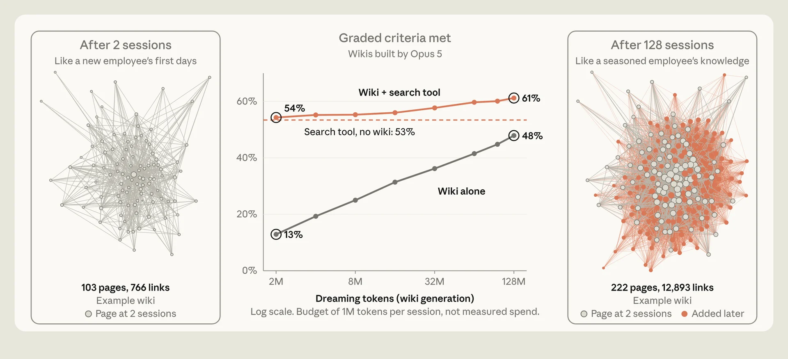

中图是 Claude 逐步建设公司文档 Wiki 时，在 25 道题上的得分。左右是分别经过 2 次和 128 次会话的示例 Wiki。每个点是一个页面，连线表示页面间的链接。

我们想了解哪些任务能从 Wiki 受益，于是使用 [Harvey LAB](https://github.com/harveyai/harvey-labs) 基准和一组企业合并文件。LAB 给 Claude 一套文档，要求据此撰写法律文书，并按一系列标准评分。这些测试或许没有玩宝可梦有趣，但提供了多样的 Wiki 建设材料。

我们让 Claude 用这些文档构建 Wiki，再分别利用 Wiki 和直接搜索文件，回答合并问题或撰写 LAB 法律文书。有一项测试包括 24 道合并问题（图 11 左）。超过一半需要汇总多份文档，许多还需要判断或计算。在这些题上（红线和橙线），Claude 查阅 Wiki 时得分 87%，仅搜索时为 73%。

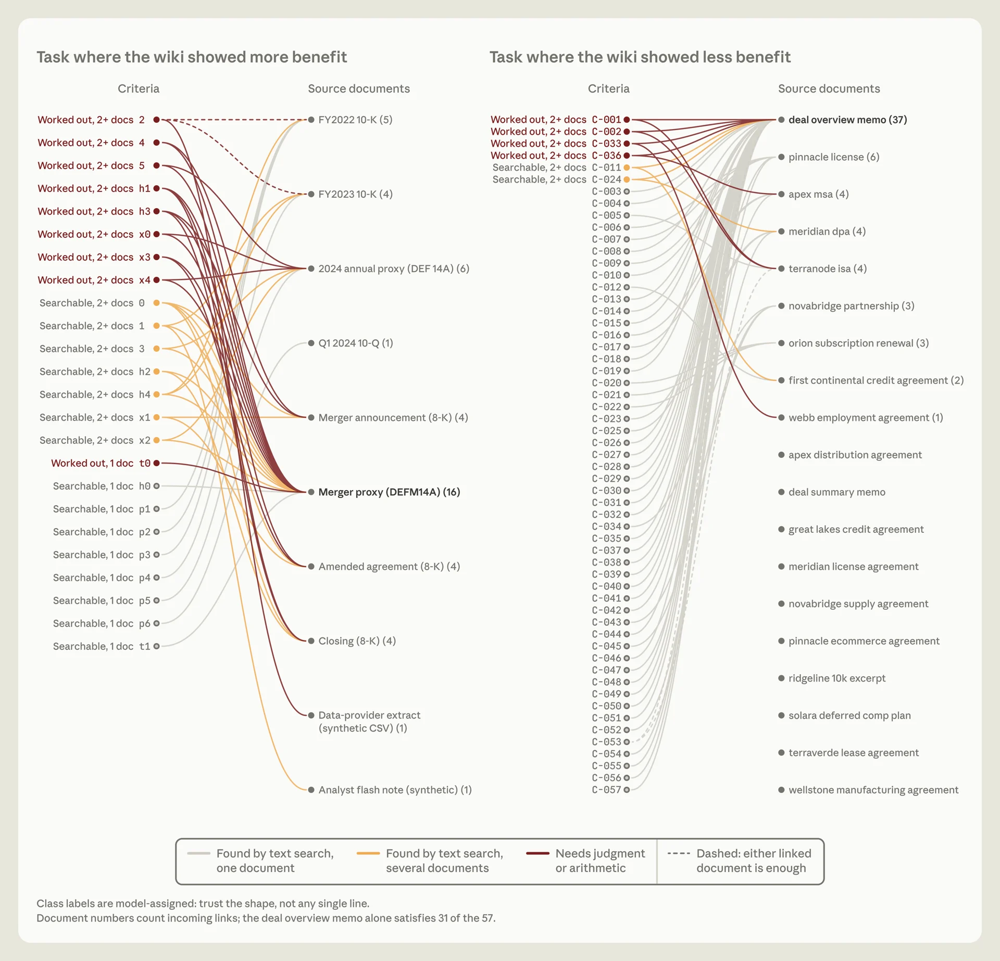

每个面板左侧是评分内容，右侧是满足标准所需的源文件。左图的 24 道合并问题大多可依据公开申报材料回答，超过一半的标准要求汇总多份文档。右侧的 LAB 任务中，Wiki 未带来明显提升，多数标准只需一份文档即可满足。

其他情形中，Wiki 帮助较小。在一个 LAB 任务中（图 11 右），查单份文档就能找到文书评分所需的信息，Wiki 相比搜索没有明显提升。另一个任务中，Wiki 比原始文档还大（图 12）。就像博尔赫斯《论科学的精确性》里的制图师画出了与帝国一样大的地图，Claude 做出了一份极详尽却几乎没有提炼内容的 Wiki。

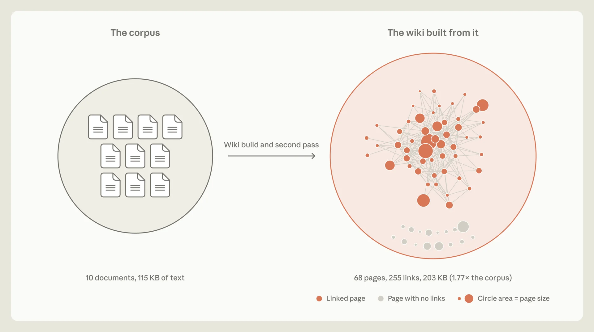

Wiki 的体积超过了原始文件。

### 做梦可以把笔记提升到更高的记忆层级

做梦还能把笔记提升至记忆层级的顶端，由智能体运行框架在每次会话开始时预先加载进 Claude 的上下文（图 13）。Claude 不必主动查找，也不必事先知道有东西可查。

把记忆提升到新会话，是一种*上下文注入*，需要谨慎。注入的记忆会占用宝贵的 token，错误笔记也可能被带入每次会话。加载也无法保证 Claude 会遵守笔记。[Claude Code 文档](https://code.claude.com/docs/en/memory)指出，指令文件越长，遵循程度越低。因此，顶层记忆需要保持精简。做梦的一项工作就是把某些细节移到下层，并在上层留下链接。

[Claude Code 的自动记忆](https://code.claude.com/docs/en/memory)也以相同方式控制注入层大小，由 Claude 在会话中维护。每次会话只加载 `MEMORY.md` 的前 200 行或前 25 KB，不会把所有自动记忆塞进上下文窗口。这段开头相当于索引，告诉 Claude 它知道什么、去哪里找。

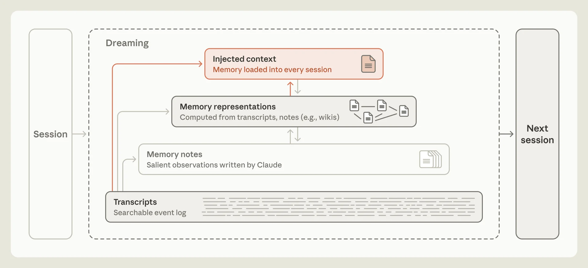

做梦可以写入记忆层级的顶层。每次会话都加载注入上下文，下层内容则由 Claude 按需读取或搜索。

### 做梦可以让记忆服务于特定目标

做梦也能影响记忆如何扩充。例如，[Claude Duet](https://support.claude.com/en/articles/17631495-get-started-with-claude-duet)这样的助手通常适合围绕所服务的人组织记忆。可以调整做梦的方式，让所建记忆服务于特定目标。

引导记忆增长的指令因任务而异，会告诉 Claude 哪些信息重要。例如，LAB 基准中的一项任务模拟企业收购，提供一组合同，并根据法律文书是否准确描述合同条款来评分。

开始时，我们只给出构建 Wiki 的基本指令，没有规定*怎样*使用 Wiki。这一任务非常依赖合同条款。构建过程中，多个智能体同时往一份共享的条款表写入（图 14 左）。

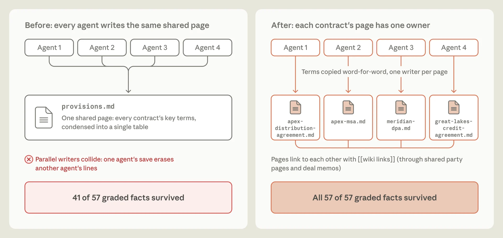

调整指令前后纳入 Wiki 的合同事实数。左图是多智能体写共享页面，只保留 41 项。右图每份合同由一个智能体单独建页并逐字引用条款，57 项全部保留。

生成的 Wiki 缺少关键事实。根据这份 Wiki 写出的法律文书只包含 57 项事实中的 41 项（72%）。追查发现，共享表没能准确概括合同条款，有些条款因智能体互相覆盖而彻底丢失。

合同条款是 Wiki 中最重要的部分，但指令没有说明。为改进指令，我们让 Claude 回顾失败、提出改法并重建 Wiki。在这个循环中，Claude 发现精确记录合同条款非常重要，便相应改写了构建指令。

每份合同在 Wiki 中单独建页，由一个智能体编写并逐字摘录条款。依据改进后的 Wiki 生成的文书可以满足全部评分标准，达成率从 72% 提高到 100%。

### 做梦可以补上单次会话留下的缺口

Claude 写记忆笔记时，只能看到*当次*会话的上下文。做梦可以搜索多次会话，找出共同模式或纠正反复出现的错误。

构建 LAB 基准的 Wiki 时，Claude 有时会链接到尚不存在的页面（可参见图 14 中的建 Wiki 任务）。第二次做梦修补了许多这样的缺口。一个任务里（图 15），做梦找到九条指向缺失页面的链接，把它们改指到同一文档已有的页面，并新增包括索引在内的三个页面。

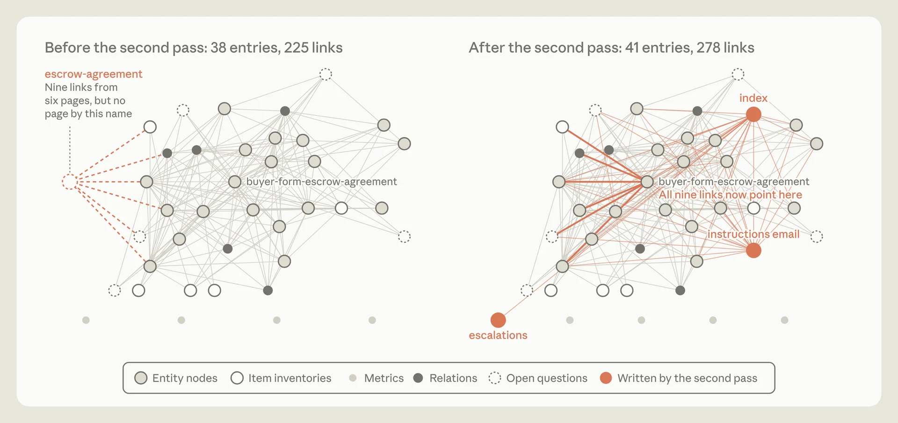

第二次做梦前后的 Wiki。

### 回顾过去，面向未来

智能体记忆系统还有许多设计问题没有解决。其中一个是 Claude 应何时创建记忆。执行任务期间，Claude 可以把记忆写到文件夹、文件或数据库里，当场记录重要细节，供后续轮次或会话立即使用。但即时记录难免分散主任务的注意力。做梦可以把创建记忆移到后台，结果却未必能立即被 Claude 读取。

另一个问题是怎样可靠地保持记忆更新。Claude 可能作出错误预测，也可能一开始就写错规则。环境变化还会让记忆失准、不再适用。做梦可以纠正这些问题（图 8），但要消耗计算资源。让 Claude 持续检查*所有*记忆未必可行。可能需要优先检查容易变化的信息，或者按记忆的访问频率等因素谨慎调整做梦的节奏。

把会话记录搜索作为 Claude 记忆的基础也是合理的。将 Wiki 等表示和搜索结合起来有时有效（图 10），但 Claude 仍需投入计算来维护这些表示，防止错误或幻觉累积。

虽然 Claude 更擅长判断什么值得记住，任何模型都无法真正预知后续轮次。做梦给了 Claude *回顾*的机会，让它用计算资源整理记忆、纠正错误并维护表示，以便未来的会话更容易访问记忆。随着 Claude 变得更强，记忆系统也会演进，而我们还有许多设计问题需要研究。

可参考我们的[做梦入门示例](https://platform.claude.com/cookbook/managed-agents-cma-dreaming-with-a-dynamic-workflow)和[知识 Wiki 示例](https://github.com/anthropics/claude-quickstarts/tree/main/managed-agents/knowledge-wiki)。
