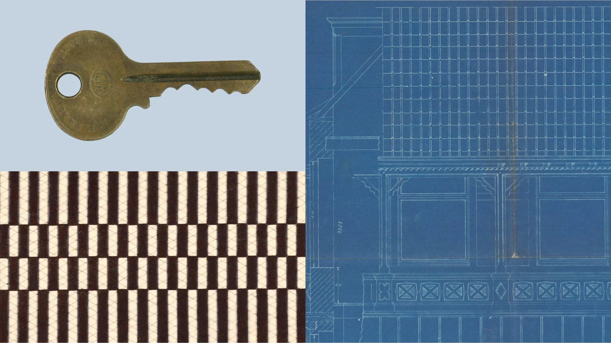

# 通过可信虚拟机实现保密推理

- 英文标题：Confidential Inference via Trusted Virtual Machines
- 发布日期：2025-06-18
- 官网栏目：工程
- 原文：[Anthropic 页面](https://www.anthropic.com/research/confidential-inference-trusted-vms)
- 官网署名：Anthropic
- 官网推荐阅读：[阅读论文](https://assets.anthropic.com/m/c52125297b85a42/original/Confidential_Inference_Paper.pdf)

> 中文机器初译，未逐篇人工校对。引用研究结论时请核对英文原文。

每天都有数百万用户 [委托](https://trust.anthropic.com/) Claude掌握敏感信息——从专有代码到机密业务策略。在 Anthropic，我们正在研究和构建新技术，以确保用户的信任得到保证——事实上，确保他们的信任得到加密保证。

“加密保证”是什么意思？在一个 [新报告](https://assets.anthropic.com/m/c52125297b85a42/original/Confidential_Inference_Paper.pdf) 与合作出版 [模式实验室](https://www.patternlabs.co/)，我们描述了机密推理的机制。机密推理是一组我们可以用来处理加密数据并表明此类数据只能在能够证明自己值得信赖的服务器内读取的工具。采用这些工具有两个主要原因：

- 模型权重安全：我们可以使用机密推理作为我们更广泛努力的一部分，以确保像Claude这样的前沿模型免受能力日益增强的威胁行为者的侵害，例如兰德公司最近的报告中描述的那些 [保护 AI 模型权重](https://www.rand.org/pubs/research_reports/RRA2849-1.html);
- 用户安全：我们可以使用机密推理来证明敏感的用户数据是保密的。

我们正在分享这篇文章以及随附的 [报告](https://assets.anthropic.com/m/c52125297b85a42/original/Confidential_Inference_Paper.pdf)，解释什么是机密推理以及它可以为我们的用户带来的好处。我们还想分享我们如何考虑所涉及系统的安全性。这只是我们研究的一个草图，以便开始对话；我们仍处于这项工作的早期阶段，现在预测它将如何演变为我们未来可能提供的特定设计或功能还为时过早。

以下各节提供了实施机密推理的一些技术细节。关键要点是，我们正在构建的系统旨在帮助确保您的敏感数据在任何地方都保持加密状态，除了需要处理的确切时刻之外，即使如此，也只能在高度受限的可验证环境中进行加密。

## 推理服务

机密推理背后的指导原则是敏感数据应保持加密状态，除非在处理时。为了实现这一点，我们使用既定的机密计算方法。这意味着我们建立一条信任链​​来证明我们软件的安全性，然后使用该证明来强制执行有关允许哪些软件使用加密密钥的规则。

对于用户数据，我们需要对敏感明文（即未加密或以任何方式隐藏的文本）进行操作的两点：

- API 服务器。该服务器处理提示，将其转换为令牌，并操作 Claude API 请求背后的大部分逻辑；
- 推理服务器。该服务器在硬件加速器上运行 Claude 的“大脑”，根据提示生成完成令牌。

对于模型权重，只有推理服务器接收敏感数据。

在这篇文章中，我们将重点关注推理服务器——API 服务器的安全性同样重要，但超出了我们试图描述的范围。由于并非所有加速器都完全支持机密计算，因此我们正在探索在小型、安全的“模型加载器和调用器”之上实现的推理服务器，该服务器可以在可信环境中运行。该加载程序执行一些简单的工作：

- 接受加密数据，解密并发送给加速器；
- 对加速器发起调用，并将加密结果返回给调用者。

只有“受信任”的加载程序才能访问解密的数据。系统的其余部分是“不受信任的”，但可以向加载器发送请求。

我们正在开发一个基于此设计的系统，以便我们自己实现。对于此实现，我们的大部分推理服务器都运行在“不受信任”的一侧 - 它可能会频繁更改，但更改不会影响整个系统的安全性。我们有一个小型的可信加载程序，在由虚拟机管理程序隔离的单独虚拟机上运行。加载器将自己作为“虚拟加速器”呈现给推理服务器，与模型架构细节无关。这个“虚拟加速器”只接受由我们的安全持续集成服务器签名的程序，这确保了运行的任何代码都经过了多名工程师的审查。

最终结果是确保加载程序正确运行时，满足我们的保密要求 *无论系统的其余部分做什么*。因此，确定加载程序正确运行至关重要。

## 值得信赖的环境

该报告描述了在机密计算环境中运行的加载程序，具有一组特定的功能：

1. 加密内存，通过硬件与其他工作负载隔离；
2. 禁用调试功能；
3. 正在运行正确代码的加密证明。

(1) 防止某些形式的物理攻击和恶意虚拟机管理程序，但与加速器共享加密主机内存所需的功能尚未完善。我们将继续努力缩小这一差距，但与此同时，我们将依靠我们的计算提供商来维护物理数据中心和虚拟机管理程序软件的安全性。

(2) 和 (3) 可以通过广泛支持的机密计算实践来实现，使用可信平台模块 (TPM) 作为信任根。TPM 测量启动过程的每个阶段并报告代表最终结果的哈希值。该哈希证明加载程序服务器按照我们期望的方式隔离，正在运行我们签名和审查的代码，并且配置为禁用相关调试功能。密钥服务器可以检查此证明，并且仅在接收者证明自己安全时才发布解密密钥。

环境是否“可信”的决定最终取决于密钥服务器。我们还在探索机密计算模型，其他方可以在其中验证可信代码并管理独立的密钥服务器。这可以让我们为每条数据提供更强的保密保证。

## 未来方向

随着前沿模型的能力越来越强，我们可能会发现有必要在安全加载程序层纳入进一步的保护措施。这可能包括诸如附加层之类的功能 [出口带宽限制](https://www.anthropic.com/news/activating-asl3-protections) 在保存明文模型权重的服务器上，或者需要安全分类器的签名才能运行推理。我们希望提出这种机密推理模型可以激发讨论哪些附加功能值得探索，以确保 Anthropic 环境的持续安全性和用户数据的机密性。

## 结论

这项研究将推动我们持续努力确保模型权重和保护用户数据。使用此模型来保护用户请求旨在确保客户数据仅在具有增强的基于硬件的安全控制的上下文中被解密：：

- 请求在到达 Anthropic 服务器之前会被加密；
- 当请求到达 API 服务器时，它会被解密、处理并重新加密，然后再继续传递；
- 推理服务器以加密形式处理请求，只有当请求发送到可信加载器时才会解密；
- 完成内容在离开加载器之前会被加密，并通过 API 服务器传回调用者。

模型权重的情况更简单：它们可以加密存储，在加载器上解密，并且永远不会从那里释放。

硬件设计师（没有 [已经这样做了](https://developer.nvidia.com/blog/confidential-computing-on-h100-gpus-for-secure-and-trustworthy-ai/)）应考虑将机密计算纳入其芯片中。如果加速器附有硬件信任根，则可以显着减少此类系统的信任边界。

阅读 [完整报告](https://assets.anthropic.com/m/c52125297b85a42/original/Confidential_Inference_Paper.pdf).

### 与我们合作

如果对机密推理的讨论激发了您想要与我们合作解决这些问题，请考虑申请“安全”和“人工智能研究与工程”部分中列出的空缺职位之一 [我们网站上的职位页面](https://www.anthropic.com/jobs).
