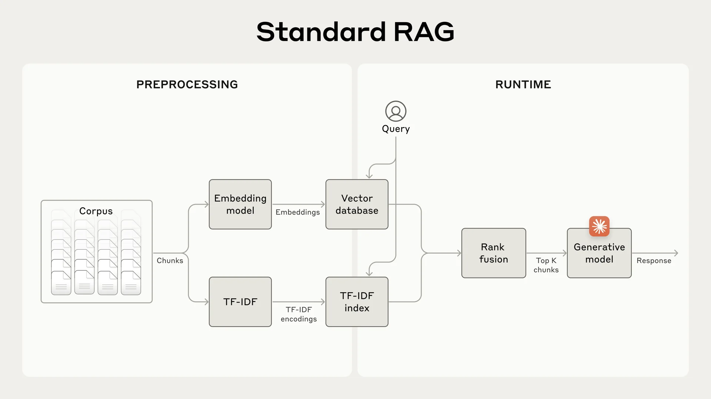
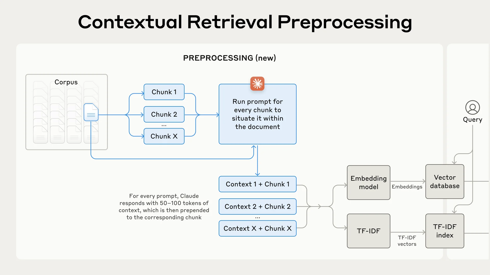
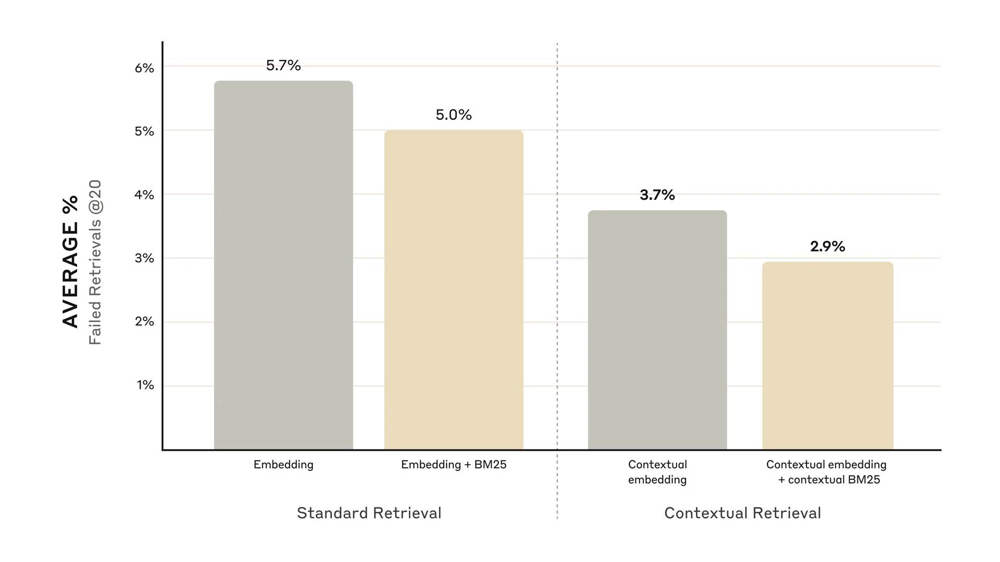
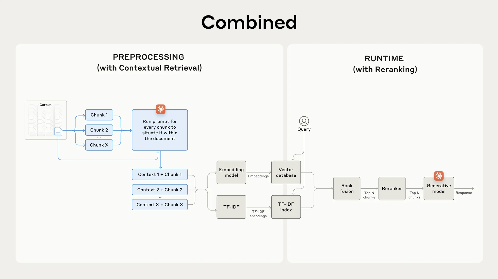
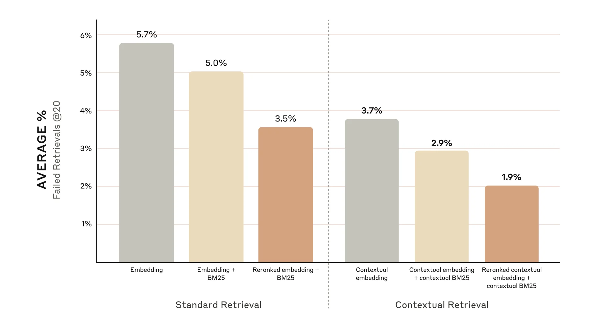
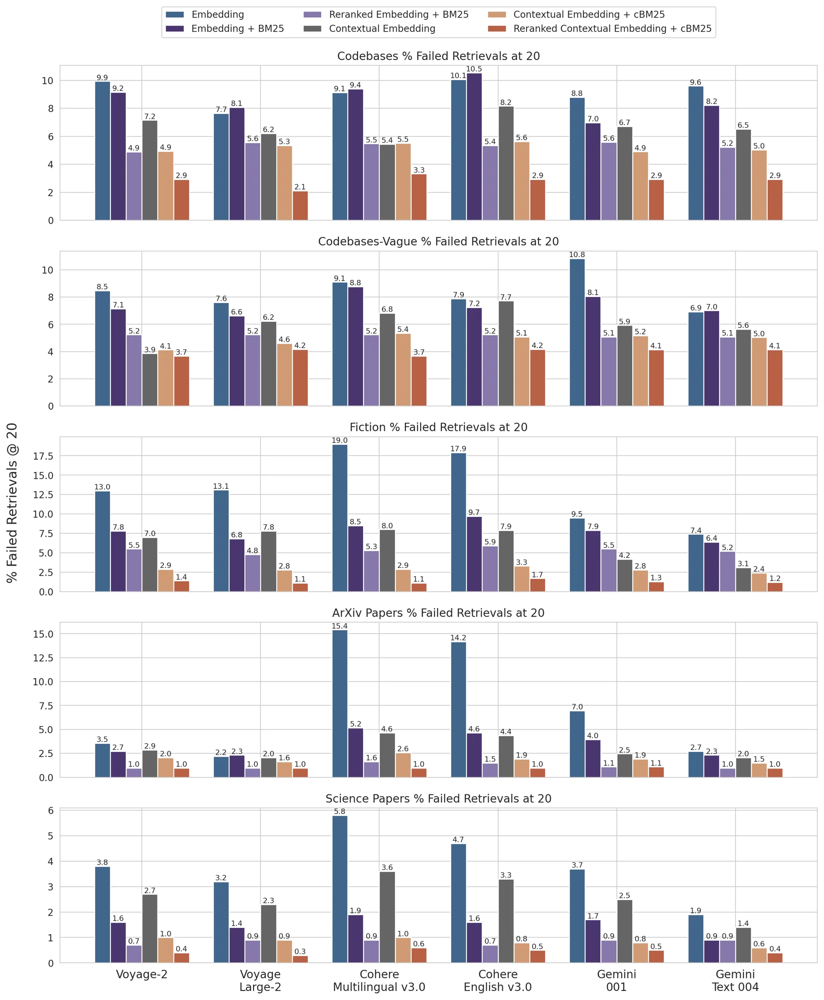

# 介绍上下文检索

- 英文标题：Introducing Contextual Retrieval
- 发布日期：2024-09-19
- 官网栏目：工程
- 原文：[Anthropic 页面](https://www.anthropic.com/research/contextual-retrieval)
- 官网署名：Anthropic

> 中文机器初译，未逐篇人工校对。引用研究结论时请核对英文原文。


为了让人工智能模型在特定环境中发挥作用，它通常需要获取背景知识。例如，客户支持聊天机器人需要了解它们所用于的特定业务，而法律分析机器人需要了解大量过去的案例。

开发人员通常使用检索增强生成 (RAG) 来增强 AI 模型的知识。RAG 是一种从知识库中检索相关信息并将其附加到用户提示中的方法，从而显着增强模型的响应。问题在于，传统的 RAG 解决方案在编码信息时会删除上下文，这通常会导致系统无法从知识库中检索相关信息。

在这篇文章中，我们概述了一种可以显着改进 RAG 检索步骤的方法。该方法称为“上下文检索”，并使用两种子技术：上下文嵌入和上下文 BM25。此方法可将失败检索的数量减少 49%，与重新排名结合使用时可减少 67%。这些代表了检索准确性的显着提高，这直接转化为下游任务的更好性能。

您可以使用 Claude 轻松部署自己的上下文检索解决方案 [我们的食谱](https://platform.claude.com/cookbook/capabilities-contextual-embeddings-guide).

### 关于仅使用较长提示的注意事项

有时最简单的解决方案是最好的。如果您的知识库小于 200,000 个标记（大约 500 页材料），您可以将整个知识库包含在为模型提供的提示中，而不需要 RAG 或类似的方法。

几周前，我们发布了 [提示缓存](https://docs.anthropic.com/en/docs/build-with-claude/prompt-caching) 对于 Claude 来说，这使得这种方法明显更快且更具成本效益。开发人员现在可以缓存 API 调用之间经常使用的提示，从而将延迟减少 2 倍以上，并将成本降低高达 90%（您可以通过阅读我们的文章来了解它的工作原理） [提示缓存食谱](https://platform.claude.com/cookbook/misc-prompt-caching)).

然而，随着您的知识库的增长，您将需要更具可扩展性的解决方案。这就是上下文检索的用武之地。

## RAG 入门：扩展到更大的知识库

对于不适合上下文窗口的较大知识库，RAG 是典型的解决方案。RAG 的工作原理是使用以下步骤预处理知识库：

1. 将知识库（文档的“语料库”）分解为更小的文本块，通常不超过几百个标记；
2. 使用嵌入模型将这些块转换为编码含义的向量嵌入；
3. 将这些嵌入存储在向量数据库中，以便通过语义相似性进行搜索。

在运行时，当用户向模型输入查询时，矢量数据库用于根据与查询的语义相似性查找最相关的块。然后，最相关的块被添加到发送到生成模型的提示中。

虽然嵌入模型擅长捕获语义关系，但它们可能会错过关键的精确匹配。幸运的是，有一种较旧的技术可以在这些情况下提供帮助。BM25（最佳匹配 25）是一种排名函数，使用词汇匹配来查找精确的单词或短语匹配。它对于包含唯一标识符或技术术语的查询特别有效。

BM25 的工作原理基于 TF-IDF（术语频率-逆文档频率）概念。TF-IDF 衡量一个单词对于集合中的文档的重要性。BM25 通过考虑文档长度并对术语频率应用饱和函数来对此进行细化，这有助于防止常见单词主导结果。

以下是 BM25 如何在语义嵌入失败的情况下取得成功：假设用户在技术支持数据库中查询“错误代码 TS-999”。嵌入模型通常可能会找到有关错误代码的内容，但可能会错过确切的“TS-999”匹配。BM25 查找此特定文本字符串来识别相关文档。

RAG 解决方案可以通过使用以下步骤结合嵌入和 BM25 技术来更准确地检索最适用的块：

1. 将知识库（文档的“语料库”）分解为更小的文本块，通常不超过几百个标记；
2. 为这些块创建 TF-IDF 编码和语义嵌入；
3. 使用 BM25 根据精确匹配查找顶级块；
4. 使用嵌入根据语义相似性查找顶级块；
5. 使用等级融合技术组合（3）和（4）的结果并消除重复；
6. 将前 K 个块添加到提示中以生成响应。

通过利用 BM25 和嵌入模型，传统 RAG 系统可以提供更全面、更准确的结果，在精确的术语匹配与更广泛的语义理解之间取得平衡。



标准检索增强生成 (RAG) 系统，使用嵌入和最佳匹配 25 (BM25) 来检索信息。TF-IDF（术语频率-逆文档频率）衡量单词重要性并构成 BM25 的基础。

这种方法使您能够经济有效地扩展到巨大的知识库，远远超出单个提示所能容纳的范围。但这些传统的 RAG 系统有一个显着的局限性：它们经常破坏上下文。

### 传统 RAG 中的上下文难题

在传统的 RAG 中，文档通常被分割成更小的块以实现高效检索。虽然这种方法适用于许多应用程序，但当各个块缺乏足够的上下文时，它可能会导致问题。

例如，假设您有一组财务信息（例如，美国）SEC 文件）嵌入您的知识库，您收到以下问题： *“ACME Corp 2023 年第二季度的收入增长是多少？”*

相关块可能包含文本： *“公司营收较上季度增长3%。”* 然而，该块本身并没有指定它所指的是哪家公司或相关时间段，因此很难检索正确的信息或有效地使用该信息。

## 上下文检索简介

上下文检索通过在嵌入之前向每个块添加特定于块的解释性上下文（“上下文嵌入”）并创建 BM25 索引（“上下文 BM25”）来解决此问题。

让我们回到 SEC 文件收集示例。以下是如何转换块的示例：

```
original_chunk = "The company's revenue grew by 3% over the previous quarter."

contextualized_chunk = "This chunk is from an SEC filing on ACME corp's performance in Q2 2023; the previous quarter's revenue was $314 million. The company's revenue grew by 3% over the previous quarter."
```

值得注意的是，过去已经提出了使用上下文来改进检索的其他方法。其他建议包括： [将通用文档摘要添加到块中](https://aclanthology.org/W02-0405.pdf) （我们进行了实验，发现收益非常有限）， [假设文档嵌入](https://arxiv.org/abs/2212.10496), 和 [基于摘要的索引](https://www.llamaindex.ai/blog/a-new-document-summary-index-for-llm-powered-qa-systems-9a32ece2f9ec) （我们评估并发现性能较低）。这些方法与本文中提出的方法不同。

### 实施上下文检索

当然，手动注释知识库中数千甚至数百万个块的工作量太大。为了实现上下文检索，我们求助于 Claude。我们编写了一个提示，指示模型提供简洁的、特定于块的上下文，使用整个文档的上下文来解释块。我们使用以下 Claude 3 Haiku 提示来为每个块生成上下文：

```
<document> 
{{WHOLE_DOCUMENT}} 
</document> 
Here is the chunk we want to situate within the whole document 
<chunk> 
{{CHUNK_CONTENT}} 
</chunk> 
Please give a short succinct context to situate this chunk within the overall document for the purposes of improving search retrieval of the chunk. Answer only with the succinct context and nothing else. 
```

生成的上下文文本（通常为 50-100 个标记）在嵌入块之前和创建 BM25 索引之前被添加到块中。

以下是实践中的预处理流程：



*上下文检索是一种提高检索准确性的预处理技术。*

如果您对使用上下文检索感兴趣，您可以开始使用 [我们的食谱](https://platform.claude.com/cookbook/capabilities-contextual-embeddings-guide).

### 使用提示缓存来降低上下文检索的成本

由于我们上面提到的特殊提示缓存功能，Claude 可以以较低的成本实现上下文检索。使用提示缓存，您不需要为每个块传递参考文档。您只需将文档加载到缓存中一次，然后引用以前缓存的内容即可。假设 800 个令牌块、8k 个令牌文档、50 个令牌上下文指令以及每个块 100 个上下文令牌， **生成上下文化块的一次性成本为每百万个文档令牌 1.02 美元**.

#### 方法论

我们尝试了各种知识领域（代码库、小说、ArXiv 论文、科学论文）、嵌入模型、检索策略和评估指标。我们在每个域中提供了一些问题和答案的示例 [附录二](https://assets.anthropic.com/m/1632cded0a125333/original/Contextual-Retrieval-Appendix-2.pdf).

下图显示了使用性能最佳的嵌入配置 (Gemini Text 004) 并检索前 20 个块的所有知识领域的平均性能。我们使用1减去recall@20作为我们的评估指标，它衡量前20个块中未能检索到的相关文档的百分比。您可以在附录中看到完整的结果 - 上下文化提高了我们评估的每个嵌入源组合的性能。

#### 性能改进

我们的实验表明：

- **上下文嵌入将前 20 个块的检索失败率降低了 35%** (5.7% → 3.7%).
- **结合上下文嵌入和上下文 BM25 将前 20 个块检索失败率降低了 49%** (5.7% → 2.9%).



*将上下文嵌入和上下文 BM25 相结合，可将前 20 个块的检索失败率降低 49%。*

#### 实施注意事项

在实施上下文检索时，需要记住以下几点：

1. **块边界：** 考虑如何将文档分成多个块。块大小、块边界和块重叠的选择会影响检索性能1.
2. **嵌入模型：** 尽管上下文检索提高了我们测试的所有嵌入模型的性能，但某些模型可能比其他模型受益更多。我们发现 [双子座](https://ai.google.dev/gemini-api/docs/embeddings) 和 [航行](https://www.voyageai.com/) 嵌入特别有效。
3. **自定义上下文提示：** 虽然我们提供的通用提示效果很好，但通过针对您的特定领域或用例量身定制的提示（例如，包括可能仅在知识库的其他文档中定义的关键术语词汇表），您也许能够获得更好的结果。
4. **块数：** 在上下文窗口中添加更多块会增加包含相关信息的机会。然而，更多的信息可能会分散模型的注意力，因此这是有限制的。我们尝试交付 5、10 和 20 个块，发现使用 20 是这些选项中性能最高的（请参阅附录进行比较），但值得在您的用例上进行试验。

**始终运行评估：** 可以通过向其传递上下文化块并区分什么是上下文和什么是块来改进响应生成。

## 通过重新排名进一步提高性能

最后一步，我们可以将上下文检索与另一种技术结合起来，以提供更多的性能改进。在传统的 RAG 中，人工智能系统搜索其知识库以查找潜在相关的信息块。对于大型知识库，这种初始检索通常会返回大量（有时是数百个）具有不同相关性和重要性的块。

重新排名是一种常用的过滤技术，可确保仅将最相关的块传递给模型。重新排名可提供更好的响应并降低成本和延迟，因为模型处理的信息较少。关键步骤是：

1. 执行初始检索以获取最重要的潜在相关块（我们使用前 150 个）；
2. 将前 N 个块与用户的查询一起通过重新排名模型；
3. 使用重新排序模型，根据每个块与提示的相关性和重要性给每个块打分，然后选择前 K 个块（我们使用前 20 个）；
4. 将前 K 个块作为上下文传递到模型中以生成最终结果。



*结合上下文检索和重新排名以最大限度地提高检索准确性。*

### 性能改进

市场上有多种重新排名模型。我们进行了测试 [连贯重排序](https://cohere.com/rerank)。航行 [还提供重新排名器](https://docs.voyageai.com/docs/reranker)，尽管我们没有时间测试它。我们的实验表明，在各个领域中，添加重新排名步骤可以进一步优化检索。

具体来说，我们发现 Reranked Contextual Embedding 和 Contextual BM25 将前 20 个块的检索失败率降低了 67% (5.7% → 1.9%)。



*重新排序的上下文嵌入和上下文 BM25 将前 20 个块检索失败率降低了 67%。*

#### 成本和延迟考虑

重新排序的一个重要考虑因素是对延迟和成本的影响，尤其是在对大量块进行重新排序时。由于重新排序在运行时增加了一个额外的步骤，因此它不可避免地会增加少量延迟，即使重新排序器并行对所有块进行评分。重新排列更多块以获得更好的性能与重新排列更少块以获得更低的延迟和成本之间存在固有的权衡。我们建议根据您的特定用例尝试不同的设置，以找到合适的平衡点。

## 结论

我们进行了大量测试，比较了上述所有技术的不同组合（嵌入模型、BM25 的使用、上下文检索的使用、重新排序器的使用以及检索到的前 K 个结果的总数），所有这些都跨越各种不同的数据集类型。以下是我们发现的摘要：

1. Embeddings+BM25 比单独的 embeddings 更好；
2. Voyage 和 Gemini 拥有我们测试的最佳嵌入；
3. 将前 20 个块传递给模型比仅传递前 10 个或前 5 个块更有效；
4. 在块中添加上下文可以大大提高检索准确性；
5. 重新排名比不重新排名好；
6. **所有这些好处叠加**：为了最大限度地提高性能，我们可以将上下文嵌入（来自 Voyage 或 Gemini）与上下文 BM25 结合起来，再加上重新排名步骤，并将 20 个块添加到提示中。

我们鼓励所有使用知识库的开发人员使用 [我们的食谱](https://platform.claude.com/cookbook/capabilities-contextual-embeddings-guide) 尝试这些方法来解锁新的性能水平。

## 附录一

下面是跨数据集、嵌入提供者、嵌入之外使用 BM25、上下文检索的使用以及 Retrievals @ 20 重新排名的使用的结果细分。

参见 [附录二](https://assets.anthropic.com/m/1632cded0a125333/original/Contextual-Retrieval-Appendix-2.pdf) 有关检索@ 10 和@ 5 的细分以及每个数据集的示例问题和答案。



*1 减去召回率 @ 20 个跨数据集和嵌入提供商的结果。*
